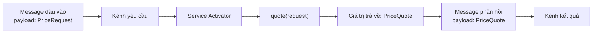

# Method trả về payload

## 1. Mục tiêu và ngữ cảnh

Trong chương **Service activator** của module **SPRING_INTEGRATION_CORE**, bài này giải thích cách kết quả của một method nghiệp vụ trở thành dữ liệu cho bước tiếp theo trong luồng thông điệp. Trọng tâm là hợp đồng giữa method, `Message`, `MessageChannel` và endpoint; từ đó áp dụng được bằng annotation hoặc Java DSL và kiểm tra được kết quả tại ranh giới messaging.

Sau bài học, bạn có thể:

- Viết method nhận một kiểu payload và trả về một kiểu payload khác.
- Phân biệt giá trị Java trả về với message phản hồi mà endpoint gửi đi.
- Xác định kênh nhận kết quả và nhận biết trường hợp kết quả không có nơi nhận.
- Chủ động xử lý `null`, `void`, collection và lỗi thay vì suy luận từ tên method.
- Kiểm tra đồng thời dữ liệu đầu ra, header được truyền tiếp và số lượng message.

Các ví dụ sử dụng Java 17 trở lên, `spring-integration-core` và API Java DSL theo kiểu Spring Integration 6.x trở lên. Phần kiểm thử minh họa dùng JUnit Jupiter. Phiên bản thư viện cần theo cấu hình quản lý dependency của ứng dụng; bài không gán một phiên bản cụ thể cho module.

## 2. Giá trị trả về nằm ở đâu trong message đầu ra?

Giả sử hệ thống nhận yêu cầu tính giá:

```java
public PriceQuote quote(PriceRequest request) {
    // Tính toán nghiệp vụ...
    return new PriceQuote(request.orderId(), total, "VND");
}
```

Method không phải tự tạo `Message<PriceQuote>` hoặc gọi `send()` để đưa kết quả sang bước kế tiếp. Khi được gọi qua service activator, đối tượng `PriceQuote` trả về là dữ liệu mà endpoint dùng làm payload phản hồi. Nếu gọi trực tiếp `quoteService.quote(request)` bằng Java, bạn chỉ nhận một đối tượng Java; hành vi messaging đến từ endpoint bao quanh lời gọi đó. Đây là hợp đồng giá trị trả về được mô tả trong [Javadoc của `@ServiceActivator`](https://docs.spring.io/spring-integration/api/org/springframework/integration/annotation/ServiceActivator.html).



Ba đối tượng cần tách biệt khi đọc code:

| Đối tượng | Vai trò trong ví dụ |
| --- | --- |
| `Message<PriceRequest>` | Phong bì chứa yêu cầu và các header như `traceId` |
| `PriceQuote` | Kết quả nghiệp vụ của method |
| `Message<PriceQuote>` | Phong bì mang kết quả sang phần còn lại của flow |

Kiểu đầu vào và đầu ra không cần giống nhau. Hợp đồng quan trọng là consumer kế tiếp hiểu `PriceQuote`. Một flow vẫn khởi động được không có nghĩa mọi kiểu dữ liệu gửi vào đều phù hợp tại runtime.

## 3. Viết method với hợp đồng đầu ra rõ ràng

Ví dụ nghiệp vụ có hai kiểu dữ liệu:

```java
public record PriceRequest(
        String orderId,
        BigDecimal unitPrice,
        int quantity) {
}

public record PriceQuote(
        String orderId,
        BigDecimal total,
        String currency) {
}
```

Với đơn hàng có đơn giá `125000` và số lượng `2`, kết quả mong đợi là một `PriceQuote` có tổng tiền `250000` và mã tiền `VND`. Các record giữ quan hệ yêu cầu–kết quả qua `orderId`; không cần lấy message ID làm mã đơn hàng.

Nên ưu tiên chữ ký cụ thể như `PriceQuote quote(PriceRequest request)` thay vì `Object process(Object value)`. Chữ ký cụ thể giúp đọc được hợp đồng, viết unit test và phát hiện sớm các thay đổi dữ liệu ảnh hưởng downstream.

Nếu method chỉ cần payload, để nó nhận kiểu nghiệp vụ. Nếu cần thêm header, một adapter có thể nhận riêng header:

```java
import org.springframework.messaging.handler.annotation.Header;

public PriceQuote quoteForTenant(
        PriceRequest request,
        @Header("tenantId") String tenantId) {
    return tenantPricingService.quote(tenantId, request);
}
```

Đoạn này minh họa chữ ký của adapter khi ứng dụng đã có `tenantPricingService`; nó không phải một bean bổ sung cho ví dụ hoàn chỉnh ở phần sau. Với `@Header("tenantId")`, header là bắt buộc theo mặc định. Cần thống nhất nguồn cung cấp nó, thay vì để một lỗi thiếu metadata bị hiểu nhầm thành lỗi tính giá.

Không cần thêm tham số `Message<?>` chỉ để có thể trả về payload. Cũng không cần đổi method sang trả về `Message<?>` chỉ vì kiểu phản hồi khác kiểu yêu cầu.

## 4. Ví dụ hoàn chỉnh bằng Java DSL

Ví dụ dưới đây độc lập với Spring Boot. Lưu các khai báo trong cùng tệp `QuoteFlowConfig.java` thuộc package `example.integration` khi thực hành. Các kiểu nghiệp vụ và service được đặt bên trong configuration để ví dụ có thể đọc trọn vẹn trong một khối code; trong ứng dụng lớn, có thể tách chúng thành các tệp riêng.

```java
package example.integration;

import java.math.BigDecimal;
import java.util.Objects;

import org.springframework.context.annotation.Bean;
import org.springframework.context.annotation.Configuration;
import org.springframework.integration.channel.DirectChannel;
import org.springframework.integration.channel.QueueChannel;
import org.springframework.integration.config.EnableIntegration;
import org.springframework.integration.dsl.IntegrationFlow;
import org.springframework.messaging.MessageChannel;

@Configuration
@EnableIntegration
public class QuoteFlowConfig {

    public record PriceRequest(
            String orderId,
            BigDecimal unitPrice,
            int quantity) {
    }

    public record PriceQuote(
            String orderId,
            BigDecimal total,
            String currency) {
    }

    public static class QuoteService {

        public PriceQuote quote(PriceRequest request) {
            Objects.requireNonNull(request, "request");
            Objects.requireNonNull(request.unitPrice(), "unitPrice");

            if (request.unitPrice().signum() < 0) {
                throw new IllegalArgumentException(
                        "Đơn giá không được âm");
            }
            if (request.quantity() <= 0) {
                throw new IllegalArgumentException(
                        "Số lượng phải lớn hơn 0");
            }

            BigDecimal total = request.unitPrice()
                    .multiply(BigDecimal.valueOf(request.quantity()));

            return new PriceQuote(request.orderId(), total, "VND");
        }
    }

    @Bean
    public MessageChannel quoteRequests() {
        return new DirectChannel();
    }

    @Bean
    public QueueChannel quoteResults() {
        return new QueueChannel(10);
    }

    @Bean
    public QuoteService quoteService() {
        return new QuoteService();
    }

    @Bean
    public IntegrationFlow quoteFlow(QuoteService quoteService) {
        return IntegrationFlow.from("quoteRequests")
                .handle(quoteService, "quote",
                        endpoint -> endpoint.requiresReply(true))
                .channel("quoteResults")
                .get();
    }
}
```

Trong flow này:

1. `quoteRequests` nhận message có payload là `PriceRequest`.
2. `.handle(quoteService, "quote", ...)` tạo bước service activator gọi method đã chỉ định.
3. Method trả về một `PriceQuote`; bước xử lý tiếp tục với payload mới.
4. `.channel("quoteResults")` đặt đích đầu ra cho bước `.handle()` ngay trước nó.
5. `QueueChannel` giữ kết quả để chương trình thực hành hoặc test chủ động đọc.

`requiresReply(true)` thể hiện hợp đồng: mỗi yêu cầu hợp lệ cần tạo kết quả khác `null`. Nó không khẳng định bước gửi kết quả luôn thành công và không thiết lập thời gian chờ phản hồi cho gateway.

`DirectChannel` ở đầu vào gọi subscriber trên luồng gửi. `QueueChannel` ở đầu ra chỉ giữ message; trong ví dụ này không có endpoint nào đang poll queue, nên không cần cấu hình poller để người gọi dùng `receive()` lấy kết quả.

### Gửi yêu cầu và đọc kết quả

Đoạn sau giả sử ứng dụng đã có `ApplicationContext` tên `context` được tạo từ `QuoteFlowConfig`:

```java
import java.math.BigDecimal;

import org.springframework.integration.channel.QueueChannel;
import org.springframework.messaging.Message;
import org.springframework.messaging.MessageChannel;
import org.springframework.messaging.support.MessageBuilder;

MessageChannel input = context.getBean(
        "quoteRequests", MessageChannel.class);
QueueChannel output = context.getBean(
        "quoteResults", QueueChannel.class);

Message<QuoteFlowConfig.PriceRequest> request = MessageBuilder
        .withPayload(new QuoteFlowConfig.PriceRequest(
                "ORD-006", new BigDecimal("125000"), 2))
        .setHeader("traceId", "trace-006")
        .build();

boolean accepted = input.send(request);
Message<?> reply = output.receive(1000);

if (!accepted || reply == null) {
    throw new IllegalStateException("Không nhận được báo giá");
}

QuoteFlowConfig.PriceQuote quote =
        (QuoteFlowConfig.PriceQuote) reply.getPayload();

System.out.println(quote.orderId());       // ORD-006
System.out.println(quote.total());         // 250000
System.out.println(quote.currency());      // VND
System.out.println(reply.getHeaders()
        .get("traceId"));                  // trace-006
```

Giá trị trả về của `input.send(request)` là `boolean` về thao tác gửi, không phải `PriceQuote`. Đối tượng nghiệp vụ được lấy từ `reply.getPayload()`. Thời gian `1000` trong `receive(1000)` là thời gian chờ đọc message, tính bằng mili giây; nó không hủy một method nghiệp vụ chạy lâu.

Trong ví dụ dùng `DirectChannel`, lời gọi `send()` còn có thể ném exception nếu quá trình xử lý đồng bộ gặp lỗi. Vì vậy không thể dùng riêng biến `accepted` làm toàn bộ chính sách xử lý lỗi.

## 5. Cùng hợp đồng với annotation

Nếu muốn đăng ký endpoint bằng annotation, có thể thay bean `quoteFlow` bằng bean adapter sau. Giữ lại các bean channel và `QuoteService` từ ví dụ trên:

```java
import org.springframework.integration.annotation.ServiceActivator;

public class QuoteEndpoint {

    private final QuoteFlowConfig.QuoteService quoteService;

    public QuoteEndpoint(QuoteFlowConfig.QuoteService quoteService) {
        this.quoteService = quoteService;
    }

    @ServiceActivator(
            inputChannel = "quoteRequests",
            outputChannel = "quoteResults",
            requiresReply = "true")
    public QuoteFlowConfig.PriceQuote handle(
            QuoteFlowConfig.PriceRequest request) {
        return quoteService.quote(request);
    }
}
```

Đăng ký adapter trong configuration đang bật `@EnableIntegration`:

```java
@Bean
public QuoteEndpoint quoteEndpoint(QuoteService quoteService) {
    return new QuoteEndpoint(quoteService);
}
```

`QuoteService` trong đoạn bean trên là kiểu lồng trong `QuoteFlowConfig`, vì bean được đặt vào chính configuration đó. `requiresReply` ở annotation nhận chuỗi `"true"`; DSL nhận giá trị boolean `true`.

Đây là hai phương án cấu hình thay thế nhau. Chọn một endpoint cho luồng tính giá đang minh họa. Nếu đồng thời giữ cả DSL lẫn adapter cùng subscribe vào `DirectChannel`, có nhiều consumer cạnh tranh; một request không mặc nhiên được gọi qua cả hai.

## 6. Kết quả được gửi đến đâu?

Đối với trường hợp payload thông thường trong bài, không dùng routing slip, đích gửi được xác định theo thứ tự:

1. Output channel cấu hình trên endpoint, nếu có.
2. Header `replyChannel` của message yêu cầu, nếu chưa có output channel.
3. Nếu không có đích hợp lệ, việc gửi phản hồi thất bại.

`replyChannel` có thể là một đối tượng `MessageChannel` hoặc tên channel có thể resolve được. Cơ chế này và trường hợp trả về nguyên `Message<?>` được mô tả trong [hướng dẫn Service Activator](https://docs.spring.io/spring-integration/reference/service-activator.html).

Ví dụ chính có đích cố định `quoteResults`, nên kết quả đến đó ngay cả khi request có thêm `replyChannel`. Output channel không đồng nghĩa với việc gửi một bản sao tới mọi địa chỉ phản hồi xuất hiện trong header.

### Biến thể phục vụ request–reply

Nếu bên gửi cần chỉ định nơi nhận kết quả cho từng request, tạo một flow thay thế không gắn `quoteResults`:

```java
@Bean
public IntegrationFlow onDemandQuoteFlow(QuoteService quoteService) {
    return IntegrationFlow.from("onDemandQuotes")
            .handle(quoteService, "quote",
                    endpoint -> endpoint.requiresReply(true))
            .get();
}
```

Đặt bean này trong `QuoteFlowConfig` nếu thực hành biến thể. DSL tạo kênh đầu vào tên `onDemandQuotes` khi cần. Bên gọi có thể gửi địa chỉ trả lời bằng header:

```java
QueueChannel temporaryReplies = new QueueChannel(1);

Message<QuoteFlowConfig.PriceRequest> request = MessageBuilder
        .withPayload(new QuoteFlowConfig.PriceRequest(
                "ORD-007", new BigDecimal("50000"), 3))
        .setReplyChannel(temporaryReplies)
        .build();

context.getBean("onDemandQuotes", MessageChannel.class)
        .send(request);

Message<?> reply = temporaryReplies.receive(1000);
```

Channel phản hồi tạm trong ví dụ không cần tên bean vì header chứa trực tiếp đối tượng channel. Messaging gateway thường chuẩn bị địa chỉ phản hồi cho lời gọi request–reply; method nghiệp vụ vẫn chỉ cần trả về `PriceQuote`.

Nếu gắn một output queue cố định vào bước kết thúc rồi gọi qua gateway đang đợi địa chỉ phản hồi riêng, cần thiết kế đoạn nối kết quả về gateway. Chỉ thêm `return` trong service không giải quyết được một tuyến phản hồi bị cấu hình sai.

## 7. Header nào đi cùng payload mới?

`Message` có payload và headers; cấu trúc headers không cho sửa trực tiếp bằng `put()`. Việc payload là một POJO cũng không khiến bản thân POJO tự trở thành immutable. Các đặc điểm này được giải thích trong [tài liệu Message](https://docs.spring.io/spring-integration/reference/message.html).

Trong cấu hình mặc định của ví dụ, header ứng dụng như `traceId` được truyền từ yêu cầu sang phản hồi. Riêng `id` và `timestamp` thuộc thông tin của message do framework quản lý; không dùng chúng để giả định phản hồi chính là message yêu cầu ban đầu. Khi endpoint dựng message mới từ payload mới, kiểm tra `orderId` hoặc header tương quan nghiệp vụ thay cho việc yêu cầu message ID phải giữ nguyên.

Việc truyền header có thể được tùy chỉnh hoặc lọc trong flow. Ví dụ, hệ thống có thể muốn giữ `traceId` trong nội bộ nhưng loại một header chứa thông tin xác thực trước khi gửi ra hệ thống khác. Đó là trách nhiệm của bước quản lý header hoặc cấu hình propagation tương ứng.

Một giới hạn quan trọng khi so sánh các kiểu trả về: ngay cả khi service activator trả về nguyên `Message<?>`, các header yêu cầu còn thiếu có thể được bổ sung vào phản hồi. Vì vậy, tự tạo một message ít header hơn không phải cách đáng tin để xóa header khỏi flow. Bài này chọn trả về payload để hợp đồng nghiệp vụ gọn; nếu cần thay đổi metadata, thiết kế bước header riêng. Quy tắc sao chép này được mô tả ở mục [Service Activator and Method Return Type](https://docs.spring.io/spring-integration/reference/service-activator.html).

## 8. Không có kết quả: `null`, `void` và giá trị rỗng

Một method có kiểu trả về `PriceQuote` vẫn có thể trả về `null` khi chạy. Vì thế khai báo kiểu Java và yêu cầu endpoint phải có phản hồi là hai ràng buộc khác nhau.

| Kết quả method | Ý nghĩa ở service activator thông thường |
| --- | --- |
| `new PriceQuote(...)` | Có kết quả nghiệp vụ để gửi tiếp |
| `null`, `requiresReply` mặc định là `false` | Không tạo phản hồi cho lần xử lý đó |
| `null`, `requiresReply(true)` | Vi phạm hợp đồng, phát sinh `ReplyRequiredException` |
| Method `void` với endpoint một chiều | Thực hiện công việc rồi kết thúc, không có payload phản hồi |
| Chuỗi `""` hoặc danh sách rỗng | Vẫn là đối tượng khác `null`; cần diễn giải theo nghiệp vụ |

Ý nghĩa của `requiresReply` và giá trị mặc định được quy định trong [Javadoc `@ServiceActivator.requiresReply`](https://docs.spring.io/spring-integration/api/org/springframework/integration/annotation/ServiceActivator.html#requiresReply()).

### Không tìm thấy dữ liệu vẫn có thể là một kết quả

Giả sử tra cứu sản phẩm không thấy mã hàng. Trả về `null` có thể làm bên gọi request–reply đợi hết timeout, dù service đã chạy xong. Nếu bên gọi cần phân biệt “không tìm thấy” với “chưa có phản hồi”, nên có một kiểu kết quả nghiệp vụ, chẳng hạn:

```java
public enum LookupStatus {
    FOUND, NOT_FOUND
}

public record ProductLookupResult(
        String productCode,
        LookupStatus status) {
}

public ProductLookupResult notFound(String code) {
    return new ProductLookupResult(code, LookupStatus.NOT_FOUND);
}
```

Đối tượng `NOT_FOUND` vẫn là một payload hợp lệ. Router hoặc consumer downstream có thể đọc trạng thái để quyết định bước tiếp theo. `requiresReply(true)` chỉ giúp phát hiện `null`; nó không kiểm tra `productCode` hay ý nghĩa của `status`.

Với thao tác chỉ ghi audit hoặc gửi thông báo một chiều, `void` có thể phù hợp. Khi đó hợp đồng bên gọi cũng cần thể hiện không chờ kết quả. Không thiết kế một endpoint `void` cho luồng bắt buộc request–reply rồi kỳ vọng framework tự sinh một thông điệp xác nhận nghiệp vụ.

## 9. Collection là một payload hay nhiều message?

Xét method nghiệp vụ:

```java
public List<String> availableWarehouses(String productCode) {
    return List.of("HN", "HCM", "DN");
}
```

Trong một service activator trả về `List<String>` thông thường, danh sách là payload của **một** message. Không suy ra số lượng message từ số phần tử. Nếu hợp đồng downstream là xử lý từng kho riêng biệt, thêm một splitter để biểu đạt quyết định chia thông điệp.

```java
@Bean
public IntegrationFlow warehouseFlow(WarehouseService warehouseService) {
    return IntegrationFlow.from("warehouseRequests")
            .handle(warehouseService, "availableWarehouses")
            .split()
            .channel("singleWarehouseRequests")
            .get();
}
```

Đây là một biến thể minh họa, giả định ứng dụng đã có bean `WarehouseService` với method vừa nêu và đã cấu hình consumer cho `singleWarehouseRequests`. Sau bước `.handle()`, payload là danh sách; sau `.split()`, từng mã kho được gửi thành message riêng. Vai trò chia message và metadata liên quan được trình bày trong [tài liệu Splitter](https://docs.spring.io/spring-integration/reference/splitter.html).

Điểm cần thống nhất khi chọn hợp đồng:

- `List<Warehouse>` phù hợp khi consumer cần đánh giá cả tập kho cùng lúc.
- `Warehouse` sau splitter phù hợp khi mỗi kho là một đơn vị xử lý riêng.
- Danh sách rỗng từ service activator vẫn có thể được chuyển như một kết quả; sau splitter, không có phần tử để phát tiếp. Điều này ảnh hưởng bên gọi đang đợi một phản hồi cuối cùng.

Không dùng việc trả về collection như một cơ chế broadcast ngầm. Thiết kế fan-out, xử lý từng phần tử và gom kết quả cần được thể hiện trong các endpoint phù hợp.

## 10. Lambda `.handle()` cũng phải trả kết quả

Với xử lý ngắn, Java DSL cho phép handler nhận payload và headers rồi trả về giá trị:

```java
@Bean
public IntegrationFlow normalizeCodeFlow() {
    return IntegrationFlow.from("rawProductCodes")
            .handle(String.class, (payload, headers) ->
                    payload.strip().toUpperCase(java.util.Locale.ROOT))
            .channel("normalizedProductCodes")
            .get();
}
```

Phần `String.class` nêu rõ kiểu payload mong đợi cho handler. Lambda hai tham số ở đây là kiểu `GenericHandler`, có kết quả dùng để tiếp tục flow. Cách dùng và giới hạn suy luận generic của lambda được giải thích trong [hướng dẫn Java DSL `.handle()`](https://docs.spring.io/spring-integration/reference/dsl/java-handle.html).

Cẩn thận với block lambda chỉ có side effect:

```java
.handle(String.class, (payload, headers) -> {
    auditService.record(payload);
    return null;
})
```

Đoạn này biểu đạt không có phản hồi, không phải chuyển tiếp payload cũ. Nếu audit xong vẫn muốn tiếp tục, trả về payload theo hợp đồng đã chọn:

```java
.handle(String.class, (payload, headers) -> {
    auditService.record(payload);
    return payload;
})
```

Hai đoạn audit giả định có `auditService` trong ứng dụng. Ngoài ra, `MessageHandler` là một giao diện có method `void handleMessage(Message<?>)`. Khi tự truyền một `MessageHandler` vào overload tương ứng của `.handle()`, không được mặc định nó là lambda sinh phản hồi giống ví dụ `GenericHandler` hai tham số. Chọn đúng overload trước khi phân tích vì sao luồng không đi tiếp.

## 11. Exception không phải payload phản hồi thông thường

Method tính giá từ chối số lượng âm bằng exception vì yêu cầu không hợp lệ. Không nên bắt mọi exception rồi trả về chuỗi `"ERROR"` nếu consumer kế tiếp được thiết kế để nhận `PriceQuote`; kiểu dữ liệu thay đổi theo nhánh khiến lỗi bị đẩy sang bước sau.

Chọn một hợp đồng rõ ràng:

| Tình huống | Hướng biểu đạt |
| --- | --- |
| Có báo giá | Trả về `PriceQuote` |
| Kết quả nghiệp vụ cần phân nhánh, như không tìm thấy sản phẩm | Trả về một kiểu kết quả nghiệp vụ có trạng thái |
| Không thể thực hiện do lỗi kỹ thuật hoặc dữ liệu không hợp lệ theo hợp đồng | Ném exception và xử lý tại ranh giới lỗi phù hợp |

Với `DirectChannel` như ví dụ chính, lỗi đồng bộ lan về lời gọi gửi, thường dưới dạng exception messaging có nguyên nhân bên trong. Một header `errorChannel` không tự biến mọi lỗi đồng bộ thành message lỗi. Với poller hoặc luồng bất đồng bộ do framework quản lý, cơ chế phát `ErrorMessage` cần được xem theo cấu hình thực thi. Đây là phân biệt cốt lõi trong [tài liệu Error Handling](https://docs.spring.io/spring-integration/reference/error-handling.html).

Tương tự, có kết quả nghiệp vụ chưa bảo đảm gửi được kết quả: queue đầu ra có thể đầy, kênh tên sai hoặc không có đích phản hồi. Khi xử lý lỗi, phân biệt lỗi lúc tính toán với lỗi lúc chuyển kết quả. Việc gửi lại một yêu cầu đã có side effect còn cần chính sách idempotency phù hợp.

## 12. Kiểm thử hợp đồng tại ranh giới messaging

Unit test thuần Java có ích cho công thức tính tiền, nhưng không xác nhận endpoint đã dùng kết quả làm payload hay đã giữ header cần thiết. Bổ sung test gửi message vào channel rồi đọc message đầu ra để kiểm tra phần nối giữa nghiệp vụ và flow.

Đặt lớp minh họa dưới đây trong cùng package với `QuoteFlowConfig`. Nó sử dụng configuration DSL ban đầu, chưa thay bằng annotation và chưa cần các flow biến thể.

```java
package example.integration;

import java.math.BigDecimal;

import org.junit.jupiter.api.Test;
import org.springframework.context.annotation.AnnotationConfigApplicationContext;
import org.springframework.context.annotation.Bean;
import org.springframework.context.annotation.Configuration;
import org.springframework.integration.channel.QueueChannel;
import org.springframework.integration.config.EnableIntegration;
import org.springframework.integration.dsl.IntegrationFlow;
import org.springframework.integration.handler.ReplyRequiredException;
import org.springframework.messaging.Message;
import org.springframework.messaging.MessageChannel;
import org.springframework.messaging.MessagingException;
import org.springframework.messaging.support.MessageBuilder;

import static org.junit.jupiter.api.Assertions.*;

class QuoteFlowTest {

    @Test
    void returnsQuotePayloadAndPreservesTraceHeader() {
        try (var context = new AnnotationConfigApplicationContext(
                QuoteFlowConfig.class)) {

            MessageChannel input = context.getBean(
                    "quoteRequests", MessageChannel.class);
            QueueChannel output = context.getBean(
                    "quoteResults", QueueChannel.class);

            Message<QuoteFlowConfig.PriceRequest> request = MessageBuilder
                    .withPayload(new QuoteFlowConfig.PriceRequest(
                            "ORD-006", new BigDecimal("125000"), 2))
                    .setHeader("traceId", "trace-006")
                    .build();

            assertTrue(input.send(request));
            Message<?> reply = output.receive(1000);

            assertNotNull(reply);
            QuoteFlowConfig.PriceQuote quote = assertInstanceOf(
                    QuoteFlowConfig.PriceQuote.class, reply.getPayload());

            assertEquals("ORD-006", quote.orderId());
            assertEquals(0,
                    new BigDecimal("250000").compareTo(quote.total()));
            assertEquals("VND", quote.currency());
            assertEquals("trace-006", reply.getHeaders().get("traceId"));
            assertNotEquals(request.getHeaders().getId(),
                    reply.getHeaders().getId());
            assertNull(output.receive(0));
        }
    }

    @Test
    void rejectsInvalidQuantityWithoutProducingQuote() {
        try (var context = new AnnotationConfigApplicationContext(
                QuoteFlowConfig.class)) {

            MessageChannel input = context.getBean(
                    "quoteRequests", MessageChannel.class);
            QueueChannel output = context.getBean(
                    "quoteResults", QueueChannel.class);

            Message<QuoteFlowConfig.PriceRequest> request = MessageBuilder
                    .withPayload(new QuoteFlowConfig.PriceRequest(
                            "ORD-BAD", new BigDecimal("125000"), -1))
                    .build();

            assertThrows(MessagingException.class,
                    () -> input.send(request));
            assertNull(output.receive(0));
        }
    }

    @Test
    void requiresReplyRejectsNullResult() {
        try (var context = new AnnotationConfigApplicationContext(
                MissingReplyConfig.class)) {

            MessageChannel input = context.getBean(
                    "missingReplyRequests", MessageChannel.class);

            assertThrows(ReplyRequiredException.class,
                    () -> input.send(MessageBuilder
                            .withPayload("request-without-result")
                            .build()));
        }
    }

    @Configuration
    @EnableIntegration
    static class MissingReplyConfig {

        @Bean
        IntegrationFlow missingReplyFlow() {
            return IntegrationFlow.from("missingReplyRequests")
                    .handle(String.class, (payload, headers) -> null,
                            endpoint -> endpoint.requiresReply(true))
                    .channel("nullChannel")
                    .get();
        }
    }
}
```

Test đầu tiên xác nhận toàn bộ hợp đồng thành công: đúng kiểu payload, đúng dữ liệu, giữ `traceId`, tạo message mới và chỉ có một kết quả trong flow đồng bộ này. So sánh tiền bằng `compareTo()` tránh làm test thất bại chỉ vì scale của `BigDecimal` khác nhau.

Test thứ hai kiểm tra đầu vào không hợp lệ không bị biến thành báo giá hợp lệ. Test thứ ba dùng một handler cố ý trả `null`; output là `nullChannel` để đã có đích hợp lệ, giúp tình huống tập trung vào hợp đồng `requiresReply`.

Khi thực hành thêm, có thể kiểm tra hai tình huống tuyến phản hồi: output cố định được ưu tiên hơn header, và flow không có output dùng được `replyChannel`. Với luồng bất đồng bộ, cần chiến lược chờ hoàn tất trước khi kết luận số lượng message; `receive(0)` chỉ đủ cho việc kiểm tra tức thời của ví dụ đồng bộ trên.

Các đoạn test là mã minh họa cho người học tự chạy trong project có dependency tương ứng, không phải báo cáo rằng test đã được thực thi khi biên soạn bài.

## 13. Những lỗi dễ gặp khi method đã có `return`

| Hiện tượng | Nguyên nhân cần kiểm tra | Hướng xử lý |
| --- | --- | --- |
| Method chạy xong nhưng không có phản hồi | Nhánh trả `null` hoặc method `void` | Xác định lại hợp đồng; bật `requiresReply` nếu kết quả là bắt buộc |
| Có đối tượng kết quả nhưng gửi thất bại | Không có output hoặc địa chỉ phản hồi hợp lệ | Kiểm tra đích của endpoint và header `replyChannel` |
| Gateway đợi dù kết quả đã xuất hiện trong queue | Flow gửi vào output cố định khác đường gateway đang đợi | Thiết kế lại tuyến trả kết quả hoặc nối output về địa chỉ phản hồi |
| Bước sau nhận sai kiểu | Consumer vẫn mong payload yêu cầu cũ | Cập nhật hợp đồng downstream theo kiểu kết quả |
| Mong ba message nhưng chỉ thấy một | Service trả về một `List` làm payload | Thêm splitter nếu nghiệp vụ cần một message cho mỗi phần tử |
| Mất phần xử lý sau bước audit | Handler audit trả `null` | Trả payload cần chuyển tiếp hoặc thiết kế audit ở nhánh phù hợp |
| Một số header tưởng đã xóa lại xuất hiện | Tạo message ít header trong service activator nhưng request được truyền header tiếp | Dùng bước lọc header rõ ràng |
| Lỗi gửi về caller dù có header `errorChannel` | Đang chạy đồng bộ qua `DirectChannel` | Xử lý theo ranh giới đồng bộ hoặc cấu hình cơ chế lỗi phù hợp |

Khi debug, nên quan sát payload và header tại đầu vào lẫn đầu ra endpoint, cùng exception gốc. Log duy nhất dòng “service đã chạy” không chứng minh rằng message phản hồi đã tới consumer.

## 14. Ranh giới của hợp đồng trả về payload

Chọn service activator khi một bước flow cần gọi nghiệp vụ, chẳng hạn tính báo giá, kiểm tra tồn kho hoặc lưu dữ liệu rồi trả về kết quả. Nếu mục tiêu của bước chỉ là đổi biểu diễn dữ liệu, transformer giúp thể hiện ý định rõ hơn. Cùng một kiểu trả về Java không làm hai endpoint có cùng ngữ nghĩa về header và yêu cầu phản hồi.

Đối với router và filter, đừng dùng nhầm giá trị trả về của service activator như chỉ thị điều khiển: trả về chuỗi tên channel trong `.handle()` vẫn là một chuỗi dữ liệu; trả về `false` vẫn có thể là payload boolean. Muốn định tuyến hoặc loại message, biểu đạt bằng endpoint router hoặc filter tương ứng.

Với `CompletableFuture`, reactive publisher hoặc cấu hình async, cần đọc hợp đồng riêng của kiểu kết quả và endpoint. Không áp dụng máy móc ví dụ trả về `PriceQuote` đồng bộ để kết luận framework luôn chờ hoặc tự tách mọi wrapper. Đó là phạm vi xử lý bất đồng bộ, ngoài hợp đồng POJO trả về payload thông thường đang được thực hành ở đây.

Điểm cần giữ khi thiết kế flow là: method tạo một kết quả nghiệp vụ có nghĩa; service activator nối kết quả đó vào hệ thống message; kênh và các endpoint tiếp theo xác định kết quả sẽ đi đâu và được xử lý như thế nào.
