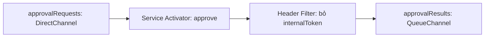

# Method trả về Message trong Service Activator

Trong module **SPRING_INTEGRATION_CORE**, service activator kết nối một method xử lý nghiệp vụ với luồng thông điệp. Bài này tập trung vào trường hợp method trả về `Message<T>` để mô tả cả dữ liệu phản hồi lẫn metadata phục vụ những bước tiếp theo.

Ví dụ xuyên suốt là duyệt yêu cầu đặt hàng: payload phản hồi chứa quyết định; header `decision` cho phép luồng sau chọn cách xử lý. Cách thiết kế này tạo nền tảng để ghép service activator với router, filter, gateway hoặc aggregator mà vẫn xác định rõ trách nhiệm của từng thành phần.

Sau bài học, bạn có thể:

- Phân biệt trả payload với trả toàn bộ `Message`.
- Dựng phản hồi có kiểu dữ liệu rõ ràng bằng `MessageBuilder`.
- Dự đoán header nào được giữ, ghi đè hoặc cần loại bỏ.
- Kết nối method với endpoint bằng annotation hoặc Java DSL.
- Kiểm thử kết quả của method và kết quả thực tế sau khi đi qua endpoint.

## 1. Giá trị trả về được hiểu như thế nào?

Một method có thể nhận payload, nhận toàn bộ message hoặc nhận thêm header qua tham số. Kiểu đầu vào và kiểu trả về là hai lựa chọn độc lập. Annotation `@ServiceActivator` hỗ trợ tham số kiểu `Message` hoặc kiểu payload; giá trị trả về không phải message sẽ được dùng làm payload của phản hồi. [Javadoc ServiceActivator](https://docs.spring.io/spring-integration/api/org/springframework/integration/annotation/ServiceActivator.html)

| Chữ ký minh họa | Nội dung method quyết định |
| --- | --- |
| `OrderDecision approve(OrderRequest request)` | Dữ liệu nghiệp vụ của phản hồi |
| `Message<OrderDecision> approve(OrderRequest request)` | Payload phản hồi và header do method thiết lập |
| `Message<OrderDecision> approve(Message<OrderRequest> request)` | Phản hồi được dựng sau khi đọc cả payload lẫn header đầu vào |
| `Message<OrderDecision> approve(OrderRequest request, @Header("tenantId") String tenantId)` | Phản hồi cần một header cụ thể nhưng không cần toàn bộ message đầu vào |

Khi trả `Message<OrderDecision>`, payload của phản hồi vẫn là `OrderDecision`. Không tự bọc thêm một lớp `Message`:

```java
// Đúng: message phản hồi chứa kết quả nghiệp vụ.
return MessageBuilder.withPayload(decision).build();

// Sai với hợp đồng đang xét: payload trở thành một Message khác.
return MessageBuilder
        .withPayload(MessageBuilder.withPayload(decision).build())
        .build();
```

Trong bài này, “message do method trả về” và “message endpoint phát ra” được gọi riêng để thuận tiện quan sát. Chúng có thể khác nhau về header sau khi framework hoàn tất xử lý.

## 2. Dựng phản hồi bằng MessageBuilder

Các ví dụ dùng những import sau:

```java
import org.springframework.messaging.Message;
import org.springframework.messaging.support.MessageBuilder;
```

Ví dụ một method chỉ cần payload:

```java
public Message<OrderDecision> approve(OrderRequest request) {
    OrderDecision decision =
            new OrderDecision(request.orderId(), true, "APPROVED");

    return MessageBuilder.withPayload(decision)
            .setHeader("decision", "APPROVED")
            .setHeader("handledBy", "approval-service")
            .build();
}
```

Các lớp `OrderRequest` và `OrderDecision` sẽ được định nghĩa đầy đủ trong ví dụ Java DSL bên dưới.

Nếu chỉ cần một header, có thể đổi tham số thành:

```java
import org.springframework.messaging.handler.annotation.Header;

public Message<OrderDecision> approve(
        OrderRequest request,
        @Header("tenantId") String tenantId) {

    OrderDecision decision =
            new OrderDecision(request.orderId(), true, "APPROVED");

    return MessageBuilder.withPayload(decision)
            .setHeader("tenantId", tenantId)
            .setHeader("decision", "APPROVED")
            .build();
}
```

`@Header` ràng buộc tham số với header có tên tương ứng. Mặc định header là bắt buộc; dùng `required = false` khi hợp đồng cho phép vắng mặt và method có xử lý giá trị `null`. [Javadoc Header](https://docs.spring.io/spring-framework/docs/current/javadoc-api/org/springframework/messaging/handler/annotation/Header.html)

### 2.1. Chọn thao tác builder theo ý định

| Thao tác | Khi nào dùng |
| --- | --- |
| `withPayload(newPayload)` | Dựng phản hồi với dữ liệu mới |
| `fromMessage(request)` | Giữ payload hiện có và bắt đầu từ các header của request |
| `copyHeaders(headers)` | Sao chép header, có thể ghi đè giá trị đã đặt |
| `copyHeadersIfAbsent(headers)` | Sao chép nhưng giữ lại giá trị đã có trong builder |
| `setHeader(name, value)` | Đặt hoặc thay giá trị header |
| `removeHeader(name)` | Bỏ header khỏi message đang được dựng |

`fromMessage` không phải thao tác thay payload. Khi payload đổi từ `OrderRequest` sang `OrderDecision`, hãy bắt đầu bằng `withPayload(decision)`. [Javadoc MessageBuilder](https://docs.spring.io/spring-framework/docs/current/javadoc-api/org/springframework/messaging/support/MessageBuilder.html)

Ví dụ cần sao chép tường minh nhưng ưu tiên quyết định mới:

```java
return MessageBuilder.withPayload(decision)
        .setHeader("decision", "APPROVED")
        .copyHeadersIfAbsent(request.getHeaders())
        .build();
```

Đây là một lựa chọn cho hợp đồng của method. Ở ví dụ chính, method không sao chép toàn bộ header để bạn nhìn rõ phần framework bổ sung.

### 2.2. Không sửa trực tiếp MessageHeaders

`MessageHeaders` có giao diện `Map` nhưng không cho phép các thao tác sửa như `put`. Hãy tạo message phản hồi qua builder. [Javadoc MessageHeaders](https://docs.spring.io/spring-framework/docs/current/javadoc-api/org/springframework/messaging/MessageHeaders.html)

```java
// Không dùng: có thể ném UnsupportedOperationException.
request.getHeaders().put("decision", "APPROVED");

// Dùng builder.
Message<OrderRequest> marked = MessageBuilder.fromMessage(request)
        .setHeader("decision", "APPROVED")
        .build();
```

Việc không sửa được cấu trúc message không làm mọi object bên trong trở thành bất biến. Với ví dụ đặt hàng, dùng `record` gồm `String`, `int` và `boolean` giúp tránh chia sẻ một DTO có thể bị sửa giữa các bước xử lý.

## 3. Header đầu vào có còn trên phản hồi không?

Với service activator thông thường, header từ request được bổ sung vào phản hồi khi phản hồi chưa có header cùng tên. Vì vậy, method trả toàn bộ `Message` vẫn chưa có nghĩa là mọi header vắng mặt đều bị xóa. Đây là điểm khác với transformer trả toàn bộ message. [Service Activator — Method Return Type](https://docs.spring.io/spring-integration/reference/service-activator.html#service-activator-method-return-type)

Giả sử request có:

```text
payload: OrderRequest("ORD-17", 3)
headers:
  requestId: REQ-17
  tenantId: tenant-a
  decision: PENDING
  internalToken: demo-token
```

Method trả message chỉ có các header ứng dụng:

```text
payload: OrderDecision("ORD-17", true, "APPROVED")
headers:
  decision: APPROVED
  handledBy: approval-service
```

Với cấu hình mặc định, sau service activator có thể quan sát:

| Header | Giá trị | Giải thích trong ví dụ |
| --- | --- | --- |
| `decision` | `APPROVED` | Method đã đưa ra quyết định mới |
| `handledBy` | `approval-service` | Method thêm thông tin xử lý |
| `requestId` | `REQ-17` | Request có, phản hồi chưa có |
| `tenantId` | `tenant-a` | Request có, phản hồi chưa có |
| `internalToken` | `demo-token` | Bỏ qua trong builder chưa loại nó khỏi đầu ra |

Các header hệ thống như `id` và `timestamp` được lược khỏi bảng để tập trung vào hợp đồng ứng dụng.

### 3.1. Bỏ header trong method chưa đủ để loại khỏi luồng

Đoạn sau bỏ `internalToken` khỏi message mà method dựng:

```java
return MessageBuilder.withPayload(decision)
        .copyHeaders(request.getHeaders())
        .removeHeader("internalToken")
        .build();
```

Tuy nhiên, bước bổ sung header từ request có thể đưa `internalToken` trở lại. Nếu chính sách của luồng yêu cầu xóa header trước khi gửi ra ngoài, đặt `headerFilter` sau service activator:

```java
.handle(approvalService, "approve")
.headerFilter("internalToken")
```

`HeaderFilter` là transformer chuyên loại header. Đặt nó gần ranh giới cần làm sạch cũng giúp người đọc luồng nhận ra chính sách này. [Javadoc HeaderFilter](https://docs.spring.io/spring-integration/api/org/springframework/integration/transformer/HeaderFilter.html)

### 3.2. Chặn sao chép header tại endpoint

Java DSL có tùy chọn:

```java
.handle(approvalService, "approve",
        endpoint -> endpoint
                .requiresReply(true)
                .notPropagatedHeaders("internalToken"))
```

`notPropagatedHeaders` kiểm soát việc sao chép từ message đầu vào. Nó không phải thao tác xóa một header mà method đã chủ động đặt trên message trả về. [Javadoc ConsumerEndpointSpec](https://docs.spring.io/spring-integration/api/org/springframework/integration/dsl/ConsumerEndpointSpec.html)

Trong ví dụ chính, method không sao chép `internalToken` và luồng dùng `headerFilter` sau xử lý. Hai đoạn cấu hình trên minh họa hai lựa chọn; không cần áp dụng cả hai chỉ để thực hiện cùng một yêu cầu.

Khi dùng `notPropagatedHeaders("*")`, framework không bổ sung các header đầu vào. Hợp đồng phản hồi khi đó cần xét cả `replyChannel`, `errorChannel` và header phục vụ gom nhóm. [Message — Header Propagation](https://docs.spring.io/spring-integration/reference/message.html#message-header-propagation)

### 3.3. Định danh message và định danh nghiệp vụ

Đối với message mới, không dùng `MessageHeaders.ID` như mã đơn hàng hoặc mã yêu cầu. Header này định danh instance message và do cơ chế dựng message quản lý. [Message — Pre-defined Headers](https://docs.spring.io/spring-integration/reference/message.html)

Trong thiết kế đặt hàng:

- `orderId` trong payload xác định đơn hàng.
- `requestId` do ứng dụng đặt để theo dõi một lần yêu cầu.
- `correlationId` chỉ nên được sử dụng khi có quy ước ghép các message liên quan, chẳng hạn gom phản hồi theo nhóm.

Nếu bổ sung aggregator, hãy xác định khóa gom nhóm và điều kiện hoàn tất riêng. Không suy ra rằng việc trả `Message` tự tạo một nhóm gom hợp lệ.

## 4. Ví dụ đầy đủ bằng Java DSL

Ví dụ dùng cú pháp Java 17 và các API Spring Integration Java DSL có trong dòng 6.x. Khi chạy, dùng JDK cùng bộ Spring Framework/Spring Integration tương thích với phiên bản dự án. Cần `spring-integration-core`, Spring Context và JUnit Jupiter cho phần kiểm thử; ví dụ không phụ thuộc Spring Boot hay broker bên ngoài.

Luồng xử lý:



Yêu cầu hợp lệ có `units > 0`. Duyệt khi `units <= 10`; số lượng lớn hơn là kết quả từ chối nghiệp vụ.

### 4.1. Mô hình, service và cấu hình

Toàn bộ đoạn dưới thuộc cùng một tệp Java minh họa:

```java
package example.integration;

import org.springframework.context.annotation.Bean;
import org.springframework.context.annotation.Configuration;
import org.springframework.integration.annotation.IntegrationComponentScan;
import org.springframework.integration.channel.DirectChannel;
import org.springframework.integration.channel.QueueChannel;
import org.springframework.integration.config.EnableIntegration;
import org.springframework.integration.dsl.IntegrationFlow;
import org.springframework.messaging.Message;
import org.springframework.messaging.MessageChannel;
import org.springframework.messaging.support.MessageBuilder;

@Configuration
@EnableIntegration
public class ApprovalFlowConfiguration {

    public record OrderRequest(String orderId, int units) {
    }

    public record OrderDecision(
            String orderId,
            boolean accepted,
            String reason) {
    }

    public static class ApprovalService {

        public Message<OrderDecision> approve(
                Message<OrderRequest> request) {

            OrderRequest order = request.getPayload();

            if (order.units() <= 0) {
                throw new IllegalArgumentException(
                        "units must be greater than zero");
            }

            boolean accepted = order.units() <= 10;
            String decisionCode =
                    accepted ? "APPROVED" : "REJECTED";

            OrderDecision decision = new OrderDecision(
                    order.orderId(),
                    accepted,
                    accepted ? "APPROVED" : "CAPACITY_EXCEEDED");

            return MessageBuilder.withPayload(decision)
                    .setHeader("decision", decisionCode)
                    .setHeader("handledBy", "approval-service")
                    .build();
        }
    }

    @Bean
    public MessageChannel approvalRequests() {
        return new DirectChannel();
    }

    @Bean
    public QueueChannel approvalResults() {
        return new QueueChannel(10);
    }

    @Bean
    public ApprovalService approvalService() {
        return new ApprovalService();
    }

    @Bean
    public IntegrationFlow approvalFlow(
            ApprovalService approvalService) {

        return IntegrationFlow.from("approvalRequests")
                .handle(approvalService, "approve",
                        endpoint -> endpoint.requiresReply(true))
                .headerFilter("internalToken")
                .channel("approvalResults")
                .get();
    }
}
```

Import `IntegrationComponentScan` ở trên chỉ cần khi dùng phương án gateway trong mục 6; nếu chỉ chạy luồng cơ bản, có thể bỏ import này.

`.handle(approvalService, "approve", ...)` đăng ký bước gọi method theo cơ chế service activator của Java DSL. [Service Activators and the .handle() Method](https://docs.spring.io/spring-integration/reference/dsl/java-handle.html)

Trong cấu hình này:

1. `approvalRequests` nhận `Message<OrderRequest>`.
2. `approve` trả `Message<OrderDecision>` với hai header ứng dụng.
3. Endpoint hoàn tất phản hồi, trong đó có các header được kế thừa.
4. `headerFilter` bỏ `internalToken`.
5. Message được đưa vào `approvalResults` để bên nhận lấy ra.

`QueueChannel` ở cuối dùng để thu kết quả minh họa. Không có consumer đọc từ queue trong cấu hình này, nên không cần poller chỉ để ghi kết quả vào queue.

### 4.2. Gửi yêu cầu và đọc phản hồi

Đoạn sau có thể đặt trong method thử nghiệm, với các kiểu dữ liệu được import từ `ApprovalFlowConfiguration`:

```java
import example.integration.ApprovalFlowConfiguration;
import example.integration.ApprovalFlowConfiguration.OrderRequest;
import org.springframework.context.annotation.AnnotationConfigApplicationContext;
import org.springframework.integration.channel.QueueChannel;
import org.springframework.messaging.Message;
import org.springframework.messaging.MessageChannel;
import org.springframework.messaging.support.MessageBuilder;

// Bên trong một method:
try (var context = new AnnotationConfigApplicationContext(
        ApprovalFlowConfiguration.class)) {

    MessageChannel input =
            context.getBean("approvalRequests", MessageChannel.class);
    QueueChannel output =
            context.getBean("approvalResults", QueueChannel.class);

    Message<OrderRequest> request =
            MessageBuilder.withPayload(new OrderRequest("ORD-17", 3))
                    .setHeader("requestId", "REQ-17")
                    .setHeader("tenantId", "tenant-a")
                    .setHeader("decision", "PENDING")
                    .setHeader("internalToken", "demo-token")
                    .build();

    input.send(request);
    Message<?> reply = output.receive(1_000);

    if (reply == null) {
        throw new IllegalStateException("No reply received");
    }

    System.out.println(reply.getPayload());
    System.out.println(reply.getHeaders().get("decision"));
    System.out.println(reply.getHeaders().get("requestId"));
    System.out.println(
            reply.getHeaders().containsKey("internalToken"));
}
```

Kết quả nghiệp vụ mong đợi:

```text
OrderDecision[orderId=ORD-17, accepted=true, reason=APPROVED]
APPROVED
REQ-17
false
```

Đừng dùng toàn bộ chuỗi `toString()` của message làm kết quả cố định để so sánh: nó còn chứa metadata của từng lần tạo message.

## 5. Cấu hình bằng annotation

Nếu chọn annotation thay cho bước `.handle(...)` ở trên, đăng ký một bean có method như sau:

```java
import org.springframework.integration.annotation.ServiceActivator;
import org.springframework.messaging.Message;

public static class AnnotatedApprovalEndpoint {

    private final ApprovalService service;

    public AnnotatedApprovalEndpoint(ApprovalService service) {
        this.service = service;
    }

    @ServiceActivator(
            inputChannel = "approvalRequests",
            outputChannel = "approvalRawReplies",
            requiresReply = "true")
    public Message<OrderDecision> approve(
            Message<OrderRequest> request) {

        return service.approve(request);
    }
}
```

`ApprovalService` và các record được dùng lại từ ví dụ trước. `AnnotatedApprovalEndpoint` cần được đăng ký thành bean, chẳng hạn bằng `@Bean` trong configuration có `@EnableIntegration`.

Để giữ bước làm sạch header, dùng một flow tiếp theo:

```java
@Bean
public IntegrationFlow cleanApprovalReplies() {
    return IntegrationFlow.from("approvalRawReplies")
            .headerFilter("internalToken")
            .channel("approvalResults")
            .get();
}
```

Đây là phương án thay thế: bỏ `approvalFlow` cũ trước khi đăng ký endpoint annotation trên cùng `approvalRequests`. Đăng ký cả hai tạo hai consumer khác nhau, làm ví dụ không còn thể hiện một đường xử lý duy nhất.

Cũng cần phân biệt method nghiệp vụ trả `Message` với `MessageHandler.handleMessage(Message<?>)`. Interface `MessageHandler` có method trả `void`; không thể thay chữ ký đó thành `Message<OrderDecision>`. Hãy để endpoint gọi POJO theo các cách đã minh họa.

## 6. Phản hồi sẽ được gửi tới đâu?

Có thể tách quyết định thành hai câu:

1. Method trả dữ liệu và header gì?
2. Endpoint được cấu hình để gửi phản hồi tới đâu?

`outputChannel` được cấu hình là đích gửi của endpoint. Khi không có output channel, service activator có thể dùng `replyChannel` của request. Trả về `Message` tự nó không tạo một đích nhận phản hồi. [Service Activator](https://docs.spring.io/spring-integration/reference/service-activator.html)

Ví dụ chính có đích cuối cố định `approvalResults`. Nó phù hợp với bài tập gửi rồi nhận từ queue.

### 6.1. Biến thể dùng gateway

Nếu muốn caller gọi một interface và nhận phản hồi trực tiếp, có thể dùng gateway:

```java
package example.integration;

import example.integration.ApprovalFlowConfiguration.OrderDecision;
import example.integration.ApprovalFlowConfiguration.OrderRequest;
import org.springframework.integration.annotation.MessagingGateway;
import org.springframework.messaging.Message;

@MessagingGateway(defaultRequestChannel = "approvalRequests")
public interface ApprovalGateway {

    Message<OrderDecision> approve(OrderRequest request);
}
```

Thêm `@IntegrationComponentScan(basePackageClasses = ApprovalGateway.class)` vào configuration để phát hiện interface gateway.

Với phương án này, thay flow cũ bằng flow không có queue đầu ra cố định:

```java
@Bean
public IntegrationFlow approvalFlow(
        ApprovalService approvalService) {

    return IntegrationFlow.from("approvalRequests")
            .handle(approvalService, "approve",
                    endpoint -> endpoint.requiresReply(true))
            .headerFilter("internalToken")
            .get();
}
```

Gateway tạo kênh trả lời tạm và gắn thông tin vào request. Bước cuối dùng đường phản hồi đó để trả kết quả về caller. Chọn kiểu trả về `Message<OrderDecision>` khi caller cần đọc header; chọn `OrderDecision` khi caller chỉ cần payload. [Messaging Gateways](https://docs.spring.io/spring-integration/reference/gateway.html)

Không gắn nguyên phương án queue vào gateway rồi kỳ vọng gateway tự đọc `approvalResults`. Muốn một topology có kênh phản hồi cố định, cần thiết kế cấu hình gateway và đường nối tương ứng.

## 7. Null, requiresReply và lỗi thực thi

Khai báo kiểu trả về `Message<OrderDecision>` vẫn cho phép code Java trả `null`. `requiresReply` mặc định không bắt buộc phản hồi; đặt `true` nếu mỗi yêu cầu được xử lý thành công phải tạo kết quả khác `null`. [Javadoc ServiceActivator.requiresReply](https://docs.spring.io/spring-integration/api/org/springframework/integration/annotation/ServiceActivator.html#requiresReply())

| Tình huống | Ý nghĩa đối với bài toán đặt hàng |
| --- | --- |
| Trả `Message<OrderDecision>` với `accepted = true` | Duyệt yêu cầu |
| Trả `Message<OrderDecision>` với `accepted = false` | Có phản hồi từ chối nghiệp vụ |
| Trả `null`, không bắt buộc reply | Không phát phản hồi từ bước đó |
| Trả `null`, `requiresReply(true)` | Vi phạm hợp đồng bắt buộc phản hồi |
| Ném exception | Method không hoàn thành bình thường |

Khi yêu cầu reply nhưng handler không tạo reply, framework dùng `ReplyRequiredException`. [Javadoc ReplyRequiredException](https://docs.spring.io/spring-integration/api/org/springframework/integration/handler/ReplyRequiredException.html)

Trong ví dụ:

- `units = 11` tạo kết quả `REJECTED` và `CAPACITY_EXCEEDED`.
- `units = 0` ném `IllegalArgumentException` theo điều kiện đầu vào.
- Method không dùng `null` để biểu diễn từ chối.

Với luồng chạy trên `DirectChannel`, lỗi xử lý đi theo luồng gọi và có thể được caller bắt dưới dạng exception của messaging, kèm nguyên nhân nghiệp vụ. Có header `errorChannel` không tự động chuyển mọi lỗi đồng bộ thành message lỗi. Khi thêm executor hoặc poller, cần cấu hình cơ chế xử lý lỗi phù hợp với đường chạy bất đồng bộ. [Error Handling](https://docs.spring.io/spring-integration/reference/error-handling.html)

`requiresReply(true)` kiểm tra việc tạo phản hồi; nó không xác nhận hệ thống bên ngoài đã nhận hoặc xử lý thành công kết quả. Trong ứng dụng thật, cần phân biệt lỗi gọi nghiệp vụ với lỗi gửi phản hồi để tránh lặp lại side effect khi retry.

## 8. Kiểm thử ở ranh giới method và endpoint

Kiểm thử trực tiếp method trả lời câu hỏi “service đã dựng message gì?”. Kiểm thử qua channel trả lời câu hỏi “luồng thực sự phát message gì?”. Hai kết quả có thể khác nhau vì bước kế thừa header và `headerFilter`.

Lớp kiểm thử sau dùng JUnit Jupiter, cùng package với configuration. Mỗi test mở context riêng để queue không giữ dữ liệu từ test trước.

```java
package example.integration;

import example.integration.ApprovalFlowConfiguration.ApprovalService;
import example.integration.ApprovalFlowConfiguration.OrderDecision;
import example.integration.ApprovalFlowConfiguration.OrderRequest;
import org.junit.jupiter.api.Test;
import org.springframework.context.annotation.AnnotationConfigApplicationContext;
import org.springframework.integration.channel.QueueChannel;
import org.springframework.messaging.Message;
import org.springframework.messaging.MessageChannel;
import org.springframework.messaging.support.MessageBuilder;

import static org.junit.jupiter.api.Assertions.*;

class ApprovalFlowTest {

    @Test
    void methodCreatesDecisionWithoutCopyingRequestHeaders() {
        ApprovalService service = new ApprovalService();
        Message<OrderRequest> request = request(3);

        Message<OrderDecision> reply = service.approve(request);

        assertEquals(
                new OrderDecision("ORD-17", true, "APPROVED"),
                reply.getPayload());
        assertEquals("APPROVED",
                reply.getHeaders().get("decision"));
        assertEquals("approval-service",
                reply.getHeaders().get("handledBy"));

        // Gọi trực tiếp method chưa đi qua endpoint.
        assertNull(reply.getHeaders().get("requestId"));
        assertNull(reply.getHeaders().get("internalToken"));
    }

    @Test
    void flowPropagatesHeadersOverridesDecisionAndRemovesToken() {
        try (var context = new AnnotationConfigApplicationContext(
                ApprovalFlowConfiguration.class)) {

            MessageChannel input = context.getBean(
                    "approvalRequests", MessageChannel.class);
            QueueChannel output = context.getBean(
                    "approvalResults", QueueChannel.class);
            Message<OrderRequest> request = request(3);

            assertTrue(input.send(request, 1_000));
            Message<?> reply = output.receive(1_000);

            assertNotNull(reply);
            assertInstanceOf(OrderDecision.class, reply.getPayload());
            assertEquals(
                    new OrderDecision("ORD-17", true, "APPROVED"),
                    reply.getPayload());

            assertEquals("REQ-17",
                    reply.getHeaders().get("requestId"));
            assertEquals("tenant-a",
                    reply.getHeaders().get("tenantId"));
            assertEquals("APPROVED",
                    reply.getHeaders().get("decision"));
            assertFalse(
                    reply.getHeaders().containsKey("internalToken"));

            // Luồng tạo phản hồi, không sửa request ban đầu.
            assertEquals("PENDING",
                    request.getHeaders().get("decision"));
            assertEquals("demo-token",
                    request.getHeaders().get("internalToken"));
        }
    }

    @Test
    void businessRejectionStillProducesReply() {
        try (var context = new AnnotationConfigApplicationContext(
                ApprovalFlowConfiguration.class)) {

            MessageChannel input = context.getBean(
                    "approvalRequests", MessageChannel.class);
            QueueChannel output = context.getBean(
                    "approvalResults", QueueChannel.class);

            assertTrue(input.send(request(11), 1_000));
            Message<?> reply = output.receive(1_000);

            assertNotNull(reply);
            assertEquals(
                    new OrderDecision(
                            "ORD-17", false, "CAPACITY_EXCEEDED"),
                    reply.getPayload());
            assertEquals("REJECTED",
                    reply.getHeaders().get("decision"));
        }
    }

    private static Message<OrderRequest> request(int units) {
        return MessageBuilder.withPayload(
                        new OrderRequest("ORD-17", units))
                .setHeader("requestId", "REQ-17")
                .setHeader("tenantId", "tenant-a")
                .setHeader("decision", "PENDING")
                .setHeader("internalToken", "demo-token")
                .build();
    }
}
```

Ba test này kiểm tra các hợp đồng khác nhau: quyết định do method tạo, metadata sau endpoint và phản hồi cho trường hợp từ chối. Chúng không cần kết nối cơ sở dữ liệu hoặc dịch vụ ngoài.

Khi mở rộng ví dụ, thêm test cho `requiresReply(true)` bằng một service stub cố ý trả `null`; kiểm tra lỗi bắt buộc phản hồi xuất hiện và không có message kết quả. Với biến thể gateway, kiểm tra thêm việc caller nhận được reply để phát hiện mất đường phản hồi.

## 9. Những lỗi thường gặp khi áp dụng

| Biểu hiện | Điểm cần kiểm tra | Hướng điều chỉnh |
| --- | --- | --- |
| Payload đầu ra là một `Message` khác | Có bọc `Message` vào `withPayload` lần nữa không? | Trả trực tiếp `Message<OrderDecision>` |
| Header đã bỏ trong method vẫn xuất hiện | Endpoint có bổ sung lại từ request không? | Đặt `headerFilter` sau service activator hoặc kiểm soát propagation |
| Header kết quả bị đổi thành giá trị cũ ngay trong method | Có gọi `copyHeaders` sau khi đặt header mới không? | Sao chép trước rồi đặt giá trị mới, hoặc dùng `copyHeadersIfAbsent` |
| Unit test thiếu `requestId` nhưng kiểm thử qua flow có | Có đang so sánh hai ranh giới xử lý khác nhau không? | Tách hợp đồng method và hợp đồng endpoint |
| Gateway không nhận được phản hồi | Có đích queue cố định hoặc đã mất `replyChannel` không? | Kiểm tra toàn bộ đường trả kết quả |
| Không có kết quả khi method trả `null` | Có yêu cầu phản hồi bắt buộc không? | Dùng kết quả từ chối rõ ràng hoặc bật `requiresReply` |
| Router không chọn đúng nhánh | Payload và header `decision` có cùng phản ánh một quyết định không? | Quy định một hợp đồng và kiểm thử cả hai |
| Aggregator gom sai nhóm | Header correlation có được giữ đúng theo mô hình nhóm không? | Kiểm tra khóa tương quan và điều kiện hoàn tất |

Đối với luồng có router hoặc filter, hãy quyết định cách biểu diễn trạng thái nghiệp vụ trước khi chọn điều kiện định tuyến. Đối với luồng có aggregator, hãy xác định metadata tương quan trước khi bật chặn propagation. Nhờ vậy, method trả `Message` cung cấp một hợp đồng đầu ra có chủ đích, còn cấu hình luồng thể hiện rõ cách chuyển và xử lý hợp đồng đó.