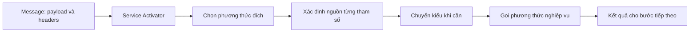

# Method argument resolution trong Service Activator

## 1. Từ thông điệp đến lời gọi phương thức Java

Trong module `SPRING_INTEGRATION_CORE`, Service Activator nối một luồng thông điệp với phương thức xử lý nghiệp vụ. **Method argument resolution** là quá trình lấy dữ liệu từ `Message<?>`, xác định nguồn cho từng tham số và chuyển giá trị sang kiểu Java mà phương thức cần.

Giả sử một thông điệp chứa:

```text
payload = Order(orderId="ORD-008", quantity=3)
headers = {
    tenantId: "shop-vn",
    attempt: "2",
    traceId: "trace-008",
    ...
}
```

Đích đến là lời gọi có ý nghĩa tương đương:

```java
handler.approve(order, "shop-vn", Integer.valueOf(2), headers);
```

Tên biến `order` hay `attempt` không đủ để xác định nguồn dữ liệu. Kiểu tham số, annotation và cấu hình endpoint mới tạo nên hợp đồng ánh xạ.



Cần phân biệt ba quyết định:

| Quyết định | Câu hỏi cần trả lời | Ví dụ |
| --- | --- | --- |
| Chọn phương thức | Gọi phương thức nào trên bean? | `.handle(handler, "approve")` |
| Ánh xạ tham số | Mỗi đối số lấy từ đâu? | `@Header("tenantId")` lấy một header |
| Chuyển kiểu | Giá trị nguồn có phù hợp kiểu đích? | Chuỗi `"2"` chuyển sang `Integer` |

Chỉ định tên phương thức giải quyết quyết định đầu tiên; các tham số vẫn cần ánh xạ hợp lệ. Service Activator hỗ trợ phương thức nhận payload, toàn bộ message, hoặc các giá trị header. Xem [Service Activator trong Spring Integration](https://docs.spring.io/spring-integration/reference/7.0/service-activator.html).

## 2. Các dạng tham số thường dùng

Những annotation dưới đây thuộc **Spring Messaging**:

```java
import org.springframework.messaging.Message;
import org.springframework.messaging.handler.annotation.Header;
import org.springframework.messaging.handler.annotation.Headers;
import org.springframework.messaging.handler.annotation.Payload;
```

Annotation khai báo endpoint thuộc Spring Integration:

```java
import org.springframework.integration.annotation.ServiceActivator;
```

| Khai báo tham số | Nguồn dữ liệu | Cách dùng |
| --- | --- | --- |
| `Order order` | Payload theo quy ước, khi chữ ký không mơ hồ | Phương thức nghiệp vụ đơn giản |
| `@Payload Order order` | Payload được chỉ định rõ | Phương thức có nhiều tham số |
| `@Payload("['orderId']") String id` | Giá trị trích từ payload dạng `Map` | Lấy một trường bằng SpEL |
| `@Header("tenantId") String tenantId` | Header có tên `tenantId` | Nhận metadata cụ thể |
| `@Headers Map<String, Object> headers` | Tập hợp header | Adapter cần đọc nhiều metadata |
| `Message<?> message` | Toàn bộ thông điệp | Xử lý cần cả cấu trúc message |
| Không có tham số | Không trích dữ liệu | Message chỉ kích hoạt một hành động |

Đây là các dạng chữ ký thường gặp, không phải thứ tự chạy cố định của mọi resolver. Đặc biệt, `Map` không có annotation có quy ước riêng, được trình bày ở phần 5.

## 3. Nhận payload và trích một phần payload

### 3.1. Payload theo quy ước

Một phương thức có một tham số nghiệp vụ rõ ràng có thể viết:

```java
public String describe(Order order) {
    return order.orderId() + ":" + order.quantity();
}
```

Khi phương thức này được nối vào Service Activator, đối số `order` được lấy từ payload. Viết `@Payload Order order` giúp thể hiện nguồn dữ liệu trực tiếp trong chữ ký.

Một tham số `Object` thường nhận payload, không mặc nhiên nhận toàn bộ `Message`. Nếu mục đích là đọc message, hãy khai báo `Message<?>`.

### 3.2. Trích giá trị bằng `@Payload`

Với payload là `Map.of("orderId", "ORD-008", "quantity", 3)`, có thể dùng:

```java
public String identify(
        @Payload("['orderId']") String orderId,
        @Header("tenantId") String tenantId) {
    return tenantId + "/" + orderId;
}
```

Biểu thức trong `@Payload` được đánh giá với **payload làm đối tượng gốc**. Vì vậy, `['orderId']` truy cập một phần tử của map. Không thêm `payload.` như khi viết biểu thức ở mức endpoint với message làm ngữ cảnh. Quy tắc đối tượng gốc được mô tả trong [API `@Payload`](https://docs.spring.io/spring-framework/docs/current/javadoc-api/org/springframework/messaging/handler/annotation/Payload.html).

Ví dụ này chỉ trích một giá trị đã tồn tại. Nếu cần dựng DTO, chuẩn hóa nhiều trường hoặc xác thực cấu trúc đầu vào, nên dùng transformer trước Service Activator để hợp đồng nghiệp vụ rõ hơn.

### 3.3. Không đồng nhất payload tùy chọn với message không có payload

Một `Message` thông thường của Spring có payload khác `null`. Header tùy chọn là tình huống phổ biến hơn. Không nên thiết kế luồng dựa trên giả định có thể gửi một message với payload `null` rồi mong resolver tự bỏ qua nó.

Phương thức không tham số vẫn có thể được kích hoạt bởi message hợp lệ. Dạng này phù hợp với thao tác tăng bộ đếm hoặc yêu cầu làm mới dữ liệu khi nội dung thông điệp không cần được đọc.

## 4. Nhận header bắt buộc và tùy chọn

### 4.1. Chỉ rõ tên header

```java
public String routeKey(
        @Payload Order order,
        @Header("tenantId") String tenantId) {
    return tenantId + ":" + order.orderId();
}
```

`tenantId` trong annotation là tên header thực tế; tên biến Java có thể khác. Khai báo tên rõ ràng cũng giúp tránh phụ thuộc vào việc giữ lại tên tham số khi biên dịch.

Theo mặc định, `@Header` yêu cầu header tồn tại. Nếu thiếu, việc ánh xạ thất bại trước khi phần thân nghiệp vụ được gọi. `required = false` cho phép nhận `null` khi thiếu header, theo [API `@Header`](https://docs.spring.io/spring-framework/docs/current/javadoc-api/org/springframework/messaging/handler/annotation/Header.html).

### 4.2. Dùng kiểu bao cho giá trị có thể vắng mặt

```java
public int resolveAttempt(
        @Header(value = "attempt", required = false) Integer attempt) {
    return attempt == null ? 1 : attempt;
}
```

Trong ví dụ này, chính mã nghiệp vụ chọn giá trị mặc định là `1`. Tránh khai báo `int` cho header được phép vắng mặt: primitive không biểu diễn được `null`.

`required = false` chỉ xử lý việc **thiếu giá trị**. Nếu header tồn tại nhưng chứa `"hai"` và kiểu đích là `Integer`, việc chuyển kiểu vẫn thất bại.

### 4.3. Biểu đạt giá trị tùy chọn bằng `Optional`

Một dạng khác là:

```java
public String trace(
        @Payload Order order,
        @Header("traceId") java.util.Optional<String> traceId) {
    return traceId.orElse("untracked") + ":" + order.orderId();
}
```

Spring Integration hỗ trợ ánh xạ các tham số `Optional`, bao gồm header tùy chọn; xem ví dụ trong [tài liệu Service Activator](https://docs.spring.io/spring-integration/reference/7.0/service-activator.html). Với hệ thống nhận dữ liệu từ nhiều nguồn, vẫn cần quy định rõ kiểu của từng header ở biên vào.

## 5. Toàn bộ header, toàn bộ message và trường hợp `Map`

### 5.1. Dùng `@Headers` để thể hiện ý định

```java
public String inspect(
        @Payload Order order,
        @Headers java.util.Map<String, Object> headers) {
    Object traceId = headers.get("traceId");
    return order.orderId() + ":" + traceId;
}
```

`@Header("traceId")` nhận **một giá trị**; `@Headers` nhận **tập hợp header**. Cách kết hợp payload và header được mô tả trong [Annotation Support](https://docs.spring.io/spring-integration/reference/7.0/configuration/annotations.html).

Xem header nhận vào như dữ liệu để đọc. `MessageHeaders` có hợp đồng bất biến; các thao tác như `put()` không phải cách sửa message hiện tại. Nếu cần thêm metadata cho bước tiếp theo, dùng header enricher hoặc xây message mới. Xem [API `MessageHeaders`](https://docs.spring.io/spring-framework/docs/current/javadoc-api/org/springframework/messaging/MessageHeaders.html).

### 5.2. Vì sao một tham số `Map` không có annotation dễ gây nhầm?

Với chữ ký `inspect(Map<String, Object> values)`, nguồn dữ liệu có thể thay đổi theo payload:

| Trường hợp | Quy ước ánh xạ |
| --- | --- |
| Chỉ có một tham số `Map`, payload cũng là `Map` | Ưu tiên payload |
| Chỉ có một tham số `Map`, payload không phải `Map` | Ánh xạ sang headers theo quy ước |
| Một tham số nghiệp vụ không phải `Map` và một tham số `Map` | Tham số nghiệp vụ nhận payload; map nhận headers |
| Hai tham số `Map` không có annotation | Mơ hồ về nguồn dữ liệu |

Với trường hợp một `Map` đơn lẻ mà payload không phải map, quy ước này không thử chuyển payload thành map trước khi chọn headers. Đây là hành vi cụ thể trong [Message Mapping Rules and Conventions](https://docs.spring.io/spring-integration/reference/7.0/configuration/message-mapping-rules.html).

Vì vậy, khi cả payload và headers đều có dạng map, hãy ghi rõ:

```java
public String inspectMaps(
        @Payload java.util.Map<String, Object> body,
        @Headers java.util.Map<String, Object> headers) {
    return headers.get("tenantId") + ":" + body.get("orderId");
}
```

Việc thêm annotation giúp tránh một thay đổi ở định dạng payload vô tình đổi ý nghĩa của tham số `values`.

### 5.3. Nhận toàn bộ message

```java
public String inspectMessage(Message<?> message) {
    Object payload = message.getPayload();
    Object traceId = message.getHeaders().get("traceId");
    return payload.getClass().getSimpleName() + ":" + traceId;
}
```

Dạng này phù hợp với mã tích hợp cần quan sát hoặc xây lại thông điệp. Nếu nghiệp vụ chỉ cần một đơn hàng và tenant, chữ ký `Order` cùng `@Header("tenantId")` thường thể hiện nhu cầu rõ hơn.

Chọn `Message<?>` là chọn làm việc với cấu trúc message. Nó không thay thế việc kiểm tra kiểu payload hoặc xác thực dữ liệu nghiệp vụ.

## 6. Ví dụ hoàn chỉnh với Java DSL

Ví dụ sau dùng Java 17 và API Java DSL của Spring Integration 6.x trở lên. Cần dependency `org.springframework.integration:spring-integration-core` cùng các dependency Spring tương thích; phiên bản nên theo BOM hoặc dependency management của ứng dụng. Các đoạn kiểm thử ở phần 10 cần thêm JUnit Jupiter.

Tạo lớp `MethodArgumentsConfig` trong package ví dụ. Các kiểu `Order`, `Approval` và handler được đặt bên trong để dễ theo dõi.

```java
package example.integration;

import java.util.Map;

import org.springframework.context.annotation.Bean;
import org.springframework.context.annotation.Configuration;
import org.springframework.integration.channel.DirectChannel;
import org.springframework.integration.channel.QueueChannel;
import org.springframework.integration.config.EnableIntegration;
import org.springframework.integration.dsl.IntegrationFlow;
import org.springframework.messaging.handler.annotation.Header;
import org.springframework.messaging.handler.annotation.Headers;
import org.springframework.messaging.handler.annotation.Payload;

@Configuration
@EnableIntegration
public class MethodArgumentsConfig {

    public record Order(String orderId, int quantity) {
    }

    public record Approval(
            String orderId,
            String tenantId,
            int attempt,
            String traceId) {
    }

    public static class OrderHandler {

        public Approval approve(
                @Payload Order order,
                @Header("tenantId") String tenantId,
                @Header(value = "attempt", required = false) Integer attempt,
                @Headers Map<String, Object> headers) {

            if (order.quantity() <= 0) {
                throw new IllegalArgumentException("quantity must be positive");
            }

            int effectiveAttempt = attempt == null ? 1 : attempt;
            Object traceHeader = headers.get("traceId");
            String traceId = traceHeader == null
                    ? "untracked"
                    : traceHeader.toString();

            return new Approval(
                    order.orderId(), tenantId, effectiveAttempt, traceId);
        }
    }

    @Bean
    public DirectChannel ordersIn() {
        return new DirectChannel();
    }

    @Bean
    public QueueChannel ordersOut() {
        return new QueueChannel();
    }

    @Bean
    public OrderHandler orderHandler() {
        return new OrderHandler();
    }

    @Bean
    public IntegrationFlow approvalFlow(OrderHandler orderHandler) {
        return IntegrationFlow.from(ordersIn())
                .handle(orderHandler, "approve")
                .channel(ordersOut())
                .get();
    }
}
```

Ở đây, `.handle(orderHandler, "approve")` tạo điểm gọi POJO trong flow. Các annotation trên tham số vẫn được dùng để ánh xạ dữ liệu. Không cần thêm `@ServiceActivator(inputChannel = "ordersIn")` vào cùng phương thức để tạo thêm một endpoint nữa.

Có thể gửi message từ một phương thức chạy thử như sau:

```java
try (var context = new org.springframework.context.annotation
        .AnnotationConfigApplicationContext(MethodArgumentsConfig.class)) {

    var input = context.getBean(
            "ordersIn", org.springframework.messaging.MessageChannel.class);
    var output = context.getBean(
            "ordersOut", org.springframework.messaging.PollableChannel.class);

    var request = org.springframework.integration.support.MessageBuilder
            .withPayload(new MethodArgumentsConfig.Order("ORD-008", 3))
            .setHeader("tenantId", "shop-vn")
            .setHeader("attempt", "2")
            .setHeader("traceId", "trace-008")
            .build();

    input.send(request);

    var reply = output.receive(1_000);
    if (reply == null) {
        throw new IllegalStateException("Expected an approval reply");
    }

    System.out.println(reply.getPayload());
}
```

Payload đầu ra mong đợi:

```text
Approval[orderId=ORD-008, tenantId=shop-vn, attempt=2, traceId=trace-008]
```

Quan sát hợp đồng của ví dụ:

| Tham số | Giá trị nguồn | Giá trị trong phương thức |
| --- | --- | --- |
| `order` | Payload `Order` | Đơn hàng `ORD-008`, số lượng `3` |
| `tenantId` | Header `tenantId` | `"shop-vn"` |
| `attempt` | Header chứa chuỗi `"2"` | `Integer` có giá trị `2` |
| `headers` | Tập header đầu vào | Có thể đọc `traceId` và metadata khác |

`QueueChannel` ở đầu ra dùng để giữ kết quả cho thao tác `receive()`. Trong cấu hình này nó không cần poller vì không có endpoint được cấu hình để poll nó. Phần xử lý từ `ordersIn` qua handler chạy đồng bộ trên luồng gọi `send()`.

## 7. Hai nguồn gây mơ hồ cần tách riêng

### 7.1. Mơ hồ trong một chữ ký phương thức

Chữ ký sau không thể hiện hai tham số lấy từ đâu:

```java
public String process(String orderId, String tenantId) {
    return tenantId + ":" + orderId;
}
```

Không có quy tắc chung rằng tham số thứ nhất luôn là payload còn tham số thứ hai tự động lấy header trùng tên. Viết rõ hợp đồng:

```java
public String process(
        @Payload String orderId,
        @Header("tenantId") String tenantId) {
    return tenantId + ":" + orderId;
}
```

Với chữ ký phức tạp, xác định nguồn dữ liệu cho từng tham số trước khi thêm logic xử lý. Annotation của Spring MVC như `@RequestParam` hoặc `@RequestHeader` không thay thế annotation Spring Messaging trong Service Activator.

### 7.2. Mơ hồ giữa các overload

Hai khai báo trong một handler có thể cùng muốn nhận payload `Order`:

```java
public Approval approve(Order order);

public Approval approve(
        Order order,
        @Header("tenantId") String tenantId);
```

Đây là các chữ ký minh họa, không phải một lớp Java hoàn chỉnh. Cấu hình `.handle(handler, "approve")` vẫn chỉ cung cấp **tên**, chưa loại được sự cạnh tranh giữa hai phương thức có cùng kiểu payload. Việc có thêm header không phải một quy tắc router để chọn overload theo ý nghiệp vụ.

Cách thiết kế dễ kiểm soát là dùng tên riêng như `approveForTenant` và cấu hình chính xác tên đó. Nếu cần rẽ nhánh theo loại yêu cầu hoặc tenant, hãy đặt router ở flow.

Các quy ước về tham số, ánh xạ theo payload và chữ ký mơ hồ được trình bày trong [Message Mapping Rules and Conventions](https://docs.spring.io/spring-integration/reference/7.0/configuration/message-mapping-rules.html). Tránh phụ thuộc vào thứ tự khai báo phương thức trong mã nguồn.

## 8. Chuyển kiểu và ranh giới trách nhiệm

### 8.1. Chuyển kiểu không đồng nghĩa xác thực nghiệp vụ

Trong ví dụ chính, chuyển `"2"` thành `Integer` chỉ xác nhận dữ liệu có thể biểu diễn dưới dạng số. Nếu `attempt` phải nằm trong khoảng `1..5`, ứng dụng vẫn cần kiểm tra ràng buộc đó.

Tương tự, resolver ánh xạ `Order` không tự bảo đảm `quantity > 0`. Kiểm tra này nằm trong handler của ví dụ.

### 8.2. Đăng ký converter riêng

Ví dụ bổ sung sau chuyển một mã tenant có tiền tố `tenant:` thành kiểu miền. Đặt kiểu và converter này bên trong một lớp cấu hình, cùng các import được ghi rõ:

```java
import org.springframework.core.convert.converter.Converter;
import org.springframework.integration.annotation.IntegrationConverter;

public record TenantId(String value) {
}

public static class StringToTenantId implements Converter<String, TenantId> {

    @Override
    public TenantId convert(String source) {
        if (!source.startsWith("tenant:") || source.length() == 7) {
            throw new IllegalArgumentException("Invalid tenant id");
        }
        return new TenantId(source.substring(7));
    }
}

@Bean
@IntegrationConverter
public StringToTenantId stringToTenantId() {
    return new StringToTenantId();
}
```

Khi đã đăng ký converter này, có thể khai báo `@Header("tenantId") TenantId tenantId` và gửi header `"tenant:shop-vn"`. Đây là biến thể độc lập: nếu giữ dữ liệu `"shop-vn"` của ví dụ chính, converter trên sẽ từ chối nó.

`@IntegrationConverter` đăng ký converter cho chuyển kiểu trong quá trình xử lý thông điệp. Cần phân biệt `integrationConversionService` với conversion service dùng khi tạo và cấu hình bean.

### 8.3. Dữ liệu tuần tự hóa cần cấu hình tương ứng

Một chuỗi JSON không mặc nhiên là DTO chỉ vì phương thức nhận DTO. Cơ chế gọi phương thức mặc định có thể sử dụng `MessageConverter`, với kết quả phụ thuộc converter hiện có, thư viện trên classpath và metadata như `contentType`.

Nếu cần hợp đồng dễ quan sát, đặt bước chuyển JSON sang `Order` trước handler. Một biểu thức gọi bean ở cấp endpoint cũng không nhất thiết có cùng đường chuyển đổi theo `contentType` như cơ chế resolver mặc định.

Các khái niệm converter, conversion service và chuyển đổi theo content type được giải thích trong [Message Endpoints: Payload Type Conversion và Content Type Conversion](https://docs.spring.io/spring-integration/reference/7.0/endpoint.html#payload-type-conversion).

## 9. POJO handler và lambda trong Java DSL

Với POJO:

```java
.handle(orderHandler, "approve")
```

Framework phân tích chữ ký của phương thức đích và giải quyết các tham số đã khai báo.

Với lambda theo hợp đồng `GenericHandler<P>`, hai đối số đã là payload và headers:

```java
.handle(MethodArgumentsConfig.Order.class, (order, headers) -> {
    String tenantId = (String) headers.get("tenantId");
    if (tenantId == null) {
        throw new IllegalArgumentException("Missing tenantId");
    }
    return tenantId + ":" + order.orderId();
})
```

Lambda này tự đọc header và tự kiểm tra thiếu giá trị. Nó không khai báo `@Header` để nhờ resolver áp dụng hợp đồng bắt buộc như phương thức POJO.

Truyền `Order.class` giúp biểu đạt kiểu payload đích tại ranh giới DSL, nhất là khi lambda cần chuyển kiểu. Xem [Service Activators and the `.handle()` method](https://docs.spring.io/spring-integration/reference/7.0/dsl/java-handle.html).

Chọn POJO khi chữ ký ánh xạ có nhiều quy tắc cần đọc và kiểm thử độc lập. Lambda phù hợp với xử lý ngắn, dễ quan sát ngay trong flow.

## 10. Kiểm thử qua channel để kiểm tra argument resolution

Gọi trực tiếp `new OrderHandler().approve(...)` chỉ kiểm tra mã Java trong handler. Annotation trên tham số không tự thực thi trong lời gọi đó. Muốn kiểm tra resolver, hãy gửi message qua endpoint đã được Spring khởi tạo.

Bộ kiểm thử dưới đây sử dụng lớp cấu hình ở phần 6. Mỗi test mở context riêng để dữ liệu trong output queue không ảnh hưởng test khác.

```java
package example.integration;

import org.junit.jupiter.api.Test;
import org.springframework.context.annotation.AnnotationConfigApplicationContext;
import org.springframework.messaging.Message;
import org.springframework.messaging.MessageChannel;
import org.springframework.messaging.MessagingException;
import org.springframework.messaging.PollableChannel;
import org.springframework.integration.support.MessageBuilder;

import static org.junit.jupiter.api.Assertions.*;

class MethodArgumentsTest {

    @Test
    void mapsPayloadHeadersAndConvertsAttempt() {
        try (var context = new AnnotationConfigApplicationContext(
                MethodArgumentsConfig.class)) {
            var input = context.getBean("ordersIn", MessageChannel.class);
            var output = context.getBean("ordersOut", PollableChannel.class);

            input.send(MessageBuilder
                    .withPayload(new MethodArgumentsConfig.Order("ORD-008", 3))
                    .setHeader("tenantId", "shop-vn")
                    .setHeader("attempt", "2")
                    .setHeader("traceId", "trace-008")
                    .build());

            Message<?> reply = output.receive(1_000);
            assertNotNull(reply);
            var result = assertInstanceOf(
                    MethodArgumentsConfig.Approval.class, reply.getPayload());
            assertEquals(new MethodArgumentsConfig.Approval(
                    "ORD-008", "shop-vn", 2, "trace-008"), result);
        }
    }

    @Test
    void allowsMissingOptionalHeaders() {
        try (var context = new AnnotationConfigApplicationContext(
                MethodArgumentsConfig.class)) {
            var input = context.getBean("ordersIn", MessageChannel.class);
            var output = context.getBean("ordersOut", PollableChannel.class);

            input.send(MessageBuilder
                    .withPayload(new MethodArgumentsConfig.Order("ORD-009", 1))
                    .setHeader("tenantId", "shop-vn")
                    .build());

            Message<?> reply = output.receive(1_000);
            assertNotNull(reply);
            var result = assertInstanceOf(
                    MethodArgumentsConfig.Approval.class, reply.getPayload());
            assertEquals(1, result.attempt());
            assertEquals("untracked", result.traceId());
        }
    }

    @Test
    void rejectsMissingRequiredTenantHeader() {
        try (var context = new AnnotationConfigApplicationContext(
                MethodArgumentsConfig.class)) {
            var input = context.getBean("ordersIn", MessageChannel.class);
            var output = context.getBean("ordersOut", PollableChannel.class);

            var request = MessageBuilder
                    .withPayload(new MethodArgumentsConfig.Order("ORD-010", 1))
                    .build();

            assertThrows(MessagingException.class, () -> input.send(request));
            assertNull(output.receive(0));
        }
    }

    @Test
    void rejectsAnAttemptThatCannotBeConverted() {
        try (var context = new AnnotationConfigApplicationContext(
                MethodArgumentsConfig.class)) {
            var input = context.getBean("ordersIn", MessageChannel.class);
            var output = context.getBean("ordersOut", PollableChannel.class);

            var request = MessageBuilder
                    .withPayload(new MethodArgumentsConfig.Order("ORD-011", 1))
                    .setHeader("tenantId", "shop-vn")
                    .setHeader("attempt", "hai")
                    .build();

            assertThrows(MessagingException.class, () -> input.send(request));
            assertNull(output.receive(0));
        }
    }
}
```

Các kiểm thử lỗi xác nhận endpoint từ chối message và không phát kết quả thành công. Khi chẩn đoán nguyên nhân cụ thể, đọc chuỗi `cause` thay vì chỉ dựa vào exception bọc ngoài. Nếu cần chứng minh handler chưa được gọi, có thể thêm spy hoặc bộ đếm lời gọi vào một bài kiểm thử riêng.

Đây là mã kiểm thử minh họa để người học đưa vào dự án phù hợp, không phải kết quả chạy kiểm thử được báo cáo cho module.

## 11. Chẩn đoán lỗi theo giai đoạn

| Triệu chứng | Giai đoạn nên kiểm tra | Hướng xử lý |
| --- | --- | --- |
| Handler không được gọi vì thiếu `tenantId` | Ánh xạ header | Kiểm tra tên header và hợp đồng bắt buộc |
| Header `attempt="hai"` gây lỗi | Chuyển kiểu | Chuẩn hóa dữ liệu hoặc từ chối ở biên vào |
| Hai tham số `String` không rõ nguồn | Phân tích chữ ký | Thêm `@Payload` và `@Header` phù hợp |
| Hai overload cùng nhận payload `Order` | Chọn phương thức | Đổi tên phương thức hoặc tách endpoint |
| Một tham số `Map` nhận dữ liệu khác dự kiến | Quy ước ánh xạ | Chỉ rõ `@Payload` hoặc `@Headers` |
| Handler chạy xong nhưng không gửi được kết quả | Định tuyến reply | Kiểm tra output channel hoặc `replyChannel` |
| Lỗi `quantity must be positive` | Logic nghiệp vụ | Kiểm tra dữ liệu đơn hàng; ánh xạ đã hoàn tất |

Không phải mọi lỗi của Service Activator đều là lỗi argument resolution. Lỗi gửi reply xảy ra sau lời gọi phương thức; lỗi chọn phương thức có thể xuất hiện ngay khi endpoint được khởi tạo hoặc khi xử lý một kiểu payload cụ thể.

Trong ví dụ dùng `DirectChannel`, lỗi xử lý truyền về luồng gọi `send()`. Chỉ thêm header `errorChannel` không tự biến lỗi đồng bộ này thành một thông điệp lỗi. Với poller, executor hoặc gateway có cấu hình xử lý lỗi riêng, đường truyền lỗi có thể khác. Xem [Error Handling trong Spring Integration](https://docs.spring.io/spring-integration/reference/7.0/error-handling.html).

## 12. Áp dụng vào thiết kế luồng thông điệp

Một flow dễ bảo trì nên đưa dữ liệu về hợp đồng ổn định trước khi gọi nghiệp vụ:

```text
Nguồn dữ liệu
    → transformer: dựng Order
    → header enricher: bổ sung metadata theo hợp đồng
    → filter hoặc validator: kiểm tra điều kiện đầu vào
    → service activator: approve(Order, tenantId, attempt, headers)
    → các bước xử lý kết quả
```

Đây là gợi ý thiết kế cho ví dụ đơn hàng, không phải chuỗi bắt buộc cho mọi ứng dụng. Router có thể đặt trước endpoint khi cần chọn nhánh nghiệp vụ; gateway có thể cung cấp giao diện gọi cho bên gửi. Khi message đã đến Service Activator, chữ ký phương thức cần đủ rõ để framework ánh xạ dữ liệu một cách xác định.

Khi tự rà soát một handler, hãy kiểm tra:

- Mỗi tham số có nguồn dữ liệu rõ ràng, đặc biệt khi có nhiều `String` hoặc `Map`.
- Header bắt buộc và tùy chọn phản ánh đúng hợp đồng; giá trị vắng mặt dùng kiểu có thể biểu diễn sự vắng mặt.
- Chuyển kiểu có cấu hình phù hợp với dữ liệu thực tế, bao gồm các trường hợp không thể chuyển đổi.
- Tên phương thức và overload không làm lựa chọn phương thức trở nên mơ hồ.
- Kiểm thử argument resolution gửi message qua endpoint; kiểm thử nghiệp vụ có thể gọi POJO trực tiếp.

Với cách tiếp cận này, chữ ký Service Activator trở thành tài liệu trực tiếp cho ranh giới giữa message và nghiệp vụ: payload mang dữ liệu chính, header mang metadata, còn resolver nối hai phần đó với các đối số Java.
