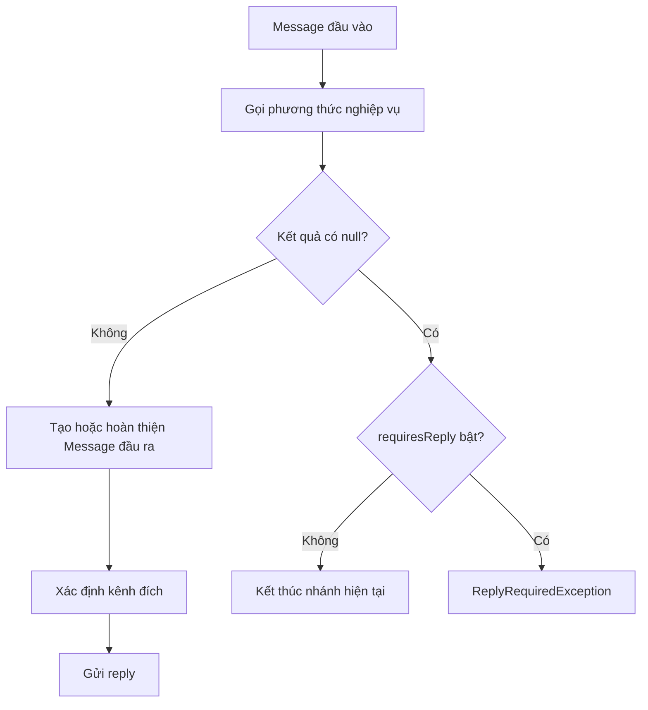

# Method return value handling — Xử lý giá trị trả về của Service Activator

## 1. Mục tiêu và bối cảnh

Trong module `SPRING_INTEGRATION_CORE`, Service Activator kết nối một phương thức nghiệp vụ với luồng thông điệp. Phương thức có thể tính giá, ghi nhận giao dịch hoặc gọi một hệ thống bên ngoài. Giá trị Java mà phương thức trả về quyết định dữ liệu nào tiếp tục đi qua `MessageChannel`.

Bài học thuộc chương **Service activator**, tập trung vào hợp đồng đầu ra: phân biệt payload với `Message`, xác định nơi nhận reply và xử lý trường hợp phương thức không tạo kết quả. Những quyết định này ảnh hưởng trực tiếp đến gateway, các bước transformer/router/filter/aggregator ở phía sau và cách kiểm thử luồng tích hợp.

Sau bài học, bạn có thể:

- Chọn kiểu trả về phù hợp giữa đối tượng nghiệp vụ, `Message<T>`, `void` và kết quả bất đồng bộ.
- Giải thích vì sao phương thức chạy thành công nhưng gateway vẫn không nhận được phản hồi.
- Cấu hình `requiresReply`, `outputChannel` và `replyChannel` đúng mục đích.
- Kiểm thử payload, header, kênh đích và nhánh không có reply.

Các ví dụ dùng Java 17 và API Spring Integration 6.5. Đây là mốc API để diễn giải ví dụ, không phải yêu cầu đổi phiên bản của module. Cần có `spring-integration-core`; phần kiểm thử dùng JUnit Jupiter. Những đoạn ghi rõ là biến thể được dùng thay cho bước tương ứng trong ví dụ chính.

## 2. Từ giá trị Java đến thông điệp đầu ra

Xét phương thức nghiệp vụ:

```java
public PriceQuote quote(PriceRequest request) {
    return new PriceQuote(request.sku(), request.quantity(), total);
}
```

Phương thức chỉ biết yêu cầu và báo giá. Service Activator chịu trách nhiệm gọi phương thức, chuyển kết quả thành thông điệp và gửi thông điệp đến đích đã cấu hình hoặc được chỉ định trong header.



Sơ đồ mô tả trường hợp đồng bộ thông thường, chưa có advice thay đổi kết quả, Routing Slip hoặc xử lý reactive.

| Giá trị thực sự được trả về | Hành vi đầu ra trong trường hợp thông thường |
|---|---|
| Một `PriceQuote`, `String`, số hoặc DTO khác | Kết quả trở thành payload của reply |
| `Message<PriceQuote>` | Framework dùng payload và header của message đó để tạo đầu ra |
| `null` | Không có reply; kiểm tra chính sách `requiresReply` |
| Phương thức `void` | Không tạo kết quả để tiếp tục nhánh |
| `Boolean.FALSE`, số `0`, chuỗi rỗng | Vẫn là dữ liệu khác `null`, vì vậy vẫn có thể tạo reply |

`false` không có nghĩa là loại bỏ thông điệp ở Service Activator. Ý nghĩa đó cần được biểu diễn bằng một filter hoặc một quyết định định tuyến rõ ràng. Tương tự, phương thức trả về đối tượng `Exception` thường tạo payload chứa đối tượng ấy; muốn báo thất bại bằng cơ chế exception thì phải `throw`.

Cơ chế gọi phương thức nằm trong `ServiceActivatingHandler`; phần lớp cha xử lý kết quả và chính sách yêu cầu reply. [Mã nguồn ServiceActivatingHandler](https://github.com/spring-projects/spring-integration/blob/v6.5.0/spring-integration-core/src/main/java/org/springframework/integration/handler/ServiceActivatingHandler.java), [mã nguồn AbstractReplyProducingMessageHandler](https://github.com/spring-projects/spring-integration/blob/v6.5.0/spring-integration-core/src/main/java/org/springframework/integration/handler/AbstractReplyProducingMessageHandler.java).

## 3. Trả payload hoặc trả Message

### 3.1. Trả một đối tượng nghiệp vụ

Đây thường là lựa chọn dễ bảo trì nhất khi dịch vụ chỉ cần tính kết quả:

```java
public BigDecimal calculateTotal(PriceRequest request) {
    return new BigDecimal("125000")
            .multiply(BigDecimal.valueOf(request.quantity()));
}
```

Downstream nhận một `Message<BigDecimal>`, dù phương thức không tự gọi `MessageBuilder`. Một phương thức kiểm thử đơn vị cũng có thể gọi `calculateTotal()` trực tiếp mà không dựng hạ tầng messaging.

Theo cơ chế truyền header mặc định của handler này, các header đầu vào có thể được bổ sung vào reply nếu reply chưa có chúng, trừ các header bị loại khỏi chính sách truyền. Vì vậy, `tenantId` hoặc `requestId` có thể tiếp tục đi cùng payload mới.

Không dùng `MessageHeaders.ID` làm mã giao dịch nghiệp vụ. Khi tạo một thông điệp mới, header định danh hệ thống có thể thay đổi. Hãy đặt mã cần theo dõi vào một header ứng dụng riêng hoặc thuộc tính trong DTO.

### 3.2. Trả Message khi cần điều khiển header

Dùng `Message<T>` khi kết quả cần bổ sung metadata, chẳng hạn trạng thái tính giá hoặc nguồn dữ liệu:

```java
public Message<PriceQuote> quoteWithHeaders(Message<PriceRequest> request) {
    PriceQuote quote = quote(request.getPayload());
    if (quote == null) {
        return null;
    }
    return MessageBuilder.withPayload(quote)
            .setHeader("pricingStatus", "READY")
            .setHeader("priceSource", "catalog")
            .build();
}
```

Đoạn này là một phương thức thay thế bên trong `PricingService` ở ví dụ chính; cần import `org.springframework.messaging.Message` và `org.springframework.messaging.support.MessageBuilder`.

Với cấu hình mặc định, header đầu vào chưa tồn tại trên reply được bổ sung theo cơ chế copy-if-absent. Nếu request có `priceSource=cache`, đầu ra vẫn giữ `priceSource=catalog` do phương thức đã chủ động đặt giá trị này. Không cần sao chép thủ công toàn bộ header chỉ để giữ `tenantId`.

Hai lưu ý thực hành:

- Trả `Message<T>` không biến header `replyChannel` của message đó thành đích có ưu tiên cao nhất. Việc chọn kênh còn phụ thuộc cấu hình endpoint và header của request.
- Việc xóa một header khỏi message tự dựng chưa chắc loại được nó ở đầu ra: quá trình truyền header có thể bổ sung lại giá trị từ request. Khi cần loại bỏ, cấu hình `notPropagatedHeaders` hoặc một bước xử lý header rõ ràng ở sau endpoint.

Ví dụ biến thể của bước `.handle()`:

```java
.handle(service, "quoteWithHeaders",
        endpoint -> endpoint.requiresReply(true)
                .notPropagatedHeaders("internalToken"))
```

`notPropagatedHeaders` kiểm soát việc sao chép từ request; nó không tự xóa một header mà chính phương thức đã đặt vào reply. Quy tắc xây dựng message và bổ sung header được thể hiện trong `createOutputMessage()`. [Mã nguồn AbstractMessageProducingHandler](https://github.com/spring-projects/spring-integration/blob/v6.5.0/spring-integration-core/src/main/java/org/springframework/integration/handler/AbstractMessageProducingHandler.java).

Message giữ cấu trúc header theo hướng bất biến; muốn thay đổi header, hãy tạo message qua builder thay vì gọi `put()` trên `getHeaders()`. Điều đó không làm đối tượng payload bên trong tự động bất biến. [Tài liệu Message](https://docs.spring.io/spring-integration/reference/message.html).

## 4. Reply được gửi đi đâu?

Trong luồng thông thường không dùng Routing Slip, thứ tự chọn đích là:

1. `outputChannel` được cấu hình trên Service Activator.
2. Header `replyChannel` của **request**, khi endpoint không có output channel.
3. Header `replyChannel` của **Message trả về**, khi request cũng không có header này.

Header có thể chứa một đối tượng `MessageChannel` hoặc tên kênh dưới dạng `String`. Tên kênh phải phân giải được trong ngữ cảnh Spring. Không có đích, hoặc tên đích không phân giải được, dẫn đến lỗi phân giải đích; reply không tự được gửi đến `errorChannel` như một kết quả bình thường. [Tài liệu Service Activator](https://docs.spring.io/spring-integration/reference/6.5/service-activator.html).

Ví dụ:

```text
Endpoint outputChannel = priceResults
Request replyChannel   = temporaryGatewayReply
Returned replyChannel  = alternateResults

Đích nhận reply tại endpoint này: priceResults
```

Endpoint chọn một đích theo quy tắc, không tự nhân bản reply đến cả ba kênh. Nếu cần nhiều nhánh, thiết kế publish-subscribe hoặc các mẫu phân phối tương ứng.

### 4.1. Liên hệ với gateway

Một gateway yêu cầu–phản hồi thường đặt địa chỉ nhận reply vào header của request. Endpoint cuối luồng có thể trả kết quả qua địa chỉ này khi không cấu hình output channel tường minh.

Nếu thêm `outputChannel=priceResults`, reply sẽ đi tới đó. Gateway chỉ nhận kết quả khi thiết kế luồng còn một đường đưa phản hồi trở về địa chỉ chờ của nó. Đưa message vào một `QueueChannel` mà không có consumer chuyển tiếp không hoàn thành lời gọi gateway.

Không giả định `replyTimeout` của gateway là thời hạn cắt ngang một phương thức đồng bộ đang chạy. Hành vi chờ reply và thời gian thực thi phương thức trên caller thread là hai vấn đề cần phân biệt.

### 4.2. Output channel chưa bảo đảm việc gửi thành công

Có một kênh đích khác với có một consumer xử lý được message. Chẳng hạn, `DirectChannel` không có subscriber có thể làm việc gửi thất bại; queue bị giới hạn dung lượng có thể làm thao tác gửi phải chờ hoặc thất bại theo timeout.

Do đó cần quan sát ba mốc riêng: phương thức đã tạo kết quả, endpoint đã gửi kết quả, và downstream đã hoàn thành xử lý. Chúng không đồng nghĩa với nhau.

## 5. null, void và requiresReply

### 5.1. null kết thúc nhánh đang xử lý

Một phương thức có thể trả `null` vì không tìm thấy dữ liệu:

```java
public PriceQuote findQuote(PriceRequest request) {
    if (!"BOOK-01".equals(request.sku())) {
        return null;
    }
    return quote(request);
}
```

Khi không bắt buộc reply, nhánh đi qua endpoint dừng tại đây. Framework không tạo một message có payload bằng `null`, cũng không tự chuyển tiếp request nguyên trạng. Nếu caller đang chờ kết quả, cần thiết kế rõ hành vi khi không có phản hồi.

Đối với một API truy vấn mà “không tìm thấy” là kết quả bình thường, DTO như `LookupResult(found, value)` giúp caller nhận được trạng thái rõ ràng. Chọn `null` chỉ khi việc không phát đầu ra là một phần có chủ đích của hợp đồng luồng.

### 5.2. requiresReply bảo vệ hợp đồng đồng bộ

Với Java DSL:

```java
.handle(service, "quote", endpoint -> endpoint.requiresReply(true))
```

Với annotation trên một service bean đã được Spring đăng ký:

```java
@ServiceActivator(
        inputChannel = "priceRequests",
        outputChannel = "priceResults",
        requiresReply = "true")
public PriceQuote quote(PriceRequest request) {
    // Tính và trả báo giá.
}
```

Đoạn annotation là cách cấu hình thay thế; không đăng ký thêm vào ví dụ DSL chính trên cùng input channel. Import annotation từ `org.springframework.integration.annotation.ServiceActivator`.

Trong cấu hình đồng bộ này, `requiresReply=true` khiến kết quả `null` bị báo bằng `ReplyRequiredException`, thay vì im lặng dừng nhánh. Mặc định của Service Activator là không bắt buộc reply. [API ConsumerEndpointSpec.requiresReply](https://docs.spring.io/spring-integration/docs/6.5.0/api/org/springframework/integration/dsl/ConsumerEndpointSpec.html#requiresReply(boolean)).

Cờ này không tạo dữ liệu thay thế, không kiểm tra DTO có hợp lệ về nghiệp vụ, không bảo đảm kênh đích có consumer và không bảo đảm downstream xử lý thành công. Với phương thức `void`, hãy thiết kế endpoint một chiều; đừng bật yêu cầu reply cho một phương thức vốn không có kết quả.

### 5.3. void phù hợp với tác vụ một chiều

Ví dụ ghi nhật ký nghiệp vụ:

```java
public void recordAudit(PriceRequest request) {
    auditRepository.save(request);
}
```

Đây là đoạn minh họa cần một `auditRepository` do ứng dụng cung cấp. Sau lời gọi `void`, không có payload để các bước kế tiếp trên cùng nhánh tiếp tục xử lý.

Nếu cần vừa ghi nhận vừa giữ dữ liệu cho downstream, có thể chủ động trả lại request:

```java
public PriceRequest recordAndContinue(PriceRequest request) {
    auditRepository.save(request);
    return request;
}
```

Nếu yêu cầu chỉ là quan sát luồng, một nhánh wire tap cũng là lựa chọn thiết kế phù hợp. Việc `send()` trả `true` ở đầu vào chỉ cho biết thao tác gửi được chấp nhận theo hợp đồng của channel, không phải một báo giá nghiệp vụ.

## 6. Ví dụ Java DSL: tạo báo giá

### 6.1. Cấu hình đầy đủ

Đặt lớp sau trong `PriceFlowConfig.java`. Hai kênh được khai báo rõ để dễ quan sát: request đi qua `DirectChannel`, kết quả được giữ ở `QueueChannel` để đọc và kiểm thử.

```java
package vn.example.integration;

import java.math.BigDecimal;

import org.springframework.context.annotation.Bean;
import org.springframework.context.annotation.Configuration;
import org.springframework.integration.channel.DirectChannel;
import org.springframework.integration.channel.QueueChannel;
import org.springframework.integration.config.EnableIntegration;
import org.springframework.integration.dsl.IntegrationFlow;

@Configuration(proxyBeanMethods = false)
@EnableIntegration
public class PriceFlowConfig {

    public record PriceRequest(String sku, int quantity) {
    }

    public record PriceQuote(String sku, int quantity, BigDecimal total) {
    }

    public static class PricingService {

        public PriceQuote quote(PriceRequest request) {
            if (request.quantity() <= 0) {
                throw new IllegalArgumentException("quantity must be positive");
            }
            if (!"BOOK-01".equals(request.sku())) {
                return null;
            }
            BigDecimal total = new BigDecimal("125000")
                    .multiply(BigDecimal.valueOf(request.quantity()));
            return new PriceQuote(request.sku(), request.quantity(), total);
        }
    }

    @Bean
    public DirectChannel priceRequests() {
        return new DirectChannel();
    }

    @Bean
    public QueueChannel priceResults() {
        return new QueueChannel();
    }

    @Bean
    public PricingService pricingService() {
        return new PricingService();
    }

    @Bean
    public IntegrationFlow priceFlow(
            DirectChannel priceRequests,
            QueueChannel priceResults,
            PricingService pricingService) {

        return IntegrationFlow.from(priceRequests)
                .handle(pricingService, "quote",
                        endpoint -> endpoint.requiresReply(true))
                .channel(priceResults)
                .get();
    }
}
```

`.handle(pricingService, "quote", ...)` tạo bước Service Activator. `.channel(priceResults)` nối đầu ra của bước đó vào kênh kết quả. Không cần đặt thêm `@ServiceActivator` lên `quote()` trong cấu hình này. Java DSL cũng hỗ trợ lambda dạng `GenericHandler<P>` nhận payload và headers rồi trả kết quả. [Tài liệu phương thức .handle()](https://docs.spring.io/spring-integration/reference/dsl/java-handle.html).

### 6.2. Dữ liệu đi qua luồng

Với request:

```text
payload = PriceRequest("BOOK-01", 2)
headers = {tenantId: "shop-hcm", requestId: "REQ-1001", ...}
```

Kết quả mong đợi tại `priceResults`:

```text
payload = PriceQuote("BOOK-01", 2, 250000)
headers chứa tenantId="shop-hcm", requestId="REQ-1001"
```

`quote()` trả một DTO; framework tạo message chứa DTO đó. Header ứng dụng được giữ theo chính sách mặc định. Đối với `UNKNOWN`, phương thức trả `null` và hợp đồng bắt buộc reply làm phát sinh lỗi ngay trong luồng đồng bộ.

Ví dụ cố ý dùng một bảng giá nhỏ để tập trung vào hợp đồng đầu ra. Trong ứng dụng thực tế, thay phần tính giá bằng lời gọi dịch vụ hoặc repository nhưng giữ nguyên các ca kiểm thử về payload, header và kênh đích.

## 7. Chủ động bỏ kết quả bằng nullChannel

Có những thư viện bắt buộc trả một đối tượng dù ứng dụng chỉ cần tác dụng phụ. Nếu vẫn dùng phương thức ấy nhưng không sử dụng kết quả, cấu hình đích bỏ thông điệp:

```java
@Bean
public IntegrationFlow ignoredQuoteFlow(PricingService service) {
    return IntegrationFlow.from("ignoredPriceRequests")
            .handle(service, "quote")
            .channel("nullChannel")
            .get();
}
```

Đây là biến thể sử dụng `PricingService` của ví dụ chính. Spring Integration cung cấp kênh `nullChannel` để nhận và loại bỏ thông điệp.

| Tình huống | Ý nghĩa |
|---|---|
| Phương thức trả `null`, không bắt buộc reply | Không có reply để gửi |
| Phương thức trả báo giá, output là `nullChannel` | Có kết quả, sau đó kết quả được chủ động bỏ |
| Phương thức trả báo giá, không có output hay reply address | Thiếu địa chỉ gửi kết quả, cần sửa hợp đồng luồng |

Không dùng `nullChannel` cho một lời gọi mà caller còn cần báo giá. Cũng không coi việc bỏ kết quả là bằng chứng rằng thao tác nghiệp vụ đã rollback: phương thức có thể đã thực hiện tác dụng phụ trước khi tạo reply.

## 8. Collection: một payload hay nhiều message?

Với handler nền của Spring Integration 6.5, cần phân biệt hai trường hợp:

```java
public List<String> labels(PriceRequest request) {
    return List.of("priced", "ready");
}
```

Danh sách dữ liệu này trở thành **một payload**. Downstream nhận một message chứa `List<String>`, không mặc nhiên nhận hai message `String`.

Trong khi đó, một `Iterable` chứa các phần tử `Message` hoặc integration message builder có thể được handler nền tách thành nhiều đầu ra. Ví dụ sau trả hai message riêng:

```java
public List<Message<String>> notifications(PriceRequest request) {
    return List.of(
            MessageBuilder.withPayload("price-ready").build(),
            MessageBuilder.withPayload("stock-check-required").build());
}
```

Hai phương thức minh họa cần import `java.util.List`, `org.springframework.messaging.Message`, `org.springframework.messaging.support.MessageBuilder` và kiểu `PriceRequest` trong cấu hình chính.

Nếu muốn chắc chắn danh sách message là **một payload**, bọc danh sách ấy vào một `Message<List<Message<String>>>`. Khi đó giá trị trả về ngoài cùng là một `Message`.

Khi nhu cầu là chia dữ liệu nghiệp vụ thành các message có thông tin sequence để ghép lại, hãy dùng splitter một cách tường minh. Việc trả một danh sách message từ service không tự biểu diễn đầy đủ hợp đồng splitter–aggregator. Hành vi tách iterable được xác định bởi `sendOutputs()` và `shouldSplitOutput()` trong lớp nền. [Mã nguồn xử lý đầu ra](https://github.com/spring-projects/spring-integration/blob/v6.5.0/spring-integration-core/src/main/java/org/springframework/integration/handler/AbstractMessageProducingHandler.java).

## 9. CompletableFuture và phản hồi bất đồng bộ

Một kết quả `CompletableFuture<PriceQuote>` có hai lớp ý nghĩa: đối tượng future được trả về ngay và báo giá chỉ có khi future hoàn tất.

Với kênh thông thường, khi chưa bật xử lý async cho Service Activator, future có thể trở thành payload đầu ra. Muốn endpoint xử lý kết quả hoàn tất, cấu hình rõ:

```java
.handle(service, "quoteAsync", endpoint -> endpoint.async(true))
```

Để minh họa kiểu trả về, có thể bổ sung phương thức này vào `PricingService` và import `java.util.concurrent.CompletableFuture`:

```java
public CompletableFuture<PriceQuote> quoteAsync(PriceRequest request) {
    return CompletableFuture.completedFuture(quote(request));
}
```

`completedFuture()` ở đây hoàn tất ngay, nên không tạo công việc trên thread nền. Nó chỉ minh họa hợp đồng future. Với dịch vụ thật, phương thức cần trả future do một API bất đồng bộ hoặc executor phù hợp tạo ra. Bật `async(true)` không tự biến đoạn tính toán đang chặn thành tác vụ nền.

Trong Spring Integration 6.5, không dùng `requiresReply(true)` như một bảo đảm rằng future sẽ hoàn tất bằng giá trị khác `null`. Nhánh kiểm tra reply đồng bộ và callback future có cách xử lý riêng. Nếu `null` là lỗi nghiệp vụ, hãy kiểm tra trong chuỗi future và hoàn tất bằng exception khi vi phạm hợp đồng. Với `CompletableFuture<Void>`, thiết kế theo ngữ nghĩa một chiều.

Ngoài ra, callback có thể chạy trên thread hoàn tất future, hoặc ngay khi đăng ký callback nếu future đã hoàn tất. Cần cân nhắc ngữ cảnh transaction và tracing khi đi qua ranh giới này. Phần async trong tài liệu và mã callback là cơ sở để kiểm tra hành vi theo phiên bản. [Asynchronous Service Activator](https://docs.spring.io/spring-integration/reference/6.5/service-activator.html#async-service-activator).

## 10. Lỗi nghiệp vụ, lỗi reply và giới hạn giao dịch

Có ba nhóm lỗi thường xuất hiện quanh giá trị trả về:

| Nhóm | Ví dụ | Điểm cần kiểm tra |
|---|---|---|
| Phương thức thất bại | `IllegalArgumentException` vì số lượng âm | Dữ liệu đầu vào và cause của lỗi xử lý message |
| Vi phạm hợp đồng kết quả | `null` trong endpoint bắt buộc reply đồng bộ | `ReplyRequiredException` và nhánh trả `null` |
| Không gửi được reply | Thiếu đích hoặc kênh không nhận được message | Output channel, reply header, subscriber và timeout gửi |

Với `DirectChannel`, xử lý thông thường diễn ra trên thread gửi nên exception có thể truyền về caller. Khi xử lý qua poller hoặc executor do framework quản lý, lỗi thường cần được công bố dưới dạng `ErrorMessage` đến kênh lỗi thích hợp. Chỉ đặt header `errorChannel` không làm mọi exception trên luồng đồng bộ tự đổi thành message lỗi. [Tài liệu Error Handling](https://docs.spring.io/spring-integration/reference/error-handling.html).

Không bắt mọi exception rồi trả `null` để che lỗi: với endpoint không yêu cầu reply, cách đó làm nhánh biến mất; với endpoint yêu cầu reply, lỗi mới còn làm mờ nguyên nhân nghiệp vụ.

Ví dụ một phương thức ghi đơn hàng thành công, sau đó reply không gửi được. Caller có thể nhận lỗi dù đơn hàng đã được lưu. Nếu cơ chế retry gọi lại phương thức, đơn hàng có thể được ghi thêm lần nữa. Việc có rollback hay không phụ thuộc ranh giới transaction và tài nguyên tham gia; giá trị trả về không tự tạo bảo đảm giao dịch. Với thao tác có tác dụng phụ, dùng khóa idempotency phù hợp và kiểm thử điểm thất bại sau khi tạo kết quả.

## 11. Kiểm thử hợp đồng đầu ra

Kiểm thử riêng `PricingService.quote()` xác nhận phép tính, nhưng chưa xác nhận header hay địa chỉ reply. Lớp sau kiểm thử luồng thật của `PriceFlowConfig` bằng Spring context, không cần chạy Spring Boot hoặc broker.

Đặt trong `PriceFlowConfigTest.java`, cùng package với cấu hình:

```java
package vn.example.integration;

import java.math.BigDecimal;

import org.junit.jupiter.api.AfterEach;
import org.junit.jupiter.api.BeforeEach;
import org.junit.jupiter.api.Test;
import org.springframework.context.annotation.AnnotationConfigApplicationContext;
import org.springframework.integration.channel.DirectChannel;
import org.springframework.integration.channel.QueueChannel;
import org.springframework.integration.handler.ReplyRequiredException;
import org.springframework.messaging.Message;
import org.springframework.messaging.support.MessageBuilder;

import vn.example.integration.PriceFlowConfig.PriceQuote;
import vn.example.integration.PriceFlowConfig.PriceRequest;

import static org.junit.jupiter.api.Assertions.*;

class PriceFlowConfigTest {

    private AnnotationConfigApplicationContext context;
    private DirectChannel requests;
    private QueueChannel results;

    @BeforeEach
    void openContext() {
        context = new AnnotationConfigApplicationContext(PriceFlowConfig.class);
        requests = context.getBean("priceRequests", DirectChannel.class);
        results = context.getBean("priceResults", QueueChannel.class);
    }

    @AfterEach
    void closeContext() {
        context.close();
    }

    @Test
    void wrapsReturnedDtoAndPropagatesApplicationHeaders() {
        Message<PriceRequest> request = MessageBuilder
                .withPayload(new PriceRequest("BOOK-01", 2))
                .setHeader("tenantId", "shop-hcm")
                .setHeader("requestId", "REQ-1001")
                .build();

        assertTrue(requests.send(request));

        Message<?> reply = results.receive(1000);
        assertNotNull(reply);
        PriceQuote quote = assertInstanceOf(PriceQuote.class, reply.getPayload());
        assertEquals("BOOK-01", quote.sku());
        assertEquals(2, quote.quantity());
        assertEquals(0, new BigDecimal("250000").compareTo(quote.total()));
        assertEquals("shop-hcm", reply.getHeaders().get("tenantId"));
        assertEquals("REQ-1001", reply.getHeaders().get("requestId"));
        assertNull(results.receive(0));
    }

    @Test
    void failsWhenSynchronousHandlerRequiresReplyButReturnsNull() {
        Message<PriceRequest> request = MessageBuilder
                .withPayload(new PriceRequest("UNKNOWN", 1))
                .build();

        assertThrows(ReplyRequiredException.class, () -> requests.send(request));
        assertNull(results.receive(0));
    }

    @Test
    void explicitOutputChannelHasPriorityOverRequestReplyChannel() {
        QueueChannel alternateReply = new QueueChannel();
        Message<PriceRequest> request = MessageBuilder
                .withPayload(new PriceRequest("BOOK-01", 1))
                .setReplyChannel(alternateReply)
                .build();

        assertTrue(requests.send(request));

        assertNotNull(results.receive(1000));
        assertNull(alternateReply.receive(0));
    }
}
```

Các phép đọc `receive(0)` kiểm tra ngay lập tức vì ví dụ dùng `DirectChannel`: khi `send()` quay về bình thường, bước tính giá và gửi vào queue đầu ra đã chạy xong. Nếu thay bằng ranh giới bất đồng bộ, cần đồng bộ hóa kiểm thử hoặc chờ có giới hạn; không dùng kết quả đọc ngay để kết luận rằng sẽ không có message đến sau.

Các biến thể đáng bổ sung khi thay đổi hợp đồng:

| Thay đổi | Kết quả cần xác nhận |
|---|---|
| Đổi phương thức sang `quoteWithHeaders()` | Header do reply đặt thắng giá trị trùng tên từ request |
| Bỏ `requiresReply(true)` và gửi SKU không tồn tại | Không có message ở queue, luồng đồng bộ không báo lỗi vì thiếu reply |
| Bỏ output channel nhưng đặt request `replyChannel` | Reply xuất hiện ở kênh trong header |
| Bỏ cả output và reply address, phương thức vẫn trả DTO | Có lỗi phân giải đích |
| Trả `List<String>` rồi `List<Message<String>>` | Số lượng message và kiểu payload khớp hợp đồng đã chọn |
| Future hoàn tất bằng exception | Luồng lỗi async nhận được nguyên nhân thích hợp |

Đây là mã kiểm thử minh họa để chạy trong dự án có các dependency tương ứng; việc trình bày chúng trong bài không có nghĩa các test đã được thực thi trong môi trường của người học.

## 12. Chẩn đoán khi đầu ra không như mong đợi

| Hiện tượng | Nguyên nhân cần khoanh vùng | Hướng xử lý |
|---|---|---|
| Bước tiếp theo không chạy | Phương thức trả `null` hoặc `void` | Xác định nhánh có phải một chiều; trả dữ liệu nếu cần tiếp tục |
| Downstream nhận `false` | Service trả `Boolean` và coi đó là điều kiện lọc | Dùng filter hoặc router để biểu diễn quyết định |
| Gateway chờ nhưng queue có báo giá | Output channel tường minh nhận reply | Thiết kế đường trả kết quả về caller |
| Có DTO nhưng báo không tìm thấy đích | Không có output channel hoặc reply address | Cấu hình đích phù hợp thay vì chỉ tắt `requiresReply` |
| Header nội bộ vẫn xuất hiện | Header được bổ sung lại từ request | Kiểm tra chính sách truyền và header do service tự đặt |
| Downstream nhận đối tượng future | Hợp đồng async chưa được cấu hình đúng | Kiểm tra `async(true)`, kiểu trả về và phiên bản API |
| Retry tạo tác dụng phụ lặp | Nghiệp vụ đã chạy trước lỗi gửi reply | Xác định ranh giới transaction và cơ chế idempotency |

Khi thiết kế một Service Activator, hãy ghi rõ bốn điều trong hợp đồng của bước: kiểu dữ liệu trả về, ý nghĩa của trường hợp không có kết quả, chính sách truyền header và đích nhận reply. Sau đó kiểm thử hợp đồng ở mức message flow, nhất là khi thay đổi gateway hoặc thêm kênh đầu ra.
