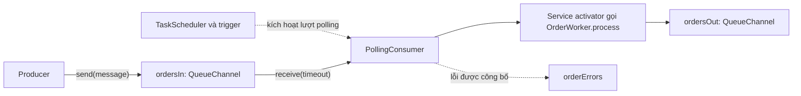

# Service activator với poller

Service activator nối một message với phương thức xử lý nghiệp vụ. Khi đầu vào là một channel có hàng đợi, cần thêm cơ chế chủ động lấy message: **poller điều khiển thời điểm lấy việc; service activator thực hiện việc đó**.

Trong module `SPRING_INTEGRATION_CORE`, bài này kết nối các kiến thức về `Message`, `MessageChannel`, endpoint và Java DSL để xây dựng một luồng xử lý có bộ đệm. Ví dụ xuyên suốt là nhận yêu cầu đặt hàng vào hàng đợi, xác nhận từng yêu cầu và đưa kết quả hoặc lỗi sang channel riêng.

Sau bài học, bạn có thể:

- Nhận biết khi nào một service activator cần poller.
- Cấu hình nhịp polling, thời gian chờ nhận và giới hạn message mỗi lượt.
- Viết cùng một luồng bằng annotation hoặc Java DSL.
- Giải thích ảnh hưởng của scheduler, executor, lỗi và transaction.
- Viết kiểm thử có giới hạn chờ cho luồng xử lý bất đồng bộ.

Các ví dụ dùng Java 17 trở lên và API Spring Integration 6.5. Ứng dụng cần `spring-integration-core`; phần kiểm thử dùng JUnit Jupiter. Nếu dùng Spring Boot, lấy phiên bản thư viện từ bộ quản lý dependency tương ứng của ứng dụng. Các đoạn cấu hình mở rộng bên dưới là phương án thay thế cho phần liên quan trong ví dụ chính.

## 1. Từ channel đến kiểu consumer

Service activator có handler để gọi phương thức nghiệp vụ; endpoint chịu trách nhiệm kết nối handler với channel đầu vào. Với cấu hình thông thường, kiểu channel quyết định cách endpoint nhận message:

| Channel đầu vào | Cách nhận message | Endpoint tương ứng | Cần poller? |
| --- | --- | --- | --- |
| `DirectChannel` | Channel gọi handler khi có `send()` | `EventDrivenConsumer` | Không |
| `ExecutorChannel` | Channel chuyển việc gọi handler cho executor | `EventDrivenConsumer` | Không |
| `QueueChannel` | Consumer chủ động gọi `receive()` | `PollingConsumer` | Có |

Điều kiện tổng quát là `SubscribableChannel` đối với consumer đăng ký nhận và `PollableChannel` đối với consumer polling. Thêm poller không biến một `DirectChannel` thành hàng đợi. [Spring Integration: Message Endpoints](https://docs.spring.io/spring-integration/reference/6.5/endpoint.html)



Trong ví dụ, producer chỉ cần đưa yêu cầu vào `ordersIn`. Sau đó poller lấy yêu cầu để handler xử lý. Giá trị `true` từ `ordersIn.send(...)` xác nhận hàng đợi đã nhận message; để biết kết quả đặt hàng, bên gọi phải quan sát kết quả nghiệp vụ.

Nếu API chỉ cần trả về “đã tiếp nhận”, mô hình này phù hợp. Nếu API phải trả về “đã xác nhận đơn hàng”, cần thiết kế thêm cơ chế nhận kết quả, chẳng hạn gateway request–reply hoặc tra cứu trạng thái theo mã đơn.

## 2. Hai vị trí có poller nhưng trách nhiệm khác nhau

Hãy xét một luồng đọc dữ liệu ngoài hệ thống:

```text
Nguồn dữ liệu
  -> inbound polling adapter
  -> QueueChannel
  -> service activator có poller
  -> xử lý nghiệp vụ
```

Hai poller trong luồng này làm hai việc độc lập:

| Thành phần | Đối tượng được polling | Kết quả của một lần nhận |
| --- | --- | --- |
| `SourcePollingChannelAdapter` | `MessageSource`, ví dụ nguồn đọc bản ghi | Message mới được đưa vào channel |
| `PollingConsumer` của service activator | `PollableChannel`, ví dụ `QueueChannel` | Message đang chờ được chuyển cho handler |

Inbound adapter có thể đưa dữ liệu vào một `DirectChannel`; khi đó service activator phía sau nhận trực tiếp và không cần thêm poller. Nếu cố ý đặt `QueueChannel` ở giữa, cần cấu hình consumer để rút message khỏi hàng đợi ấy. [Spring Integration: Channel Adapter](https://docs.spring.io/spring-integration/reference/6.5/channel-adapter.html)

Ví dụ, nguồn có thể được đọc mỗi 10 giây, còn hàng đợi nghiệp vụ được kiểm tra mỗi 500 ms. Giảm chu kỳ của consumer chỉ làm giảm thời gian chờ tại hàng đợi; muốn dữ liệu được phát hiện sớm hơn ở nguồn phải xem cấu hình inbound adapter.

## 3. Một lượt polling thực hiện những gì?

Có thể hình dung cơ chế trong trường hợp xử lý đồng bộ, không advice phục hồi, bằng mã giả sau:

```text
khi trigger cho phép chạy một lượt:
    đã_xử_lý = 0

    trong khi chưa đạt giới hạn message:
        message = inputChannel.receive(receiveTimeout)

        nếu message không có:
            kết thúc lượt

        handler.handleMessage(message)
        đã_xử_lý += 1

    chờ trigger cho lượt tiếp theo
```

Đây là mô hình giải thích, không phải đoạn mã nguồn để sao chép vào ứng dụng. Nếu handler ném lỗi mà không có cơ chế phục hồi tại chỗ, luồng thực thi rời khỏi lượt hiện tại; không nên giả định các message còn lại trong giới hạn vẫn được xử lý ngay.

Ba điểm cần phân biệt:

1. **Một lượt có thể xử lý nhiều message.** Nếu giới hạn là 5, handler vẫn nhận từng message riêng.
2. **Giới hạn không phải kích thước lô nghiệp vụ.** Handler không tự nhận `List<OrderCommand>`. Muốn gom message cần cơ chế gom nhóm, chẳng hạn aggregator.
3. **Một message chậm làm kéo dài lượt hiện tại.** Trong cấu hình tuần tự, message sau phải đợi handler của message trước hoàn tất.

Giả sử hàng đợi có 12 yêu cầu, `maxMessagesPerPoll = 5`, `receiveTimeout = 0`, không có lỗi và không có yêu cầu mới:

```text
Lượt 1: xử lý tối đa 5 yêu cầu
Lượt 2: xử lý tối đa 5 yêu cầu
Lượt 3: xử lý 2 yêu cầu, lần receive tiếp theo không có dữ liệu
```

Thời gian hoàn thành còn phụ thuộc nhịp trigger, thời gian xử lý và mức độ sẵn sàng của tài nguyên.

## 4. Các tham số cần cấu hình có chủ đích

| Tham số | Ý nghĩa | Giá trị trong ví dụ |
| --- | --- | --- |
| `fixedDelay` | Khoảng nghỉ sau khi tác vụ theo lịch hoàn tất | `500` ms |
| `fixedRate` | Nhịp chạy theo các mốc thời gian định kỳ | Không dùng cùng `fixedDelay` |
| `cron` | Lịch chạy theo biểu thức cron | Dùng thay lịch khoảng thời gian |
| `maxMessagesPerPoll` | Số message tối đa mỗi lượt | `5` |
| `receiveTimeout` | Thời gian chờ cho một lần nhận khi chưa có message | `0` ms |
| `taskExecutor` | Executor thực thi công việc polling | Chưa cấu hình ở ví dụ cơ bản |
| `errorChannel` | Channel lỗi mặc định của error handler cho poller | `orderErrors` |

Với `@Poller`, giá trị số của `fixedDelay`, `fixedRate` và `receiveTimeout` trong bài được hiểu theo mili giây. Mặc định của `maxMessagesPerPoll` phụ thuộc loại endpoint: polling consumer là `-1`, còn inbound polling adapter là `1`; `receiveTimeout` của polling consumer mặc định là `1000` ms. [Mã nguồn @Poller, Spring Integration 6.5.0](https://raw.githubusercontent.com/spring-projects/spring-integration/v6.5.0/spring-integration-core/src/main/java/org/springframework/integration/annotation/Poller.java)

### 4.1. Giới hạn mỗi lượt

Với giá trị dương, chẳng hạn `5`, lượt polling dừng khi đạt giới hạn hoặc khi không nhận được message. Với `-1`, lượt tiếp tục cho tới khi lần nhận trả về không có dữ liệu. Nếu hàng đợi luôn được bổ sung, lượt có thể kéo dài rất lâu. Trong dòng 6.5, giá trị `0` bỏ qua việc lấy message ở lượt polling; nếu muốn dừng endpoint khi vận hành, cần phân biệt thao tác ấy với lifecycle `stop()`. [Mã nguồn AbstractPollingEndpoint](https://raw.githubusercontent.com/spring-projects/spring-integration/v6.5.0/spring-integration-core/src/main/java/org/springframework/integration/endpoint/AbstractPollingEndpoint.java)

Khi mới triển khai, đặt giới hạn dương giúp dễ quan sát thời gian một lượt. Chỉ tăng sau khi đo thời gian xử lý và lượng message tồn.

### 4.2. Khoảng nghỉ và thời gian chờ nhận

`receiveTimeout = 0` khiến lần nhận kết thúc ngay nếu hàng đợi đang rỗng. Giá trị lớn hơn cho phép thread đợi message đến. Thời gian chờ này áp dụng cho **từng lần nhận**, không phải giới hạn tổng thời gian handler chạy.

Nếu một lượt vừa xử lý xong message cuối cùng nhưng chưa đạt giới hạn, lần nhận kế tiếp có thể chờ thêm hết timeout. Vì vậy, khi quan sát một lượt kéo dài, hãy tách thời gian chờ dữ liệu khỏi thời gian thực hiện nghiệp vụ.

`fixedDelay = 500` cũng không hứa rằng mỗi message chờ tối đa 500 ms. Giả sử không có executor riêng, mỗi yêu cầu tốn 200 ms và một lượt xử lý đủ 5 yêu cầu:

```text
Thời gian xử lý một lượt ≈ 5 × 200 ms = 1000 ms
Khoảng từ đầu lượt này đến đầu lượt sau ≈ 1000 + 500 = 1500 ms
Thông lượng ước tính khi luôn có việc ≈ 5 / 1,5 = 3,33 yêu cầu/giây
```

Đây là phép ước lượng cho các giả định vừa nêu, chưa tính chi phí framework, I/O biến động, retry hoặc tranh chấp tài nguyên. Nếu đầu vào thường xuyên là 10 yêu cầu/giây, hàng đợi sẽ tiếp tục tăng dù producer vẫn gửi thành công.

## 5. Ví dụ hoàn chỉnh bằng annotation

Tạo file `PollingOrderConfig.java` trong ứng dụng thực hành:

```java
import org.springframework.context.annotation.Bean;
import org.springframework.context.annotation.Configuration;
import org.springframework.integration.annotation.EndpointId;
import org.springframework.integration.annotation.Poller;
import org.springframework.integration.annotation.ServiceActivator;
import org.springframework.integration.channel.QueueChannel;
import org.springframework.integration.config.EnableIntegration;
import org.springframework.messaging.handler.annotation.Header;

@Configuration
@EnableIntegration
public class PollingOrderConfig {

    @Bean
    public QueueChannel ordersIn() {
        return new QueueChannel(100);
    }

    @Bean
    public QueueChannel ordersOut() {
        return new QueueChannel(100);
    }

    @Bean
    public QueueChannel orderErrors() {
        return new QueueChannel(100);
    }

    @Bean
    public OrderWorker orderWorker() {
        return new OrderWorker();
    }

    public record OrderCommand(String orderId, int quantity) {
    }

    public record OrderReceipt(
            String orderId,
            String status,
            int acceptedQuantity,
            String traceId) {
    }

    public static class OrderWorker {

        @EndpointId("orderPollingEndpoint")
        @ServiceActivator(
            inputChannel = "ordersIn",
            outputChannel = "ordersOut",
            poller = @Poller(
                fixedDelay = "500",
                maxMessagesPerPoll = "5",
                receiveTimeout = "0",
                errorChannel = "orderErrors"
            )
        )
        public OrderReceipt process(
                OrderCommand command,
                @Header(value = "traceId", required = false)
                String traceId) {

            if (command.quantity() <= 0) {
                throw new IllegalArgumentException(
                    "quantity must be greater than zero"
                );
            }

            System.out.printf(
                "Processing order %s on thread %s%n",
                command.orderId(),
                Thread.currentThread().getName()
            );

            return new OrderReceipt(
                command.orderId(),
                "ACCEPTED",
                command.quantity(),
                traceId
            );
        }
    }
}
```

`@EnableIntegration` đăng ký hạ tầng cần thiết trong ví dụ Spring thuần này. `OrderWorker` là Spring bean, nên phương thức có `@ServiceActivator` được nhận diện. `@EndpointId` đặt tên ổn định cho endpoint, thuận tiện khi quan sát và kiểm soát lifecycle. Annotation nhận payload qua tham số `OrderCommand` và lấy header qua `@Header`. [Spring Integration: Annotation Support](https://docs.spring.io/spring-integration/reference/6.5/configuration/annotations.html)

Ví dụ chỉ mô phỏng bước chấp nhận đơn, chưa ghi cơ sở dữ liệu. Trong ứng dụng thật, phương thức có thể gọi một service nghiệp vụ riêng; việc lựa chọn khóa idempotency và transaction phải theo tác dụng thực tế của service ấy.

### 5.1. Gửi một message

Đoạn sau chạy bên trong mã đã có `ApplicationContext context`:

```java
import org.springframework.integration.channel.QueueChannel;
import org.springframework.messaging.Message;
import org.springframework.messaging.support.MessageBuilder;

QueueChannel input =
    context.getBean("ordersIn", QueueChannel.class);
QueueChannel output =
    context.getBean("ordersOut", QueueChannel.class);

Message<PollingOrderConfig.OrderCommand> request =
    MessageBuilder.withPayload(
        new PollingOrderConfig.OrderCommand("ORD-101", 2)
    )
    .setHeader("traceId", "trace-101")
    .build();

boolean accepted = input.send(request, 100);

if (!accepted) {
    throw new IllegalStateException("ordersIn is full");
}

Message<?> reply = output.receive(3000);

if (reply == null) {
    throw new IllegalStateException(
        "No result within the observation timeout"
    );
}

System.out.println(reply.getPayload());
```

Timeout `100` ms là giới hạn chờ **đưa message vào hàng đợi**. Timeout `3000` ms là giới hạn chờ **quan sát kết quả**. Hết thời gian chờ nhận kết quả không tự hủy yêu cầu đang xử lý.

`QueueChannel(100)` giới hạn số message đang đợi. Khi đầy, thao tác gửi có thể phải chờ; biến thể `send(message, timeout)` cho phép đặt giới hạn. Hàng đợi mặc định lưu trong bộ nhớ, nên dữ liệu đang đợi không bền vững qua việc dừng tiến trình. [Spring Integration: Message Channel Implementations](https://docs.spring.io/spring-integration/reference/6.5/channel/implementations.html)

### 5.2. Kết quả của service activator đi đâu?

Phương thức trả về `OrderReceipt`, nên handler tạo reply và gửi vào `ordersOut`. Nếu bỏ `outputChannel`, service activator có thể sử dụng header `replyChannel` để tìm đích trả lời.

Một phương thức `void` phù hợp khi chỉ thực hiện tác dụng nghiệp vụ và kết thúc. Nếu phương thức trả `null` với cấu hình không bắt buộc reply, sẽ không có message đầu ra. Khi hợp đồng yêu cầu luôn có kết quả, cần cấu hình `requiresReply` phù hợp và kiểm tra trường hợp thiếu reply. [Spring Integration: Service Activator](https://docs.spring.io/spring-integration/reference/6.5/service-activator.html)

Hai hàng đợi `ordersOut` và `orderErrors` trong ví dụ dành cho bên gọi hoặc kiểm thử lấy dữ liệu. Trong luồng chạy lâu dài, cần consumer tiếp tục rút dữ liệu khỏi chúng. Nếu đầu ra đầy, handler có thể bị giữ ở bước gửi reply, làm giảm khả năng rút việc khỏi đầu vào.

## 6. Viết cùng luồng bằng Java DSL

Giữ các bean channel và kiểu dữ liệu ở trên. **Gỡ `@ServiceActivator` và `@EndpointId` khỏi `OrderWorker.process()`**, rồi thêm bean sau vào cấu hình. Phương thức nghiệp vụ và `@Header` vẫn giữ nguyên.

```java
import java.time.Duration;

import org.springframework.beans.factory.annotation.Qualifier;
import org.springframework.context.annotation.Bean;
import org.springframework.integration.channel.QueueChannel;
import org.springframework.integration.dsl.IntegrationFlow;
import org.springframework.integration.dsl.Pollers;

@Bean
public IntegrationFlow orderFlow(
        @Qualifier("ordersIn") QueueChannel input,
        @Qualifier("ordersOut") QueueChannel output,
        PollingOrderConfig.OrderWorker worker) {

    return IntegrationFlow
        .from(input)
        .handle(
            worker,
            "process",
            endpoint -> endpoint
                .id("orderPollingEndpoint")
                .poller(
                    Pollers.fixedDelay(Duration.ofMillis(500))
                        .maxMessagesPerPoll(5)
                        .receiveTimeout(0)
                        .errorChannel("orderErrors")
                )
        )
        .channel(output)
        .get();
}
```

`.from(input)` xác định channel đầu vào. `.handle(worker, "process", ...)` tạo service activator, và `.poller(...)` cấu hình cách endpoint ấy lấy message từ channel. `Pollers` là builder tạo đặc tả `PollerMetadata`. [Spring Integration: Pollers trong Java DSL](https://docs.spring.io/spring-integration/reference/6.5/dsl/java-pollers.html)

Chỉ chọn một trong hai cách đăng ký endpoint cho cùng bước xử lý. Nếu giữ annotation rồi thêm DSL, bạn có thể gặp xung đột tên hoặc tạo thêm consumer cùng lấy việc từ một hàng đợi.

Nếu luồng có nhiều bước, poller phải gắn vào endpoint trực tiếp tiêu thụ `PollableChannel`. Ví dụ:

```text
QueueChannel
  -> transformer có poller
  -> DirectChannel
  -> service activator
```

Ở sơ đồ này, transformer rút message khỏi queue; service activator phía sau nhận theo cơ chế đăng ký của `DirectChannel`.

## 7. Tái sử dụng cấu hình poller

Khi nhiều endpoint cần chung quy tắc polling, có thể khai báo poller có tên. Thêm import `PollerSpec`, `Pollers` và `Duration` tương ứng, rồi đặt bean sau trong lớp cấu hình:

```java
@Bean
public PollerSpec orderPoller() {
    return Pollers.fixedDelay(Duration.ofMillis(500))
        .maxMessagesPerPoll(5)
        .receiveTimeout(0)
        .errorChannel("orderErrors");
}
```

Ở phiên bản annotation, thay phần khai báo `poller` bằng:

```java
@ServiceActivator(
    inputChannel = "ordersIn",
    outputChannel = "ordersOut",
    poller = @Poller("orderPoller")
)
```

Khi tham chiếu một bean `PollerMetadata` bằng `@Poller("orderPoller")`, các thuộc tính khác của `@Poller` không được khai báo đồng thời; đưa chúng vào bean được tham chiếu.

Nếu muốn cấu hình mặc định, đặt tên bean bằng hằng `PollerMetadata.DEFAULT_POLLER`. Endpoint nhận từ channel pollable có thể dùng cấu hình mặc định ấy khi không khai báo poller riêng. Đừng nhầm cơ chế này với việc mọi ứng dụng luôn tự có một poller đáp ứng yêu cầu của bạn; cần xác định hạ tầng hoặc cấu hình ứng dụng nào cung cấp nó. [Spring Integration: Using the @Poller Annotation](https://docs.spring.io/spring-integration/reference/6.5/configuration/annotations.html#annotations-poller)

Với bean trả về `PollerSpec`, trả trực tiếp builder như ví dụ; không gọi `getObject()` trong phương thức `@Bean`. Spring sẽ xử lý `FactoryBean` để khởi tạo metadata. Việc tái sử dụng metadata cũng không có nghĩa các endpoint dùng chung một hàng đợi hay một vòng polling duy nhất. [Spring Integration: khai báo PollerSpec](https://docs.spring.io/spring-integration/reference/6.5/dsl/java-pollers.html)

## 8. Scheduler, executor và mức độ song song

Trong cấu hình cơ bản, handler chạy trên thread thực thi tác vụ polling theo lịch. Nếu nghiệp vụ gọi dịch vụ chậm, thread ấy có thể bị chiếm lâu. Với nhiều endpoint, thời gian chờ hoặc xử lý kéo dài có thể làm các tác vụ khác chậm được chạy.

Nếu cần chuyển công việc polling sang executor riêng, có thể thêm bean:

```java
import org.springframework.scheduling.concurrent.ThreadPoolTaskExecutor;

@Bean
public ThreadPoolTaskExecutor orderPollExecutor() {
    ThreadPoolTaskExecutor executor = new ThreadPoolTaskExecutor();
    executor.setCorePoolSize(4);
    executor.setMaxPoolSize(4);
    executor.setQueueCapacity(20);
    executor.setThreadNamePrefix("order-poll-");
    return executor;
}
```

Tiêm thêm tham số `@Qualifier("orderPollExecutor") ThreadPoolTaskExecutor executor` vào phương thức `orderFlow`, rồi thay đặc tả poller của endpoint bằng:

```java
Pollers.fixedDelay(Duration.ofMillis(500))
    .maxMessagesPerPoll(5)
    .receiveTimeout(0)
    .errorChannel("orderErrors")
    .taskExecutor(executor)
```

Spring quản lý lifecycle của bean executor. Trong cấu hình này:

- Scheduler quyết định lúc gửi tác vụ polling.
- Executor quyết định khi nào tác vụ có thread để chạy.
- Một tác vụ polling vẫn xử lý từng message tuần tự theo giới hạn của nó.
- Nhiều tác vụ có thể cùng tồn tại hoặc thực thi khi cấu hình lịch và executor cho phép.

`maxMessagesPerPoll = 5` không tạo năm thread. Pool có bốn thread cũng không đảm bảo lúc nào bốn message đang được xử lý. Mức song song thực tế phụ thuộc số tác vụ sẵn sàng và thời gian chúng chiếm tài nguyên. [Spring Integration: PollerSpec.taskExecutor](https://docs.spring.io/spring-integration/api/org/springframework/integration/dsl/PollerSpec.html#taskExecutor(java.util.concurrent.Executor))

Đặc biệt, khi dùng executor bất đồng bộ, việc hoàn tất tác vụ theo góc nhìn scheduler có thể chỉ là đã bàn giao công việc. Không dùng `fixedDelay` để suy ra khoảng nghỉ chắc chắn giữa hai lần **hoàn tất nghiệp vụ**. Cần theo dõi cả số message trong channel và số tác vụ đợi trong executor. [Spring Integration: Asynchronous Polling](https://docs.spring.io/spring-integration/reference/6.5/endpoint.html#async-polling)

Trước khi tăng mức song song, xác định:

| Câu hỏi thiết kế | Hệ quả cần xử lý |
| --- | --- |
| Handler có dùng trạng thái mutable dùng chung không? | Bảo đảm an toàn khi nhiều thread cùng truy cập |
| Hai yêu cầu cùng một mã đơn có được chạy đồng thời không? | Cần quy tắc tuần tự theo khóa hoặc kiểm soát xung đột |
| Hệ thống phía sau chịu được bao nhiêu lời gọi đồng thời? | Giới hạn pool theo khả năng downstream |
| Tác vụ bị từ chối khi pool và queue đầy sẽ được xử lý thế nào? | Quan sát rejection và thiết kế chính sách phù hợp |
| Có bắt buộc kết quả giữ thứ tự đầu vào không? | Không suy thứ tự hoàn tất từ thứ tự lấy khỏi queue |

Ví dụ, đơn A được lấy trước nhưng gọi API mất 2 giây; đơn B được lấy sau ở thread khác và chỉ mất 100 ms. Kết quả B có thể xuất hiện trước A.

## 9. Lỗi của handler được quan sát ở đâu?

Trong ví dụ, yêu cầu có `quantity <= 0` làm `OrderWorker.process()` ném `IllegalArgumentException`. Producer có thể đã gửi xong từ trước; exception phát sinh ở thread polling không thể tự quay lại stack của lệnh `send()` ban đầu.

Với cơ chế error handler của Spring Integration, lỗi tác vụ polling được công bố dưới dạng `ErrorMessage`. Error handler ưu tiên đích trong header `errorChannel` của message khi có; nếu không, dùng đích mặc định đã cấu hình, như `orderErrors` trong ví dụ. Khi không thay mặc định theo poller, framework có global `errorChannel`. [Spring Integration: Error Handling](https://docs.spring.io/spring-integration/reference/6.5/error-handling.html)

Ví dụ quan sát lỗi, vẫn với `ApplicationContext context` của cấu hình annotation:

```java
import org.springframework.integration.channel.QueueChannel;
import org.springframework.messaging.Message;
import org.springframework.messaging.MessagingException;
import org.springframework.messaging.support.ErrorMessage;
import org.springframework.messaging.support.GenericMessage;

QueueChannel input =
    context.getBean("ordersIn", QueueChannel.class);
QueueChannel errors =
    context.getBean("orderErrors", QueueChannel.class);

boolean accepted = input.send(
    new GenericMessage<>(
        new PollingOrderConfig.OrderCommand("ORD-BAD", 0)
    ),
    100
);

if (!accepted) {
    throw new IllegalStateException("ordersIn is full");
}

Message<?> received = errors.receive(3000);

if (received instanceof ErrorMessage error) {
    Throwable failure = error.getPayload();

    if (failure instanceof MessagingException exception) {
        Message<?> failedMessage = exception.getFailedMessage();
        System.out.println("Failed request: " + failedMessage);
    }

    System.out.println("Failure: " + failure);
}
else {
    throw new IllegalStateException(
        "No error message within the observation timeout"
    );
}
```

Với lỗi xảy ra trong handler, exception thường chứa message xử lý thất bại. Lỗi ở giai đoạn khác, chẳng hạn trước khi lấy được message, có thể không có `failedMessage`; mã xử lý lỗi tổng quát cần tính đến trường hợp này.

### 9.1. Polling lại và retry là hai quyết định khác nhau

Khi message đã được lấy khỏi `QueueChannel` trong bộ nhớ, lần polling sau sẽ lấy message tiếp theo. Message lỗi không tự xuất hiện lại chỉ vì lịch polling tiếp tục.

Nếu muốn gọi lại handler khi gặp lỗi tạm thời, có thể dùng `RequestHandlerRetryAdvice` ở bước handler. Retry cần có giới hạn, khoảng nghỉ và hành động khi hết lượt. Advice này đặt ở cấu hình handler, chẳng hạn `endpoint.advice(retryAdvice)` trong DSL, cần được phân biệt với advice bao quanh thao tác poll. [Spring Integration: Retry Advice](https://docs.spring.io/spring-integration/reference/6.5/handler-advice/classes.html#retry-advice)

Ví dụ, một API có thể đã ghi nhận đơn nhưng phản hồi bị timeout. Gọi lại có nguy cơ tạo tác dụng lặp. Do đó, trước khi bật retry:

1. Xác định loại lỗi được phép thử lại.
2. Chọn khóa idempotency, chẳng hạn mã yêu cầu nghiệp vụ ổn định.
3. Giới hạn số lần thử và thời gian chờ.
4. Chọn nơi lưu yêu cầu hết lượt retry để có thể xử lý tiếp.

`maxMessagesPerPoll` giới hạn số message lấy trong lượt, không thay thế chính sách retry của một message. Không nên đưa message lỗi trở lại ngay cùng hàng đợi theo vòng lặp không giới hạn.

## 10. Transaction: phạm vi nào được bảo vệ?

Có hai nhu cầu thường gặp:

| Nhu cầu | Vị trí đặt transaction |
| --- | --- |
| Bảo vệ một thao tác cập nhật cơ sở dữ liệu của service | Transaction ở service nghiệp vụ |
| Bao gồm thao tác nhận từ tài nguyên transactional và xử lý sau đó | Transaction advice của poller |

Poller transaction có thể bao quanh thao tác nhận và xử lý trên cùng thread. Nó chỉ rollback được những tài nguyên thực sự tham gia transaction tương ứng. Chuyển tiếp sang thread khác tạo ranh giới cần thiết kế riêng. [Spring Integration: Transaction Support](https://docs.spring.io/spring-integration/reference/6.5/transactions.html)

Ví dụ đặc tả poller sau giả định ứng dụng đã có một `PlatformTransactionManager transactionManager` phù hợp với tài nguyên thực tế:

```java
Pollers.fixedDelay(Duration.ofMillis(500))
    .maxMessagesPerPoll(1)
    .receiveTimeout(0)
    .errorChannel("orderErrors")
    .transactional(transactionManager)
```

Đây là phần thay thế đặc tả poller trong DSL, không phải cấu hình transaction manager hoàn chỉnh. Chọn `maxMessagesPerPoll(1)` ở ví dụ để dễ quan sát từng yêu cầu; không suy ra rằng mọi message của một lượt polling luôn thuộc cùng một transaction chỉ từ giới hạn này. [Spring Integration: PollerSpec.transactional](https://docs.spring.io/spring-integration/api/org/springframework/integration/dsl/PollerSpec.html)

Xét tình huống với `QueueChannel` trong bộ nhớ:

```text
1. Poller lấy yêu cầu khỏi ordersIn.
2. Service bắt đầu cập nhật cơ sở dữ liệu.
3. Cập nhật thất bại.
4. Transaction cơ sở dữ liệu rollback.
5. Yêu cầu đã lấy khỏi queue không tự được khôi phục.
```

Rollback cơ sở dữ liệu và khôi phục message là hai khả năng của hai tài nguyên khác nhau. Nếu yêu cầu phải sống qua sự cố và có thể nhận lại khi rollback, cần chọn hàng đợi hoặc message store hỗ trợ cơ chế transactional phù hợp, rồi kiểm chứng hành vi cùng transaction manager đang dùng.

Một lời gọi HTTP ra ngoài cũng không tự bị hoàn tác theo transaction cơ sở dữ liệu. Với quy trình nhiều tác dụng nghiệp vụ, hãy xác định cách phát hiện thao tác đã hoàn thành và cách tiếp tục hoặc bù trừ khi lỗi.

## 11. Kiểm thử luồng polling mà không đoán thời gian bằng sleep

Kiểm thử service bằng cách gọi trực tiếp `worker.process(...)` chỉ chứng minh logic của phương thức. Để kiểm tra wiring của bài này, cần gửi message vào channel thật và quan sát channel kết quả hoặc lỗi.

Hai kiểm thử dưới đây dùng cấu hình annotation ở mục 5. Mỗi kiểm thử tạo context riêng để không dùng chung dữ liệu trong queue:

```java
import org.junit.jupiter.api.Test;
import org.springframework.context.annotation.AnnotationConfigApplicationContext;
import org.springframework.integration.channel.QueueChannel;
import org.springframework.integration.endpoint.PollingConsumer;
import org.springframework.messaging.Message;
import org.springframework.messaging.MessagingException;
import org.springframework.messaging.support.ErrorMessage;
import org.springframework.messaging.support.MessageBuilder;

import static org.junit.jupiter.api.Assertions.*;

class PollingOrderFlowTest {

    @Test
    void shouldProcessMessageFromQueue() {
        try (var context =
                new AnnotationConfigApplicationContext(
                    PollingOrderConfig.class
                )) {

            assertInstanceOf(
                PollingConsumer.class,
                context.getBean("orderPollingEndpoint")
            );

            QueueChannel input =
                context.getBean("ordersIn", QueueChannel.class);
            QueueChannel output =
                context.getBean("ordersOut", QueueChannel.class);

            var request = MessageBuilder.withPayload(
                new PollingOrderConfig.OrderCommand("ORD-201", 3)
            )
            .setHeader("traceId", "trace-201")
            .build();

            assertTrue(input.send(request, 100));

            Message<?> received = output.receive(3000);
            assertNotNull(received, "Expected a receipt");

            var receipt = assertInstanceOf(
                PollingOrderConfig.OrderReceipt.class,
                received.getPayload()
            );

            assertEquals("ORD-201", receipt.orderId());
            assertEquals("ACCEPTED", receipt.status());
            assertEquals(3, receipt.acceptedQuantity());
            assertEquals("trace-201", receipt.traceId());
        }
    }

    @Test
    void shouldPublishHandlerFailureToErrorChannel() {
        try (var context =
                new AnnotationConfigApplicationContext(
                    PollingOrderConfig.class
                )) {

            QueueChannel input =
                context.getBean("ordersIn", QueueChannel.class);
            QueueChannel output =
                context.getBean("ordersOut", QueueChannel.class);
            QueueChannel errors =
                context.getBean("orderErrors", QueueChannel.class);

            var command =
                new PollingOrderConfig.OrderCommand("ORD-INVALID", 0);

            assertTrue(
                input.send(
                    MessageBuilder.withPayload(command).build(),
                    100
                )
            );

            Message<?> received = errors.receive(3000);
            assertNotNull(received, "Expected an error message");

            ErrorMessage error = assertInstanceOf(
                ErrorMessage.class,
                received
            );

            MessagingException failure = assertInstanceOf(
                MessagingException.class,
                error.getPayload()
            );

            assertNotNull(failure.getFailedMessage());
            assertEquals(
                command,
                failure.getFailedMessage().getPayload()
            );

            assertNull(output.receive(0));
        }
    }
}
```

`receive(3000)` đợi có điều kiện và trả về ngay khi có dữ liệu. Nó tránh việc luôn ngủ đủ một khoảng cố định trước khi kiểm tra. Đây là ngân sách chờ của kiểm thử, không phải cam kết độ trễ sản phẩm.

Hai kiểm thử trên xác nhận đường đi thành công và đường đi lỗi; chúng chưa chứng minh tốc độ, số message chính xác trong một lượt hay hành vi khi tiến trình bị dừng. Khi cần kiểm soát lịch chặt chẽ, Spring Integration Test hỗ trợ ngăn endpoint tự khởi động bằng `@SpringIntegrationTest(noAutoStartup = ...)` và thay trigger qua `MockIntegrationContext`; có thể dùng trigger chỉ chạy một lần để quan sát một lượt polling. [Spring Integration: Testing Support](https://docs.spring.io/spring-integration/reference/6.5/testing.html)

Đối với một luồng sẽ chạy thực tế, hãy bổ sung kiểm thử theo yêu cầu cụ thể:

| Kịch bản | Điều cần quan sát |
| --- | --- |
| Queue đầu vào đầy | `send(..., timeout)` thất bại theo hợp đồng tiếp nhận |
| Một lượt có giới hạn message | Số yêu cầu được lấy khi chỉ kích hoạt một lượt có kiểm soát |
| Handler chậm và có executor | Mức song song và thứ tự hoàn tất |
| Retry gặp lỗi tạm thời | Số lần gọi và việc tránh tác dụng lặp |
| Transaction thất bại | Trạng thái cơ sở dữ liệu và trạng thái message ở đúng loại queue |

## 12. Chẩn đoán và chọn cấu hình ban đầu

| Hiện tượng | Điểm cần kiểm tra |
| --- | --- |
| Queue có message nhưng handler không chạy | Endpoint đã khởi động chưa; poller riêng hoặc mặc định có tồn tại không |
| Khởi tạo ứng dụng lỗi khi thêm poller | Channel đầu vào có thực sự là `PollableChannel` không |
| Chỉ thấy một consumer nhận mỗi message | Kiểm tra thiết kế point-to-point và các endpoint cùng tiêu thụ queue |
| Kết quả xuất hiện chậm dù chu kỳ polling ngắn | Thời gian handler, retry, receive timeout và mức bận của scheduler |
| Producer chờ lâu khi gửi | Sức chứa queue và timeout gửi |
| Queue đầu vào tăng khi downstream chậm | Thông lượng xử lý, pool, kết nối và các tác vụ bị nghẽn |
| Lỗi không xuất hiện trong try–catch quanh send | Quan sát error channel của nhánh bất đồng bộ |
| Kết quả đảo thứ tự | Các tác vụ xử lý song song và thời gian mỗi tác vụ |
| Database đã rollback nhưng message không quay lại | Loại queue, khả năng transactional và transaction manager |

Với ví dụ đặt hàng, một cấu hình khởi đầu dễ hiểu là queue hữu hạn, `fixedDelay` rõ ràng, `maxMessagesPerPoll` dương, `receiveTimeout = 0` và một consumer. Sau khi đo, mới quyết định tăng giới hạn mỗi lượt, thay nhịp hoặc bổ sung executor.

Các số liệu cần quan sát cùng nhau là lượng message tồn, thời gian chờ trước xử lý, thời gian nghiệp vụ, tỷ lệ lỗi, số lần retry và mức sử dụng executor. Queue rỗng nhưng executor tồn nhiều tác vụ vẫn có thể là dấu hiệu hệ thống đang chậm.

Khi thiết kế service activator có poller, hãy trả lời rõ bốn câu hỏi: **message nằm ở đâu trước khi xử lý, ai quyết định lúc nhận, ai thực thi nghiệp vụ và yêu cầu lỗi được giữ lại hoặc xử lý tiếp bằng cách nào**. Những quyết định ấy giúp lựa chọn poller phù hợp với hợp đồng tiếp nhận và độ tin cậy của luồng thông điệp.
