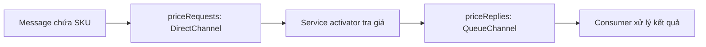

# Service activator với advice chain

## 1. Mục tiêu và bối cảnh

Trong module **SPRING_INTEGRATION_CORE**, service activator kết nối một phương thức nghiệp vụ với luồng thông điệp. Khi phương thức gọi dịch vụ ngoài, ta thường cần thử lại khi lỗi tạm thời, đo thời gian hoặc mở transaction. **Advice chain** giúp đặt các hành vi đó tại ranh giới xử lý của endpoint, để phương thức nghiệp vụ vẫn tập trung vào công việc của nó.

Sau bài này, bạn có thể:

- Gắn advice bằng `@ServiceActivator` và Java DSL.
- Xác định handler nào được bọc, phần nào của flow nằm ngoài phạm vi advice.
- Dự đoán số lần thực thi khi kết hợp nhiều advice.
- Cấu hình retry có giới hạn, phân loại lỗi và recovery.
- Thiết kế kiểm thử cho thành công sau retry, lỗi vĩnh viễn và lỗi downstream.

Các ví dụ dùng **Java 17+, Spring Integration 6.5.x và Spring Retry 2.x**. Đây là mốc API của bài; khi dùng Spring Boot, quản lý phiên bản qua BOM phù hợp. Riêng cấu hình retry của bài dùng `org.springframework.retry.support.RetryTemplate` và `RequestHandlerRetryAdvice.setRetryTemplate(...)`, theo [API Spring Integration 6.5](https://docs.spring.io/spring-integration/docs/6.5.0/api/org/springframework/integration/handler/advice/RequestHandlerRetryAdvice.html).

Kiến thức cần có: `Message` chứa payload và headers, `DirectChannel` chuyển thông điệp đồng bộ cho subscriber, `QueueChannel` giữ thông điệp để nhận sau, và service activator có thể trả kết quả làm reply.

## 2. Advice chain nằm ở đâu?

Giả sử flow tra giá gồm ba bước:



Gắn retry vào service activator nhằm thử lại thao tác tra giá. Cách gắn này tránh chạy lại các bước nghiệp vụ trước đó chỉ vì tra giá gặp lỗi. Spring Integration hỗ trợ advice ở cấp endpoint với mục đích giới hạn hành vi tại điểm xử lý cần thiết. Xem [Adding Behavior to Endpoints](https://docs.spring.io/spring-integration/reference/6.5/handler-advice.html).

Một chuỗi thông thường có dạng:

```text
Message đến handler
  -> Advice A: trước
     -> Advice B: trước
        -> phương thức nghiệp vụ
     <- Advice B: sau hoặc xử lý lỗi
  <- Advice A: sau hoặc xử lý lỗi
Reply được chuyển tới outputChannel
```

Advice có thể trả nguyên kết quả, trả giá trị thay thế hoặc ném exception. Nếu nó nuốt exception rồi trả một giá trị bình thường, advice phía ngoài sẽ quan sát một lần gọi hoàn tất bình thường.

### Phạm vi của request-handler advice

Với service activator sinh reply dựa trên `AbstractReplyProducingMessageHandler`, request-handler advice bọc bước `handleRequestMessage()`. Việc gửi reply và xử lý ở endpoint tiếp theo nằm sau bước này. Ngay cả khi downstream dùng `DirectChannel` và cùng thread, lỗi downstream vẫn nằm ngoài phạm vi retry của handler trước. Đây là ranh giới phương thức được bọc, không chỉ là ranh giới thread.

`HandleMessageAdvice` là cơ chế có phạm vi khác: nó bọc `handleMessage()`. Với handler sinh reply, framework tách loại này khỏi request-handler chain, nên không thể suy luận thứ tự chung chỉ từ vị trí trong danh sách. Bài này dùng các advice kế thừa `AbstractRequestHandlerAdvice`. Xem [Handling Message Advice](https://docs.spring.io/spring-integration/reference/6.5/handler-advice/handle-message.html).

### Phân biệt các điểm mở rộng

| Cơ chế | Điểm cần quan sát hoặc điều khiển | Ví dụ trong bài toán tra giá |
| --- | --- | --- |
| Request-handler advice | Lần xử lý tại handler được chọn | Thử lại lời gọi dịch vụ giá |
| `ChannelInterceptor` | Hoạt động gửi/nhận ở channel | Kiểm tra header trước khi gửi vào channel |
| Advice của poller | Tác vụ polling trong phạm vi poller | Điều khiển transaction khi lấy message từ queue |
| AOP trên bean nghiệp vụ | Lời gọi đi qua proxy của bean | Transaction dùng chung cho các nơi gọi service |
| Endpoint downstream | Một bước xử lý tiếp theo trong flow | Lưu giá hoặc phát sự kiện sau khi tra giá |

Không gắn retry ở cả poller, endpoint và HTTP client mà chưa tính tổng số lần gọi thực tế. Mỗi tầng retry có thể nhân thêm số lần thực hiện thao tác bên dưới.

## 3. Thứ tự advice quyết định hành vi

Đối với các request-handler advice thông thường trong cùng chain, phần tử đầu bọc ngoài cùng; phần tử cuối nằm sát handler. Xem [Ordering Advices within Advice Chain](https://docs.spring.io/spring-integration/reference/6.5/handler-advice/order.html).

Xét cấu hình:

```text
[totalTimingAdvice, pricingRetryAdvice, attemptTimingAdvice]
```

Khi dịch vụ lỗi hai lần rồi thành công ở lần thứ ba:

```text
totalTimingAdvice bắt đầu
  pricingRetryAdvice bắt đầu chu kỳ
    attemptTimingAdvice -> gọi 1 -> lỗi
    chờ backoff
    attemptTimingAdvice -> gọi 2 -> lỗi
    chờ backoff
    attemptTimingAdvice -> gọi 3 -> thành công
  pricingRetryAdvice trả kết quả
totalTimingAdvice hoàn tất
gửi một reply
```

Trong thiết kế này:

- Bộ đo tổng được gọi một lần cho một message; thời gian của nó gồm các lần thử và thời gian backoff.
- Bộ đo từng lần được gọi ba lần; mỗi lần bao quanh một lần gọi nghiệp vụ.
- Chỉ có một kết quả được chuyển ra output channel sau khi chu kỳ retry thành công.
- Thời gian gửi reply và xử lý downstream không thuộc bộ đo request-handler bên ngoài.

Nếu đưa `attemptTimingAdvice` ra trước retry, bộ đo đó cũng chỉ thấy một chu kỳ tổng. Tên bean không tạo ra ý nghĩa “tổng” hay “từng lần”; vị trí trong chain mới quyết định điều đó.

## 4. Ví dụ đầy đủ bằng annotation

### 4.1. Chuẩn bị dependency

Trong một ứng dụng đã quản lý phiên bản thư viện tương thích, cần các dependency sau:

```text
org.springframework.integration:spring-integration-core
org.springframework.retry:spring-retry
org.junit.jupiter:junit-jupiter            # chỉ cho ví dụ kiểm thử
```

Ví dụ cấu hình retry trực tiếp bằng advice và `RetryTemplate`; không cần thêm `@EnableRetry` để kích hoạt chain này.

### 4.2. Cấu hình channel, advice và service

Tạo lớp `AdviceChainDemo` trong dự án thực hành:

```java
package example.integration;

import java.util.concurrent.atomic.AtomicInteger;
import java.util.concurrent.atomic.LongAdder;

import org.springframework.context.annotation.Bean;
import org.springframework.context.annotation.Configuration;
import org.springframework.integration.annotation.ServiceActivator;
import org.springframework.integration.channel.DirectChannel;
import org.springframework.integration.channel.QueueChannel;
import org.springframework.integration.config.EnableIntegration;
import org.springframework.integration.handler.advice.AbstractRequestHandlerAdvice;
import org.springframework.integration.handler.advice.RequestHandlerRetryAdvice;
import org.springframework.messaging.Message;
import org.springframework.retry.support.RetryTemplate;

@Configuration(proxyBeanMethods = false)
@EnableIntegration
public class AdviceChainDemo {

    @Bean
    public DirectChannel priceRequests() {
        return new DirectChannel();
    }

    @Bean
    public QueueChannel priceReplies() {
        return new QueueChannel();
    }

    @Bean
    public TimingAdvice totalTimingAdvice() {
        return new TimingAdvice("total");
    }

    @Bean
    public TimingAdvice attemptTimingAdvice() {
        return new TimingAdvice("attempt");
    }

    @Bean
    public RequestHandlerRetryAdvice pricingRetryAdvice() {
        RetryTemplate template = RetryTemplate.builder()
                .maxAttempts(3)
                .exponentialBackoff(100, 2.0, 1000)
                .retryOn(TemporaryPriceException.class)
                .traversingCauses()
                .build();

        RequestHandlerRetryAdvice advice = new RequestHandlerRetryAdvice();
        advice.setRetryTemplate(template);
        return advice;
    }

    @Bean
    public PricingService pricingService() {
        return new PricingService();
    }

    public static class PricingService {

        private final AtomicInteger calls = new AtomicInteger();

        @ServiceActivator(
                inputChannel = "priceRequests",
                outputChannel = "priceReplies",
                requiresReply = "true",
                adviceChain = {
                    "totalTimingAdvice",
                    "pricingRetryAdvice",
                    "attemptTimingAdvice"
                })
        public String quote(String sku) {
            int attempt = calls.incrementAndGet();

            if ("INVALID".equals(sku)) {
                throw new IllegalArgumentException("SKU không hợp lệ");
            }

            if ("OUTAGE".equals(sku) || attempt < 3) {
                throw new TemporaryPriceException(
                        "Dịch vụ giá chưa sẵn sàng, lần gọi " + attempt);
            }

            return "PRICE:" + sku + ":125000";
        }

        public int calls() {
            return calls.get();
        }
    }

    public static class TemporaryPriceException extends RuntimeException {

        public TemporaryPriceException(String message) {
            super(message);
        }
    }

    public static class TimingAdvice extends AbstractRequestHandlerAdvice {

        private static final System.Logger LOG =
                System.getLogger(TimingAdvice.class.getName());

        private final String label;
        private final LongAdder invocations = new LongAdder();

        public TimingAdvice(String label) {
            this.label = label;
        }

        @Override
        protected Object doInvoke(
                ExecutionCallback callback,
                Object target,
                Message<?> message) throws Exception {

            long started = System.nanoTime();
            try {
                return callback.execute();
            }
            finally {
                invocations.increment();
                long elapsedMicros = (System.nanoTime() - started) / 1000;
                LOG.log(System.Logger.Level.INFO,
                        "advice={0}, durationMicros={1}",
                        label, elapsedMicros);
            }
        }

        public long invocations() {
            return invocations.sum();
        }
    }
}
```

`PricingService` được đăng ký làm Spring bean để annotation trên phương thức được hạ tầng Integration phát hiện. `adviceChain` chứa **tên các bean advice**, theo đúng thứ tự mong muốn. Cú pháp và kiểu thuộc tính được mô tả trong [ServiceActivator API](https://docs.spring.io/spring-integration/docs/6.5.0/api/org/springframework/integration/annotation/ServiceActivator.html).

Bộ đếm của service là mô phỏng cho bài thực hành: mỗi application context mới bắt đầu từ 0. Kịch bản thành công dùng một message trong context đó. Không dùng logic đếm này làm chính sách lỗi trong hệ thống thật.

### 4.3. Đọc chính sách retry

`maxAttempts(3)` cho phép tổng cộng ba lần gọi, gồm lần đầu và tối đa hai lần thử lại. Backoff của ví dụ lần lượt khoảng 100 ms, 200 ms; giới hạn 1000 ms chưa được chạm tới trong chu kỳ này. Chỉ `TemporaryPriceException` và các lớp con được chọn để retry. `traversingCauses()` cho phép tìm loại exception trong chuỗi nguyên nhân. Xem [RetryTemplateBuilder API](https://docs.spring.io/spring-retry/docs/2.0.12/apidocs/org/springframework/retry/support/RetryTemplateBuilder.html).

Việc duyệt nguyên nhân có ý nghĩa khi lỗi nghiệp vụ được bọc trong một `MessagingException`, cũng là lưu ý của [RequestHandlerRetryAdvice API](https://docs.spring.io/spring-integration/docs/6.5.0/api/org/springframework/integration/handler/advice/RequestHandlerRetryAdvice.html).

`INVALID` biểu diễn đầu vào sai: gọi lại với cùng dữ liệu không giúp sửa SKU. `OUTAGE` biểu diễn sự cố kéo dài: handler vẫn lỗi sau ba lần gọi. Một SKU bình thường như `BOOK-42` biểu diễn lỗi tạm thời rồi phục hồi.

### 4.4. Vì sao custom advice dùng finally?

Đặt bộ đếm và ghi thời gian trong `finally` giúp quan sát cả lần thành công lẫn lần ném lỗi. Advice trả nguyên giá trị của `callback.execute()`, nên không biến kết quả lỗi thành reply hoặc làm mất kết quả thành công.

`AbstractRequestHandlerAdvice` cung cấp callback để thực thi phần tiếp theo của chain. Custom advice gọi nhiều lần trong cùng một lần `doInvoke()` cần dùng `cloneAndExecute()` để giữ đúng trạng thái AOP; do đó không nên tự viết retry bằng vòng lặp gọi `execute()` liên tiếp. Xem [Custom Advice Classes](https://docs.spring.io/spring-integration/reference/6.5/handler-advice/custom.html).

Advice thường được dùng như singleton. Giữ thời điểm bắt đầu trong biến local và dùng bộ đếm hỗ trợ đồng thời giúp tránh trộn dữ liệu giữa các message. Nếu thêm metric, dùng nhãn hữu hạn như tên endpoint và loại kết quả; không dùng từng SKU hoặc message ID làm nhãn metric.

## 5. Cấu hình tương đương bằng Java DSL

Nếu chọn Java DSL, bỏ `@ServiceActivator` khỏi `PricingService.quote()`, giữ nguyên các bean service, channel và advice ở trên, rồi thêm bean flow dưới đây vào lớp cấu hình. Chỉ chọn một cách đăng ký endpoint, vì hai consumer cùng đăng ký vào `DirectChannel` sẽ làm thay đổi cách phân phối message.

```java
import org.springframework.integration.dsl.IntegrationFlow;

@Bean
public IntegrationFlow pricingFlow(
        PricingService pricingService,
        TimingAdvice totalTimingAdvice,
        RequestHandlerRetryAdvice pricingRetryAdvice,
        TimingAdvice attemptTimingAdvice) {

    return IntegrationFlow.from("priceRequests")
            .handle(pricingService, "quote",
                    endpoint -> endpoint
                            .id("priceLookupEndpoint")
                            .requiresReply(true)
                            .advice(
                                    totalTimingAdvice,
                                    pricingRetryAdvice,
                                    attemptTimingAdvice))
            .channel("priceReplies")
            .get();
}
```

Trong annotation, ta truyền tên bean; trong DSL, ta truyền các đối tượng advice. Lambda `endpoint -> ...` cấu hình chính endpoint của bước `.handle(...)`. Phương thức `advice(Advice...)` áp dụng chuỗi lồng nhau tại handler. Xem [ConsumerEndpointSpec API](https://docs.spring.io/spring-integration/api/org/springframework/integration/dsl/ConsumerEndpointSpec.html).

Khi flow có transformer, filter hoặc router phía sau, lời gọi `.advice(...)` ở bước này không tự gắn cùng chính sách cho tất cả những bước đó. Hãy đặt advice tại từng thao tác có yêu cầu retry hoặc transaction riêng.

## 6. Hết retry: ném lỗi hay recovery?

### 6.1. Giữ lỗi cho caller

Cấu hình chính không khai báo recovery. Với `OUTAGE`, retry hết ba lần rồi lỗi thoát khỏi handler. Vì input là `DirectChannel`, lời gọi `send()` của người gửi cũng thất bại.

Việc có sẵn bean tên `errorChannel`, hoặc đặt header cùng tên, không tự biến mọi lỗi của lời gọi đồng bộ trực tiếp thành `ErrorMessage`. Cơ chế bắt lỗi phụ thuộc điểm khởi phát: gateway có cấu hình riêng, còn poller và xử lý bất đồng bộ có cơ chế phát lỗi tương ứng. Xem [Error Handling](https://docs.spring.io/spring-integration/reference/6.5/error-handling.html).

### 6.2. Biến thể chuyển lỗi cuối sang channel

Với flow tiếp nhận yêu cầu để xử lý nền, có thể chọn chuyển lỗi cuối sang một channel chuyên xử lý thất bại. Thêm bean sau vào cấu hình:

```java
@Bean
public QueueChannel pricingErrors() {
    return new QueueChannel();
}
```

Thay bean retry bằng biến thể sau:

```java
import org.springframework.integration.handler.advice.ErrorMessageSendingRecoverer;

@Bean
public RequestHandlerRetryAdvice pricingRetryAdvice(
        QueueChannel pricingErrors) {

    RetryTemplate template = RetryTemplate.builder()
            .maxAttempts(3)
            .exponentialBackoff(100, 2.0, 1000)
            .retryOn(TemporaryPriceException.class)
            .traversingCauses()
            .build();

    RequestHandlerRetryAdvice advice = new RequestHandlerRetryAdvice();
    advice.setRetryTemplate(template);
    advice.setRecoveryCallback(
            new ErrorMessageSendingRecoverer(pricingErrors));
    return advice;
}
```

`ErrorMessageSendingRecoverer` là recovery callback phát lỗi cuối dưới dạng `ErrorMessage` tới channel đã chọn. Xem [ErrorMessageSendingRecoverer API](https://docs.spring.io/spring-integration/docs/6.5.0/api/org/springframework/integration/handler/advice/ErrorMessageSendingRecoverer.html).

Với biến thể này, đổi `requiresReply = "true"` thành `requiresReply = "false"`, hoặc đổi `.requiresReply(true)` thành `.requiresReply(false)` nếu dùng DSL. Recoverer này không cung cấp một kết quả giá nghiệp vụ; recovery trả `null`. Nếu vẫn bắt buộc reply, handler có thể phát sinh `ReplyRequiredException` sau recovery. Cờ yêu cầu reply được định nghĩa trong [ServiceActivator API](https://docs.spring.io/spring-integration/docs/6.5.0/api/org/springframework/integration/annotation/ServiceActivator.html).

Hợp đồng của biến thể được thiết kế như sau:

```text
Thành công: một message giá vào priceReplies
Thất bại đã recovery: một ErrorMessage vào pricingErrors, không có reply giá
```

Nếu publish vào channel lỗi cũng thất bại, recovery không còn được xem là hoàn tất. Cần một consumer thực sự xử lý channel lỗi và một chính sách lưu trữ phù hợp; `QueueChannel` trong ví dụ chỉ giữ dữ liệu trong bộ nhớ.

Chính sách “không retry loại lỗi này” không đồng nghĩa “không recovery loại lỗi này”. Khi có recovery callback, phải xác định cả cách xử lý lỗi đầu vào bị từ chối ngay ở lần đầu. Nếu lỗi vĩnh viễn phải luôn thoát ra caller, recovery cần phân loại và ném lại lỗi đó.

### 6.3. Hợp đồng với gateway

Gateway dùng kiểu request-reply cần nhận kết quả, nhận lỗi hoặc kết thúc theo timeout đã định. Recovery chỉ đưa lỗi sang một channel khác mà không tạo reply có thể làm caller tiếp tục chờ. Vì vậy hãy chọn rõ một trong ba hợp đồng:

| Hợp đồng | Kết quả caller cần quan sát |
| --- | --- |
| Tra giá đồng bộ | Giá hợp lệ hoặc exception |
| Tra giá có kết quả thay thế | Một kiểu kết quả biểu diễn rõ thành công/thất bại |
| Tiếp nhận để xử lý nền | Xác nhận tiếp nhận; kết quả và lỗi theo một kênh khác |

Không dùng một chuỗi trống hoặc giá 0 làm “thành công” để che lỗi kết nối. Nếu nghiệp vụ cho phép giá từ cache, kết quả nên mang dấu hiệu về nguồn và độ mới của giá.

## 7. Kết hợp retry với transaction và circuit breaker

### 7.1. Retry và transaction

Hai vị trí tạo ra hai mô hình:

```text
retry -> transaction -> handler
transaction -> retry -> handler
```

Mô hình thứ nhất cho phép mỗi lần thử có ranh giới transaction riêng; mô hình thứ hai đặt cả chu kỳ retry bên trong transaction bên ngoài. Xem [Ordering Advices within Advice Chain](https://docs.spring.io/spring-integration/reference/6.5/handler-advice/order.html).

Tuy nhiên, nếu đã có transaction từ caller và advice dùng `PROPAGATION_REQUIRED`, các lần thử có thể cùng tham gia transaction đang tồn tại. Để yêu cầu transaction vật lý mới cho từng lần, cần cấu hình propagation thích hợp, chẳng hạn `REQUIRES_NEW`, và kiểm tra tài nguyên được sử dụng.

Transaction advice thông thường trong request-handler chain có phạm vi xử lý handler. Spring Integration cung cấp `TransactionHandleMessageAdvice` cho phạm vi `handleMessage()`; transaction vẫn bị giới hạn bởi thread và các tài nguyên tham gia. Xem [Transaction Support](https://docs.spring.io/spring-integration/reference/6.5/handler-advice/tx-handle-message.html).

Trong bài toán tra giá qua HTTP, rollback database không hủy một tác động đã xảy ra ở hệ thống ngoài. Đặc biệt, không giữ transaction database kéo dài qua nhiều khoảng backoff nếu yêu cầu nghiệp vụ không đòi hỏi điều đó.

### 7.2. Retry và circuit breaker

Retry dành cho việc thử lại một thao tác lỗi; circuit breaker ngừng gọi khi phụ thuộc tiếp tục hỏng. Spring Integration có `RequestHandlerCircuitBreakerAdvice`, với ngưỡng lỗi và khoảng chờ trước khi cho phép gọi thử lại. Xem [RequestHandlerCircuitBreakerAdvice API](https://docs.spring.io/spring-integration/docs/6.5.0/api/org/springframework/integration/handler/advice/RequestHandlerCircuitBreakerAdvice.html).

Ví dụ bean tùy chọn:

```java
import org.springframework.integration.handler.advice.RequestHandlerCircuitBreakerAdvice;

@Bean
public RequestHandlerCircuitBreakerAdvice pricingCircuitBreaker() {
    RequestHandlerCircuitBreakerAdvice advice =
            new RequestHandlerCircuitBreakerAdvice();
    advice.setThreshold(5);
    advice.setHalfOpenAfter(10_000);
    return advice;
}
```

Khi thiết kế chain, hãy dự đoán hai trường hợp:

| Thứ tự | Điều circuit breaker có thể quan sát |
| --- | --- |
| Circuit breaker ở ngoài retry | Kết quả cuối của một chu kỳ retry |
| Circuit breaker ở trong retry | Kết quả từng lần thử đi qua nó |

Đây là suy luận từ cấu trúc lồng nhau, với điều kiện exception vẫn được truyền qua vị trí của breaker. Recovery bên trong retry có thể biến thất bại thành kết quả trả về bình thường, khiến breaker bên ngoài không nhìn thấy lỗi đó.

Nếu đặt breaker trong retry, tránh retry tiếp exception biểu thị circuit đang mở: chờ và gọi lại một circuit vẫn mở chỉ làm caller bị giữ lâu hơn. Chính sách chọn riêng `TemporaryPriceException` trong ví dụ giúp phân biệt tình huống này với sự cố tra giá.

## 8. Retry phải đi cùng tính lặp an toàn và giới hạn thời gian

Ví dụ tra giá là thao tác đọc. Nếu thay bằng thu tiền hoặc tạo vận đơn, một timeout không chứng minh thao tác phía ngoài chưa xảy ra. Retry cùng yêu cầu có thể tạo tác động thứ hai.

Thiết kế cho thao tác có tác dụng phụ cần xác định:

1. Khóa nghiệp vụ ổn định, chẳng hạn `paymentRequestId`, giữ nguyên qua các lần thử.
2. Cách hệ thống đích nhận diện một yêu cầu đã xử lý.
3. Cách truy vấn trạng thái khi kết quả lần trước chưa rõ.
4. Giới hạn retry tại client, endpoint và cơ chế redelivery của broker.

Một retry advice không tự cung cấp bảo đảm “exactly once”.

Với ví dụ ba lần gọi, nếu mỗi lời gọi có timeout 800 ms, ước lượng ngân sách riêng cho handler là:

```text
3 × 800 ms + 100 ms + 200 ms = 2700 ms
```

Con số này chưa tính thời gian đợi queue, gửi reply và các bước sau. Nếu yêu cầu toàn bộ phải xong trong 2 giây, chính sách này đã không phù hợp ngay từ thiết kế. Backoff của retry đồng bộ giữ thread trong thời gian chờ; ở tải lớn, cần cân đối số thread và số yêu cầu đồng thời.

Không xem timeout chờ reply của gateway là cơ chế chắc chắn hủy được lời gọi HTTP đang chạy. Đặt connect/read timeout ở client thực hiện thao tác, rồi phối hợp ngân sách của toàn luồng.

## 9. Kiểm thử hành vi qua channel

Kiểm thử bằng cách gọi trực tiếp `pricingService.quote(...)` sẽ bỏ qua endpoint và advice chain được gắn bởi Integration. Hãy gửi message vào `priceRequests` để kiểm tra đúng cấu hình.

Hai kiểm thử dưới đây dành cho **cấu hình annotation ban đầu, chưa thêm recovery hoặc circuit breaker**. Mỗi test tạo context mới để bộ đếm service không bị chia sẻ giữa các kịch bản.

```java
package example.integration;

import org.junit.jupiter.api.AfterEach;
import org.junit.jupiter.api.BeforeEach;
import org.junit.jupiter.api.Test;

import org.springframework.context.annotation.AnnotationConfigApplicationContext;
import org.springframework.integration.channel.DirectChannel;
import org.springframework.integration.channel.QueueChannel;
import org.springframework.messaging.Message;
import org.springframework.messaging.support.MessageBuilder;

import static org.junit.jupiter.api.Assertions.*;

class AdviceChainDemoTest {

    private AnnotationConfigApplicationContext context;
    private DirectChannel requests;
    private QueueChannel replies;

    @BeforeEach
    void openContext() {
        context = new AnnotationConfigApplicationContext(AdviceChainDemo.class);
        requests = context.getBean("priceRequests", DirectChannel.class);
        replies = context.getBean("priceReplies", QueueChannel.class);
    }

    @AfterEach
    void closeContext() {
        context.close();
    }

    @Test
    void transientFailureIsRetriedAndProducesOneReply() {
        assertTrue(requests.send(
                MessageBuilder.withPayload("BOOK-42").build()));

        Message<?> reply = replies.receive(1000);

        assertNotNull(reply);
        assertEquals("PRICE:BOOK-42:125000", reply.getPayload());
        assertNull(replies.receive(0));

        assertEquals(3,
                context.getBean(AdviceChainDemo.PricingService.class).calls());
        assertEquals(1L,
                context.getBean("totalTimingAdvice",
                        AdviceChainDemo.TimingAdvice.class).invocations());
        assertEquals(3L,
                context.getBean("attemptTimingAdvice",
                        AdviceChainDemo.TimingAdvice.class).invocations());
    }

    @Test
    void invalidSkuIsNotRetried() {
        assertThrows(RuntimeException.class,
                () -> requests.send(
                        MessageBuilder.withPayload("INVALID").build()));

        assertNull(replies.receive(0));
        assertEquals(1,
                context.getBean(AdviceChainDemo.PricingService.class).calls());
        assertEquals(1L,
                context.getBean("totalTimingAdvice",
                        AdviceChainDemo.TimingAdvice.class).invocations());
        assertEquals(1L,
                context.getBean("attemptTimingAdvice",
                        AdviceChainDemo.TimingAdvice.class).invocations());
    }
}
```

Assertion chấp nhận `RuntimeException` vì ví dụ tập trung vào chính sách retry; một bộ kiểm thử ứng dụng cụ thể nên kiểm tra thêm loại lỗi và nguyên nhân nghiệp vụ. Không chỉ khẳng định “có exception”, vì một lỗi sai cấu hình cũng có thể làm test đó pass.

Các kịch bản cần mở rộng:

| Kịch bản | Quan sát mong đợi trong context mới |
| --- | --- |
| `OUTAGE`, không recovery | Ném lỗi; service 3 lần; không có reply |
| `OUTAGE`, recovery sang channel lỗi | Service 3 lần; một `ErrorMessage`; không có reply giá |
| Đảo vị trí bộ đo từng lần ra ngoài retry | Bộ đo đó chỉ đếm một chu kỳ |
| Downstream ném lỗi sau khi tra giá thành công | Không gọi lại service do retry advice của bước tra giá |
| Cấu hình DSL thay annotation | Cùng kết quả và số lần gọi như cấu hình gốc |
| Nhiều message đồng thời | Không trộn dữ liệu đo giữa các message |

Để kiểm tra lỗi downstream, thay queue đầu ra bằng `DirectChannel` và thêm một handler phía sau luôn ném lỗi. Với service mô phỏng vẫn lỗi hai lần đầu, số lần tra giá vẫn là **3**; downstream chỉ được gọi **1** lần. Lời gọi gửi ban đầu có thể nhận lỗi downstream, nhưng retry tại bước tra giá đã kết thúc trước khi lỗi đó xảy ra.

Không khẳng định thời gian thực thi bằng một giá trị mili giây chính xác: lịch thread và môi trường chạy có thể thay đổi. Số lần gọi, số reply và vị trí lỗi là bằng chứng ổn định hơn cho thứ tự advice.

## 10. Chẩn đoán các lỗi thường gặp

| Hiện tượng | Điều cần kiểm tra |
| --- | --- |
| Advice không chạy | Service có phải Spring bean; message có đi qua đúng endpoint; tên bean trong annotation có đúng |
| Retry không nhận lỗi tạm thời | Loại exception được chọn và nguyên nhân bị bọc; cấu hình duyệt causes |
| Đo “mỗi lần thử” nhưng chỉ có một số đo | Advice đo nằm ngoài retry |
| Hết retry nhưng caller tưởng thành công | Recovery hoặc custom advice đã nuốt lỗi; cần đọc lại hợp đồng kết quả |
| Recovery xong lại có lỗi bắt buộc reply | Recoverer trả `null` trong endpoint có `requiresReply=true` |
| Lỗi downstream không làm tra giá được retry | Kiểm tra phạm vi request-handler advice; đặt chính sách tại bước thực sự lỗi |
| Cùng yêu cầu tạo nhiều tác động | Nhiều tầng retry/redelivery; thiếu khóa lặp an toàn |
| Sau khi thêm DSL, hành vi lúc đúng lúc sai | Cả annotation và DSL cùng đăng ký consumer trên input channel |

Khi đọc một advice chain, bắt đầu từ thao tác nghiệp vụ cần bảo vệ, xác định ranh giới được bọc rồi đi từ advice ngoài vào trong. Với flow tra giá của bài, ba tiêu chí thiết kế là: chỉ thử lại lỗi có khả năng phục hồi, giữ đúng hợp đồng reply/lỗi, và chứng minh số lần thực thi bằng kiểm thử qua channel.
