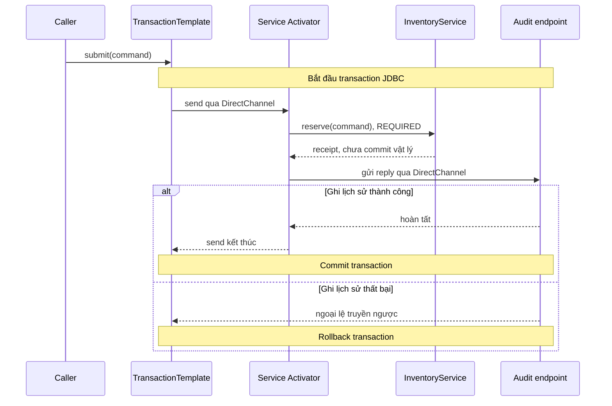
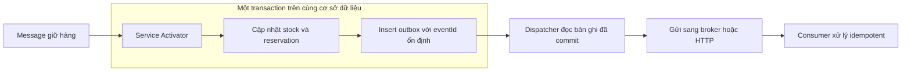

# Service activator và transaction

## Mục tiêu bài học

Trong module `SPRING_INTEGRATION_CORE`, Service Activator nối luồng thông điệp với phương thức nghiệp vụ của một Spring bean. Khi phương thức cập nhật dữ liệu, điều cần xác định là **transaction bắt đầu ở đâu, kết thúc khi nào và bao gồm những thao tác nào**.

Sau bài này, bạn có thể:

- Chọn transaction ở service, ở phía gọi, ở handler hoặc ở poller.
- Giải thích ảnh hưởng của `DirectChannel`, `QueueChannel` và `ExecutorChannel`.
- Phân biệt rollback dữ liệu, khôi phục message và xử lý thông báo lỗi.
- Thiết kế retry, idempotency và phép kiểm chứng phù hợp cho một luồng có Service Activator.

Bài tập trung vào transaction imperative dùng JDBC và `PlatformTransactionManager`. Transaction reactive cần mô hình ngữ cảnh riêng và không được suy ra từ ví dụ gắn với thread trong bài.

## 1. Service Activator không tự mở transaction

`@ServiceActivator` và toán tử `.handle()` của Java DSL khai báo cách gọi nghiệp vụ từ một message. Chúng không mặc nhiên tạo transaction cơ sở dữ liệu. Muốn có transaction, cần thêm cơ chế như `@Transactional`, `TransactionTemplate`, transaction advice hoặc poller có cấu hình transaction. Vai trò của endpoint và cách tạo reply được mô tả trong [tài liệu Service Activator](https://docs.spring.io/spring-integration/reference/service-activator.html).

Hãy tách ba câu hỏi:

| Câu hỏi | Thành phần quyết định |
| --- | --- |
| Phương thức nào nhận payload và tạo kết quả? | Service Activator |
| Đoạn thực thi nào được bao trong transaction? | Transaction interceptor hoặc transaction template |
| Tài nguyên nào thực sự commit/rollback? | Transaction manager và tài nguyên tham gia |

Một message có thể đi qua nhiều endpoint nhưng chỉ có một transaction. Ngược lại, một lần xử lý message có thể mở nhiều transaction độc lập.

Ví dụ nghiệp vụ giữ hàng:

1. Giảm lượng hàng khả dụng.
2. Ghi nhận yêu cầu giữ hàng.
3. Ghi lịch sử xử lý.
4. Gửi thông báo cho hệ thống bên ngoài.

Hai thao tác đầu cần cùng thành công hoặc cùng thất bại. Thao tác thứ ba có thể cần chung transaction, tùy hợp đồng nghiệp vụ. Thao tác thứ tư cần xem xét tài nguyên và cơ chế giao tiếp; một HTTP request không tự tham gia transaction JDBC.

## 2. Ba phạm vi cần nhìn trên sơ đồ luồng

### 2.1. Phạm vi gọi phương thức

Nếu transaction chỉ được khai báo trên phương thức service, phạm vi thường là:

```text
Service Activator nhận message
  -> gọi proxy của service
       BEGIN
       chạy phương thức nghiệp vụ
       COMMIT hoặc ROLLBACK
  -> nhận giá trị trả về
  -> tạo và gửi reply sang output channel
```

Khi không có transaction bên ngoài, commit của service xảy ra trước bước gửi reply. Vì vậy, lỗi ở endpoint nhận reply không thể quay lại hoàn tác một transaction đã commit.

Nếu service tham gia transaction đang tồn tại với propagation `REQUIRED`, việc thoát phương thức chỉ kết thúc phạm vi logic của service; commit vật lý vẫn do phạm vi bên ngoài quyết định.

### 2.2. Phạm vi handler và đoạn downstream đồng bộ

Một transaction bao quanh toàn bộ `handleMessage()` có thể gồm cả gọi nghiệp vụ và gửi reply qua các endpoint đồng bộ tiếp theo:

```text
BEGIN
  Service Activator
    -> service
    -> gửi reply
    -> endpoint tiếp theo trên cùng thread
COMMIT hoặc ROLLBACK
```

Phạm vi này rộng hơn transaction chỉ bao quanh phương thức nghiệp vụ.

### 2.3. Phạm vi nhận message của poller

Với một polling consumer, transaction có thể bắt đầu trước `receive()`:

```text
BEGIN
  receive message
  -> Service Activator
  -> cập nhật dữ liệu
  -> downstream đồng bộ
COMMIT hoặc ROLLBACK
```

Điều này có ý nghĩa đối với việc khôi phục message khi thao tác nhận message dùng một tài nguyên có khả năng rollback. Một queue trong bộ nhớ không có đặc tính đó chỉ nhờ đặt transaction ở poller.

## 3. Channel ảnh hưởng đến transaction như thế nào?

Trong mô hình JDBC thông thường, ngữ cảnh transaction được gắn với thread thực thi. `DirectChannel` gọi handler trên thread của bên gửi; `ExecutorChannel` thường giao việc sang thread khác; queue tạo điểm bàn giao để consumer nhận về sau. Không thể dùng header để vận chuyển transaction JDBC qua các điểm bàn giao này. Xem [các loại Message Channel](https://docs.spring.io/spring-integration/reference/channel/implementations.html).

| Đường đi | Transaction của bên gửi có bao phủ nghiệp vụ không? |
| --- | --- |
| Caller → `DirectChannel` → Service Activator | Có thể, khi nghiệp vụ tham gia đúng transaction và tài nguyên |
| Caller → `QueueChannel` → poller → Service Activator | Không tự truyền qua queue; consumer cần phạm vi transaction riêng |
| Caller → `ExecutorChannel` → Service Activator | Không được dựa vào transaction của caller |
| Poller có transaction → Service Activator → `DirectChannel` → endpoint khác | Có thể bao phủ phần xử lý đồng bộ phía sau |
| Service Activator → tự tạo thread hoặc gọi `@Async` | Công việc ở thread mới không tự tham gia transaction đang có |

Cùng thread là điều kiện quan trọng, nhưng chưa đủ: cần dùng tài nguyên được quản lý bởi transaction manager tương ứng, tránh propagation tách transaction và để lỗi đi đến đúng phạm vi quyết định rollback.

Đưa message vào queue cũng không buộc transaction của caller commit ngay tại lệnh `send()`. Caller vẫn kết thúc transaction theo phạm vi đã khai báo; phần consumer ở phía sau hoạt động với phạm vi khác.

## 4. Ví dụ: giữ hàng và ghi lịch sử

### 4.1. Điều kiện dựng ví dụ

Các đoạn Java dùng Java 17 trở lên, Spring Integration Java DSL và Spring JDBC. Trong ứng dụng Spring Boot, có thể dùng các dependency do BOM của ứng dụng quản lý:

- `spring-boot-starter-integration`.
- `spring-boot-starter-jdbc`.
- H2 cho phần thực hành.
- `spring-boot-starter-test` nếu viết kiểm thử.

Giả sử ứng dụng đã có `DataSource`, quét các bean trong ví dụ và khởi tạo schema sau. Mỗi kiểu `public` nằm trong tệp Java tương ứng; các ví dụ cấu hình thay thế được chỉ rõ ở từng phần.

```sql
create table stock (
    sku varchar(64) primary key,
    available integer not null check (available >= 0)
);

create table reservation (
    order_id varchar(64) primary key,
    sku varchar(64) not null,
    quantity integer not null check (quantity > 0)
);

create table reservation_audit (
    order_id varchar(64) primary key,
    detail varchar(255) not null
);

insert into stock(sku, available) values ('BOOK-01', 10);
```

Payload đầu vào và kết quả nghiệp vụ:

```java
public record ReserveCommand(String orderId, String sku, int quantity) {
}

public record ReservationReceipt(String orderId, String sku, int quantity) {
}
```

### 4.2. Cấu hình nền tảng

```java
import javax.sql.DataSource;

import org.springframework.context.annotation.Bean;
import org.springframework.context.annotation.Configuration;
import org.springframework.integration.channel.DirectChannel;
import org.springframework.integration.config.EnableIntegration;
import org.springframework.jdbc.core.JdbcTemplate;
import org.springframework.jdbc.datasource.DataSourceTransactionManager;
import org.springframework.transaction.PlatformTransactionManager;
import org.springframework.transaction.annotation.EnableTransactionManagement;

@Configuration
@EnableIntegration
@EnableTransactionManagement
public class ReservationFlowConfig {

    @Bean
    public PlatformTransactionManager transactionManager(DataSource dataSource) {
        return new DataSourceTransactionManager(dataSource);
    }

    @Bean
    public JdbcTemplate jdbcTemplate(DataSource dataSource) {
        return new JdbcTemplate(dataSource);
    }

    @Bean
    public DirectChannel reserveInput() {
        return new DirectChannel();
    }

    @Bean
    public DirectChannel reservationEvents() {
        return new DirectChannel();
    }
}
```

`JdbcTemplate` và transaction manager cùng dùng một `DataSource`. Ví dụ chỉ có một transaction manager. Khi ứng dụng có nhiều manager, cần chọn rõ manager dùng cho từng phạm vi.

### 4.3. Service có transaction

```java
import org.springframework.jdbc.core.JdbcTemplate;
import org.springframework.stereotype.Service;
import org.springframework.transaction.annotation.Transactional;

@Service
public class InventoryService {

    private final JdbcTemplate jdbc;

    public InventoryService(JdbcTemplate jdbc) {
        this.jdbc = jdbc;
    }

    @Transactional(transactionManager = "transactionManager")
    public ReservationReceipt reserve(ReserveCommand command) {
        if (command.quantity() <= 0) {
            throw new IllegalArgumentException("Số lượng phải lớn hơn 0");
        }

        int changed = jdbc.update(
                """
                update stock
                   set available = available - ?
                 where sku = ? and available >= ?
                """,
                command.quantity(),
                command.sku(),
                command.quantity());

        if (changed != 1) {
            throw new IllegalStateException(
                    "Không tìm thấy SKU hoặc không đủ hàng: " + command.sku());
        }

        jdbc.update(
                """
                insert into reservation(order_id, sku, quantity)
                values (?, ?, ?)
                """,
                command.orderId(),
                command.sku(),
                command.quantity());

        return new ReservationReceipt(
                command.orderId(), command.sku(), command.quantity());
    }
}
```

Câu lệnh update có điều kiện tránh mô hình đọc số dư rồi ghi lại dựa trên dữ liệu có thể đã thay đổi. Khóa chính `order_id` ngăn ghi hai bản giữ hàng trùng khóa. Nếu insert thất bại, ngoại lệ từ Spring JDBC khiến phần giảm hàng bị rollback theo cấu hình transaction mặc định.

Khóa chính mới chỉ chặn ghi trùng. Nó chưa cung cấp hợp đồng idempotency trả lại kết quả cũ cho một message được gửi lại.

### 4.4. Hai endpoint trên luồng đồng bộ

```java
import org.springframework.integration.annotation.ServiceActivator;
import org.springframework.stereotype.Component;

@Component
public class ReservationEndpoint {

    private final InventoryService inventoryService;

    public ReservationEndpoint(InventoryService inventoryService) {
        this.inventoryService = inventoryService;
    }

    @ServiceActivator(
            inputChannel = "reserveInput",
            outputChannel = "reservationEvents")
    public ReservationReceipt reserve(ReserveCommand command) {
        return inventoryService.reserve(command);
    }
}
```

```java
import org.springframework.integration.annotation.ServiceActivator;
import org.springframework.jdbc.core.JdbcTemplate;
import org.springframework.stereotype.Component;

@Component
public class ReservationAuditEndpoint {

    private final JdbcTemplate jdbc;

    public ReservationAuditEndpoint(JdbcTemplate jdbc) {
        this.jdbc = jdbc;
    }

    @ServiceActivator(inputChannel = "reservationEvents")
    public void record(ReservationReceipt receipt) {
        jdbc.update(
                """
                insert into reservation_audit(order_id, detail)
                values (?, ?)
                """,
                receipt.orderId(),
                "Đã giữ " + receipt.quantity() + " sản phẩm " + receipt.sku());
    }
}
```

Endpoint đầu gọi sang một bean nghiệp vụ khác. Cách này làm rõ lời gọi qua proxy chứa transaction advice. Trong chế độ proxy thông thường, tự gọi `this.reserve(...)` bên trong cùng đối tượng không đi qua proxy để kích hoạt annotation transaction mới; bean tạo bằng `new` ngoài Spring cũng không được xử lý annotation tự động. Xem [cơ chế sử dụng @Transactional](https://docs.spring.io/spring-framework/reference/data-access/transaction/declarative/annotations.html).

Endpoint ghi lịch sử không tự mở transaction. Khi không có transaction bên ngoài, nó chạy sau commit của `InventoryService`; khi đã có transaction bao ngoài, `JdbcTemplate` của nó có thể tham gia transaction chung.

### 4.5. Gửi message và quan sát

Trong một phương thức có sẵn biến `reserveInput` là channel được inject:

```java
var command = new ReserveCommand("ORD-100", "BOOK-01", 2);
var message = org.springframework.messaging.support.MessageBuilder
        .withPayload(command)
        .build();

boolean sent = reserveInput.send(message);
if (!sent) {
    throw new IllegalStateException("Channel không nhận message");
}
```

Với dữ liệu ban đầu, kết quả thành công là `available = 8`, có bản ghi `reservation` và có bản ghi lịch sử của `ORD-100`.

Để thấy giới hạn của transaction trên service, đặt trước một dòng `reservation_audit` mang khóa `ORD-101`, nhưng chưa có `reservation` cho đơn đó. Sau đó gửi lệnh giữ 2 sản phẩm cho `ORD-101`.

Trình tự khi caller không có transaction:

1. Service giảm hàng và tạo reservation.
2. Transaction của service commit.
3. Service Activator gửi receipt tới `reservationEvents`.
4. Endpoint lịch sử gặp khóa trùng và ném lỗi.
5. Caller nhận lỗi qua lời gọi đồng bộ, nhưng giữ hàng đã commit.

Đây là ví dụ cho trạng thái **lời gọi báo lỗi nhưng một phần nghiệp vụ đã thành công**. Vấn đề nằm ở phạm vi transaction cần thiết cho hợp đồng nghiệp vụ.

## 5. Bao transaction từ phía gọi

Nếu caller chịu trách nhiệm cho toàn bộ thao tác giữ hàng và ghi lịch sử, có thể mở transaction trước `send()`:

```java
import org.springframework.beans.factory.annotation.Qualifier;
import org.springframework.messaging.MessageChannel;
import org.springframework.messaging.support.MessageBuilder;
import org.springframework.stereotype.Service;
import org.springframework.transaction.PlatformTransactionManager;
import org.springframework.transaction.support.TransactionTemplate;

@Service
public class ReservationSubmission {

    private final MessageChannel input;
    private final TransactionTemplate transactions;

    public ReservationSubmission(
            @Qualifier("reserveInput") MessageChannel input,
            PlatformTransactionManager transactionManager) {
        this.input = input;
        this.transactions = new TransactionTemplate(transactionManager);
    }

    public void submit(ReserveCommand command) {
        transactions.executeWithoutResult(status -> {
            boolean sent = input.send(
                    MessageBuilder.withPayload(command).build());
            if (!sent) {
                throw new IllegalStateException("Gửi message thất bại");
            }
        });
    }
}
```

Ở đây, `InventoryService.reserve()` dùng propagation mặc định `REQUIRED` nên tham gia transaction của `TransactionTemplate`. Endpoint lịch sử cũng chạy đồng bộ với cùng `DataSource`. Lỗi ghi lịch sử thoát ra khỏi callback khiến cả giảm hàng lẫn tạo reservation rollback.



Một facade có `@Transactional` được gọi qua Spring proxy có thể đóng vai trò tương tự. Nếu dùng messaging gateway, cần xác định transaction nằm ở facade hay advice của gateway; việc có gateway tự nó không chứng minh toàn luồng được bao trong transaction. Cách gateway chuyển lỗi thành kết quả bình thường cũng có thể ảnh hưởng quyết định commit.

## 6. Bao toàn handler bằng transaction advice

Khi endpoint là nơi phù hợp để bắt đầu đơn vị công việc, dùng `TransactionHandleMessageAdvice` để bao cả handler và phần gửi reply đồng bộ. `TransactionInterceptorBuilder(true)` tạo loại advice này. Một `TransactionInterceptor` thông thường đặt trong request handler advice chain có phạm vi hẹp hơn và không tự bao toàn bộ downstream. Xem [transaction advice cho handler](https://docs.spring.io/spring-integration/reference/handler-advice/tx-handle-message.html).

Thêm bean sau vào cấu hình:

```java
@Bean
public org.springframework.transaction.interceptor.TransactionInterceptor
        reservationFlowTx(PlatformTransactionManager transactionManager) {
    return new org.springframework.integration.transaction.TransactionInterceptorBuilder(true)
            .transactionManager(transactionManager)
            .build();
}
```

Sau đó **thay annotation** trên `ReservationEndpoint.reserve()` bằng:

```java
@ServiceActivator(
        inputChannel = "reserveInput",
        outputChannel = "reservationEvents",
        adviceChain = "reservationFlowTx")
public ReservationReceipt reserve(ReserveCommand command) {
    return inventoryService.reserve(command);
}
```

Các bước giảm hàng, tạo reservation và ghi lịch sử nay có thể dùng chung transaction do handler advice mở. `@Transactional` trên service vẫn hữu ích khi service được gọi từ đường khác; với `REQUIRED`, nó tham gia phạm vi bên ngoài.

Nếu chọn Java DSL, đăng ký endpoint thay cho `ReservationEndpoint`:

```java
@Bean
public org.springframework.integration.dsl.IntegrationFlow reserveDirectFlow(
        InventoryService inventoryService,
        @org.springframework.beans.factory.annotation.Qualifier("reservationFlowTx")
        org.springframework.transaction.interceptor.TransactionInterceptor flowTx) {

    return org.springframework.integration.dsl.IntegrationFlow
            .from("reserveInput")
            .handle(inventoryService, "reserve",
                    endpoint -> endpoint.advice(flowTx))
            .channel("reservationEvents")
            .get();
}
```

Giữ lại endpoint lịch sử. Chỉ chọn một cách đăng ký consumer cho `reserveInput`: annotation hoặc DSL. Nhiều consumer trên `DirectChannel` là các đích cạnh tranh, không phải các bước tuần tự của cùng luồng.

Advice không biến downstream bất đồng bộ thành một phần của transaction hiện tại. Nếu đổi `reservationEvents` thành một queue trong bộ nhớ, việc đưa reply vào queue thành công có thể khiến transaction hiện tại commit; lỗi ghi lịch sử xảy ra về sau thuộc một phạm vi khác.

## 7. Service Activator nhận message bằng poller có transaction

Với `QueueChannel`, Service Activator cần polling consumer. Bổ sung các bean sau vào cấu hình nền tảng; đường này dùng `reserveQueue`, tách với đầu vào đồng bộ `reserveInput`:

```java
@Bean
public org.springframework.integration.channel.QueueChannel reserveQueue() {
    return new org.springframework.integration.channel.QueueChannel(100);
}

@Bean
public org.springframework.integration.dsl.IntegrationFlow reservePolledFlow(
        InventoryService inventoryService,
        PlatformTransactionManager transactionManager) {

    return org.springframework.integration.dsl.IntegrationFlow
            .from("reserveQueue")
            .handle(inventoryService, "reserve",
                    endpoint -> endpoint.poller(
                            org.springframework.integration.dsl.Pollers
                                    .fixedDelay(1000)
                                    .maxMessagesPerPoll(1)
                                    .receiveTimeout(0)
                                    .transactional(transactionManager)))
            .channel("reservationEvents")
            .get();
}
```

Ở đây:

- Poller tạo transaction cho thao tác nhận và xử lý message.
- `maxMessagesPerPoll(1)` giúp ví dụ dễ quan sát từng message.
- `receiveTimeout(0)` tránh chờ message khi queue đang rỗng.
- Service và endpoint lịch sử dùng cùng tài nguyên JDBC, cùng thread xử lý.
- Ngoại lệ đủ điều kiện rollback thoát qua transaction advice sẽ khiến các thay đổi JDBC trong phạm vi này rollback.

Phạm vi bao quanh thao tác poll được mô tả trong [Transaction Support](https://docs.spring.io/spring-integration/reference/transactions.html); tùy chọn Java DSL nằm trong [API PollerSpec](https://docs.spring.io/spring-integration/api/org/springframework/integration/dsl/PollerSpec.html).

Bên gửi có thể thực hiện:

```java
boolean queued = reserveQueue.send(
        org.springframework.messaging.support.MessageBuilder
                .withPayload(new ReserveCommand("ORD-200", "BOOK-01", 2))
                .build(),
        1000);

if (!queued) {
    throw new IllegalStateException("Queue không nhận message trong thời hạn");
}
```

`queued == true` xác nhận việc bàn giao vào queue, chưa xác nhận giữ hàng thành công. Bên gửi có thể đã hoàn tất công việc trước khi poller xử lý.

### 7.1. Rollback JDBC không đưa message về queue trong bộ nhớ

`new QueueChannel(100)` sử dụng hàng đợi trong bộ nhớ, không tự tham gia transaction JDBC. Khi poller đã lấy message ra rồi nghiệp vụ thất bại:

```text
Queue trước receive:       [ORD-200]
Sau receive:              []
Nghiệp vụ gặp lỗi:         rollback stock và reservation
Queue sau rollback JDBC:  []   <- không tự có lại ORD-200
```

Một kênh lỗi có thể nhận thông báo thất bại, nhưng thông báo đó không tự requeue message đầu vào. Nếu bài toán yêu cầu không mất yêu cầu khi tiến trình dừng hoặc nghiệp vụ rollback, cần nguồn lưu bền và chiến lược redelivery phù hợp.

### 7.2. Queue dùng JDBC Message Store

Một lựa chọn là queue được lưu bằng `JdbcChannelMessageStore`. Khi thao tác lấy message và cập nhật nghiệp vụ cùng tham gia một transaction JDBC trên cùng cơ sở dữ liệu, rollback có thể hoàn tác cả việc lấy message khỏi store.

Các điều kiện phải được thiết kế cùng nhau:

1. Khởi tạo schema của Spring Integration phù hợp phiên bản dependency.
2. Cấu hình query provider đúng hệ quản trị cơ sở dữ liệu.
3. Cho store và nghiệp vụ dùng tài nguyên nằm trong cùng transaction.
4. Bắt đầu transaction trước thao tác receive của poller.
5. Giữ phần cần nguyên tử trong cùng phạm vi, tránh tách bằng `REQUIRES_NEW`.
6. Có chính sách giới hạn xử lý lại và cách ly message luôn thất bại.

Với cấu hình serialization mặc định, payload và các header được lưu phải đáp ứng yêu cầu serialization; hai record minh họa ban đầu chưa khai báo `Serializable`. Khi chuyển sang store, cần bổ sung khả năng serialization hoặc chọn cách tuần tự hóa phù hợp, đồng thời tránh lưu các đối tượng chỉ có ý nghĩa trong bộ nhớ tiến trình.

Spring Integration phân biệt store tổng quát với store tối ưu cho channel; xem [JDBC Message Store](https://docs.spring.io/spring-integration/reference/jdbc/message-store.html).

Một queue lưu bền ở cơ sở dữ liệu khác, hoặc message broker dùng transaction riêng, không tự tạo tính nguyên tử với dữ liệu nghiệp vụ chỉ vì cả hai đều hỗ trợ transaction.

## 8. Propagation, isolation và timeout

### 8.1. Propagation quyết định tham gia hay tách phạm vi

| Propagation | Ý nghĩa trong ví dụ giữ hàng |
| --- | --- |
| `REQUIRED` | Tham gia transaction đang có; nếu chưa có thì tạo mới |
| `REQUIRES_NEW` | Tạo transaction vật lý độc lập, tạm treo phạm vi đang có |
| `MANDATORY` | Yêu cầu bên gọi đã mở transaction; thiếu thì báo lỗi |
| `SUPPORTS` | Có thể tham gia transaction có sẵn, nhưng không bảo đảm tự mở transaction |
| `NOT_SUPPORTED` | Chạy ngoài transaction hiện tại |
| `NESTED` | Dùng savepoint khi transaction manager và tài nguyên hỗ trợ |

Nếu service giữ hàng dùng `REQUIRES_NEW`, nó có thể commit trước khi endpoint lịch sử thất bại, kể cả khi poller hoặc caller đã có transaction. Khi đó, rollback phạm vi ngoài không xóa được reservation đã commit ở phạm vi riêng.

Một tình huống khác: service dùng `REQUIRED` ném lỗi và đã đánh dấu transaction chung là rollback-only. Caller bắt lỗi rồi tiếp tục không xóa được dấu này. Khi caller cố commit, có thể nhận `UnexpectedRollbackException`.

Không dùng `REQUIRES_NEW` chỉ để làm lỗi biến mất. Nó thay đổi tính nguyên tử, đồng thời có thể cần thêm connection khi transaction ngoài vẫn giữ connection của mình. Các đặc tính này được giải thích trong [Transaction Propagation](https://docs.spring.io/spring-framework/reference/data-access/transaction/declarative/tx-propagation.html).

### 8.2. Isolation không thay thế ràng buộc nghiệp vụ

Isolation liên quan đến cách các transaction đồng thời nhìn và tác động dữ liệu. Nó không tự bảo đảm mỗi `orderId` chỉ xử lý một lần, không ngăn mọi kiểu cập nhật sai và không tạo transaction xuyên qua channel bất đồng bộ.

Trong ví dụ, hai cơ chế nghiệp vụ cụ thể là update có điều kiện `available >= quantity` và khóa chính `reservation.order_id`. Khi tăng mức isolation, cần đo thêm lock, thời gian chờ và tỷ lệ retry của transaction xung đột.

### 8.3. Các loại timeout có phạm vi khác nhau

| Cấu hình | Giới hạn điều gì? |
| --- | --- |
| Timeout của transaction | Thời gian cho đơn vị công việc, theo khả năng thực thi của transaction manager/tài nguyên |
| Timeout khi gửi vào queue | Thời gian chờ queue nhận message |
| Timeout chờ reply ở gateway | Thời gian bên gọi chờ kết quả |
| Timeout của HTTP client | Thời gian chờ giao tiếp HTTP |

Gateway hết thời gian chờ không chứng minh consumer đã dừng hoặc rollback. Transaction timeout cũng không phải cơ chế hủy mọi thao tác mạng. Một lần gọi sau timeout có thể tạo yêu cầu lặp, nên cần khóa idempotency ổn định.

## 9. Ngoại lệ, rollback và error channel

### 9.1. Để lỗi đi qua đúng ranh giới transaction

Với cấu hình rollback mặc định của Spring, `RuntimeException` và `Error` gây rollback; checked exception thường cần quy tắc bổ sung. Có thể khai báo rõ:

```java
@Transactional(
        transactionManager = "transactionManager",
        rollbackFor = java.io.IOException.class)
public void importReservation(ReserveCommand command)
        throws java.io.IOException {
    // Đọc dữ liệu và cập nhật JDBC trong phạm vi nghiệp vụ này.
}
```

Đây là ví dụ khai báo quy tắc, không phải phần thay thế cho logic giữ hàng. Ứng dụng có thể thay đổi quy tắc mặc định toàn cục. Tham khảo [Rolling Back a Declarative Transaction](https://docs.spring.io/spring-framework/reference/data-access/transaction/declarative/rolling-back.html).

Cần xét **ngoại lệ mà interceptor thực sự quan sát**. Framework messaging có thể bọc lỗi gốc trong `MessagingException`; interceptor trên service và interceptor ngoài handler có thể quan sát các lớp ngoại lệ khác nhau.

Nếu service nhận checked exception và commit theo quy tắc của nó, việc endpoint bọc lỗi sau đó không thể đảo ngược commit đã hoàn tất.

### 9.2. Bắt lỗi rồi trả kết quả có thể dẫn đến commit

```java
@Transactional
public ReservationReceipt reserveWithFallback(ReserveCommand command) {
    try {
        // Một số câu lệnh JDBC đã thực hiện.
        // Sau đó gặp lỗi nghiệp vụ.
        throw new IllegalStateException("Xử lý chưa hoàn tất");
    }
    catch (IllegalStateException ex) {
        return new ReservationReceipt(
                command.orderId(), command.sku(), 0);
    }
}
```

Đoạn trên minh họa cách nuốt lỗi. Nếu không có yếu tố khác đánh dấu rollback-only, interceptor thấy phương thức trả về bình thường và có thể commit phần thay đổi trước đó.

Nếu ý nghĩa nghiệp vụ là thất bại toàn bộ, hãy ném lỗi ra ngoài hoặc đánh dấu rollback-only có chủ đích. Việc trả về một payload biểu thị thất bại chỉ tác động tới transaction khi có logic xử lý transaction tương ứng.

`null`, `void`, `requiresReply` và việc không có output là các vấn đề về hợp đồng trả lời của endpoint; chúng không tự thay thế quy tắc rollback.

### 9.3. Error channel phục vụ xử lý lỗi dưới dạng message

Với `DirectChannel`, lỗi thường truyền ngược về caller như lời gọi Java đồng bộ. Chỉ thêm header `errorChannel` không tự chuyển mọi lỗi đồng bộ sang cơ chế bắt lỗi bất đồng bộ.

Với poller theo cấu hình xử lý lỗi thông thường, exception thoát khỏi phần xử lý có thể được công bố thành `ErrorMessage`. Nếu transaction advice đã xử lý rollback trước khi lỗi đến bộ công bố lỗi, consumer của error channel đang xử lý hậu quả của transaction đã kết thúc. Cấu hình gateway, executor và advice có thể thay đổi đường đi cụ thể. Xem [Error Handling](https://docs.spring.io/spring-integration/reference/error-handling.html).

Đối với luồng giữ hàng, error flow có thể ghi mã đơn, nguyên nhân và quyết định thử lại hoặc cách ly. Nó cần trả lời rõ:

- Message đầu vào đang ở store, broker, bộ nhớ hay đã bị lấy khỏi nguồn?
- Transaction dữ liệu đã rollback, đã commit một phần hay chưa biết kết quả?
- Ai chịu trách nhiệm redelivery?
- Bản ghi lỗi có cần commit độc lập với nghiệp vụ thất bại?

Nếu việc ghi lỗi diễn ra sau rollback, nó cần transaction riêng nếu muốn ghi nhiều thay đổi dữ liệu một cách nguyên tử. Nếu ghi lỗi ngay trong transaction chắc chắn sẽ rollback, bản ghi lỗi cũng có thể mất theo.

## 10. Kết hợp retry với transaction

Retry có thể được đặt ở advice, phía gọi hoặc nguồn message. Trước khi chọn số lần thử, cần quyết định mỗi lần thử có transaction riêng hay không.

```text
Mô hình A:
Retry
  lần 1 -> BEGIN -> nghiệp vụ lỗi -> ROLLBACK
  lần 2 -> BEGIN -> nghiệp vụ lỗi -> ROLLBACK
  lần 3 -> BEGIN -> thành công    -> COMMIT

Mô hình B:
BEGIN
  Retry
    lần 1 -> nghiệp vụ lỗi, transaction có thể đã rollback-only
    lần 2 -> tiếp tục trên transaction không còn khả năng commit
ROLLBACK hoặc lỗi khi kết thúc
```

Mô hình A thường phù hợp với các lỗi transaction có thể thử lại bằng một lần thực thi mới. Nó đòi hỏi lời gọi từng lần thực sự đi qua một phạm vi tạo transaction mới; chỉ xếp tên advice theo ý muốn chưa đủ nếu bên ngoài đã có transaction và service tiếp tục tham gia bằng `REQUIRED`.

Trong luồng poller có transaction, retry cục bộ ở handler có thể vẫn nằm trong transaction mà poller đã mở. Một phương án là để lần xử lý thất bại rollback rồi dùng redelivery của nguồn để tạo lần xử lý sau. Với queue trong bộ nhớ, redelivery đó phải được xây dựng rõ; nó không tự xuất hiện.

`RequestHandlerRetryAdvice` hỗ trợ retry cho handler; trạng thái retry và callback khôi phục cần được thiết kế phù hợp. Xem [Provided Advice Classes](https://docs.spring.io/spring-integration/reference/handler-advice/classes.html).

Các nguyên tắc cho bài toán giữ hàng:

- Thử lại có giới hạn với lỗi tạm thời; lỗi dữ liệu cố định cần được phân loại.
- Giữ nguyên khóa nghiệp vụ khi redelivery, chẳng hạn `orderId`.
- Đặt unique constraint để bảo vệ trước hai consumer đồng thời.
- Định nghĩa cách trả kết quả cũ cho yêu cầu trùng đã thành công.
- Xem xét callback recovery: nếu callback trả về bình thường, interceptor phía ngoài có thể coi công việc là đã xử lý, trừ khi transaction đã rollback-only.
- Theo dõi số lần thử, tuổi message và đường cách ly message thất bại lâu dài.

Không nên bắt `DuplicateKeyException` trong cùng transaction rồi giả định transaction vẫn dùng tiếp được để đọc kết quả cũ. Sau một lỗi SQL, khả năng tiếp tục phụ thuộc cơ sở dữ liệu và trạng thái transaction; xử lý idempotency cần một thiết kế cụ thể, ví dụ thao tác insert theo khả năng hỗ trợ của DB hoặc đọc lại sau khi phạm vi thất bại đã rollback.

## 11. Tác động bên ngoài và transactional outbox

Giả sử Service Activator gọi HTTP để gửi thông báo sau khi giảm hàng. Nếu phía nhận HTTP đã xử lý thành công rồi cơ sở dữ liệu cục bộ rollback, thông báo không tự biến mất.

Tương tự, một lần gửi message sang broker không mặc nhiên cùng commit với JDBC. Độ bền của broker và transaction cơ sở dữ liệu là hai đặc tính riêng; muốn phối hợp cần thiết kế tài nguyên, transaction manager và giao thức thích hợp.

Với yêu cầu giữ hàng rồi phát sự kiện, có thể dùng transactional outbox:



Transaction cục bộ bảo vệ việc ghi reservation và ý định phát sự kiện. Dispatcher chỉ đọc dữ liệu đã commit, gửi ra ngoài và đánh dấu kết quả theo chiến lược của ứng dụng. Nếu tiến trình dừng sau khi gửi nhưng trước khi đánh dấu đã gửi, sự kiện có thể được phát lại; vì vậy consumer vẫn cần idempotency.

Callback `afterCommit` có thể hữu ích cho hành động sau commit, nhưng không tự tạo hàng đợi lưu bền. Tiến trình dừng ngay sau commit hoặc callback gửi ra ngoài thất bại vẫn tạo khoảng trống cần xử lý. Đồng bộ callback transaction cũng không biến file, HTTP hay bộ nhớ thành tài nguyên có rollback.

## 12. Thực hành kiểm chứng bằng trạng thái đã commit

### 12.1. Một kiểm thử rollback ở service

Kiểm thử dưới đây giả sử ứng dụng Spring Boot đã khởi tạo schema và đăng ký các bean của ví dụ đồng bộ. Không đặt `@Transactional` trên lớp hoặc phương thức test này: cần quan sát transaction do ứng dụng tự mở và dữ liệu sau khi lời gọi kết thúc.

```java
import org.junit.jupiter.api.BeforeEach;
import org.junit.jupiter.api.Test;

import org.springframework.beans.factory.annotation.Autowired;
import org.springframework.beans.factory.annotation.Qualifier;
import org.springframework.boot.test.context.SpringBootTest;
import org.springframework.jdbc.core.JdbcTemplate;
import org.springframework.messaging.MessageChannel;
import org.springframework.messaging.MessagingException;
import org.springframework.messaging.support.MessageBuilder;

import static org.junit.jupiter.api.Assertions.assertEquals;
import static org.junit.jupiter.api.Assertions.assertThrows;

@SpringBootTest
class ReservationTransactionTest {

    @Autowired
    JdbcTemplate jdbc;

    @Autowired
    @Qualifier("reserveInput")
    MessageChannel input;

    @BeforeEach
    void resetDatabase() {
        jdbc.update("delete from reservation_audit");
        jdbc.update("delete from reservation");
        jdbc.update("delete from stock");
        jdbc.update(
                "insert into stock(sku, available) values (?, ?)",
                "BOOK-01", 10);
    }

    @Test
    void duplicateReservationRollsBackTheSecondStockUpdate() {
        var command = new ReserveCommand("ORD-DUP", "BOOK-01", 2);
        var message = MessageBuilder.withPayload(command).build();

        input.send(message);

        assertEquals(8, available());

        assertThrows(MessagingException.class, () -> input.send(message));

        assertEquals(8, available());
        assertEquals(1, jdbc.queryForObject(
                "select count(*) from reservation where order_id = ?",
                Integer.class, "ORD-DUP"));
        assertEquals(1, jdbc.queryForObject(
                "select count(*) from reservation_audit where order_id = ?",
                Integer.class, "ORD-DUP"));
    }

    private int available() {
        return jdbc.queryForObject(
                "select available from stock where sku = ?",
                Integer.class, "BOOK-01");
    }
}
```

Lần đầu giữ 2 sản phẩm và commit. Lần thứ hai giảm hàng trong transaction rồi insert reservation gặp khóa trùng. Giá trị vẫn là 8 sau lỗi chứng minh lần giảm hàng thứ hai không được commit.

Kiểm thử này chưa phân biệt transaction chỉ ở service với transaction bao downstream, vì lỗi xảy ra ngay trong service.

### 12.2. Phân biệt các ranh giới bằng lỗi ở endpoint lịch sử

Mỗi lượt dưới đây bắt đầu với tồn kho 10 và mã đơn mới. Trước khi gửi, tạo sẵn một dòng audit có cùng mã đơn, nhưng chưa có reservation. Điều này cố ý làm lỗi xảy ra sau khi service trả kết quả.

| Cấu hình của lượt thử | Kết quả nghiệp vụ mong đợi sau lỗi |
| --- | --- |
| Chỉ `@Transactional` trên service, caller không có transaction | Tồn kho 8; reservation đã tồn tại |
| `ReservationSubmission` mở transaction quanh `send()` | Tồn kho 10; không có reservation mới |
| `TransactionHandleMessageAdvice` bao handler, downstream dùng `DirectChannel` | Tồn kho 10; không có reservation mới |
| Poller có transaction, downstream dùng `DirectChannel` | JDBC rollback; khả năng nhận lại message phụ thuộc nguồn |
| Transaction ở service nhưng gửi reply qua queue trong bộ nhớ | Không thể dùng lỗi audit về sau để rollback commit của service |
| Service đổi sang `REQUIRES_NEW` trong transaction ngoài | Giữ hàng có thể đã commit độc lập trước lỗi audit |

Dòng audit được dùng làm dữ liệu gây lỗi phải vẫn còn sau lượt thử; nó được ghi từ trước, ngoài transaction đang kiểm chứng.

### 12.3. Kiểm chứng đường bất đồng bộ

Với poller, `send()` thành công không đủ để assert kết quả cuối. Dùng công cụ chờ có giới hạn như Awaitility, kênh xác nhận hoặc latch điều khiển endpoint kiểm thử. Đồng bộ theo một điều kiện cụ thể: có receipt, có lỗi được công bố, hoặc dữ liệu đã đạt trạng thái cuối mong đợi.

Sau đó kiểm tra độc lập:

1. Trạng thái dữ liệu nghiệp vụ sau commit/rollback.
2. Message còn trong nguồn hay không.
3. Message có được giao lại và tạo tác động lặp không.
4. Thông tin lỗi và số lần xử lý có tương ứng không.

Không chỉ assert có `ErrorMessage`: điều đó chưa chứng minh nghiệp vụ đã rollback hoặc message đầu vào đã được khôi phục. Với queue lưu bền, bổ sung tình huống khởi động lại tiến trình và kiểm tra redelivery bằng đúng hệ cơ sở dữ liệu hoặc broker dự định sử dụng.

## 13. Các lỗi thiết kế thường gặp

| Dấu hiệu | Nguyên nhân cần xem xét | Hướng xử lý |
| --- | --- | --- |
| Caller nhận lỗi nhưng reservation vẫn tồn tại | Service commit trước khi gửi reply | Chọn phạm vi transaction bao cả phần cần nguyên tử |
| Dữ liệu không rollback dù có annotation | Gọi ngoài proxy, tự gọi nội bộ hoặc chọn sai manager | Kiểm tra đường gọi và tài nguyên thực sự tham gia |
| Queue rỗng sau khi nghiệp vụ rollback | Queue trong bộ nhớ không hỗ trợ rollback receive | Chọn nguồn lưu bền hoặc cơ chế phục hồi rõ ràng |
| Message được xử lý liên tục nhưng luôn lỗi | Redelivery thiếu giới hạn hoặc lỗi dữ liệu cố định | Phân loại lỗi, giới hạn thử lại, cách ly message |
| Có `UnexpectedRollbackException` dù đã bắt lỗi | Phạm vi tham gia đã đánh dấu rollback-only | Đặt xử lý lỗi sau ranh giới rollback phù hợp |
| Gửi thông báo thành công nhưng DB thất bại | Tác động ngoài không cùng transaction | Dùng outbox, idempotency hoặc quy trình bù phù hợp |
| Test luôn thấy rollback nhưng thực tế vẫn commit | Transaction của test che phạm vi ứng dụng | Kiểm tra dữ liệu sau khi transaction ứng dụng kết thúc |

## 14. Cách chọn phạm vi cho một luồng thực tế

Bắt đầu từ điều kiện dữ liệu cần bảo vệ, rồi vẽ các bước phải cùng commit:

- Nếu chỉ một thao tác nghiệp vụ cập nhật nhiều bảng, đặt transaction tại service.
- Nếu nhiều bước đồng bộ phải cùng thành công, mở transaction tại facade/caller hoặc dùng advice bao toàn handler.
- Nếu cần lấy message và cập nhật dữ liệu cùng rollback, mở transaction tại poller hoặc đầu vào phù hợp, đồng thời chọn nguồn nhận có hỗ trợ transaction.
- Nếu cần đi qua thread khác, broker hoặc dịch vụ bên ngoài, xác định các transaction cục bộ và cơ chế bàn giao lưu bền giữa chúng.

Với mỗi thiết kế, ghi rõ chủ sở hữu transaction, channel tạo điểm bàn giao, tài nguyên tham gia, quy tắc rollback và đơn vị được thử lại. Các quyết định đó cho biết một Service Activator có bảo vệ đúng nghiệp vụ hay chỉ bảo vệ một phần nhỏ của luồng.
