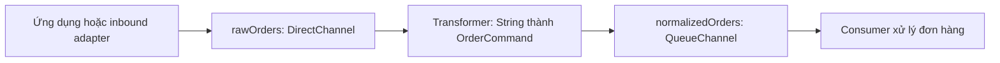

# Transformer là gì

## 1. Mục tiêu bài học

Trong module **SPRING_INTEGRATION_CORE**, transformer là một thành phần giúp nối các hệ thống có hợp đồng dữ liệu khác nhau. Sau bài này, bạn có thể giải thích vai trò của transformer trong luồng thông điệp, viết một bước chuyển đổi bằng Java DSL hoặc `@Transformer`, xác định payload và header đầu ra, đồng thời kiểm tra hành vi khi chuyển đổi thất bại.

Ví dụ xuyên suốt bài là tiếp nhận một dòng đơn hàng từ hệ thống đối tác, chuẩn hóa nó thành đối tượng nội bộ rồi gửi đến channel tiếp theo. Ví dụ tập trung vào các thành phần cốt lõi: `Message`, `MessageChannel`, endpoint và cách ghép chúng thành `IntegrationFlow`.

## 2. Khái niệm và vấn đề cần giải quyết

**Transformer** hiện thực mẫu Message Translator: nhận một thông điệp và chuyển dữ liệu của nó sang dạng mà bước kế tiếp cần. Producer và consumer nhờ đó có thể dùng các biểu diễn khác nhau. Spring Integration cho phép sử dụng phương thức POJO làm transformer; không bắt buộc payload phải là XML. [Tài liệu Transformer](https://docs.spring.io/spring-integration/reference/transformer.html).

Giả sử đối tác gửi payload dạng chuỗi:

```text
 o-1001 | kb-01 | 2
```

Trong khi hệ thống kho muốn nhận:

```java
new OrderCommand("O-1001", "KB-01", 2)
```

Nếu từng consumer tự tách chuỗi, loại khoảng trắng và kiểm tra số lượng, quy tắc chuyển đổi sẽ bị lặp lại. Đặt transformer tại ranh giới tiếp nhận giúp hệ thống kho làm việc trực tiếp với `OrderCommand`.

Trong thiết kế của ví dụ, transformer chịu trách nhiệm:

1. Đọc ba trường từ định dạng đầu vào.
2. Chuẩn hóa mã đơn hàng và mã hàng theo quy ước đã chọn.
3. Chuyển số lượng từ chuỗi thành số nguyên dương.
4. Tạo đối tượng đầu ra phù hợp với hợp đồng nội bộ.

Quy tắc viết hoa mã hàng là quyết định của ví dụ. Với hệ thống có mã phân biệt chữ hoa và chữ thường, phải giữ nguyên mã theo hợp đồng thực tế.

## 3. Transformer nằm ở đâu trong luồng thông điệp?



Các thành phần trong sơ đồ có trách nhiệm riêng:

| Thành phần | Trách nhiệm trong ví dụ |
| --- | --- |
| Producer | Tạo `Message<String>` chứa dòng đơn hàng và metadata nguồn gửi. |
| Channel đầu vào | Đưa message đến endpoint chuyển đổi. |
| Transformer endpoint | Gọi logic chuyển đổi và phát message kết quả. |
| Channel đầu ra | Tiếp nhận `Message<OrderCommand>` để bước sau sử dụng. |
| Consumer | Xử lý đơn hàng theo mô hình nội bộ. |

Về cơ chế, `MessageTransformingHandler` là handler tạo phản hồi, ủy quyền công việc cho một `Transformer` rồi gửi kết quả đến channel đầu ra. Khai báo endpoint giúp Spring quản lý việc nối handler với channel; gọi riêng một phương thức Java chưa tạo thành luồng thông điệp. [Javadoc MessageTransformingHandler](https://docs.spring.io/spring-integration/api/org/springframework/integration/transformer/MessageTransformingHandler.html).

Gateway có thể đứng trước luồng để ứng dụng gọi một phương thức nghiệp vụ thay vì tự tạo và gửi `Message`. Trong bài này, thao tác gửi trực tiếp giúp quan sát rõ dữ liệu đi qua transformer. Với luồng yêu cầu/phản hồi đơn giản, endpoint dùng `outputChannel` đã cấu hình; nếu không có, header `replyChannel` có thể cung cấp địa chỉ phản hồi. [Annotation Support](https://docs.spring.io/spring-integration/reference/configuration/annotations.html).

## 4. Chuyển đổi payload và chuyển đổi cả message

Một message có hai phần cần phân biệt:

```text
Message<T>
├── payload: dữ liệu được xử lý
└── headers: metadata đi cùng dữ liệu
```

Ví dụ đầu vào:

```text
payload = " o-1001 | kb-01 | 2 "
headers.sourceSystem = "partner-a"
headers.traceId = "trace-42"
```

Có hai cách viết logic chuyển đổi:

| Giá trị nhận và trả về | Khi sử dụng |
| --- | --- |
| Nhận payload, trả về payload mới | Phép ánh xạ chỉ cần nội dung dữ liệu. |
| Nhận `Message<?>`, trả về message mới | Cần kiểm soát metadata cùng với payload. |

Khi transformer trả về **payload**, framework lan truyền các header đầu vào theo cấu hình. Khi transformer trả về **một `Message` hoàn chỉnh**, code chuyển đổi chịu trách nhiệm về các header của message đó. Không nên giả định những header bị bỏ sót sẽ tự được bổ sung. [Quy tắc Header Propagation](https://docs.spring.io/spring-integration/reference/message.html#message-header-propagation).

Với ví dụ đơn hàng, kiểu trả về `OrderCommand` là đủ nếu chỉ cần giữ metadata đang có. Nếu cần thêm `schemaVersion` hoặc loại bỏ một header mô tả định dạng cũ, có thể xây dựng message đầu ra một cách tường minh.

## 5. Hợp đồng chuyển đổi trước khi viết code

Ta chọn hợp đồng sau cho định dạng minh họa:

| Nội dung | Quy tắc |
| --- | --- |
| Payload đầu vào | `String` có đúng ba trường, phân cách bằng ký tự `|`. |
| Trường 1 | Mã đơn hàng, bỏ khoảng trắng hai đầu, không được rỗng, chuẩn hóa thành chữ hoa. |
| Trường 2 | Mã hàng, bỏ khoảng trắng hai đầu, không được rỗng, chuẩn hóa thành chữ hoa. |
| Trường 3 | Số nguyên dương trong phạm vi `int`. |
| Payload đầu ra | `OrderCommand(orderId, sku, quantity)`. |
| Dữ liệu không hợp lệ | Ném exception mô tả nguyên nhân. |
| Metadata cần giữ | `sourceSystem`, `traceId` và các header cần thiết cho luồng. |

Định dạng này không có cơ chế escape cho ký tự `|` bên trong một trường. Nếu đối tác cần biểu diễn dữ liệu như vậy, phải thống nhất định dạng đầy đủ hơn hoặc chọn parser phù hợp. Không mở rộng ngầm một định dạng đơn giản thành một chuẩn CSV hoàn chỉnh.

Hợp đồng cũng cần xác định việc có chấp nhận giá trị như `+2` hay `02` hay không. Ví dụ dùng `Integer.parseInt`, do đó hai giá trị này đều biểu diễn số lượng `2`; `2.5`, chuỗi rỗng và giá trị vượt phạm vi `int` bị từ chối.

## 6. Ví dụ đầy đủ bằng Java DSL

### 6.1. Điều kiện để sử dụng ví dụ

Cú pháp Java trong ví dụ yêu cầu Java 17 trở lên vì dùng `record`. Dự án cần dependency `org.springframework.integration:spring-integration-core` và bộ phiên bản Spring tương thích với JDK đang dùng. Đoạn kiểm thử phía sau cần thêm JUnit Jupiter.

Các lớp dưới đây không khai báo package để dễ theo dõi. Khi đưa vào dự án, đặt chúng vào package phù hợp. Ví dụ không cần Spring Boot hay một message broker; application context và các channel đều chạy trong cùng tiến trình.

### 6.2. Khai báo channel, logic chuyển đổi và flow

```java
import java.util.Locale;
import java.util.Objects;

import org.springframework.beans.factory.annotation.Qualifier;
import org.springframework.context.annotation.Bean;
import org.springframework.context.annotation.Configuration;
import org.springframework.integration.channel.DirectChannel;
import org.springframework.integration.channel.QueueChannel;
import org.springframework.integration.config.EnableIntegration;
import org.springframework.integration.dsl.IntegrationFlow;
import org.springframework.messaging.MessageChannel;
import org.springframework.messaging.PollableChannel;

@Configuration
@EnableIntegration
public class OrderTransformConfig {

    public record OrderCommand(String orderId, String sku, int quantity) {
    }

    @Bean
    public MessageChannel rawOrders() {
        return new DirectChannel();
    }

    @Bean
    public PollableChannel normalizedOrders() {
        return new QueueChannel(10);
    }

    @Bean
    public IntegrationFlow normalizeOrdersFlow(
            @Qualifier("rawOrders") MessageChannel input,
            @Qualifier("normalizedOrders") PollableChannel output) {

        return IntegrationFlow.from(input)
                .<String, OrderCommand>transform(OrderTransformConfig::parseOrder)
                .channel(output)
                .get();
    }

    public static OrderCommand parseOrder(String source) {
        Objects.requireNonNull(source, "Dòng đơn hàng không được null");

        String[] fields = source.split("\\|", -1);
        if (fields.length != 3) {
            throw new IllegalArgumentException(
                    "Đơn hàng phải có đúng 3 trường: orderId|sku|quantity");
        }

        String orderId = fields[0].strip().toUpperCase(Locale.ROOT);
        String sku = fields[1].strip().toUpperCase(Locale.ROOT);

        if (orderId.isEmpty() || sku.isEmpty()) {
            throw new IllegalArgumentException("orderId và sku không được rỗng");
        }

        int quantity;
        try {
            quantity = Integer.parseInt(fields[2].strip());
        }
        catch (NumberFormatException ex) {
            throw new IllegalArgumentException(
                    "quantity phải là số nguyên trong phạm vi int", ex);
        }

        if (quantity <= 0) {
            throw new IllegalArgumentException("quantity phải lớn hơn 0");
        }

        return new OrderCommand(orderId, sku, quantity);
    }
}
```

Những chi tiết có ý nghĩa trong ví dụ:

- `split("\\|", -1)` tách theo ký tự `|` và giữ cả trường rỗng ở cuối. Nhờ đó, `O-1|KB-01|` được nhận diện là thiếu giá trị số lượng.
- `Locale.ROOT` làm cho quy tắc viết hoa không phụ thuộc locale mặc định của máy chạy.
- `parseOrder` không đọc channel hay application context, nên có thể gọi trực tiếp khi kiểm thử quy tắc ánh xạ.
- `<String, OrderCommand>` thể hiện rõ kiểu payload nhận vào và trả về của bước chuyển đổi.

Trong Java DSL, `.transform(...)` khai báo transformer endpoint; `.get()` hoàn tất việc xây dựng cấu hình flow. Spring tạo và nối các thành phần thực thi từ cấu hình này. Các lambda của những phép toán EIP thông thường nhận payload. [DSL Basics](https://docs.spring.io/spring-integration/reference/dsl/java-basics.html).

### 6.3. Gửi message và quan sát đầu ra

```java
import org.springframework.context.annotation.AnnotationConfigApplicationContext;
import org.springframework.messaging.Message;
import org.springframework.messaging.MessageChannel;
import org.springframework.messaging.PollableChannel;
import org.springframework.messaging.support.MessageBuilder;

public class OrderTransformDemo {

    public static void main(String[] args) {
        try (var context = new AnnotationConfigApplicationContext(
                OrderTransformConfig.class)) {

            MessageChannel input = context.getBean(
                    "rawOrders", MessageChannel.class);
            PollableChannel output = context.getBean(
                    "normalizedOrders", PollableChannel.class);

            Message<String> request = MessageBuilder
                    .withPayload(" o-1001 | kb-01 | 2 ")
                    .setHeader("sourceSystem", "partner-a")
                    .setHeader("traceId", "trace-42")
                    .build();

            input.send(request);

            Message<?> result = output.receive(1_000);
            if (result == null) {
                throw new IllegalStateException("Không nhận được đơn hàng đã chuẩn hóa");
            }

            System.out.println(result.getPayload());
            System.out.println(result.getHeaders().get("sourceSystem"));
            System.out.println(result.getHeaders().get("traceId"));
        }
    }
}
```

Kết quả mong đợi:

```text
OrderCommand[orderId=O-1001, sku=KB-01, quantity=2]
partner-a
trace-42
```

`DirectChannel` gọi handler trong thread của bên gửi. `QueueChannel` đầu ra giữ kết quả để chương trình lấy bằng `receive(...)`; nó không tự gọi consumer. Ví dụ không cần poller vì đang đọc queue trực tiếp. Nếu một endpoint cần tự tiêu thụ từ `QueueChannel`, phải có cấu hình polling phù hợp. [Message Channel Implementations](https://docs.spring.io/spring-integration/reference/channel/implementations.html), [Poller với annotation](https://docs.spring.io/spring-integration/reference/configuration/annotations.html#annotations-poller).

Đừng suy ra rằng cứ có `QueueChannel` là toàn bộ flow tự chạy trên một thread khác. Trong ví dụ, bước chuyển đổi đã thực hiện trước khi message kết quả được đưa vào queue.

## 7. Viết cùng phép chuyển đổi bằng `@Transformer`

Annotation phù hợp khi muốn gắn việc tiếp nhận message với một phương thức bean. Để thay thế flow ở mục 6, **bỏ bean `normalizeOrdersFlow`**, giữ hai bean channel và phương thức `parseOrder`, rồi thêm phần sau vào `OrderTransformConfig`:

```java
// Import thêm:
// import org.springframework.integration.annotation.Transformer;

@Bean
public OrderNormalizer orderNormalizer() {
    return new OrderNormalizer();
}

public static class OrderNormalizer {

    @Transformer(inputChannel = "rawOrders", outputChannel = "normalizedOrders")
    public OrderCommand normalize(String source) {
        return OrderTransformConfig.parseOrder(source);
    }
}
```

`OrderNormalizer` được đăng ký bằng `@Bean`; việc xử lý annotation do hạ tầng integration đảm nhiệm. Cấu hình này có cùng mục đích với bước DSL đã thay thế. [Cấu hình Transformer bằng Java và annotation](https://docs.spring.io/spring-integration/reference/transformer.html).

Chỉ chọn một trong hai cấu hình cho cùng bước xử lý. Nếu đồng thời đăng ký cả DSL và annotation vào `rawOrders`, bạn đã tạo thêm consumer trên cùng channel; đó không phải cách yêu cầu một message đi lần lượt qua hai phép biến đổi.

Phân biệt hai kiểu `Transformer` khi đọc import:

| Tên đầy đủ | Vai trò |
| --- | --- |
| `org.springframework.integration.annotation.Transformer` | Annotation đánh dấu phương thức xử lý. |
| `org.springframework.integration.transformer.Transformer` | Interface cho chiến lược chuyển đổi message. |

Trong phần lớn phép ánh xạ đơn giản, bạn có thể dùng POJO hoặc lambda mà không cần tự implement interface của framework.

## 8. Khi cần chủ động điều khiển header

Giả sử đầu vào có header `rawFormat=pipe-v1`. Sau khi payload trở thành `OrderCommand`, ta muốn bỏ header đó và thêm `schemaVersion=order-command-v1`.

Trong bean DSL ở mục 6, có thể thay riêng dòng `.transform(...)` bằng đoạn sau. Bổ sung import `org.springframework.messaging.Message` và `org.springframework.messaging.support.MessageBuilder` vào lớp cấu hình:

```java
.transform(Message.class, message -> MessageBuilder
        .withPayload(parseOrder((String) message.getPayload()))
        .copyHeaders(message.getHeaders())
        .removeHeader("rawFormat")
        .setHeader("schemaVersion", "order-command-v1")
        .build())
```

Đây là biến thể dành cho đầu vào đã có hợp đồng payload `String`. `Message.class` yêu cầu framework đưa cả message vào lambda. Chỉ viết tham số generic `Message<?>` mà không dùng overload thích hợp có thể khiến framework vẫn đưa payload vào, dẫn đến lỗi ép kiểu. [Lambdas và tham số Message](https://docs.spring.io/spring-integration/reference/dsl/java-basics.html#java-dsl-lambdas).

`MessageBuilder` tạo message mới; `copyHeaders` mang metadata cần thiết sang trước khi code loại bỏ hoặc ghi đè từng header. `id` và `timestamp` là những header hệ thống chỉ đọc, không dùng để áp đặt định danh của message cũ lên message mới. [MessageBuilder và header chỉ đọc](https://docs.spring.io/spring-integration/reference/message.html).

Từ quy tắc này, khi thiết kế luồng đơn hàng nên quyết định rõ:

| Header | Cách xử lý trong tình huống minh họa |
| --- | --- |
| `sourceSystem` | Giữ để biết nguồn phát sinh đơn hàng. |
| `traceId` | Giữ để tra cứu một yêu cầu xuyên qua các bước. |
| `replyChannel` | Giữ nếu các bước sau cần phản hồi về nơi gửi ban đầu. |
| `errorChannel` | Giữ nếu cơ chế xử lý lỗi của luồng sử dụng header này. |
| `correlationId`, thông tin sequence | Giữ khi luồng tiếp tục xử lý nhóm message. |
| `rawFormat` | Bỏ vì mô tả biểu diễn đầu vào đã được thay thế. |
| `schemaVersion` | Gán theo hợp đồng payload đầu ra. |

Không dùng `MessageHeaders.id` làm mã đơn hàng. Hãy dùng `orderId` để định danh nghiệp vụ và một giá trị theo dõi ổn định như `traceId` khi cần nối các lần xử lý.

Với `GenericMessage` thông thường, không sửa trực tiếp map header. Tính bất biến của vỏ message cũng không làm cho một payload là `List` hoặc một đối tượng mutable tự trở thành bất biến sâu. [Message và tính bất biến](https://docs.spring.io/spring-integration/reference/message.html).

Một quy tắc triển khai hữu ích là tạo dữ liệu đầu ra mới thay vì sửa đối tượng đầu vào tại chỗ. Điều này đặc biệt có ý nghĩa nếu cùng message còn được chuyển cho nhánh khác. `OrderCommand` trong ví dụ chỉ chứa `String` và `int`, nên không chia sẻ collection có thể bị sửa giữa các nhánh.

## 9. Không dùng transformer để thay thế mọi endpoint

Chọn endpoint theo mục đích của bước xử lý:

| Nhu cầu | Endpoint phù hợp | Ví dụ trong hệ thống đơn hàng |
| --- | --- | --- |
| Đổi cấu trúc hoặc biểu diễn dữ liệu | Transformer | Chuỗi đối tác thành `OrderCommand`. |
| Quyết định cho message đi tiếp hay loại bỏ | Filter | Loại bản ghi thử nghiệm theo một tiêu chí rõ ràng. |
| Chọn channel đích | Router | Chuyển đơn đến luồng kho miền Bắc hoặc miền Nam. |
| Chia một message thành nhiều message | Splitter | Tách các dòng hàng của một đơn. |
| Chờ và kết hợp một nhóm message | Aggregator | Tổng hợp các kết quả xử lý dòng hàng. |
| Gọi một dịch vụ nghiệp vụ | Service activator | Ghi đơn hàng hoặc yêu cầu giữ hàng trong kho. |

Filter quyết định việc cho thông điệp đi tiếp; service activator nối message với lời gọi dịch vụ; aggregator còn quản lý nhóm message và điều kiện phát hành nhóm. [Filter](https://docs.spring.io/spring-integration/reference/filter.html), [Service Activator](https://docs.spring.io/spring-integration/reference/service-activator.html), [Aggregator](https://docs.spring.io/spring-integration/reference/aggregator.html).

Với ví dụ này, kiểm tra đủ ba trường là một phần của việc đọc định dạng. Quyết định có tiếp nhận đơn của một đối tác đang bị tạm khóa hay không là một chính sách riêng, có thể biểu diễn bằng filter trước hoặc sau bước chuyển đổi tùy dữ liệu cần dùng.

Nếu một phép chuyển đổi tạo ra `List<OrderCommand>`, cần phân biệt **một message có payload là danh sách** với **nhiều message riêng biệt**. Muốn từng đơn hàng đi qua các endpoint độc lập, hãy thiết kế bước splitter tương ứng.

Về khả năng kỹ thuật, transformer có thể gọi một dịch vụ bên ngoài. Tuy nhiên, với luồng đơn hàng này, nên giữ việc ánh xạ riêng với việc ghi database hoặc gọi API giữ hàng. Khi đó, lỗi đọc dữ liệu có thể được phân biệt với lỗi hạ tầng, và việc thử lại phép ánh xạ không vô tình lặp thao tác nghiệp vụ.

## 10. Quy tắc quan trọng: không trả về `null`

Một phép biến đổi thành công cần tạo ra kết quả. Phương thức transformer trả về `null` làm phát sinh lỗi chuyển đổi; transformer không có tùy chọn tắt yêu cầu này bằng `requiresReply=false`. Nếu mục đích là loại message theo điều kiện, hãy dùng filter. [Hợp đồng trả về của Transformer](https://docs.spring.io/spring-integration/reference/transformer.html).

Ví dụ sau không thể hiện đúng hợp đồng:

```java
public OrderCommand convertOrIgnore(String source) {
    if (source.isBlank()) {
        return null; // Không dùng null để biểu diễn việc lọc bỏ message.
    }
    return OrderTransformConfig.parseOrder(source);
}
```

Với nguồn gửi có thể phát các dòng trắng như một phần của giao thức, bạn có thể đặt một filter trước transformer và cấu hình cách xử lý message bị loại. Nếu dòng trắng là lỗi dữ liệu cần truy vết, giữ nó trên nhánh báo lỗi sẽ phù hợp hơn việc loại bỏ im lặng.

Đừng bắt tất cả exception rồi trả về một `OrderCommand` rỗng để luồng tiếp tục. Một đầu ra có vẻ hợp lệ nhưng thiếu ý nghĩa sẽ đẩy lỗi sang bước ghi nhận đơn hàng, làm nguyên nhân khó tìm hơn.

## 11. Chuyển đổi thất bại và đường đi của lỗi

Với `DirectChannel` trong ví dụ, exception từ bước chuyển đổi truyền về lời gọi `send(...)`, thường nằm trong một exception của hệ thống messaging. Việc gắn header `errorChannel` không tự biến lời gọi đồng bộ này thành luồng gửi lỗi bất đồng bộ. Với tác vụ do executor hoặc poller của Spring Integration thực thi, cơ chế xử lý lỗi có thể xuất bản `ErrorMessage` đến channel lỗi được giải quyết từ header hoặc cấu hình mặc định. [Error Handling](https://docs.spring.io/spring-integration/reference/error-handling.html).

Do đó, cần bắt lỗi ở nơi gọi trong ví dụ gửi trực tiếp:

```java
import org.springframework.messaging.MessagingException;
import org.springframework.messaging.support.MessageBuilder;

// input là bean rawOrders lấy từ application context ở mục 6.
try {
    input.send(MessageBuilder.withPayload("O-1001|KB-01|abc").build());
}
catch (MessagingException ex) {
    // Tại đây có thể ghi nhận mã theo dõi và kiểm tra chuỗi nguyên nhân.
    // Không xem send thành công hoặc thất bại là một giá trị OrderCommand.
    System.err.println("Không thể chuyển đổi đơn hàng: " + ex.getMessage());
}
```

Để thiết kế xử lý lỗi cho hệ thống đơn hàng, có thể phân loại:

| Loại lỗi | Ví dụ | Hướng xử lý cho tình huống này |
| --- | --- | --- |
| Sai định dạng | Thiếu trường hoặc `quantity=abc` | Ghi nhận bản tin lỗi để kiểm tra nguồn gửi. |
| Không thỏa hợp đồng đầu vào | `quantity=0` | Báo dữ liệu không hợp lệ với nguyên nhân rõ ràng. |
| Lỗi lập trình hoặc cấu hình | Sai kiểu payload hoặc thiếu nơi nhận kết quả | Sửa hợp đồng giữa các bước hoặc cấu hình flow. |
| Lỗi hạ tầng ở bước dịch vụ riêng | API kho tạm thời không phản hồi | Xem xét retry tại bước gọi dịch vụ, cùng quy tắc chống lặp thao tác. |

Chạy lại cùng chuỗi `O-1001|KB-01|abc` không làm cho nó trở thành hợp lệ. Trong trường hợp này, retry không giải quyết nguyên nhân. Nên phân biệt lỗi dữ liệu với lỗi tạm thời trước khi bổ sung chính sách thử lại.

## 12. Kiểm thử logic và kiểm thử luồng

Hai nhóm kiểm tra trả lời những câu hỏi khác nhau:

- **Kiểm thử logic:** chuỗi đầu vào có được ánh xạ đúng thành đối tượng không, và quy tắc từ chối dữ liệu có đúng không?
- **Kiểm thử luồng:** message có đi qua endpoint, đến đúng channel, giữ metadata cần thiết và thể hiện lỗi theo cơ chế đã chọn không?

Dưới đây là một lớp JUnit Jupiter sử dụng cấu hình DSL ở mục 6. Các ví dụ này là mã để người học thực hành; chúng không cần server bên ngoài.

```java
import org.junit.jupiter.api.Test;
import org.springframework.context.annotation.AnnotationConfigApplicationContext;
import org.springframework.messaging.Message;
import org.springframework.messaging.MessageChannel;
import org.springframework.messaging.MessagingException;
import org.springframework.messaging.PollableChannel;
import org.springframework.messaging.support.MessageBuilder;

import static org.junit.jupiter.api.Assertions.*;

class OrderTransformTest {

    @Test
    void mapsFieldsAndNormalizesCodes() {
        var actual = OrderTransformConfig.parseOrder(" o-1001 | kb-01 | 2 ");

        assertEquals(
                new OrderTransformConfig.OrderCommand("O-1001", "KB-01", 2),
                actual);
    }

    @Test
    void rejectsInvalidQuantity() {
        assertThrows(IllegalArgumentException.class,
                () -> OrderTransformConfig.parseOrder("O-1001|KB-01|0"));
        assertThrows(IllegalArgumentException.class,
                () -> OrderTransformConfig.parseOrder("O-1001|KB-01|abc"));
        assertThrows(IllegalArgumentException.class,
                () -> OrderTransformConfig.parseOrder("O-1001|KB-01|"));
    }

    @Test
    void transformsMessageAndPreservesBusinessHeaders() {
        try (var context = new AnnotationConfigApplicationContext(
                OrderTransformConfig.class)) {

            var input = context.getBean("rawOrders", MessageChannel.class);
            var output = context.getBean("normalizedOrders", PollableChannel.class);

            input.send(MessageBuilder
                    .withPayload(" o-1001 | kb-01 | 2 ")
                    .setHeader("sourceSystem", "partner-a")
                    .setHeader("traceId", "trace-42")
                    .build());

            Message<?> result = output.receive(1_000);

            assertNotNull(result);
            var command = assertInstanceOf(
                    OrderTransformConfig.OrderCommand.class, result.getPayload());
            assertEquals("O-1001", command.orderId());
            assertEquals("KB-01", command.sku());
            assertEquals(2, command.quantity());
            assertEquals("partner-a", result.getHeaders().get("sourceSystem"));
            assertEquals("trace-42", result.getHeaders().get("traceId"));
            assertNull(output.receive(0));
        }
    }

    @Test
    void reportsBadInputToDirectChannelCaller() {
        try (var context = new AnnotationConfigApplicationContext(
                OrderTransformConfig.class)) {

            var input = context.getBean("rawOrders", MessageChannel.class);
            var output = context.getBean("normalizedOrders", PollableChannel.class);

            assertThrows(MessagingException.class, () -> input.send(
                    MessageBuilder.withPayload("O-1001|KB-01|abc").build()));

            assertNull(output.receive(0));
        }
    }
}
```

`receive(1_000)` đặt thời gian chờ hữu hạn cho kết quả; `receive(0)` kiểm tra ngay queue mà không chờ. Mỗi kiểm thử luồng tạo một context riêng để message còn sót không làm sai kết quả kiểm thử khác.

Nếu chuyển sang biến thể trả về `Message` ở mục 8, bổ sung kiểm tra `rawFormat` đã bị loại, `schemaVersion` có đúng giá trị, và các header cần giữ vẫn tồn tại. Khi dùng gateway, thêm kiểm tra lời gọi gateway nhận được phản hồi theo đúng hợp đồng của nó.

## 13. Chọn cách triển khai phép chuyển đổi

| Cách triển khai | Phù hợp khi | Điểm cần cân nhắc |
| --- | --- | --- |
| Lambda trong Java DSL | Phép ánh xạ ngắn, dễ đọc tại vị trí khai báo flow. | Tách thành phương thức hoặc lớp khi logic dài lên. |
| Phương thức POJO được DSL gọi | Muốn tách quy tắc ánh xạ khỏi cấu hình luồng. | Chọn tên phương thức rõ và tránh overload gây khó đọc. |
| Phương thức có `@Transformer` | Muốn khai báo channel ngay trên phương thức bean. | Bảo đảm bean được đăng ký và annotation được xử lý. |
| Biểu thức SpEL | Phép lấy trường hoặc tính giá trị đơn giản. | Logic nhiều nhánh thường dễ bảo trì hơn bằng Java. |
| Transformer có sẵn | Chuyển đổi định dạng phổ biến được framework hỗ trợ. | Kiểm tra kiểu đầu vào, đầu ra và dependency tương ứng. |

Java DSL có lớp factory `org.springframework.integration.dsl.Transformers` để cấu hình các transformer có sẵn. Chẳng hạn, có thể chọn transformer JSON thay cho việc tự viết parser khi hợp đồng thực tế là JSON; cần kiểm tra thư viện JSON và cách cấu hình mapper tương thích với phiên bản dự án. [Transformers trong Java DSL](https://docs.spring.io/spring-integration/reference/dsl/java-transformers.html).

Với bài toán đơn hàng hiện tại, `parseOrder` là một điểm khởi đầu dễ đọc. Nếu quy tắc ánh xạ mở rộng thành nhiều phiên bản định dạng, có thể đưa nó vào một lớp mapper riêng và kiểm thử từng hợp đồng đầu vào.

## 14. Các lỗi thường gặp khi áp dụng

| Biểu hiện | Nguyên nhân cần xem xét | Cách xử lý |
| --- | --- | --- |
| Không nhận được `traceId` sau chuyển đổi | Code tạo `Message` mới nhưng không giữ header cần thiết. | Kiểm tra cách xây message đầu ra và bổ sung kiểm thử metadata. |
| Lỗi ép kiểu trong lambda nhận `Message` | Lambda thực tế đang nhận payload. | Dùng overload nhận `Message.class` hoặc phương thức POJO có chữ ký phù hợp. |
| Đơn hàng không hợp lệ gây lỗi thay vì bị bỏ qua | Transformer trả về `null`. | Tách chính sách loại bỏ sang filter hoặc báo lỗi dữ liệu rõ ràng. |
| Chuyển đổi xong nhưng không gửi được kết quả | Không có địa chỉ đầu ra phù hợp hoặc channel đích chưa có consumer cần thiết. | Kiểm tra `outputChannel`, `replyChannel` và các thành phần nhận message. |
| Gọi trực tiếp phương thức có annotation nhưng không thấy message ở output | Lời gọi Java không đi qua endpoint nhận message từ channel. | Kiểm thử bằng channel hoặc gateway để quan sát wiring. |
| Chuẩn hóa mã khác nhau giữa các máy | Dùng locale mặc định cho quy tắc đổi hoa/thường. | Chọn locale theo hợp đồng dữ liệu, như `Locale.ROOT` trong ví dụ. |
| Khó xác định vì sao đơn hàng thất bại | Trộn parse dữ liệu, ghi database và gọi API vào một bước lớn. | Tách phép ánh xạ khỏi các bước nghiệp vụ có tác dụng phụ. |

## 15. Bài thực hành

Mở rộng ví dụ theo các yêu cầu sau:

1. Thêm header `rawFormat=pipe-v1` vào message đầu vào, dùng biến thể ở mục 8 và kiểm tra header này đã bị loại khỏi đầu ra.
2. Gán `schemaVersion=order-command-v1` mà vẫn giữ `sourceSystem` và `traceId`.
3. Bổ sung ca kiểm thử cho mã hàng rỗng, thiếu trường, thừa trường, số âm và số vượt phạm vi `int`.
4. Thay Java DSL bằng cấu hình annotation ở mục 7 rồi dùng lại các kiểm thử payload và header.
5. Tách việc loại dòng trắng thành một filter với hành vi loại bỏ được xác định rõ; kiểm tra message bị loại không xuất hiện ở `normalizedOrders`.

Khi giải thích kết quả, hãy chỉ rõ kiểu payload trước và sau bước chuyển đổi, các header được giữ hoặc thay đổi, cùng vị trí tiếp nhận exception cho flow bạn đã cấu hình. Đó là các yếu tố quyết định transformer có thực hiện đúng hợp đồng trong một hệ thống tích hợp hay không.
