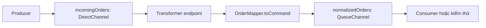

# Payload transformer

## 1. Mục tiêu và bài toán

Trong chương **Transformer** của module **SPRING_INTEGRATION_CORE**, bài này tập trung vào việc chuyển dữ liệu trong payload sang hợp đồng mà bước kế tiếp cần. Bạn sẽ xây dựng một mapper, đưa mapper vào endpoint bằng Java DSL, theo dõi header qua phép chuyển đổi và kiểm thử cả kết quả lẫn lỗi.

Giả sử hệ thống bán hàng nhận đơn từ đối tác. Đối tác gửi tổng tiền dưới dạng chuỗi và mã tiền tệ viết thường. Dịch vụ xử lý đơn bên trong cần `BigDecimal` và `Currency`. Nếu mỗi consumer tự hiểu định dạng đối tác, quy tắc chuyển đổi sẽ bị lặp lại. Đặt một transformer ở đầu luồng giúp consumer phía sau dùng chung một hợp đồng.

Đó là ứng dụng của mẫu [Message Translator trong Enterprise Integration Patterns](https://www.enterpriseintegrationpatterns.com/patterns/messaging/MessageTranslator.html): chuyển đổi biểu diễn dữ liệu giữa các ứng dụng có mô hình khác nhau.

**Sau bài học, bạn có thể:**

- Phân biệt chuyển payload với thay header, lọc message và tách message.
- Khai báo kiểu đầu vào, kiểu đầu ra và điều kiện thất bại của phép chuyển đổi.
- Dùng POJO, lambda hoặc `@Transformer` để thực hiện cùng một nhiệm vụ.
- Giữ metadata cần thiết, tránh sửa trực tiếp đối tượng đầu vào.
- Kiểm thử mapper độc lập và kiểm thử endpoint trong một luồng Spring Integration.

Ví dụ lấy **Java 17 và Spring Integration 6.4** làm mốc minh họa API; đây là lựa chọn cho bài học, không phải xác nhận phiên bản của dự án. Khi áp dụng, dùng bộ phiên bản Spring tương thích mà ứng dụng đang quản lý.

## 2. Payload transformer làm gì?

Mô hình xử lý có thể viết như sau:

```text
Message<S>(payload, headers)
          |
          | T transform(S payload)
          v
Message<T>(payloadMoi, headersDuocTruyenTiep)
```

Ở cách viết thông dụng, hàm chuyển đổi chỉ nhận `S` và trả về `T`. Framework đảm nhiệm phần tiếp nhận message, gọi hàm và gửi message kết quả đến output channel. `S` và `T` có thể giống nhau, như chuẩn hóa một `String`, hoặc khác nhau, như chuyển `IncomingOrder` thành `OrderCommand`.



Phân biệt ba vai trò trong hình:

| Thành phần | Trách nhiệm trong ví dụ |
| --- | --- |
| `Message<IncomingOrder>` | Mang dữ liệu đơn hàng và metadata như `traceId` |
| `DirectChannel` | Chuyển message tới endpoint đã đăng ký |
| Transformer endpoint | Nối vòng đời messaging với lời gọi mapper |
| `OrderMapper` | Kiểm tra và chuyển các trường dữ liệu |
| `QueueChannel` | Giữ message kết quả để bên nhận lấy ra |

Đặt tên “payload transformer” không có nghĩa phải kế thừa một lớp framework. Một phương thức Java thông thường cũng có thể làm hàm chuyển đổi; phần cấu hình quyết định cách gắn nó vào luồng.

### 2.1. Chọn đúng thành phần

| Nhu cầu | Thành phần phù hợp |
| --- | --- |
| Chuyển DTO đối tác thành command nội bộ | Payload transformer |
| Thêm `sourceSystem` mà không đổi dữ liệu nghiệp vụ | Header enricher |
| Bỏ message không đáp ứng một điều kiện | Message filter |
| Chọn nhánh xử lý theo loại đơn | Router |
| Tách danh sách thành từng message | Splitter |
| Gom nhiều message theo khóa liên hệ | Aggregator |
| Gọi dịch vụ để thực hiện một nghiệp vụ như ghi đơn | Service activator |

Bảng này định hướng thiết kế: chuyển biểu diễn dữ liệu nên có ranh giới rõ với quyết định chấp nhận đơn và thực thi nghiệp vụ.

### 2.2. Hợp đồng một đầu vào, một kết quả

Trong đường xử lý thành công của ví dụ, một message đầu vào tạo một message đầu ra. Nếu mapper trả `List<OrderCommand>`, kết quả vẫn là **một message có payload là danh sách**. Muốn có từng message riêng, thêm splitter.

Phương thức transformer phải trả kết quả hợp lệ. Trả `null` không phải cách bỏ qua message; Spring Integration coi đó là lỗi chuyển đổi. Dùng filter khi cần loại một message theo điều kiện. Xem [quy định về kết quả transformer](https://docs.spring.io/spring-integration/reference/6.4/transformer.html).

## 3. Thiết kế hợp đồng dữ liệu trước khi viết flow

Để bài thực hành có kết quả xác định, quy ước dữ liệu như sau:

| Trường | Đầu vào `IncomingOrder` | Đầu ra `OrderCommand` |
| --- | --- | --- |
| `orderId` | Chuỗi không rỗng, có thể có khoảng trắng ngoài | Chuỗi đã `strip()` |
| `customerEmail` | Chuỗi không rỗng, có thể có khoảng trắng ngoài | Chuỗi đã `strip()`; giữ nguyên chữ hoa/thường |
| `total` / `amount` | Chuỗi số thập phân dùng dấu chấm | `BigDecimal` dương, scale bằng 2 |
| `currency` | Chuỗi mã tiền tệ | `Currency`, chỉ chấp nhận USD hoặc EUR trong ví dụ |

Ví dụ đầu vào:

```text
IncomingOrder(
    orderId = "  PO-1042  ",
    customerEmail = "  buyer@example.com  ",
    total = "125.50",
    currency = " usd "
)
```

Kết quả mong đợi:

```text
OrderCommand(
    orderId = "PO-1042",
    customerEmail = "buyer@example.com",
    amount = 125.50,
    currency = USD
)
```

Các quyết định thuộc hợp đồng minh họa:

- Không chuyển chữ thường toàn bộ địa chỉ email; bài này chỉ loại khoảng trắng ngoài, chưa xác thực email.
- Không tự suy đoán dấu phân cách: `"125,50"` không đúng hợp đồng đầu vào.
- Không tự làm tròn `"125.501"`; thiếu chính sách làm tròn thì báo lỗi.
- `"125.500"` được nhận vì có thể biểu diễn chính xác thành `125.50`.
- Không tự đổi EUR thành USD. Chuẩn hóa mã tiền tệ và quy đổi ngoại tệ là hai nhiệm vụ khác nhau.
- Quy tắc scale bằng 2 gắn với USD/EUR trong bài thực hành, không áp dụng mặc định cho mọi loại tiền.

`BigDecimal` cho phép kiểm soát scale và làm tròn; `RoundingMode.UNNECESSARY` yêu cầu việc đổi scale không làm mất giá trị. Tham khảo [Java 17 BigDecimal API](https://docs.oracle.com/en/java/javase/17/docs/api/java.base/java/math/BigDecimal.html).

## 4. Ví dụ hoàn chỉnh bằng Java DSL

### 4.1. Điều kiện chạy ví dụ

Ví dụ chính chỉ cần `org.springframework.integration:spring-integration-core` cùng các dependency Spring tương thích. Phần kiểm thử dùng thêm JUnit Jupiter và `spring-test`; nếu dùng Spring Boot, có thể lấy chúng từ các starter tương ứng và để dependency management quản lý phiên bản.

Không cần broker, cơ sở dữ liệu hoặc HTTP server. Đầu vào ở đây đã là DTO Java. Chuyển JSON từ đường truyền thành DTO là bước riêng, được đề cập ở phần sau.

Lưu mã minh họa sau thành `PayloadTransformerConfig.java` trong package `example.integration`: 

```java
package example.integration;

import java.math.BigDecimal;
import java.math.RoundingMode;
import java.util.Currency;
import java.util.Locale;
import java.util.Objects;
import java.util.Set;

import org.springframework.context.annotation.Bean;
import org.springframework.context.annotation.Configuration;
import org.springframework.integration.channel.DirectChannel;
import org.springframework.integration.channel.QueueChannel;
import org.springframework.integration.config.EnableIntegration;
import org.springframework.integration.dsl.IntegrationFlow;

@Configuration
@EnableIntegration
public class PayloadTransformerConfig {

    public record IncomingOrder(
            String orderId,
            String customerEmail,
            String total,
            String currency) {
    }

    public record OrderCommand(
            String orderId,
            String customerEmail,
            BigDecimal amount,
            Currency currency) {
    }

    public static final class OrderMapper {

        private static final Set<String> SUPPORTED_CURRENCIES =
                Set.of("USD", "EUR");

        public OrderCommand toCommand(IncomingOrder source) {
            Objects.requireNonNull(source, "source is required");

            String orderId = required(source.orderId(), "orderId");
            String email = required(source.customerEmail(), "customerEmail");
            String total = required(source.total(), "total");
            String code = required(source.currency(), "currency")
                    .toUpperCase(Locale.ROOT);

            if (!SUPPORTED_CURRENCIES.contains(code)) {
                throw new IllegalArgumentException("Unsupported currency");
            }

            BigDecimal amount = new BigDecimal(total)
                    .setScale(2, RoundingMode.UNNECESSARY);

            if (amount.signum() <= 0) {
                throw new IllegalArgumentException("total must be positive");
            }

            return new OrderCommand(
                    orderId, email, amount, Currency.getInstance(code));
        }

        private static String required(String value, String field) {
            if (value == null || value.isBlank()) {
                throw new IllegalArgumentException(field + " is required");
            }
            return value.strip();
        }
    }

    @Bean
    public OrderMapper orderMapper() {
        return new OrderMapper();
    }

    @Bean
    public DirectChannel incomingOrders() {
        return new DirectChannel();
    }

    @Bean
    public QueueChannel normalizedOrders() {
        return new QueueChannel();
    }

    @Bean
    public IntegrationFlow normalizeOrderFlow(OrderMapper orderMapper) {
        return IntegrationFlow.from(incomingOrders())
                .transform(IncomingOrder.class, orderMapper::toCommand)
                .channel(normalizedOrders())
                .get();
    }
}
```

### 4.2. Đọc cấu hình theo trách nhiệm

`@EnableIntegration` kích hoạt hạ tầng Spring Integration trong cấu hình Spring thuần này. `IntegrationFlow.from(incomingOrders())` bắt đầu luồng từ channel đầu vào. `.transform(IncomingOrder.class, orderMapper::toCommand)` khai báo rõ kiểu payload đầu vào và phép chuyển đổi. Mapper không cần biết tên channel hoặc tự gửi message.

`.channel(normalizedOrders())` đặt output channel cụ thể. `QueueChannel` cuối luồng giúp ví dụ và kiểm thử đọc kết quả bằng `receive(timeout)`. Việc đưa kết quả vào queue không biến mapper phía trước thành tác vụ chạy trên một thread khác.

Trong ví dụ này, mapper được gọi ngay trên thread gửi vào `DirectChannel`. Chưa có polling consumer đọc queue đầu ra nên không cần poller. Nếu sau này một endpoint nhận đầu vào từ `QueueChannel`, phải cấu hình cơ chế polling phù hợp. Xem [các triển khai MessageChannel](https://docs.spring.io/spring-integration/reference/6.4/channel/implementations.html).

Việc ghi rõ `IncomingOrder.class` làm hợp đồng đầu vào dễ đọc và hỗ trợ việc chọn overload của DSL. Tuy nhiên, khai báo này không thay thế deserialization hay toàn bộ kiểm tra schema. Producer vẫn phải đưa đúng dữ liệu vào ranh giới đã thống nhất.

### 4.3. Gửi và nhận một message

Đoạn mã độc lập sau sử dụng cấu hình ở trên:

```java
package example.integration;

import org.springframework.context.annotation.AnnotationConfigApplicationContext;
import org.springframework.integration.channel.DirectChannel;
import org.springframework.integration.channel.QueueChannel;
import org.springframework.messaging.Message;
import org.springframework.messaging.support.MessageBuilder;

import example.integration.PayloadTransformerConfig.IncomingOrder;

public class PayloadTransformerDemo {

    public static void main(String[] args) {
        try (var context = new AnnotationConfigApplicationContext(
                PayloadTransformerConfig.class)) {

            var input = context.getBean("incomingOrders", DirectChannel.class);
            var output = context.getBean("normalizedOrders", QueueChannel.class);

            Message<IncomingOrder> request = MessageBuilder.withPayload(
                    new IncomingOrder("  PO-1042  ",
                            "  buyer@example.com  ", "125.50", " usd "))
                    .setHeader("traceId", "trace-1042")
                    .build();

            input.send(request);
            Message<?> reply = output.receive(1_000);

            if (reply == null) {
                throw new IllegalStateException("No transformed order received");
            }

            System.out.println(reply.getPayload());
            System.out.println(reply.getHeaders().get("traceId"));
        }
    }
}
```

Kết quả payload biểu diễn một `OrderCommand` với amount `125.50`, currency `USD` và các chuỗi đã bỏ khoảng trắng ngoài. Header `traceId` vẫn mang giá trị `trace-1042`.

## 5. Những cách biểu diễn cùng một phép chuyển đổi

### 5.1. Lambda và GenericTransformer

Với phép chuyển đổi nhỏ, lambda giúp flow ngắn và dễ đọc. Đây là đoạn thay thế cho bước `.transform(...)`, không phải một flow hoàn chỉnh:

```java
.transform(String.class, value -> value.strip())
```

Nếu cần đặt tên cho hàm dùng lại, có thể dùng functional interface `GenericTransformer<S, T>`:

```java
import java.util.Locale;
import org.springframework.integration.core.GenericTransformer;

GenericTransformer<String, String> normalizeCode =
        value -> value.strip().toUpperCase(Locale.ROOT);
```

Sau đó truyền biến đó vào `.transform(normalizeCode)` khi cấu hình một flow nhận payload `String`. API của interface định nghĩa một phương thức `T transform(S source)`; xem [GenericTransformer API](https://docs.spring.io/spring-integration/api/org/springframework/integration/core/GenericTransformer.html).

Quy tắc chọn trong bài: lambda cho phép đổi nhỏ; mapper có tên khi đã xuất hiện nhiều trường, điều kiện hoặc chính sách cần kiểm thử độc lập.

### 5.2. Cấu hình bằng annotation

Có thể thay bean `IntegrationFlow` ở ví dụ chính bằng một endpoint dùng annotation. Khai báo bean sau bên trong `PayloadTransformerConfig`, cùng với lớp endpoint lồng bên dưới:

```java
@Bean
public AnnotatedOrderTransformer annotatedOrderTransformer(OrderMapper mapper) {
    return new AnnotatedOrderTransformer(mapper);
}

public static final class AnnotatedOrderTransformer {

    private final OrderMapper mapper;

    public AnnotatedOrderTransformer(OrderMapper mapper) {
        this.mapper = mapper;
    }

    @org.springframework.integration.annotation.Transformer(
            inputChannel = "incomingOrders",
            outputChannel = "normalizedOrders")
    public OrderCommand transform(IncomingOrder payload) {
        return mapper.toCommand(payload);
    }
}
```

Bean này phải được Spring quản lý để hạ tầng annotation phát hiện phương thức. Khi chọn cách này, bỏ bean `normalizeOrderFlow` của cách DSL. Nếu giữ cả hai, bạn tạo hai consumer cùng đăng ký trên `incomingOrders`; message có thể được giao cho một trong các consumer thay vì đi qua một pipeline duy nhất.

Annotation thuận tiện khi muốn đặt khai báo endpoint ngay cạnh phương thức. DSL thuận tiện khi cần đọc chuỗi transformer, filter, router và các bước tiếp theo trên cùng một cấu hình.

## 6. Header sau khi chuyển payload

### 6.1. Trả payload và trả Message là hai hợp đồng khác nhau

Khi hàm transformer chỉ trả payload, header đầu vào được framework truyền tiếp theo quy tắc propagation. Khi hàm trả một `Message` hoàn chỉnh, mã ứng dụng chịu trách nhiệm xây dựng message đó. Xem [Header Propagation](https://docs.spring.io/spring-integration/reference/6.4/message.html#message-header-propagation).

| Giá trị phương thức trả về | Trách nhiệm của mã ứng dụng |
| --- | --- |
| `OrderCommand` | Tạo dữ liệu kết quả; để framework xử lý message và truyền header |
| `Message<OrderCommand>` | Tạo cả payload lẫn tập header đầu ra cần thiết |

Trong flow mẫu, `traceId` được giữ và hệ thống tạo message mới cho payload khác kiểu. Không dùng `MessageHeaders.ID` làm mã đơn hàng hay khóa chống xử lý trùng: đó là định danh của message. Timestamp của message cũng không thay thế thời điểm nghiệp vụ `orderCreatedAt`.

Với request-reply, lưu ý `replyChannel`; với xử lý lỗi, lưu ý `errorChannel`; với splitter/aggregator, lưu ý các header correlation và sequence. Tạo một message chỉ có payload có thể làm mất ngữ cảnh mà phần còn lại của luồng cần.

### 6.2. Khi cần chủ động xây dựng Message

Giả sử chuyển đổi còn phải cập nhật metadata về phiên bản schema. Một phương thức thay thế có thể viết như sau; đặt trong một bean transformer được cấu hình thích hợp:

```java
public org.springframework.messaging.Message<OrderCommand> transformMessage(
        org.springframework.messaging.Message<IncomingOrder> input) {

    OrderCommand payload = mapper.toCommand(input.getPayload());

    return org.springframework.messaging.support.MessageBuilder
            .withPayload(payload)
            .copyHeaders(input.getHeaders())
            .removeHeaders("contentType")
            .setHeader("payloadSchemaVersion", "order-command-v1")
            .build();
}
```

Đoạn này giả định bean có field `OrderMapper mapper` được truyền qua constructor. Phương thức nhận toàn bộ message thay cho chỉ payload. Nếu dùng `@Transformer`, đặt annotation cùng input/output channel lên phương thức này.

Việc bỏ `contentType` trong ví dụ là quyết định tại ranh giới: header mô tả định dạng JSON cũ không còn mô tả trực tiếp DTO Java hiện tại. Nếu consumer yêu cầu `contentType`, hãy đặt giá trị theo hợp đồng thực của nó. Không sao chép máy móc các header định dạng sau khi đổi biểu diễn.

`copyHeaders` giúp giữ metadata thông thường; không dùng nó để ép giữ định danh và timestamp hệ thống của message cũ. Nếu chỉ cần thêm một header và mapper vẫn chỉ cần payload, một bước header enricher riêng thường làm flow dễ đọc hơn.

## 7. Bất biến, tính thuần và xử lý đồng thời

Trong ví dụ, `IncomingOrder` và `OrderCommand` là record chứa các kiểu giá trị bất biến. Mapper tạo đối tượng mới; không thay đổi nguồn. Vì mapper không giữ dữ liệu của từng lần gọi trong field, nhiều lời gọi độc lập có thể dùng chung bean.

Việc một message không cho thay payload bằng setter **không làm mọi đối tượng bên trong payload trở thành bất biến**. Một `Map` hoặc `List` mutable vẫn có thể bị sửa qua tham chiếu. Điều này được phân biệt trong [mô hình Message của Spring Integration](https://docs.spring.io/spring-integration/reference/6.4/message.html).

Ví dụ dễ gây tác dụng phụ khi nhiều nhánh cùng đọc dữ liệu:

```java
// Minh họa điều nên tránh nếu source còn được chia sẻ.
sourceMap.put("currency", "USD");
return sourceMap;
```

Cách sao chép tối thiểu:

```java
var target = new java.util.HashMap<String, Object>(sourceMap);
target.put("currency", "USD");
return target;
```

Đây mới là shallow copy: đối tượng lồng nhau vẫn có thể dùng chung tham chiếu. Nếu payload có danh sách dòng hàng mutable, cần quyết định sao chép các phần tử hoặc chuyển sang mô hình bất biến. Record cũng không tự deep-copy một `List` được truyền vào constructor.

Đối với transformer ở biên hệ thống, nên ưu tiên:

- Cùng dữ liệu và cùng cấu hình cho cùng kết quả.
- Không lưu “đơn hiện tại” trong field của singleton bean.
- Không thực hiện gửi email, trừ tồn kho hoặc ghi nhận thanh toán trong mapper.
- Dùng dependency an toàn cho truy cập đồng thời nếu mapper cần chúng.

Gọi HTTP để tra tỷ giá làm phép chuyển đổi phụ thuộc mạng, timeout và thời điểm. Khi có nhu cầu đó, hãy thể hiện bước tra cứu/enrichment riêng, rồi chuyển dữ liệu dựa trên kết quả đã có.

## 8. Lỗi chuyển đổi và ranh giới xử lý lỗi

### 8.1. Phân loại lỗi trong ví dụ

| Dữ liệu đầu vào | Điểm thất bại dự kiến | Hành vi cần thiết kế |
| --- | --- | --- |
| `orderId` chỉ có khoảng trắng | Kiểm tra trường bắt buộc | Báo dữ liệu không hợp lệ |
| `total = "abc"` | `BigDecimal` không phân tích được | Không tạo command thay thế với amount bằng 0 |
| `total = "125.501"` | Đổi scale cần làm tròn | Yêu cầu chính sách rõ hoặc từ chối |
| `total = "0"` | Kiểm tra số dương | Không đi vào kênh đơn hợp lệ |
| `currency = "XYZ"` | Ngoài tập USD/EUR | Báo mã chưa được hỗ trợ |
| Payload là kiểu khác hợp đồng | Ranh giới gọi transformer | Kiểm tra producer và bước giải mã trước đó |

Mapper kiểm tra những điều cần thiết để tạo command đúng cấu trúc. Quyết định như “khách hàng có được mua chịu hay không” nên thuộc bước nghiệp vụ hoặc lọc/định tuyến sau đó.

Không xử lý lỗi theo cách này:

```java
try {
    return mapper.toCommand(source);
}
catch (RuntimeException ex) {
    return null;
}
```

Cách trên làm mất nguyên nhân ban đầu và vẫn vi phạm hợp đồng kết quả của transformer. Cũng không trả lại `source` khi lỗi: consumer phía sau đang chờ `OrderCommand`, không phải một kết quả có kiểu thay đổi tùy nhánh.

### 8.2. DirectChannel và xử lý bất đồng bộ

Với luồng mẫu, lỗi xảy ra trên thread của bên gọi `incomingOrders.send(...)`. Bên gửi có thể nhận một `MessagingException` bao bọc lỗi gốc. Chỉ đặt header `errorChannel` không tự làm một lỗi đồng bộ qua `DirectChannel` biến thành `ErrorMessage` gửi đến channel đó.

Ở các tác vụ bất đồng bộ hoặc poller có cơ chế error handler của Spring Integration, lỗi có thể được xuất bản thành `ErrorMessage`. Error handler dùng header `errorChannel` nếu có, hoặc channel lỗi toàn cục. Cần cấu hình đúng ranh giới thực thi; gateway cũng có cơ chế xử lý lỗi riêng. Xem [Error Handling](https://docs.spring.io/spring-integration/reference/6.4/error-handling.html).

Với dữ liệu sai cố định như `"abc"`, chạy lại cùng mapper nhiều lần vẫn thất bại. Khi thiết kế vận hành, nên giữ mã lỗi, nguồn, khóa nghiệp vụ và thông tin truy vết để sửa dữ liệu hoặc đưa sang luồng xử lý lỗi. Chỉ retry khi có khả năng lỗi tạm thời được giải quyết.

Không suy từ việc transformer trả kết quả rằng đơn đã được ghi nhận bền vững. Luồng mẫu dừng ở queue trong bộ nhớ; việc lưu đơn là trách nhiệm của bước tiếp theo.

## 9. Kiểm thử mapper độc lập

Kiểm thử mapper xác nhận hợp đồng dữ liệu mà không khởi động Spring. Các test sau đặt trong package `example.integration`:

```java
package example.integration;

import java.math.BigDecimal;
import java.util.Currency;

import org.junit.jupiter.api.Test;

import example.integration.PayloadTransformerConfig.IncomingOrder;
import example.integration.PayloadTransformerConfig.OrderMapper;

import static org.junit.jupiter.api.Assertions.*;

class OrderMapperTest {

    private final OrderMapper mapper = new OrderMapper();

    @Test
    void mapsValidOrder() {
        var source = new IncomingOrder(
                "  PO-1042  ", "  buyer@example.com  ", "125.50", " usd ");

        var result = mapper.toCommand(source);

        assertEquals("PO-1042", result.orderId());
        assertEquals("buyer@example.com", result.customerEmail());
        assertEquals(new BigDecimal("125.50"), result.amount());
        assertEquals(Currency.getInstance("USD"), result.currency());
        assertEquals("  PO-1042  ", source.orderId());
    }

    @Test
    void rejectsAmountThatNeedsRounding() {
        var source = new IncomingOrder(
                "PO-1042", "buyer@example.com", "125.501", "USD");

        assertThrows(ArithmeticException.class,
                () -> mapper.toCommand(source));
    }

    @Test
    void acceptsRedundantTrailingZero() {
        var source = new IncomingOrder(
                "PO-1042", "buyer@example.com", "125.500", "USD");

        assertEquals(new BigDecimal("125.50"),
                mapper.toCommand(source).amount());
    }
}
```

Test scale có ý nghĩa vì hợp đồng yêu cầu `125.50`, không chỉ giá trị số gần bằng `125.5`. Hãy bổ sung trường rỗng, số âm, chuỗi không phải số và currency ngoài danh sách khi mở rộng bài thực hành.

## 10. Kiểm thử transformer trong flow

Mapper đúng chưa đủ để xác nhận endpoint được đăng ký đúng channel hoặc header được truyền tiếp. Test dưới đây khởi động đúng cấu hình DSL ở phần 4, gửi message thật và đọc queue đầu ra. Không dùng đồng thời cấu hình annotation ở phần 5.

```java
package example.integration;

import org.junit.jupiter.api.BeforeEach;
import org.junit.jupiter.api.Test;
import org.springframework.beans.factory.annotation.Autowired;
import org.springframework.beans.factory.annotation.Qualifier;
import org.springframework.integration.channel.DirectChannel;
import org.springframework.integration.channel.QueueChannel;
import org.springframework.messaging.Message;
import org.springframework.messaging.MessagingException;
import org.springframework.messaging.support.MessageBuilder;
import org.springframework.test.context.junit.jupiter.SpringJUnitConfig;

import example.integration.PayloadTransformerConfig.IncomingOrder;
import example.integration.PayloadTransformerConfig.OrderCommand;

import static org.junit.jupiter.api.Assertions.*;

@SpringJUnitConfig(PayloadTransformerConfig.class)
class PayloadTransformerFlowTest {

    @Autowired
    @Qualifier("incomingOrders")
    DirectChannel input;

    @Autowired
    @Qualifier("normalizedOrders")
    QueueChannel output;

    @BeforeEach
    void drainOutput() {
        while (output.receive(0) != null) {
            // Dọn kết quả còn lại giữa các test chạy tuần tự.
        }
    }

    @Test
    void transformsPayloadAndPreservesHeaders() {
        var replyChannel = new QueueChannel();
        var errorChannel = new QueueChannel();

        Message<IncomingOrder> request = MessageBuilder.withPayload(
                new IncomingOrder(" PO-1042 ",
                        " buyer@example.com ", "125.50", "usd"))
                .setHeader("traceId", "trace-1042")
                .setReplyChannel(replyChannel)
                .setErrorChannel(errorChannel)
                .build();

        assertTrue(input.send(request));
        Message<?> result = output.receive(1_000);

        assertNotNull(result);
        OrderCommand payload = assertInstanceOf(
                OrderCommand.class, result.getPayload());
        assertEquals("PO-1042", payload.orderId());
        assertEquals("trace-1042", result.getHeaders().get("traceId"));
        assertSame(replyChannel, result.getHeaders().getReplyChannel());
        assertSame(errorChannel, result.getHeaders().getErrorChannel());
        assertNotEquals(request.getHeaders().getId(), result.getHeaders().getId());
        assertNull(output.receive(0));
        assertNull(replyChannel.receive(0));
    }

    @Test
    void propagatesSynchronousFailureToSender() {
        var errors = new QueueChannel();
        var invalid = MessageBuilder.withPayload(
                new IncomingOrder("  ",
                        "buyer@example.com", "125.50", "USD"))
                .setErrorChannel(errors)
                .build();

        MessagingException failure = assertThrows(MessagingException.class,
                () -> input.send(invalid));

        assertInstanceOf(IllegalArgumentException.class,
                failure.getMostSpecificCause());
        assertNull(output.receive(0));
        assertNull(errors.receive(0));
    }
}
```

Những kiểm chứng có chủ đích:

1. Payload thực sự đổi sang `OrderCommand`, và `traceId` còn nguyên.
2. Header request-reply và lỗi được giữ; message mới có định danh riêng.
3. Output channel khai báo tường minh nhận kết quả; `replyChannel` không nhận thêm một bản.
4. Dữ liệu sai không đi vào kênh đầu ra hợp lệ và lỗi đồng bộ trở về bên gửi.

`receive(1_000)` đặt giới hạn chờ cho test; không dùng `Thread.sleep()` để đoán lúc có kết quả. Bộ test minh họa giả định chạy tuần tự vì dùng chung channel trong Spring context. Nếu chạy song song, cần cô lập context hoặc kênh dữ liệu của từng test.

Spring Integration có thêm các module hỗ trợ mocking endpoint và kiểm thử flow lớn hơn; ví dụ nhỏ này chỉ cần JUnit và Spring Test. Xem [Testing support](https://docs.spring.io/spring-integration/reference/6.4/testing.html).

Các test trên là mã thực hành để người học chạy trong môi trường có dependency phù hợp, không phải báo cáo rằng mã đã được chạy trong repository.

## 11. Ghép payload transformer vào luồng thực tế

### 11.1. Tách giải mã định dạng và ánh xạ nghiệp vụ

Một pipeline nhận JSON có thể tổ chức theo trách nhiệm:

```text
JSON String
   -> JSON-to-object transformer
IncomingOrder
   -> OrderMapper
OrderCommand
   -> filter hoặc router theo quy tắc nghiệp vụ
   -> service activator ghi nhận đơn
```

Java DSL cung cấp factory `Transformers`; chẳng hạn bước `.transform(Transformers.fromJson(IncomingOrder.class))` dùng để chuyển JSON sang đối tượng. Tham khảo [Transformers trong Java DSL](https://docs.spring.io/spring-integration/reference/6.4/dsl/java-transformers.html).

Nếu thêm bước này trước mapper, cần dependency JSON và object mapper tương thích; mapper JSON phải hỗ trợ cách tạo DTO/record đang dùng. Lỗi cú pháp JSON và lỗi giá trị nghiệp vụ là hai tình huống khác nhau, nên giữ thông tin để chẩn đoán đúng bước.

Khi đi ngược ra hệ thống ngoài, tuần tự hóa command thành JSON là một bước riêng. `toString()` của record không phải hợp đồng JSON, và Spring Integration không yêu cầu mọi payload đều phải là chuỗi.

### 11.2. Phối hợp với filter, router và aggregator

Ví dụ, sau khi có `OrderCommand` hợp lệ:

- Filter quyết định có nhận đơn có amount dưới mức tối thiểu hay không.
- Router chọn luồng USD hoặc EUR.
- Service activator thực hiện nghiệp vụ ghi đơn và phát sinh kết quả.
- Nếu luồng trước đó đã split các dòng hàng, aggregator dùng correlation/sequence phù hợp để gom kết quả.

Transformer đổi dữ liệu nhưng cần tôn trọng ngữ cảnh của các bước đó. Mất correlation header có thể làm aggregator không gom đúng nhóm; mất reply channel có thể làm gateway chờ mà không nhận được phản hồi.

Gateway có thể cung cấp một API Java cho bên gọi, còn transformer tiếp tục làm nhiệm vụ chuẩn hóa bên trong flow. Nếu đổi ví dụ thành gateway trả về `OrderCommand`, phải thiết kế đường trả lời tương ứng thay cho việc chỉ giữ kết quả ở `normalizedOrders`.

## 12. Những lỗi thiết kế thường gặp

| Biểu hiện | Nguyên nhân có thể gặp | Hướng sửa |
| --- | --- | --- |
| Consumer thỉnh thoảng nhận DTO cũ | Catch lỗi rồi trả lại đầu vào | Giữ một kiểu kết quả theo hợp đồng và đưa lỗi ra ranh giới xử lý |
| Gateway chờ quá hạn sau bước transform | Tự tạo `Message` làm mất metadata hoặc chưa có đường trả lời | Kiểm tra propagation và output/reply channel |
| Đơn bị đổi dữ liệu ở nhánh khác | Sửa payload mutable đang dùng chung | Tạo kết quả mới, xác định rõ mức sao chép |
| Tiền bị sai số hoặc làm tròn ngoài ý muốn | Dùng `double` hay làm tròn ngầm | Parse chuỗi bằng `BigDecimal`, ghi rõ chính sách scale |
| Danh sách đầu ra vẫn là một message | Nhầm transform với split | Thêm splitter khi cần một message cho mỗi phần tử |
| Header nói JSON nhưng payload đã là DTO | Mang metadata định dạng cũ qua ranh giới | Xóa hoặc cập nhật header theo hợp đồng consumer |
| Retry liên tục với một bản tin sai | Không phân biệt lỗi dữ liệu với lỗi tạm thời | Chuyển sang nhánh lỗi có đủ thông tin sửa dữ liệu |
| Hai cách cấu hình cho kết quả khó dự đoán | Đăng ký cả DSL và annotation trên cùng input channel | Chọn một endpoint cho phép chuyển đổi dự kiến |

## 13. Bài thực hành mở rộng

1. Thêm `sourceSystem` vào header trước mapper; xác nhận header còn sau chuyển đổi mà không thêm nó vào DTO.
2. Mở rộng hợp đồng amount với một chính sách làm tròn được viết rõ. So sánh kết quả với chế độ `UNNECESSARY` và cập nhật test.
3. Thêm `lineItems` dạng danh sách. Xác nhận một transformer trả danh sách vẫn chỉ tạo một message, rồi thêm splitter để quan sát khác biệt.
4. Thay một đoạn flow bằng ranh giới bất đồng bộ có cấu hình error handler; viết test nhận `ErrorMessage` thay cho bắt lỗi từ `send()`.
5. Cho thêm định dạng đơn từ đối tác thứ hai và viết một mapper riêng để cả hai hội tụ về `OrderCommand`.

Hoàn thành bài khi bạn có thể giải thích được hợp đồng payload trước/sau, header nào phải giữ hoặc cập nhật, nơi lỗi được quan sát, và lý do consumer phía sau có thể tin vào kiểu dữ liệu mà nó nhận.
