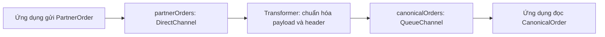

# Message transformer

## 1. Mục tiêu và bối cảnh

Trong module `SPRING_INTEGRATION_CORE`, message đi qua các channel và endpoint để nối những thành phần có hợp đồng dữ liệu khác nhau. Một hệ thống đối tác có thể gửi đơn hàng theo mô hình riêng, trong khi dịch vụ nội bộ chỉ chấp nhận mô hình chuẩn. Transformer là endpoint đảm nhiệm bước chuyển đổi đó.

Bài học thuộc chương **Transformer**, tập trung vào việc biến đổi **toàn bộ `Message`** khi kết quả phụ thuộc cả payload lẫn header. Người học sẽ thiết kế một luồng Java DSL, giữ ngữ cảnh trả lời và tương quan thông điệp, xử lý đầu vào không hợp lệ và viết kiểm thử cho hợp đồng đầu ra.

Sau bài học, bạn cần làm được các việc sau:

- Phân biệt transformer chỉ nhận payload với transformer nhận cả `Message<?>`.
- Chọn kiểu trả về phù hợp và giải thích việc truyền header trong từng trường hợp.
- Tạo message mới bằng `MessageBuilder` mà không sửa trực tiếp message đầu vào.
- Đăng ký transformer vào `IntegrationFlow`, xác định channel đầu ra và đường truyền lỗi.
- Kiểm thử cả dữ liệu nghiệp vụ, header và việc message gốc không bị thay đổi.

Các ví dụ dùng Java 17 trở lên vì có `record` và pattern matching cho `instanceof`. Dự án cần `spring-integration-core`; các kiểm thử sử dụng JUnit Jupiter. Phiên bản Spring Integration và Spring Framework phải được quản lý đồng bộ trong build của dự án. Các đoạn mã thuộc cùng package `example.integration`; mỗi lớp hoặc record `public` được đặt trong tệp Java cùng tên.

## 2. Message transformer giải quyết vấn đề gì?

### 2.1. Chuyển từ hợp đồng nguồn sang hợp đồng đích

Giả sử đối tác cung cấp dữ liệu:

```text
Payload: PartnerOrder(
    externalId = " PO-42 ",
    customerCode = " c-01 ",
    currency = " usd ",
    amount = 12.5
)

Headers:
    tenantId      = "tenant-a"
    correlationId = "batch-19"
    sourceSystem  = "partner-api"
    partnerToken  = "token tạm của đối tác"
```

Dịch vụ nội bộ cần:

```text
Payload: CanonicalOrder(
    orderId = "PO-42",
    customerCode = "C-01",
    currency = USD,
    amount = 12.50
)

Headers:
    tenantId      = "tenant-a"
    correlationId = "batch-19"
    sourceSystem  = "partner-api"
    schemaVersion = "order.v1"
    partnerToken  không còn tồn tại
```

Quy tắc viết hoa mã khách hàng là **quy ước riêng của ví dụ**: mã khách hàng được xem là không phân biệt hoa thường. Trong một hệ thống có mã phân biệt hoa thường, không áp dụng phép biến đổi này.

Ở đây transformer cần làm việc với cả hai phần:

1. Payload được chuyển sang mô hình nội bộ và chuẩn hóa giá trị.
2. Header `tenantId` được kiểm tra, `schemaVersion` được ghi đè theo hợp đồng đích, `partnerToken` bị loại bỏ và ngữ cảnh tương quan được giữ lại.

Dịch vụ tiếp theo không cần biết các khoảng trắng, cách viết mã tiền tệ hay tên trường mà đối tác sử dụng.



### 2.2. Ranh giới với các endpoint khác

| Nhu cầu | Thành phần phù hợp | Kết quả mong muốn |
|---|---|---|
| Đổi `PartnerOrder` thành `CanonicalOrder` | Transformer | Một message đầu ra hợp lệ khi biến đổi thành công |
| Chỉ thêm hoặc cập nhật metadata | Header enricher | Payload giữ nguyên, một số header thay đổi |
| Chỉ xóa metadata tạm thời | Header filter | Payload giữ nguyên, các header được chỉ định bị loại bỏ |
| Cho phép hoặc loại một message theo điều kiện | Filter | Message đi tiếp hoặc bị loại theo cấu hình |
| Chọn nhánh theo loại đơn hàng | Router | Message được chuyển tới channel tương ứng |
| Tách một đơn thành nhiều dòng hàng | Splitter | Nhiều message đầu ra |
| Gom các dòng hàng thành một nhóm | Aggregator | Kết quả tổng hợp từ nhiều message liên quan |
| Gọi nghiệp vụ như lưu đơn hoặc đặt chỗ | Service activator | Tác động nghiệp vụ, có thể có kết quả trả về |

Trong thiết kế của bài này, transformer chỉ chuyển biểu diễn dữ liệu. Việc lưu đơn, gửi email hay gọi API thanh toán thuộc bước nghiệp vụ khác. Ranh giới này giúp chạy lại phép biến đổi mà không tạo thêm tác động bên ngoài.

Một transformer thông thường có hợp đồng một đầu vào thành một đầu ra khi thành công. Trả về một `List` từ phương thức biến đổi thường tạo **một message có payload là danh sách**; muốn phát từng phần tử thành message riêng thì dùng splitter.

## 3. Hợp đồng của transformer trong Spring Integration

### 3.1. Nhận payload hay nhận cả message?

Spring Integration có thể gọi một phương thức POJO nhận payload, nhận `Message<?>`, hoặc lấy các header bằng `@Header` và `@Headers`. Với Java DSL, có thể đăng ký đối tượng và tên phương thức qua `.transform(bean, "methodName")`; với cấu hình annotation, dùng `@Transformer`. Hai cách đều tạo endpoint biến đổi. Xem [hướng dẫn Transformer của Spring Integration](https://docs.spring.io/spring-integration/reference/transformer.html).

Các chữ ký thường gặp:

```java
// Chỉ cần dữ liệu nghiệp vụ.
CanonicalOrder normalize(PartnerOrder payload);

// Cần đọc payload cùng metadata, trả về payload mới.
CanonicalOrder normalize(Message<PartnerOrder> message);

// Cần quyết định rõ cả payload và tập header đầu ra.
Message<CanonicalOrder> normalize(Message<PartnerOrder> message);
```

Đây là ba cách thiết kế để lựa chọn, không phải yêu cầu khai báo đồng thời ba phương thức trùng tên trong cùng bean. Một phương thức đích rõ ràng sẽ tránh việc lựa chọn overload khó hiểu.

Khi phép chuyển đổi cần đầy đủ message, có thể triển khai trực tiếp interface:

```java
org.springframework.integration.transformer.Transformer
```

Interface này là một chuyên biệt của `GenericTransformer<Message<?>, Message<?>>`, với phương thức `Message<?> transform(Message<?> message)`. Vì vậy đây là lựa chọn rõ ràng cho ví dụ cần kiểm soát header. Xem [API Transformer](https://docs.spring.io/spring-integration/api/org/springframework/integration/transformer/Transformer.html).

Lưu ý phân biệt hai kiểu cùng tên:

- `org.springframework.integration.transformer.Transformer`: interface chứa logic biến đổi.
- `org.springframework.integration.annotation.Transformer`: annotation dùng khi cấu hình endpoint trên phương thức bean.

### 3.2. Trả về payload khác với trả về Message

Đối với transformer dùng cơ chế gọi phương thức của framework, cách đóng gói kết quả phụ thuộc kiểu trả về:

| Kết quả phương thức | Framework xử lý | Trách nhiệm khi viết logic |
|---|---|---|
| Một đối tượng payload khác `null` | Tạo message kết quả và truyền các header đầu vào được phép truyền | Kiểm soát nội dung payload và chính sách truyền header của endpoint |
| Một `Message<?>` hoàn chỉnh | Dùng message đó làm kết quả | Chủ động tạo đúng payload và header cần giữ |
| `null` | Biến đổi thất bại | Ném lỗi rõ nghĩa hoặc dùng filter nếu mục đích là loại message |

Không nên suy luận rằng framework luôn bổ sung các header còn thiếu vào một `Message` mà phương thức tự tạo. Nhánh trả về message hoàn chỉnh được dùng trực tiếp; nhánh trả về payload mới thực hiện bước sao chép header. Có thể đối chiếu hành vi này trong [mã nguồn AbstractMessageProcessingTransformer](https://github.com/spring-projects/spring-integration/blob/main/spring-integration-core/src/main/java/org/springframework/integration/transformer/AbstractMessageProcessingTransformer.java).

Với một lớp trực tiếp triển khai interface `Transformer`, bạn luôn phải trả về `Message<?>`. Mọi quyết định sao chép header trong lớp đó thuộc phần triển khai của bạn.

### 3.3. Vì sao không trả về null để bỏ qua dữ liệu?

Transformer phải tạo ra kết quả hợp lệ khi xử lý thành công. Nếu đơn bị từ chối vì thiếu dữ liệu bắt buộc, hãy phát sinh lỗi có ngữ cảnh. Nếu đơn không thuộc nhóm cần xử lý, hãy đặt filter ở bước thích hợp. Cách này giúp phân biệt **biến đổi thất bại** với **loại message theo quy tắc luồng**.

Không dùng `null` như một trạng thái thành công im lặng. Một payload rỗng như chuỗi `""` hay danh sách rỗng cũng vẫn là payload; nó không có nghĩa message đã bị loại.

## 4. Message bất biến và chính sách header

### 4.1. Không sửa trực tiếp cấu trúc message

`Message` cung cấp payload và `MessageHeaders`. Header map là cấu trúc chỉ đọc; đối tượng payload hoặc giá trị header vẫn có thể là đối tượng mutable. Vì vậy tính bất biến của vỏ message không bảo đảm một `List` bên trong payload sẽ được bảo vệ khỏi chỉnh sửa. Xem [mô hình Message của Spring Integration](https://docs.spring.io/spring-integration/reference/message.html).

Cách sau không hợp lệ:

```java
message.getHeaders().put("schemaVersion", "order.v1");
```

Cách thích hợp khi giữ payload và chỉ thêm metadata:

```java
Message<?> output = MessageBuilder.fromMessage(message)
        .setHeader("schemaVersion", "order.v1")
        .build();
```

Khi đổi kiểu payload, bắt đầu với payload mới rồi sao chép header:

```java
Message<CanonicalOrder> output = MessageBuilder
        .withPayload(canonicalOrder)
        .copyHeaders(message.getHeaders())
        .setHeader("schemaVersion", "order.v1")
        .removeHeader("partnerToken")
        .build();
```

Các đoạn rời trong mục này cần import `org.springframework.messaging.Message` và `org.springframework.messaging.support.MessageBuilder`. Chúng minh họa cách tạo kết quả; phần triển khai đầy đủ nằm ở mục 5.

### 4.2. Thứ tự thao tác trên builder có ý nghĩa

Trong chuỗi trên, thứ tự là:

1. Tạo builder với payload đích.
2. Sao chép header từ nguồn.
3. Ghi đè những header do hợp đồng đích quyết định.
4. Xóa header không được truyền tiếp.
5. Gọi `build()` để lấy message kết quả.

Nếu đặt `schemaVersion` trước rồi gọi `copyHeaders`, giá trị cũ từ message nguồn có thể ghi đè giá trị mới. Nếu xóa `partnerToken` trước rồi sao chép header nguồn, token có thể xuất hiện trở lại.

`copyHeadersIfAbsent` chỉ sao chép khi builder chưa có giá trị cho khóa tương ứng. `copyHeaders` có thể ghi đè các header thông thường đã có. Hai header hệ thống `id` và `timestamp` không được sao chép đè như header nghiệp vụ. Xem [API MessageBuilder](https://docs.spring.io/spring-framework/docs/current/javadoc-api/org/springframework/messaging/support/MessageBuilder.html).

Đối với message mới được tạo bằng `withPayload(...).copyHeaders(...).build()` trong bài, không kỳ vọng `id` trùng message nguồn. `timestamp` là metadata thời điểm tạo message, không phải thời điểm đặt đơn. Hai message tạo gần nhau có thể có cùng giá trị timestamp theo mili giây; vì vậy không kiểm thử rằng hai timestamp bắt buộc phải khác nhau.

Nếu cần thời điểm phát sinh sự kiện nghiệp vụ, hãy có trường riêng như `occurredAt`. Nếu cần lần theo toàn bộ đơn hàng, hãy dùng khóa nghiệp vụ hoặc `correlationId`, thay vì dựa vào một message ID phải bất biến qua mọi bước.

### 4.3. Header nào cần quan tâm?

| Header | Mục đích trong luồng | Chính sách của ví dụ |
|---|---|---|
| `tenantId` | Xác định tenant của đơn | Bắt buộc là chuỗi không rỗng, giữ lại |
| `correlationId` | Liên kết các message có liên quan | Giữ nguyên nếu đã có |
| `sequenceNumber`, `sequenceSize` | Metadata thứ tự/nhóm khi có splitter và aggregator | Không xóa tùy tiện trong một luồng đang dùng chúng |
| `replyChannel` | Đích trả lời khi endpoint cần giải quyết địa chỉ trả lời | Giữ nguyên nếu có |
| `errorChannel` | Địa chỉ lỗi khi cơ chế xử lý lỗi sử dụng header này | Giữ nguyên nếu có |
| `schemaVersion` | Phiên bản hợp đồng payload đích | Ghi thành `order.v1` |
| `partnerToken` | Metadata chỉ cần ở ranh giới đối tác | Loại bỏ theo quy ước ví dụ |

Chính sách sao chép rồi loại bỏ một số header phù hợp với luồng nội bộ của ví dụ. Khi đi qua ranh giới hệ thống, nên xác định tập header được phép truyền và cấu hình header mapper của adapter tương ứng. Không xem thao tác `copyHeaders` trong bộ nhớ là cam kết rằng mọi header đều được truyền qua HTTP, AMQP hoặc JMS.

## 5. Ví dụ đầy đủ: chuẩn hóa đơn hàng của đối tác

### 5.1. Hai mô hình dữ liệu

```java
package example.integration;

import java.math.BigDecimal;

public record PartnerOrder(
        String externalId,
        String customerCode,
        String currency,
        BigDecimal amount) {
}
```

```java
package example.integration;

import java.math.BigDecimal;
import java.util.Currency;

public record CanonicalOrder(
        String orderId,
        String customerCode,
        Currency currency,
        BigDecimal amount) {
}
```

Trong ví dụ, các thành phần của record là `String`, `Currency` và `BigDecimal`, thuận tiện cho việc tạo kết quả mà không sửa dữ liệu nguồn. Nếu payload chứa collection mutable, cần quyết định tạo bản sao hoặc dùng collection không sửa được tại ranh giới phù hợp.

Quy tắc tiền tệ của bài được giới hạn rõ: **chỉ nhận USD và EUR, lưu số tiền với hai chữ số thập phân, không tự làm tròn**. Đây là hợp đồng minh họa, không phải quy tắc chung cho tất cả tiền tệ.

### 5.2. Triển khai Transformer

```java
package example.integration;

import java.math.BigDecimal;
import java.math.RoundingMode;
import java.util.Currency;
import java.util.Locale;
import java.util.Set;

import org.springframework.integration.transformer.Transformer;
import org.springframework.messaging.Message;
import org.springframework.messaging.support.MessageBuilder;

public final class OrderMessageTransformer implements Transformer {

    private static final Set<String> SUPPORTED_CURRENCIES =
            Set.of("USD", "EUR");

    @Override
    public Message<CanonicalOrder> transform(Message<?> message) {
        if (!(message.getPayload() instanceof PartnerOrder source)) {
            throw new IllegalArgumentException(
                    "Payload phải là PartnerOrder");
        }

        Object tenantHeader = message.getHeaders().get("tenantId");
        if (!(tenantHeader instanceof String tenantId)
                || tenantId.isBlank()) {
            throw new IllegalArgumentException(
                    "Header tenantId phải là chuỗi không rỗng");
        }

        String orderId = requireText(source.externalId(), "externalId");
        String customerCode = requireText(
                source.customerCode(), "customerCode")
                .toUpperCase(Locale.ROOT);
        String currencyCode = requireText(source.currency(), "currency")
                .toUpperCase(Locale.ROOT);

        if (!SUPPORTED_CURRENCIES.contains(currencyCode)) {
            throw new IllegalArgumentException(
                    "Ví dụ chỉ hỗ trợ USD và EUR");
        }

        BigDecimal amount = requireAmount(source.amount());
        CanonicalOrder target = new CanonicalOrder(
                orderId,
                customerCode,
                Currency.getInstance(currencyCode),
                amount);

        return MessageBuilder.withPayload(target)
                .copyHeaders(message.getHeaders())
                .setHeader("schemaVersion", "order.v1")
                .removeHeader("partnerToken")
                .build();
    }

    private static String requireText(String value, String field) {
        if (value == null || value.isBlank()) {
            throw new IllegalArgumentException(
                    field + " không được rỗng");
        }
        return value.trim();
    }

    private static BigDecimal requireAmount(BigDecimal value) {
        if (value == null || value.signum() < 0) {
            throw new IllegalArgumentException(
                    "amount phải có giá trị và không âm");
        }
        try {
            return value.setScale(2, RoundingMode.UNNECESSARY);
        }
        catch (ArithmeticException ex) {
            throw new IllegalArgumentException(
                    "amount không được cần làm tròn đến hai chữ số", ex);
        }
    }
}
```

Giá trị `12.5` trở thành `12.50`; `12.345` bị từ chối vì chuyển sang hai chữ số sẽ cần làm tròn. Một giá trị như `12.500` vẫn hợp lệ vì có thể chuyển chính xác thành `12.50`.

Các kiểm tra trong lớp bảo đảm có đủ dữ liệu để tạo hợp đồng đích. Một điều kiện nghiệp vụ như “chỉ xử lý đơn của khách hàng đang hoạt động” nên được cân nhắc ở filter hoặc bước nghiệp vụ tương ứng.

Transformer không tự sinh `correlationId`. Nếu message đầu vào đã thuộc một nhóm, việc tạo một correlation ID mới ở đây có thể khiến aggregator phía sau không gom đúng nhóm.

Lớp không giữ trạng thái riêng của từng message trong field. Vì vậy không có nguy cơ một biến như `currentTenant` bị message khác ghi đè khi luồng xử lý đồng thời. Các hằng số và tập tiền tệ ở ví dụ cũng không bị chỉnh sửa trong quá trình xử lý.

### 5.3. Ghép vào IntegrationFlow

```java
package example.integration;

import org.springframework.context.annotation.Bean;
import org.springframework.context.annotation.Configuration;
import org.springframework.integration.channel.DirectChannel;
import org.springframework.integration.channel.QueueChannel;
import org.springframework.integration.config.EnableIntegration;
import org.springframework.integration.dsl.IntegrationFlow;
import org.springframework.messaging.MessageChannel;
import org.springframework.messaging.PollableChannel;

@Configuration
@EnableIntegration
public class OrderIntegrationConfig {

    @Bean
    public MessageChannel partnerOrders() {
        return new DirectChannel();
    }

    @Bean
    public PollableChannel canonicalOrders() {
        return new QueueChannel();
    }

    @Bean
    public OrderMessageTransformer orderMessageTransformer() {
        return new OrderMessageTransformer();
    }

    @Bean
    public IntegrationFlow normalizeOrders(
            OrderMessageTransformer orderMessageTransformer) {
        return IntegrationFlow.from("partnerOrders")
                .transform(orderMessageTransformer,
                        endpoint -> endpoint.id("normalizePartnerOrder"))
                .channel("canonicalOrders")
                .get();
    }
}
```

`.transform(...)` đăng ký endpoint dùng transformer đã khai báo. ID `normalizePartnerOrder` giúp nhận diện bước biến đổi khi quan sát luồng. Logic chuyển đổi nằm trong `OrderMessageTransformer`; channel và endpoint quyết định cách logic đó tham gia vào hệ thống. Các overload đăng ký transformer được mô tả trong [API Java DSL](https://docs.spring.io/spring-integration/api/org/springframework/integration/dsl/BaseIntegrationFlowDefinition.html).

`partnerOrders` là `DirectChannel`, nên phép biến đổi chạy trên thread gửi. `canonicalOrders` là `QueueChannel` để ứng dụng hoặc kiểm thử chủ động gọi `receive(...)` lấy kết quả. Việc đặt queue **sau** transformer không chuyển transformer sang thread khác. Các đặc tính gửi, nhận và timeout của hai channel được mô tả trong [Message Channel Implementations](https://docs.spring.io/spring-integration/reference/channel/implementations.html).

Không cần poller trong cấu hình này: endpoint biến đổi đăng ký nhận trực tiếp từ `DirectChannel`, còn ứng dụng tự lấy message từ queue đầu ra. Nếu đổi **đầu vào của endpoint** thành `QueueChannel`, cần cấu hình poller để endpoint lấy message.

Queue ở đây chỉ phục vụ ví dụ trong bộ nhớ. Trong một luồng vận hành, cần chọn dung lượng, timeout gửi và cơ chế lưu trữ theo yêu cầu của ứng dụng.

### 5.4. Gửi và đọc kết quả

```java
package example.integration;

import java.math.BigDecimal;

import org.springframework.context.annotation.AnnotationConfigApplicationContext;
import org.springframework.integration.IntegrationMessageHeaderAccessor;
import org.springframework.messaging.Message;
import org.springframework.messaging.MessageChannel;
import org.springframework.messaging.PollableChannel;
import org.springframework.messaging.support.MessageBuilder;

public class OrderDemo {

    public static void main(String[] args) {
        try (var context = new AnnotationConfigApplicationContext(
                OrderIntegrationConfig.class)) {
            MessageChannel input = context.getBean(
                    "partnerOrders", MessageChannel.class);
            PollableChannel output = context.getBean(
                    "canonicalOrders", PollableChannel.class);

            Message<PartnerOrder> request = MessageBuilder
                    .withPayload(new PartnerOrder(
                            " PO-42 ", " c-01 ", " usd ",
                            new BigDecimal("12.5")))
                    .setHeader("tenantId", "tenant-a")
                    .setHeader(
                            IntegrationMessageHeaderAccessor.CORRELATION_ID,
                            "batch-19")
                    .setHeader("sourceSystem", "partner-api")
                    .setHeader("schemaVersion", "partner.v3")
                    .setHeader("partnerToken", "temporary-token")
                    .build();

            if (!input.send(request)) {
                throw new IllegalStateException("Gửi message thất bại");
            }

            Message<?> reply = output.receive(1_000);
            if (reply == null) {
                throw new IllegalStateException("Không nhận được kết quả");
            }

            System.out.println(reply.getPayload());
            System.out.println(reply.getHeaders().get("schemaVersion"));
            System.out.println(
                    reply.getHeaders().containsKey("partnerToken"));
        }
    }
}
```

Kết quả mong đợi:

```text
CanonicalOrder[orderId=PO-42, customerCode=C-01, currency=USD, amount=12.50]
order.v1
false
```

Ví dụ dùng chuỗi để khởi tạo `BigDecimal`, tránh đưa sai số nhị phân của một literal `double` vào dữ liệu mẫu.

## 6. Chọn POJO, annotation hay interface Transformer

Triển khai interface có lợi khi cần nhìn rõ toàn bộ hợp đồng `Message` đầu vào và đầu ra. Nếu logic chuyển đổi đã nằm trong một dịch vụ thông thường, cũng có thể sử dụng một phương thức POJO:

```java
public Message<CanonicalOrder> normalize(Message<PartnerOrder> input) {
    // Tạo CanonicalOrder từ input.getPayload().
    // Tạo Message đầu ra và chủ động quyết định header.
    // Phần thân cụ thể có thể dùng cùng quy tắc ở mục 5.
}
```

Đoạn trên chỉ mô tả chữ ký và vị trí của logic, không phải phương thức hoàn chỉnh để biên dịch. Java DSL có thể gọi phương thức đó bằng:

```java
.transform(orderNormalizer, "normalize")
```

Nếu dùng annotation, một **phương án thay thế** là đặt cấu hình endpoint trên phương thức bean đã có phần thân:

```java
@org.springframework.integration.annotation.Transformer(
        inputChannel = "partnerOrders",
        outputChannel = "canonicalOrders")
public Message<CanonicalOrder> normalize(Message<PartnerOrder> input) {
    // Phần thân biến đổi.
}
```

Bean phải nằm trong Spring context và cơ chế hỗ trợ Integration annotation phải được bật. Không đăng ký thêm endpoint annotation cho cùng bước của ví dụ trong khi vẫn giữ flow Java DSL ở mục 5. Nếu vô tình tạo hai consumer trên cùng `DirectChannel`, các message có thể được phân phối giữa chúng thay vì luôn đi qua endpoint mà bạn dự kiến.

Khi chỉ cần một header để tính payload mới, có thể thiết kế phương thức nhận `PartnerOrder` cùng tham số `@Header("tenantId") String tenantId`. Cách đó giảm sự phụ thuộc của phần tính toán vào API message. Khi cần xóa, bổ sung và bảo toàn nhiều header theo chính sách riêng, trả về một `Message` hoàn chỉnh giúp hợp đồng đầu ra rõ hơn.

Không ép một lambda vốn nhận payload thành `Message` bằng cách cast tùy tiện. Với ví dụ này, đăng ký đối tượng triển khai interface `Transformer` giúp xác định rõ nguồn đầu vào là toàn bộ message.

## 7. Channel đầu ra, gateway và ngữ cảnh trả lời

### 7.1. Output channel cố định trong ví dụ

Flow ở mục 5 chỉ rõ `canonicalOrders` làm channel đầu ra. Vì vậy message kết quả được gửi vào queue này. Header `replyChannel` nếu có vẫn được giữ để dùng ở những bước tiếp theo cần nó, nhưng sự hiện diện của header không làm endpoint bỏ qua channel đầu ra đã cấu hình.

### 7.2. Khi transformer là bước cuối của request–reply

Một gateway cho phép mã gọi sử dụng giao diện Java để gửi yêu cầu vào luồng. Khi thiết kế luồng request–reply, có thể để endpoint cuối không có output channel cố định, rồi trả kết quả theo ngữ cảnh `replyChannel`.

Ví dụ biến thể của bean flow:

```java
@Bean
public IntegrationFlow normalizeOrders(
        OrderMessageTransformer orderMessageTransformer) {
    return IntegrationFlow.from("partnerOrders")
            .transform(orderMessageTransformer)
            .get();
}
```

Đây là **cấu hình thay thế**, chỉ phù hợp khi bên gọi cung cấp đường trả lời, chẳng hạn thông qua gateway. Không chạy đồng thời bean này với bean flow cùng tên ở mục 5.

Trong biến thể này, việc vô tình tạo kết quả bằng:

```java
MessageBuilder.withPayload(target).build();
```

sẽ làm mất các header mà transformer phải bảo toàn. Khi endpoint không còn tìm được đích trả lời phù hợp, luồng có thể báo lỗi giải quyết reply channel. Bởi vậy kiểm thử chỉ so sánh payload sẽ bỏ sót một lỗi tích hợp đáng kể.

Giữ `replyChannel` không có nghĩa việc trả lời đã hoàn tất. Cấu hình các endpoint tiếp theo, đường đi của message và timeout của bên gọi vẫn phải phù hợp với hợp đồng request–reply.

## 8. Xử lý lỗi trong bước biến đổi

### 8.1. Lỗi trên luồng đồng bộ

Trong cấu hình `partnerOrders` là `DirectChannel`, lỗi từ transformer xảy ra trên thread gọi `send(...)`. Khi gọi trực tiếp lớp `OrderMessageTransformer`, đầu vào sai tạo `IllegalArgumentException` như phần triển khai. Khi lớp được gọi thông qua endpoint transformer của Spring Integration, lỗi biến đổi được bọc theo cơ chế của endpoint, thường là `MessageTransformationException` có nguyên nhân bên trong. Xem [mã nguồn MessageTransformingHandler](https://github.com/spring-projects/spring-integration/blob/main/spring-integration-core/src/main/java/org/springframework/integration/transformer/MessageTransformingHandler.java).

Ví dụ dữ liệu bị từ chối:

```text
Payload không phải PartnerOrder
Thiếu tenantId hoặc tenantId sai kiểu
externalId rỗng
currency không phải USD hoặc EUR
amount âm hoặc cần làm tròn để còn hai chữ số thập phân
```

Không bắt mọi exception rồi trả lại message đầu vào như thể đã chuyển đổi thành công. Cách đó có thể đưa `PartnerOrder` vào đoạn luồng yêu cầu `CanonicalOrder` và khiến lỗi xuất hiện muộn hơn, khó xác định nguồn hơn.

### 8.2. Lỗi khi có ranh giới bất đồng bộ

Nếu một task của Spring Integration xử lý message ở thread khác, lỗi không thể tự quay về stack của thread gửi ban đầu. Cơ chế error handling của framework có thể đóng gói lỗi thành `ErrorMessage`, tìm `errorChannel` trong header hoặc dùng channel lỗi toàn cục. Poller và `ExecutorChannel` là các ngữ cảnh cần xem xét khi thiết kế đường lỗi. Xem [Error Handling](https://docs.spring.io/spring-integration/reference/error-handling.html).

Chỉ đặt header `errorChannel` không tự thay thế hành vi ném exception của một handler đang chạy đồng bộ qua `DirectChannel`. Với gateway hoặc advice xử lý lỗi được cấu hình riêng, hành vi có thể được điều chỉnh theo hợp đồng của cấu hình đó.

Cần phân biệt vị trí queue trong ví dụ:

```text
DirectChannel -> transformer -> QueueChannel
                 ^ lỗi ở đây vẫn xảy ra trên thread gửi

QueueChannel -> poller -> transformer
                         ^ xử lý nằm trong task của poller
```

### 8.3. Chọn phản ứng theo nguyên nhân

| Nguyên nhân | Phản ứng phù hợp cho thiết kế ví dụ |
|---|---|
| Dữ liệu không tạo được mô hình đích | Phát sinh lỗi, đưa thông tin cần thiết vào đường xử lý lỗi đã thiết kế |
| Đơn hợp lệ nhưng không thuộc phạm vi xử lý | Dùng filter theo quy tắc luồng |
| Lỗi dịch vụ tra cứu tạm thời trong một thiết kế mở rộng | Xem xét retry có giới hạn ở bước tương tác đó |
| Lỗi lập trình trong phép ánh xạ | Giữ nguyên dấu vết nguyên nhân để sửa mã |

Retry không sửa được một chuỗi tiền tệ không được hỗ trợ hoặc số tiền âm. Transformer trong bài cũng không gọi dịch vụ ngoài, nên không có lý do tự thêm retry cho các lỗi dữ liệu này.

## 9. Kiểm thử hợp đồng Message

Các đoạn dưới là **mã kiểm thử mẫu để người học đưa vào dự án**, bao gồm cả kiểm thử lớp và kiểm thử luồng. Khi chạy trong dự án, JUnit Jupiter cần được cấu hình trong test runtime. Không cần Spring Boot hay `spring-integration-test` để thực hiện các phép kiểm tra tối thiểu này.

### 9.1. Kiểm thử trực tiếp logic và header

```java
package example.integration;

import java.math.BigDecimal;
import java.util.Currency;

import org.junit.jupiter.api.Test;
import org.springframework.integration.IntegrationMessageHeaderAccessor;
import org.springframework.integration.channel.QueueChannel;
import org.springframework.messaging.Message;
import org.springframework.messaging.MessageHeaders;
import org.springframework.messaging.support.MessageBuilder;

import static org.junit.jupiter.api.Assertions.*;

class OrderMessageTransformerTest {

    private final OrderMessageTransformer transformer =
            new OrderMessageTransformer();

    @Test
    void transformsPayloadAndPreservesRequiredContext() {
        QueueChannel replyChannel = new QueueChannel();
        QueueChannel errorChannel = new QueueChannel();
        PartnerOrder payload = new PartnerOrder(
                " PO-42 ", " c-01 ", " usd ",
                new BigDecimal("12.5"));

        Message<PartnerOrder> input = MessageBuilder.withPayload(payload)
                .setHeader("tenantId", "tenant-a")
                .setHeader(
                        IntegrationMessageHeaderAccessor.CORRELATION_ID,
                        "batch-19")
                .setHeader("schemaVersion", "partner.v3")
                .setHeader("partnerToken", "temporary-token")
                .setReplyChannel(replyChannel)
                .setErrorChannel(errorChannel)
                .build();

        Message<CanonicalOrder> output = transformer.transform(input);
        CanonicalOrder target = output.getPayload();

        assertEquals("PO-42", target.orderId());
        assertEquals("C-01", target.customerCode());
        assertEquals(Currency.getInstance("USD"), target.currency());
        assertEquals(new BigDecimal("12.50"), target.amount());
        assertEquals("tenant-a", output.getHeaders().get("tenantId"));
        assertEquals("batch-19", output.getHeaders().get(
                IntegrationMessageHeaderAccessor.CORRELATION_ID));
        assertEquals("order.v1", output.getHeaders().get("schemaVersion"));
        assertFalse(output.getHeaders().containsKey("partnerToken"));
        assertSame(replyChannel,
                output.getHeaders().get(MessageHeaders.REPLY_CHANNEL));
        assertSame(errorChannel,
                output.getHeaders().get(MessageHeaders.ERROR_CHANNEL));
        assertNotEquals(input.getHeaders().getId(),
                output.getHeaders().getId());

        // Message đầu vào và payload nguồn vẫn giữ giá trị ban đầu.
        assertSame(payload, input.getPayload());
        assertEquals(" PO-42 ", input.getPayload().externalId());
        assertEquals(new BigDecimal("12.5"), input.getPayload().amount());
        assertEquals("partner.v3",
                input.getHeaders().get("schemaVersion"));
        assertTrue(input.getHeaders().containsKey("partnerToken"));
    }

    @Test
    void rejectsMissingTenant() {
        Message<PartnerOrder> input = MessageBuilder.withPayload(
                new PartnerOrder("PO-42", "C-01", "USD",
                        new BigDecimal("12.50")))
                .build();

        assertThrows(IllegalArgumentException.class,
                () -> transformer.transform(input));
    }

    @Test
    void rejectsAmountThatWouldRequireRounding() {
        Message<PartnerOrder> input = MessageBuilder.withPayload(
                new PartnerOrder("PO-42", "C-01", "USD",
                        new BigDecimal("12.345")))
                .setHeader("tenantId", "tenant-a")
                .build();

        assertThrows(IllegalArgumentException.class,
                () -> transformer.transform(input));
    }
}
```

Kiểm thử đầu tiên kiểm tra cả kết quả nghiệp vụ lẫn metadata điều khiển. Assertion `assertSame` cho hai channel xác nhận transformer giữ đúng đối tượng địa chỉ trong bộ nhớ, thay vì tự tạo một channel mới không có consumer tương ứng.

So sánh `BigDecimal` bằng `equals` trong ví dụ còn kiểm tra được scale `2`, vì `12.5` và `12.50` không bằng nhau theo `BigDecimal.equals`. Điều này phù hợp với hợp đồng định dạng số tiền đã chọn.

### 9.2. Kiểm thử endpoint trong Spring context

Kiểm thử trực tiếp lớp chưa chứng minh bean, channel và endpoint được nối đúng. Kiểm thử dưới đây dùng cấu hình ở mục 5 để kiểm tra đường đi thực tế và ngoại lệ khi đi qua endpoint.

```java
package example.integration;

import java.math.BigDecimal;

import org.junit.jupiter.api.AfterEach;
import org.junit.jupiter.api.BeforeEach;
import org.junit.jupiter.api.Test;
import org.springframework.context.annotation.AnnotationConfigApplicationContext;
import org.springframework.integration.transformer.MessageTransformationException;
import org.springframework.messaging.Message;
import org.springframework.messaging.MessageChannel;
import org.springframework.messaging.PollableChannel;
import org.springframework.messaging.support.MessageBuilder;

import static org.junit.jupiter.api.Assertions.*;

class OrderFlowTest {

    private AnnotationConfigApplicationContext context;
    private MessageChannel input;
    private PollableChannel output;

    @BeforeEach
    void openContext() {
        context = new AnnotationConfigApplicationContext(
                OrderIntegrationConfig.class);
        input = context.getBean("partnerOrders", MessageChannel.class);
        output = context.getBean("canonicalOrders", PollableChannel.class);
    }

    @AfterEach
    void closeContext() {
        context.close();
    }

    @Test
    void deliversCanonicalOrderToConfiguredOutput() {
        Message<PartnerOrder> request = MessageBuilder.withPayload(
                new PartnerOrder(" PO-42 ", " c-01 ", " usd ",
                        new BigDecimal("12.5")))
                .setHeader("tenantId", "tenant-a")
                .build();

        assertTrue(input.send(request));
        Message<?> result = output.receive(1_000);

        assertNotNull(result);
        CanonicalOrder order = assertInstanceOf(
                CanonicalOrder.class, result.getPayload());
        assertEquals("PO-42", order.orderId());
        assertEquals("order.v1", result.getHeaders().get("schemaVersion"));
        assertNull(output.receive(0));
    }

    @Test
    void invalidRequestThrowsOnSendingThread() {
        Message<PartnerOrder> request = MessageBuilder.withPayload(
                new PartnerOrder("PO-42", "C-01", "USD",
                        new BigDecimal("12.50")))
                .build(); // Cố ý thiếu tenantId.

        MessageTransformationException exception = assertThrows(
                MessageTransformationException.class,
                () -> input.send(request));

        assertInstanceOf(IllegalArgumentException.class,
                exception.getCause());
        assertSame(request, exception.getFailedMessage());
        assertNull(output.receive(0));
    }
}
```

`receive(1_000)` giới hạn thời gian chờ, giúp kiểm thử kết thúc khi cấu hình sai. `receive(0)` lấy ngay nếu có message và trả về ngay nếu queue rỗng. Mỗi test có context riêng nên không đọc nhầm message còn lại của test trước.

Nếu mở rộng bài sang gateway, cần bổ sung kiểm thử thực hiện lời gọi qua gateway và xác nhận bên gọi nhận được kết quả. Giữ đúng `replyChannel` ở mức unit test là điều kiện cần, nhưng chưa chứng minh toàn bộ giao thức request–reply đã được cấu hình đúng.

## 10. Những lỗi thiết kế thường gặp

| Biểu hiện | Nguyên nhân có thể xảy ra | Cách xử lý |
|---|---|---|
| Payload đúng nhưng mất tenant hoặc correlation | Tạo message mới mà không sao chép các header cần thiết | Đặt chính sách header rõ trong transformer và kiểm thử |
| `schemaVersion` vẫn là phiên bản nguồn | Sao chép header sau khi đặt phiên bản đích | Sao chép trước, ghi đè sau |
| Token đã xóa lại xuất hiện | Xóa trước rồi sao chép lại header nguồn | Xóa sau bước sao chép |
| Request–reply không trả được kết quả | Mất `replyChannel` hoặc có output channel cố định ngoài dự kiến | Kiểm tra hợp đồng trả lời và toàn bộ đường đi |
| Aggregator không kết thúc nhóm | Mất hoặc đổi metadata tương quan/thứ tự | Kiểm tra `correlationId` và sequence headers trước, sau transformer |
| Ném `UnsupportedOperationException` khi đổi header | Gọi `put` hoặc `remove` trên `MessageHeaders` | Tạo kết quả bằng builder |
| Nhánh khác thấy dữ liệu nguồn bị đổi | Sửa trực tiếp payload mutable hoặc giá trị header mutable dùng chung | Tạo giá trị đích hoặc bản sao phù hợp |
| Message sai cấu trúc đi tiếp mà không báo lỗi | Bắt lỗi rồi trả lại message nguồn | Ném lỗi biến đổi và xử lý trên đường lỗi đã thiết kế |
| Chỉ một phần message đi qua logic dự kiến | Đăng ký hai endpoint tiêu thụ cùng một `DirectChannel` | Kiểm tra cấu hình annotation và DSL có bị đăng ký lặp |
| Kiểm thử chỉ chạy lớp thì thành công, chạy ứng dụng thì không có kết quả | Bean chưa được đăng ký, channel nối sai hoặc đường trả lời sai | Bổ sung kiểm thử luồng với context thật |

Không ghi toàn bộ token hoặc payload nhạy cảm vào log chỉ để xác định message nào bị lỗi. Trong ví dụ đơn hàng, `orderId`, tenant và correlation ID thường đủ hữu ích cho việc tra cứu theo chính sách quan sát của ứng dụng.

## 11. Thực hành áp dụng

Từ luồng đã xây dựng, thực hiện các thay đổi sau trong một nhánh thực hành riêng của dự án:

1. Thêm header `sourceSystem` vào các assertion và xác nhận giá trị nguồn được giữ sau biến đổi.
2. Gửi `tenantId` là một số nguyên, rồi xác nhận transformer từ chối và queue đầu ra rỗng.
3. Gửi tiền tệ `EUR` cùng số tiền `0` và xác nhận kết quả có scale `2`.
4. Gửi `12.500` và `12.501`; giải thích vì sao trường hợp đầu hợp lệ còn trường hợp sau bị từ chối.
5. Thêm header tạm `partnerRequestId`, quyết định theo hợp đồng có giữ hay loại bỏ, rồi kiểm thử quyết định đó.
6. Tạo một biến thể request–reply dùng gateway và kiểm tra lời gọi nhận lại `CanonicalOrder` qua đường trả lời.

Tiêu chí hoàn thành là hợp đồng payload và header được mô tả rõ, trường hợp lỗi không tạo kết quả thành công, message nguồn không bị chỉnh sửa và luồng thực tế đưa message tới đúng đích. Với một transformer thuần chuyển đổi như trong bài, cùng dữ liệu và metadata nghiệp vụ đầu vào phải cho kết quả nghiệp vụ tương đương; không đòi message ID hay timestamp mới phải giống nhau giữa các lần chạy.
