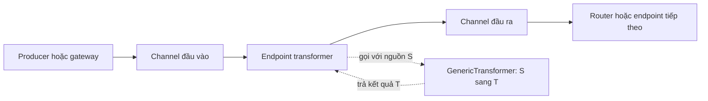

# GenericTransformer

## Mục tiêu và bối cảnh

Trong chương **Transformer** của module **SPRING_INTEGRATION_CORE**, `GenericTransformer<S, T>` giúp biểu diễn phép chuyển đổi dữ liệu bằng một hợp đồng Java có kiểu đầu vào và kiểu đầu ra rõ ràng. Đây là điểm kết nối giữa logic chuyển đổi của ứng dụng với endpoint transformer trong Spring Integration Java DSL.

Giả sử hệ thống nhận đơn hàng từ đối tác. Mã hàng có khoảng trắng, số lượng và đơn giá đều là chuỗi. Trước khi định tuyến đến dịch vụ xử lý đơn, luồng cần tạo một đối tượng nội bộ đã chuẩn hóa. `GenericTransformer` phù hợp để viết phép ánh xạ này và kiểm thử nó độc lập với channel, gateway hoặc adapter.

Sau bài học, bạn có thể:

- Đọc hợp đồng `GenericTransformer<S, T>` và chọn đúng kiểu cho nguồn, đích.
- Viết transformer bằng lambda, method reference hoặc lớp riêng.
- Gắn transformer vào `IntegrationFlow` và phân biệt logic chuyển đổi với endpoint thực thi.
- Quyết định khi nào chỉ trả về payload, khi nào cần tạo toàn bộ `Message`.
- Xử lý dữ liệu không hợp lệ, kiểm tra header và xác định đường đi của lỗi.

Ví dụ hoàn chỉnh sử dụng Java 17 với `record` và API Java DSL thuộc dòng Spring Integration 6.x. Dự án cần có `spring-integration-core`; ví dụ kiểm thử cần JUnit Jupiter. Nếu dùng Spring Boot, hãy để cơ chế quản lý dependency của Boot chọn bộ phiên bản tương thích. Bài tập chỉ thao tác với đối tượng trong bộ nhớ, không cần broker hay cơ sở dữ liệu.

## 1. Hợp đồng `GenericTransformer<S, T>`

Interface nằm trong package `org.springframework.integration.core`. Hợp đồng cốt lõi có dạng:

```java
@FunctionalInterface
public interface GenericTransformer<S, T> {
    T transform(S source);
}
```

`S` là kiểu nguồn và `T` là kiểu kết quả. Interface có một phương thức trừu tượng nên có thể dùng lambda hoặc method reference. [Javadoc GenericTransformer](https://docs.spring.io/spring-integration/api/org/springframework/integration/core/GenericTransformer.html)

Ví dụ:

```java
import java.util.Locale;
import org.springframework.integration.core.GenericTransformer;

GenericTransformer<String, String> normalizeSku =
        text -> text.strip().toUpperCase(Locale.ROOT);

String sku = normalizeSku.transform("  book-java  ");
// sku = "BOOK-JAVA"
```

Hai kiểu không nhất thiết khác nhau. Ở đây `String -> String` vẫn là chuyển đổi vì biểu diễn của dữ liệu đã thay đổi.

| Khai báo | Ý nghĩa trong ứng dụng |
| --- | --- |
| `GenericTransformer<String, String>` | Chuẩn hóa một giá trị văn bản |
| `GenericTransformer<String, OrderCommand>` | Đọc một biểu diễn văn bản thành đối tượng theo quy tắc do ứng dụng định nghĩa |
| `GenericTransformer<RawOrder, OrderCommand>` | Ánh xạ DTO bên ngoài sang lệnh nội bộ |
| `GenericTransformer<Message<RawOrder>, Message<OrderCommand>>` | Chuyển đổi có xét cả payload và header |

Interface chỉ định nghĩa phép gọi `transform`. Nó không tự tạo channel, không đăng ký endpoint, không lập lịch và không quyết định retry. Khi gọi trực tiếp `normalizeSku.transform(...)`, bạn đang thực thi một lời gọi Java thông thường.

Một bean `GenericTransformer` cũng chưa tạo thành luồng. Cần gắn bean đó vào `.transform(...)` hoặc một cấu hình endpoint phù hợp để Spring Integration tiếp nhận và chuyển tiếp thông điệp.

### Phân biệt với các hợp đồng gần giống

| Thành phần | Hợp đồng trọng tâm | Khi phù hợp |
| --- | --- | --- |
| `GenericTransformer<S, T>` | `T transform(S source)` | Viết chiến lược chuyển đổi có kiểu, dùng trong Java DSL |
| `Transformer` | `Message<?> transform(Message<?> message)` | Làm việc trực tiếp với message ở API transformer của framework |
| `Function<S, T>` | `T apply(S source)` | Viết hàm Java tổng quát, có thể nối vào DSL bằng method reference |
| `Converter<S, T>` | `T convert(S source)` | Tham gia cơ chế chuyển đổi kiểu của Spring khi đã được đăng ký phù hợp |

`Transformer` trong `org.springframework.integration.transformer` kế thừa `GenericTransformer<Message<?>, Message<?>>`. Nó là một chuyên biệt hóa làm việc với toàn bộ message. [Javadoc Transformer](https://docs.spring.io/spring-integration/api/org/springframework/integration/transformer/Transformer.html)

Hai interface cùng có một phương thức không có nghĩa là các biến thuộc hai interface tự gán được cho nhau. Nếu đã có một `Function`, có thể thích nghi bằng method reference:

```java
import java.util.function.Function;
import org.springframework.integration.core.GenericTransformer;

Function<String, Integer> lengthFunction = String::length;
GenericTransformer<String, Integer> lengthTransformer =
        lengthFunction::apply;
```

## 2. Từ hàm Java đến endpoint trong flow

Xét một đoạn cấu hình bên trong phương thức tạo `IntegrationFlow`:

```java
return IntegrationFlow.from("skuInput")
        .transform(String.class,
                text -> text.strip().toUpperCase(Locale.ROOT))
        .channel("skuOutput")
        .get();
```

`skuInput` và `skuOutput` là tên channel trong application context. Lambda chỉ nhận dữ liệu đầu vào của phép chuyển đổi; endpoint xung quanh chịu trách nhiệm nhận và phát message.



Java DSL tạo và đăng ký các thành phần tích hợp từ bean `IntegrationFlow`. Vì vậy, một lỗi cấu hình channel và một lỗi trong hàm chuyển đổi thuộc hai lớp trách nhiệm khác nhau. [Java DSL](https://docs.spring.io/spring-integration/reference/dsl.html)

Tham số `String.class` mô tả kiểu nguồn mà bước `.transform(...)` mong đợi, không phải kiểu kết quả. Với overload nhận `Class<P>`, framework có thể thử chuyển đổi dữ liệu về kiểu mong đợi khi cần. Việc chuyển đổi có thành công hay không phụ thuộc các converter được cấu hình. [Javadoc BaseIntegrationFlowDefinition.transform](https://docs.spring.io/spring-integration/docs/6.4.x/api/org/springframework/integration/dsl/BaseIntegrationFlowDefinition.html)

Không nên suy ra rằng `.transform(OrderCommand.class, ...)` sẽ tự đọc bất kỳ chuỗi JSON nào thành `OrderCommand`. Đọc JSON cần một bước giải mã hoặc cấu hình converter thích hợp. Trong bài này, đầu vào đã là `RawOrder`; phép ánh xạ sang `OrderCommand` do mã Java thực hiện.

### Chọn lambda, method reference hay lớp riêng

- Dùng lambda cho phép đổi ngắn, chẳng hạn bỏ khoảng trắng hoặc lấy một trường.
- Dùng method reference khi đã có phương thức có tên diễn đạt rõ nghiệp vụ, chẳng hạn `orderMapper::toCommand`.
- Dùng lớp riêng khi phép đổi có nhiều quy tắc, dependency hoặc cần tái sử dụng và kiểm thử độc lập.

Ví dụ method reference có thể thay lambda ở đoạn trên:

```java
GenericTransformer<String, Integer> countCharacters = String::length;
```

Nếu lambda bắt đầu chứa nhiều nhánh kiểm tra, khối `try/catch` và những phép đổi trung gian, hãy chuyển logic ra lớp có tên. Cấu hình flow khi đó vẫn đọc được theo thứ tự xử lý dữ liệu.

## 3. Ví dụ hoàn chỉnh: chuẩn hóa đơn hàng

### Hợp đồng dữ liệu

Đối tác gửi một `RawOrder` chứa năm trường dạng chuỗi. Luồng nội bộ cần `OrderCommand` có số lượng kiểu `int` và tổng tiền kiểu `BigDecimal`.

| Trường đầu vào | Giá trị mẫu | Quy tắc của ví dụ |
| --- | --- | --- |
| `externalId` | `" PO-17 "` | Bỏ khoảng trắng đầu cuối, giữ nội dung định danh |
| `sku` | `" book-java "` | Bỏ khoảng trắng và viết hoa theo `Locale.ROOT` |
| `quantity` | `" 2 "` | Đọc số nguyên dương |
| `unitPrice` | `" 125000.50 "` | Đọc số thập phân không âm, không chấp nhận dấu phân cách hàng nghìn |
| `currency` | `" vnd "` | Chuẩn hóa mã tiền tệ rồi chỉ chấp nhận `VND` trong bài tập |

Tổng tiền bằng đơn giá nhân số lượng. Ví dụ cố ý giữ nguyên độ chính xác của `BigDecimal`; không bổ sung quy tắc làm tròn. Quy định số chữ số thập phân, thuế và làm tròn cần xuất phát từ hợp đồng nghiệp vụ của hệ thống thực tế.

### Cấu hình và implementation

Đặt đoạn mã sau trong `OrderIntegrationConfig.java` của dự án thực hành. Các record và lớp transformer được đặt lồng trong cấu hình để ví dụ có thể đọc độc lập trong một file.

```java
package example.integration;

import java.math.BigDecimal;
import java.util.Locale;
import java.util.Objects;

import org.springframework.context.annotation.Bean;
import org.springframework.context.annotation.Configuration;
import org.springframework.integration.channel.DirectChannel;
import org.springframework.integration.channel.QueueChannel;
import org.springframework.integration.config.EnableIntegration;
import org.springframework.integration.core.GenericTransformer;
import org.springframework.integration.dsl.IntegrationFlow;

@Configuration
@EnableIntegration
public class OrderIntegrationConfig {

    public record RawOrder(
            String externalId,
            String sku,
            String quantity,
            String unitPrice,
            String currency) {
    }

    public record OrderCommand(
            String orderId,
            String sku,
            int quantity,
            BigDecimal totalAmount,
            String currency) {
    }

    public static final class OrderToCommandTransformer
            implements GenericTransformer<RawOrder, OrderCommand> {

        @Override
        public OrderCommand transform(RawOrder source) {
            Objects.requireNonNull(source, "source không được null");

            String orderId = requiredText(
                    source.externalId(), "externalId");
            String sku = requiredText(source.sku(), "sku")
                    .toUpperCase(Locale.ROOT);
            String currency = requiredText(source.currency(), "currency")
                    .toUpperCase(Locale.ROOT);

            int quantity = parseQuantity(source.quantity());
            BigDecimal unitPrice = parseUnitPrice(source.unitPrice());

            if (!"VND".equals(currency)) {
                throw new IllegalArgumentException(
                        "Ví dụ chỉ hỗ trợ currency VND");
            }

            BigDecimal totalAmount = unitPrice.multiply(
                    BigDecimal.valueOf(quantity));

            return new OrderCommand(
                    orderId, sku, quantity, totalAmount, currency);
        }

        private static int parseQuantity(String value) {
            String text = requiredText(value, "quantity");
            final int quantity;
            try {
                quantity = Integer.parseInt(text);
            }
            catch (NumberFormatException ex) {
                throw new IllegalArgumentException(
                        "quantity phải là số nguyên trong miền int", ex);
            }
            if (quantity <= 0) {
                throw new IllegalArgumentException(
                        "quantity phải lớn hơn 0");
            }
            return quantity;
        }

        private static BigDecimal parseUnitPrice(String value) {
            String text = requiredText(value, "unitPrice");
            final BigDecimal unitPrice;
            try {
                unitPrice = new BigDecimal(text);
            }
            catch (NumberFormatException ex) {
                throw new IllegalArgumentException(
                        "unitPrice phải là số thập phân hợp lệ", ex);
            }
            if (unitPrice.signum() < 0) {
                throw new IllegalArgumentException(
                        "unitPrice không được âm");
            }
            return unitPrice;
        }

        private static String requiredText(String value, String field) {
            if (value == null || value.isBlank()) {
                throw new IllegalArgumentException(
                        field + " không được rỗng");
            }
            return value.strip();
        }
    }

    @Bean
    public DirectChannel rawOrders() {
        return new DirectChannel();
    }

    @Bean
    public QueueChannel normalizedOrders() {
        return new QueueChannel(100);
    }

    @Bean
    public GenericTransformer<RawOrder, OrderCommand> orderTransformer() {
        return new OrderToCommandTransformer();
    }

    @Bean
    public IntegrationFlow normalizeOrderFlow(
            GenericTransformer<RawOrder, OrderCommand> orderTransformer) {
        return IntegrationFlow.from("rawOrders")
                .transform(RawOrder.class, orderTransformer,
                        endpoint -> endpoint.id("normalizeOrderEndpoint"))
                .channel("normalizedOrders")
                .get();
    }
}
```

Trong ứng dụng lớn, các DTO và lớp chuyển đổi thường nằm ngoài lớp cấu hình. Cách đặt lồng ở trên chỉ giúp bài thực hành không phụ thuộc những file chưa được giới thiệu.

Có ba điểm cần đọc riêng:

1. `OrderToCommandTransformer` chỉ biết `RawOrder` và `OrderCommand`, không biết tên channel.
2. Bean `orderTransformer` cung cấp chiến lược chuyển đổi để flow sử dụng.
3. `.transform(RawOrder.class, orderTransformer, ...)` gắn chiến lược đó vào endpoint có tên rõ ràng.

`DirectChannel` đầu vào khiến bước chuyển đổi của flow này chạy trên luồng gửi. `QueueChannel` cuối luồng giữ kết quả để consumer hoặc mã kiểm thử nhận về. Nó không làm cho bước chuyển đổi đứng trước tự chạy bất đồng bộ.

Ví dụ không đặt consumer đọc `normalizedOrders`; mã kiểm thử sẽ gọi `receive(...)`. Khi bổ sung endpoint tiêu thụ từ channel dạng queue, cần cấu hình poller phù hợp. Queue có dung lượng hữu hạn cũng cần chính sách timeout/backpressure khi đưa vào luồng thực tế.

## 4. Khi nào hàm nhận payload, khi nào nhận `Message`?

### Chỉ nhận và trả về payload

Trong ví dụ chính:

```text
Message<RawOrder>
    -> endpoint lấy nguồn cho hàm
    -> GenericTransformer<RawOrder, OrderCommand>
    -> endpoint tạo Message<OrderCommand>
```

Hàm không phải tự tạo `Message<OrderCommand>`. Đây là cách thích hợp khi phép đổi chỉ phụ thuộc dữ liệu nghiệp vụ.

### Nhận toàn bộ message

Đôi khi quyết định chuyển đổi phụ thuộc header, hoặc kết quả phải có thêm metadata mô tả schema. Overload `.transform(Message.class, ...)` yêu cầu truyền toàn bộ message vào hàm. `Message.class` là class literal không biểu diễn được tham số generic của payload; vì vậy cần kiểm tra hoặc ép kiểu payload tại ranh giới này.

Đoạn sau là **phương án thay thế** cho bước `.transform(...)` trong `normalizeOrderFlow`, không cần tạo thêm flow cùng nhận `rawOrders`. Trong file cấu hình, bổ sung import `org.springframework.messaging.Message` và `org.springframework.messaging.support.MessageBuilder`.

```java
return IntegrationFlow.from("rawOrders")
        .transform(Message.class, message -> {
            Object payload = message.getPayload();
            if (!(payload instanceof RawOrder rawOrder)) {
                throw new IllegalArgumentException(
                        "Payload phải là RawOrder");
            }

            OrderCommand command = orderTransformer.transform(rawOrder);

            return MessageBuilder.withPayload(command)
                    .copyHeaders(message.getHeaders())
                    .setHeader("schemaVersion", "2")
                    .build();
        })
        .channel("normalizedOrders")
        .get();
```

Phép kiểm tra `instanceof` giúp thông báo lỗi nói rõ hợp đồng đầu vào, thay vì để lỗi ép kiểu xuất hiện sâu trong mã chuyển đổi. Nếu chỉ muốn thêm header cố định mà không cần thao tác message trong mapper, giữ transformer payload ở ví dụ chính rồi dùng một bước header enricher riêng thường sẽ dễ đọc hơn.

### Quy tắc truyền header

Với cấu hình mặc định, transformer chỉ trả về payload sẽ để framework truyền các header đầu vào sang message kết quả. Khi transformer trả về một `Message` hoàn chỉnh, mã ứng dụng chịu trách nhiệm xây dựng message và các header cần thiết. [Header Propagation](https://docs.spring.io/spring-integration/reference/message.html#header-propagation)

| Kết quả hàm trả về | Trách nhiệm với header |
| --- | --- |
| `OrderCommand` | Framework tạo message kết quả và thực hiện truyền header |
| `Message<OrderCommand>` | Hàm phải chủ động chọn hoặc sao chép header cần giữ |

Trong đoạn thay thế, `copyHeaders(...)` giữ metadata cần cho phần tiếp theo của luồng; `setHeader(...)` đứng sau để ghi đè giá trị `schemaVersion` cũ nếu có.

Header cần xem xét gồm `traceId` của ứng dụng, mã tương quan, thông tin sequence khi luồng có splitter/aggregator, và `replyChannel` nếu downstream dựa vào cơ chế trả lời đó. Các header không còn phù hợp sau khi payload đổi định dạng cũng cần được điều chỉnh.

Ví dụ cụ thể: nếu flow được gọi qua gateway, việc dựng một message mới mà bỏ mất `replyChannel` có thể làm mất đường trả lời ở phần downstream không có output channel tường minh. Ở ví dụ chính, đầu ra đã được cấu hình là `normalizedOrders`; đây là nơi kiểm thử nhận kết quả.

`id` và `timestamp` là header do hạ tầng quản lý; không dùng chúng như khóa nghiệp vụ phải bất biến qua mọi phép đổi. `MessageBuilder` xử lý chúng như header chỉ đọc. Payload bên trong vẫn có thể là đối tượng mutable nếu ứng dụng tự chọn kiểu đó. [Message và MessageBuilder](https://docs.spring.io/spring-integration/reference/message.html#the-messagebuilder-helper-class)

Vì vậy, không sửa trực tiếp map header, và nên tạo đối tượng kết quả mới thay vì thay đổi DTO nguồn đang có thể được chia sẻ với nhánh khác của luồng.

## 5. Kết quả rỗng, lỗi dữ liệu và đường đi của exception

### Không trả `null` để loại bỏ message

Transformer trong flow phải tạo ra kết quả hợp lệ cho message được xử lý. Một phương thức chuyển đổi trả `null` sẽ dẫn đến lỗi chuyển đổi ở endpoint; transformer không phải công cụ bỏ qua thông điệp. Cần dùng filter khi chủ đích là quyết định giữ hay loại message. [Transformer](https://docs.spring.io/spring-integration/reference/transformer.html)

Ví dụ thiết kế không phù hợp:

```java
GenericTransformer<String, String> normalize = text -> {
    if (text.isBlank()) {
        return null;
    }
    return text.strip();
};
```

Nếu chuỗi rỗng là dữ liệu cần loại bỏ theo hợp đồng luồng, biểu diễn quyết định đó bằng filter trước transformer:

```java
return IntegrationFlow.from("textInput")
        .filter(String.class, text -> !text.isBlank())
        .transform(String.class, String::strip)
        .channel("textOutput")
        .get();
```

Nếu chuỗi rỗng là lỗi cần báo cho người gửi, hãy ném exception có ý nghĩa. Nếu cần lưu dữ liệu bị loại để đối soát, cấu hình discard channel của filter theo yêu cầu ứng dụng.

Có một khác biệt khi kiểm thử: lời gọi trực tiếp vào một lambda `GenericTransformer` vẫn chỉ là Java; interface tự nó không chặn `null`. Ràng buộc transformer phải có đầu ra được thực thi khi chiến lược đó chạy bên trong endpoint của Spring Integration.

Trả về `List<OrderCommand>` cũng có nghĩa kết quả payload là một danh sách. Nếu cần mỗi phần tử trở thành một message riêng, thêm splitter; không mặc định rằng transformer sẽ tách danh sách thành nhiều message.

### Exception trong phép chuyển đổi

Ví dụ chính ném `IllegalArgumentException` khi số lượng không hợp lệ hoặc đơn giá âm. Khi đi qua endpoint, exception có thể được bọc trong exception của lớp messaging. Khi chẩn đoán, cần xem chuỗi nguyên nhân và thông điệp đầu vào gắn với lỗi, thay vì chỉ đọc kiểu exception ở ngoài cùng.

Đường đi của lỗi phụ thuộc cách endpoint được thực thi:

| Kiểu thực thi | Cách quan sát lỗi điển hình |
| --- | --- |
| Flow đồng bộ qua `DirectChannel` | Exception quay về bên gọi `send(...)` |
| Flow có poller hoặc tác vụ bất đồng bộ do hạ tầng Spring Integration thực thi | Cơ chế xử lý lỗi có thể phát `ErrorMessage` tới error channel |
| Lời gọi qua gateway | Cấu hình gateway quyết định cách trả lỗi hoặc chuyển lỗi sang error channel |

Trong cơ chế phát `ErrorMessage`, header `errorChannel` được ưu tiên khi có; nếu không có, hạ tầng dùng channel lỗi toàn cục theo cấu hình. Chỉ thêm header này không tự biến một lời gọi đồng bộ `DirectChannel` thành xử lý lỗi bất đồng bộ. [Error Handling](https://docs.spring.io/spring-integration/reference/error-handling.html)

Đối với lỗi dữ liệu như `quantity = "abc"`, retry cùng một thông điệp thường không thay đổi kết quả. Thiết kế phù hợp hơn là phản hồi lỗi hoặc đưa dữ liệu vào luồng đối soát. Retry cần xuất phát từ nguyên nhân có khả năng phục hồi, chẳng hạn một dependency tạm thời không sẵn sàng.

Phương thức `transform` không khai báo `throws` cho checked exception. Nếu gọi thư viện có checked exception, implementation phải xử lý hoặc bọc lỗi bằng exception thích hợp và giữ nguyên cause để phục vụ chẩn đoán.

## 6. Kiểm thử ở hai ranh giới

Các đoạn JUnit dưới đây là mã thực hành đi kèm bài học. Kiểm thử hàm chuyển đổi xác nhận quy tắc dữ liệu; kiểm thử flow xác nhận cả việc nối endpoint, channel và truyền header.

### Kiểm thử logic chuyển đổi không khởi động Spring

Đặt lớp test cùng package `example.integration` với cấu hình ở trên:

```java
package example.integration;

import java.math.BigDecimal;

import org.junit.jupiter.api.Test;

import example.integration.OrderIntegrationConfig.OrderToCommandTransformer;
import example.integration.OrderIntegrationConfig.RawOrder;

import static org.junit.jupiter.api.Assertions.*;

class OrderToCommandTransformerTest {

    private final OrderToCommandTransformer transformer =
            new OrderToCommandTransformer();

    @Test
    void convertsValidOrder() {
        var raw = new RawOrder(
                " PO-17 ", " book-java ", " 2 ", " 125000.50 ", " vnd ");

        var command = transformer.transform(raw);

        assertEquals("PO-17", command.orderId());
        assertEquals("BOOK-JAVA", command.sku());
        assertEquals(2, command.quantity());
        assertEquals("VND", command.currency());
        assertEquals(0,
                new BigDecimal("250001.00")
                        .compareTo(command.totalAmount()));
        assertEquals(" book-java ", raw.sku());
    }

    @Test
    void rejectsNonPositiveQuantity() {
        var raw = new RawOrder("PO-17", "BOOK-JAVA", "0", "100", "VND");

        var error = assertThrows(IllegalArgumentException.class,
                () -> transformer.transform(raw));

        assertEquals("quantity phải lớn hơn 0", error.getMessage());
    }

    @Test
    void retainsCauseWhenQuantityCannotBeParsed() {
        var raw = new RawOrder("PO-17", "BOOK-JAVA", "abc", "100", "VND");

        var error = assertThrows(IllegalArgumentException.class,
                () -> transformer.transform(raw));

        assertInstanceOf(NumberFormatException.class, error.getCause());
    }
}
```

`compareTo(...)` thể hiện chủ đích so sánh giá trị tiền, không yêu cầu hai `BigDecimal` có cùng scale. Kiểm tra lại `raw.sku()` cũng xác nhận phép ánh xạ không thay đổi nguồn.

Các ca biên nên bổ sung khi thực hành gồm trường bắt buộc bị thiếu, quantity vượt miền `int`, đơn giá không đọc được, đơn giá âm và currency không hỗ trợ. Chọn ca kiểm thử theo hợp đồng dữ liệu, không chỉ theo số nhánh hiện có trong implementation.

### Kiểm thử flow và header

Test sau sử dụng nguyên cấu hình payload transformer ở mục 3:

```java
package example.integration;

import org.junit.jupiter.api.Test;
import org.springframework.context.annotation.AnnotationConfigApplicationContext;
import org.springframework.integration.channel.QueueChannel;
import org.springframework.messaging.MessageChannel;
import org.springframework.messaging.MessagingException;
import org.springframework.messaging.support.MessageBuilder;

import example.integration.OrderIntegrationConfig.OrderCommand;
import example.integration.OrderIntegrationConfig.RawOrder;

import static org.junit.jupiter.api.Assertions.*;

class NormalizeOrderFlowTest {

    @Test
    void sendsConvertedPayloadAndPreservesTraceId() {
        try (var context = new AnnotationConfigApplicationContext(
                OrderIntegrationConfig.class)) {
            var input = context.getBean("rawOrders", MessageChannel.class);
            var output = context.getBean("normalizedOrders", QueueChannel.class);

            var request = MessageBuilder.withPayload(new RawOrder(
                            "PO-17", " book-java ", "2", "125000.50", "vnd"))
                    .setHeader("traceId", "trace-001")
                    .build();

            assertTrue(input.send(request));
            var reply = output.receive(1000);

            assertNotNull(reply);
            var command = assertInstanceOf(OrderCommand.class,
                    reply.getPayload());
            assertEquals("BOOK-JAVA", command.sku());
            assertEquals("trace-001", reply.getHeaders().get("traceId"));
        }
    }

    @Test
    void exposesInvalidInputToDirectChannelSender() {
        try (var context = new AnnotationConfigApplicationContext(
                OrderIntegrationConfig.class)) {
            var input = context.getBean("rawOrders", MessageChannel.class);
            var output = context.getBean("normalizedOrders", QueueChannel.class);
            var request = MessageBuilder.withPayload(new RawOrder(
                            "PO-17", "BOOK-JAVA", "0", "100", "VND"))
                    .build();

            assertThrows(MessagingException.class,
                    () -> input.send(request));
            assertNull(output.receive(0));
        }
    }
}
```

`receive(1000)` giới hạn thời gian đợi để test không treo khi flow chưa tạo đầu ra. Ca lỗi dùng cấu hình đồng bộ ở mục 3 nên có thể xác nhận exception ngay tại `send(...)` và kiểm tra queue không có kết quả thành công.

Nếu chuyển sang biến thể trả toàn bộ `Message`, cần thêm test cho `schemaVersion` và header phải giữ. Nếu bỏ `copyHeaders(...)` trong biến thể đó, test `traceId` sẽ giúp phát hiện thay đổi hợp đồng metadata.

## 7. Nguyên tắc thiết kế khi tái sử dụng

### Giữ mapper tập trung vào phép chuyển đổi

Một mapper dễ tái sử dụng thường nhận dữ liệu nguồn và trả đối tượng mới, không tự gửi thêm message và không biết tên channel. Những tác vụ như gọi API thanh toán hoặc ghi đơn hàng vào database nên được tách thành endpoint thể hiện rõ tác dụng nghiệp vụ.

Kiểm tra `quantity > 0` trong mapper của bài có mục đích bảo đảm đối tượng đích hợp lệ. Một chính sách như quyết định chấp nhận đơn theo hạn mức tín dụng lại là bước xử lý nghiệp vụ riêng; không nên giấu trong phép đổi DTO.

### Tránh trạng thái thay đổi dùng chung

Một bean transformer có thể được gọi đồng thời nếu được sử dụng bởi các luồng hoặc channel thực thi đồng thời. Implementation phải phù hợp với cách sử dụng đó. Ví dụ chính chỉ dùng biến cục bộ và các đối tượng giá trị, không có bộ đếm hay buffer thay đổi dùng chung.

Không giữ một `StringBuilder`, collection kết quả hoặc formatter không an toàn luồng trong field rồi tái sử dụng giữa các lần gọi. Nếu transformer dùng dependency, tính an toàn khi truy cập đồng thời cũng phải xét tới dependency đó.

### Viết rõ hợp đồng chuẩn hóa

Trong ví dụ, viết hoa SKU là quy tắc đã chọn. Không áp dụng máy móc cho mọi định danh: một mã bên ngoài có thể phân biệt hoa thường. Tương tự, chuyển chuỗi sang `BigDecimal` không tự giải quyết định dạng theo vùng, đơn vị tiền hoặc quy tắc làm tròn.

Với dữ liệu đầu vào đa dạng, xác định rõ từng bước: đọc định dạng truyền tải, ánh xạ mô hình, kiểm tra dữ liệu, định tuyến và thực hiện nghiệp vụ. Việc chia thành các bước có tên sẽ giúp tìm được điểm gây lỗi và giữ mapper vừa đủ nhỏ để kiểm thử.

## 8. Những lỗi thường gặp

| Hiện tượng | Nguyên nhân thường gặp | Hướng xử lý |
| --- | --- | --- |
| Có bean `GenericTransformer` nhưng không thấy dữ liệu được đổi | Bean chưa được nối vào endpoint | Kiểm tra `.transform(...)` và input channel của flow |
| Lambda nhận kiểu không như dự kiến | Chọn nhầm overload hoặc hợp đồng nguồn không rõ | Dùng `.transform(ExpectedType.class, ...)` và xác định bước giải mã phía trước |
| Chuỗi JSON không biến thành DTO | Chỉ khai báo class mong đợi, chưa có bước đọc JSON hoặc converter phù hợp | Bổ sung phép giải mã và kiểm thử ranh giới dữ liệu |
| Mất `traceId` khi trả `Message` mới | Chưa sao chép hoặc chọn lại header | Dùng `MessageBuilder` và kiểm thử header cần giữ |
| Lỗi khi trả `null` | Dùng transformer để loại bỏ message | Chuyển quyết định giữ/loại sang filter |
| Danh sách đầu ra vẫn là một payload | Nhầm chuyển đổi với tách message | Dùng splitter nếu cần mỗi phần tử là một message |
| Không thấy lỗi trong error channel | Mong đợi `DirectChannel` tự chuyển exception đồng bộ sang channel lỗi | Kiểm tra mô hình thực thi và cấu hình xử lý lỗi tại ranh giới gọi |
| Lỗi khó tái hiện khi tăng số luồng | Transformer có trạng thái thay đổi dùng chung | Giữ implementation stateless hoặc kiểm soát truy cập theo thiết kế |

## 9. Bài tập thực hành

1. Chạy các test của ví dụ trong dự án đã có dependency phù hợp; xác nhận dữ liệu `PO-17` tạo `OrderCommand` và giữ `traceId`.
2. Bổ sung hợp đồng cho `unitPrice`: chấp nhận số 0, từ chối số âm và chuỗi có dấu phân cách hàng nghìn; viết test phản ánh từng quy tắc.
3. Thay bước chuyển đổi bằng biến thể nhận `Message.class`; xác nhận có `schemaVersion = "2"` và vẫn giữ `traceId`.
4. Trong biến thể trên, chủ động bỏ sao chép header rồi quan sát test metadata thất bại; khôi phục chính sách header theo hợp đồng đã chọn.
5. Nối một router sau bước chuẩn hóa để phân nhánh theo thuộc tính của `OrderCommand`. Giữ quy tắc chuyển đổi trong mapper và quyết định đường đi trong router.

Kết quả cần thể hiện được ba ranh giới: `RawOrder -> OrderCommand` trong logic Java, `Message -> Message` tại endpoint và `channel -> endpoint -> channel` trong cấu hình luồng. Đây là nền tảng để ghép transformer với gateway, filter, router và aggregator mà vẫn kiểm soát được kiểu dữ liệu, metadata và lỗi.
