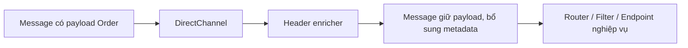

# Header enricher transformer

Trong module **Spring Integration Core (`SPRING_INTEGRATION_CORE`)**, header enricher là transformer chuyên bổ sung hoặc thay thế metadata của `Message`. Thành phần này giúp các endpoint phía sau định tuyến, chọn chính sách xử lý hoặc liên kết thông điệp mà không cần thay đổi dữ liệu nghiệp vụ trong payload.

Bài học thuộc chương **Transformer**, tập trung vào cách đặt header bằng giá trị tĩnh, SpEL và Java DSL; đồng thời làm rõ quy tắc ghi đè, xử lý `null`, lỗi và kiểm thử. Các ví dụ dùng Java 17 và API Spring Integration 6.3 làm mốc; dự án cần quản lý phiên bản thư viện nhất quán bằng cấu hình dependency hiện có.

## 1. Mục tiêu và kiến thức nền

Sau bài học, bạn có thể:

- Phân biệt dữ liệu nghiệp vụ trong payload với metadata điều khiển luồng trong header.
- Tạo endpoint header enricher bằng Java DSL và đọc cấu hình XML tương đương.
- Chọn chính sách giữ giá trị cũ, ghi đè hoặc xóa header.
- Tránh phụ thuộc vào thứ tự khai báo các header trong cùng một enricher.
- Viết kiểm thử cho payload, header đầu ra, tính bất biến của đầu vào và tình huống lỗi.

Bạn nên biết `Message<T>`, `MessageChannel`, `DirectChannel`, `QueueChannel` và cách khai báo một `IntegrationFlow`. Không cần thêm adapter giao thức để thực hành nội dung này.

## 2. Header enricher thay đổi điều gì?

Một message có hai phần:

```text
Message<Order>
├── payload: Order
└── headers: Map<String, Object>
```

Ví dụ một đơn hàng cần được chuyển đến kho theo vùng:

```text
Đầu vào
  payload = Order("ORD-1001", "south", 6500000)
  headers = { requestId: "req-007" }

Đầu ra sau enrichment
  payload = cùng đối tượng Order ở đầu vào
  headers = {
    requestId: "req-007",
    sourceSystem: "order-api",
    orderId: "ORD-1001",
    region: "SOUTH",
    warehouse: "WH-HCM",
    highValue: true
  }
```

Các header hệ thống như `id` và `timestamp` được lược bỏ trong minh họa. Header enricher giữ payload và các header không thuộc phạm vi cập nhật, rồi tạo kết quả qua message builder. Nó không sửa trực tiếp map header của message đầu vào. Map này chỉ cho phép đọc; `message.getHeaders().put(...)` sẽ gây `UnsupportedOperationException`. Tuy nhiên, bản thân object payload hoặc object nằm trong header vẫn có thể mutable. Vì vậy, tính bất biến của message không có nghĩa mọi object bên trong đều đã được sao chép sâu. Xem [Message và MessageHeaders](https://docs.spring.io/spring-integration/reference/6.3/message.html).



Header enricher là một transformer. Trong một flow, nó trở thành endpoint xử lý message nhận từ input channel và phát kết quả sang bước tiếp theo. Nó không tự lưu message, không tạo worker thread và không tự gửi yêu cầu ra hệ thống bên ngoài. Channel và cấu hình endpoint quyết định cách message được giao và xử lý.

### Chọn đúng thành phần

| Nhu cầu | Thành phần phù hợp | Ví dụ |
| --- | --- | --- |
| Thêm metadata, giữ payload | Header enricher | Thêm `warehouse` để router chọn kho |
| Chuyển đổi payload | Payload transformer | Đổi JSON thành `Order` |
| Bổ sung dữ liệu vào payload qua nguồn tra cứu | Payload/content enricher | Tra hồ sơ khách hàng rồi thêm vào đơn hàng |
| Xóa một số header | Header filter | Bỏ `internalNote` trước khi ra ngoài |
| Chọn đường đi dựa trên metadata | Router | Đọc `warehouse` và chuyển sang channel tương ứng |
| Chấp nhận hoặc loại cả message | Message filter | Chỉ nhận đơn hàng có trạng thái hợp lệ |

Spring Integration Core cung cấp cả header enricher và payload enricher; hai thành phần giải quyết hai vị trí làm giàu dữ liệu khác nhau. Cấu hình header enricher hỗ trợ giá trị tĩnh, biểu thức và phương thức của bean. Xem [Content Enricher — Header Enricher](https://docs.spring.io/spring-integration/reference/6.3/content-enrichment.html#header-enricher).

Việc chọn header hay payload cũng là quyết định về hợp đồng dữ liệu. Nếu `customerTier` là dữ liệu phải lưu trong hồ sơ nghiệp vụ và chia sẻ lâu dài với hệ thống khác, hãy đưa nó vào mô hình phù hợp. Nếu nó chỉ là kết quả tạm để chọn tuyến xử lý trong flow hiện tại, header có thể là lựa chọn gọn hơn.

## 3. Ví dụ Java DSL hoàn chỉnh: gắn metadata cho đơn hàng

Ví dụ dùng `spring-integration-core` cùng các dependency Spring tương thích. Phần kiểm thử bên dưới cần JUnit Jupiter. Không cần Spring Boot hay broker. Nếu ứng dụng đã dùng Spring Boot, hãy để cơ chế quản lý dependency của ứng dụng chọn các phiên bản Spring tương thích.

Quy ước nghiệp vụ của ví dụ:

- `sourceSystem` dùng giá trị mặc định `order-api` khi message chưa mang thông tin nguồn.
- `orderId`, `region`, `warehouse` và `highValue` được tính từ payload đã được flow tin cậy.
- Giá trị cũ của bốn header được tính lại phải được thay thế.
- Vùng hợp lệ là `NORTH`, `CENTRAL` và `SOUTH`; đầu vào khác các vùng này phải báo lỗi.

```java
package example.integration;

import java.util.Locale;

import org.springframework.context.annotation.Bean;
import org.springframework.context.annotation.Configuration;
import org.springframework.integration.channel.DirectChannel;
import org.springframework.integration.channel.QueueChannel;
import org.springframework.integration.config.EnableIntegration;
import org.springframework.integration.dsl.IntegrationFlow;
import org.springframework.messaging.MessageChannel;

@Configuration
@EnableIntegration
public class OrderEnrichmentConfig {

    public record Order(String orderId, String region, long totalVnd) {
    }

    @Bean
    public MessageChannel orderInput() {
        return new DirectChannel();
    }

    @Bean
    public QueueChannel enrichedOrders() {
        return new QueueChannel();
    }

    @Bean
    public IntegrationFlow orderHeaderFlow() {
        return IntegrationFlow.from("orderInput")
                .enrichHeaders(h -> h
                        .defaultOverwrite(false)
                        .header("sourceSystem", "order-api")
                        .<Order>headerFunction(
                                "orderId",
                                m -> m.getPayload().orderId(),
                                true)
                        .<Order>headerFunction(
                                "region",
                                m -> normalizeRegion(m.getPayload().region()),
                                true)
                        .<Order>headerFunction(
                                "warehouse",
                                m -> warehouseFor(m.getPayload().region()),
                                true)
                        .<Order>headerFunction(
                                "highValue",
                                m -> m.getPayload().totalVnd() >= 5_000_000L,
                                true))
                .channel("enrichedOrders")
                .get();
    }

    private static String normalizeRegion(String value) {
        if (value == null || value.isBlank()) {
            throw new IllegalArgumentException("region must not be blank");
        }

        String normalized = value.strip().toUpperCase(Locale.ROOT);
        return switch (normalized) {
            case "NORTH", "CENTRAL", "SOUTH" -> normalized;
            default -> throw new IllegalArgumentException(
                    "Unsupported region: " + value);
        };
    }

    private static String warehouseFor(String region) {
        return switch (normalizeRegion(region)) {
            case "NORTH" -> "WH-HN";
            case "CENTRAL" -> "WH-DN";
            case "SOUTH" -> "WH-HCM";
            default -> throw new IllegalStateException("Unexpected region");
        };
    }
}
```

`@EnableIntegration` đăng ký hạ tầng Integration khi dùng cấu hình Spring thuần. `IntegrationFlow.from("orderInput")` lấy message từ channel đã khai báo. `enrichHeaders(...)` thêm bước biến đổi header; `channel("enrichedOrders")` chuyển kết quả vào queue để có thể nhận và kiểm tra.

`headerFunction` nhận một `Message<P>`, nên lambda truy cập được cả payload lẫn header. Cú pháp `.<Order>headerFunction(...)` chỉ rõ kiểu payload cho compiler. Đối số cuối `true` là quyền ghi đè riêng của header đó. Đây là các API trong [HeaderEnricherSpec](https://docs.spring.io/spring-integration/api/org/springframework/integration/dsl/HeaderEnricherSpec.html).

Ở đây, `warehouseFor(...)` đọc vùng từ payload, không đọc header `region` vừa khai báo phía trên. Cách này chủ động tránh phụ thuộc giữa hai phép tính trong cùng một enricher.

`QueueChannel` ở cuối chỉ giữ kết quả cho người nhận. Flow xử lý từ `orderInput` đến khi đặt kết quả vào queue vẫn chạy trên thread gọi `send(...)`, vì đầu vào là `DirectChannel` và không có bước chuyển thực thi bất đồng bộ. Ví dụ không cần poller vì chưa khai báo endpoint tiêu thụ `enrichedOrders`.

## 4. Ba cách xác định giá trị header

### 4.1. Giá trị tĩnh: `header`

```java
.enrichHeaders(h -> h
        .header("sourceSystem", "order-api")
        .header("schemaVersion", 2)
        .header("auditEnabled", true))
```

Các giá trị trên lần lượt có kiểu `String`, `Integer` và `Boolean`. Header không bắt buộc là chuỗi.

Giá trị truyền vào `header(...)` được xác định khi dựng cấu hình. Ví dụ sau tạo một UUID rồi dùng chung giá trị đó cho những message được bổ sung header:

```java
// Không phù hợp nếu mỗi message cần một mã xử lý mới.
.header("processingId", java.util.UUID.randomUUID().toString())
```

Nếu muốn tính cho từng message, dùng callback:

```java
.<Object>headerFunction(
        "processingId",
        m -> java.util.UUID.randomUUID().toString(),
        true)
```

Mã ngẫu nhiên mới trên mỗi lần xử lý chỉ thích hợp để nhận diện một lượt xử lý. Với yêu cầu chống xử lý trùng, hãy chọn khóa ổn định từ nghiệp vụ hoặc từ sự kiện nguồn; tạo UUID mới mỗi lần retry sẽ làm mất ý nghĩa nhận diện bản ghi trùng.

### 4.2. Biểu thức SpEL: `headerExpression`

```java
.enrichHeaders(h -> h
        .headerExpression("orderId", "payload.orderId()", true)
        .headerExpression("highValue", "payload.totalVnd() >= 5000000", true)
        .headerExpression(
                "requestedBy",
                "headers['requestedBy'] ?: 'system'"))
```

Root của ngữ cảnh đánh giá cho phép đọc `payload` và `headers`. Biểu thức cuối dùng toán tử Elvis để lấy giá trị hiện có hoặc giá trị thay thế khi biểu thức được đánh giá. Với chính sách mặc định không ghi đè, header `requestedBy` đã tồn tại sẽ được giữ mà không cần đánh giá lại biểu thức.

Phân biệt giá trị tĩnh với biểu thức:

```java
.header("orderId", "payload.orderId()")            // Chuỗi literal.
.headerExpression("orderId", "payload.orderId()") // Kết quả gọi accessor.
```

Biểu thức ngắn giúp cấu hình dễ đọc. Với quy tắc có nhiều nhánh, nên đưa logic vào phương thức Java để dễ đặt tên, kiểm thử và bảo trì. SpEL cũng có thể gọi bean, chẳng hạn `@warehousePolicy.warehouseFor(payload.region())`, khi bean `warehousePolicy` đã được đăng ký và phương thức có thể được truy cập. Xem [SpEL và POJO support của header enricher](https://docs.spring.io/spring-integration/reference/6.3/content-enrichment.html#spel-support).

### 4.3. Hàm Java: `headerFunction`

```java
.enrichHeaders(h -> h
        .<OrderEnrichmentConfig.Order>headerFunction(
                "routingKey",
                m -> m.getPayload().orderId() + ":"
                        + m.getHeaders().get("tenantId", String.class),
                true))
```

Callback đọc header từ message đầu vào. Ví dụ này giả định `tenantId` đã được xác thực và bắt buộc phải có trước bước enrichment. Nếu không có, phép nối chuỗi sẽ cho phần đuôi `"null"`; ứng dụng nên kiểm tra hợp đồng đầu vào thay vì chấp nhận khóa định tuyến sai.

Lambda cần ngắn, không sửa payload và không giữ trạng thái mutable dùng chung giữa các message. Khi việc tính header cần tra cứu từ xa, hãy tách thành bước dịch vụ có timeout, xử lý lỗi và chiến lược retry phù hợp. Enricher thực thi hàm tính giá trị, nên một lời gọi chậm bên trong hàm vẫn làm chậm bước xử lý message.

## 5. Quy tắc ghi đè: xác định bên sở hữu header

Mặc định, header enricher **không thay thế header đã tồn tại**. Có hai mức cấu hình:

1. `defaultOverwrite(...)`: chính sách chung cho các header chưa chỉ định riêng.
2. Đối số `overwrite` trên từng khai báo: chính sách riêng, ưu tiên hơn chính sách chung.

Ví dụ:

```java
.enrichHeaders(h -> h
        .defaultOverwrite(true)
        .header("sourceSystem", "order-api", false)
        .header("schemaVersion", 2)
        .headerExpression("orderId", "payload.orderId()", true))
```

Nếu đầu vào đã có các header tương ứng:

| Header | Chính sách có hiệu lực | Kết quả |
| --- | --- | --- |
| `sourceSystem` | Riêng: `false` | Giữ nguồn do upstream truyền |
| `schemaVersion` | Chung: `true` | Đổi thành số nguyên `2` |
| `orderId` | Riêng: `true` | Tính lại từ payload |

Nếu header chưa tồn tại và giá trị tính được khác `null`, enricher bổ sung header dù chính sách ghi đè là `false`.

| Đầu vào có header? | Ghi đè có hiệu lực? | Có tính giá trị mới? |
| --- | --- | --- |
| Không | `false` | Có |
| Không | `true` | Có |
| Có | `false` | Không; giữ giá trị hiện có |
| Có | `true` | Có |

Việc không đánh giá biểu thức khi header đã tồn tại và không cho phép ghi đè có thể làm một lỗi dữ liệu bị che khuất: bạn tưởng hàm luôn chạy để kiểm tra payload, nhưng thực tế nó bị bỏ qua. Hãy đặt validation ở bước validation rõ ràng nếu đó là yêu cầu bắt buộc với mọi message. Quy tắc đánh giá có điều kiện này được thể hiện trong [mã nguồn HeaderEnricher 6.3](https://github.com/spring-projects/spring-integration/blob/v6.3.0/spring-integration-core/src/main/java/org/springframework/integration/transformer/HeaderEnricher.java).

Trong một flow nội bộ đáng tin cậy, giữ `sourceSystem` cũ có thể giúp bảo toàn nguồn ban đầu. Ở điểm nhận dữ liệu từ bên ngoài, nếu header cần phản ánh danh tính do hệ thống xác lập, hãy ghi đè nó từ nguồn tin cậy. Quyền ghi đè nên dựa trên bên sở hữu ý nghĩa của header.

## 6. Giá trị `null`: bỏ qua hay xóa?

`shouldSkipNulls` có giá trị mặc định `true`. Khi một khai báo header được đánh giá và trả về `null`:

- `shouldSkipNulls(true)`: không áp dụng kết quả đó.
- `shouldSkipNulls(false)`: áp dụng `null` theo ngữ nghĩa xóa header.

Cấu hình `null` không tạo ra một header có giá trị `null` để downstream đọc. Xem [HeaderEnricher.setShouldSkipNulls](https://docs.spring.io/spring-integration/api/org/springframework/integration/transformer/HeaderEnricher.html#setShouldSkipNulls(boolean)).

Phải xét đồng thời quyền ghi đè:

| Header đầu vào | Ghi đè | `shouldSkipNulls` | Kết quả nếu phép tính trả `null` |
| --- | --- | --- | --- |
| Chưa có | Bất kỳ | `true` | Header vẫn không tồn tại |
| Chưa có | Bất kỳ | `false` | Header vẫn không tồn tại |
| Đã có | `false` | Bất kỳ | Không chạy phép tính; giữ giá trị cũ |
| Đã có | `true` | `true` | Giữ giá trị cũ |
| Đã có | `true` | `false` | Xóa header |

Ví dụ chủ động xóa `legacyRoute`:

```java
.enrichHeaders(h -> h
        .shouldSkipNulls(false)
        .headerExpression("legacyRoute", "null", true))
```

Đối số `true` ở đây cho phép tác động lên header đã tồn tại. Nếu bỏ nó trong khi chính sách chung vẫn là `false`, header cũ sẽ không bị xóa.

Nếu mục tiêu duy nhất là xóa các header có tên đã biết, cách diễn đạt rõ hơn là:

```java
.headerFilter("legacyRoute", "internalNote")
```

Header filter loại các header được chọn, còn message filter quyết định có giữ cả message hay không. Xem [Header Filter](https://docs.spring.io/spring-integration/reference/transformer.html#header-filter).

Một điểm thực tế: chuỗi rỗng `""` và chuỗi chỉ có dấu cách vẫn là giá trị khác `null`. `shouldSkipNulls` không thay bạn chuẩn hóa hoặc xác thực những giá trị này.

## 7. Các phép tính trong cùng enricher đọc message đầu vào

Không coi thứ tự các lời gọi `header(...)`, `headerExpression(...)` hay `headerFunction(...)` trong cùng một enricher là các phép gán tuần tự trên một message đang thay đổi. Các processor nhận message đầu vào; header vừa được thêm vào builder không trở thành đầu vào cho processor kế tiếp.

Giả sử message đầu vào có `region = NORTH`:

```java
.enrichHeaders(h -> h
        .header("region", "SOUTH", true)
        .headerExpression(
                "warehouse",
                "headers['region'] == 'SOUTH' ? 'WH-HCM' : 'WH-OTHER'",
                true))
```

Kết quả có `region = SOUTH` nhưng `warehouse = WH-OTHER`, vì biểu thức đọc `region = NORTH` từ message ban đầu. Đổi thứ tự hai khai báo không phải giải pháp. Đây là hệ quả từ cách `transform(...)` truyền message đến từng processor trong [HeaderEnricher](https://github.com/spring-projects/spring-integration/blob/v6.3.0/spring-integration-core/src/main/java/org/springframework/integration/transformer/HeaderEnricher.java).

Nếu bước sau cần đọc header đã được chuẩn hóa, tách hai enricher:

```java
.enrichHeaders(h -> h
        .header("region", "SOUTH", true))
.enrichHeaders(h -> h
        .headerExpression(
                "warehouse",
                "headers['region'] == 'SOUTH' ? 'WH-HCM' : 'WH-OTHER'",
                true))
```

Hoặc tính độc lập từng giá trị từ cùng một nguồn gốc như payload trong ví dụ đơn hàng. Khi nhiều header cần chung một kết quả tra cứu đắt tiền, hãy thực hiện tra cứu một lần ở bước riêng rồi dùng kết quả đó; không lặp lại lời gọi dịch vụ cho từng header.

## 8. Cấu hình XML tương đương

Khai báo dưới đây là một lựa chọn thay cho cấu hình Java. Nó dùng cùng kiểu payload `OrderEnrichmentConfig.Order`, bổ sung nguồn và tính hai header từ payload. Đây là ví dụ XML rút gọn về nghiệp vụ, không chứa toàn bộ các quy tắc vùng/kho của flow Java.

```xml
<?xml version="1.0" encoding="UTF-8"?>
<beans xmlns="http://www.springframework.org/schema/beans"
       xmlns:xsi="http://www.w3.org/2001/XMLSchema-instance"
       xmlns:int="http://www.springframework.org/schema/integration"
       xsi:schemaLocation="
           http://www.springframework.org/schema/beans
           https://www.springframework.org/schema/beans/spring-beans.xsd
           http://www.springframework.org/schema/integration
           https://www.springframework.org/schema/integration/spring-integration.xsd">

    <int:channel id="orderInput"/>

    <int:channel id="enrichedOrders">
        <int:queue/>
    </int:channel>

    <int:header-enricher id="orderHeaderEnricher"
                         input-channel="orderInput"
                         output-channel="enrichedOrders"
                         default-overwrite="false"
                         should-skip-nulls="true">
        <int:header name="sourceSystem"
                    value="order-api"/>
        <int:header name="orderId"
                    expression="payload.orderId()"
                    overwrite="true"/>
        <int:header name="highValue"
                    expression="payload.totalVnd() &gt;= 5000000"
                    overwrite="true"/>
    </int:header-enricher>
</beans>
```

Trong XML, `value` thể hiện giá trị literal, `expression` là SpEL, còn `ref` có thể tham chiếu bean; khi kết hợp `ref` với `method`, framework gọi phương thức để tính giá trị. Ký tự `>` được viết thành `&gt;` trong biểu thức XML ở trên. Các cách cấu hình này được mô tả tại [Header Enricher](https://docs.spring.io/spring-integration/reference/content-enrichment.html#header-enricher).

| Ý nghĩa | Java DSL | XML |
| --- | --- | --- |
| Chính sách ghi đè chung | `defaultOverwrite(false)` | `default-overwrite="false"` |
| Chính sách bỏ qua `null` | `shouldSkipNulls(true)` | `should-skip-nulls="true"` |
| Giá trị literal | `header("sourceSystem", "order-api")` | `<int:header name="sourceSystem" value="order-api"/>` |
| Giá trị từ SpEL | `headerExpression("orderId", "payload.orderId()", true)` | `expression="payload.orderId()" overwrite="true"` |
| Ghi đè một header | Đối số riêng `true` hoặc `false` | Thuộc tính riêng `overwrite` |

Chỉ nạp một trong hai cấu hình cho ví dụ này. Nếu nạp cả Java và XML với cùng bean/channel, ứng dụng có thể gặp xung đột bean hoặc tạo nhiều consumer ngoài ý định.

## 9. Header nghiệp vụ và header điều khiển framework

Bạn có thể tạo header riêng như `warehouse`, nhưng một số tên đã có ý nghĩa đối với hạ tầng:

| Header | Vai trò | Điểm cần nhớ khi enrichment |
| --- | --- | --- |
| `replyChannel` | Nơi nhận phản hồi khi endpoint cần xác định đường trả lời | Gateway có thể đã đặt đường trả lời cho lời gọi hiện tại |
| `errorChannel` | Địa chỉ xử lý lỗi khi cơ chế phát lỗi sử dụng header này | Cần có channel và consumer xử lý lỗi tương ứng |
| `correlationId` | Liên kết các message có quan hệ với nhau | Aggregator mặc định sử dụng nó để xác định nhóm |
| `sequenceNumber`, `sequenceSize` | Thông tin thứ tự và kích thước nhóm | Có thể đã được splitter hoặc luồng phân nhánh thiết lập |
| `priority` | Độ ưu tiên message | Có tác dụng sắp xếp khi dùng channel hỗ trợ như `PriorityChannel` |

Các kiểu và ý nghĩa header chuẩn được mô tả tại [Message headers](https://docs.spring.io/spring-integration/reference/message.html). Giữ nguyên các header điều khiển do gateway, splitter hoặc endpoint trước thiết lập, trừ khi flow chủ động thay đổi hợp đồng đó.

Không dùng `MessageHeaders.ID` làm mã nghiệp vụ ổn định xuyên suốt mọi phép biến đổi. `id` và `timestamp` là header chỉ đọc do framework quản lý; với message builder mặc định, cấu hình chúng trong enricher bị từ chối khi khởi tạo. Nếu cần định danh xuyên nhiều bước, hãy dùng `requestId`, `eventId` hoặc khóa nghiệp vụ riêng. Xem [Read-only Headers](https://docs.spring.io/spring-integration/reference/6.3/message.html#read-only-headers).

### Tương tác với gateway

Trong luồng request/reply, ghi đè `replyChannel` có thể khiến phản hồi đi đến nơi khác và caller chờ đến timeout. Giữ header này khi mục tiêu chỉ là thêm metadata nghiệp vụ.

Khi cần tuần tự hóa message có `replyChannel` hoặc `errorChannel` là object channel, DSL có `headerChannelsToString()` để đăng ký channel trong `HeaderChannelRegistry` và dùng chuỗi tham chiếu. Registry là cơ chế ánh xạ trong application context, có vòng đời và thời hạn lưu; chuỗi này không tự biến channel thành địa chỉ liên lạc giữa hai JVM độc lập. Xem [Header Channel Registry](https://docs.spring.io/spring-integration/reference/content-enrichment.html#header-channel-registry).

### Tương tác với aggregator

Nếu splitter đã gắn cùng `correlationId` cho các phần của một yêu cầu, việc đặt UUID ngẫu nhiên riêng cho từng phần trước aggregator sẽ tách chúng thành nhiều nhóm. Khi không cần thay đổi chiến lược nhóm, hãy bảo toàn header này.

Ngược lại, cùng một `orderId` xuất hiện trong nhiều lần xử lý độc lập chưa chắc là khóa nhóm đủ phân biệt. Việc chọn correlation key phải theo phạm vi nhóm nghiệp vụ, thay vì sao chép một header thuận tiện. Cơ chế nhóm mặc định được mô tả trong [AggregatingMessageHandler — CorrelationStrategy](https://docs.spring.io/spring-integration/reference/aggregator.html).

## 10. Dùng header đã enrich để định tuyến

Trong ví dụ Java, `warehouse` là kết quả chuẩn hóa từ vùng của đơn hàng. Router phía sau có thể chỉ đọc header này thay vì lặp lại quy tắc chọn kho.

Đoạn dưới thay cho `.channel("enrichedOrders")` ở cuối flow; các channel `northOrders`, `centralOrders` và `southOrders` cần được khai báo trước khi chạy:

```java
.route("headers['warehouse']", r -> r
        .channelMapping("WH-HN", "northOrders")
        .channelMapping("WH-DN", "centralOrders")
        .channelMapping("WH-HCM", "southOrders"))
```

Sự phân chia trách nhiệm là:

```text
Payload Order
    → kiểm tra / chuẩn hóa dữ liệu
    → header enricher xác lập warehouse
    → router ánh xạ warehouse sang channel
    → endpoint xử lý tại kho
```

Đây là lựa chọn thiết kế cho ví dụ: chính sách suy ra kho nằm ở bước enrichment, còn router biểu diễn đường đi. Nếu tính toán chọn kho đã trở thành một nghiệp vụ lớn với dữ liệu từ nhiều dịch vụ, hãy đưa nó vào một service riêng rồi để enricher gắn kết quả cần thiết.

Quy tắc `warehouse` đã được tính trước router không bảo đảm header tự đi qua HTTP, Kafka, AMQP hay JMS. Khi ra khỏi ứng dụng, adapter và header mapper quyết định trường nào được truyền và cách chuyển kiểu. Thiết kế hợp đồng đầu ra cần xác định rõ tên, kiểu và các header được phép đi qua biên hệ thống.

## 11. Lỗi xảy ra trong bước enrichment được xử lý ở đâu?

Enrichment có thể thất bại khi:

- Payload có kiểu hoặc cấu trúc khác điều mà biểu thức/lambda yêu cầu.
- Dữ liệu bắt buộc bị thiếu, chẳng hạn `region` rỗng.
- Biểu thức gọi phương thức không hợp lệ hoặc phương thức nghiệp vụ ném exception.
- Hàm tính header gọi một nguồn tra cứu và nguồn đó thất bại.

Với flow chính dùng `DirectChannel`, lỗi xử lý được ném về caller của `send(...)`, thường dưới dạng exception thuộc hệ thống messaging có chứa nguyên nhân gốc. Chỉ thêm header `errorChannel` không làm một lời gọi `send(...)` đồng bộ tự chuyển lỗi thành message trên channel đó.

Khi xử lý qua poller hoặc cơ chế thực thi bất đồng bộ có error handler phù hợp, lỗi có thể được đóng gói thành `ErrorMessage` và chuyển đến error channel. Gateway cũng có cấu hình xử lý lỗi riêng. Cần xác định nơi phát lỗi và nơi bắt lỗi theo cách flow được thực thi. Xem [Error Handling](https://docs.spring.io/spring-integration/docs/6.1.x/reference/html/error-handling.html).

Nếu enrichment là điều kiện bắt buộc để router hoạt động đúng, không nên bắt mọi exception rồi trả về một kho mặc định. Ví dụ vùng `UNKNOWN` cần được từ chối hoặc chuyển đến tuyến xử lý dữ liệu lỗi theo thiết kế nghiệp vụ.

Nếu một header chỉ mang tính bổ sung, chẳng hạn nhãn phục vụ báo cáo, có thể cho phép thiếu nó. Khi đó, xác định rõ:

1. Giá trị thiếu được biểu diễn bằng việc không có header hay bằng giá trị mặc định.
2. Downstream có được tiếp tục xử lý khi header thiếu hay không.
3. Khi phép tính trả `null`, giá trị cũ có cần được giữ hay phải bị xóa.

Việc bỏ qua `null` mặc định có thể bảo toàn một giá trị cũ đã hết hiệu lực. Đây là lý do cần xem xét cả `overwrite` và `shouldSkipNulls` khi thiết kế fallback.

## 12. Kiểm thử hành vi của flow

Các ví dụ JUnit 5 dưới đây dùng nguyên `OrderEnrichmentConfig` ở mục 3. Lớp test đặt trong cùng package `example.integration`. Context Spring thuần tạo channel, endpoint và flow; không cần khởi chạy server hay broker.

Ba hành vi cần kiểm tra trước tiên là: kết quả enrichment đúng, chính sách ghi đè đúng và dữ liệu không hợp lệ khiến bước enrichment thất bại.

```java
package example.integration;

import org.junit.jupiter.api.Test;

import org.springframework.context.annotation.AnnotationConfigApplicationContext;
import org.springframework.integration.channel.QueueChannel;
import org.springframework.messaging.Message;
import org.springframework.messaging.MessageChannel;
import org.springframework.messaging.MessagingException;
import org.springframework.messaging.support.MessageBuilder;

import static org.junit.jupiter.api.Assertions.*;

class OrderHeaderEnrichmentTest {

    @Test
    void enrichesHeadersAndKeepsOriginalPayload() {
        try (var context = new AnnotationConfigApplicationContext(
                OrderEnrichmentConfig.class)) {

            MessageChannel input = context.getBean(
                    "orderInput", MessageChannel.class);
            QueueChannel output = context.getBean(
                    "enrichedOrders", QueueChannel.class);

            var order = new OrderEnrichmentConfig.Order(
                    "ORD-1001", "south", 6_500_000L);

            Message<OrderEnrichmentConfig.Order> original =
                    MessageBuilder.withPayload(order)
                            .setHeader("requestId", "req-007")
                            .build();

            assertTrue(input.send(original));

            Message<?> enriched = output.receive(1_000);
            assertNotNull(enriched);

            assertSame(order, enriched.getPayload());
            assertEquals("order-api",
                    enriched.getHeaders().get("sourceSystem"));
            assertEquals("ORD-1001",
                    enriched.getHeaders().get("orderId"));
            assertEquals("SOUTH",
                    enriched.getHeaders().get("region"));
            assertEquals("WH-HCM",
                    enriched.getHeaders().get("warehouse"));
            assertEquals(Boolean.TRUE,
                    enriched.getHeaders().get("highValue"));
            assertEquals("req-007",
                    enriched.getHeaders().get("requestId"));

            assertFalse(original.getHeaders().containsKey("warehouse"));
            assertFalse(original.getHeaders().containsKey("region"));
            assertEquals("south", order.region());
        }
    }

    @Test
    void preservesSourceAndRecomputesOwnedHeaders() {
        try (var context = new AnnotationConfigApplicationContext(
                OrderEnrichmentConfig.class)) {

            MessageChannel input = context.getBean(
                    "orderInput", MessageChannel.class);
            QueueChannel output = context.getBean(
                    "enrichedOrders", QueueChannel.class);

            var order = new OrderEnrichmentConfig.Order(
                    "ORD-1002", " SOUTH ", 200_000L);

            Message<OrderEnrichmentConfig.Order> original =
                    MessageBuilder.withPayload(order)
                            .setHeader("sourceSystem", "partner-api")
                            .setHeader("orderId", "OLD-ID")
                            .setHeader("region", "NORTH")
                            .setHeader("warehouse", "WH-HN")
                            .setHeader("highValue", true)
                            .build();

            assertTrue(input.send(original));

            Message<?> enriched = output.receive(1_000);
            assertNotNull(enriched);

            assertEquals("partner-api",
                    enriched.getHeaders().get("sourceSystem"));
            assertEquals("ORD-1002",
                    enriched.getHeaders().get("orderId"));
            assertEquals("SOUTH",
                    enriched.getHeaders().get("region"));
            assertEquals("WH-HCM",
                    enriched.getHeaders().get("warehouse"));
            assertEquals(Boolean.FALSE,
                    enriched.getHeaders().get("highValue"));

            assertEquals("OLD-ID",
                    original.getHeaders().get("orderId"));
            assertEquals("NORTH",
                    original.getHeaders().get("region"));
            assertEquals("WH-HN",
                    original.getHeaders().get("warehouse"));
        }
    }

    @Test
    void rejectsUnsupportedRegionWithoutPublishingOutput() {
        try (var context = new AnnotationConfigApplicationContext(
                OrderEnrichmentConfig.class)) {

            MessageChannel input = context.getBean(
                    "orderInput", MessageChannel.class);
            QueueChannel output = context.getBean(
                    "enrichedOrders", QueueChannel.class);

            var order = new OrderEnrichmentConfig.Order(
                    "ORD-1003", "UNKNOWN", 200_000L);

            Message<OrderEnrichmentConfig.Order> original =
                    MessageBuilder.withPayload(order)
                            .setHeader("warehouse", "WH-HCM")
                            .build();

            assertThrows(MessagingException.class,
                    () -> input.send(original));

            assertNull(output.receive(0));
        }
    }
}
```

Test thứ ba cố ý có sẵn header `warehouse`. Vì các header suy ra từ payload được khai báo ghi đè, dữ liệu không hợp lệ vẫn làm flow thất bại; giá trị cũ không được dùng để bỏ qua bước tính mới.

`assertSame(order, enriched.getPayload())` kiểm tra hợp đồng giữ nguyên tham chiếu payload của header enricher. Kiểm tra header trên `original` xác nhận đầu vào không bị sửa. Không dùng việc so sánh toàn bộ map header làm kỳ vọng duy nhất vì có các header hệ thống do framework quản lý.

### Các trường hợp bổ sung nên phủ khi thay đổi chính sách

| Trường hợp | Kỳ vọng cần xác nhận |
| --- | --- |
| Header đã tồn tại, không ghi đè | Giữ giá trị cũ; callback không chạy |
| Header đã tồn tại, ghi đè | Giá trị mới thay thế giá trị cũ |
| Callback trả `null`, mặc định bỏ qua | Giữ giá trị cũ |
| Callback trả `null`, cho phép ghi đè và không bỏ qua | Header bị xóa |
| Hai phép tính cùng enricher phụ thuộc nhau | Phép tính sau vẫn đọc header của message đầu vào |
| Hai enricher nối tiếp | Bước thứ hai nhìn thấy header đầu ra của bước thứ nhất |
| Giá trị `highValue` | Có kiểu `Boolean`, không phải chuỗi `"true"` |

Các dòng trong bảng là yêu cầu kiểm thử bổ sung cho từng biến thể cấu hình; chúng chưa được bao phủ đầy đủ bởi ba test minh họa ở trên.

## 13. Các lỗi thiết kế thường gặp

| Hiện tượng | Nguyên nhân thường gặp | Hướng xử lý |
| --- | --- | --- |
| Header mới không thay giá trị cũ | Mặc định không ghi đè | Chọn `overwrite` riêng cho header do flow sở hữu |
| Đã đặt `shouldSkipNulls(false)` nhưng không xóa được | Header cũ không được phép ghi đè | Cho phép ghi đè hoặc dùng header filter |
| Downstream nhận chuỗi `payload.orderId()` | Dùng `header` thay cho `headerExpression` | Chọn API đánh giá biểu thức |
| Header phụ thuộc có giá trị sai | Đọc header vừa khai báo trong cùng enricher | Tách thành hai bước hoặc đọc cùng nguồn ban đầu |
| Tất cả message dùng chung một UUID | UUID được tính lúc dựng flow | Dùng callback nếu mã cần được tạo khi xử lý |
| Gateway chờ phản hồi đến timeout | `replyChannel` bị thay hoặc mất | Bảo toàn đường trả lời và kiểm tra hợp đồng request/reply |
| Aggregator không gom đủ nhóm | `correlationId` hoặc sequence header bị thay | Bảo toàn metadata nhóm nếu không đổi chiến lược gom |
| Header biến mất khi qua broker | Mapper hoặc giao thức không truyền header đó | Cấu hình ánh xạ và kiểu dữ liệu ở adapter |
| Thêm `errorChannel` mà lỗi vẫn ném về caller | Flow hiện tại chạy đồng bộ qua `DirectChannel` | Xử lý exception tại caller hoặc cấu hình cơ chế lỗi ở boundary phù hợp |

Một hàm enrich có thể chạy trên nhiều thread nếu flow được gọi đồng thời hoặc có channel bất đồng bộ. Dùng object immutable cho dữ liệu chia sẻ và giữ hàm tính header không có trạng thái thay đổi theo từng message. Tách I/O hoặc phép tính phức tạp thành endpoint riêng khi cần kiểm soát thời gian chạy, retry và quan sát lỗi.

## 14. Thiết kế hợp đồng header trước khi mở rộng flow

Với mỗi header, hãy ghi nhận bốn quyết định: kiểu dữ liệu, nguồn giá trị, bên có quyền thay thế và cách biểu diễn khi thiếu. Ví dụ hợp đồng của flow đơn hàng:

| Header | Kiểu | Nguồn | Khi đã tồn tại |
| --- | --- | --- | --- |
| `sourceSystem` | `String` | Upstream nội bộ hoặc mặc định `order-api` | Giữ |
| `orderId` | `String` | `payload.orderId()` | Tính lại |
| `region` | `String` chuẩn hóa | `payload.region()` | Tính lại |
| `warehouse` | `String` | Chính sách kho từ vùng trong payload | Tính lại |
| `highValue` | `Boolean` | So sánh tổng tiền với ngưỡng | Tính lại |
| `requestId` | `String` | Bước tiếp nhận yêu cầu | Bảo toàn qua bước enrichment |

Đặt enricher trước endpoint cần sử dụng metadata. Giữ các phép tính trong cùng bước độc lập với nhau; dùng nhiều bước nếu có quan hệ phụ thuộc. Xác định rõ quy tắc ghi đè và `null` để một header cũ không vô tình trở thành quyết định nghiệp vụ mới. Những lựa chọn này giúp router, filter, gateway và aggregator phối hợp theo một hợp đồng message rõ ràng.
