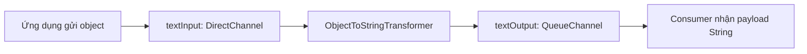

# Object to string

Trong chương **Transformer** của module `SPRING_INTEGRATION_CORE`, bài này trình bày cách chuyển payload của một message thành `String` bằng `ObjectToStringTransformer`. Mục tiêu là đặt bước chuyển đổi đúng chỗ trong luồng thông điệp, hiểu kết quả thực tế và kiểm thử được cả dữ liệu lẫn metadata đi kèm.

Các ví dụ sử dụng Java 17 và cách viết Java DSL của Spring Integration 6.x. Chúng chỉ cần các thành phần cốt lõi; không cần broker, cơ sở dữ liệu hoặc file adapter để quan sát kết quả.

## 1. Bài toán: bên gửi có object, bên nhận cần văn bản

Giả sử hệ thống xử lý đơn hàng phát ra đối tượng mô tả trạng thái. Một bước phía sau chỉ nhận văn bản để hiển thị hoặc ghi một dòng thông tin nội bộ:

```text
Đầu vào:  OrderSummary("DH-1042", "PAID")
Đầu ra:   "orderId=DH-1042;status=PAID"
```

Ta đặt transformer giữa hai bên để bên phát không phải tự chuyển sang `String` trước khi gửi message.



Trong luồng này, channel vận chuyển message, còn transformer quyết định giá trị payload đầu ra. Đây là một ứng dụng cụ thể của mẫu Message Translator: điều chỉnh biểu diễn dữ liệu để nối các thành phần có yêu cầu khác nhau.

Sau bài học, người học cần thực hiện được ba việc:

- Dự đoán chuỗi đầu ra cho object thông thường, `char[]` và `byte[]`.
- Khai báo endpoint bằng Java DSL và nối nó với channel hoặc gateway.
- Phát hiện trường hợp cần bộ định dạng hay serializer riêng thay vì dựa vào `toString()`.

## 2. Quy tắc chuyển đổi của `ObjectToStringTransformer`

Transformer dựng payload chuỗi theo kiểu dữ liệu đầu vào:

| Payload đầu vào | Cách tạo chuỗi | Ví dụ kết quả |
| --- | --- | --- |
| Object thông thường | Gọi `payload.toString()` | `Integer.valueOf(42)` thành `"42"` |
| `String` | Dùng kết quả `toString()` của chuỗi | `"Đã nhận"` vẫn có nội dung `"Đã nhận"` |
| `char[]` | Tạo chuỗi từ các ký tự trong mảng | `new char[] {'O', 'K'}` thành `"OK"` |
| `byte[]` | Giải mã mảng byte bằng charset được cấu hình | Byte UTF-8 của `"Đã nhận"` thành `"Đã nhận"` |

Charset mặc định là UTF-8. Đây là hai trường hợp xử lý riêng cho mảng ký tự và mảng byte; chúng không sử dụng `toString()` mặc định của mảng. Quy tắc này được nêu trong [Javadoc của ObjectToStringTransformer](https://docs.spring.io/spring-integration/api/org/springframework/integration/transformer/ObjectToStringTransformer.html).

Điều cần chốt trước khi chọn component là: **consumer có thực sự muốn biểu diễn `toString()` của object hay không?** Một giá trị thuộc kiểu `String` chưa đủ để chứng minh nội dung đáp ứng hợp đồng dữ liệu.

Ví dụ, hai chuỗi sau đều hợp lệ về kiểu Java nhưng phục vụ các yêu cầu khác nhau:

```text
orderId=DH-1042;status=PAID
{"orderId":"DH-1042","status":"PAID"}
```

Nếu đối tác yêu cầu JSON, chọn phương án tạo JSON có schema và quy tắc serialize rõ ràng. Không coi kết quả `toString()` là JSON chỉ vì nó đã trở thành chuỗi.

## 3. Message đầu ra và các header

Transformer làm việc ở cấp message:

```text
Message<OrderSummary>
    payload: OrderSummary(...)
    headers: businessTraceId, correlationId, replyChannel, ...
                      |
                      v
Message<String>
    payload: "orderId=DH-1042;status=PAID"
    headers: metadata được chuyển tiếp theo cơ chế dựng message
```

Với cấu hình mặc định, kết quả payload được đặt vào message đầu ra và các header đầu vào được sao chép. Có thể thấy cơ chế này trong [mã nguồn AbstractTransformer](https://raw.githubusercontent.com/spring-projects/spring-integration/v6.5.4/spring-integration-core/src/main/java/org/springframework/integration/transformer/AbstractTransformer.java).

Không dùng `id` của message làm khóa nghiệp vụ xuyên suốt luồng. Message được dựng lại có định danh riêng; `timestamp` cũng phản ánh thời điểm dựng message. Hai timestamp có thể bằng nhau nếu việc tạo diễn ra trong cùng một mili giây. Khi cần theo dõi một đơn hàng qua nhiều endpoint, hãy dùng header nghiệp vụ như `businessTraceId` hoặc correlation header. Xem [mô hình Message và MessageHeaders](https://docs.spring.io/spring-integration/reference/message.html).

Sao chép header không đồng nghĩa transformer hiểu và hiệu chỉnh mọi metadata. Chẳng hạn, nếu đầu vào mang `contentType=application/json` nhưng `toString()` tạo văn bản dạng `orderId=...`, cần điều chỉnh header ở một bước phù hợp. `ObjectToStringTransformer` không phải bộ quản lý hợp đồng nội dung của toàn bộ flow.

## 4. Chuẩn bị một object có kết quả dễ quan sát

Ví dụ sau cố ý định nghĩa `toString()` để kết quả minh họa ổn định. Đặt các lớp Java trong bài vào cùng package `example.integration.text` nếu ghép thành một dự án thực hành.

```java
package example.integration.text;

public record OrderSummary(String orderId, String status) {

    @Override
    public String toString() {
        return "orderId=" + orderId + ";status=" + status;
    }
}
```

Đối tượng:

```java
new OrderSummary("DH-1042", "PAID")
```

sẽ cung cấp chuỗi:

```text
orderId=DH-1042;status=PAID
```

Đây là định dạng phục vụ bài thực hành. Nếu chuỗi trở thành giao thức trao đổi lâu dài, nên tách bộ định dạng ra khỏi `toString()` và quy định cách xử lý dấu phân cách, giá trị rỗng, ngày giờ, số thập phân và phiên bản định dạng. Chẳng hạn, `orderId` chứa dấu `;` sẽ làm cách ghép đơn giản trên khó phân tích ngược.

## 5. Cấu hình hoàn chỉnh bằng Java DSL

### 5.1. Thành phần cần có

Ví dụ cần `org.springframework.integration:spring-integration-core`; phần kiểm thử dùng JUnit Jupiter. Sử dụng phiên bản dependency được quản lý thống nhất bởi dự án. Các đoạn mã dưới đây là ví dụ độc lập để học component, không yêu cầu thay đổi cấu hình build hiện có của module.

### 5.2. Flow từ `DirectChannel` sang `QueueChannel`

```java
package example.integration.text;

import java.nio.charset.StandardCharsets;

import org.springframework.beans.factory.annotation.Qualifier;
import org.springframework.context.annotation.Bean;
import org.springframework.context.annotation.Configuration;
import org.springframework.integration.channel.DirectChannel;
import org.springframework.integration.channel.QueueChannel;
import org.springframework.integration.config.EnableIntegration;
import org.springframework.integration.dsl.IntegrationFlow;
import org.springframework.integration.dsl.Transformers;
import org.springframework.messaging.MessageChannel;

@Configuration
@EnableIntegration
public class ObjectToStringFlowConfig {

    @Bean
    public MessageChannel textInput() {
        return new DirectChannel();
    }

    @Bean
    public QueueChannel textOutput() {
        return new QueueChannel();
    }

    @Bean
    public IntegrationFlow objectToStringFlow(
            @Qualifier("textInput") MessageChannel input,
            @Qualifier("textOutput") QueueChannel output) {

        return IntegrationFlow.from(input)
                .transform(Transformers.objectToString(
                        StandardCharsets.UTF_8.name()))
                .channel(output)
                .get();
    }
}
```

`Transformers.objectToString()` tạo transformer dùng charset mặc định; overload nhận `String` cho phép chỉ định tên charset. Trong ví dụ, truyền `StandardCharsets.UTF_8.name()` để cấu hình tường minh. Xem [API của Transformers](https://docs.spring.io/spring-integration/api/org/springframework/integration/dsl/Transformers.html).

Các phần trong cấu hình phối hợp như sau:

1. `textInput` tiếp nhận message do ứng dụng gửi.
2. `.transform(...)` đăng ký endpoint xử lý message từ channel đó.
3. Payload sau chuyển đổi được gửi tới `textOutput`.
4. Mã thực hành đọc message bằng `receive(...)` để quan sát kết quả.

Queue ở cuối được dùng để giữ kết quả cho việc đọc thủ công hoặc assertion. Không cần poller khi chính mã kiểm thử gọi `receive()`. Nếu sau này gắn một consuming endpoint tự động vào `QueueChannel`, cần cấu hình cơ chế polling phù hợp.

### 5.3. Gửi và đọc một message

Đoạn mã sau có thể đặt trong một phương thức chạy thử, với các import tương ứng:

```java
import org.springframework.context.annotation.AnnotationConfigApplicationContext;
import org.springframework.integration.channel.QueueChannel;
import org.springframework.messaging.Message;
import org.springframework.messaging.MessageChannel;
import org.springframework.messaging.support.MessageBuilder;

try (var context = new AnnotationConfigApplicationContext(
        ObjectToStringFlowConfig.class)) {

    MessageChannel input = context.getBean("textInput", MessageChannel.class);
    QueueChannel output = context.getBean("textOutput", QueueChannel.class);

    Message<OrderSummary> request = MessageBuilder
            .withPayload(new OrderSummary("DH-1042", "PAID"))
            .setHeader("businessTraceId", "trace-1042")
            .build();

    input.send(request);

    Message<?> reply = output.receive(1_000);
    if (reply == null) {
        throw new IllegalStateException("Không nhận được kết quả chuyển đổi");
    }

    System.out.println(reply.getPayload());
    System.out.println(reply.getHeaders().get("businessTraceId"));
}
```

Kết quả mong đợi:

```text
orderId=DH-1042;status=PAID
trace-1042
```

`input.send(...)` cho biết thao tác gửi thành công hoặc phát sinh lỗi; giá trị boolean của nó không phải chuỗi kết quả. Muốn lấy chuỗi, cần nhận message ở đầu ra hoặc sử dụng gateway theo kiểu request/reply.

## 6. Dùng gateway để cung cấp API trả về `String`

Khi ứng dụng chỉ muốn gọi một phương thức và nhận kết quả, có thể cung cấp interface:

```java
package example.integration.text;

import org.springframework.integration.annotation.MessagingGateway;

@MessagingGateway(defaultRequestChannel = "renderInput")
public interface TextGateway {

    String render(Object payload);
}
```

Cấu hình riêng cho biến thể request/reply:

```java
package example.integration.text;

import org.springframework.context.annotation.Bean;
import org.springframework.context.annotation.Configuration;
import org.springframework.context.annotation.Import;
import org.springframework.integration.config.EnableIntegration;
import org.springframework.integration.dsl.IntegrationFlow;
import org.springframework.integration.dsl.Transformers;

@Configuration
@EnableIntegration
@Import(TextGateway.class)
public class TextGatewayConfig {

    @Bean
    public IntegrationFlow renderFlow() {
        return IntegrationFlow.from("renderInput")
                .transform(Transformers.objectToString())
                .get();
    }
}
```

Khi context nạp `TextGatewayConfig`, có thể lấy bean `TextGateway` và gọi:

```java
String text = gateway.render(new OrderSummary("DH-1042", "PAID"));
// text = "orderId=DH-1042;status=PAID"
```

Gateway tạo reply channel tạm và đưa thông tin đó vào header. Transformer cuối flow không khai báo output channel nên trả kết quả theo cơ chế reply. Trong Spring Integration 6.x, `@Import` có thể đăng ký interface mang `@MessagingGateway`; một lựa chọn khác là `@IntegrationComponentScan`. Cơ chế này được mô tả trong [tài liệu Messaging Gateways](https://docs.spring.io/spring-integration/reference/gateway.html).

Biến thể này có đầu vào `renderInput` và trả lời trực tiếp cho lời gọi gateway. Nếu thiết kế một flow request/reply mà lại kết thúc bằng một queue không có consumer chuyển tiếp reply, lời gọi có thể không nhận được kết quả mong muốn. Cần xác định rõ ai nhận message cuối luồng trước khi nối thêm channel.

## 7. Khai báo bằng annotation hoặc XML

Hai cách dưới đây là các lựa chọn thay thế cho cấu hình Java DSL ở mục 5. Chỉ chọn một cách đăng ký endpoint cho cùng bài thực hành để tránh có nhiều consumer ngoài ý muốn trên `textInput`.

### 7.1. Bean với `@Transformer`

Trong một lớp cấu hình có `@EnableIntegration` và các bean channel cần thiết:

```java
import org.springframework.context.annotation.Bean;
import org.springframework.integration.annotation.Transformer;
import org.springframework.integration.transformer.ObjectToStringTransformer;

@Bean
@Transformer(inputChannel = "textInput", outputChannel = "textOutput")
public ObjectToStringTransformer objectToStringTransformer() {
    return new ObjectToStringTransformer("UTF-8");
}
```

Bean cung cấp logic chuyển đổi; annotation khai báo cách logic đó được gắn vào các channel. Không cần tự viết một phương thức trung gian chỉ để gọi `Object.toString()`.

### 7.2. XML namespace

```xml
<?xml version="1.0" encoding="UTF-8"?>
<beans xmlns="http://www.springframework.org/schema/beans"
       xmlns:xsi="http://www.w3.org/2001/XMLSchema-instance"
       xmlns:int="http://www.springframework.org/schema/integration"
       xsi:schemaLocation="
         http://www.springframework.org/schema/beans
         https://www.springframework.org/schema/beans/spring-beans.xsd
         http://www.springframework.org/schema/integration
         https://www.springframework.org/schema/integration/spring-integration.xsd">

    <int:channel id="textInput"/>

    <int:channel id="textOutput">
        <int:queue/>
    </int:channel>

    <int:object-to-string-transformer
            id="orderTextTransformer"
            input-channel="textInput"
            output-channel="textOutput"
            charset="UTF-8"/>
</beans>
```

Phần tử `object-to-string-transformer` thể hiện trực tiếp loại chuyển đổi và các channel liên quan. Có thể đối chiếu cú pháp cấu hình ở [mục Object-to-String trong tài liệu Spring Integration 6.5](https://docs.spring.io/spring-integration/reference/6.5/transformer.html#_object_to_string_transformer).

## 8. Charset: phân biệt byte, ký tự và chuỗi

### 8.1. Charset áp dụng khi đầu vào là `byte[]`

Byte không tự mang thông tin nó được mã hóa bằng UTF-8, ISO-8859-1 hay bảng mã nào khác. Cấu hình transformer phải khớp với phía tạo dữ liệu.

Ví dụ một nguồn gửi byte ISO-8859-1 của từ `café`:

```java
import java.nio.charset.StandardCharsets;

import org.springframework.integration.transformer.ObjectToStringTransformer;
import org.springframework.messaging.Message;
import org.springframework.messaging.support.GenericMessage;

byte[] bytes = "café".getBytes(StandardCharsets.ISO_8859_1);

var transformer = new ObjectToStringTransformer(
        StandardCharsets.ISO_8859_1.name());

Message<?> result = transformer.transform(new GenericMessage<>(bytes));
// result.getPayload().equals("café")
```

`char[]` đã chứa ký tự nên không cần bước giải mã byte này. Với payload `String` đã bị đọc sai từ trước, việc cấu hình lại charset ở transformer cũng không khôi phục được dữ liệu gốc: component chỉ có chuỗi hiện tại để xử lý. Sự khác nhau giữa constructor nhận `byte[]` và constructor nhận `char[]` được mô tả trong [API String của Java](https://docs.oracle.com/en/java/javase/21/docs/api/java.base/java/lang/String.html).

### 8.2. Charset đầu vào và encoding đầu ra là hai quyết định riêng

```text
byte[] của hệ thống nguồn
          |
          | giải mã bằng charset nguồn
          v
       String
          |
          | mã hóa bằng charset của nơi nhận
          v
byte[] ghi ra file hoặc truyền qua mạng
```

Ví dụ, nguồn có thể gửi ISO-8859-1 trong khi file đích cần UTF-8. Transformer thực hiện bước đầu; bước ghi hoặc gửi về sau phải cấu hình encoding tương ứng. Một `String` trong Java không phải một buffer byte UTF-8 sẵn để truyền đi.

### 8.3. Không tự chọn charset từ header

Một instance `ObjectToStringTransformer` giữ charset được cấu hình khi tạo. Nó không tự đọc header tên `sourceCharset`, cũng không tự suy charset từ `contentType`. Cách giữ cấu hình và các nhánh chuyển đổi có thể kiểm tra trong [mã nguồn ObjectToStringTransformer](https://raw.githubusercontent.com/spring-projects/spring-integration/v6.5.4/spring-integration-core/src/main/java/org/springframework/integration/transformer/ObjectToStringTransformer.java).

Nếu hợp đồng thực sự cho phép mỗi message dùng charset khác nhau, có thể dùng transformer biểu thức. Ví dụ sau là đoạn Java DSL thay cho bước chuyển đổi cố định, với giả định payload luôn là `byte[]` và header đã được kiểm tra:

```java
.transform("new java.lang.String(payload, headers['sourceCharset'])")
```

Cần quy định charset nào được chấp nhận và cách xử lý khi header thiếu. Nếu có nhiều nhánh kiểm tra hoặc quy tắc fallback, một transformer Java riêng sẽ dễ đọc và dễ kiểm thử hơn biểu thức dài.

## 9. Những dữ liệu dễ bị hiểu nhầm

### 9.1. Mảng khác `byte[]` và `char[]`

`int[]`, `String[]` và `Object[]` đi theo nhánh `toString()` thông thường. Chúng không được tự động nối các phần tử thành danh sách dễ đọc.

Ví dụ:

```java
int[] values = {10, 20};
String text = values.toString();
// Dạng như "[I@..."; phần sau @ không cố định.
```

Nếu muốn `"[10, 20]"`, hãy dùng một bước định dạng có chủ đích:

```java
import java.util.Arrays;

// Đoạn cấu hình trong một IntegrationFlow:
.transform(int[].class, values -> Arrays.toString(values))
```

### 9.2. `Map`, collection và object nghiệp vụ

Một map có thể cho chuỗi dạng `{orderId=DH-1042, status=PAID}`. Cú pháp có dấu `=` này không phải JSON. Cũng không nên dựa vào thứ tự hiển thị nếu collection không cam kết thứ tự phù hợp.

Với object nghiệp vụ, thay đổi `toString()` để hỗ trợ debug có thể vô tình đổi nội dung gửi cho consumer. Khi consumer cần một giao thức ổn định, nên dùng một formatter riêng hoặc JSON transformer và kiểm thử định dạng đó như một hợp đồng.

### 9.3. `File`, `InputStream` và dữ liệu nhị phân

Chọn component theo nội dung muốn nhận:

| Nhu cầu thực tế | Cách xử lý phù hợp |
| --- | --- |
| Lấy nội dung văn bản của file | Dùng file-to-string transformer với charset phù hợp |
| Đọc nội dung một `InputStream` thành chuỗi | Dùng stream transformer, chẳng hạn `Transformers.fromStream("UTF-8")` |
| Truyền object theo JSON | Dùng JSON transformer và cấu hình mapper phù hợp |
| Biểu diễn ảnh/PDF trong trường văn bản | Dùng Base64 theo hợp đồng của hệ thống nhận |
| Tạo một dòng nghiệp vụ có quy tắc escape | Viết formatter/transformer riêng |

Gọi `toString()` trên một object `File` không đọc nội dung file. Tương tự, gọi trên một stream không tiêu thụ stream để lấy văn bản. Việc chọn component ở đây xuất phát từ thao tác cần thực hiện: đọc tài nguyên, giải mã byte hoặc định dạng object là các bước khác nhau.

Không giải mã byte ảnh hoặc PDF bằng UTF-8 để thay cho Base64. Mục tiêu của giải mã văn bản là khôi phục ký tự; mục tiêu của Base64 là biểu diễn byte dưới dạng văn bản có thể khôi phục lại.

## 10. Khi cần từ chối byte không hợp lệ

`ObjectToStringTransformer` không phải bộ xác thực toàn diện cho dữ liệu văn bản từ bên ngoài. Ngoài việc chọn đúng charset, một số luồng còn yêu cầu từ chối dãy byte sai mã hóa ngay tại biên hệ thống.

Có thể viết decoder nghiêm ngặt bằng `CharsetDecoder` với `CodingErrorAction.REPORT`, rồi gọi nó từ một transformer:

```java
package example.integration.text;

import java.nio.ByteBuffer;
import java.nio.charset.CharacterCodingException;
import java.nio.charset.CodingErrorAction;
import java.nio.charset.StandardCharsets;

public final class StrictUtf8Decoder {

    private StrictUtf8Decoder() {
    }

    public static String decode(byte[] bytes) {
        var decoder = StandardCharsets.UTF_8.newDecoder()
                .onMalformedInput(CodingErrorAction.REPORT)
                .onUnmappableCharacter(CodingErrorAction.REPORT);

        try {
            return decoder.decode(ByteBuffer.wrap(bytes)).toString();
        }
        catch (CharacterCodingException ex) {
            throw new IllegalArgumentException(
                    "Payload phải là văn bản UTF-8 hợp lệ", ex);
        }
    }
}
```

Đoạn Java DSL tương ứng:

```java
.transform(byte[].class, StrictUtf8Decoder::decode)
```

Ví dụ `new byte[] {(byte) 0xC3, 0x28}` không phải dãy UTF-8 hợp lệ và sẽ bị decoder này từ chối. Decoder được tạo cho mỗi lần gọi, tránh chia sẻ cùng một decoder có trạng thái giữa các thread. Cơ chế báo lỗi và lưu ý về thread được quy định trong [API CharsetDecoder](https://docs.oracle.com/en/java/javase/21/docs/api/java.base/java/nio/charset/CharsetDecoder.html).

Đây là một biến thể dành cho yêu cầu xác thực đầu vào. Chỉ cần dùng built-in transformer khi hành vi chuyển đổi sẵn có đã phù hợp với hợp đồng của flow.

## 11. Xử lý lỗi ở đúng ranh giới thực thi

Các nguyên nhân nên xem xét khi chuyển object thành chuỗi gồm:

- `toString()` của object ném exception.
- Tên charset được cấu hình không được hỗ trợ.
- Bộ định dạng hoặc decoder riêng từ chối dữ liệu.
- Bước sau transformer không chấp nhận nội dung vừa tạo.

Lỗi nội dung như sai charset đôi khi vẫn cho ra một `String`. Vì vậy, kiểm thử chỉ xác nhận kiểu dữ liệu sẽ bỏ sót trường hợp chuỗi bị sai.

Trong flow sử dụng `DirectChannel` ở mục 5, handler thực thi trên thread gửi message. Lỗi chuyển đổi có thể truyền về lời gọi `send(...)`. Không mặc định cho rằng thêm một header `errorChannel` sẽ tự chuyển mọi lỗi đồng bộ sang một flow khác.

Khi chuyển sang `ExecutorChannel` hoặc endpoint được chạy bởi poller, cần thiết kế xử lý lỗi theo cơ chế bất đồng bộ: thông tin lỗi có thể được phát thành `ErrorMessage` tới error channel theo cấu hình. Gateway cũng có tùy chọn định tuyến lỗi riêng. Sự khác biệt giữa các ranh giới thực thi này được giải thích trong [tài liệu Error Handling](https://docs.spring.io/spring-integration/reference/error-handling.html).

Không trả về `null` từ logic chuyển đổi để biểu thị “bỏ message”. Nếu một message không nên đi tiếp, hãy dùng filter và quy định discard/error flow phù hợp. Payload của message cần có giá trị; việc chặn dữ liệu và việc đổi biểu diễn nên được thể hiện thành các bước rõ ràng.

## 12. Kiểm thử component: nội dung, charset và header

Các đoạn kiểm thử dưới đây là mã thực hành đề xuất. Chúng sử dụng JUnit Jupiter và lớp `OrderSummary` ở mục 4.

```java
package example.integration.text;

import java.nio.charset.StandardCharsets;

import org.junit.jupiter.api.Test;

import org.springframework.integration.IntegrationMessageHeaderAccessor;
import org.springframework.integration.channel.QueueChannel;
import org.springframework.integration.transformer.MessageTransformationException;
import org.springframework.integration.transformer.ObjectToStringTransformer;
import org.springframework.messaging.Message;
import org.springframework.messaging.support.GenericMessage;
import org.springframework.messaging.support.MessageBuilder;

import static org.junit.jupiter.api.Assertions.assertEquals;
import static org.junit.jupiter.api.Assertions.assertInstanceOf;
import static org.junit.jupiter.api.Assertions.assertNotEquals;
import static org.junit.jupiter.api.Assertions.assertSame;
import static org.junit.jupiter.api.Assertions.assertThrows;

class ObjectToStringTransformerTest {

    @Test
    void convertsBusinessObjectAndPreservesRelevantHeaders() {
        var replyChannel = new QueueChannel();
        Message<OrderSummary> request = MessageBuilder
                .withPayload(new OrderSummary("DH-1042", "PAID"))
                .setHeader("businessTraceId", "trace-1042")
                .setHeader(IntegrationMessageHeaderAccessor.CORRELATION_ID,
                        "order-group-1042")
                .setReplyChannel(replyChannel)
                .build();

        Message<?> result = new ObjectToStringTransformer().transform(request);

        assertInstanceOf(String.class, result.getPayload());
        assertEquals("orderId=DH-1042;status=PAID", result.getPayload());
        assertEquals("trace-1042",
                result.getHeaders().get("businessTraceId"));
        assertEquals("order-group-1042", result.getHeaders().get(
                IntegrationMessageHeaderAccessor.CORRELATION_ID));
        assertSame(replyChannel, result.getHeaders().getReplyChannel());
        assertNotEquals(request.getHeaders().getId(),
                result.getHeaders().getId());
    }

    @Test
    void decodesUtf8ByDefault() {
        byte[] bytes = "Đơn hàng đã nhận".getBytes(StandardCharsets.UTF_8);

        Message<?> result = new ObjectToStringTransformer()
                .transform(new GenericMessage<>(bytes));

        assertEquals("Đơn hàng đã nhận", result.getPayload());
    }

    @Test
    void decodesTheConfiguredCharset() {
        byte[] bytes = "café".getBytes(StandardCharsets.ISO_8859_1);
        var transformer = new ObjectToStringTransformer("ISO-8859-1");

        Message<?> result = transformer.transform(new GenericMessage<>(bytes));

        assertEquals("café", result.getPayload());
    }

    @Test
    void convertsCharacterArrayContents() {
        char[] characters = "Đã nhận".toCharArray();

        Message<?> result = new ObjectToStringTransformer()
                .transform(new GenericMessage<>(characters));

        assertEquals("Đã nhận", result.getPayload());
    }

    @Test
    void keepsExistingStringContent() {
        Message<?> result = new ObjectToStringTransformer()
                .transform(new GenericMessage<>("Đã nhận"));

        assertEquals("Đã nhận", result.getPayload());
    }

    @Test
    void reportsAnExceptionFromToString() {
        var request = new GenericMessage<>(new BrokenPayload());
        var transformer = new ObjectToStringTransformer();

        MessageTransformationException error = assertThrows(
                MessageTransformationException.class,
                () -> transformer.transform(request));

        assertSame(request, error.getFailedMessage());
        assertInstanceOf(IllegalStateException.class, error.getCause());
    }

    private static final class BrokenPayload {

        @Override
        public String toString() {
            throw new IllegalStateException("Không định dạng được payload");
        }
    }
}
```

Test tiếng Việt giúp tránh chỉ thử với ASCII, vì nhiều lỗi charset không xuất hiện khi dữ liệu chỉ gồm `A-Z`, chữ số và dấu đơn giản. Test dùng ISO-8859-1 kiểm tra cấu hình thực sự được áp dụng; `é` là ký tự có thể biểu diễn trong bảng mã này.

Không so sánh toàn bộ hai map header bằng `assertEquals`: message đầu ra có các header định danh/thời gian riêng. Chọn assertion theo hành vi cần đảm bảo, như giữ `businessTraceId`, correlation header và reply channel. Cũng không yêu cầu timestamp đầu ra phải lớn hơn timestamp đầu vào.

## 13. Kiểm thử flow: xác nhận endpoint đã nối đúng channel

Unit test trên chỉ gọi trực tiếp component. Cần một kiểm thử khác nếu muốn phát hiện channel sai tên, bean flow chưa đăng ký hoặc endpoint chưa được nối vào input.

```java
package example.integration.text;

import java.nio.charset.StandardCharsets;

import org.junit.jupiter.api.Test;

import org.springframework.context.annotation.AnnotationConfigApplicationContext;
import org.springframework.integration.channel.QueueChannel;
import org.springframework.messaging.Message;
import org.springframework.messaging.MessageChannel;
import org.springframework.messaging.support.MessageBuilder;

import static org.junit.jupiter.api.Assertions.assertEquals;
import static org.junit.jupiter.api.Assertions.assertInstanceOf;
import static org.junit.jupiter.api.Assertions.assertNotNull;
import static org.junit.jupiter.api.Assertions.assertTrue;

class ObjectToStringFlowTest {

    @Test
    void routesConvertedTextToTheOutputChannel() {
        try (var context = new AnnotationConfigApplicationContext(
                ObjectToStringFlowConfig.class)) {

            MessageChannel input = context.getBean(
                    "textInput", MessageChannel.class);
            QueueChannel output = context.getBean(
                    "textOutput", QueueChannel.class);

            Message<byte[]> request = MessageBuilder
                    .withPayload("Đã nhận đơn".getBytes(StandardCharsets.UTF_8))
                    .setHeader("businessTraceId", "trace-flow-01")
                    .build();

            assertTrue(input.send(request));

            Message<?> result = output.receive(1_000);
            assertNotNull(result);
            assertInstanceOf(String.class, result.getPayload());
            assertEquals("Đã nhận đơn", result.getPayload());
            assertEquals("trace-flow-01",
                    result.getHeaders().get("businessTraceId"));
        }
    }
}
```

Timeout có giới hạn giúp test dừng khi không nhận được message. Với flow đồng bộ này, không cần thêm `Thread.sleep()` để chờ transformer hoàn thành.

Nếu triển khai biến thể gateway, nên bổ sung assertion trực tiếp trên `TextGateway.render(...)` để xác nhận chuỗi thực sự quay lại bên gọi. Nếu sử dụng decoder nghiêm ngặt, bổ sung test cho byte hợp lệ và byte sai UTF-8, cùng hành vi xử lý lỗi mong muốn tại ranh giới của flow.

## 14. Chọn vị trí chuyển đổi trong luồng nghiệp vụ

Giả sử luồng thực tế có thứ tự:

```text
OrderSummary
    -> kiểm tra đơn được phép xuất
    -> định tuyến theo status
    -> tạo chuỗi để xuất
    -> gửi tới consumer văn bản
```

Nên giữ object trong các bước cần truy cập trường nghiệp vụ. Nếu đổi sang chuỗi quá sớm, router ở bước sau có thể phải phân tích lại văn bản chỉ để lấy `status`, làm tăng liên kết với định dạng chuỗi.

Tương tự, khi có aggregator, cần quyết định kết quả tổng hợp là object, collection hay văn bản cuối cùng. `ObjectToStringTransformer` không tự ghép một collection thành báo cáo nhiều dòng theo quy tắc nghiệp vụ. Hãy tạo nội dung báo cáo bằng một bước định dạng riêng nếu yêu cầu có thứ tự dòng, tiêu đề hoặc tổng số tiền.

Với nhu cầu chỉ quan sát dữ liệu để debug, có thể đặt logging endpoint hoặc wire tap mà không đổi payload chính của flow. Việc chọn object-to-string nên xuất phát từ hợp đồng của consumer tiếp theo.

Các điểm cần ghi nhớ khi áp dụng bài học:

- Chọn built-in transformer khi kết quả `toString()` hoặc nội dung ký tự/byte đã đúng với nhu cầu đầu ra.
- Xác định charset từ hợp đồng nguồn và kiểm tra bằng dữ liệu có dấu.
- Giữ các header phục vụ theo dõi và reply, đồng thời điều chỉnh metadata nội dung nếu cần.
- Dùng formatter hoặc serializer riêng khi đầu ra là một giao thức ổn định.
- Kiểm thử cả component lẫn đường đi của message qua flow.
