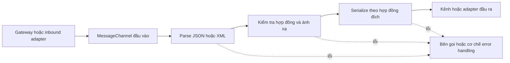

# XML hoặc JSON transformation

Trong chương **Transformer** của module **SPRING_INTEGRATION_CORE**, chuyển đổi XML hoặc JSON là cách nối hai thành phần có hợp đồng dữ liệu khác nhau. Một hệ thống có thể gửi JSON theo tên trường của đối tác, trong khi hệ thống kế toán cần mô hình đơn hàng nội bộ; một hệ thống khác vẫn trao đổi XML có namespace và phiên bản riêng.

Bài học tập trung vào việc đặt các bước chuyển đổi trong `IntegrationFlow`: xác định payload đầu vào, tạo payload đầu ra, bảo toàn thông tin điều phối cần thiết và đưa lỗi về đúng nơi. Các ví dụ dùng **Java 17+, Spring Integration 6.5.x và Jackson 2** với package `com.fasterxml.jackson`. Đây là mốc API của ví dụ; khi áp dụng vào ứng dụng, chọn phiên bản thư viện đồng bộ bằng BOM hoặc dependency management của ứng dụng.

## 1. Kết quả cần đạt

Sau bài học, bạn có thể:

- Phân biệt serialize/deserialize, thay đổi cấu trúc và ánh xạ ý nghĩa nghiệp vụ.
- Dùng `JsonToObjectTransformer` và `ObjectToJsonTransformer` trong Java DSL.
- Dùng `XsltPayloadTransformer` để đổi XML giữa hai hợp đồng có namespace.
- Chọn OXM khi cần chuyển XML thành đối tượng Java hoặc ngược lại.
- Xác định kiểu payload, `contentType`, thông tin kiểu trong header và đường đi của lỗi.
- Thiết kế kiểm thử dựa trên dữ liệu có ý nghĩa, thay vì chỉ so sánh chuỗi biểu diễn.

Bạn cần biết `Message<T>` gồm payload và headers, vai trò của `MessageChannel`, cùng cách khai báo một `IntegrationFlow` bằng `@Bean`.

## 2. Xác định hợp đồng trước khi chọn transformer

### 2.1. Ba loại thay đổi thường bị trộn lẫn

| Loại thay đổi | Ví dụ | Điều phải quyết định |
|---|---|---|
| Biểu diễn | JSON `String` → đối tượng Java | Kiểu Java, quy tắc deserialize, dữ liệu không hợp lệ |
| Cấu trúc | XML `purchase/number` → XML `order/orderId` | Tên phần tử, namespace, vị trí thuộc tính |
| Ý nghĩa nghiệp vụ | `quantity × unit_price` → `totalAmount` | Đơn vị, tiền tệ, làm tròn, giá trị thiếu |

Đổi JSON thành một `Map` chỉ giải quyết biểu diễn. Nó chưa giải thích liệu `price` là đơn giá hay tổng tiền, liệu số tiền tính bằng đồng hay xu, hoặc một mảng rỗng có ý nghĩa gì.

Với mỗi điểm chuyển đổi, hãy viết được hợp đồng dạng:

```text
Đầu vào:
  payload = String chứa JSON của đối tác, schema order.v1
  quantity = số nguyên dương
  unit_price = số thập phân không âm

Đầu ra:
  payload = String chứa JSON theo hợp đồng nội bộ order.v2
  totalAmount = quantity × unit_price
  traceId của yêu cầu tiếp tục đi theo message

Khi lỗi:
  không tạo đơn hàng mặc định
  phát sinh lỗi có thể truy nguyên yêu cầu
```

Một transformer phải tạo kết quả hợp lệ cho message mà nó nhận. Không dùng `return null` để loại dữ liệu; nếu muốn chấp nhận hoặc loại message theo điều kiện, dùng filter. Java DSL biểu diễn transformer endpoint bằng `.transform(...)`. [Tài liệu Transformer](https://docs.spring.io/spring-integration/reference/6.5/transformer.html)

### 2.2. Vị trí trong luồng tích hợp



Gateway là điểm vào thuận tiện cho lời gọi nghiệp vụ. Channel nối các endpoint. Transformer chịu trách nhiệm dữ liệu tại một bước cụ thể. Router có thể chọn phiên bản hợp đồng hoặc đối tác trước khi đi vào nhánh chuyển đổi tương ứng.

Một transformer không cần biết cách gửi HTTP, ghi file hay gọi hệ thống kế toán. Tách các tác vụ đó giúp kiểm thử phép chuyển đổi bằng message trong bộ nhớ.

## 3. Thư viện và lựa chọn công cụ

Các ví dụ giả định ứng dụng đã quản lý phiên bản dependency tương thích.

| Nhu cầu | Dependency hoặc API chính |
|---|---|
| Message, channel, Java DSL và JSON transformer | `org.springframework.integration:spring-integration-core` |
| JSON bằng Jackson 2 | `com.fasterxml.jackson.core:jackson-databind` |
| XSLT và các XML transformer của Spring Integration | `org.springframework.integration:spring-integration-xml` |
| Ánh xạ XML ↔ Java qua Spring OXM | `org.springframework:spring-oxm`; thêm JAXB API/runtime nếu chọn JAXB |
| Ví dụ kiểm thử JUnit 5 | `org.junit.jupiter:junit-jupiter` |

Không dùng XML để cấu hình bean vẫn có thể xử lý XML payload bằng Java DSL. Ngược lại, dùng cấu hình bean bằng XML không có nghĩa payload của ứng dụng phải là XML.

Các factory `Transformers.fromJson(...)` và `Transformers.toJson(...)` là cách viết gọn cho JSON transformer. Khai báo transformer thành bean sẽ thuận tiện khi cần cấu hình mapper, chính sách kiểu dữ liệu hoặc tái sử dụng cấu hình rõ ràng. [API Transformers](https://docs.spring.io/spring-integration/docs/6.5.0/api/org/springframework/integration/dsl/Transformers.html)

## 4. JSON: deserialize, ánh xạ rồi serialize

### 4.1. Tình huống đơn hàng

Đối tác gửi:

```json
{
  "order_id": "A-100",
  "customer_id": "C-17",
  "quantity": 2,
  "unit_price": 125000.50,
  "currency": "VND"
}
```

Đầu ra mong muốn về mặt dữ liệu:

```json
{
  "orderId": "A-100",
  "customerId": "C-17",
  "totalAmount": 250001.00,
  "currency": "VND"
}
```

Thiết kế gồm ba bước độc lập:

```text
String JSON
  → PartnerOrder
  → OrderRequested
  → String JSON
```

`PartnerOrder` biểu diễn hợp đồng đầu vào. `OrderRequested` biểu diễn dữ liệu mà consumer cần. Tách hai kiểu này cho phép đổi tên trường và tính tổng tiền mà không đưa quy ước của đối tác vào mọi thành phần phía sau.

### 4.2. Cấu hình Java DSL đầy đủ

Ví dụ dưới đây là nội dung một lớp Java tên `JsonOrderFlowConfiguration`. Các record được đặt trong lớp để người học có thể theo dõi toàn bộ mô hình tại một chỗ.

```java
import java.math.BigDecimal;

import com.fasterxml.jackson.annotation.JsonProperty;
import com.fasterxml.jackson.databind.DeserializationFeature;
import com.fasterxml.jackson.databind.MapperFeature;
import com.fasterxml.jackson.databind.json.JsonMapper;

import org.springframework.context.annotation.Bean;
import org.springframework.context.annotation.Configuration;
import org.springframework.core.ResolvableType;
import org.springframework.integration.config.EnableIntegration;
import org.springframework.integration.dsl.IntegrationFlow;
import org.springframework.integration.expression.FunctionExpression;
import org.springframework.integration.json.JsonToObjectTransformer;
import org.springframework.integration.json.ObjectToJsonTransformer;
import org.springframework.integration.mapping.support.JsonHeaders;
import org.springframework.integration.support.json.Jackson2JsonObjectMapper;
import org.springframework.messaging.Message;

@Configuration
@EnableIntegration
public class JsonOrderFlowConfiguration {

    public record PartnerOrder(
            @JsonProperty("order_id") String orderId,
            @JsonProperty("customer_id") String customerId,
            Integer quantity,
            @JsonProperty("unit_price") BigDecimal unitPrice,
            String currency) {
    }

    public record OrderRequested(
            String orderId,
            String customerId,
            BigDecimal totalAmount,
            String currency) {
    }

    @Bean
    Jackson2JsonObjectMapper orderJsonMapper() {
        JsonMapper jackson = JsonMapper.builder()
                .enable(DeserializationFeature.FAIL_ON_UNKNOWN_PROPERTIES)
                .enable(DeserializationFeature.FAIL_ON_TRAILING_TOKENS)
                .disable(DeserializationFeature.ACCEPT_FLOAT_AS_INT)
                .disable(MapperFeature.ALLOW_COERCION_OF_SCALARS)
                .build();

        return new Jackson2JsonObjectMapper(jackson);
    }

    @Bean
    JsonToObjectTransformer partnerOrderReader(
            Jackson2JsonObjectMapper orderJsonMapper) {

        ResolvableType fixedType =
                ResolvableType.forClass(PartnerOrder.class);

        JsonToObjectTransformer reader =
                new JsonToObjectTransformer(fixedType, orderJsonMapper);

        // Hợp đồng đầu vào do ứng dụng quyết định, không lấy từ header.
        reader.setValueTypeExpression(
                new FunctionExpression<Message<?>>(message -> fixedType));

        return reader;
    }

    @Bean
    ObjectToJsonTransformer orderJsonWriter(
            Jackson2JsonObjectMapper orderJsonMapper) {

        ObjectToJsonTransformer writer = new ObjectToJsonTransformer(
                orderJsonMapper,
                ObjectToJsonTransformer.ResultType.STRING);

        writer.setContentType("application/json");
        return writer;
    }

    @Bean
    IntegrationFlow partnerJsonFlow(
            JsonToObjectTransformer partnerOrderReader,
            ObjectToJsonTransformer orderJsonWriter) {

        return IntegrationFlow.from("partnerJsonIn")
                .transform(partnerOrderReader)
                .transform(PartnerOrder.class,
                        JsonOrderFlowConfiguration::toCanonical)
                .transform(orderJsonWriter)
                .headerFilter(JsonHeaders.HEADERS.toArray(String[]::new))
                .get();
    }

    private static OrderRequested toCanonical(PartnerOrder input) {
        if (input.orderId() == null || input.orderId().isBlank()) {
            throw new IllegalArgumentException("Thiếu order_id");
        }
        if (input.customerId() == null || input.customerId().isBlank()) {
            throw new IllegalArgumentException("Thiếu customer_id");
        }
        if (input.quantity() == null || input.quantity() <= 0) {
            throw new IllegalArgumentException("quantity phải lớn hơn 0");
        }
        if (input.unitPrice() == null || input.unitPrice().signum() < 0) {
            throw new IllegalArgumentException("unit_price không hợp lệ");
        }
        if (input.currency() == null
                || !input.currency().matches("[A-Z]{3}")) {
            throw new IllegalArgumentException("currency phải có 3 chữ in hoa");
        }

        BigDecimal total = input.unitPrice()
                .multiply(BigDecimal.valueOf(input.quantity()));

        return new OrderRequested(
                input.orderId(),
                input.customerId(),
                total,
                input.currency());
    }
}
```

Trong ví dụ:

- `@JsonProperty` nối tên trường bên ngoài với tên thuộc tính Java.
- `Integer` giúp nhận biết `quantity` bị thiếu hoặc là `null` trước khi kiểm tra nghiệp vụ.
- `BigDecimal` biểu diễn phép nhân tiền tệ trong mô hình ví dụ.
- Kiểm tra `currency` mới chỉ kiểm tra hình thức ba chữ in hoa. Danh sách tiền tệ được hỗ trợ và chính sách làm tròn cần được xác định theo nghiệp vụ.
- Mapper được cấu hình trước khi sử dụng. Không thay đổi cấu hình mapper theo từng message.

Việc bật lỗi khi gặp trường không biết là lựa chọn hợp đồng của ví dụ. Với tích hợp cần chấp nhận đối tác thêm trường, có thể chọn chính sách khác, nhưng phải chủ động xác định và kiểm thử. Cấu hình mapper mặc định của framework và mapper do ứng dụng cung cấp có thể khác nhau. [API Jackson2JsonObjectMapper](https://docs.spring.io/spring-integration/docs/6.5.0/api/org/springframework/integration/support/json/Jackson2JsonObjectMapper.html)

`FunctionExpression` cung cấp một `Expression` từ lambda Java. Ở đây lambda luôn trả về kiểu đã định, nên người gửi không được chọn lớp Java cần deserialize. [API FunctionExpression](https://docs.spring.io/spring-integration/docs/6.5.0/api/org/springframework/integration/expression/FunctionExpression.html)

### 4.3. Gọi luồng và nhận kết quả

Luồng không khai báo kênh đầu ra cố định ở bước cuối. Khi được gọi bằng cơ chế request/reply, kết quả được gửi về `replyChannel` của yêu cầu. Trong kiểm thử ở phần 10, `MessagingTemplate` tạo và quản lý đường trả lời này.

Nếu gửi trực tiếp bằng `inputChannel.send(message)`, cần cung cấp `replyChannel` hoặc cấu hình output channel cho flow. Đừng coi giá trị `true` trả về từ `send` là JSON đã chuyển đổi thành công theo hợp đồng nghiệp vụ.

Khi chuyển sang luồng một chiều để gửi dữ liệu cho adapter, có thể thêm:

```java
// Đặt ngay trước .get() của flow khi chọn đầu ra cố định:
.channel("canonicalJsonOut")
```

Kênh `canonicalJsonOut` phải được nối với consumer phù hợp. Đoạn trên là phương án cấu hình thay thế cho kiểu request/reply của ví dụ.

### 4.4. JSON array và generic type

Đích `List.class` chỉ mô tả container; nó không thể hiện kiểu phần tử mong muốn. Với một JSON array đơn hàng, khai báo `ResolvableType`:

```java
ResolvableType ordersType = ResolvableType.forClassWithGenerics(
        java.util.List.class,
        JsonOrderFlowConfiguration.PartnerOrder.class);

JsonToObjectTransformer batchReader =
        new JsonToObjectTransformer(ordersType, orderJsonMapper);

batchReader.setValueTypeExpression(
        new FunctionExpression<Message<?>>(message -> ordersType));
```

Đây là đoạn cấu hình bổ sung trong nơi đã có `orderJsonMapper` và các import của ví dụ chính. Sau bước đọc, cần ánh xạ từng phần tử của danh sách. Nếu muốn xử lý độc lập từng đơn hàng, hãy cân nhắc splitter rồi aggregator, đồng thời xác định thứ tự và cách xử lý một phần tử lỗi.

`JsonToObjectTransformer` hỗ trợ kiểu đích `Class<?>` hoặc `ResolvableType`. Mặc định, việc xác định kiểu có thể tham khảo các JSON type header trước khi quay về kiểu cấu hình. Vì vậy, chỉ truyền `PartnerOrder.class` vào constructor chưa thể hiện đầy đủ chính sách tin cậy header. [API JsonToObjectTransformer](https://docs.spring.io/spring-integration/docs/6.5.0/api/org/springframework/integration/json/JsonToObjectTransformer.html)

## 5. Payload JSON và headers cần được quản lý riêng

### 5.1. Chọn dạng đầu ra

| `ResultType` | Payload sau chuyển đổi | Trường hợp sử dụng |
|---|---|---|
| `STRING` | `String` chứa JSON | Adapter hoặc consumer nhận văn bản |
| `BYTES` | `byte[]` | Consumer có hợp đồng nhận byte |
| `NODE` | Cây JSON của mapper, với Jackson 2 là `JsonNode` | Còn cần thao tác cấu trúc JSON trong bộ nhớ |

Một `JsonNode` không phải chuỗi JSON. Trước khi đưa ra giao thức, xác định component nào chịu trách nhiệm serialize nó. `ObjectToJsonTransformer` còn bổ sung thông tin kiểu của đối tượng nguồn vào header. [API ObjectToJsonTransformer](https://docs.spring.io/spring-integration/docs/6.5.0/api/org/springframework/integration/json/ObjectToJsonTransformer.html)

Nếu hợp đồng yêu cầu byte UTF-8, có thể dùng đầu ra `STRING` rồi chuyển byte tường minh:

```java
.transform(String.class,
        json -> json.getBytes(java.nio.charset.StandardCharsets.UTF_8))
```

Đặt bước này sau bước serialize JSON. `String` của Java chưa phải byte truyền trên mạng; việc ghi `charset=UTF-8` trong header không tự thay đổi phép mã hóa của adapter.

### 5.2. Tránh serialize hai lần

Payload đã chứa JSON:

```text
{"orderId":"A-100"}
```

Nếu coi chuỗi này là một giá trị Java cần serialize tiếp, kết quả có thể là một JSON string:

```json
"{\"orderId\":\"A-100\"}"
```

Kết quả trên khác một JSON object. Cùng lỗi này có thể xuất hiện khi flow đã serialize rồi HTTP client hoặc message converter lại serialize chuỗi theo một cấu hình không phù hợp.

Quy ước thực hành: xác định **một nơi chịu trách nhiệm tạo biểu diễn gửi đi**. Nếu adapter đã làm việc đó từ POJO, không thêm transformer chỉ vì dữ liệu cuối cùng là JSON.

### 5.3. Header vận hành và header mô tả kiểu

| Nhóm | Ví dụ | Cách xử lý |
|---|---|---|
| Truy vết | `traceId`, mã yêu cầu nghiệp vụ | Giữ xuyên suốt phép ánh xạ khi còn cùng yêu cầu |
| Điều phối nội bộ | `replyChannel`, `errorChannel` | Giữ khi cần cho flow; chỉ xuất ra giao thức qua chính sách mapping thích hợp |
| Kiểu JSON nội bộ | `JsonHeaders.TYPE_ID`, `RESOLVABLE_TYPE` | Chỉ tin nguồn đã được kiểm soát; thường loại ở biên công khai |
| Mô tả biểu diễn | `MessageHeaders.CONTENT_TYPE` | Cập nhật theo đầu ra thực tế |
| Định danh message của framework | `id`, `timestamp` | Không dùng để thay mã đơn hàng hay mã truy vết ổn định |

`JsonHeaders.HEADERS` tập hợp các tên header kiểu JSON mà framework định nghĩa. Ví dụ chính dùng tập này để loại thông tin kiểu Java khỏi kết quả chuẩn bị đi qua biên tích hợp. [API JsonHeaders](https://docs.spring.io/spring-integration/docs/6.5.0/api/org/springframework/integration/mapping/support/JsonHeaders.html)

Việc loại header kiểu Java không thay thế chính sách outbound header mapping. Một gateway hoặc adapter vẫn cần chỉ xuất những header được giao thức và đối tác chấp nhận.

Trong nhánh 6.5, `ObjectToJsonTransformer` mặc định không nhất thiết ghi đè một `contentType` đã tồn tại. Ví dụ gọi `setContentType("application/json")` để chủ động đặt giá trị cho kết quả, tránh giữ nhầm mô tả từ đầu vào khác định dạng. [Mã nguồn ObjectToJsonTransformer 6.5.0](https://github.com/spring-projects/spring-integration/blob/v6.5.0/spring-integration-core/src/main/java/org/springframework/integration/json/ObjectToJsonTransformer.java)

Payload được thay bằng đối tượng mới không có nghĩa mọi đối tượng nằm trong payload cũ đã được sao chép sâu. Với cây JSON, DOM hoặc collection có thể thay đổi, tránh sửa trực tiếp đối tượng đang được nhiều nhánh cùng sử dụng.

## 6. XML: dùng XSLT để đổi hợp đồng tài liệu

### 6.1. Dữ liệu nguồn và dữ liệu đích

Một đối tác khác gửi tổng tiền đã được tính sẵn:

```xml
<p:purchase xmlns:p="urn:partner:orders:v1">
    <p:number>A-100</p:number>
    <p:client>C-17</p:client>
    <p:amount currency="VND">250001.00</p:amount>
</p:purchase>
```

Hợp đồng XML đích:

```xml
<o:order xmlns:o="urn:company:orders:v2">
    <o:orderId>A-100</o:orderId>
    <o:customerId>C-17</o:customerId>
    <o:totalAmount>250001.00</o:totalAmount>
    <o:currency>VND</o:currency>
</o:order>
```

Ở đây đổi cả tên phần tử, vị trí tiền tệ và namespace. XSLT phù hợp vì cả hai phía đều có hợp đồng XML rõ ràng.

Không dùng biểu thức chính quy để đổi tên tag: XML còn có namespace, thuộc tính, entity, phần tử lồng nhau và ký tự cần escape.

### 6.2. Stylesheet XSLT 1.0

Khi thực hành ví dụ XML, đặt stylesheet dưới đây tại `src/main/resources/xslt/order-v1-to-v2.xsl` trong ứng dụng của bạn:

```xml
<?xml version="1.0" encoding="UTF-8"?>
<xsl:stylesheet version="1.0"
        xmlns:xsl="http://www.w3.org/1999/XSL/Transform"
        xmlns:p="urn:partner:orders:v1"
        xmlns:o="urn:company:orders:v2"
        exclude-result-prefixes="p">

    <xsl:output method="xml"
                omit-xml-declaration="yes"
                encoding="UTF-8"/>

    <xsl:template match="/">
        <xsl:if test="not(p:purchase)">
            <xsl:message terminate="yes">
                Unsupported purchase root or namespace
            </xsl:message>
        </xsl:if>

        <o:order>
            <o:orderId>
                <xsl:value-of select="p:purchase/p:number"/>
            </o:orderId>
            <o:customerId>
                <xsl:value-of select="p:purchase/p:client"/>
            </o:customerId>
            <o:totalAmount>
                <xsl:value-of select="p:purchase/p:amount"/>
            </o:totalAmount>
            <o:currency>
                <xsl:value-of select="p:purchase/p:amount/@currency"/>
            </o:currency>
        </o:order>
    </xsl:template>
</xsl:stylesheet>
```

Prefix `p` trong XPath được ánh xạ tới URI namespace, không phụ thuộc đối tác dùng prefix `p` hay `src`. Với XML dùng default namespace, các phần tử vẫn thuộc namespace đó; XPath `purchase/number` không tự có cùng namespace.

Stylesheet kiểm tra root để tránh tạo một đơn hàng rỗng khi gửi nhầm tài liệu. Nó chưa kiểm tra đầy đủ trường bắt buộc hoặc tính hợp lệ của số tiền. Những điều đó thuộc bước validation và hợp đồng nghiệp vụ.

XSLT trên chỉ sao chép chuỗi biểu diễn tổng tiền. Không dùng phép tính số của XSLT 1.0 để thay thế tùy tiện phép tính `BigDecimal` về tiền tệ.

### 6.3. Parse XML và biên dịch stylesheet với cấu hình rõ ràng

Lớp trợ giúp sau dùng implementation JAXP mặc định của JDK. Ví dụ từ chối DOCTYPE và việc đọc tài nguyên ngoài, phù hợp với stylesheet độc lập phía trên.

```java
import java.io.IOException;
import java.io.InputStream;
import java.io.StringReader;

import javax.xml.XMLConstants;
import javax.xml.parsers.DocumentBuilderFactory;
import javax.xml.parsers.ParserConfigurationException;
import javax.xml.transform.Templates;
import javax.xml.transform.TransformerFactory;
import javax.xml.transform.stream.StreamSource;

import org.springframework.core.io.Resource;
import org.w3c.dom.Document;
import org.xml.sax.InputSource;
import org.xml.sax.SAXException;

public final class SecureXmlSupport {

    private SecureXmlSupport() {
    }

    public static Document parse(String xml) {
        try {
            DocumentBuilderFactory factory =
                    DocumentBuilderFactory.newDefaultInstance();

            factory.setNamespaceAware(true);
            factory.setXIncludeAware(false);
            factory.setFeature(
                    XMLConstants.FEATURE_SECURE_PROCESSING, true);
            factory.setFeature(
                    "http://apache.org/xml/features/disallow-doctype-decl",
                    true);
            factory.setFeature(
                    "http://xml.org/sax/features/external-general-entities",
                    false);
            factory.setFeature(
                    "http://xml.org/sax/features/external-parameter-entities",
                    false);
            factory.setAttribute(XMLConstants.ACCESS_EXTERNAL_DTD, "");
            factory.setAttribute(XMLConstants.ACCESS_EXTERNAL_SCHEMA, "");

            return factory.newDocumentBuilder().parse(
                    new InputSource(new StringReader(xml)));
        }
        catch (ParserConfigurationException | SAXException | IOException ex) {
            throw new IllegalArgumentException(
                    "XML không hợp lệ hoặc bị chính sách parser từ chối",
                    ex);
        }
    }

    public static Templates compile(Resource stylesheet) throws Exception {
        TransformerFactory factory =
                TransformerFactory.newDefaultInstance();

        factory.setFeature(XMLConstants.FEATURE_SECURE_PROCESSING, true);
        factory.setAttribute(XMLConstants.ACCESS_EXTERNAL_DTD, "");
        factory.setAttribute(XMLConstants.ACCESS_EXTERNAL_STYLESHEET, "");

        try (InputStream input = stylesheet.getInputStream()) {
            return factory.newTemplates(new StreamSource(input));
        }
    }
}
```

`DocumentBuilderFactory` tạo parser DOM; việc bật namespace awareness cần được thực hiện trước khi parse. Ví dụ tạo parser riêng cho mỗi lần gọi để tránh chia sẻ trạng thái parser giữa các message. [API DocumentBuilderFactory](https://docs.oracle.com/en/java/javase/17/docs/api/java.xml/javax/xml/parsers/DocumentBuilderFactory.html)

`TransformerFactory.newTemplates(...)` biên dịch stylesheet. Các thuộc tính `ACCESS_EXTERNAL_*` cần đặt đúng ở bộ xử lý tương ứng; giới hạn ở parser XML không tự bao phủ việc XSLT truy cập tài nguyên ngoài. [API TransformerFactory](https://docs.oracle.com/en/java/javase/17/docs/api/java.xml/javax/xml/transform/TransformerFactory.html)

Không bắt lỗi cấu hình bảo vệ rồi bỏ qua để tiếp tục xử lý. Nếu dùng provider XML khác, xác minh tập feature mà provider hỗ trợ và đặt chính sách tương đương.

### 6.4. Đưa XSLT vào IntegrationFlow

Lớp cấu hình sau sử dụng stylesheet và lớp trợ giúp vừa trình bày:

```java
import javax.xml.transform.Templates;

import org.springframework.context.annotation.Bean;
import org.springframework.context.annotation.Configuration;
import org.springframework.core.io.ClassPathResource;
import org.springframework.integration.config.EnableIntegration;
import org.springframework.integration.dsl.IntegrationFlow;
import org.springframework.integration.xml.transformer.ResultToStringTransformer;
import org.springframework.integration.xml.transformer.XsltPayloadTransformer;
import org.springframework.messaging.MessageHeaders;

@Configuration
@EnableIntegration
public class XmlOrderFlowConfiguration {

    @Bean
    XsltPayloadTransformer xmlOrderTransformer() throws Exception {
        Templates templates = SecureXmlSupport.compile(
                new ClassPathResource("xslt/order-v1-to-v2.xsl"));

        XsltPayloadTransformer transformer = new XsltPayloadTransformer(
                templates,
                new ResultToStringTransformer());

        transformer.setAlwaysUseResultFactory(true);
        return transformer;
    }

    @Bean
    IntegrationFlow partnerXmlFlow(
            XsltPayloadTransformer xmlOrderTransformer) {

        return IntegrationFlow.from("partnerXmlIn")
                .transform(String.class, SecureXmlSupport::parse)
                .transform(xmlOrderTransformer)
                .enrichHeaders(headers -> headers.header(
                        MessageHeaders.CONTENT_TYPE,
                        "application/xml",
                        true))
                .get();
    }
}
```

Hợp đồng payload của flow này là:

```text
String XML nguồn
  → Document được parse với chính sách của ứng dụng
  → String XML đích
```

Việc đặt `setAlwaysUseResultFactory(true)` cùng `ResultToStringTransformer` thể hiện rõ đích là chuỗi. Nếu để mặc định, đầu vào `String` thường cho đầu ra `String`, đầu vào `Document` cho đầu ra `Document`, còn `Source` đi qua cơ chế `ResultFactory`. Không nên suy đoán mọi XML transformer đều trả `String`. [API XsltPayloadTransformer](https://docs.spring.io/spring-integration/docs/6.5.0/api/org/springframework/integration/xml/transformer/XsltPayloadTransformer.html)

Stylesheet được biên dịch khi tạo bean. `Templates` có thể dùng đồng thời giữa các luồng; mỗi lần biến đổi cần ngữ cảnh `Transformer` riêng. Dùng transformer của Spring Integration giúp tránh tự chia sẻ một `javax.xml.transform.Transformer` giữa các request. [API Templates](https://docs.oracle.com/en/java/javase/17/docs/api/java.xml/javax/xml/transform/Templates.html)

## 7. Khi nào dùng OXM thay cho XSLT?

XSLT hợp với chuyển XML sang một tài liệu khác. Nếu bước sau cần xử lý bằng Java, có thể dùng mô hình:

```text
Document XML
  → UnmarshallingTransformer
  → DTO Java
  → ánh xạ nghiệp vụ
  → DTO Java đích
  → MarshallingTransformer
  → XML
```

| Thành phần | Trách nhiệm |
|---|---|
| `UnmarshallingTransformer` | Giao XML cho một Spring OXM `Unmarshaller` để tạo đối tượng |
| `MarshallingTransformer` | Giao đối tượng cho một Spring OXM `Marshaller` để tạo XML |
| `Jaxb2Marshaller` | Một implementation có thể đảm nhiệm cả hai vai trò OXM |
| `ResultToStringTransformer` | Chuyển kết quả XML sang chuỗi khi cấu hình marshalling cần đầu ra này |

Mặc định `MarshallingTransformer` trả kết quả DOM dạng `DomResult`. Khi cần kiểu khác, cấu hình `ResultFactory` hoặc `ResultTransformer` thích hợp. [XML transformation của Spring Integration](https://docs.spring.io/spring-integration/reference/6.5/xml/transformation.html)

Nếu chọn JAXB, cần DTO được ánh xạ đúng root, namespace, phần tử và thuộc tính của hợp đồng XML. Trên Java 17, cần khai báo JAXB API/runtime phù hợp thay vì giả định JAXB đã có sẵn trong JDK.

Spring OXM phân biệt rõ `Marshaller` cho Java → XML và `Unmarshaller` cho XML → Java; một bean `Jaxb2Marshaller` có thể được cấu hình bằng tập lớp được bind hoặc context tương ứng. [Tài liệu Spring OXM](https://docs.spring.io/spring-framework/reference/6.2/data-access/oxm.html)

Đừng mặc định JAXB DTO và JSON DTO phải dùng chung một lớp. Hai hợp đồng có thể khác tên trường, cách biểu diễn tiền tệ hoặc phiên bản phát triển. Mô hình nội bộ nên được thiết kế theo ý nghĩa ứng dụng, rồi ánh xạ rõ ở từng biên.

## 8. Chuyển XML ↔ JSON cần quyết định cách ánh xạ

Không có một phép đổi tổng quát nào tự đoán đúng mọi ý nghĩa của XML khi xuất JSON.

| Đặc điểm XML | Câu hỏi cho hợp đồng JSON |
|---|---|
| `<amount currency="VND">250001.00</amount>` | Dùng object `{value, currency}` hay hai trường riêng? |
| Một hoặc nhiều `item` | Luôn là array hay thay đổi theo số phần tử? |
| Namespace | Lược bỏ, giữ URI hay dùng trường mô tả schema? |
| `<name/>`, thiếu `name`, `xsi:nil` | Chuỗi rỗng, không có trường hay `null`? |
| Text xen giữa các phần tử | Có cần giữ thứ tự và mixed content không? |
| Mã `00125` | Giữ string hay chuyển thành number và mất số 0 đầu? |

Với đơn hàng, một lựa chọn dễ kiểm soát là:

```text
XML hoặc JSON của đối tác
  → DTO của hợp đồng nguồn
  → OrderRequested của ứng dụng
  → DTO của hợp đồng đích
  → XML hoặc JSON gửi đi
```

Nếu nguồn XML được chọn ở phần 6, `amount` đã là tổng tiền. Nếu nguồn JSON được chọn ở phần 4, phải nhân số lượng với đơn giá. Cả hai có thể tạo cùng `OrderRequested`, nhưng phép ánh xạ đầu vào không giống nhau.

Validation cũng cần tách theo mức:

1. **Cú pháp:** parser đọc được JSON/XML hay không.
2. **Cấu trúc:** trường bắt buộc, kiểu dữ liệu, namespace, schema version.
3. **Nghiệp vụ:** tổng tiền, tiền tệ được hỗ trợ, mã khách hàng hợp lệ.

Deserialize thành công không chứng minh cả ba mức đã hợp lệ. XSLT tạo ra XML hợp cú pháp cũng chưa chứng minh tài liệu đạt XSD của consumer. Nếu dùng XSD hoặc JSON Schema, đặt bước kiểm tra theo phiên bản hợp đồng đã chọn.

## 9. Xử lý lỗi và giới hạn vận hành

### 9.1. Lỗi phải giữ được nguyên nhân

| Tình huống | Cách xử lý phù hợp |
|---|---|
| JSON thiếu dấu đóng, XML không well-formed | Ghi nhận lỗi dữ liệu đầu vào; không retry cùng nội dung vô hạn |
| Trường số không đọc được, namespace không hỗ trợ | Báo sai hợp đồng, kèm phiên bản và mã truy vết |
| `quantity <= 0` hoặc thiếu mã đơn | Báo lỗi validation/nghiệp vụ |
| Stylesheet không đọc được hoặc không biên dịch được | Cho lỗi xuất hiện lúc khởi tạo bean để sửa cấu hình |
| Đối tác chưa hỗ trợ schema mới | Route theo phiên bản đã cho phép hoặc đưa vào luồng xử lý ngoại lệ |
| Consumer phía sau tạm thời không sẵn sàng | Xem xét retry tại bước giao tiếp tương ứng |

Không bắt mọi exception rồi trả `{}` hoặc một đơn hàng rỗng. Điều đó biến lỗi chuyển đổi thành dữ liệu có vẻ hợp lệ và làm mất lý do thất bại.

### 9.2. Đồng bộ và bất đồng bộ

Với flow chạy trên `DirectChannel`, lỗi có thể truyền theo call stack về bên gọi. Gửi bằng channel hoặc `MessagingTemplate` không tự biến mọi exception thành message trên `errorChannel`.

Khi consumer chạy bất đồng bộ qua executor hoặc poller, cơ chế error handling tương ứng có thể phát `ErrorMessage`; `errorChannel` trong headers được ưu tiên khi cơ chế đó phân giải kênh lỗi, nếu không dùng kênh lỗi mặc định. Gateway cũng có cấu hình xử lý lỗi riêng. Vì vậy, cần thiết kế đường lỗi theo mô hình gọi thực tế. [Tài liệu Error Handling](https://docs.spring.io/spring-integration/reference/6.5/error-handling.html)

Khi lưu lỗi, những thông tin hữu ích gồm `traceId`, mã hợp đồng nguồn/đích, mã đơn nếu đọc được và nhóm nguyên nhân. Tránh đưa toàn bộ payload chứa dữ liệu cá nhân vào log thông thường. Nếu cần lưu message lỗi để xử lý lại, dùng nơi lưu có chính sách truy cập và thời hạn giữ dữ liệu.

### 9.3. Giới hạn tài nguyên và bảo vệ parser

JSON/XML từ bên ngoài cần giới hạn kích thước ngay tại điểm nhận. Đặt thêm giới hạn độ sâu hoặc độ dài token theo parser đang dùng; lưu ý DOM và cây JSON cần bộ nhớ lớn hơn kích thước văn bản nguồn.

Với XML, XXE và việc mở rộng entity có thể dẫn đến đọc tài nguyên ngoài hoặc làm cạn tài nguyên. Cần kiểm soát cả parser dữ liệu và bộ xử lý stylesheet, bao gồm `document()`, `xsl:include`, `xsl:import` nếu ứng dụng cho phép chúng. Ví dụ phần 6 chủ động chặn truy cập ngoài và chỉ dùng stylesheet do ứng dụng cung cấp. [Hướng dẫn JAXP Security của Oracle](https://docs.oracle.com/en/java/javase/17/security/java-api-xml-processing-jaxp-security-guide.html)

Với JSON, giữ kiểu đích dưới quyền ứng dụng; không cho dữ liệu đầu vào tùy ý chỉ định tên lớp Java. Nếu cần đa hình, ánh xạ một tập mã loại nghiệp vụ hữu hạn tới các DTO được cho phép.

## 10. Kiểm thử theo hợp đồng dữ liệu

### 10.1. Ví dụ JUnit 5 cho flow JSON

Đoạn kiểm thử sau dùng lớp cấu hình ở phần 4, không cần HTTP server hoặc broker. Nó kiểm tra cả phép tính nghiệp vụ, kiểu payload, truy vết và chính sách không lấy kiểu đích từ header bên gửi.

```java
import java.math.BigDecimal;

import com.fasterxml.jackson.databind.JsonNode;
import com.fasterxml.jackson.databind.json.JsonMapper;

import org.junit.jupiter.api.Test;
import org.springframework.context.annotation.AnnotationConfigApplicationContext;
import org.springframework.integration.core.MessagingTemplate;
import org.springframework.integration.mapping.support.JsonHeaders;
import org.springframework.messaging.Message;
import org.springframework.messaging.MessageChannel;
import org.springframework.messaging.MessageHeaders;
import org.springframework.messaging.MessagingException;
import org.springframework.messaging.support.MessageBuilder;

import static org.junit.jupiter.api.Assertions.*;

class JsonOrderFlowTest {

    @Test
    void transformsOrderAndKeepsTheBoundaryContract() throws Exception {
        try (var context = new AnnotationConfigApplicationContext(
                JsonOrderFlowConfiguration.class)) {

            MessageChannel input = context.getBean(
                    "partnerJsonIn", MessageChannel.class);

            MessagingTemplate template = new MessagingTemplate();
            template.setReceiveTimeout(1000);

            Message<String> request = MessageBuilder.withPayload("""
                    {
                      "order_id": "A-100",
                      "customer_id": "C-17",
                      "quantity": 2,
                      "unit_price": 125000.50,
                      "currency": "VND"
                    }
                    """)
                    .setHeader("traceId", "trace-demo-01")
                    .setHeader(JsonHeaders.TYPE_ID, String.class)
                    .build();

            Message<?> reply = template.sendAndReceive(input, request);

            assertNotNull(reply);
            assertInstanceOf(String.class, reply.getPayload());

            JsonNode result = JsonMapper.builder().build()
                    .readTree((String) reply.getPayload());

            assertEquals("A-100", result.path("orderId").asText());
            assertEquals("C-17", result.path("customerId").asText());
            assertEquals("VND", result.path("currency").asText());
            assertEquals(0, new BigDecimal("250001.00").compareTo(
                    result.path("totalAmount").decimalValue()));

            assertEquals("trace-demo-01",
                    reply.getHeaders().get("traceId"));
            assertEquals("application/json",
                    reply.getHeaders().get(MessageHeaders.CONTENT_TYPE));

            assertTrue(JsonHeaders.HEADERS.stream()
                    .noneMatch(reply.getHeaders()::containsKey));
        }
    }

    @Test
    void rejectsMalformedJson() {
        try (var context = new AnnotationConfigApplicationContext(
                JsonOrderFlowConfiguration.class)) {

            MessageChannel input = context.getBean(
                    "partnerJsonIn", MessageChannel.class);

            MessagingTemplate template = new MessagingTemplate();
            template.setReceiveTimeout(1000);

            Message<String> request = MessageBuilder
                    .withPayload("{broken")
                    .build();

            assertThrows(MessagingException.class,
                    () -> template.sendAndReceive(input, request));
        }
    }
}
```

So sánh `BigDecimal` bằng `compareTo` trong ví dụ vì giá trị `250001.0` và `250001.00` có thể biểu diễn cùng số tiền. Nếu hợp đồng yêu cầu chính xác số chữ số thập phân, hãy có kiểm tra riêng cho quy tắc đó.

Hai phép kiểm tra trên minh họa luồng thành công và lỗi cú pháp; chúng chưa đại diện cho toàn bộ tập kiểm thử của ứng dụng.

### 10.2. Các tình huống cần bổ sung

| Nhóm | Dữ liệu kiểm thử | Điều cần quan sát |
|---|---|---|
| JSON thiếu dữ liệu | Thiếu `quantity`, thiếu `order_id` | Lỗi có nguyên nhân rõ; không tạo giá trị nghiệp vụ mặc định |
| JSON sai kiểu | `quantity` là object hoặc số có phần thập phân | Chính sách deserialize thực sự được áp dụng |
| Hợp đồng thay đổi | Trường mới hoặc schema version chưa hỗ trợ | Kết quả đúng chính sách tương thích đã chọn |
| Văn bản | Tiếng Việt, dấu ngoặc kép, ký tự `&` | Không hỏng ký tự, escape đúng khi xuất |
| Generic | Array rỗng và array nhiều đơn | Kiểu phần tử đúng, không phụ thuộc phần tử đầu tiên |
| XML namespace | Cùng URI với prefix khác; URI khác | Prefix khác vẫn đúng; namespace sai bị từ chối |
| XML không hợp lệ | Sai dấu đóng, root khác | Không tạo tài liệu đích có dữ liệu rỗng giả thành công |
| XML có DOCTYPE | Khai báo DTD trong đầu vào | Parser từ chối theo chính sách ví dụ |
| Biên đầu ra | Kiểm tra payload và headers | Đúng `String`/`byte[]`/`Document` và content type |
| Xử lý đồng thời | Nhiều message khác mã đơn | Không lẫn dữ liệu hoặc trạng thái giữa các yêu cầu |

Với flow XML, gửi message request/reply vào `partnerXmlIn` tương tự ví dụ JSON. Parse kết quả bằng namespace-aware parser rồi kiểm tra namespace URI, local name và giá trị trường. Không coi khác prefix, thứ tự thuộc tính hay thụt dòng là sai nghiệp vụ.

Nếu hợp đồng quy định thứ tự các phần tử hoặc dữ liệu ký số, cần kiểm thử thêm đúng yêu cầu đó. Không dùng việc parse hai tài liệu thành DOM để mặc định kết luận mọi khác biệt biểu diễn đều được bỏ qua.

## 11. Thực hành mở rộng

Thực hiện trên ứng dụng học tập của bạn:

1. Thêm trường `discount` vào hợp đồng JSON nguồn. Xác định rõ đó là số tiền hay tỷ lệ, rồi cập nhật DTO và phép ánh xạ.
2. Thêm một phiên bản XML nguồn khác có namespace riêng. Dùng router chọn nhánh trước khi áp dụng stylesheet tương ứng.
3. Cho cả JSON và XML tạo cùng `OrderRequested`, rồi serialize một lần trước điểm gửi cho consumer.
4. Bổ sung kiểm thử lỗi quantity, namespace sai và dữ liệu tiếng Việt. Quan sát exception ở mô hình đồng bộ trước khi thêm xử lý bất đồng bộ.

Tiêu chí hoàn thành: giải thích được kiểu payload tại từng channel, nơi xác thực hợp đồng, nơi tính toán nghiệp vụ, thành phần serialize cuối cùng và đường đi của một message bị lỗi.

## 12. Điểm cần nhớ

- Bắt đầu từ hợp đồng dữ liệu và ý nghĩa trường, rồi chọn JSON transformer, XSLT hoặc OXM.
- JSON thường đi qua DTO để làm rõ kiểu và phép ánh xạ; không để header không được kiểm soát quyết định lớp Java.
- XSLT cần namespace đúng và cấu hình kiểu kết quả rõ ràng.
- Header mô tả biểu diễn phải khớp đầu ra; các header kiểu Java và header điều phối cần được kiểm soát tại biên.
- Chuyển đổi, validation và gửi dữ liệu là các trách nhiệm có thể kiểm thử riêng.
- Dữ liệu không hợp lệ phải đi theo đường lỗi đã thiết kế; không thay bằng kết quả rỗng có vẻ thành công.
