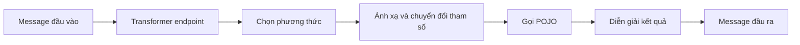

# Transformer method mapping

## 1. Mục tiêu và phạm vi

Trong module **SPRING_INTEGRATION_CORE**, chương **Transformer** trình bày cách biến đổi thông điệp giữa các bước tích hợp. Bài này tập trung vào **method mapping**: cách Spring Integration nối một `Message<?>` với phương thức Java, lấy dữ liệu cho từng tham số và dùng kết quả để tạo thông điệp đầu ra.

Hãy hình dung hệ thống nhận đơn hàng từ nhiều nguồn. Payload chứa sản phẩm, số lượng và đơn giá; header chứa mã tenant và mức ưu tiên. Phương thức chuyển đổi cần nhận đúng dữ liệu để tạo lệnh xử lý đơn hàng. Lỗi ánh xạ có thể khiến code nghiệp vụ chưa được gọi, dù bản thân phương thức Java hoàn toàn đúng.

Sau bài học, bạn có thể:

- Chọn chữ ký nhận payload, từng header, toàn bộ headers hoặc `Message<T>`.
- Phân biệt chọn phương thức, ánh xạ tham số và chuyển đổi kiểu.
- Cấu hình cùng một POJO qua Java DSL, annotation hoặc XML.
- Quyết định khi nào trả payload, khi nào trả `Message<T>`.
- Nhận diện chữ ký mơ hồ và kiểm tra mapping qua một flow thực tế.

Ví dụ chính sử dụng Java 17 và API Java DSL của Spring Integration 6.x. Dự án cần dependency `spring-integration-core`; các đoạn kiểm thử dùng JUnit Jupiter. Quản lý phiên bản dependency thống nhất theo BOM của dự án. Ví dụ không yêu cầu Spring Boot, broker hoặc database.

## 2. Method mapping diễn ra ở đâu?

POJO không phải tự đọc channel hoặc tạo consumer. Endpoint tiếp nhận thông điệp rồi chuyển cho handler. Với transformer gọi phương thức, `MethodInvokingTransformer` thích nghi message với phương thức Java. Xem [Javadoc MethodInvokingTransformer](https://docs.spring.io/spring-integration/api/org/springframework/integration/transformer/MethodInvokingTransformer.html).



Để phân tích một cấu hình, đặt ba câu hỏi riêng biệt:

| Câu hỏi | Ví dụ trong luồng đơn hàng |
| --- | --- |
| Phương thức nào được gọi? | `orderMapper.toCommand` |
| Mỗi đối số lấy từ đâu? | `draft` từ payload, `tenantId` từ header |
| Kết quả có ý nghĩa gì? | `OrderCommand` trở thành payload đầu ra |

Tên `transform`, `map`, `convert` hay `toCommand` thể hiện ý định của lập trình viên. Trong ví dụ dưới đây, tên được khai báo trực tiếp để người đọc thấy điểm gọi:

```java
.transform(orderMapper, "toCommand")
```

Mapping message tới phương thức khác với ánh xạ thuộc tính giữa hai DTO. Công cụ sinh mã DTO mapper có thể được gọi bên trong `toCommand`, nhưng không thay thế cơ chế lấy header hoặc kết nối channel.

## 3. Nhận payload bằng chữ ký đơn giản

Một tham số thông thường như `String` nhận payload; cũng có thể đánh dấu bằng `@Payload`. Tham số kiểu `Message` nhận thông điệp. Xem [Message Mapping Rules and Conventions](https://docs.spring.io/spring-integration/reference/configuration/message-mapping-rules.html).

```java
import java.util.Locale;
import org.springframework.messaging.handler.annotation.Payload;

public class SkuMapper {

    public String normalize(String rawSku) {
        return rawSku.strip().toUpperCase(Locale.ROOT);
    }

    public String normalizeExplicit(@Payload String rawSku) {
        return rawSku.strip().toUpperCase(Locale.ROOT);
    }
}
```

Ví dụ dữ liệu:

```text
Payload đầu vào:  "  kb-01  "
Phương thức:      normalize(String rawSku)
Đối số rawSku:    "  kb-01  "
Payload đầu ra:   "KB-01"
```

`@Payload` giúp nhận ra nguồn dữ liệu ngay tại chữ ký. Khi chỉ có một tham số đơn giản, cách viết không annotation gọn và dễ hiểu. Khi thêm header hoặc xử lý payload dạng `Map`, khai báo tường minh làm hợp đồng dễ đọc hơn.

Dùng annotation thuộc Spring Messaging:

```java
import org.springframework.messaging.handler.annotation.Payload;
import org.springframework.messaging.handler.annotation.Header;
import org.springframework.messaging.handler.annotation.Headers;
```

Các annotation HTTP như `@RequestBody` và `@RequestParam` mô tả hợp đồng controller web. Không dùng chúng để chỉ nguồn tham số cho transformer.

## 4. Lấy dữ liệu từ header

### 4.1. Header bắt buộc và header tùy chọn

`@Header` gắn tham số với một header, mặc định là bắt buộc. `required = false` cho phép thiếu giá trị; `defaultValue` cung cấp giá trị dự phòng. Xem [Javadoc Header](https://docs.spring.io/spring-framework/docs/6.1.x/javadoc-api/org/springframework/messaging/handler/annotation/Header.html).

```java
import org.springframework.messaging.handler.annotation.Header;
import org.springframework.messaging.handler.annotation.Payload;

public class LabeledSkuMapper {

    public String label(
            @Payload String sku,
            @Header("tenantId") String tenantId,
            @Header(value = "priority", required = false) Integer priority) {

        int effectivePriority = priority == null ? 0 : priority;
        return tenantId + ":" + sku + ":P" + effectivePriority;
    }
}
```

Trong hợp đồng ví dụ:

| Thành phần message | Đối số | Ý nghĩa nghiệp vụ |
| --- | --- | --- |
| Payload `"KB-01"` | `sku` | Mã sản phẩm đã chuẩn hóa |
| Header `tenantId = "shop-a"` | `tenantId` | Tenant sở hữu dữ liệu |
| Header `priority = 3` | `priority` | Mức ưu tiên do bên gửi chỉ định |
| Không có header `priority` | `priority = null` | Mapper tự chọn mức `0` |

Chọn `Integer` cho header tùy chọn để biểu diễn trạng thái thiếu. Nếu chọn `int`, cần giá trị dự phòng phù hợp. Ngoài việc có mặt, `tenantId` vẫn cần kiểm tra nghiệp vụ: chuỗi chỉ gồm khoảng trắng không phải tenant hợp lệ.

Một biến thể dùng mặc định tại chữ ký:

```java
public String label(
        @Payload String sku,
        @Header("tenantId") String tenantId,
        @Header(value = "priority", defaultValue = "0") int priority) {

    return tenantId + ":" + sku + ":P" + priority;
}
```

Chọn duy nhất một biến thể của `label` cho ví dụ. Không đặt hai biến thể cạnh nhau rồi để flow quyết định chữ ký nào đại diện cho hợp đồng nghiệp vụ.

### 4.2. Nhận toàn bộ headers

Dùng `@Headers` khi mapper cần tập metadata thay vì vài giá trị cố định. Xem [Annotation Support](https://docs.spring.io/spring-integration/reference/configuration/annotations.html).

```java
import java.util.Map;
import org.springframework.messaging.handler.annotation.Headers;
import org.springframework.messaging.handler.annotation.Payload;

public class AuditTextMapper {

    public String describe(
            @Payload String sku,
            @Headers Map<String, Object> headers) {

        Object traceId = headers.get("traceId");
        return "sku=" + sku + ", traceId=" + traceId;
    }
}
```

Với ba header đã biết trước, ba tham số có tên thường dễ kiểm tra hơn một map. Với tập metadata mở, `@Headers` có thể hợp lý hơn. Chọn theo hợp đồng dữ liệu thay vì làm mọi transformer có cùng dạng chữ ký.

Không sửa metadata đầu vào bằng `headers.put(...)`. Muốn đổi metadata đầu ra, dùng header enricher hoặc xây dựng `Message` kết quả. Ví dụ trên chỉ chọn `traceId` để quan sát, thay vì đưa nguyên map headers vào chuỗi mô tả.

## 5. Payload dạng Map và ánh xạ một phần payload

`Map` có thể biểu diễn dữ liệu nghiệp vụ hoặc headers. Khi cả hai xuất hiện, dùng `@Payload` và `@Headers` để xác định nguồn, tránh dựa vào thứ tự tham số. Xem [quy tắc mapping](https://docs.spring.io/spring-integration/reference/configuration/message-mapping-rules.html).

```java
import java.util.Map;
import org.springframework.messaging.handler.annotation.Headers;
import org.springframework.messaging.handler.annotation.Payload;

public class DocumentMapper {

    public Map<String, Object> toCommand(
            @Payload Map<String, Object> document,
            @Headers Map<String, Object> headers) {

        Object sku = document.get("sku");
        Object tenantId = headers.get("tenantId");
        if (!(sku instanceof String skuText) || skuText.isBlank()) {
            throw new IllegalArgumentException("sku phải là chuỗi không rỗng");
        }
        if (!(tenantId instanceof String tenantText) || tenantText.isBlank()) {
            throw new IllegalArgumentException("tenantId không hợp lệ");
        }
        return Map.of("sku", skuText, "tenantId", tenantText);
    }
}
```

`document.get("tenantId")` và `headers.get("tenantId")` là hai nguồn khác nhau. Nếu bên gửi đặt tenant trong payload, mapper vẫn yêu cầu metadata theo hợp đồng đã chọn. Tên key giống nhau không đồng bộ payload và header.

Kết quả `Map.of(...)` là payload mới. Không dùng việc trả về `Map` như cách ngầm cập nhật header. Khi cần thông điệp hoàn chỉnh, trả `Message`. Xem [MethodInvokingTransformer](https://docs.spring.io/spring-integration/api/org/springframework/integration/transformer/MethodInvokingTransformer.html).

Nếu chỉ cần một trường, có thể dùng biểu thức trong `@Payload`:

```java
import org.springframework.messaging.handler.annotation.Header;
import org.springframework.messaging.handler.annotation.Payload;

public class SkuFieldMapper {

    public String tenantSku(
            @Payload("['sku']") String sku,
            @Header("tenantId") String tenantId) {

        return tenantId + ":" + sku;
    }
}
```

Với payload `Map.of("sku", "KB-01")`, biểu thức `['sku']` đọc key `sku`. Ngữ cảnh gốc của biểu thức `@Payload` là payload. Xem [Javadoc Payload](https://docs.spring.io/spring-framework/docs/6.1.21/javadoc-api/org/springframework/messaging/handler/annotation/Payload.html).

Biểu thức ngắn phù hợp để chọn trường ổn định. Nếu phải kiểm tra nhiều trường, áp dụng mặc định và tạo object nghiệp vụ, phương thức nhận DTO thường dễ đọc và dễ kiểm thử hơn biểu thức dài.

## 6. Chọn phương thức và tránh chữ ký mơ hồ

### 6.1. Chỉ định tên phương thức

Java DSL cho phép truyền đối tượng cùng tên phương thức qua `transform(Object, String)`. Xem [Javadoc BaseIntegrationFlowDefinition](https://docs.spring.io/spring-integration/docs/6.4.x/api/org/springframework/integration/dsl/BaseIntegrationFlowDefinition.html).

```java
.transform(orderMapper, "toCommand")
```

Tên tường minh thu hẹp tập phương thức. Nếu lớp có nhiều overload `toCommand`, tên chuỗi vẫn chưa chỉ một chữ ký Java duy nhất. Với một điểm vào của flow, nên cung cấp một phương thức public có vai trò rõ ràng.

Ví dụ thiết kế chữ ký dễ đọc:

```java
public OrderCommand fromDraft(OrderDraft draft) { /* ... */ }
public OrderCommand fromLegacyText(String text) { /* ... */ }
```

Mỗi flow chọn phương thức tương ứng. Nếu đầu vào có nhiều loại nghiệp vụ, router có thể dẫn chúng tới các nhánh chuyển đổi riêng; mỗi nhánh có hợp đồng đầu vào cụ thể.

### 6.2. Mỗi tham số cần một nguồn xác định

Chữ ký sau không nói chuỗi thứ hai đến từ đâu:

```java
// Chữ ký cần tránh trong một transformer gọi POJO.
public String combine(String sku, String tenantId) { /* ... */ }
```

Khai báo nguồn trực tiếp:

```java
public String combine(
        @Payload String sku,
        @Header("tenantId") String tenantId) {

    return tenantId + ":" + sku;
}
```

Nhiều tham số không đánh dấu nguồn có thể làm mapping mơ hồ. Xem [Message Mapping Rules and Conventions](https://docs.spring.io/spring-integration/reference/configuration/message-mapping-rules.html).

Khi đọc lỗi, phân biệt:

- **Không chọn được phương thức:** kiểm tra tên cấu hình và overload.
- **Không tạo được đối số:** kiểm tra annotation, header bắt buộc và kiểu dữ liệu.
- **Phương thức đã chạy rồi ném lỗi:** kiểm tra điều kiện nghiệp vụ trong mapper.

Không kết luận mọi lỗi đều do conversion. Thêm converter cho `String` không giải quyết chữ ký hai tham số chưa có nguồn riêng.

### 6.3. Lambda và POJO method mapping

Nếu chỉ cần payload, Java DSL có thể nhận hàm với kiểu đầu vào rõ ràng:

```java
.transform(String.class, text -> text.strip())
```

Với POJO nhiều tham số từ payload và headers, dùng dạng gọi theo đối tượng:

```java
.transform(orderMapper, "toCommand")
```

Ở dạng thứ hai, framework tạo từng đối số theo annotation. Không chuyển cơ học thành lambda một tham số rồi kỳ vọng annotation trên phương thức khác tự cấp các đối số còn thiếu.

Các đoạn `/* ... */` chỉ minh họa chữ ký. Ví dụ tiếp theo có phần thân đầy đủ.

## 7. Ví dụ hoàn chỉnh bằng Java DSL

### 7.1. Hợp đồng thông điệp

Luồng nhận bản nháp đơn hàng và tạo lệnh xử lý:

```text
ordersIn
  -> orderMapper.toCommand(payload, tenantId, priority)
  -> ordersOut
```

| Dữ liệu | Giá trị minh họa |
| --- | --- |
| Payload đầu vào | `OrderDraft("O-100", "KB-01", 2, 125000)` |
| Header bắt buộc | `tenantId = "shop-a"` |
| Header tùy chọn | `priority = 3` |
| Header quan sát | `traceId = "trace-100"` |
| Payload đầu ra | `OrderCommand` có tổng tiền `250000`, tenant `shop-a` |

Quy tắc ví dụ: số lượng dương; đơn giá không âm; mã đơn hàng, mã sản phẩm và tenant không rỗng. Thiếu priority thì dùng `0`.

### 7.2. Cấu hình và mapper

Trong dự án thực hành, lưu đoạn dưới thành `OrderFlowConfig.java`. Các record và mapper là lớp lồng để ví dụ chỉ cần một tệp nguồn.

```java
import java.math.BigDecimal;
import java.util.Objects;

import org.springframework.context.annotation.Bean;
import org.springframework.context.annotation.Configuration;
import org.springframework.integration.channel.DirectChannel;
import org.springframework.integration.channel.QueueChannel;
import org.springframework.integration.config.EnableIntegration;
import org.springframework.integration.dsl.IntegrationFlow;
import org.springframework.messaging.handler.annotation.Header;
import org.springframework.messaging.handler.annotation.Payload;

@Configuration
@EnableIntegration
public class OrderFlowConfig {

    public record OrderDraft(
            String orderId,
            String sku,
            int quantity,
            BigDecimal unitPrice) {
    }

    public record OrderCommand(
            String orderId,
            String tenantId,
            String sku,
            int quantity,
            BigDecimal totalAmount,
            int priority) {
    }

    public static class OrderMapper {

        public OrderCommand toCommand(
                @Payload OrderDraft draft,
                @Header("tenantId") String tenantId,
                @Header(value = "priority", required = false)
                Integer priority) {

            Objects.requireNonNull(draft, "draft không được null");
            requireText(draft.orderId(), "orderId");
            requireText(draft.sku(), "sku");
            requireText(tenantId, "tenantId");

            if (draft.quantity() <= 0) {
                throw new IllegalArgumentException("quantity phải dương");
            }
            if (draft.unitPrice() == null
                    || draft.unitPrice().signum() < 0) {
                throw new IllegalArgumentException(
                        "unitPrice phải có giá trị không âm");
            }

            BigDecimal total = draft.unitPrice()
                    .multiply(BigDecimal.valueOf(draft.quantity()));
            int effectivePriority = priority == null ? 0 : priority;

            return new OrderCommand(
                    draft.orderId(),
                    tenantId,
                    draft.sku(),
                    draft.quantity(),
                    total,
                    effectivePriority);
        }

        private static void requireText(String value, String field) {
            if (value == null || value.isBlank()) {
                throw new IllegalArgumentException(
                        field + " không được rỗng");
            }
        }
    }

    @Bean
    public DirectChannel ordersIn() {
        return new DirectChannel();
    }

    @Bean
    public QueueChannel ordersOut() {
        return new QueueChannel();
    }

    @Bean
    public OrderMapper orderMapper() {
        return new OrderMapper();
    }

    @Bean
    public IntegrationFlow orderFlow(OrderMapper orderMapper) {
        return IntegrationFlow.from("ordersIn")
                .transform(orderMapper, "toCommand",
                        endpoint -> endpoint.id("orderDraftToCommand"))
                .channel("ordersOut")
                .get();
    }
}
```

Mapper không có `@Transformer`: Java DSL đã chọn `.transform(...)` và tên phương thức. Mapper cũng không truy cập channel; nó nhận dữ liệu và trả kết quả.

`ordersIn` dùng `DirectChannel` để minh họa lời gọi đồng bộ. `ordersOut` là `QueueChannel` để test chủ động lấy thông điệp. Không cần poller cho queue chỉ được test gọi `receive`; poller cần được xét khi có endpoint tự tiêu thụ từ queue.

### 7.3. Theo dõi một lần ánh xạ

Với thông điệp chứa bản nháp `O-100`, các nguồn đối số là:

```text
Tham số draft     <- message.getPayload()
Tham số tenantId  <- message.getHeaders().get("tenantId")
Tham số priority  <- message.getHeaders().get("priority")
```

Mapper tạo `OrderCommand` mới. Bản nháp vẫn mô tả dữ liệu ban đầu; các bước sau làm việc với lệnh chứa tenant và tổng tiền. Thiết kế này tránh thay đổi object mà nhánh khác còn có thể dùng.

Trong luồng lớn hơn, có thể đặt filter trước bước này để loại yêu cầu ngoài phạm vi, router sau bước này để chọn nhánh theo tenant, hoặc chuyển tiếp tới aggregator theo khóa nhóm. Method mapping vẫn chỉ chịu trách nhiệm cho một lần nhận và chuyển đổi thông điệp.

## 8. Cấu hình bằng annotation hoặc XML

Hai cách dưới đây thay thế flow Java DSL ở mục 7. Chọn một cách khi thực hành; không đăng ký thêm endpoint trên cùng `ordersIn` chỉ để thử cách khai báo khác.

### 8.1. Endpoint qua annotation

```java
import org.springframework.integration.annotation.Transformer;
import org.springframework.messaging.handler.annotation.Header;
import org.springframework.messaging.handler.annotation.Payload;
import org.springframework.stereotype.Component;

@Component
public class AnnotatedOrderTransformer {

    private final OrderFlowConfig.OrderMapper mapper;

    public AnnotatedOrderTransformer(OrderFlowConfig.OrderMapper mapper) {
        this.mapper = mapper;
    }

    @Transformer(inputChannel = "ordersIn", outputChannel = "ordersOut")
    public OrderFlowConfig.OrderCommand map(
            @Payload OrderFlowConfig.OrderDraft draft,
            @Header("tenantId") String tenantId,
            @Header(value = "priority", required = false) Integer priority) {

        return mapper.toCommand(draft, tenantId, priority);
    }
}
```

Ứng dụng cần đăng ký component này, mapper và các channel, đồng thời bật hạ tầng Integration. Với cấu hình thủ công, dùng `@EnableIntegration` và component scan hoặc đăng ký bean tương ứng. Annotation trên object chưa được quản lý không tự đưa object vào flow. Xem [Annotation Support](https://docs.spring.io/spring-integration/reference/configuration/annotations.html).

Mapping được xử lý tại phương thức `map` mà endpoint gọi. Lời gọi `mapper.toCommand(...)` bên trong là lời gọi Java thông thường; ba đối số đã được truyền tường minh.

### 8.2. Endpoint qua XML

Đoạn sau là phần cấu hình endpoint, giả sử `ordersIn`, `ordersOut` và bean `orderMapper` đã được khai báo:

```xml
<beans xmlns="http://www.springframework.org/schema/beans"
       xmlns:xsi="http://www.w3.org/2001/XMLSchema-instance"
       xmlns:int="http://www.springframework.org/schema/integration"
       xsi:schemaLocation="
           http://www.springframework.org/schema/beans
           https://www.springframework.org/schema/beans/spring-beans.xsd
           http://www.springframework.org/schema/integration
           https://www.springframework.org/schema/integration/spring-integration.xsd">

    <int:transformer id="orderDraftToCommand"
                     input-channel="ordersIn"
                     output-channel="ordersOut"
                     ref="orderMapper"
                     method="toCommand"/>
</beans>
```

`ref` chọn bean, `method` chọn tên phương thức; hai channel xác định kết nối. Tham số POJO vẫn được ánh xạ theo chữ ký và annotation. Xem [Transformer: cấu hình XML và annotation](https://docs.spring.io/spring-integration/reference/transformer.html).

Khi thay cách cấu hình, giữ nguyên dữ liệu thử `OrderDraft`, `tenantId` và `priority`. Nhờ đó, thay đổi cần quan sát là cách đăng ký endpoint.

## 9. Trả payload hay trả Message?

### 9.1. Trả payload khi chỉ chuyển dữ liệu

Ở cấu hình mặc định, khi transformer trả payload, headers đầu vào được truyền sang message kết quả. Khi trả cả `Message`, mã ứng dụng chịu trách nhiệm về headers đầu ra. Xem [Message: Header Propagation](https://docs.spring.io/spring-integration/reference/message.html).

Trong ví dụ đơn hàng, chọn trả `OrderCommand` vì mapper chỉ tính dữ liệu nghiệp vụ. `traceId` phục vụ quan sát luồng, không cần trở thành tham số của phép tính tổng tiền.

### 9.2. Trả Message để kiểm soát metadata

Ví dụ này giữ headers đầu vào và bổ sung cờ chuẩn hóa:

```java
import java.util.Locale;
import org.springframework.messaging.Message;
import org.springframework.messaging.support.MessageBuilder;

public class MessageAwareSkuMapper {

    public Message<String> normalize(Message<String> input) {
        String normalized = input.getPayload()
                .strip()
                .toUpperCase(Locale.ROOT);

        return MessageBuilder.withPayload(normalized)
                .copyHeaders(input.getHeaders())
                .setHeader("normalized", true)
                .build();
    }
}
```

Nếu bỏ `copyHeaders(...)`, hãy xác định headers còn cần cho các bước sau và thêm chúng chủ động. Chẳng hạn, mất `traceId` làm việc theo dõi khó hơn; mất khóa nhóm ảnh hưởng aggregator; mất `replyChannel` có thể ảnh hưởng luồng trả lời qua gateway.

`id` và `timestamp` do hạ tầng quản lý; copy headers không có nghĩa giữ định danh message. Message mới cũng không tự sao chép sâu payload. Xem [Message và MessageBuilder](https://docs.spring.io/spring-integration/reference/message.html).

Tại biên hệ thống bên ngoài, chọn metadata theo hợp đồng truyền tải. Ví dụ này copy headers để thể hiện trách nhiệm mapper trong luồng nội bộ.

## 10. Hợp đồng trả về: không dùng null để loại message

Transformer cần kết quả chuyển đổi; `null` gây `MessageTransformationException`. `void` không đáp ứng hợp đồng kết quả. Để loại message theo điều kiện, dùng filter; với thao tác cho phép không trả kết quả, xem service activator. Xem [quy tắc trả về của Transformer](https://docs.spring.io/spring-integration/reference/transformer.html).

Ví dụ cần tránh:

```java
public String normalize(String text) {
    if (text.isBlank()) {
        return null;
    }
    return text.strip();
}
```

Một cách thể hiện rõ điều kiện chấp nhận:

```java
IntegrationFlow.from("skuIn")
        .filter(String.class, text -> !text.isBlank())
        .transform(String.class, text -> text.strip())
        .channel("skuOut")
        .get();
```

Ví dụ chỉ giữ chuỗi không blank rồi chuẩn hóa. Trong ứng dụng thật, quyết định thêm nơi nhận message bị loại nếu cần theo dõi hoặc phản hồi nghiệp vụ.

Một `List<OrderCommand>` trả về từ mapper vẫn là một payload. Muốn phát từng phần tử thành message riêng, thiết kế thêm splitter; muốn ghép nhiều message, dùng aggregator. Các quyết định này nên hiện rõ trên flow thay vì ẩn trong phương thức tên `transform`.

## 11. Chuyển đổi kiểu và giới hạn cần hiểu

Mapping và conversion phục vụ hai câu hỏi khác nhau:

| Cơ chế | Câu hỏi |
| --- | --- |
| Mapping | Đối số lấy từ payload hay header? |
| Conversion | Giá trị lấy được đổi sang kiểu tham số được không? |
| Logic nghiệp vụ | Giá trị đúng kiểu đã hợp lệ theo quy tắc đơn hàng chưa? |

Spring Integration hỗ trợ conversion khi gọi phương thức, gồm `integrationConversionService` và message converter tùy đường gọi. Khả năng đổi kiểu phụ thuộc cấu hình và converter hiện có; không mặc định mọi chuỗi JSON đều đổi được thành DTO. Xem [Message Endpoints: Payload Type Conversion và Content Type Conversion](https://docs.spring.io/spring-integration/reference/endpoint.html).

Trong ví dụ chính, gửi `OrderDraft` thật và header `priority` kiểu `Integer` để tập trung vào mapping. Sau khi hợp đồng hoạt động, mới thử priority dạng chuỗi hoặc payload JSON và xác định riêng điều kiện conversion.

Nếu có nhiều định dạng đầu vào, nên chuẩn hóa ở bước thấy được trên flow. Chẳng hạn, chuyển tài liệu JSON thành `OrderDraft` rồi gọi `toCommand`; khi lỗi, bạn phân biệt được lỗi đọc tài liệu với lỗi nghiệp vụ.

Không dùng conversion để che vấn đề thiết kế. Header `tenantId` bị thiếu cần bổ sung ở nguồn hoặc xử lý theo hợp đồng, chứ không được chữa bằng cách đổi kiểu tham số thành `Object`.

## 12. Kiểm thử đúng tầng mapping

Gọi trực tiếp `mapper.toCommand(draft, "shop-a", 3)` chỉ kiểm tra logic Java. Muốn kiểm tra framework lấy đúng header, xử lý header tùy chọn và đưa kết quả tới channel, cần gửi `Message` qua flow.

Đặt lớp sau cùng package với `OrderFlowConfig`. Mỗi test tạo context riêng để có queue đầu ra độc lập.

```java
import java.math.BigDecimal;

import org.junit.jupiter.api.Test;
import org.springframework.context.annotation.AnnotationConfigApplicationContext;
import org.springframework.integration.channel.DirectChannel;
import org.springframework.integration.channel.QueueChannel;
import org.springframework.messaging.Message;
import org.springframework.messaging.MessagingException;
import org.springframework.messaging.support.MessageBuilder;

import static org.junit.jupiter.api.Assertions.*;

class OrderFlowConfigTest {

    @Test
    void mapsPayloadAndHeaders() {
        try (var context = new AnnotationConfigApplicationContext(
                OrderFlowConfig.class)) {

            var input = context.getBean("ordersIn", DirectChannel.class);
            var output = context.getBean("ordersOut", QueueChannel.class);
            var draft = new OrderFlowConfig.OrderDraft(
                    "O-100", "KB-01", 2, new BigDecimal("125000"));

            Message<?> request = MessageBuilder.withPayload(draft)
                    .setHeader("tenantId", "shop-a")
                    .setHeader("priority", 3)
                    .setHeader("traceId", "trace-100")
                    .build();

            assertTrue(input.send(request));
            Message<?> reply = output.receive(1000);
            assertNotNull(reply);

            var command = assertInstanceOf(
                    OrderFlowConfig.OrderCommand.class, reply.getPayload());
            assertEquals("O-100", command.orderId());
            assertEquals("shop-a", command.tenantId());
            assertEquals("KB-01", command.sku());
            assertEquals(2, command.quantity());
            assertEquals(0, new BigDecimal("250000")
                    .compareTo(command.totalAmount()));
            assertEquals(3, command.priority());
            assertEquals("trace-100", reply.getHeaders().get("traceId"));
        }
    }

    @Test
    void usesDefaultWhenOptionalPriorityIsMissing() {
        try (var context = new AnnotationConfigApplicationContext(
                OrderFlowConfig.class)) {

            var input = context.getBean("ordersIn", DirectChannel.class);
            var output = context.getBean("ordersOut", QueueChannel.class);
            var draft = new OrderFlowConfig.OrderDraft(
                    "O-101", "MS-02", 1, new BigDecimal("80000"));

            assertTrue(input.send(MessageBuilder.withPayload(draft)
                    .setHeader("tenantId", "shop-a")
                    .build()));

            Message<?> reply = output.receive(1000);
            assertNotNull(reply);
            var command = assertInstanceOf(
                    OrderFlowConfig.OrderCommand.class, reply.getPayload());
            assertEquals(0, command.priority());
        }
    }

    @Test
    void rejectsMissingRequiredTenantHeader() {
        try (var context = new AnnotationConfigApplicationContext(
                OrderFlowConfig.class)) {

            var input = context.getBean("ordersIn", DirectChannel.class);
            var output = context.getBean("ordersOut", QueueChannel.class);
            var draft = new OrderFlowConfig.OrderDraft(
                    "O-102", "KB-01", 1, new BigDecimal("125000"));
            Message<?> request = MessageBuilder.withPayload(draft).build();

            assertThrows(MessagingException.class, () -> input.send(request));
            assertNull(output.receive(0));
        }
    }
}
```

Assertion tập trung vào hành vi thấy được: dữ liệu chuyển đổi, headers, thiếu header tùy chọn và thiếu header bắt buộc. Không khóa test vào toàn bộ chuỗi exception hoặc tên lớp nội bộ.

`receive(1000)` giới hạn thời gian chờ kết quả. `receive(0)` kiểm tra ngay queue rỗng khi xử lý đồng bộ thất bại.

Đây là mã kiểm thử minh họa để chạy trong dự án thực hành. Tài liệu không mặc định các đoạn code đã được biên dịch hoặc chạy.

## 13. Lỗi mapping và đường đi của exception

Với `DirectChannel`, handler chạy cùng thread bên gửi; exception trở về lời gọi `send`. Việc đưa lỗi qua `errorChannel` phụ thuộc ranh giới thực thi và cơ chế publishing lỗi. Xem [Error Handling](https://docs.spring.io/spring-integration/reference/error-handling.html).

Dùng request thật để tái hiện lỗi. Bảng sau gợi ý chẩn đoán cho các ví dụ của bài:

| Triệu chứng | Kiểm tra trước | Hướng xử lý |
| --- | --- | --- |
| Thiếu `tenantId` | Headers của request | Sửa nguồn gửi hoặc định nghĩa lại hợp đồng tùy chọn |
| Không chọn được `toCommand` | Bean được truyền vào, overload | Chọn tên riêng, giảm điểm vào mơ hồ |
| `priority` không nhận được | Tên key, kiểu giá trị | Gửi `Integer` đúng hợp đồng, kiểm tra conversion riêng |
| Lỗi trước log mapper | Mapping từng tham số | Kiểm tra annotation, header bắt buộc |
| Tổng tiền sai | `OrderDraft`, phép tính | Kiểm thử logic nghiệp vụ độc lập |
| Mất `traceId` sau bước khác | Bước trả `Message` tự xây | Kiểm tra chính sách giữ headers |
| Không tới `ordersOut` | Kết nối đầu ra, exception từ `send` | Xác minh flow đăng ký, xem lỗi gốc |

Đọc chuỗi `cause` để tìm nguyên nhân, giữ mã đơn hàng hoặc trace ID trong thông tin chẩn đoán. Với dữ liệu thiếu tenant, retry message không thay đổi không tạo ra tenant còn thiếu; cần sửa dữ liệu hoặc chuyển nhánh phù hợp.

Nếu đổi `ordersIn` thành queue hoặc chuyển xử lý sang executor, thiết kế lại cách test và quan sát exception theo cơ chế mới. Assertion cho `send` đồng bộ ở mục 12 không áp dụng nguyên trạng cho mọi flow bất đồng bộ.

## 14. Tự thực hành và tiêu chí hoàn thành

Dùng ví dụ mục 7 làm điểm bắt đầu:

1. Gửi bản nháp hợp lệ cùng `tenantId`, `priority`, `traceId`; xác nhận các giá trị đầu ra.
2. Bỏ `priority`; xác nhận mức `0`.
3. Bỏ `tenantId`; xác nhận không tạo `OrderCommand`, bên gửi đồng bộ nhận lỗi.
4. Đổi payload thành `Map`, viết mapper riêng dùng `@Payload Map` và `@Headers Map`.
5. Viết biến thể trả `Message<OrderCommand>`; giữ `traceId`, thêm header `mappedBy`.
6. So sánh biến thể giữ headers với biến thể chỉ dựng message từ payload; giải thích tác động tới bước sau.

Ở bước 5, đặt tên phương thức riêng rồi thay `.transform(...)` tương ứng. Không đăng ký nhiều transformer cạnh tranh trên `ordersIn` khi mục tiêu là so sánh kết quả từng phiên bản.

Bạn hoàn thành khi chỉ được nguồn của mỗi tham số, giải thích cách diễn giải kết quả và chứng minh hợp đồng bằng message gửi qua flow. Chữ ký transformer dễ hiểu thường có payload rõ kiểu, ít header có tên cụ thể và kết quả xác định cho mọi đầu vào được chấp nhận.

## 15. Tài liệu tham khảo

- [Spring Integration: Transformer](https://docs.spring.io/spring-integration/reference/transformer.html) — cấu hình POJO transformer, hợp đồng kết quả.
- [Message Mapping Rules and Conventions](https://docs.spring.io/spring-integration/reference/configuration/message-mapping-rules.html) — nguồn đối số, trường hợp mơ hồ.
- [Annotation Support](https://docs.spring.io/spring-integration/reference/configuration/annotations.html) — endpoint và tham số có annotation.
- [BaseIntegrationFlowDefinition, dòng 6.4](https://docs.spring.io/spring-integration/docs/6.4.x/api/org/springframework/integration/dsl/BaseIntegrationFlowDefinition.html) — các overload `transform` trong Java DSL.
- [Message](https://docs.spring.io/spring-integration/reference/message.html) — headers và chính sách truyền headers.
- [Message Endpoints](https://docs.spring.io/spring-integration/reference/endpoint.html) — conversion khi xử lý message.
- [Error Handling](https://docs.spring.io/spring-integration/reference/error-handling.html) — lỗi đồng bộ và bất đồng bộ.
