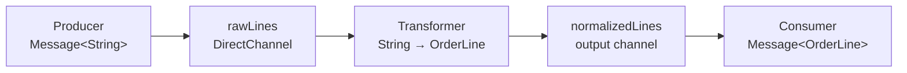

# Transformer với output channel

Trong chương **Transformer** của module **SPRING_INTEGRATION_CORE**, bài này trình bày cách đưa kết quả biến đổi đến bước tiếp theo của một luồng thông điệp. Trọng tâm là mối liên hệ giữa `Message`, transformer endpoint, `MessageChannel`, `replyChannel` và Java DSL.

Một hàm chuyển chuỗi thành đối tượng có thể trả về kết quả đúng nhưng luồng vẫn thất bại nếu endpoint không tìm được nơi gửi kết quả. Vì vậy, khi thiết kế transformer, cần xác định cả hợp đồng dữ liệu đầu ra lẫn kênh tiếp nhận dữ liệu đó.

Các ví dụ dùng Java 17 và API Spring Integration 6.5. Dependency chính là `org.springframework.integration:spring-integration-core`; ví dụ kiểm thử dùng JUnit Jupiter. Trong ứng dụng Spring Boot, có thể dùng `spring-boot-starter-integration` và để dependency management của ứng dụng quản lý phiên bản. Những đoạn mã ghi rõ là phương án thay thế cần được chọn riêng, tránh đăng ký hai endpoint xử lý trùng một đầu vào.

## 1. Output channel giữ vai trò gì?

Xét một hệ thống tiếp nhận dòng hàng ở dạng văn bản:

```text
Đầu vào:  " sku-42 , 2 "
Đầu ra:   OrderLine[sku=SKU-42, quantity=2]
```

Transformer chịu trách nhiệm chuyển biểu diễn dữ liệu. Output channel là nơi endpoint gửi `Message` chứa kết quả sau khi chuyển đổi thành công.



Trong sơ đồ, `normalizedLines` vừa là output channel của transformer, vừa có thể là input channel của endpoint tiếp theo. Tên “output” mô tả vai trò của kênh đối với một endpoint cụ thể.

| Thành phần | Trách nhiệm trong ví dụ |
| --- | --- |
| Producer | Tạo thông điệp chứa chuỗi đầu vào |
| Input channel | Đưa thông điệp đến transformer endpoint |
| Logic biến đổi | Chuẩn hóa mã hàng, đọc số lượng và tạo `OrderLine` |
| Transformer endpoint | Gọi logic biến đổi, tạo kết quả thông điệp và gửi tiếp |
| Output channel | Tiếp nhận thông điệp sau biến đổi |
| Consumer | Xử lý hợp đồng dữ liệu `OrderLine` |

Hàm biến đổi nên tập trung vào dữ liệu. Việc kết nối các bước được thể hiện bằng cấu hình endpoint và channel, giúp thay đổi topology của luồng mà không phải viết lại logic phân tích chuỗi.

Spring Integration cho phép khai báo transformer bằng annotation, XML hoặc toán tử `.transform()` trong Java DSL. [Tham chiếu Transformer](https://docs.spring.io/spring-integration/reference/6.5/transformer.html).

## 2. Phân biệt kết quả hàm và kết quả gửi thông điệp

Hai lệnh sau có ý nghĩa khác nhau:

```java
OrderLine line = OrderLine.parse("sku-42,2");
boolean accepted = inputChannel.send(message);
```

Lệnh thứ nhất gọi hàm Java và nhận đối tượng kết quả. Lệnh thứ hai gửi một `Message` đến channel; giá trị `boolean` biểu thị kết quả gửi theo hợp đồng của channel, không chứa payload đã biến đổi.

Khi dùng transformer endpoint, đường đi là:

1. Endpoint nhận thông điệp từ input channel.
2. Endpoint gọi hàm biến đổi.
3. Kết quả được dùng để tạo thông điệp đầu ra.
4. Endpoint xác định kênh đích.
5. Endpoint gửi thông điệp đầu ra đến kênh đó.

Để lấy kết quả, người gọi phải nhận từ kênh đầu ra có khả năng `receive()`, dùng `MessagingTemplate` cho request–reply, hoặc gọi một messaging gateway. Không ép kiểu giá trị trả về của `send()` thành đối tượng nghiệp vụ.

## 3. Endpoint xác định nơi gửi đầu ra như thế nào?

Với luồng thông thường không dùng routing slip, có thể đọc quy tắc theo thứ tự:

1. Nếu endpoint đã được cấu hình output channel, gửi đến kênh đó.
2. Nếu chưa có output channel, tìm `replyChannel` trong headers của thông điệp đầu vào.
3. Nếu đầu vào không có địa chỉ phản hồi và kết quả trả về là một `Message`, có thể dùng `replyChannel` của thông điệp kết quả.
4. Nếu không xác định được đích, việc gửi kết quả thất bại.

`replyChannel` có thể chứa một đối tượng `MessageChannel` hoặc tên kênh dưới dạng `String`. Tên kênh phải phân giải được trong ngữ cảnh của ứng dụng. Thiếu đích hoặc tên đích không phân giải được có thể dẫn đến `DestinationResolutionException`; ngoại lệ quan sát từ bên gọi có thể được bọc trong ngoại lệ messaging khác. [Quy tắc chọn kênh trả lời](https://docs.spring.io/spring-integration/reference/6.5/service-activator.html).

| Output channel của endpoint | `replyChannel` đầu vào | Đích đầu ra trong luồng thông thường |
| --- | --- | --- |
| `normalizedLines` | Không có | `normalizedLines` |
| `normalizedLines` | `callerReplies` | `normalizedLines` |
| Không cấu hình | Đối tượng `callerReplies` | Đối tượng channel đó |
| Không cấu hình | Tên `"callerReplies"` | Channel được phân giải theo tên |
| Không cấu hình | Không có | Dùng địa chỉ trên kết quả nếu phù hợp; nếu vẫn thiếu thì lỗi |

Một header tùy ý mang tên `outputChannel` không thay thế thuộc tính output channel của endpoint. Muốn chọn nhánh dựa trên dữ liệu, hãy dùng router hoặc cơ chế định tuyến phù hợp.

Cấu hình output channel và header `replyChannel` cũng không tạo hai lần gửi. Ví dụ có cả hai sẽ gửi trước đến output channel đã cấu hình. Một endpoint ở cuối luồng có thể tiếp tục dùng `replyChannel` để trả kết quả cuối cùng về người gọi.

## 4. Ví dụ Java DSL hoàn chỉnh

### 4.1. Hợp đồng dữ liệu và cấu hình luồng

Đặt mã sau trong `TransformerOutputConfiguration.java`. Ví dụ chỉ cần Spring context, Spring Integration core và các dependency chuyển tiếp của chúng; không phụ thuộc web server hay message broker.

```java
package example.transformer;

import java.util.Locale;

import org.springframework.context.annotation.Bean;
import org.springframework.context.annotation.Configuration;
import org.springframework.integration.channel.DirectChannel;
import org.springframework.integration.channel.QueueChannel;
import org.springframework.integration.config.EnableIntegration;
import org.springframework.integration.dsl.IntegrationFlow;

@Configuration
@EnableIntegration
public class TransformerOutputConfiguration {

    public record OrderLine(String sku, int quantity) {

        public static OrderLine parse(String raw) {
            if (raw == null || raw.isBlank()) {
                throw new IllegalArgumentException(
                        "Dong hang khong duoc rong");
            }

            String[] fields = raw.split(",", -1);
            if (fields.length != 2) {
                throw new IllegalArgumentException(
                        "Dinh dang phai la sku,quantity");
            }

            String sku = fields[0].trim().toUpperCase(Locale.ROOT);
            if (sku.isBlank()) {
                throw new IllegalArgumentException(
                        "Ma hang khong duoc rong");
            }

            final int quantity;
            try {
                quantity = Integer.parseInt(fields[1].trim());
            }
            catch (NumberFormatException ex) {
                throw new IllegalArgumentException(
                        "So luong phai la so nguyen", ex);
            }

            if (quantity <= 0) {
                throw new IllegalArgumentException(
                        "So luong phai lon hon 0");
            }

            return new OrderLine(sku, quantity);
        }
    }

    @Bean
    public DirectChannel rawLines() {
        return new DirectChannel();
    }

    @Bean
    public QueueChannel normalizedLines() {
        return new QueueChannel(100);
    }

    @Bean
    public IntegrationFlow normalizeLineFlow(
            DirectChannel rawLines,
            QueueChannel normalizedLines) {

        return IntegrationFlow.from(rawLines)
                .transform(String.class, OrderLine::parse)
                .channel(normalizedLines)
                .get();
    }
}
```

Luồng trên có các quyết định thiết kế cụ thể:

- `rawLines` là đầu vào có subscriber transformer; lời gọi gửi trực tiếp kích hoạt xử lý.
- `.transform(String.class, OrderLine::parse)` nhận payload kiểu `String` và trả payload kiểu `OrderLine`.
- `.channel(normalizedLines)` nối đầu ra của transformer với bean channel đã khai báo.
- `QueueChannel(100)` giữ kết quả để ví dụ có thể nhận thủ công và giới hạn số thông điệp đang chờ.

Định dạng đầu vào ở đây là giao thức đơn giản gồm đúng hai trường phân cách bằng dấu phẩy, không hỗ trợ CSV có trích dẫn hoặc dấu phẩy bên trong mã hàng.

### 4.2. Gửi đầu vào và đọc đầu ra

Đặt đoạn sau trong `TransformerOutputDemo.java`, cùng package với cấu hình:

```java
package example.transformer;

import org.springframework.context.annotation.AnnotationConfigApplicationContext;
import org.springframework.integration.channel.DirectChannel;
import org.springframework.integration.channel.QueueChannel;
import org.springframework.messaging.Message;
import org.springframework.messaging.support.MessageBuilder;

public class TransformerOutputDemo {

    public static void main(String[] args) {
        try (var context = new AnnotationConfigApplicationContext(
                TransformerOutputConfiguration.class)) {

            DirectChannel input =
                    context.getBean("rawLines", DirectChannel.class);
            QueueChannel output =
                    context.getBean("normalizedLines", QueueChannel.class);

            Message<String> request = MessageBuilder
                    .withPayload(" sku-42 , 2 ")
                    .setHeader("traceId", "trace-010")
                    .build();

            if (!input.send(request)) {
                throw new IllegalStateException(
                        "Khong gui duoc thong diep dau vao");
            }

            Message<?> result = output.receive(1_000);
            if (result == null) {
                throw new IllegalStateException(
                        "Khong nhan duoc ket qua trong thoi gian cho");
            }

            System.out.println(result.getPayload());
            System.out.println(result.getHeaders().get("traceId"));
        }
    }
}
```

Kết quả mong đợi:

```text
OrderLine[sku=SKU-42, quantity=2]
trace-010
```

Ứng dụng nhận `Message` từ output channel rồi mới đọc payload. Tham số `1_000` của `receive()` là thời gian chờ nhận, tính bằng mili giây.

Ở ví dụ này, không cần poller cho output channel vì chương trình chủ động gọi `receive()`. Nếu thay phần nhận thủ công bằng một consuming endpoint đọc từ `QueueChannel`, endpoint đó cần poller.

## 5. Cách Java DSL nối output channel

Có thể biểu diễn hai bước liên tiếp như sau:

```java
@Bean
public IntegrationFlow displayLineFlow() {
    return IntegrationFlow.from("displayInput")
            .transform(String.class,
                    TransformerOutputConfiguration.OrderLine::parse)
            .handle(System.out::println)
            .get();
}
```

DSL tạo kết nối nội bộ giữa transformer và handler kế tiếp. Trong cấu hình mặc định của kiểu chuỗi xử lý này, các endpoint được nối bằng `DirectChannel`; không bắt buộc đặt tên cho mọi channel. [DSL Basics](https://docs.spring.io/spring-integration/reference/6.5/dsl/java-basics.html).

Khi cần một điểm kết nối rõ ràng, dùng channel có tên hoặc bean channel:

```java
.transform(String.class, OrderLine::parse)
.channel(normalizedLines)
```

Kênh có tên hữu ích khi muốn gắn interceptor, nối một flow khác, quan sát thông điệp hoặc biểu diễn ranh giới giữa hai hợp đồng dữ liệu.

Cần đọc `.channel(...)` theo vị trí. Nếu channel đứng sau transformer, nó là nơi nhận kết quả của transformer. Nếu channel đứng trước transformer, nó cung cấp thông điệp cho transformer. Một endpoint nối tiếp channel dùng kiểu queue cần cấu hình cơ chế polling phù hợp.

Đặc biệt, kết thúc flow ngay sau `.transform(...)` không có nghĩa là tự động bỏ kết quả. Nếu DSL chưa nối endpoint với kênh đầu ra hoặc bước kế tiếp, endpoint vẫn cần xác định địa chỉ phản hồi hợp lệ.

## 6. Khai báo bằng annotation và XML

### 6.1. Annotation `@Transformer`

Có thể thay bean `normalizeLineFlow` ở phần 4 bằng một bean POJO:

```java
package example.transformer;

import org.springframework.integration.annotation.Transformer;

public class LineNormalizer {

    @Transformer(
            inputChannel = "rawLines",
            outputChannel = "normalizedLines")
    public TransformerOutputConfiguration.OrderLine normalize(String raw) {
        return TransformerOutputConfiguration.OrderLine.parse(raw);
    }
}
```

Đăng ký POJO trong lớp cấu hình đã có `@EnableIntegration`:

```java
@Bean
public LineNormalizer lineNormalizer() {
    return new LineNormalizer();
}
```

Giữ hai bean channel `rawLines` và `normalizedLines`; bỏ bean flow cũ khi chọn phương án này. Nếu giữ cả hai, `rawLines` sẽ có hai endpoint cùng đăng ký nhận, khiến luồng không còn tương ứng với ví dụ một transformer duy nhất.

### 6.2. XML tương đương

Đoạn XML sau dùng namespace prefix `int` cho Spring Integration và `beans` cho Spring Beans trong một tài liệu cấu hình đã khai báo namespace:

```xml
<int:channel id="rawLines"/>

<int:channel id="normalizedLines">
    <int:queue capacity="100"/>
</int:channel>

<beans:bean id="lineNormalizer"
            class="example.transformer.LineNormalizer"/>

<int:transformer id="normalizeLineEndpoint"
                 input-channel="rawLines"
                 output-channel="normalizedLines"
                 ref="lineNormalizer"
                 method="normalize"/>
```

Đây là phương án khai báo endpoint bằng XML. Nếu tái sử dụng POJO có annotation, cần bảo đảm không đồng thời để annotation processing tạo thêm endpoint cho cùng phương thức. Một lựa chọn rõ ràng là dùng bản POJO chỉ có phương thức `normalize`, bỏ annotation khi cấu hình hoàn toàn bằng XML.

Ba hình thức cấu hình cùng mô tả quan hệ: nhận từ `rawLines`, biến đổi payload, gửi kết quả đến `normalizedLines`. Không cần nhúng lệnh `send()` vào phương thức `normalize`.

## 7. Output channel cố định và địa chỉ phản hồi

### 7.1. Có cả output channel lẫn `replyChannel`

Với cấu hình phần 4, có thể gửi một thông điệp chứa địa chỉ phản hồi:

```java
QueueChannel callerReplies = new QueueChannel();

Message<String> request = MessageBuilder
        .withPayload("sku-42,2")
        .setReplyChannel(callerReplies)
        .build();

input.send(request);

Message<?> normalized = output.receive(1_000);
Message<?> directReply = callerReplies.receive(0);
```

Kết quả mong đợi:

- `normalized` có payload `OrderLine[sku=SKU-42, quantity=2]`.
- `directReply` là `null`, vì transformer đã gửi kết quả đến output channel cố định.

`callerReplies` là channel object được đặt trực tiếp trong header nên không cần đăng ký thành bean chỉ để phân giải tên. Nếu đặt tên bằng chuỗi, ứng dụng phải cung cấp bean channel tương ứng.

Ví dụ này cho thấy việc thêm `replyChannel` không làm transformer gửi tắt qua bước đã được cấu hình.

### 7.2. Transformer cuối luồng dùng `replyChannel`

Một flow độc lập có thể để đầu ra được quyết định bởi địa chỉ phản hồi:

```java
@Bean
public IntegrationFlow replyOnlyFlow() {
    return IntegrationFlow.from("replyOnlyInput")
            .transform(String.class,
                    TransformerOutputConfiguration.OrderLine::parse)
            .get();
}
```

Sau khi đăng ký flow đó trong cấu hình có `@EnableIntegration`:

```java
MessageChannel replyInput =
        context.getBean("replyOnlyInput", MessageChannel.class);

QueueChannel replies = new QueueChannel();

Message<String> request = MessageBuilder
        .withPayload("sku-42,2")
        .setReplyChannel(replies)
        .build();

replyInput.send(request);
Message<?> response = replies.receive(1_000);
```

`response` chứa `OrderLine`. Đoạn gọi này dùng thêm import `org.springframework.messaging.MessageChannel`. Nó không dùng kênh `normalizedLines` của ví dụ trước.

Nếu gửi trực tiếp đến `replyOnlyInput` mà không có địa chỉ phản hồi, hàm phân tích có thể chạy thành công nhưng endpoint sẽ thất bại ở bước gửi kết quả.

## 8. Kết nối qua messaging gateway

Gateway cho phép phía nghiệp vụ gọi một phương thức Java trong khi phía tích hợp thực hiện trao đổi thông điệp. Với phương thức có giá trị trả về, gateway thông thường tạo reply channel tạm và đặt nó trong header `replyChannel`. [Messaging Gateways](https://docs.spring.io/spring-integration/reference/6.5/gateway.html).

Ví dụ interface sau nằm trong package `example.transformer`:

```java
package example.transformer;

import org.springframework.integration.annotation.MessagingGateway;

@MessagingGateway(
        defaultRequestChannel = "gatewayInput",
        defaultReplyTimeout = "2000")
public interface OrderGateway {

    String submit(String raw);
}
```

Cấu hình độc lập dưới đây dùng lại kiểu `OrderLine` ở phần 4:

```java
package example.transformer;

import org.springframework.context.annotation.Bean;
import org.springframework.context.annotation.Configuration;
import org.springframework.integration.annotation.IntegrationComponentScan;
import org.springframework.integration.channel.DirectChannel;
import org.springframework.integration.config.EnableIntegration;
import org.springframework.integration.dsl.IntegrationFlow;

import example.transformer.TransformerOutputConfiguration.OrderLine;

@Configuration
@EnableIntegration
@IntegrationComponentScan(basePackageClasses = OrderGateway.class)
public class GatewayOutputConfiguration {

    @Bean
    public DirectChannel gatewayNormalizedLines() {
        return new DirectChannel();
    }

    @Bean
    public IntegrationFlow gatewayOrderFlow(
            DirectChannel gatewayNormalizedLines) {

        return IntegrationFlow.from("gatewayInput")
                .transform(String.class, OrderLine::parse)
                .channel(gatewayNormalizedLines)
                .handle(OrderLine.class, (line, headers) ->
                        "ACCEPTED " + line.sku() + " x" + line.quantity())
                .get();
    }
}
```

Khi context được tạo từ `GatewayOutputConfiguration.class`:

```java
OrderGateway gateway = context.getBean(OrderGateway.class);
String result = gateway.submit("sku-42,2");
// result: "ACCEPTED SKU-42 x2"
```

Đường đi của một lời gọi:

```text
OrderGateway.submit(...)
  → gatewayInput
  → Transformer: String thành OrderLine
  → gatewayNormalizedLines
  → Service Activator: OrderLine thành String xác nhận
  → replyChannel tạm
  → kết quả trả về từ submit(...)
```

Transformer gửi đến `gatewayNormalizedLines` vì có kết nối đầu ra rõ ràng. Handler cuối trả chuỗi và không có output channel tiếp theo nên dùng địa chỉ phản hồi đang được truyền cùng thông điệp.

Nếu nối transformer vào một queue nhưng không có consumer tạo phản hồi, gateway không tự đọc queue đó để lấy kết quả. Cần hoàn thiện đường trả lời và cấu hình thời gian chờ. Với luồng đồng bộ qua `DirectChannel`, reply timeout không đóng vai trò giới hạn thời gian thực thi hay hủy handler đang chạy.

## 9. Payload và headers ở đầu ra

### 9.1. Khi phương thức trả về payload

Trong `OrderLine::parse`, kiểu trả về là `OrderLine`. Framework sử dụng kết quả làm payload của thông điệp đầu ra và truyền các headers theo cơ chế của endpoint.

Với cấu hình mặc định ở phần 4, header ứng dụng `traceId` được giữ, nên consumer vẫn liên kết được kết quả với yêu cầu ban đầu. Không dùng điều kiện “mọi header phải giống hệt” để kiểm tra sự bảo toàn ngữ cảnh: `id` và `timestamp` là metadata của thông điệp, không phải mã nghiệp vụ ổn định xuyên suốt flow.

Nếu cần mã liên kết lâu dài, nên đặt header nghiệp vụ như `traceId` hoặc `orderId`. Khi luồng có splitter hoặc aggregator, phải hiểu thêm các header tương quan và thứ tự trước khi thay đổi chúng.

### 9.2. Khi cần trả về `Message`

Nếu transformer cần bổ sung metadata, có thể trả về một `Message<OrderLine>`:

```java
public Message<TransformerOutputConfiguration.OrderLine> normalizeMessage(
        Message<String> input) {

    var line =
            TransformerOutputConfiguration.OrderLine.parse(input.getPayload());

    return MessageBuilder.withPayload(line)
            .copyHeaders(input.getHeaders())
            .setHeader("normalizationVersion", "v1")
            .build();
}
```

Phương thức này có thể được một endpoint gọi bằng cấu hình tham chiếu phương thức. Các import cần thêm là `org.springframework.messaging.Message` và `org.springframework.messaging.support.MessageBuilder`.

`Message` trả về cho phép biểu diễn payload cùng headers. Việc endpoint gửi đi đâu vẫn tuân theo cấu hình output channel và cơ chế chọn đích. Không cần tự gọi `normalizedLines.send(...)` bên trong phương thức rồi lại trả cùng kết quả, vì endpoint sẽ tiếp tục gửi giá trị trả về và có thể làm phát sinh hai thông điệp.

Trong cơ chế chuẩn, kết quả kiểu `Message` có thể được bổ sung những request headers chưa có, tùy chính sách truyền headers của handler. Vì vậy, chỉ bỏ qua `copyHeaders(...)` khi dựng kết quả không phải cách chắc chắn để loại bỏ header khỏi toàn bộ flow. [Mã nguồn xử lý đầu ra và truyền headers](https://github.com/spring-projects/spring-integration/blob/6.5.x/spring-integration-core/src/main/java/org/springframework/integration/handler/AbstractMessageProducingHandler.java).

## 10. Chọn loại output channel theo cách tiêu thụ

| Loại channel | Cách nhận kết quả | Điểm cần xét |
| --- | --- | --- |
| `DirectChannel` | Gọi subscriber trong luồng gửi | Cần consumer đã đăng ký; xử lý mặc định diễn ra đồng bộ |
| `QueueChannel` | Consumer gọi `receive()` hoặc endpoint dùng poller | Có bộ đệm; gửi vào queue chưa chứng minh nghiệp vụ đã hoàn tất |
| `ExecutorChannel` | Dispatch qua `TaskExecutor` | Cần xét ranh giới thread, lỗi và executor |
| `PublishSubscribeChannel` | Phát tới các subscriber | Dùng khi nhiều nhánh cần nhận thông điệp |

`DirectChannel` không có phương thức `receive()`. Ngược lại, một `QueueChannel` thông thường có thể nhận thông điệp vào bộ đệm ngay cả khi chưa có consumer chờ nhận. Queue mặc định giữ dữ liệu trong bộ nhớ; yêu cầu lưu bền cần cơ chế message store hoặc hạ tầng phù hợp. [Các triển khai MessageChannel](https://docs.spring.io/spring-integration/reference/6.5/channel/implementations.html).

### 10.1. Chuyển queue thành đầu vào của endpoint tiếp theo

Nếu muốn tự động in kết quả phần 4, có thể thêm bean flow sau vào cấu hình:

```java
@Bean
public IntegrationFlow consumeNormalizedLines(
        QueueChannel normalizedLines) {

    return IntegrationFlow.from(normalizedLines)
            .handle(System.out::println,
                    endpoint -> endpoint.poller(
                            Pollers.fixedDelay(100)
                                    .maxMessagesPerPoll(10)))
            .get();
}
```

Đoạn này dùng thêm import `org.springframework.integration.dsl.Pollers`. Poller kích hoạt việc lấy thông điệp khỏi queue và gọi handler. Không đồng thời dùng consumer này trong bài kiểm thử đang nhận thủ công, vì hai bên sẽ cạnh tranh lấy cùng thông điệp.

### 10.2. Tránh hiểu nhầm về phát nhiều nơi

Gắn hai consumer vào một `DirectChannel` không làm mỗi thông điệp được xử lý thành hai bước tuần tự. Channel này có ngữ nghĩa point-to-point; dispatcher chọn consumer và có thể áp dụng cơ chế failover theo cấu hình.

Muốn xử lý tuần tự, nối endpoint A qua channel tới endpoint B. Muốn hai nhánh cùng nhận kết quả, dùng `PublishSubscribeChannel` hoặc cấu hình nhánh trong DSL. Muốn chọn một nhánh theo payload hay headers, dùng router.

## 11. Các lỗi gắn với đầu ra của transformer

### 11.1. Logic biến đổi trả về `null`

Transformer phải tạo kết quả hợp lệ. Trả về `null` không phải cách bỏ qua dữ liệu; việc đó dẫn đến lỗi biến đổi. Nếu yêu cầu là loại thông điệp không hợp lệ, hãy biểu diễn bằng filter và chính sách discard hoặc rejection thích hợp. [Hợp đồng của transformer](https://docs.spring.io/spring-integration/reference/6.5/transformer.html).

Trong ví dụ, `"sku-42,0"` làm hàm `parse` ném ngoại lệ. Không có `OrderLine` hợp lệ để gửi đến output channel.

### 11.2. Không có kênh đích

Triệu chứng có thể là lỗi nêu thiếu output channel hoặc `replyChannel`. Cần xem endpoint đã có kết nối tiếp theo chưa và thông điệp đầu vào có địa chỉ phản hồi hay không.

Cách khắc phục phụ thuộc mục tiêu luồng:

- Muốn xử lý tiếp: cấu hình output channel và consumer tương ứng.
- Muốn trả lời người gọi: hoàn thiện cơ chế request–reply.
- Chủ đích kết thúc sau khi bỏ kết quả: cấu hình `nullChannel` một cách tường minh.

Không dùng việc bỏ trống output channel để biểu thị “không quan tâm kết quả”.

### 11.3. Kênh đích tồn tại nhưng không có consumer

Nếu đầu ra là `DirectChannel` chưa có subscriber, việc gửi có thể thất bại với lỗi delivery hoặc dispatch. Tên bean channel đúng chưa đủ; endpoint tiêu thụ phải được đăng ký và hoạt động.

Với `QueueChannel`, tình huống tương tự có thể chỉ làm số thông điệp chờ tăng lên. Đây là lý do phải quan sát cả kết quả gửi lẫn tiến độ tiêu thụ.

### 11.4. Consumer không chấp nhận kiểu payload mới

Nếu transformer trả `OrderLine` nhưng consumer vẫn khai báo phương thức chỉ nhận kiểu đầu vào cũ, luồng có thể lỗi ở bước gọi consumer hoặc chuyển đổi kiểu.

Output channel nên được xem là ranh giới hợp đồng: tên kênh, kiểu payload và headers cần thiết phải phù hợp với endpoint nhận.

### 11.5. Output queue đầy

Với queue có dung lượng giới hạn, gửi có thể phải chờ chỗ trống. Timeout gửi đầu ra, khi được cấu hình trên handler, quyết định thời gian chờ thao tác gửi phù hợp với loại channel.

Thời gian chờ nhận của `output.receive(1_000)` không cấu hình timeout gửi của transformer. Tương tự, tham số timeout khi gửi vào input channel không tự trở thành thời hạn thực thi toàn bộ chuỗi handler đồng bộ.

Nếu queue đầy, cần đánh giá tốc độ producer, tốc độ consumer và chính sách điều tiết lưu lượng. Retry tức thời không tạo thêm dung lượng cho queue.

### 11.6. Nhầm kênh thành công với kênh lỗi

Output channel chứa kết quả xử lý thành công. Một transformer ném ngoại lệ không tự động tạo payload nghiệp vụ lỗi rồi gửi vào cùng kênh đó.

Với `DirectChannel` và lời gọi `send()` trực tiếp, ngoại lệ được truyền về bên gửi. Đặt header `errorChannel` không tự biến lời gọi đồng bộ đó thành xử lý lỗi bất đồng bộ. Với tác vụ do poller hoặc executor của Spring Integration thực thi, cơ chế error handling tương ứng có thể phát `ErrorMessage` đến error channel. [Error Handling](https://docs.spring.io/spring-integration/reference/6.5/error-handling.html).

Khi điều tra lỗi, xác định nó xảy ra trong hàm biến đổi, lúc gửi đầu ra hay trong consumer. Một lời gọi đầu vào thất bại chưa đủ để kết luận rằng phép biến đổi sai.

## 12. Kiểm thử hợp đồng đầu ra

Kiểm thử hàm `parse` xác minh phép biến đổi dữ liệu. Để kiểm tra output channel, cần khởi tạo integration flow và gửi một `Message` qua input channel thực.

Mã dưới đây dùng cấu hình nguyên bản ở phần 4, không thêm consumer polling vào `normalizedLines`. Đặt lớp trong `TransformerOutputConfigurationTest.java`:

```java
package example.transformer;

import org.junit.jupiter.api.AfterEach;
import org.junit.jupiter.api.BeforeEach;
import org.junit.jupiter.api.Test;

import org.springframework.context.annotation.AnnotationConfigApplicationContext;
import org.springframework.integration.channel.DirectChannel;
import org.springframework.integration.channel.QueueChannel;
import org.springframework.messaging.Message;
import org.springframework.messaging.MessagingException;
import org.springframework.messaging.support.MessageBuilder;

import example.transformer.TransformerOutputConfiguration.OrderLine;

import static org.junit.jupiter.api.Assertions.*;

class TransformerOutputConfigurationTest {

    private AnnotationConfigApplicationContext context;
    private DirectChannel input;
    private QueueChannel output;

    @BeforeEach
    void setUp() {
        context = new AnnotationConfigApplicationContext(
                TransformerOutputConfiguration.class);
        input = context.getBean("rawLines", DirectChannel.class);
        output = context.getBean("normalizedLines", QueueChannel.class);
    }

    @AfterEach
    void tearDown() {
        if (context != null) {
            context.close();
        }
    }

    @Test
    void sendsTransformedPayloadAndTraceHeaderToOutput() {
        Message<String> request = MessageBuilder
                .withPayload(" sku-42 , 2 ")
                .setHeader("traceId", "trace-010")
                .build();

        assertTrue(input.send(request));

        Message<?> result = output.receive(1_000);
        assertNotNull(result);
        assertEquals(new OrderLine("SKU-42", 2), result.getPayload());
        assertEquals("trace-010", result.getHeaders().get("traceId"));
        assertNull(output.receive(0));
    }

    @Test
    void configuredOutputTakesPriorityOverReplyHeader() {
        QueueChannel callerReplies = new QueueChannel();

        Message<String> request = MessageBuilder
                .withPayload("sku-42,2")
                .setReplyChannel(callerReplies)
                .build();

        assertTrue(input.send(request));

        Message<?> result = output.receive(1_000);
        assertNotNull(result);
        assertEquals(new OrderLine("SKU-42", 2), result.getPayload());
        assertNull(callerReplies.receive(0));
    }

    @Test
    void invalidInputProducesNoSuccessfulOutput() {
        Message<String> request = MessageBuilder
                .withPayload("sku-42,0")
                .build();

        assertThrows(MessagingException.class,
                () -> input.send(request));
        assertNull(output.receive(0));
    }
}
```

Ba kiểm thử quan sát những hành vi khác nhau: dữ liệu và ngữ cảnh đến đúng đầu ra; cấu hình kênh cố định được ưu tiên; đầu vào không hợp lệ không xuất hiện trên kênh thành công.

`receive(0)` phù hợp ở đây vì đường xử lý đến output queue chạy đồng bộ qua `DirectChannel` và lời gọi gửi đã kết thúc. Khi chuyển sang executor hoặc poller, cần chờ có giới hạn theo hành vi bất đồng bộ; không giữ nguyên giả định về thời điểm hoàn tất.

Các đoạn kiểm thử là mã minh họa cho người học thực hành trong dự án có dependency tương ứng; bài viết không xác nhận chúng đã được chạy trong môi trường của module.

## 13. Áp dụng vào thiết kế luồng

Trước khi đưa transformer vào một flow thực tế, hãy xác định hợp đồng ngay sau bước biến đổi. Với ví dụ tiếp nhận dòng hàng, hợp đồng có thể là:

```text
Channel: normalizedLines
Payload: OrderLine
Điều kiện: sku đã trim và viết hoa; quantity > 0
Ngữ cảnh: giữ traceId khi đầu vào cung cấp
Đầu vào không hợp lệ: phát sinh lỗi, không gửi kết quả thành công
Cách tiêu thụ: receive thủ công hoặc endpoint có poller
```

Từ hợp đồng đó, lựa chọn các thành phần kế tiếp trở nên rõ ràng. Consumer nghiệp vụ nhận `OrderLine`; router có thể phân nhánh theo mã hàng; filter quyết định chấp nhận hay loại bỏ; splitter tạo nhiều thông điệp khi cần tách một cấu trúc tổng hợp; aggregator gom nhóm ở bước riêng.

Output channel là điểm nối để các thành phần này phối hợp. Transformer giữ trách nhiệm chuyển dữ liệu sang biểu diễn mà bước sau đã thống nhất, còn cấu hình flow thể hiện đường đi, cách tiêu thụ và cách trả lời người gọi.