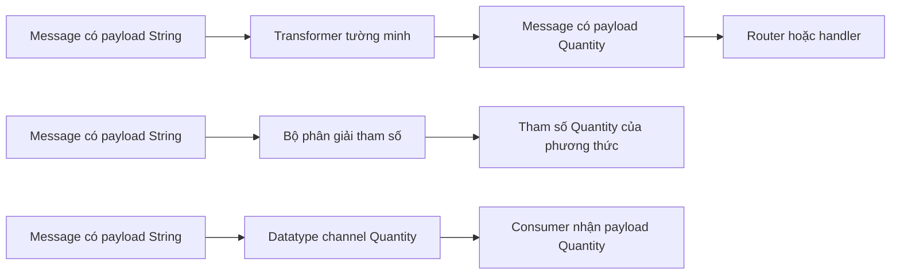

# Transformer và type conversion

## 1. Mục tiêu và bối cảnh

Trong chương **Transformer** của module **SPRING_INTEGRATION_CORE**, bài này tập trung vào việc đưa payload về đúng kiểu dữ liệu tại ranh giới giữa các thành phần xử lý. Chủ đề gắn trực tiếp với việc thiết kế luồng bằng `Message`, `MessageChannel`, endpoint và Java DSL: một consumer chỉ nên nhận dạng dữ liệu mà hợp đồng của nó cho phép.

Sau bài học, bạn có thể:

- Phân biệt transformer endpoint với cơ chế chuyển đổi kiểu khi gọi phương thức.
- Sử dụng `.transform(...)`, `.convert(...)` và `@IntegrationConverter` đúng mục đích.
- Chọn giữa `Converter`, `ConversionService` và `MessageConverter`.
- Nhận biết ảnh hưởng của chuyển đổi đến payload, header, gateway, router và aggregator.
- Thiết kế kiểm thử cho dữ liệu hợp lệ, dữ liệu sai định dạng và lỗi thiếu converter.

Tình huống xuyên suốt là nhận số lượng hàng dạng chuỗi, chẳng hạn `" 12 "`, rồi tạo giá trị miền `Quantity(12)`. Quy tắc của ví dụ là số lượng phải là số nguyên dương, nằm trong miền giá trị của `int`. Không chấp nhận dấu phân cách hàng nghìn, số thập phân hay chuỗi trống.

Các ví dụ dùng Java 17 trở lên và API Java DSL có trên Spring Integration 6.x. Chọn phiên bản dependency theo BOM của ứng dụng; bài không yêu cầu thay đổi dependency hoặc cấu trúc build của module.

## 2. Đổi kiểu dữ liệu và biến đổi thông điệp

Xét hai công việc:

```text
"12" -> Integer.valueOf(12)
PartnerOrder -> InternalOrder
```

Công việc thứ nhất đổi cách biểu diễn một giá trị. Công việc thứ hai có thể đổi tên trường, chuẩn hóa đơn vị, ghép dữ liệu và tạo hợp đồng miền mới. Cả hai đều có thể xuất hiện trong transformer, nhưng độ lớn và ý nghĩa của chúng khác nhau.

| Khái niệm | Trọng tâm | Ví dụ |
| --- | --- | --- |
| Type conversion | Chuyển một giá trị từ kiểu nguồn sang kiểu đích | `String -> Quantity` |
| Transformation | Tạo dữ liệu phù hợp với hợp đồng đầu ra của một bước trong luồng | `PartnerOrder -> InternalOrder` |
| Parsing | Diễn giải cú pháp của một biểu diễn | Đọc chuỗi số nguyên hoặc tài liệu JSON |
| Validation | Kiểm tra điều kiện được chấp nhận | Số lượng dương, mã hàng tồn tại |
| Serialization | Tạo biểu diễn để lưu trữ hoặc truyền tải | DTO thành JSON hoặc `byte[]` |

Một transformer có thể gọi parser và kiểm tra bất biến để tạo ra một đối tượng hợp lệ. Tuy nhiên, quyết định như “khách hàng này được phép mua tối đa bao nhiêu sản phẩm” thường thuộc bước nghiệp vụ, vì cần ngữ cảnh vượt ra ngoài một phép đổi kiểu.

Transformer là endpoint biểu diễn một bước thay đổi dữ liệu trong luồng. Nó có thể nhận payload hoặc toàn bộ message; kết quả phải hợp lệ và không được là `null`. Khi muốn loại bỏ thông điệp theo điều kiện, dùng filter. Xem [Spring Integration: Transformer](https://docs.spring.io/spring-integration/reference/transformer.html).

## 3. Chuyển đổi xảy ra ở đâu?

Không nên giả định có một cơ chế duy nhất chuyển đổi mọi payload trong hệ thống.



Ba nhánh trong sơ đồ là ba lựa chọn độc lập, không phải các bước bắt buộc của cùng một pipeline.

| Vị trí | Điều gì được chuyển đổi? | Kết quả cần quan sát |
| --- | --- | --- |
| Transformer tường minh | Dữ liệu đầu vào để tạo đầu ra của endpoint | Message đi tiếp có payload đã biến đổi |
| Chuyển đổi tham số phương thức | Giá trị truyền vào một tham số của handler | Phương thức được gọi với đúng kiểu; message gốc không tự bị sửa |
| Datatype channel | Payload trước khi channel giao message cho consumer | Consumer của channel nhận kiểu được chấp nhận |
| Adapter hoặc gateway cụ thể | Dữ liệu tại ranh giới giao thức hoặc lời gọi | Phụ thuộc hợp đồng và converter của thành phần đó |

Đối với cơ chế gọi phương thức, Spring Integration dùng `integrationConversionService` cho chuyển đổi kiểu tại thời điểm chạy. `conversionService` dùng khi cấu hình bean là một vai trò riêng; không nên mặc định hai tên này chỉ cùng một bean. Xem [Payload Type Conversion](https://docs.spring.io/spring-integration/reference/endpoint.html#payload-type-conversion).

Một hệ quả thiết kế: nếu nhiều bước phía sau cần `Quantity`, hãy tạo `Quantity` tại một ranh giới rõ ràng. Nếu chỉ một tham số cục bộ cần kiểu này, chuyển đổi khi gọi phương thức có thể đủ.

## 4. Chọn đúng API

### 4.1. `Converter<S, T>`

`org.springframework.core.convert.converter.Converter<S, T>` mô tả một cặp kiểu nguồn và đích. Phương thức `convert(S source)` không nhận toàn bộ message hay header.

Ví dụ hợp lý là chuyển `String` sang `Quantity` theo cùng một quy tắc ở mọi nơi. Giữ implementation không có trạng thái thay đổi để có thể dùng chung giữa các luồng xử lý.

`ConverterFactory` phù hợp với một họ kiểu đích; `GenericConverter` phù hợp khi cần nhiều cặp kiểu hoặc thông tin `TypeDescriptor`. Không cần dùng các SPI phức tạp này cho một cặp kiểu đơn giản. Xem [Spring Framework: Spring Type Conversion](https://docs.spring.io/spring-framework/reference/core/validation/convert.html).

### 4.2. `ConversionService`

`ConversionService` là API tìm và thực thi converter:

```java
ConversionService service = ...;
boolean supported = service.canConvert(String.class, Quantity.class);
Quantity quantity = service.convert("12", Quantity.class);
```

Đoạn trên minh họa API; phần ví dụ đầy đủ phía dưới sẽ cung cấp service và kiểu `Quantity` thực tế.

`canConvert(...)` kiểm tra khả năng chuyển giữa các kiểu. Nó không đọc và xác nhận mọi giá trị đầu vào. Có đường chuyển `String -> Quantity` vẫn không làm cho `"abc"` trở thành số lượng hợp lệ. Với collection, khả năng chuyển collection cũng không bảo đảm mọi phần tử đều chuyển được. Xem [Javadoc: ConversionService](https://docs.spring.io/spring-framework/docs/current/javadoc-api/org/springframework/core/convert/ConversionService.html).

### 4.3. `MessageConverter`

`org.springframework.messaging.converter.MessageConverter` làm việc với message và có thể dùng metadata như `contentType`. Nó phù hợp hơn khi định dạng nội dung quyết định cách đọc payload.

| Nhu cầu | Lựa chọn khởi đầu |
| --- | --- |
| Chuỗi số lượng theo một hợp đồng cố định | `Converter<String, Quantity>` |
| Đổi DTO đối tác thành DTO nội bộ trong một flow | Transformer gọi mapper chuyên biệt |
| Đọc nội dung theo `contentType` và kiểu đích | `MessageConverter` của thành phần liên quan |
| Cùng kiểu `String`, nhưng hai đối tác có hai cú pháp khác nhau | Hai transformer hoặc hai parser có tên rõ ràng |
| Chuẩn hóa dựa trên header `partnerId` | Transformer nhận `Message<?>` hoặc tham số header |

Không đưa lựa chọn theo đối tác vào một converter toàn cục `String -> Quantity` rồi tìm header qua biến dùng chung hoặc `ThreadLocal`. Hợp đồng đó không biểu diễn được đầy đủ ngữ cảnh của phép đổi.

## 5. Ví dụ đầy đủ: một converter, hai cách chuyển đổi

### 5.1. Hợp đồng dữ liệu

Trong ví dụ:

- `"12"` và `" 12 "` tạo `Quantity(12)`.
- `"0012"` cũng tạo `Quantity(12)`; thông tin số 0 đầu không được giữ.
- `"0"`, `"-3"`, `"1.5"`, `"1,000"` và chuỗi trống bị từ chối.
- Giá trị vượt giới hạn `int` bị từ chối.
- Không có tra cứu database hoặc lời gọi mạng trong converter.

Việc chấp nhận số 0 đầu là quyết định của ví dụ. Nếu dữ liệu là mã định danh như `"0012"`, chuyển nó sang số có thể phá hủy ý nghĩa; khi đó cần một kiểu mã định danh riêng.

### 5.2. Cấu hình Java

Đây là một lớp cấu hình độc lập, dùng package `example.integration`. Đặt lớp vào source set thích hợp của ứng dụng khi thực hành. Classpath cần `spring-integration-core`; mã kiểm thử ở phần sau cần JUnit Jupiter.

```java
package example.integration;

import org.springframework.context.annotation.Bean;
import org.springframework.context.annotation.Configuration;
import org.springframework.core.convert.converter.Converter;
import org.springframework.integration.channel.DirectChannel;
import org.springframework.integration.channel.QueueChannel;
import org.springframework.integration.config.EnableIntegration;
import org.springframework.integration.config.IntegrationConverter;
import org.springframework.integration.dsl.IntegrationFlow;

@Configuration
@EnableIntegration
public class QuantityIntegrationConfig {

    public record Quantity(int units) {

        public Quantity {
            if (units <= 0) {
                throw new IllegalArgumentException(
                        "Quantity must be greater than zero");
            }
        }
    }

    public static final class StringToQuantityConverter
            implements Converter<String, Quantity> {

        @Override
        public Quantity convert(String source) {
            String text = source.strip();

            if (!text.matches("[0-9]+")) {
                throw new IllegalArgumentException(
                        "Quantity must contain decimal digits only");
            }

            final int units;
            try {
                units = Integer.parseInt(text);
            }
            catch (NumberFormatException ex) {
                throw new IllegalArgumentException(
                        "Quantity is outside the int range", ex);
            }

            return new Quantity(units);
        }
    }

    @Bean
    @IntegrationConverter
    public StringToQuantityConverter quantityConverter() {
        return new StringToQuantityConverter();
    }

    @Bean("quantity.explicit.in")
    public DirectChannel explicitInput() {
        return new DirectChannel();
    }

    @Bean("quantity.convert.in")
    public DirectChannel convertInput() {
        return new DirectChannel();
    }

    @Bean("quantity.explicit.out")
    public QueueChannel explicitOutput() {
        return new QueueChannel(10);
    }

    @Bean("quantity.convert.out")
    public QueueChannel convertOutput() {
        return new QueueChannel(10);
    }

    @Bean
    public IntegrationFlow explicitQuantityFlow(
            StringToQuantityConverter quantityConverter) {

        return IntegrationFlow
                .from("quantity.explicit.in")
                .transform(String.class, quantityConverter::convert)
                .channel("quantity.explicit.out")
                .get();
    }

    @Bean
    public IntegrationFlow convertedQuantityFlow() {
        return IntegrationFlow
                .from("quantity.convert.in")
                .convert(Quantity.class)
                .channel("quantity.convert.out")
                .get();
    }
}
```

Hai input là `DirectChannel`, mỗi input có một transformer consumer. Hai output là `QueueChannel` để bài thực hành có thể chủ động gọi `receive(...)`. Việc đọc trực tiếp output queue trong kiểm thử không cần poller.

Mỗi queue có sức chứa 10 message, đủ cho ví dụ. Trong ứng dụng thật, cần thiết kế sức chứa, timeout và consumer theo tốc độ xử lý; đừng coi cấu hình thực hành này là cấu hình vận hành.

### 5.3. Luồng gọi trực tiếp converter

Trong `explicitQuantityFlow`, method reference `quantityConverter::convert` là phép biến đổi được chỉ định trực tiếp. Logic của bước này không cần tìm `StringToQuantityConverter` trong registry để chọn phép đổi.

```text
GenericMessage<String>(" 12 ")
    -> gọi StringToQuantityConverter.convert(...)
    -> Message<Quantity>(Quantity(12))
    -> quantity.explicit.out
```

Cách này hữu ích khi hợp đồng chuyển đổi thuộc về một flow cụ thể hoặc bạn muốn người đọc thấy ngay implementation nào được gọi.

### 5.4. Luồng chuyển đổi qua registry

Trong `convertedQuantityFlow`, `.convert(Quantity.class)` chỉ định **kiểu payload đầu ra**. Spring Integration sử dụng hạ tầng chuyển đổi tại thời điểm chạy để đưa payload về kiểu đó.

`@IntegrationConverter` đăng ký bean converter cho `integrationConversionService`. Annotation nằm trong package `org.springframework.integration.config`; nó có thể đặt trên phương thức `@Bean` hoặc lớp bean được quản lý. Xem [Javadoc: IntegrationConverter](https://docs.spring.io/spring-integration/api/org/springframework/integration/config/IntegrationConverter.html).

```text
GenericMessage<String>(" 12 ")
    -> chuyển sang kiểu đích Quantity
    -> chọn converter String -> Quantity đã đăng ký
    -> Message<Quantity>(Quantity(12))
    -> quantity.convert.out
```

Một bean chỉ implements `Converter` không tự mang ý nghĩa “đăng ký cho Spring Integration” trong mọi cấu hình. Đăng ký phải được thực hiện qua cơ chế thích hợp, chẳng hạn `@IntegrationConverter` như ví dụ.

Có thể bỏ annotation khỏi ví dụ để thử nghiệm sự khác biệt, nhưng không dùng kết quả đó để khẳng định mọi kiểu đều chuyển thất bại: các converter mặc định hoặc đường chuyển khác vẫn có thể tồn tại. Cần kiểm tra chính cặp kiểu đang quan tâm.

### 5.5. Chạy quan sát bằng một context nhỏ

Đoạn sau là nội dung có thể đặt trong một phương thức `main`; dùng các import được nêu đầy đủ ở đây:

```java
import example.integration.QuantityIntegrationConfig;
import org.springframework.context.annotation.AnnotationConfigApplicationContext;
import org.springframework.integration.channel.QueueChannel;
import org.springframework.messaging.Message;
import org.springframework.messaging.MessageChannel;
import org.springframework.messaging.support.MessageBuilder;

// Đặt bên trong main(String[] args):
try (var context = new AnnotationConfigApplicationContext(
        QuantityIntegrationConfig.class)) {

    MessageChannel input = context.getBean(
            "quantity.convert.in", MessageChannel.class);

    QueueChannel output = context.getBean(
            "quantity.convert.out", QueueChannel.class);

    Message<String> request = MessageBuilder.withPayload(" 12 ")
            .setHeader("traceId", "trace-quantity-001")
            .build();

    if (!input.send(request, 1_000)) {
        throw new IllegalStateException("Input message was not accepted");
    }

    Message<?> result = output.receive(1_000);
    if (result == null) {
        throw new IllegalStateException("No converted message");
    }

    System.out.println(result.getPayload());
    System.out.println(result.getHeaders().get("traceId"));
    System.out.println(request.getPayload().getClass().getSimpleName());
}
```

Kết quả mong đợi:

```text
Quantity[units=12]
trace-quantity-001
String
```

Dòng cuối giúp quan sát rằng message đầu vào vẫn có payload `String`. Kết quả chuyển đổi được phát ra trong message đầu ra của transformer.

## 6. Phân biệt kiểu đầu vào và kiểu đầu ra trong Java DSL

Hai câu lệnh sau có ý nghĩa khác nhau:

```java
.transform(Quantity.class, quantity -> quantity.units())
```

```java
.convert(Quantity.class)
```

Ở `.transform(Class<P>, GenericTransformer<P, T>)`, đối số `Class<P>` là **kiểu đầu vào mong đợi** của hàm biến đổi. Framework có thể thử chuyển payload sang kiểu đó trước khi gọi lambda. Trong ví dụ thứ nhất, lambda nhận `Quantity`, rồi trả về `Integer` nhờ boxing giá trị `int`.

Ở `.convert(Quantity.class)`, kiểu được truyền là **kiểu đích** của bước chuyển đổi. Xem các overload trong [Javadoc: BaseIntegrationFlowDefinition](https://docs.spring.io/spring-integration/docs/6.4.x/api/org/springframework/integration/dsl/BaseIntegrationFlowDefinition.html).

Ví dụ cần đọc cẩn thận:

```java
return IntegrationFlow.from("quantity.some.in")
        .transform(QuantityIntegrationConfig.Quantity.class,
                quantity -> "units=" + quantity.units())
        .channel("quantity.some.out")
        .get();
```

Đây là đoạn cấu hình minh họa, cần khai báo input/output tương ứng khi sử dụng. Nếu nhận `String`, converter phù hợp phải tạo được `Quantity` trước khi lambda chạy. Payload đầu ra lại là `String`, chẳng hạn `"units=12"`.

Vì vậy, không đọc `.transform(Quantity.class, ...)` thành “đầu ra chắc chắn là Quantity”. Hợp đồng đầu ra nằm ở kết quả của hàm.

Khi mục tiêu là công khai ranh giới chuẩn hóa, có thể viết hai bước:

```java
.convert(QuantityIntegrationConfig.Quantity.class)
.transform(QuantityIntegrationConfig.Quantity.class,
        quantity -> "units=" + quantity.units())
```

Bước đầu tạo giá trị miền; bước sau tạo biểu diễn văn bản. Sự tách biệt có ích khi cần đặt tên endpoint, quan sát hoặc phân loại lỗi theo từng bước.

## 7. Chuyển đổi tham số không sửa message gốc

Giả sử một handler nhận tham số `Quantity`:

```java
public final class QuantityFormatter {

    public String format(QuantityIntegrationConfig.Quantity quantity) {
        return "units=" + quantity.units();
    }
}
```

Khi cấu hình lời gọi phương thức của handler và payload nguồn khác kiểu tham số, hạ tầng có thể chuyển giá trị để gọi phương thức nếu có converter thích hợp. Tuy nhiên, điều đó không tương đương với việc thay payload của message nguồn trong tất cả các nhánh.

Một tình huống dễ gây nhầm là broadcast cùng message cho hai nhánh:

```text
                  +-> Nhánh A: handler nhận Quantity
Message<String> --|
                  +-> Nhánh B: quan sát payload gốc String
```

Ở nhánh A, tham số có thể là `Quantity`; nhánh B vẫn có thể nhận payload `String`. Nếu hợp đồng của toàn bộ phần downstream là `Quantity`, đặt transformer trước điểm phân nhánh sẽ thể hiện ý định rõ hơn.

Gateway cũng có thể có cơ chế ánh xạ hoặc chuyển đổi tại ranh giới lời gọi. Kiểu trả về của phương thức gateway không đủ để kết luận mọi message bên trong flow đều có payload cùng kiểu đó. Khi thiết kế, ghi rõ cả hợp đồng gateway lẫn hợp đồng message giữa các endpoint.

## 8. Datatype channel là một ranh giới khác

Một channel có thể khai báo kiểu payload được chấp nhận:

```java
@Bean("quantity.typed")
public DirectChannel typedQuantityChannel() {
    DirectChannel channel = new DirectChannel();
    channel.setDatatypes(QuantityIntegrationConfig.Quantity.class);
    return channel;
}
```

Đây là lựa chọn cấu hình bổ sung, không thuộc hai flow hoàn chỉnh ở phần 5.

Nếu payload đã tương thích với datatype, channel có thể giao tiếp. Nếu không, hạ tầng datatype channel thử chuyển đổi bằng converter được cấu hình; thiếu khả năng chuyển hoặc dữ liệu không hợp lệ sẽ gây lỗi. Muốn gửi thử qua `DirectChannel`, phải có consumer đăng ký, nếu không có thể gặp lỗi không có subscriber thay vì lỗi chuyển đổi mong muốn.

Datatype chấp nhận kiểu có thể gán được vào kiểu khai báo. Khai báo `Number.class` cũng chấp nhận `Integer` hoặc `Double`, nên nó không đồng nghĩa với “chỉ số nguyên”. Xem [Datatype Channel Configuration](https://docs.spring.io/spring-integration/reference/channel/configuration.html#channel-datatype-channel).

Chọn cách thể hiện theo ý nghĩa của hợp đồng:

- Dùng transformer khi cần thấy bước chuẩn hóa trên sơ đồ flow.
- Dùng datatype channel khi chính channel phải duy trì ranh giới kiểu cho mọi producer.
- Nếu dùng cả hai, xác định rõ vai trò của mỗi nơi để tránh quy tắc chuyển đổi bị phân tán.

## 9. Payload, header và ngữ cảnh chuyển đổi

Một message có payload và header. Cấu trúc message không cho thay payload bằng setter; điều đó không làm cho đối tượng payload có thể thay đổi trở nên bất biến sâu.

Trong cấu hình mặc định, khi transformer chỉ trả payload, header đầu vào được truyền sang kết quả theo cơ chế của framework. Khi transformer trả một `Message` hoàn chỉnh, mã ứng dụng chịu trách nhiệm tạo đầy đủ message đầu ra. `id` và `timestamp` là metadata do hạ tầng quản lý; dùng correlation hoặc trace header để nối các bước xử lý. Xem [Message và Header Propagation](https://docs.spring.io/spring-integration/reference/message.html#message-header-propagation).

Ví dụ một hàm nhận toàn bộ message và chủ động giữ header cần thiết:

```java
import org.springframework.messaging.Message;
import org.springframework.messaging.support.MessageBuilder;

public static Message<QuantityIntegrationConfig.Quantity> convertMessage(
        Message<String> source,
        QuantityIntegrationConfig.StringToQuantityConverter converter) {

    QuantityIntegrationConfig.Quantity quantity =
            converter.convert(source.getPayload());

    return MessageBuilder.withPayload(quantity)
            .copyHeaders(source.getHeaders())
            .setHeader("quantityFormat", "positive-int")
            .build();
}
```

Đây là một hàm hỗ trợ minh họa, không phải endpoint tự đăng ký. `copyHeaders(...)` giữ các header có thể sao chép như `traceId`, `replyChannel`, `errorChannel` và thông tin sequence nếu chúng có mặt. Không dùng ví dụ này để cố giữ nguyên `id` của message nguồn.

Với aggregator, việc đánh rơi `correlationId`, `sequenceNumber` hoặc `sequenceSize` có thể khiến nhóm không hoàn tất như mong đợi. Với gateway, đánh rơi `replyChannel` có thể làm phản hồi không trở về đúng nơi. Vì vậy, kiểm thử hợp đồng chuyển đổi cần quan sát cả header mà luồng dựa vào.

Nếu phép chuyển từ văn bản sang đối tượng làm thay đổi ý nghĩa của `contentType`, cần một chính sách metadata rõ ràng. Giữ `contentType=text/plain` trên một payload miền rồi để thành phần tiếp theo hiểu nó là dữ liệu văn bản có thể tạo hành vi ngoài dự kiến.

## 10. JSON và `contentType` không phải phép đổi kiểu tổng quát

Chuỗi `"{\"units\":12}"` vẫn là `String` cho đến khi một thành phần thực sự đọc nội dung đó. Đặt header `contentType=application/json` chỉ cung cấp metadata; không tự biến mọi message trên mọi channel thành đối tượng Java.

Chuyển đổi dựa trên `MessageConverter` khi phân giải tham số còn phụ thuộc converter, thư viện xử lý định dạng và cơ chế gọi phương thức. Cơ chế này khác phép đổi class-to-class qua `ConversionService`; đường gọi bằng SpEL không có đầy đủ cơ chế chuyển đổi theo `MessageConverter` như bộ phân giải tham số. Xem [Content Type Conversion](https://docs.spring.io/spring-integration/reference/endpoint.html#content-type-conversion).

Trong thiết kế một luồng nhận đơn hàng JSON, có thể dùng các ranh giới riêng:

```text
Dữ liệu JSON
    -> đọc cú pháp thành PartnerOrder
    -> transformer ánh xạ thành InternalOrder
    -> filter/router áp dụng chính sách xử lý
    -> service activator thực hiện nghiệp vụ
```

Bốn bước giúp phân biệt:

- JSON hỏng cú pháp.
- JSON hợp lệ nhưng không khớp cấu trúc DTO.
- DTO hợp lệ về cấu trúc nhưng không tạo được giá trị miền.
- Giá trị miền hợp lệ nhưng không đạt điều kiện nghiệp vụ.

Không dùng `toString()` của một DTO thay cho serializer JSON khi cần hợp đồng dữ liệu để truyền sang hệ thống khác.

## 11. Generic và collection: đúng kiểu container chưa đủ

Giả sử consumer cần `List<Quantity>`. Tại thời điểm chạy, một giá trị `List` không thể chỉ bằng `List.class` mà chứng minh mọi phần tử đều là `Quantity`.

```text
["2", "3", "abc"]
```

Đây là một danh sách hợp lệ về container nhưng có phần tử không chuyển được sang số lượng. Cần chốt chính sách trước:

| Chính sách | Hành vi |
| --- | --- |
| Toàn bộ cùng thành công | Một phần tử sai làm cả batch thất bại |
| Xử lý từng phần tử | Split, chuyển đổi từng message rồi phân luồng kết quả |
| Trả kết quả có cấu trúc | Mỗi phần tử có trạng thái thành công hoặc mã lỗi |

Ví dụ tự viết cho chính sách toàn bộ cùng thành công:

```java
import java.util.ArrayList;
import java.util.List;

public static List<QuantityIntegrationConfig.Quantity> convertBatch(
        List<?> values,
        QuantityIntegrationConfig.StringToQuantityConverter converter) {

    var converted = new ArrayList<QuantityIntegrationConfig.Quantity>(
            values.size());

    for (int index = 0; index < values.size(); index++) {
        Object value = values.get(index);
        if (!(value instanceof String text)) {
            throw new IllegalArgumentException(
                    "Expected String at index " + index);
        }

        try {
            converted.add(converter.convert(text));
        }
        catch (IllegalArgumentException ex) {
            throw new IllegalArgumentException(
                    "Invalid quantity at index " + index, ex);
        }
    }

    return List.copyOf(converted);
}
```

Hàm này chưa phát message nào cho downstream trước khi hoàn tất toàn bộ danh sách. Nó cũng không tự tạo tính nguyên tử cho các tác dụng phụ bên ngoài; tránh đưa thao tác ghi database hoặc gửi mạng vào vòng lặp chuyển đổi.

Khi dùng splitter rồi aggregator để cho phép thành công từng phần, cần quy định cả phần tử lỗi được biểu diễn thế nào và nhóm được release khi nào. Nếu chỉ bỏ phần tử lỗi, aggregator dựa vào sequence size ban đầu có thể chờ vô hạn.

## 12. Xử lý lỗi theo vị trí phát sinh

### 12.1. Các nhóm lỗi cần phân biệt

| Nhóm lỗi | Ví dụ | Hướng xử lý |
| --- | --- | --- |
| Không có đường chuyển kiểu | `SomeDto -> Quantity` chưa có converter | Sửa cấu hình hoặc hợp đồng |
| Giá trị sai định dạng | `"abc"`, `"1,000"` | Trả lỗi dữ liệu hoặc chuyển luồng xử lý lỗi |
| Giá trị ngoài miền | `"0"` hoặc vượt giới hạn `int` | Áp dụng quy tắc từ chối rõ ràng |
| Sai metadata định dạng | Nội dung JSON nhưng khai báo loại khác | Chuẩn hóa hợp đồng ở adapter |
| Lỗi giao tiếp downstream | Output channel không có consumer | Kiểm tra topology, không gán nhầm cho converter |

Trong ví dụ, converter ném `IllegalArgumentException`. Khi chạy qua endpoint, lỗi có thể được bọc trong ngoại lệ messaging hoặc conversion. Chẩn đoán bằng chuỗi nguyên nhân và endpoint liên quan; không gắn logic vào một chuỗi thông báo lỗi của framework.

### 12.2. Đồng bộ và bất đồng bộ

Với `DirectChannel` thông thường, handler chạy trên thread của caller nên ngoại lệ có thể quay lại lời gọi `send(...)`. Chỉ thêm header `errorChannel` không làm mọi lỗi đồng bộ tự chuyển sang channel đó.

Với tác vụ bất đồng bộ do hạ tầng Spring Integration quản lý, cơ chế xử lý lỗi có thể phát `ErrorMessage`, ưu tiên error channel trong header rồi đến channel lỗi chung. Gateway hoặc advice có thể cung cấp đường xử lý lỗi riêng. Xem [Spring Integration: Error Handling](https://docs.spring.io/spring-integration/reference/error-handling.html).

Trong hai flow ở phần 5, lỗi chuyển đổi xảy ra đồng bộ trước khi message được đưa vào output queue. Output là `QueueChannel` không làm bước transformer đứng trước nó trở thành bất đồng bộ.

### 12.3. Chính sách vận hành của ví dụ

Đối với dữ liệu `"abc"`, retry nhiều lần với cùng converter không làm đầu vào hợp lệ. Nên phân loại lỗi dữ liệu, gắn mã lỗi ổn định và cho phép sửa dữ liệu hoặc xử lý lại theo quy trình của ứng dụng.

Một bản ghi lỗi hữu ích gồm `traceId`, tên endpoint, cặp kiểu nguồn/đích và mã như `INVALID_QUANTITY`. Giới hạn dữ liệu ghi log theo hợp đồng của hệ thống; với lỗi parsing, thường không cần lưu toàn bộ thông điệp nghiệp vụ để biết bước nào thất bại.

Tránh trả một `String` báo lỗi vào cùng success channel đang cam kết payload là `Quantity`. Có thể dùng error flow riêng hoặc một kiểu kết quả có cấu trúc mà downstream đã thỏa thuận.

## 13. Kiểm thử hợp đồng chuyển đổi

Mã ở phần này là ví dụ để người học chạy trong dự án có dependency phù hợp. Bài viết không khẳng định các kiểm thử đã được thực thi trong workspace hiện tại.

### 13.1. Kiểm thử converter như một hàm Java

```java
package example.integration;

import org.junit.jupiter.api.Test;

import static org.junit.jupiter.api.Assertions.assertEquals;
import static org.junit.jupiter.api.Assertions.assertThrows;

class StringToQuantityConverterTest {

    private final QuantityIntegrationConfig.StringToQuantityConverter converter =
            new QuantityIntegrationConfig.StringToQuantityConverter();

    @Test
    void stripsWhitespaceAndCreatesQuantity() {
        assertEquals(
                new QuantityIntegrationConfig.Quantity(12),
                converter.convert(" 12 "));
    }

    @Test
    void rejectsMalformedAndOutOfRangeValues() {
        for (String value : new String[] {
                "", " ", "abc", "-3", "1.5", "1,000", "0", "2147483648"
        }) {
            assertThrows(
                    IllegalArgumentException.class,
                    () -> converter.convert(value),
                    "Must reject: " + value);
        }
    }

    @Test
    void acceptsUpperIntBoundary() {
        assertEquals(
                new QuantityIntegrationConfig.Quantity(Integer.MAX_VALUE),
                converter.convert("2147483647"));
    }
}
```

Các kiểm thử này xác nhận cú pháp, khoảng trắng, bất biến số dương và giới hạn giá trị. Nếu đổi hợp đồng để chấp nhận dấu cộng hoặc dấu phân cách, cập nhật chính sách lẫn kết quả mong đợi.

### 13.2. Kiểm thử cả endpoint và registry

Kiểm thử trực tiếp converter không chứng minh được `@IntegrationConverter` đã được đăng ký. Cần một kiểm thử đi qua `.convert(Quantity.class)` trong Spring context.

```java
package example.integration;

import org.junit.jupiter.api.Test;
import org.springframework.context.annotation.AnnotationConfigApplicationContext;
import org.springframework.core.convert.ConversionService;
import org.springframework.integration.channel.QueueChannel;
import org.springframework.messaging.Message;
import org.springframework.messaging.MessageChannel;
import org.springframework.messaging.MessagingException;
import org.springframework.messaging.support.MessageBuilder;

import static org.junit.jupiter.api.Assertions.assertEquals;
import static org.junit.jupiter.api.Assertions.assertNotNull;
import static org.junit.jupiter.api.Assertions.assertNull;
import static org.junit.jupiter.api.Assertions.assertThrows;
import static org.junit.jupiter.api.Assertions.assertTrue;

class QuantityFlowTest {

    @Test
    void bothFlowsProduceQuantityAndKeepTraceId() {
        try (var context = new AnnotationConfigApplicationContext(
                QuantityIntegrationConfig.class)) {

            for (String mode : new String[] {"explicit", "convert"}) {
                MessageChannel input = context.getBean(
                        "quantity." + mode + ".in", MessageChannel.class);

                QueueChannel output = context.getBean(
                        "quantity." + mode + ".out", QueueChannel.class);

                Message<String> request = MessageBuilder.withPayload(" 12 ")
                        .setHeader("traceId", "trace-" + mode)
                        .build();

                assertTrue(input.send(request, 1_000));

                Message<?> result = output.receive(1_000);
                assertNotNull(result);
                assertEquals(
                        new QuantityIntegrationConfig.Quantity(12),
                        result.getPayload());
                assertEquals(
                        "trace-" + mode,
                        result.getHeaders().get("traceId"));
                assertEquals(" 12 ", request.getPayload());
            }
        }
    }

    @Test
    void conversionSupportDoesNotGuaranteeValidInput() {
        try (var context = new AnnotationConfigApplicationContext(
                QuantityIntegrationConfig.class)) {

            ConversionService service = context.getBean(
                    "integrationConversionService", ConversionService.class);

            assertTrue(service.canConvert(
                    String.class, QuantityIntegrationConfig.Quantity.class));

            MessageChannel input = context.getBean(
                    "quantity.convert.in", MessageChannel.class);

            QueueChannel output = context.getBean(
                    "quantity.convert.out", QueueChannel.class);

            assertThrows(
                    MessagingException.class,
                    () -> input.send(
                            MessageBuilder.withPayload("abc").build(), 1_000));

            assertNull(output.receive(0));
        }
    }
}
```

Mỗi kiểm thử tạo context riêng và đóng nó sau khi hoàn tất. Việc nhận message dùng timeout hữu hạn để tránh chờ vô hạn khi cấu hình flow sai.

Kiểm thử flow quan sát hợp đồng: payload đích, header trace và không phát kết quả thành công khi conversion thất bại. Nó không phụ thuộc vào toàn bộ nội dung thông báo lỗi hoặc tên lớp bọc ngoại lệ cụ thể.

### 13.3. Mở rộng kiểm thử theo ranh giới thật

Khi đưa mẫu vào ứng dụng, bổ sung ca kiểm thử cho đúng tính chất của hệ thống:

| Ranh giới | Điều cần chứng minh |
| --- | --- |
| Datatype channel | Kiểu không tương thích bị từ chối hoặc chuyển đúng trước khi consumer nhận |
| Message-returning transformer | Header mà gateway và aggregator cần được giữ |
| Gateway đồng bộ | Lỗi được trả hoặc ánh xạ theo hợp đồng gateway |
| Poller hoặc executor | Lỗi được nhận ở error flow và không xuất hiện ở success flow |
| Batch | Chính sách toàn bộ hoặc từng phần được thực hiện nhất quán |
| Nhiều producer | Tất cả cùng tuân thủ một hợp đồng định dạng |

Không cần đưa `@SpringIntegrationTest` vào mọi kiểm thử. Context nhỏ như ví dụ đủ cho trường hợp kiểm tra registry và hai flow; chỉ thêm hạ tầng test chuyên biệt khi cần mock endpoint hoặc kiểm soát lifecycle phức tạp.

## 14. Những quyết định dễ gây lỗi thiết kế

### Đăng ký converter quá rộng

Converter `String -> Integer` dùng quy tắc “bỏ mọi dấu phẩy” có thể khiến `"1,5"` trở thành `15` dù producer muốn biểu diễn `1.5`. Đừng giải quyết khác biệt locale bằng một quy tắc toàn cục không được nêu trong hợp đồng.

Một kiểu đích như `Quantity`, `OrderId` hoặc `MoneyAmount` làm rõ ý nghĩa hơn primitive wrapper. Nếu hai nguồn có hai cú pháp, chuẩn hóa từng nguồn trước khi đi vào hợp đồng chung.

### Ép kiểu thay cho chuyển đổi

```java
Integer value = (Integer) (Object) "12";
```

Ép kiểu trên không parse chuỗi; nó thất bại vì đối tượng nguồn vẫn là `String`. Cần gọi parser hoặc converter phù hợp. Tránh chữa lỗi bằng nhiều cast qua `Object` vì chúng làm mất thông tin kiểu ở thời điểm biên dịch.

### Nuốt lỗi và dùng giá trị mặc định

Trả `Quantity(1)` khi parse thất bại có thể tạo đơn hàng với số lượng sai nhưng trông hợp lệ. Chỉ dùng giá trị mặc định nếu nghiệp vụ quy định rõ, đồng thời có cách phân biệt giá trị mặc định với dữ liệu được producer cung cấp.

### Dùng `null` để bỏ thông điệp

Transformer không phải vị trí để trả `null` như một kết quả thành công. Khi cần từ chối theo điều kiện, dùng filter hoặc thiết kế một kết quả có cấu trúc. Khi đầu vào không thể diễn giải, phát sinh lỗi chuyển đổi rõ ràng.

### Trộn chuyển đổi với tác dụng phụ

Một converter gọi API tính phí rồi tạo DTO sẽ khó kiểm thử và khó dự đoán khi retry. Tách phép tạo giá trị khỏi bước service activator thực hiện tác dụng phụ. Khi đó có thể chạy lại chuyển đổi mà không vô tình lặp một thao tác bên ngoài.

## 15. Bài thực hành định hướng

Dùng cấu hình ở phần 5 để thực hiện các quan sát sau:

1. Gửi cùng giá trị `" 12 "` vào hai flow và so sánh payload, `traceId`, message gốc.
2. Thay đầu vào bằng `"abc"`, quan sát exception tại `send(...)` và kiểm tra output queue không có kết quả.
3. Giữ converter như một bean thường nhưng bỏ `@IntegrationConverter`; so sánh lời gọi converter trực tiếp với flow dùng `.convert(...)` cho cặp kiểu `String -> Quantity`.
4. Thêm một datatype channel và một consumer đơn giản; kiểm tra producer gửi `String` và producer gửi `Quantity`.
5. Thử batch `["2", "3", "abc"]`; chọn và ghi rõ chính sách toàn bộ hoặc từng phần trước khi triển khai.

Kết quả cần giải thích được là **nơi chuyển đổi diễn ra**, **hợp đồng đầu ra của bước đó** và **đường đi của lỗi**. Khi ba yếu tố này rõ ràng, transformer có thể kết hợp với router, filter, gateway và aggregator mà không khiến kiểu dữ liệu trở thành một giả định ngầm giữa các thành phần.
