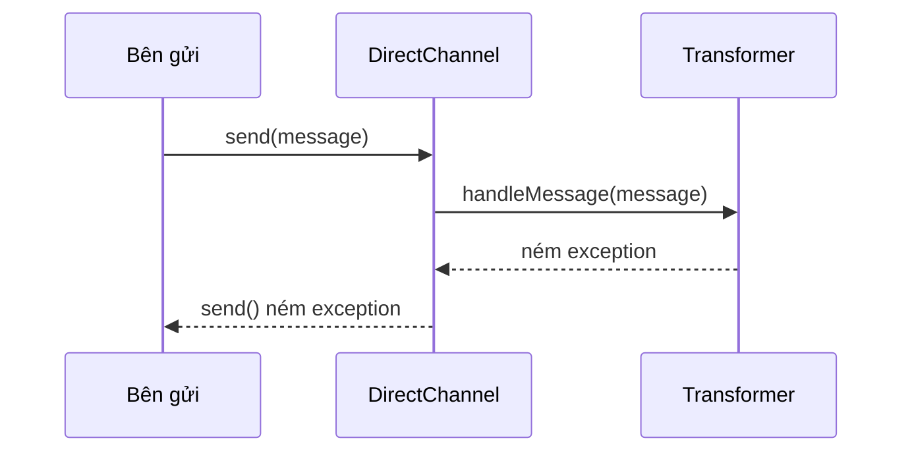
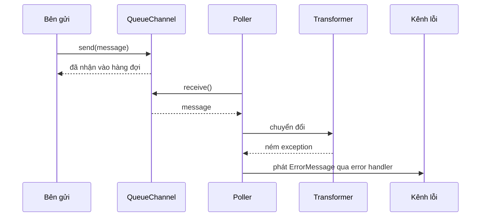

# Transformer exception

Trong Spring Integration Core, transformer chuyển biểu diễn dữ liệu của một thông điệp thành biểu diễn mà bước tiếp theo có thể sử dụng. Khi chuyển đổi thất bại, luồng cần giữ được thông điệp gây lỗi, nguyên nhân và quyết định xử lý tiếp theo. Chỉ ghi một dòng log rồi bỏ qua thường khiến bên gửi không biết dữ liệu đã được xử lý đến đâu.

Bài này thuộc chương **Transformer** của module **SPRING_INTEGRATION_CORE**. Trọng tâm là nhận diện lỗi chuyển đổi, hiểu đường đi của exception qua MessageChannel, thiết kế nhánh lỗi và kiểm thử bằng Java DSL. Các ví dụ dùng Java 17+, Spring Integration 6.5.x và JUnit Jupiter; phiên bản dependency cần được quản lý thống nhất với dự án Spring đang sử dụng. Phần retry của nhánh 6.5 dùng Spring Retry; cần đối chiếu lại API khi chuyển sang nhánh Spring Integration khác.

## 1. Hợp đồng của transformer khi xảy ra lỗi

Xét một hệ thống nhận đơn hàng dạng chuỗi:

```text
ORD-42|125000
```

Transformer phải tạo ra một đơn hàng có mã `ORD-42` và số tiền `125000`. Nếu chuỗi có dạng `ORD-42|abc`, transformer không thể tạo ra số tiền hợp lệ. Lỗi này cần được thể hiện bằng exception hoặc bằng một kiểu kết quả thất bại đã được thiết kế rõ ràng cho toàn bộ luồng.

Không nên biến đơn hàng lỗi thành một đơn hàng có số tiền bằng không để luồng tiếp tục. Cách làm đó làm mất sự khác biệt giữa “đã chuyển đổi thành công” và “không thể đọc dữ liệu đầu vào”.

Transformer cũng không dùng giá trị `null` để biểu thị “hãy bỏ thông điệp này”. Hợp đồng của endpoint yêu cầu kết quả chuyển đổi; khi muốn loại bỏ thông điệp theo điều kiện, dùng filter và xác định cách xử lý thông điệp bị loại. Tên exception cụ thể khi trả `null` còn phụ thuộc đường thực thi và phiên bản, vì vậy không dùng tên exception đó làm hợp đồng nghiệp vụ. Xem [quy tắc trả kết quả của transformer](https://docs.spring.io/spring-integration/reference/transformer.html#page-title).

Có thể phân biệt các tình huống như sau:

| Tình huống | Ví dụ trong luồng đơn hàng | Hướng xử lý ban đầu |
|---|---|---|
| Không đọc được biểu diễn đầu vào | `amount = "abc"` | Báo lỗi dữ liệu và giữ bản ghi để đối soát |
| Không đáp ứng hợp đồng dữ liệu đích | Thiếu mã đơn hàng, số tiền không dương | Phân loại lỗi hợp đồng; thường không retry nguyên trạng |
| Thiếu dữ liệu tham chiếu | Mã tiền tệ chưa có trong bảng ánh xạ | Xác định dữ liệu thực sự sai hay bảng ánh xạ chưa cập nhật |
| Lỗi tạm thời của phụ thuộc | Dịch vụ tra cứu ngừng đáp ứng | Retry có giới hạn nếu thao tác có thể lặp an toàn |
| Lỗi lập trình hoặc cấu hình | Truy cập thuộc tính không tồn tại, chọn sai phương thức | Cảnh báo và sửa triển khai |
| Gửi kết quả thất bại | Output channel không nhận được kết quả | Kiểm tra bước giao nhận, dù phép chuyển đổi đã hoàn thành |

Bảng này là cách phân loại để thiết kế luồng. Không thể kết luận chính sách retry chỉ từ việc lỗi xuất hiện gần một transformer.

## 2. Nhận diện MessageTransformationException

`MessageTransformationException` là exception chuyên biệt cho lỗi chuyển đổi thông điệp và kế thừa trực tiếp `MessagingException`. Hai thông tin cần chú ý là:

- `getFailedMessage()`: thông điệp gắn với điểm thất bại, nếu exception có lưu thông điệp.
- `getCause()`: nguyên nhân được giữ lại khi exception bọc lỗi bên dưới.

Các constructor có thể nhận cả thông điệp và nguyên nhân, nhưng cũng có constructor chỉ nhận mô tả. Vì vậy, code xử lý lỗi phải chấp nhận trường hợp `failedMessage` không có giá trị. Xem [API MessageTransformationException](https://docs.spring.io/spring-integration/api/org/springframework/integration/transformer/MessageTransformationException.html).

Một chuỗi nguyên nhân minh họa có thể là:

```text
MessageTransformationException
  -> exception khi gọi hàm chuyển đổi
     -> InvalidOrderMessageException
        -> NumberFormatException
```

Số lớp bọc không phải lúc nào cũng giống nhau. Nó phụ thuộc transformer dựng sẵn, phương thức POJO, lambda, cơ chế gọi phương thức và các thành phần bao quanh endpoint.

Trong triển khai `MessageTransformingHandler` của nhánh 6.5, lỗi từ transformer delegate được bọc thành `MessageTransformationException`, trừ trường hợp bản thân lỗi đó đã là `MessageTransformationException`. Điều này giải thích vì sao exception miền nghiệp vụ do hàm chuyển đổi ném ra có thể nằm sâu trong cause chain. Xem [mã nguồn MessageTransformingHandler 6.5.0](https://github.com/spring-projects/spring-integration/blob/v6.5.0/spring-integration-core/src/main/java/org/springframework/integration/transformer/MessageTransformingHandler.java).

Khi phân loại lỗi, nên tìm kiểu exception cần quan tâm trong toàn bộ chuỗi nguyên nhân. Chỉ lấy nguyên nhân sâu nhất có thể làm mất lớp exception nghiệp vụ mang mã lỗi rõ nghĩa: ở ví dụ trên, `NumberFormatException` nói rằng việc đọc số thất bại, còn `InvalidOrderMessageException` cho biết trường dữ liệu và nhóm lỗi của đơn hàng.

## 3. Vì sao cùng một transformer có hai đường xử lý lỗi?

Đường đi của exception phụ thuộc nơi transformer thực thi và thành phần đang quản lý lời gọi đó.

### 3.1. Luồng đồng bộ qua DirectChannel

Khi bên gửi gọi `send()` vào một `DirectChannel` và transformer xử lý ngay trên cùng luồng thực thi, exception có thể truyền ngược qua call stack về bên gửi.



Không có ranh giới bất đồng bộ trong sơ đồ này. Bên gửi cần bắt lỗi tại ranh giới phù hợp của ứng dụng hoặc để lỗi truyền lên tầng chịu trách nhiệm xử lý.

Chỉ thêm header `errorChannel` vào thông điệp không khiến một lời gọi `DirectChannel.send()` thông thường tự phát lỗi sang kênh đó. Phải có cơ chế bắt và phát lỗi, chẳng hạn error handler của tác vụ bất đồng bộ, advice được cấu hình phù hợp hoặc gateway có chính sách lỗi riêng. Xem [Error Handling](https://docs.spring.io/spring-integration/reference/error-handling.html).

### 3.2. QueueChannel với poller

Với cấu hình poller thông thường, bên gửi đưa thông điệp vào `QueueChannel`, còn poller nhận thông điệp và gọi transformer trong tác vụ được lập lịch.



Bản thân `QueueChannel` chỉ lưu và cung cấp thông điệp. Poller cùng error handler mới tạo đường xử lý lỗi trong ví dụ này. Nếu tự viết một vòng lặp `receive()` rồi gọi handler, ứng dụng phải tự chịu trách nhiệm bắt và chuyển lỗi.

Với `ExecutorChannel` sử dụng executor thực thi trên luồng khác, lỗi của handler cũng không quay lại bên gửi bằng call stack ban đầu. Khi dùng executor hoặc scheduler tùy chỉnh, cần bảo đảm chúng được tích hợp với cơ chế phát lỗi mong muốn. `MessagePublishingErrorHandler` là một implementation có nhiệm vụ gửi `ErrorMessage` đến `MessageChannel`; xem [API MessagePublishingErrorHandler](https://docs.spring.io/spring-integration/api/org/springframework/integration/channel/MessagePublishingErrorHandler.html).

### 3.3. Gateway là một ranh giới riêng

Messaging gateway có thể bắt lỗi của luồng đồng bộ và chuyển chúng sang error channel đã cấu hình. Nếu gateway cần trả kết quả, nhánh lỗi phải có chính sách phản hồi: trả một kiểu kết quả thất bại tương thích, ném lỗi phù hợp hoặc chấp nhận kết thúc theo cấu hình timeout.

Không nên coi một error flow chỉ ghi log rồi kết thúc là một phản hồi nghiệp vụ hoàn chỉnh cho mọi gateway. Kiểu trả về, cấu hình error channel và cách phản hồi quyết định hành vi mà caller quan sát. Xem [xử lý lỗi của messaging gateway](https://docs.spring.io/spring-integration/reference/gateway.html).

## 4. ErrorMessage mang dữ liệu gì?

`ErrorMessage` là một `Message` có payload kiểu `Throwable`. Nó khác thông điệp đầu vào đang mang chuỗi đơn hàng.

| Đối tượng | Dữ liệu cần đọc |
|---|---|
| `errorMessage.getPayload()` | Exception của lần xử lý thất bại |
| `MessagingException.getFailedMessage()` | Thông điệp tại điểm thất bại nếu được lưu |
| `errorMessage.getOriginalMessage()` | Thông điệp gốc được error message strategy cung cấp, có thể không có |
| Header của thông điệp gây lỗi | Correlation ID, nguồn dữ liệu hoặc metadata mà ứng dụng đã gắn |

`failedMessage` và `originalMessage` có thể khác nhau nếu luồng đã chuyển đổi thông điệp trước khi một bước phía sau thất bại. Không mặc định rằng headers của `ErrorMessage` là bản sao đầy đủ của headers nghiệp vụ. Khi cần correlation ID, hãy lấy từ thông điệp đã xác định đúng vai trò. Xem [API ErrorMessage](https://docs.spring.io/spring-framework/docs/current/javadoc-api/org/springframework/messaging/support/ErrorMessage.html).

Khi cơ chế phát lỗi chuẩn phân giải kênh đích, header `MessageHeaders.ERROR_CHANNEL` của thông điệp đang xử lý được ưu tiên; nếu không có, error handler dùng kênh mặc định của nó, thường là bean `errorChannel` toàn cục. Poller có thể được cấu hình kênh lỗi mặc định riêng. Xem [quy tắc chọn error channel](https://docs.spring.io/spring-integration/reference/error-handling.html).

Header này có thể giữ tham chiếu `MessageChannel` trong ứng dụng hoặc tên kênh mà framework phân giải. Tham chiếu đối tượng kênh phù hợp với ví dụ nội bộ một tiến trình; không thiết kế giao thức JSON gửi ra ngoài bằng cách tuần tự hóa đối tượng đó.

## 5. Ví dụ: transformer có exception miền dữ liệu rõ ràng

Quy ước đầu vào của ví dụ là `orderId|amount`. Đây là một định dạng phân tách đơn giản cho bài học, không phải bộ phân tích CSV tổng quát.

Đặt lớp sau trong `OrderParser.java`:

```java
package example.integration;

import java.math.BigDecimal;

public final class OrderParser {

    private OrderParser() {
    }

    public record Order(String orderId, BigDecimal amount) {
    }

    public static final class InvalidOrderMessageException
            extends IllegalArgumentException {

        private final String reasonCode;

        public InvalidOrderMessageException(
                String reasonCode, String description) {
            super(description);
            this.reasonCode = reasonCode;
        }

        public InvalidOrderMessageException(
                String reasonCode, String description, Throwable cause) {
            super(description, cause);
            this.reasonCode = reasonCode;
        }

        public String reasonCode() {
            return this.reasonCode;
        }
    }

    public static Order parse(String raw) {
        String[] fields = raw.split("\\|", -1);

        if (fields.length != 2 || fields[0].isBlank()) {
            throw new InvalidOrderMessageException(
                    "ORDER_FORMAT",
                    "Đầu vào phải có orderId và amount");
        }

        BigDecimal amount;
        try {
            amount = new BigDecimal(fields[1].trim());
        }
        catch (NumberFormatException cause) {
            throw new InvalidOrderMessageException(
                    "ORDER_AMOUNT_FORMAT",
                    "amount phải là số thập phân hợp lệ",
                    cause);
        }

        if (amount.signum() <= 0) {
            throw new InvalidOrderMessageException(
                    "ORDER_AMOUNT_RANGE",
                    "amount phải lớn hơn 0");
        }

        return new Order(fields[0].trim(), amount);
    }
}
```

Hàm `parse` không phụ thuộc API messaging. Điều này giúp kiểm thử quy tắc chuyển đổi trực tiếp, sau đó kiểm thử thêm cách endpoint và channel đưa lỗi ra ngoài.

Một vài kết quả mong đợi:

| Đầu vào | Kết quả |
|---|---|
| `ORD-42\|125000` | `Order("ORD-42", 125000)` |
| `ORD-42\|abc` | `ORDER_AMOUNT_FORMAT`, có nguyên nhân đọc số |
| `ORD-42\|-1` | `ORDER_AMOUNT_RANGE` |
| `\|125000` | `ORDER_FORMAT` |
| `ORD-42` | `ORDER_FORMAT` |

Ở đây, kiểm tra số tiền dương là điều kiện của hợp đồng dữ liệu đích trong ví dụ. Trong hệ thống thực, những quyết định như duyệt tín dụng hoặc chấp thuận thanh toán nên thuộc bước nghiệp vụ riêng. Giữ ranh giới đó giúp transformer tập trung vào chuyển đổi dữ liệu.

Không đưa toàn bộ đầu vào vào nội dung exception. Mã lỗi ổn định và mô tả trường lỗi thường đủ cho phân loại; bản ghi gốc nên được lưu ở nơi có quyền truy cập và thời hạn lưu phù hợp.

## 6. Cấu hình Java DSL cho hai cách thực thi

Đặt cấu hình sau trong `OrderFlowConfig.java`, cùng package với `OrderParser`:

```java
package example.integration;

import org.springframework.context.annotation.Bean;
import org.springframework.context.annotation.Configuration;
import org.springframework.integration.channel.DirectChannel;
import org.springframework.integration.channel.QueueChannel;
import org.springframework.integration.config.EnableIntegration;
import org.springframework.integration.dsl.IntegrationFlow;
import org.springframework.integration.dsl.Pollers;

@Configuration
@EnableIntegration
public class OrderFlowConfig {

    @Bean
    public DirectChannel syncOrderInput() {
        return new DirectChannel();
    }

    @Bean
    public QueueChannel asyncOrderInput() {
        return new QueueChannel(100);
    }

    @Bean
    public QueueChannel parsedOrders() {
        return new QueueChannel(100);
    }

    @Bean
    public QueueChannel transformErrors() {
        return new QueueChannel(100);
    }

    @Bean
    public IntegrationFlow syncOrderFlow() {
        return IntegrationFlow.from(syncOrderInput())
                .transform(
                        String.class,
                        OrderParser::parse,
                        endpoint -> endpoint.id("syncOrderTransformer"))
                .channel(parsedOrders())
                .get();
    }

    @Bean
    public IntegrationFlow asyncOrderFlow() {
        return IntegrationFlow
                .from(
                        asyncOrderInput(),
                        endpoint -> endpoint.poller(
                                Pollers.fixedDelay(50)
                                        .maxMessagesPerPoll(10)))
                .transform(
                        String.class,
                        OrderParser::parse,
                        endpoint -> endpoint.id("asyncOrderTransformer"))
                .channel(parsedOrders())
                .get();
    }
}
```

Cấu hình này dùng cùng hàm chuyển đổi để người học quan sát ảnh hưởng của channel và poller. `parsedOrders` và `transformErrors` là các hàng đợi được đọc chủ động trong kiểm thử; chúng chưa có consumer nghiệp vụ tự động.

Java DSL dùng `.transform(...)` để thêm transformer endpoint. Việc chỉ rõ `String.class` diễn đạt kiểu payload mà hàm nhận, còn ID endpoint giúp liên hệ lỗi với cấu hình. Tham khảo [transformer trong Java DSL](https://docs.spring.io/spring-integration/reference/6.5/dsl/java-transformers.html).

`@EnableIntegration` bật hạ tầng Integration cho application context thuần Spring trong ví dụ. Khi chạy trong ứng dụng có cấu hình sẵn, cần ghép phần định nghĩa bean vào cấu hình hiện hữu và tránh khai báo trùng bean.

Để gửi thông điệp với kênh lỗi riêng trong cùng ứng dụng:

```java
import org.springframework.messaging.Message;
import org.springframework.messaging.MessageHeaders;
import org.springframework.messaging.support.MessageBuilder;

// input và errors là các bean asyncOrderInput, transformErrors.
Message<String> request = MessageBuilder
        .withPayload("ORD-42|abc")
        .setHeader("correlationId", "import-2026-11-19-42")
        .setHeader(MessageHeaders.ERROR_CHANNEL, errors)
        .build();

boolean accepted = input.send(request, 1_000);
```

Với `asyncOrderInput`, `accepted == true` cho biết kênh đã nhận thông điệp vào hàng đợi. Nó không chứng minh transformer đã xử lý thành công.

Nếu muốn poller có kênh lỗi mặc định riêng cho cả những thông điệp không mang header `errorChannel`, thay phần cấu hình poller tương ứng bằng:

```java
endpoint -> endpoint.poller(
        Pollers.fixedDelay(50)
                .maxMessagesPerPoll(10)
                .errorChannel("transformErrors"))
```

Đây là phần thay thế cho consumer của `asyncOrderInput` trong ví dụ, không phải khai báo thêm một consumer cạnh tranh trên cùng input queue. Cấu hình chính ở trên dùng header trong từng request để kiểm thử đường phân giải kênh lỗi.

## 7. Đọc và phân loại lỗi mà không mất ngữ cảnh

Lớp hỗ trợ dưới đây tìm exception miền dữ liệu và thông điệp gây lỗi bằng cách đi qua cause chain. Đặt trong `ErrorInspection.java` cùng package:

```java
package example.integration;

import org.springframework.messaging.Message;
import org.springframework.messaging.MessagingException;

public final class ErrorInspection {

    private ErrorInspection() {
    }

    public static <T extends Throwable> T findCause(
            Throwable failure, Class<T> expectedType) {

        Throwable current = failure;
        while (current != null) {
            if (expectedType.isInstance(current)) {
                return expectedType.cast(current);
            }
            current = current.getCause();
        }
        return null;
    }

    public static Message<?> findFailedMessage(Throwable failure) {
        Throwable current = failure;
        while (current != null) {
            if (current instanceof MessagingException messaging
                    && messaging.getFailedMessage() != null) {
                return messaging.getFailedMessage();
            }
            current = current.getCause();
        }
        return null;
    }
}
```

Các hàm này giả định cause chain bình thường, không có vòng tham chiếu. Nếu nhận các implementation exception không kiểm soát được, có thể thêm tập các đối tượng đã duyệt để tránh vòng lặp.

Sau khi nhận một `ErrorMessage`, consumer có thể trích xuất thông tin như sau:

```java
import org.springframework.messaging.Message;
import org.springframework.messaging.support.ErrorMessage;

// errorMessage là ErrorMessage do consumer vừa nhận.
Throwable failure = errorMessage.getPayload();

OrderParser.InvalidOrderMessageException invalid =
        ErrorInspection.findCause(
                failure,
                OrderParser.InvalidOrderMessageException.class);

Message<?> failed = ErrorInspection.findFailedMessage(failure);
Message<?> contextMessage = failed != null
        ? failed
        : errorMessage.getOriginalMessage();

Object correlationId = contextMessage == null
        ? null
        : contextMessage.getHeaders().get("correlationId");

String category = invalid == null
        ? "UNEXPECTED_TRANSFORM_FAILURE"
        : invalid.reasonCode();
```

Đoạn trích xuất này chưa gửi lại thông điệp và chưa đánh dấu bản ghi đã xử lý. Từ `category` và ngữ cảnh đã lấy được, ứng dụng cần thực hiện chính sách cụ thể:

- Lỗi hợp đồng dữ liệu: lưu vào vùng cách ly, ghi mã lỗi và thông báo quy trình sửa dữ liệu.
- Lỗi tạm thời đã nhận diện: thử lại có giới hạn hoặc đưa vào cơ chế xử lý lại được quản lý.
- Lỗi chưa phân loại: giữ ngữ cảnh và cảnh báo người vận hành, tránh tự giả định đó là dữ liệu xấu.

Có thể dùng router để đưa các nhóm lỗi sang các channel tương ứng. Nếu sử dụng `ErrorMessageExceptionTypeRouter` dựng sẵn, cần cấu hình theo kiểu exception và kiểm tra cách router xét cause chain; không thay bằng so khớp chuỗi `exception.getMessage()`.

Điểm kết thúc của nhánh lỗi phải là hành động cụ thể, chẳng hạn lưu bản ghi cách ly hoặc trả kết quả thất bại cho caller. Một hàng đợi chưa có consumer chỉ là vị trí lưu chờ. Trong ví dụ, `transformErrors` là hàng đợi trong bộ nhớ, không bảo đảm lưu bền khi tiến trình dừng.

## 8. Chọn retry, cách ly hoặc kết quả thất bại

### 8.1. Retry chỉ có ích khi có điều kiện để lần sau khác lần trước

Chuỗi `ORD-42|abc` vẫn không đọc được thành số nếu gửi lại nguyên trạng. Retry trường hợp này nhiều lần chỉ làm tăng chi phí và trì hoãn việc sửa dữ liệu.

Ngược lại, nếu transformer cần tra cứu dữ liệu tham chiếu và dịch vụ tra cứu tạm thời không khả dụng, lần thử sau có thể thành công. Khi đó cần quyết định:

| Quyết định | Ví dụ chính sách |
|---|---|
| Kiểu lỗi được thử lại | Exception riêng cho lỗi tra cứu tạm thời |
| Ngân sách thử | Tối đa ba lần gọi, tính cả lần đầu |
| Khoảng nghỉ | Có backoff và giới hạn thời gian chờ |
| Hết lượt thử | Phát lỗi cuối cùng hoặc đưa vào nơi xử lý tiếp |
| Tác động phụ | Tránh tạo trùng bản ghi khi gọi lại |
| Trách nhiệm thử lại | Phối hợp retry tại endpoint với cơ chế giao lại của nguồn |

Đây là một chính sách minh họa, không phải giá trị mặc định của mọi phiên bản framework.

`RequestHandlerRetryAdvice` cho phép gắn chính sách retry vào message handler. Trên nhánh Spring Integration 6.5, advice dùng `RetryTemplate` của Spring Retry; cần cấu hình loại lỗi, số lần thử, backoff và recovery phù hợp. Nếu exception được bọc nhiều lớp, classifier của retry cần xét được cause chain. Xem [Retry Advice của Spring Integration 6.5](https://docs.spring.io/spring-integration/reference/6.5/handler-advice/classes.html#retry-advice).

Cách gắn advice đã được cấu hình vào một transformer endpoint có dạng:

```java
// parserWithLookup và retryAdvice là các bean đã được cấu hình.
// Đoạn này minh họa vị trí gắn advice, không thay OrderParser ở trên.
.transform(
        String.class,
        parserWithLookup::parse,
        endpoint -> endpoint.advice(retryAdvice))
```

Giới hạn advice tại handler cần thử lại giúp tránh lặp các bước trước đó. Tuy vậy, cần kiểm tra lỗi có nằm trong phạm vi được advice bao quanh hay phát sinh khi gửi kết quả sang bước sau; không suy luận rằng một advice trên transformer tự bao phủ toàn bộ flow.

Recovery cũng phải phù hợp với hợp đồng đầu ra. Nếu recovery chỉ gửi `ErrorMessage` rồi không trả kết quả, không được mặc định rằng transformer đã tạo ra một `Order` hợp lệ. Với gateway cần phản hồi, phải kiểm thử cả trường hợp hết lượt thử và nhánh lỗi kết thúc.

### 8.2. Cách ly cần hỗ trợ sửa và xử lý lại có kiểm soát

Vùng cách ly có thể giữ mã lỗi, correlation ID, định danh nguồn, thời điểm và dữ liệu cần thiết để sửa. Tùy hệ thống, dữ liệu gốc có thể được lưu bằng tham chiếu thay vì chép toàn bộ vào log.

Quy trình xử lý lại nên biết bản ghi đã được sửa hay chưa, ai thực hiện và số lần đã thử. Gửi ngay bản ghi lỗi trở lại input mà không đổi điều kiện xử lý dễ tạo vòng lặp vô hạn.

Một kênh `transformErrors` không tự tạo ra dead-letter queue của broker. Lưu bền, xác nhận giao nhận và cơ chế chuyển sang DLQ cần được thiết kế theo adapter hoặc nguồn thông điệp cụ thể.

### 8.3. Khi lỗi dữ liệu là kết quả dự kiến của nghiệp vụ

Với tác vụ nhập liệu hàng loạt, dữ liệu không hợp lệ có thể là kết quả thường gặp. Có thể thiết kế transformer luôn trả về một kiểu kết quả tường minh, chẳng hạn `ParseResult` có hai biến thể `Accepted` và `Rejected`, rồi dùng router để tách hai nhánh.

Nếu chọn cách này, contract đầu ra là `ParseResult` ngay từ đầu. Không trả lẫn `Order` và một chuỗi `"ERROR"` trên cùng kênh rồi để consumer tự đoán kiểu dữ liệu. Exception kỹ thuật ngoài dự kiến vẫn cần đường xử lý lỗi riêng.

## 9. Kiểm thử hành vi của channel và endpoint

Chỉ kiểm thử `OrderParser.parse()` chưa đủ để chứng minh error flow hoạt động. Cần kiểm tra cả cách endpoint bọc exception và nơi bên gửi quan sát được lỗi.

Các kiểm thử dưới đây dùng `spring-integration-core`, Spring Context và `junit-jupiter` trong một dự án đã quản lý phiên bản dependency. Chúng tạo application context thuần Spring, dùng cấu hình ở mục 6 và lớp hỗ trợ ở mục 7. Đặt lớp vào `OrderFlowTest.java` cùng package.

```java
package example.integration;

import java.math.BigDecimal;

import org.junit.jupiter.api.Test;
import org.springframework.context.annotation.AnnotationConfigApplicationContext;
import org.springframework.integration.channel.DirectChannel;
import org.springframework.integration.channel.QueueChannel;
import org.springframework.integration.transformer.MessageTransformationException;
import org.springframework.messaging.Message;
import org.springframework.messaging.MessageHeaders;
import org.springframework.messaging.support.ErrorMessage;
import org.springframework.messaging.support.MessageBuilder;

import static org.junit.jupiter.api.Assertions.*;

class OrderFlowTest {

    @Test
    void validOrderProducesDomainPayload() {
        try (var context =
                     new AnnotationConfigApplicationContext(
                             OrderFlowConfig.class)) {

            var input = context.getBean(
                    "syncOrderInput", DirectChannel.class);
            var output = context.getBean(
                    "parsedOrders", QueueChannel.class);

            Message<String> request = MessageBuilder
                    .withPayload("ORD-42|125000")
                    .setHeader("correlationId", "case-success")
                    .build();

            assertTrue(input.send(request, 1_000));

            Message<?> reply = output.receive(0);
            assertNotNull(reply);
            assertEquals(
                    new OrderParser.Order(
                            "ORD-42", new BigDecimal("125000")),
                    reply.getPayload());
            assertEquals(
                    "case-success",
                    reply.getHeaders().get("correlationId"));
        }
    }

    @Test
    void directChannelPropagatesErrorToSender() {
        try (var context =
                     new AnnotationConfigApplicationContext(
                             OrderFlowConfig.class)) {

            var input = context.getBean(
                    "syncOrderInput", DirectChannel.class);
            var output = context.getBean(
                    "parsedOrders", QueueChannel.class);
            var errors = context.getBean(
                    "transformErrors", QueueChannel.class);

            Message<String> request = MessageBuilder
                    .withPayload("ORD-42|abc")
                    .setHeader("correlationId", "case-direct-error")
                    .setHeader(MessageHeaders.ERROR_CHANNEL, errors)
                    .build();

            MessageTransformationException failure = assertThrows(
                    MessageTransformationException.class,
                    () -> input.send(request, 1_000));

            var invalid = ErrorInspection.findCause(
                    failure,
                    OrderParser.InvalidOrderMessageException.class);

            assertNotNull(invalid);
            assertEquals("ORDER_AMOUNT_FORMAT", invalid.reasonCode());
            assertEquals(request, failure.getFailedMessage());
            assertNull(output.receive(0));
            assertNull(errors.receive(0));
        }
    }

    @Test
    void pollerPublishesErrorToRequestErrorChannel() {
        try (var context =
                     new AnnotationConfigApplicationContext(
                             OrderFlowConfig.class)) {

            var input = context.getBean(
                    "asyncOrderInput", QueueChannel.class);
            var output = context.getBean(
                    "parsedOrders", QueueChannel.class);
            var errors = context.getBean(
                    "transformErrors", QueueChannel.class);

            Message<String> request = MessageBuilder
                    .withPayload("ORD-42|abc")
                    .setHeader("correlationId", "case-poller-error")
                    .setHeader(MessageHeaders.ERROR_CHANNEL, errors)
                    .build();

            assertTrue(input.send(request, 1_000));

            Message<?> received = errors.receive(2_000);
            ErrorMessage error = assertInstanceOf(
                    ErrorMessage.class, received);

            var invalid = ErrorInspection.findCause(
                    error.getPayload(),
                    OrderParser.InvalidOrderMessageException.class);

            assertNotNull(invalid);
            assertEquals("ORDER_AMOUNT_FORMAT", invalid.reasonCode());

            Message<?> failed = ErrorInspection.findFailedMessage(
                    error.getPayload());

            assertNotNull(failed);
            assertEquals(request, failed);
            assertEquals(
                    "case-poller-error",
                    failed.getHeaders().get("correlationId"));
            assertNull(output.receive(0));
        }
    }
}
```

Ba kiểm thử xác định ba quan sát khác nhau:

1. Dữ liệu hợp lệ tạo được payload đích và giữ correlation ID nghiệp vụ.
2. Trong đường `DirectChannel` của ví dụ, lỗi truyền về lời gọi `send()`; chỉ có header `errorChannel` chưa làm hàng đợi lỗi nhận thông điệp.
3. Trong đường poller, bên gửi nhận kết quả enqueue thành công, sau đó lỗi được nhận dưới dạng `ErrorMessage` tại kênh chỉ định.

`receive(2_000)` chờ có giới hạn cho xử lý bất đồng bộ, tránh dựa vào một lệnh sleep với thời gian đoán trước. `receive(0)` ở đường đồng bộ đọc ngay trạng thái hàng đợi sau khi lời gọi đã hoàn thành. Mỗi kiểm thử dùng context riêng để không lẫn thông điệp giữa các ca và đóng context để giải phóng scheduler.

Khi bổ sung retry vào ứng dụng, cần thêm kiểm thử cho loại lỗi không được thử lại, thành công sau một lỗi tạm thời, hết lượt thử và kết quả recovery. Nên đếm số lần gọi thực tế thay vì chỉ kiểm tra có một log retry.

## 10. Những lỗi thiết kế thường gặp

| Cách làm | Hậu quả | Cách điều chỉnh |
|---|---|---|
| `catch (Exception)` rồi trả giá trị mặc định | Thông điệp sai có thể đi tiếp như thành công | Ném exception có nguyên nhân hoặc trả kiểu kết quả thất bại rõ ràng |
| Trả `null` để bỏ thông điệp | Vi phạm kỳ vọng đầu ra của transformer | Dùng filter hoặc kết quả tường minh và router |
| Chỉ nhìn tên lớp exception ngoài cùng | Mọi lỗi bị xếp vào cùng một nhóm | Duyệt cause chain và đọc mã lỗi miền dữ liệu |
| Bắt lỗi khi enqueue để suy ra kết quả xử lý | Không quan sát được lỗi phát sinh sau đó | Theo dõi nhánh lỗi hoặc thiết kế phản hồi riêng |
| Retry mọi lỗi chuyển đổi | Dữ liệu sai được xử lý lặp lại vô ích | Chỉ retry nhóm lỗi có khả năng phục hồi |
| Tự tạo exception mới nhưng bỏ `cause` | Mất nguyên nhân cần cho điều tra và phân loại | Giữ nguyên cause khi bọc exception |
| Ghi toàn bộ payload và headers vào log | Dễ lộ dữ liệu và tăng kích thước log | Ghi mã lỗi, định danh và các trường được phép |
| Error flow lỗi rồi gửi lại chính nó | Tạo chuỗi lỗi lặp hoặc che mất lỗi ban đầu | Có đường kết thúc và xử lý lỗi của consumer lỗi |

Khi chẩn đoán một lỗi cụ thể, hãy bắt đầu từ endpoint nào thất bại, thông điệp nào được gắn vào exception và thành phần nào đang quản lý luồng thực thi. Sau đó mới quyết định nơi sửa: dữ liệu đầu vào, logic chuyển đổi, cấu hình channel hay chính sách phục hồi.

## 11. Bài thực hành mở rộng

Dùng cấu hình và các lớp của bài để thực hiện các thay đổi độc lập sau:

1. Gửi `ORD-42|-1` và kiểm tra lỗi được phân loại là `ORDER_AMOUNT_RANGE`, đồng thời không có thông điệp ở `parsedOrders`.
2. Cấu hình `.errorChannel("transformErrors")` cho poller, bỏ header lỗi khỏi request và kiểm tra kênh lỗi mặc định riêng vẫn nhận được `ErrorMessage`.
3. Sau thay đổi ở bước 2, tạo một `QueueChannel` khác trong kiểm thử và đặt đối tượng đó vào header `errorChannel`; xác minh lỗi đến kênh của request thay vì kênh mặc định.
4. Thêm một bước sau transformer cố ý thất bại. So sánh payload trong `failedMessage` với đầu vào ban đầu để hiểu thông điệp tại điểm lỗi đã thay đổi thế nào.
5. Thay việc lưu lỗi trong bộ nhớ bằng một consumer ghi bản ghi cách ly gồm correlation ID, mã lỗi và trạng thái xử lý lại. Kiểm tra trường hợp consumer cách ly cũng gặp lỗi.

Tiêu chí hoàn thành là quan sát được đầy đủ đường đi của thông điệp thành công và thông điệp thất bại, phân loại được nguyên nhân, đồng thời không coi dữ liệu lỗi là một kết quả chuyển đổi hợp lệ.

