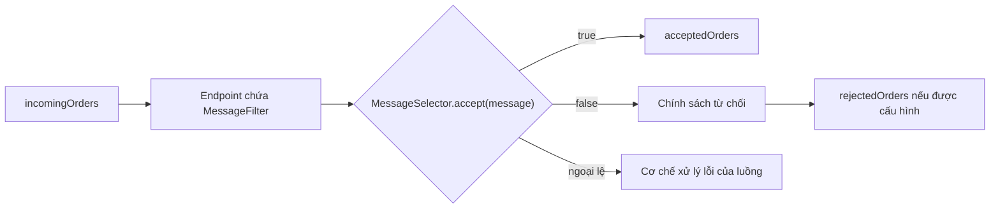

# MessageSelector

## 1. Mục tiêu và vị trí trong luồng thông điệp

Trong module **SPRING_INTEGRATION_CORE**, chương **Filter** giới thiệu cách quyết định một thông điệp có được đi tiếp hay không. Bài này tập trung vào `MessageSelector`: nơi biểu diễn điều kiện lựa chọn, kết hợp với `MessageFilter` để tạo thành một bước xử lý trong luồng Spring Integration.

Sau bài học, bạn có thể:

- Viết điều kiện dựa trên payload và header mà không ép kiểu thiếu kiểm soát.
- Phân biệt trách nhiệm của selector, filter và channel.
- Gắn selector vào Java DSL và chọn cách xử lý thông điệp bị từ chối.
- Kiểm thử riêng quy tắc và kiểm thử đường đi của thông điệp.
- Nhận ra ảnh hưởng của filter tới gateway, retry và aggregator.

Tình huống xuyên suốt: chỉ chuyển đơn hàng sang bước xử lý tiếp theo khi đơn thuộc tenant được kích hoạt, có trạng thái `READY` và tổng tiền đạt ngưỡng tối thiểu. Các đơn không đạt điều kiện đi vào một kênh riêng để có thể theo dõi.

Các ví dụ dùng cú pháp Java 17 và API của Spring Integration 6.x, đối chiếu hợp đồng API 6.5. Nếu ứng dụng dùng Spring Boot, hãy để BOM của phiên bản Boot đang dùng quản lý các dependency tương thích. Bài học không yêu cầu thay đổi phiên bản thư viện của dự án.

## 2. Hợp đồng của MessageSelector

`MessageSelector` thuộc package `org.springframework.integration.core`. Đây là functional interface, kế thừa `GenericSelector<Message<?>>`, với phương thức:

```java
boolean accept(Message<?> message);
```

Đầu vào là toàn bộ `Message`, vì vậy điều kiện có thể đọc cả `getPayload()` và `getHeaders()`. Giá trị trả về là quyết định lựa chọn, không phải payload đầu ra. Hợp đồng và khả năng dùng lambda được mô tả trong [Javadoc MessageSelector](https://docs.spring.io/spring-integration/docs/6.5.0/api/org/springframework/integration/core/MessageSelector.html).

Ví dụ selector chỉ kiểm tra một header:

```java
import org.springframework.integration.core.MessageSelector;

MessageSelector tenantAOnly =
        message -> "tenant-a".equals(message.getHeaders().get("tenantId"));
```

Cách gọi `"tenant-a".equals(...)` xử lý được trường hợp header không tồn tại. Nếu giá trị là số thay vì chuỗi, điều kiện cũng trả về `false`.

Một điểm cần phân biệt ngay:

| Kết quả đánh giá | Ý nghĩa |
| --- | --- |
| `true` | Thông điệp được chấp nhận theo điều kiện |
| `false` | Thông điệp đã được đánh giá và không đạt điều kiện |
| Ném ngoại lệ | Việc đánh giá thất bại; chưa có kết quả lựa chọn bình thường |

Chẳng hạn, đơn chưa ở trạng thái `READY` có thể là một trường hợp từ chối dự kiến. Ngược lại, lỗi gọi dịch vụ lấy chính sách tenant là sự cố kỹ thuật. Chuyển mọi ngoại lệ thành `false` sẽ làm hai tình huống này khó phân biệt trong vận hành.

Selector không có phương thức trả về lý do từ chối. Nếu cần một kết quả gồm `accepted`, `reasonCode` và thông tin bổ sung, bạn nên thiết kế bước đánh giá nghiệp vụ riêng, sau đó dùng kết quả đó để filter hoặc route.

## 3. Selector, filter và channel chịu trách nhiệm gì?

Một selector đơn lẻ là một đối tượng Java dùng để đánh giá điều kiện. Khai báo nó thành bean chưa làm cho thông điệp nào tự động được lọc.

`MessageFilter` là message handler sử dụng quyết định của selector. Endpoint bao quanh handler kết nối nó với kênh đầu vào; kênh đầu ra và cấu hình từ chối quyết định thông điệp tiếp tục ở đâu. Sự phân công này được trình bày trong [tài liệu Filter](https://docs.spring.io/spring-integration/reference/6.5/filter.html).



Sơ đồ mô tả trách nhiệm logic. Selector không tự gửi vào `acceptedOrders` hoặc `rejectedOrders`.

| Thành phần | Câu hỏi cần giải quyết |
| --- | --- |
| `Message` | Payload và header nào đang được xử lý? |
| `MessageSelector` | Thông điệp có đạt điều kiện không? |
| `MessageFilter` | Dùng quyết định đó để chuyển tiếp hoặc xử lý từ chối như thế nào? |
| Endpoint | Handler được kết nối, kích hoạt và tiêu thụ đầu vào ra sao? |
| `MessageChannel` | Thông điệp được truyền, phân phối hoặc lưu đệm như thế nào? |

Ba lựa chọn thiết kế thường gặp:

- **Filter**: chỉ đơn đủ điều kiện mới tiếp tục một quy trình.
- **Router**: mỗi loại đơn đi vào một quy trình phù hợp, chẳng hạn đơn quốc tế và nội địa.
- **Transformer**: chuyển biểu diễn đơn hàng sang một dạng dữ liệu khác.

Không nên sửa dữ liệu đơn trong selector để làm cho nó đủ điều kiện. Khi cần chuẩn hóa tiền tệ, trạng thái hoặc cấu trúc dữ liệu, hãy thực hiện bước đó trước khi lựa chọn.

## 4. Xác định rõ quy tắc trước khi viết code

Giả sử ứng dụng đã chuẩn hóa đơn thành `OrderCommand`, tổng tiền dùng cùng một đơn vị tiền tệ, và header `tenantId` đã được tạo ở biên tích hợp đáng tin cậy.

Quy tắc của ví dụ:

1. Payload phải là `OrderCommand`.
2. Header `tenantId` phải là chuỗi thuộc tập tenant được kích hoạt.
3. `orderId` phải có nội dung.
4. Trạng thái phải bằng chính xác `READY`.
5. `total` không được thiếu và phải lớn hơn hoặc bằng `100000`.

| Đầu vào | Kết quả dự kiến | Điều kiện quyết định |
| --- | --- | --- |
| Tenant hợp lệ, `READY`, tổng `100000` | Chấp nhận | Đạt đúng ngưỡng |
| Tenant hợp lệ, `READY`, tổng `99999.99` | Từ chối | Dưới ngưỡng |
| Tenant hợp lệ, `DRAFT`, tổng `200000` | Từ chối | Trạng thái chưa phù hợp |
| Thiếu `tenantId` | Từ chối | Chưa xác định tenant |
| `tenantId` là số | Từ chối | Sai kiểu header |
| Payload là chuỗi JSON chưa chuyển đổi | Từ chối | Sai hợp đồng payload |
| Tổng tiền bị thiếu | Từ chối | Không đủ dữ liệu để xét ngưỡng |

Đây là chính sách của ví dụ, không phải hành vi bắt buộc cho mọi ứng dụng. Một hệ thống khác có thể coi payload sai kiểu là lỗi cần báo ngay thay vì một ca từ chối bình thường.

Header dùng cho lựa chọn tenant cũng cần có nguồn đáng tin cậy. Chỉ kiểm tra tên tenant nằm trong một tập hợp chưa thay thế cho xác thực và phân quyền.

## 5. Ví dụ đầy đủ bằng Java DSL

### 5.1. Cấu hình, payload và selector

Ví dụ dưới đây có thể đặt trong một file Java tên `OrderFilterConfig.java`. Payload và selector được khai báo lồng trong class cấu hình để ví dụ tự chứa.

Dependency chính là `spring-integration-core`. Trong ứng dụng Boot, có thể dùng `spring-boot-starter-integration`. Phần kiểm thử phía sau dùng JUnit Jupiter; ví dụ tạo application context trực tiếp nên không cần annotation của Spring Test.

```java
package example.integration;

import java.math.BigDecimal;
import java.util.Objects;
import java.util.Set;

import org.springframework.beans.factory.annotation.Qualifier;
import org.springframework.context.annotation.Bean;
import org.springframework.context.annotation.Configuration;
import org.springframework.integration.channel.DirectChannel;
import org.springframework.integration.channel.QueueChannel;
import org.springframework.integration.config.EnableIntegration;
import org.springframework.integration.core.MessageSelector;
import org.springframework.integration.dsl.IntegrationFlow;
import org.springframework.messaging.Message;
import org.springframework.messaging.MessageChannel;

@Configuration
@EnableIntegration
public class OrderFilterConfig {

    public record OrderCommand(
            String orderId,
            BigDecimal total,
            String state) {
    }

    public static final class OrderEligibilitySelector
            implements MessageSelector {

        private final Set<String> enabledTenants;
        private final BigDecimal minimumTotal;

        public OrderEligibilitySelector(
                Set<String> enabledTenants,
                BigDecimal minimumTotal) {

            this.enabledTenants = Set.copyOf(enabledTenants);
            this.minimumTotal = Objects.requireNonNull(minimumTotal);

            if (minimumTotal.signum() < 0) {
                throw new IllegalArgumentException(
                        "minimumTotal must not be negative");
            }
        }

        @Override
        public boolean accept(Message<?> message) {
            if (!(message.getPayload() instanceof OrderCommand order)) {
                return false;
            }

            Object tenantHeader = message.getHeaders().get("tenantId");
            if (!(tenantHeader instanceof String tenantId)
                    || !enabledTenants.contains(tenantId)) {
                return false;
            }

            return order.orderId() != null
                    && !order.orderId().isBlank()
                    && "READY".equals(order.state())
                    && order.total() != null
                    && order.total().compareTo(minimumTotal) >= 0;
        }
    }

    @Bean
    public MessageSelector orderEligibilitySelector() {
        return new OrderEligibilitySelector(
                Set.of("tenant-a", "tenant-b"),
                new BigDecimal("100000"));
    }

    @Bean
    public DirectChannel incomingOrders() {
        return new DirectChannel();
    }

    @Bean
    public QueueChannel acceptedOrders() {
        return new QueueChannel(100);
    }

    @Bean
    public QueueChannel rejectedOrders() {
        return new QueueChannel(100);
    }

    @Bean
    public IntegrationFlow orderEligibilityFlow(
            @Qualifier("incomingOrders") MessageChannel input,
            @Qualifier("acceptedOrders") QueueChannel accepted,
            @Qualifier("rejectedOrders") QueueChannel rejected,
            @Qualifier("orderEligibilitySelector") MessageSelector selector) {

        return IntegrationFlow.from(input)
                .filter(selector, "accept",
                        endpoint -> endpoint
                                .id("orderEligibilityFilter")
                                .discardChannel(rejected)
                                .throwExceptionOnRejection(false))
                .channel(accepted)
                .get();
    }
}
```

Ở đây, `.filter(selector, "accept", ...)` chỉ rõ đối tượng và phương thức được gọi. Vì chữ ký `accept` nhận `Message<?>`, phương thức đọc được cả payload lẫn header. Các overload chọn đối tượng/phương thức, payload có kiểu và biểu thức được mô tả trong [API Java DSL](https://docs.spring.io/spring-integration/docs/6.5.0/api/org/springframework/integration/dsl/BaseIntegrationFlowDefinition.html).

### 5.2. Vì sao code được tổ chức như vậy?

`instanceof OrderCommand order` xác định kiểu trước khi đọc dữ liệu. Nó giúp selector thực thi đúng chính sách “sai kiểu thì từ chối”, thay vì tạo ra `ClassCastException`.

Header được lấy dưới dạng `Object`, sau đó kiểm tra bằng `instanceof String`. Cách này làm rõ ý định xử lý cả trường hợp thiếu header và sai kiểu header.

`BigDecimal.compareTo()` biểu diễn phép so sánh theo giá trị số. Với ngưỡng tiền, `100000` và `100000.00` đều phải được chấp nhận. Dùng `equals()` sẽ đưa cả scale vào phép so sánh và không thể hiện đúng điều kiện lớn hơn hoặc bằng.

Tập tenant được sao chép bằng `Set.copyOf()`, còn các trường cấu hình là `final`. Selector của ví dụ không giữ bộ đếm hoặc dữ liệu của lần gọi trước. Điều này giúp chia sẻ đối tượng giữa nhiều lần xử lý dễ kiểm soát hơn.

`acceptedOrders` và `rejectedOrders` là `QueueChannel` để người học có thể đọc lại thông điệp ở từng nhánh. Trong luồng này, filter chạy trên thread gửi vào `DirectChannel`; việc đặt thông điệp vào queue đầu ra không biến bước lựa chọn trước đó thành bất đồng bộ.

Các queue có dung lượng hữu hạn. Trong ứng dụng thật, cần có consumer và chính sách gửi/chờ phù hợp; ví dụ này chỉ gửi số lượng nhỏ rồi đọc ngay trong kiểm thử. Queue trong bộ nhớ không phải kho lưu bền vững.

### 5.3. Thông điệp được chấp nhận giữ ý nghĩa gì?

Selector không trả về đối tượng `OrderCommand` mới. Filter cho thông điệp đã đạt điều kiện tiếp tục qua nhánh chính. Payload và các header nghiệp vụ như `tenantId`, `correlationId` hay mã theo dõi vẫn cần được giữ để bước sau xử lý.

Nếu cần thêm `decisionReason`, hãy tạo một bước đánh giá hoặc header enricher riêng. Không thể thay đổi header bằng cách gọi `put()` trực tiếp trên `MessageHeaders`.

Cũng cần tránh sửa các đối tượng mutable nằm trong payload. Mặc dù `Message` có lớp vỏ bất biến, điều đó không tự biến mọi đối tượng mà payload tham chiếu thành bất biến.

## 6. MessageSelector và các dạng điều kiện khác

### 6.1. Điều kiện chỉ cần payload

Nếu chỉ cần kiểm tra trạng thái đơn hàng, có thể viết một đoạn DSL ngắn:

```java
.filter(OrderFilterConfig.OrderCommand.class,
        order -> "READY".equals(order.state()))
```

Đối số lambda trong đoạn này là `OrderCommand`. Nó không có `getHeaders()`.

Overload có đối số `Class` giúp DSL xác định kiểu dữ liệu mong đợi; cơ chế chuyển đổi có thể được áp dụng khi phù hợp. Vì thế, không nên dùng overload này như một lời bảo đảm rằng payload sai kiểu luôn được chuyển thành kết quả `false`. Nếu chính sách là kiểm tra kiểu và từ chối mềm, hãy thể hiện điều đó trong `MessageSelector` như ví dụ chính.

### 6.2. Điều kiện cần toàn bộ Message

Bạn có thể viết lambda nhận message và gán rõ kiểu đích:

```java
MessageSelector selector = message ->
        "tenant-a".equals(message.getHeaders().get("tenantId"));
```

Sau đó gắn đối tượng này vào filter bằng đối tượng/phương thức như ở ví dụ đầy đủ. Tránh dựa vào tên biến `message` để suy luận rằng mọi lambda trong `filter()` đều nhận `Message`; chữ ký overload và kiểu đích mới quyết định đối số thực tế.

### 6.3. Predicate không phải MessageSelector

| Kiểu | Phương thức | Đầu vào |
| --- | --- | --- |
| `MessageSelector` | `accept(Message<?> message)` | Toàn bộ thông điệp |
| `GenericSelector<T>` | `accept(T value)` | Theo kiểu `T` |
| `Predicate<T>` của Java | `test(T value)` | Theo kiểu `T` |

Lambda có thể phù hợp với nhiều functional interface. Tuy nhiên, một biến đã có kiểu `Predicate<Message<?>>` không tự trở thành `MessageSelector`. Hãy tạo adapter bằng method reference:

```java
import java.util.function.Predicate;
import org.springframework.integration.core.MessageSelector;
import org.springframework.messaging.Message;

Predicate<Message<?>> tenantRule =
        message -> "tenant-a".equals(message.getHeaders().get("tenantId"));

MessageSelector selector = tenantRule::test;
```

`MessageSelector` cũng không trực tiếp cung cấp các phương thức `and()`, `or()`, `negate()` của `Predicate`. Có thể ghép các lời gọi `accept()` bằng toán tử Java hoặc chủ động dùng `Predicate` ở lớp quy tắc rồi chuyển sang selector ở biên tích hợp.

### 6.4. POJO và SpEL

Một đối tượng nghiệp vụ có phương thức trả về boolean cũng có thể được DSL thích nghi thành điều kiện filter thông qua cơ chế gọi phương thức. `MethodInvokingSelector` là triển khai phục vụ việc đó; xem [Javadoc MethodInvokingSelector](https://docs.spring.io/spring-integration/api/org/springframework/integration/filter/MethodInvokingSelector.html).

Với điều kiện header rất ngắn, có thể dùng SpEL:

```java
.filter("headers['tenantId'] == 'tenant-a'")
```

`ExpressionEvaluatingSelector` là một triển khai đánh giá biểu thức cho kết quả boolean; xem [Javadoc ExpressionEvaluatingSelector](https://docs.spring.io/spring-integration/api/org/springframework/integration/filter/ExpressionEvaluatingSelector.html).

Đối với ví dụ có nhiều điều kiện, class Java có tên giúp đặt tên quy tắc và viết kiểm thử dễ hơn. Không nên đẩy một cây quyết định dài vào chuỗi SpEL chỉ để rút ngắn số dòng cấu hình.

## 7. Ghép các selector và tái sử dụng quy tắc

Giả sử có hai quy tắc độc lập: tenant hợp lệ và đơn ở trạng thái sẵn sàng.

```java
MessageSelector tenantAllowed = message ->
        "tenant-a".equals(message.getHeaders().get("tenantId"));

MessageSelector orderReady = message ->
        message.getPayload()
                instanceof OrderFilterConfig.OrderCommand order
                && "READY".equals(order.state());

MessageSelector eligible = message ->
        tenantAllowed.accept(message) && orderReady.accept(message);
```

Toán tử `&&` thực hiện short-circuit: nếu tenant không hợp lệ, `orderReady` không được gọi trong biểu thức này. Những điều kiện rẻ và xác định được từ thông điệp thường phù hợp để đặt trước.

Framework cũng cung cấp `MessageSelectorChain`, hỗ trợ tập selector và chiến lược biểu quyết. Nếu dùng thành phần đó, nên cấu hình rõ chiến lược phù hợp; chiến lược mặc định là `ALL`. Chi tiết nằm trong [Javadoc MessageSelectorChain](https://docs.spring.io/spring-integration/docs/6.5.0/api/org/springframework/integration/selector/MessageSelectorChain.html).

Khi chỉ cần kiểm tra kiểu payload, `PayloadTypeSelector` có thể thay thế việc tự viết một class riêng. Thành phần này kiểm tra khả năng gán kiểu tới các kiểu được chấp nhận, theo [Javadoc PayloadTypeSelector](https://docs.spring.io/spring-integration/docs/6.5.0/api/org/springframework/integration/selector/PayloadTypeSelector.html).

Việc tách quy tắc hữu ích khi quy tắc có tên miền rõ ràng hoặc được tái sử dụng. Với một phép so sánh đơn giản dùng ở một chỗ, lambda trực tiếp có thể dễ đọc hơn một chuỗi nhiều class nhỏ.

## 8. Điều gì xảy ra khi accept trả về false?

Kết quả `false` chỉ là đầu vào cho chính sách từ chối của filter. Hai tùy chọn chính là `discardChannel` và `throwExceptionOnRejection`.

| Có discard channel? | Ném lỗi khi từ chối? | Hành vi |
| --- | --- | --- |
| Không | `false` | Không đưa vào nhánh chính; thông điệp bị bỏ khỏi luồng |
| Có | `false` | Gửi vào discard channel |
| Không | `true` | Phát sinh `MessageRejectedException` |
| Có | `true` | Gửi vào discard channel rồi phát sinh `MessageRejectedException`, nếu bước gửi hoàn tất bình thường |

Bật `throwExceptionOnRejection` vẫn có hiệu lực khi đã khai báo discard channel. Không nên hiểu hai tùy chọn này là loại trừ nhau. Hợp đồng được nêu tại [Javadoc MessageFilter](https://docs.spring.io/spring-integration/api/org/springframework/integration/filter/MessageFilter.html).

Với ví dụ đơn hàng, từ chối do chưa đủ ngưỡng là kết quả dự kiến, nên dùng:

```java
.discardChannel(rejected)
.throwExceptionOnRejection(false)
```

Nếu việc lọt vào filter với dữ liệu không phù hợp là lỗi hợp đồng cần làm thất bại lời gọi, có thể dùng:

```java
.throwExceptionOnRejection(true)
```

Các tùy chọn này thuộc cấu hình endpoint DSL thông qua [FilterEndpointSpec](https://docs.spring.io/spring-integration/api/org/springframework/integration/dsl/FilterEndpointSpec.html).

Từ Spring Integration 6.1, trường hợp từ chối không có discard channel và không ném lỗi có cảnh báo trong log. Nếu muốn bỏ có chủ ý mà không phát cảnh báo này, có thể cấu hình discard tới bean `nullChannel`. Đây là hành vi được ghi trong [tài liệu Filter](https://docs.spring.io/spring-integration/reference/6.5/filter.html).

Một discard channel cần có điểm tiêu thụ thích hợp:

- Với `QueueChannel`, cần consumer đọc queue hoặc một polling endpoint.
- Với `DirectChannel`, cần handler đăng ký nhận thông điệp.
- Khi cần lưu phục vụ đối soát, consumer phải ghi vào nơi lưu trữ phù hợp.

Đặt tên kênh là `rejectedOrders` không tự tạo chức năng lưu bền vững hay dead-letter queue. Nếu nhánh discard gửi thất bại hoặc consumer của nó ném lỗi, đó là lỗi riêng cần được xử lý.

## 9. Ngoại lệ, retry và hợp đồng gateway

### 9.1. Ngoại lệ trong selector không phải từ chối bình thường

Ví dụ sai về ý nghĩa nghiệp vụ:

```java
@Override
public boolean accept(Message<?> message) {
    try {
        return remotePolicyAllows(message);
    }
    catch (RuntimeException ex) {
        return false;
    }
}
```

Đoạn này chỉ minh họa điều cần tránh; `remotePolicyAllows` đại diện cho một lời gọi phụ thuộc bên ngoài. Nếu dịch vụ chính sách đang lỗi, việc trả về `false` có thể làm mất cơ hội retry và biến sự cố hạ tầng thành kết quả từ chối nghiệp vụ.

Một thiết kế dễ kiểm soát hơn là lấy dữ liệu chính sách ở bước trước, áp dụng timeout/retry tại bước truy cập đó, rồi cho selector đọc kết quả đã có trong message. Chỉ chuyển lỗi thành từ chối nếu đó là chính sách fallback đã được xác định.

### 9.2. discardChannel và errorChannel khác nhau

`discardChannel` nhận thông điệp không đạt điều kiện. `errorChannel` phục vụ cơ chế xử lý lỗi và thường nhận `ErrorMessage`.

Trong luồng đồng bộ qua `DirectChannel`, ngoại lệ có thể đi ngược về bên gọi `send()`. Với consumer bất đồng bộ do framework quản lý, chẳng hạn poller hoặc executor, lỗi thường được chuyển qua cơ chế xử lý lỗi; kênh lỗi được xác định từ header hoặc cấu hình tương ứng. Không thể chỉ thêm header `errorChannel` rồi mặc định rằng mọi lời gọi đồng bộ đều tự phát lỗi vào kênh đó. Xem [tài liệu Error Handling](https://docs.spring.io/spring-integration/reference/error-handling.html).

### 9.3. Retry cần gắn với nguyên nhân có thể thay đổi

Đơn chưa đủ số tiền tối thiểu sẽ vẫn bị từ chối nếu thử lại cùng dữ liệu và cùng chính sách. Retry tự động cho loại kết quả này chỉ làm tăng tải.

Đặc biệt, khi kết hợp discard channel với `throwExceptionOnRejection(true)`, advice retry bao quanh bước xử lý có thể làm nhánh discard được thực hiện nhiều lần. Nếu consumer discard ghi audit hoặc gửi thông báo, cần thiết kế chống trùng phù hợp với khả năng giao lại của toàn luồng.

### 9.4. Gateway yêu cầu phản hồi

Nếu một gateway trả về kết quả nhưng request bị filter loại trước bước tạo reply, bên gọi có thể chờ tới timeout hoặc chờ không giới hạn tùy cấu hình. Đã gửi thành công vào discard channel không có nghĩa là gateway đã nhận được một phản hồi. Tài liệu [Messaging Gateways](https://docs.spring.io/spring-integration/reference/gateway.html) mô tả tình huống filter làm mất đường tạo reply.

Có thể thiết kế một trong các hợp đồng:

- Gateway một chiều nếu bên gọi chỉ gửi công việc.
- Từ chối tạo lỗi rõ ràng để gateway xử lý theo chính sách lỗi.
- Nhánh xử lý từ chối tạo một kết quả nghiệp vụ và trả đúng đường phản hồi.

Cấu hình `replyTimeout` hữu hạn giúp giới hạn giai đoạn chờ reply. Nó không tự ngắt một selector hoặc handler đang chạy đồng bộ và bị chặn trong cùng thread.

Luồng `acceptedOrders/rejectedOrders` của bài học là ví dụ phân loại một chiều để quan sát hai nhánh; nó chưa phải một luồng request-reply hoàn chỉnh cho gateway.

## 10. Kiểm thử selector độc lập

Kiểm thử quy tắc không cần khởi động Spring. Bạn chỉ cần tạo selector, tạo message và kiểm tra kết quả.

Ví dụ JUnit Jupiter, cùng package với cấu hình:

```java
package example.integration;

import java.math.BigDecimal;
import java.util.Set;

import org.junit.jupiter.api.Test;
import org.springframework.integration.core.MessageSelector;
import org.springframework.messaging.Message;
import org.springframework.messaging.support.MessageBuilder;

import static org.junit.jupiter.api.Assertions.assertFalse;
import static org.junit.jupiter.api.Assertions.assertTrue;

class OrderEligibilitySelectorTest {

    private final MessageSelector selector =
            new OrderFilterConfig.OrderEligibilitySelector(
                    Set.of("tenant-a"),
                    new BigDecimal("100000"));

    @Test
    void acceptsAmountAtThresholdDespiteDifferentScale() {
        assertTrue(selector.accept(
                message("tenant-a", "100000.00", "READY")));
    }

    @Test
    void rejectsAmountBelowThreshold() {
        assertFalse(selector.accept(
                message("tenant-a", "99999.99", "READY")));
    }

    @Test
    void rejectsUnknownTenantAndWrongState() {
        assertFalse(selector.accept(
                message("tenant-x", "200000", "READY")));

        assertFalse(selector.accept(
                message("tenant-a", "200000", "DRAFT")));
    }

    @Test
    void rejectsMissingOrIncorrectHeaderType() {
        Message<?> noTenant = MessageBuilder.withPayload(
                new OrderFilterConfig.OrderCommand(
                        "O-001", new BigDecimal("200000"), "READY"))
                .build();

        assertFalse(selector.accept(noTenant));

        assertFalse(selector.accept(
                message(123, "200000", "READY")));
    }

    @Test
    void rejectsUnexpectedPayloadType() {
        Message<?> raw = MessageBuilder
                .withPayload("raw-order-data")
                .setHeader("tenantId", "tenant-a")
                .build();

        assertFalse(selector.accept(raw));
    }

    @Test
    void rejectsMissingBusinessData() {
        Message<?> invalid = MessageBuilder.withPayload(
                new OrderFilterConfig.OrderCommand(" ", null, "READY"))
                .setHeader("tenantId", "tenant-a")
                .build();

        assertFalse(selector.accept(invalid));
    }

    private Message<?> message(
            Object tenantId,
            String amount,
            String state) {

        return MessageBuilder.withPayload(
                new OrderFilterConfig.OrderCommand(
                        "O-001", new BigDecimal(amount), state))
                .setHeader("tenantId", tenantId)
                .build();
    }
}
```

Các ca biên giúp làm rõ hợp đồng: đúng ngưỡng, khác scale, sai kiểu header và payload không mong đợi. Đây là những trường hợp thường không được nhìn thấy nếu chỉ thử một đơn hợp lệ.

Ca `rejectsMissingBusinessData` là ví dụ từ chối dữ liệu không đầy đủ. Nếu cần xác định độc lập từng điều kiện, hãy thêm ca riêng cho `orderId` trắng nhưng `total` hợp lệ, rồi ca `total` thiếu nhưng `orderId` hợp lệ.

Các đoạn kiểm thử trong bài là mã hướng dẫn, chưa phải báo cáo đã chạy trên build của repository.

## 11. Kiểm thử đường đi của MessageFilter

Selector trả về đúng chưa đủ để chứng minh cấu hình kênh đúng. Cần kiểm tra một message được đưa vào đúng đầu ra và không đồng thời xuất hiện ở nhánh còn lại.

Ví dụ sau tạo context từ `OrderFilterConfig`, gửi vào `DirectChannel` và đọc hai queue:

```java
package example.integration;

import java.math.BigDecimal;

import org.junit.jupiter.api.Test;
import org.springframework.context.annotation.AnnotationConfigApplicationContext;
import org.springframework.integration.channel.QueueChannel;
import org.springframework.messaging.Message;
import org.springframework.messaging.MessageChannel;
import org.springframework.messaging.support.MessageBuilder;

import static org.junit.jupiter.api.Assertions.assertEquals;
import static org.junit.jupiter.api.Assertions.assertNotNull;
import static org.junit.jupiter.api.Assertions.assertNull;
import static org.junit.jupiter.api.Assertions.assertTrue;

class OrderFilterFlowTest {

    @Test
    void sendsEachMessageToItsExpectedBranch() {
        try (var context = new AnnotationConfigApplicationContext(
                OrderFilterConfig.class)) {

            MessageChannel input = context.getBean(
                    "incomingOrders", MessageChannel.class);
            QueueChannel accepted = context.getBean(
                    "acceptedOrders", QueueChannel.class);
            QueueChannel rejected = context.getBean(
                    "rejectedOrders", QueueChannel.class);

            Message<?> eligible = orderMessage(
                    "O-100", "tenant-a", "150000", "trace-100");

            assertTrue(input.send(eligible));

            Message<?> passed = accepted.receive(0);
            assertNotNull(passed);
            assertEquals(eligible.getPayload(), passed.getPayload());
            assertEquals(
                    "tenant-a", passed.getHeaders().get("tenantId"));
            assertEquals(
                    "trace-100", passed.getHeaders().get("traceId"));
            assertNull(rejected.receive(0));

            Message<?> ineligible = orderMessage(
                    "O-101", "tenant-a", "50000", "trace-101");

            assertTrue(input.send(ineligible));

            Message<?> discarded = rejected.receive(0);
            assertNotNull(discarded);
            assertEquals(
                    ineligible.getPayload(), discarded.getPayload());
            assertEquals(
                    "trace-101", discarded.getHeaders().get("traceId"));

            assertNull(accepted.receive(0));
            assertNull(rejected.receive(0));
        }
    }

    private Message<?> orderMessage(
            String orderId,
            String tenantId,
            String amount,
            String traceId) {

        return MessageBuilder.withPayload(
                new OrderFilterConfig.OrderCommand(
                        orderId, new BigDecimal(amount), "READY"))
                .setHeader("tenantId", tenantId)
                .setHeader("traceId", traceId)
                .build();
    }
}
```

Vì đầu vào là `DirectChannel` và không có executor ở giữa, khi `send()` trả về bình thường, bước filter và việc gửi tới queue đã diễn ra trong ví dụ này. `receive(0)` kiểm tra tức thời và không cần `Thread.sleep()`.

Khi chuyển sang `ExecutorChannel` hoặc polling consumer, kiểm thử cần chờ có giới hạn theo mô hình bất đồng bộ. Khi đó không nên suy ra rằng queue phải có message ngay sau khi bên gửi hoàn tất.

`input.send(...)` trả về `true` không phải boolean nghiệp vụ từ `accept()`. Trong ví dụ, cả message được chấp nhận và bị từ chối đều có thể được gửi thành công vào đầu vào; cần kiểm tra kênh đích để biết kết quả lựa chọn.

Với luồng lớn, Spring Integration cung cấp thêm công cụ mock và hỗ trợ kiểm thử endpoint trong [tài liệu Testing Support](https://docs.spring.io/spring-integration/reference/testing.html). Ví dụ này dùng context nhỏ để người học nhìn trực tiếp sự kết nối giữa selector, filter và channel.

## 12. Các điểm thiết kế khi đưa vào luồng lớn

### 12.1. Dùng chung selector và xử lý đồng thời

Một bean selector có thể được gọi từ nhiều thread nếu cấu hình luồng cho phép. Bản thân interface không tự cung cấp khóa hoặc bảo đảm an toàn đồng thời cho dữ liệu do bạn quản lý.

Với quy tắc kiểm tra điều kiện như ví dụ, nên giữ cấu hình bất biến và tránh ghi dữ liệu riêng của từng message vào field. Nếu danh sách tenant cần cập nhật động, phải xác định cơ chế công bố một snapshot cấu hình mới một cách an toàn.

Lời gọi mạng hoặc truy vấn cơ sở dữ liệu bên trong `accept()` còn làm thời gian xử lý phụ thuộc vào hệ thống ngoài. Tách bước truy cập dữ liệu giúp bạn đặt timeout, retry và đo độ trễ ở đúng vị trí.

### 12.2. Nhiều filter trên cùng một channel

Nếu nhiều consumer cần cùng xem một message để tự chọn, hãy dùng mô hình publish-subscribe phù hợp. Đăng ký nhiều filter vào một `DirectChannel` không tự tạo cơ chế broadcast: channel này phân phối theo mô hình point-to-point. Phân biệt các kiểu channel tại [tài liệu Configuring Message Channels](https://docs.spring.io/spring-integration/reference/channel/configuration.html).

Ví dụ, một thông điệp đơn có thể đồng thời được nhánh xử lý vận chuyển và nhánh phân tích xét riêng. Điều này khác với việc yêu cầu đúng một trong hai quy trình nhận đơn; tình huống sau thường phù hợp hơn với router.

### 12.3. Filter đặt trước aggregator

Giả sử splitter tạo năm phần và gắn `sequenceSize = 5`. Filter loại hai phần, còn ba phần đi vào aggregator. Nếu điều kiện hoàn tất vẫn đợi đủ năm phần, nhóm có thể không được giải phóng theo cách dự kiến.

Cần thiết kế lại vị trí lọc, chiến lược release hoặc thông điệp bù để aggregator có đủ thông tin về các phần bị loại. Tài liệu [Aggregator](https://docs.spring.io/spring-integration/reference/aggregator.html) nêu trực tiếp trường hợp filter làm thiếu thành viên của sequence.

Đây là lý do một điều kiện selector đúng về mặt cục bộ vẫn có thể làm toàn bộ quy trình không hoàn tất.

### 12.4. Theo dõi quyết định

Một hệ thống cần biết không chỉ có bao nhiêu lỗi mà còn có bao nhiêu thông điệp không được đi tiếp. Với bài toán đơn hàng, nên quan sát:

- Số lượng đi vào, được chấp nhận và bị từ chối.
- Độ trễ đánh giá khi quy tắc trở nên phức tạp.
- Mã theo dõi để liên kết message với lần xử lý.
- Lý do từ chối nếu nghiệp vụ yêu cầu giải thích.

Vì `MessageSelector` trả về boolean, lý do có cấu trúc nên được tạo ở bước đánh giá riêng hoặc bằng một mô hình quyết định được thống nhất. Tránh đánh giá lại chính sách có thể thay đổi chỉ để đoán vì sao lần trước đã bị từ chối.

## 13. Lỗi thường gặp và cách nhận biết

| Hiện tượng | Nguyên nhân có thể gặp | Hướng xử lý |
| --- | --- | --- |
| Lambda không đọc được header | Lambda đang nhận payload | Chọn chữ ký nhận `Message` rõ ràng |
| Có `ClassCastException` khi đầu vào khác loại | Ép kiểu payload trực tiếp | Kiểm tra kiểu hoặc chuẩn hóa trước filter |
| Đơn không hợp lệ biến mất khỏi luồng | Không cấu hình điểm nhận nhánh từ chối | Chọn discard, lỗi hoặc bỏ có chủ ý |
| Gateway chờ lâu sau khi đơn bị loại | Không có reply từ nhánh từ chối | Hoàn thiện hợp đồng phản hồi |
| Audit từ chối xuất hiện nhiều lần | Retry hoặc giao lại chạy lại nhánh discard | Dùng khóa nghiệp vụ để chống trùng |
| Nhiều filter không cùng nhận một message | Dùng channel point-to-point | Kiểm tra lại mô hình phân phối |
| Aggregator giữ nhóm không hoàn tất | Filter loại thành viên của sequence | Điều chỉnh chiến lược hoàn tất |
| Đơn có tổng `100000.00` bị xử lý sai | So sánh tiền sai ý nghĩa | Dùng `compareTo()` cho điều kiện ngưỡng |
| Lỗi dịch vụ chính sách bị coi là từ chối | Bắt rộng rồi trả về `false` | Phân biệt sự cố đánh giá và kết quả nghiệp vụ |

Khi triển khai một selector, hãy viết rõ điều kiện chấp nhận, cách xử lý dữ liệu thiếu và điểm đến của từng kết quả. Kiểm thử riêng điều kiện giúp xác nhận quy tắc; kiểm thử luồng giúp xác nhận thông điệp thực sự đi đúng nhánh.
