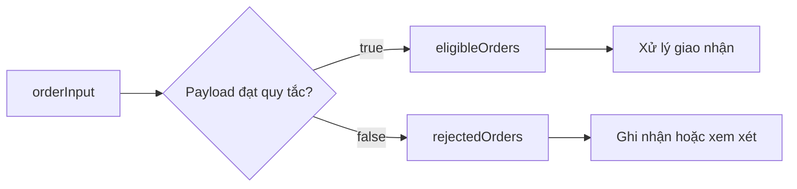

# Filter theo payload

## Mục tiêu và phạm vi

Trong chương **Filter** của module `SPRING_INTEGRATION_CORE`, bài này trình bày cách quyết định một thông điệp có được đi tiếp dựa trên **nội dung payload**. Mục tiêu là nối được quy tắc nghiệp vụ với `Message`, `MessageChannel` và endpoint bằng Java DSL, đồng thời xác định rõ điều gì xảy ra với thông điệp không đạt điều kiện.

Sau bài học, bạn có thể:

- Viết điều kiện lọc cho payload có kiểu dữ liệu cụ thể.
- Tách quy tắc nghiệp vụ khỏi cấu hình luồng để kiểm thử độc lập.
- Cấu hình nhánh nhận, nhánh từ chối và chính sách ném lỗi.
- Phân biệt lọc payload với chuyển đổi dữ liệu, định tuyến và lọc phần tử của một tập hợp.
- Kiểm thử điều kiện biên, nội dung thông điệp và nơi thông điệp được chuyển đến.

Ví dụ sử dụng Java `record` và cú pháp Java 17 trở lên. Cần chọn JDK phù hợp với phiên bản Spring của dự án. Các lớp minh họa đặt trong package `example.integration.filter`; ứng dụng cần `spring-integration-core` cùng Spring Context tương thích. Phần kiểm thử dùng JUnit Jupiter, bao gồm hỗ trợ kiểm thử tham số. Có thể để Spring Boot quản lý phiên bản dependency qua BOM của dự án.

## 1. Filter quyết định điều gì?

Một `Message<Order>` gồm payload `Order` và các header như mã truy vết hoặc thông tin phản hồi. Payload chứa dữ liệu nghiệp vụ; header chứa metadata của thông điệp. Đây là hai phần khác nhau của cùng một thông điệp. [Tài liệu Message](https://docs.spring.io/spring-integration/reference/message.html).

Với filter theo payload, quy tắc có dạng:

```text
accept(payload) -> true hoặc false
```

`true` cho phép thông điệp đi tiếp; `false` từ chối thông điệp ở vị trí filter. Kết quả boolean là quyết định của endpoint, không trở thành payload đầu ra. Khi được chấp nhận, filter chuyển tiếp thông điệp đầu vào thay vì tạo một payload nghiệp vụ mới. [Tài liệu MessageFilter](https://docs.spring.io/spring-integration/api/org/springframework/integration/filter/MessageFilter.html).



Trong ví dụ này, cả hai nhánh đều có đích rõ ràng. Quyết định nghiệp vụ là “đơn hàng đủ điều kiện tham gia luồng giao nhận hay chưa”. Một đơn hàng bị từ chối tại đây vẫn có thể là dữ liệu hợp lệ đối với hệ thống khác.

### Phân biệt với các thành phần gần nhau

| Nhu cầu | Thành phần phù hợp | Ví dụ |
| --- | --- | --- |
| Cho qua hoặc chặn toàn bộ thông điệp | Filter | Chỉ nhận đơn đã xác nhận |
| Thay nội dung hoặc kiểu payload | Transformer | Đổi JSON thành `Order` |
| Chọn đích xử lý theo kết quả phân loại | Router | Chia đơn theo vùng giao hàng |
| Tách một thông điệp thành nhiều thông điệp | Splitter | Tách danh sách đơn thành từng đơn |
| Gom nhiều thông điệp thành một kết quả | Aggregator | Gom kết quả xử lý của các dòng hàng |

Filter hỗ trợ `discardChannel` nên có thể tạo hai hướng xử lý theo điều kiện boolean. Khi bài toán có nhiều nhóm đích nghiệp vụ, router thường diễn đạt ý định rõ hơn. [Tài liệu Filter](https://docs.spring.io/spring-integration/reference/filter.html).

## 2. Tình huống: nhận đơn hàng vào luồng giao nhận

Giả sử hệ thống nhận đơn từ nhiều nguồn. Luồng giao nhận tự động chỉ xử lý đơn thỏa mãn đồng thời:

1. Có mã đơn và mã khách hàng không rỗng.
2. Trạng thái là `CONFIRMED`.
3. Tiền tệ là `VND`.
4. Tổng tiền từ `100000` trở lên, bao gồm đúng ngưỡng.

Đây là quy tắc giả định của bài học. Ngưỡng tiền, trạng thái và tập tiền tệ phải được thay theo hợp đồng nghiệp vụ của ứng dụng thực tế.

### 2.1. Mô hình payload

Nội dung minh họa cho `Order.java`:

```java
package example.integration.filter;

import java.math.BigDecimal;

public record Order(
        String id,
        String customerId,
        Status status,
        BigDecimal total,
        String currency) {

    public enum Status {
        CREATED,
        CONFIRMED,
        CANCELLED
    }
}
```

`record` giúp ví dụ có dữ liệu ổn định khi đi qua các endpoint. Các trường trong mô hình này đều có kiểu giá trị bất biến. Nếu payload có thêm `List` hoặc một đối tượng có thể sửa đổi, dùng `record` không tự làm các đối tượng bên trong trở nên bất biến.

`total` dùng `BigDecimal`. Phép kiểm tra ngưỡng cần dựa trên giá trị số, nên dùng `compareTo`, tránh dùng `equals` để biểu diễn “bằng ngưỡng”: `100000` và `100000.00` có cùng giá trị số nhưng khác scale.

### 2.2. Quy tắc nghiệp vụ độc lập với Spring

Nội dung minh họa cho `FulfillmentPolicy.java`:

```java
package example.integration.filter;

import java.math.BigDecimal;

public final class FulfillmentPolicy {

    private static final BigDecimal MIN_TOTAL =
            new BigDecimal("100000");

    public boolean accept(Order order) {
        return order != null
                && hasText(order.id())
                && hasText(order.customerId())
                && order.status() == Order.Status.CONFIRMED
                && "VND".equals(order.currency())
                && order.total() != null
                && order.total().compareTo(MIN_TOTAL) >= 0;
    }

    private boolean hasText(String value) {
        return value != null && !value.isBlank();
    }
}
```

Hàm chỉ đọc dữ liệu và trả kết quả. Nó không ghi cơ sở dữ liệu, gửi email, thay trạng thái đơn hoặc sửa payload. Nhờ vậy, cùng một đầu vào luôn dẫn đến cùng một quyết định trong phiên bản quy tắc này.

Thứ tự điều kiện tận dụng short-circuit của `&&`: chỉ đọc thuộc tính sau khi đã kiểm tra đối tượng, chỉ so sánh số sau khi xác nhận `total` tồn tại. Chính sách ở đây coi thiếu trường bắt buộc là không đủ điều kiện và trả về `false`.

Lệnh kiểm tra `order != null` giúp hàm dùng được khi gọi trực tiếp trong Java. Với `GenericMessage` và `MessageBuilder` thông thường, bản thân payload không được là `null`; các thuộc tính bên trong payload vẫn có thể thiếu.

Một số quyết định cần được ghi thành hợp đồng trước khi triển khai:

| Dữ liệu | Quyết định trong ví dụ |
| --- | --- |
| `total = 100000` | Chấp nhận nếu các trường khác hợp lệ |
| `total = 100000.00` | Chấp nhận như cùng giá trị số |
| `total = 99999.99` | Từ chối |
| `total = null` | Từ chối |
| `status = CREATED` | Từ chối vì chưa xác nhận |
| `currency = "vnd"` | Từ chối vì hợp đồng yêu cầu `VND` |
| Mã khách chỉ gồm khoảng trắng | Từ chối |

Nếu muốn chấp nhận tiền tệ viết thường, nên chuẩn hóa có chủ đích trước khi lọc hoặc thay đổi quy tắc và bổ sung ca kiểm thử tương ứng.

## 3. Cấu hình luồng bằng Java DSL

Nội dung minh họa cho `OrderFilterConfiguration.java`:

```java
package example.integration.filter;

import org.springframework.beans.factory.annotation.Qualifier;
import org.springframework.context.annotation.Bean;
import org.springframework.context.annotation.Configuration;
import org.springframework.integration.channel.DirectChannel;
import org.springframework.integration.channel.QueueChannel;
import org.springframework.integration.config.EnableIntegration;
import org.springframework.integration.dsl.IntegrationFlow;

@Configuration(proxyBeanMethods = false)
@EnableIntegration
public class OrderFilterConfiguration {

    @Bean
    public DirectChannel orderInput() {
        return new DirectChannel();
    }

    @Bean
    public QueueChannel eligibleOrders() {
        return new QueueChannel();
    }

    @Bean
    public QueueChannel rejectedOrders() {
        return new QueueChannel();
    }

    @Bean
    public FulfillmentPolicy fulfillmentPolicy() {
        return new FulfillmentPolicy();
    }

    @Bean
    public IntegrationFlow orderEligibilityFlow(
            @Qualifier("orderInput") DirectChannel input,
            @Qualifier("eligibleOrders") QueueChannel accepted,
            @Qualifier("rejectedOrders") QueueChannel rejected,
            FulfillmentPolicy policy) {

        return IntegrationFlow.from(input)
                .filter(
                        Order.class,
                        policy::accept,
                        endpoint -> endpoint
                                .id("filterOrdersByPayload")
                                .discardChannel(rejected)
                                .throwExceptionOnRejection(false))
                .channel(accepted)
                .get();
    }
}
```

`Order.class` khai báo kiểu đầu vào mong đợi của hàm nhận payload. `policy::accept` cung cấp điều kiện lọc; lambda cấu hình endpoint xác định cách xử lý trường hợp bị từ chối. Overload có `Class<P>` cũng có thể thử chuyển đổi đầu vào về kiểu mong đợi khi cần. [API Java DSL](https://docs.spring.io/spring-integration/api/org/springframework/integration/dsl/BaseIntegrationFlowDefinition.html).

Trong cấu hình này:

- `orderInput` là nơi producer gửi thông điệp vào.
- Endpoint `filterOrdersByPayload` gọi quy tắc đúng một lần cho mỗi lần xử lý thông điệp.
- Nhánh được chấp nhận đi đến `eligibleOrders`.
- Nhánh bị từ chối đi đến `rejectedOrders`, không ném lỗi do quyết định `false`.

Hai `QueueChannel` là các đích lưu thông điệp trong bộ nhớ để dễ quan sát. Chúng không tự tiêu thụ dữ liệu và không phải hàng đợi bền vững. Ví dụ đọc chúng trực tiếp từ kiểm thử; nếu nối endpoint để tiêu thụ bằng polling, cần cấu hình poller phù hợp. [Các kiểu MessageChannel](https://docs.spring.io/spring-integration/reference/channel/implementations.html).

Cấu hình dùng tham số bean và `@Qualifier` để phân biệt hai bean cùng kiểu `QueueChannel`. Không gọi trực tiếp phương thức `@Bean` khi đã đặt `proxyBeanMethods = false`.

### 3.1. Theo dõi một thông điệp qua luồng

Có thể gửi một thông điệp sau khi khởi tạo Spring context:

```java
Order order = new Order(
        "ORD-001",
        "CUS-01",
        Order.Status.CONFIRMED,
        new java.math.BigDecimal("150000"),
        "VND");

org.springframework.messaging.Message<Order> message =
        org.springframework.messaging.support.MessageBuilder
                .withPayload(order)
                .setHeader("traceId", "trace-001")
                .build();

// input, accepted và rejected là các bean channel đã lấy từ context.
boolean sent = input.send(message);
org.springframework.messaging.Message<?> result = accepted.receive(0);
```

`150000 >= 100000`, trạng thái và các trường bắt buộc đều hợp lệ, nên có thông điệp ở `eligibleOrders`. Nếu thay tổng tiền thành `50000`, thông điệp xuất hiện ở `rejectedOrders`.

**Không dùng `sent` làm kết quả nghiệp vụ.** Với cấu hình hiện tại, một thông điệp bị filter từ chối nhưng chuyển thành công đến nhánh discard vẫn có thể làm `input.send(message)` trả về `true`. Muốn biết nó được chấp nhận hay từ chối, phải quan sát đích nhận hoặc thiết kế một thông điệp kết quả riêng.

## 4. Payload có kiểu không đồng nghĩa với kiểm tra kiểu

Có hai câu hỏi khác nhau:

- “Hãy gọi quy tắc nhận một `Order`.”
- “Payload có thực sự là một `Order` hay không?”

Cấu hình `.filter(Order.class, policy::accept, ...)` giải quyết câu hỏi đầu. Nó không phải cam kết rằng mọi kiểu khác đều được chuyển đến `discardChannel`. Cơ chế gọi hàm có thể thử conversion; nếu conversion hoặc binding thất bại trước khi hàm trả kết quả, đó là lỗi xử lý. [API Java DSL về expectedType](https://docs.spring.io/spring-integration/api/org/springframework/integration/dsl/BaseIntegrationFlowDefinition.html).

Ví dụ đầu vào vẫn là chuỗi JSON:

```json
{"id":"ORD-001","customerId":"CUS-01","status":"CONFIRMED","total":150000,"currency":"VND"}
```

Chuỗi này chưa tự trở thành `Order` chỉ vì cấu hình filter có `Order.class`. Nếu hệ thống nhận JSON, hãy xác định bước giải mã và chính sách lỗi giải mã trước:

```text
JSON -> transformer/decoder -> Order -> payload filter -> xử lý tiếp
```

Khi cần từ chối an toàn mọi payload sai kiểu bằng chính quyết định boolean, có thể dùng `MessageSelector` để kiểm tra kiểu tường minh:

```java
org.springframework.integration.core.MessageSelector selector =
        message -> message.getPayload() instanceof Order order
                && policy.accept(order);
```

Sau đó dùng selector này thay cho filter theo lớp trong cấu hình luồng:

```java
return IntegrationFlow.from(input)
        .filter(selector, endpoint -> endpoint
                .id("filterOrdersByPayload")
                .discardChannel(rejected))
        .channel(accepted)
        .get();
```

Đây là **phương án thay thế** cho bean luồng ở phần 3. Chỉ kích hoạt một phương án trên cùng đầu vào. Việc tạo thêm một luồng khác cùng subscribe `DirectChannel` không có nghĩa cả hai filter sẽ nhận từng thông điệp; channel kiểu này phân phối theo mô hình point-to-point.

Selector nhận toàn bộ `Message<?>`, nhưng quy tắc trong ví dụ vẫn chỉ dựa trên `message.getPayload()`. Cùng payload mà thay `traceId` sẽ không thay đổi quyết định. Khi điều kiện bắt đầu đọc header, đó là quy tắc kết hợp payload và metadata; nên đặt tên để ý định này rõ ràng.

## 5. Chọn chính sách cho thông điệp bị từ chối

`false` cần một ý nghĩa nghiệp vụ cụ thể. Nó có thể là “chưa đủ điều kiện”, “không thuộc phạm vi xử lý” hoặc “dữ liệu cần xem xét”. Không phải trường hợp nào cũng nên trở thành ngoại lệ.

### 5.1. Bốn tổ hợp cấu hình

| Có `discardChannel` | `throwExceptionOnRejection` | Khi selector trả `false` |
| --- | --- | --- |
| Không | `false` | Không chuyển tiếp; bỏ thông điệp ở endpoint này |
| Có | `false` | Gửi thông điệp sang discard channel |
| Không | `true` | Ném `MessageRejectedException` |
| Có | `true` | Gửi sang discard channel rồi ném lỗi từ chối nếu bước gửi hoàn tất |

Giá trị mặc định của `throwExceptionOnRejection` là `false`; cấu hình discard không vô hiệu hóa tùy chọn ném lỗi. Lỗi phát sinh trong quá trình gửi sang discard vẫn có thể làm bước xử lý thất bại. [API FilterEndpointSpec](https://docs.spring.io/spring-integration/api/org/springframework/integration/dsl/FilterEndpointSpec.html).

Khi không có discard channel và không ném lỗi, từ Spring Integration 6.1 filter ghi cảnh báo cho thông điệp bị bỏ. Nếu chủ động muốn bỏ và không có cảnh báo đó, có thể cấu hình `nullChannel` làm discard channel. [Tài liệu Filter](https://docs.spring.io/spring-integration/reference/filter.html).

Trong tình huống giao nhận của bài, `discardChannel(rejected)` phù hợp vì nhóm vận hành cần biết những đơn chưa được tiếp nhận. Với luồng chỉ giữ các tín hiệu quan tâm và chấp nhận bỏ phần còn lại, chính sách bỏ thông điệp có thể hợp lý nếu đã có số liệu vận hành cần thiết.

### 5.2. Từ chối nghiệp vụ và lỗi kỹ thuật

| Tình huống | Cách hiểu | Hướng xử lý gợi ý |
| --- | --- | --- |
| Đơn mới tạo, chưa xác nhận | Không đạt quy tắc của luồng | Trả `false`, ghi nhận nhánh discard |
| Tổng tiền dưới ngưỡng | Không đạt quy tắc của luồng | Trả `false` |
| Thiếu trường được hợp đồng coi là không hợp lệ | Quyết định có thể xác định từ dữ liệu | Trả `false` hoặc đưa qua bước validation riêng |
| Hàm vô tình gọi method trên trường `null` | Lỗi thực thi quy tắc | Sửa điều kiện, bổ sung kiểm thử |
| Không giải mã được JSON | Lỗi trước bước đánh giá nghiệp vụ | Xử lý tại bước giải mã |
| Dịch vụ ngoài bị timeout | Không thể hoàn tất đánh giá | Áp dụng chính sách lỗi kỹ thuật riêng |

Ngoại lệ do selector ném ra không được tự biến thành quyết định `false`. `discardChannel` xử lý thông điệp bị selector từ chối, không đóng vai trò bắt mọi lỗi kỹ thuật. Không nên `catch (Exception)` rồi trả `false` cho tất cả lỗi: khi đó sự cố hệ thống dễ bị ghi nhận nhầm thành kết quả nghiệp vụ.

Nên giữ predicate chỉ thực hiện thao tác đọc, tính toán ngắn và xác định. Nếu phải gọi dịch vụ ngoài để biết điều kiện, có thể làm bước enrich trước, với timeout và chính sách lỗi riêng; filter sau đó đọc kết quả đã đưa vào dữ liệu.

## 6. Quan hệ với errorChannel và gateway

### 6.1. Thông điệp discard không phải ErrorMessage

`rejectedOrders` trong bài nhận thông điệp nghiệp vụ bị từ chối, với payload là `Order`. Nó khác một kênh chuyên nhận `ErrorMessage` có payload là ngoại lệ.

Với một luồng đồng bộ dùng `DirectChannel`, ngoại lệ xử lý thường truyền về thread gọi `send()`. Chỉ đặt header `errorChannel` không làm mọi lỗi của một lệnh gửi trực tiếp tự chuyển sang kênh lỗi. Khi có executor, polling hoặc gateway, cần xem cơ chế xử lý lỗi của thành phần đó. [Tài liệu xử lý lỗi](https://docs.spring.io/spring-integration/reference/error-handling.html).

Ví dụ thay cấu hình filter để việc từ chối trở thành lỗi:

```java
.filter(Order.class, policy::accept,
        endpoint -> endpoint.throwExceptionOnRejection(true))
```

Đây là đoạn thay thế phần filter trong luồng, không phải thêm filter thứ hai. Nếu producer gọi trực tiếp qua `DirectChannel`, phía gọi phải tính đến khả năng nhận ngoại lệ xử lý thay vì kết quả boolean nghiệp vụ.

### 6.2. Gateway chờ phản hồi

Giả sử ứng dụng có một gateway nhận `Order` và chờ kết quả giao nhận. Nếu filter bỏ thông điệp mà không tạo reply, gateway có thể phải chờ đến reply timeout. Gửi sang một hàng đợi discard chỉ để kiểm tra sau không tự trả kết quả về gateway. [Tài liệu Messaging Gateways](https://docs.spring.io/spring-integration/reference/gateway.html).

Có thể chọn một trong các hợp đồng:

1. **Gửi một chiều:** bên gọi gửi yêu cầu và theo dõi trạng thái qua một cơ chế khác.
2. **Từ chối bằng lỗi:** bật `throwExceptionOnRejection(true)` và thiết kế xử lý lỗi của gateway.
3. **Trả kết quả nghiệp vụ cho mọi trường hợp:** dùng nhánh xử lý thích hợp, thường với router, để tạo kết quả như `ACCEPTED` hoặc `REJECTED` và gửi về reply channel.

`replyTimeout` giới hạn thời gian chờ phản hồi sau khi quyền điều khiển về gateway; nó không tự ngắt một handler chậm đang chạy đồng bộ trên cùng thread. Cần đặt timeout ở thao tác I/O tương ứng. [Hành vi gateway khi thiếu phản hồi](https://docs.spring.io/spring-integration/reference/gateway.html#gateway-no-response).

Luồng ở phần 3 là ví dụ nhận một chiều với hai hàng đợi quan sát, chưa phải một hợp đồng request-reply hoàn chỉnh.

## 7. Cách viết tương đương bằng annotation

Khi muốn khai báo endpoint ngay tại phương thức nghiệp vụ, có thể dùng `@Filter`. Đây là phương án triển khai khác cho cùng quy tắc; không đăng ký đồng thời với luồng DSL ở phần 3 trên cùng `orderInput`.

```java
package example.integration.filter;

import org.springframework.integration.annotation.Filter;
import org.springframework.stereotype.Component;

@Component
public class OrderEligibilityEndpoint {

    private final FulfillmentPolicy policy;

    public OrderEligibilityEndpoint(FulfillmentPolicy policy) {
        this.policy = policy;
    }

    @Filter(
            inputChannel = "orderInput",
            outputChannel = "eligibleOrders",
            discardChannel = "rejectedOrders",
            throwExceptionOnRejection = "false")
    public boolean accept(Order order) {
        return policy.accept(order);
    }
}
```

Giữ lại các bean channel và policy, bật hạ tầng Integration, đồng thời bảo đảm component được đăng ký bằng component scan hoặc import phù hợp. Tham số `Order` là payload được truyền vào phương thức; kiểu trả về của phương thức filter phải là `boolean` hoặc `Boolean`. Tùy chọn `throwExceptionOnRejection` trên annotation nhận chuỗi, nên ví dụ sử dụng `"false"`. [API annotation Filter](https://docs.spring.io/spring-integration/api/org/springframework/integration/annotation/Filter.html).

Nên dùng `boolean` cho quy tắc đơn giản để không tạo thêm trường hợp `null` của `Boolean`.

## 8. Kiểm thử từ quy tắc đến luồng thông điệp

Mục đích kiểm thử là chứng minh **quyết định đúng** và **thông điệp đến đúng nơi**. Chỉ kiểm tra ứng dụng khởi động hoặc `send()` trả về `true` chưa đủ.

### 8.1. Kiểm thử quy tắc không cần Spring

Ví dụ một ca kiểm tra giá trị đúng ngưỡng nhưng khác scale:

```java
package example.integration.filter;

import java.math.BigDecimal;
import org.junit.jupiter.api.Test;

import static org.junit.jupiter.api.Assertions.assertTrue;

class FulfillmentPolicyTest {

    @Test
    void acceptsThresholdRegardlessOfScale() {
        FulfillmentPolicy policy = new FulfillmentPolicy();
        Order order = new Order(
                "ORD-001", "CUS-01", Order.Status.CONFIRMED,
                new BigDecimal("100000.00"), "VND");

        assertTrue(policy.accept(order));
    }
}
```

Các ca khác nên thay đổi một điều kiện tại một thời điểm. Chẳng hạn, để kiểm tra trạng thái `CREATED`, giữ nguyên mã đơn, khách hàng, tiền tệ và tổng tiền hợp lệ. Cách này giúp xác định chính xác điều kiện nào làm quyết định đổi sang `false`.

### 8.2. Kiểm thử hai nhánh của Java DSL

Nội dung minh họa cho `OrderFilterFlowTest.java` dùng chính cấu hình ở phần 3:

```java
package example.integration.filter;

import java.math.BigDecimal;
import java.util.stream.Stream;

import org.junit.jupiter.params.ParameterizedTest;
import org.junit.jupiter.params.provider.Arguments;
import org.junit.jupiter.params.provider.MethodSource;
import org.springframework.context.annotation.AnnotationConfigApplicationContext;
import org.springframework.integration.channel.DirectChannel;
import org.springframework.integration.channel.QueueChannel;
import org.springframework.messaging.Message;
import org.springframework.messaging.support.MessageBuilder;

import static org.junit.jupiter.api.Assertions.*;

class OrderFilterFlowTest {

    static Stream<Arguments> orders() {
        return Stream.of(
                Arguments.of("trên ngưỡng",
                        order("150000", Order.Status.CONFIRMED, "VND"), true),
                Arguments.of("đúng ngưỡng",
                        order("100000", Order.Status.CONFIRMED, "VND"), true),
                Arguments.of("cùng giá trị, khác scale",
                        order("100000.00", Order.Status.CONFIRMED, "VND"), true),
                Arguments.of("dưới ngưỡng",
                        order("99999.99", Order.Status.CONFIRMED, "VND"), false),
                Arguments.of("chưa xác nhận",
                        order("150000", Order.Status.CREATED, "VND"), false),
                Arguments.of("sai tiền tệ",
                        order("150000", Order.Status.CONFIRMED, "USD"), false),
                Arguments.of("thiếu tổng tiền",
                        order(null, Order.Status.CONFIRMED, "VND"), false),
                Arguments.of("thiếu trạng thái",
                        order("150000", null, "VND"), false),
                Arguments.of("khách hàng chỉ có khoảng trắng",
                        new Order("ORD-001", "   ", Order.Status.CONFIRMED,
                                new BigDecimal("150000"), "VND"), false));
    }

    private static Order order(
            String total, Order.Status status, String currency) {
        return new Order(
                "ORD-001", "CUS-01", status,
                total == null ? null : new BigDecimal(total), currency);
    }

    @ParameterizedTest(name = "{0}")
    @MethodSource("orders")
    void sendsOriginalMessageToExpectedChannel(
            String scenario, Order payload, boolean expectedAccepted) {

        try (var context = new AnnotationConfigApplicationContext(
                OrderFilterConfiguration.class)) {

            DirectChannel input =
                    context.getBean("orderInput", DirectChannel.class);
            QueueChannel accepted =
                    context.getBean("eligibleOrders", QueueChannel.class);
            QueueChannel rejected =
                    context.getBean("rejectedOrders", QueueChannel.class);

            Message<Order> original = MessageBuilder.withPayload(payload)
                    .setHeader("traceId", "trace-test")
                    .build();

            // true ở đây xác nhận gửi thành công, kể cả ca bị từ chối.
            assertTrue(input.send(original));

            QueueChannel target = expectedAccepted ? accepted : rejected;
            QueueChannel other = expectedAccepted ? rejected : accepted;
            Message<?> actual = target.receive(0);

            assertNotNull(actual, scenario);
            assertSame(original, actual);
            assertEquals("trace-test", actual.getHeaders().get("traceId"));
            assertNull(other.receive(0));
            assertNull(target.receive(0));
        }
    }
}
```

Mỗi lần chạy tạo context mới để các hàng đợi không giữ dữ liệu từ ca trước. Vì đầu vào là `DirectChannel`, khi `send()` hoàn tất bình thường thì quyết định và bước gửi vào hàng đợi đã diễn ra trên cùng thread. Do đó, `receive(0)` đủ cho cấu hình này; không cần `Thread.sleep()`.

`assertSame` xác nhận chính thông điệp gốc được chuyển đến đích trong cấu hình mặc định của ví dụ. Kiểm tra header giúp phát hiện việc vô tình thay thông điệp bằng một đối tượng mới thiếu metadata. Hai lần kiểm tra hàng đợi còn lại xác nhận thông điệp không đi sai nhánh và không bị gửi lặp tại endpoint đang xét.

Khi đổi cấu hình sang executor hoặc polling, cần sửa kiểm thử để chờ kết quả với thời hạn hữu hạn; không giữ giả định mọi xử lý đã xong ngay sau `send()`.

### 8.3. Các tình huống nên kiểm tra khi mở rộng

| Thay đổi | Điều cần xác nhận |
| --- | --- |
| Bật ném lỗi khi từ chối | Phía gọi nhận lỗi phù hợp; nhánh nhận không có thông điệp |
| Vừa có discard vừa ném lỗi | Đích discard nhận được thông điệp trước khi phía gọi quan sát lỗi, nếu gửi discard thành công |
| Dùng selector có kiểm tra kiểu | Payload sai kiểu được từ chối theo quy tắc đã chọn |
| Thêm bước giải mã | JSON hỏng đi qua cơ chế lỗi giải mã, không bị nhầm với đơn dưới ngưỡng |
| Thêm gateway chờ reply | Cả trường hợp chấp nhận và từ chối có kết quả hoặc lỗi theo hợp đồng |
| Thay đổi header truy vết | Quyết định vẫn giống nhau nếu quy tắc chỉ đọc payload |

Các đoạn kiểm thử trong bài là mã để đưa vào dự án thực hành; chúng không khẳng định đã được thực thi trong môi trường của người đọc.

## 9. Payload là danh sách: lọc thông điệp hay lọc từng phần tử?

Giả sử payload có kiểu `List<Order>`. Một filter nhận danh sách vẫn đưa ra **một quyết định cho toàn bộ thông điệp**.

```text
Message<List<Order>>
    -> filter điều kiện "có ít nhất một đơn đủ điều kiện"
    -> nếu true: chuyển tiếp cả danh sách ban đầu
```

Các đơn không đủ điều kiện vẫn còn trong danh sách đầu ra nếu filter cho thông điệp đi tiếp. Để có kết quả đúng, trước hết cần chọn đơn vị xử lý:

- **Muốn danh sách mới chỉ chứa đơn hợp lệ:** dùng transformer tạo danh sách mới bằng `stream().filter(policy::accept).toList()`; sau đó có thể lọc bỏ thông điệp có danh sách rỗng.
- **Muốn mỗi đơn đi qua một luồng riêng:** dùng splitter trước filter; nếu cần gom lại, thiết kế aggregator sau các bước xử lý.

Với phương án splitter rồi filter rồi aggregator, phải xem lại điều kiện giải phóng nhóm. Nếu nhóm được kỳ vọng có đủ số phần tử ban đầu nhưng một số thông điệp bị loại trước aggregator, nhóm có thể không bao giờ đủ số lượng. Cần xác định rõ cách tính số phần tử mong đợi, thông điệp kết quả cho phần tử bị loại hoặc chính sách kết thúc nhóm phù hợp. Đây là hệ quả của việc chọn đơn vị xử lý, không nên giải quyết chỉ bằng tăng timeout.

## 10. Các lỗi thiết kế thường gặp

### 10.1. Sửa payload bên trong predicate

```java
// Không nên: quyết định lọc bị trộn với thay đổi nghiệp vụ.
// order.setStatus(PROCESSING);
// return order.getTotal().compareTo(minTotal) >= 0;
```

Nếu muốn chuẩn hóa tiền tệ, tính lại tổng tiền hoặc chuyển trạng thái, hãy đặt thao tác đó ở transformer hoặc service activator thích hợp. Predicate chỉ biểu diễn tiêu chí chấp nhận.

### 10.2. Gắn việc từ chối với retry vô điều kiện

Đơn có tổng tiền `50000` không tự đạt ngưỡng `100000` chỉ nhờ chạy lại cùng dữ liệu. Retry cho kết quả không đạt điều kiện có thể tạo vòng lặp không mang lại tiến triển. Chỉ áp dụng retry khi nguyên nhân có khả năng thay đổi, chẳng hạn lỗi tạm thời của dịch vụ phụ thuộc, và đặt retry ở bước thực sự phát sinh lỗi đó.

### 10.3. Dùng discard channel làm nơi lưu trữ vô hạn

`QueueChannel` trong ví dụ dùng để học và kiểm thử. Khi vận hành, nhánh từ chối cần consumer, chính sách dung lượng và thời gian lưu phù hợp. Nếu cần giữ dữ liệu qua lần khởi động lại, phải chọn cơ chế lưu bền vững thay cho kỳ vọng hàng đợi trong bộ nhớ làm được việc đó.

### 10.4. Chỉ ghi log rồi bỏ qua khả năng điều tra

Với ví dụ đơn hàng, có thể ghi mã đơn, mã quy tắc và kết quả. Tránh đẩy toàn bộ dữ liệu khách hàng vào log. Nếu cần biết chính xác lý do, một hàm chỉ trả `boolean` không đủ mang thông tin đó ra ngoài; có thể đánh giá trước thành kết quả gồm `accepted`, `reasonCode`, `ruleVersion`, rồi định tuyến hoặc lọc theo kết quả đã có.

Không nên đánh giá lại một quy tắc phụ thuộc dữ liệu ngoài ở nhánh discard chỉ để đoán lý do: hai lần đánh giá có thể cho kết quả khác nhau. Ghi nhận quyết định tại cùng lần đánh giá sẽ dễ truy vết hơn.

### 10.5. Mất dấu tỷ lệ từ chối

Nên theo dõi số thông điệp nhận vào, số được chấp nhận, số bị từ chối và số lần xử lý lỗi. Tỷ lệ từ chối tăng sau khi cập nhật ngưỡng có thể phản ánh thay đổi nghiệp vụ; tăng sau khi đổi schema có thể phản ánh lỗi dữ liệu. Gắn phiên bản quy tắc vào bản ghi quyết định giúp phân biệt hai trường hợp này.

Không dùng `orderId` hoặc `customerId` làm nhãn metric có số lượng giá trị tăng không giới hạn. Các giá trị này phù hợp hơn với log hoặc trace được kiểm soát.

## 11. Bài thực hành

Mở rộng ví dụ theo thứ tự sau:

1. Giữ các ca kiểm thử hiện có và thêm trường hợp thiếu mã đơn, thiếu mã khách, tổng tiền âm, tiền tệ viết thường.
2. Chuyển ngưỡng tiền thành tham số cấu hình của `FulfillmentPolicy`; quyết định rõ khi ngưỡng cấu hình không hợp lệ thì ứng dụng phải làm gì.
3. Thay filter theo lớp bằng selector có kiểm tra kiểu; gửi một payload chuỗi để xác nhận đi đúng nhánh từ chối.
4. Bật ném lỗi khi bị từ chối; quan sát sự khác nhau giữa lỗi phía producer và thông điệp trong discard channel.
5. Thiết kế kết quả `EligibilityResult` có mã lý do, rồi chọn filter hoặc router theo hợp đồng đầu ra mong muốn.

Kết quả cần chứng minh được: đơn đủ điều kiện đi tiếp nguyên thông điệp; đơn không đạt có đích xử lý đã định; lỗi kỹ thuật không bị che thành quyết định nghiệp vụ; bên gọi chờ reply có cách kết thúc rõ ràng.