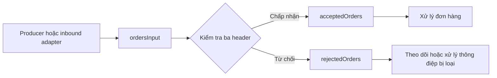

# Filter theo header

Trong module **SPRING_INTEGRATION_CORE**, filter theo header giúp quyết định một `Message<?>` có được tiếp tục qua luồng tích hợp hay không dựa trên metadata, thay vì phải đọc cấu trúc payload. Bài học thuộc chương **Filter**, kết nối `Message`, `MessageChannel`, endpoint và Java DSL với một tình huống tiếp nhận sự kiện đơn hàng.

Sau bài này, bạn có thể xác định hợp đồng header, viết điều kiện lọc bằng Java và SpEL, chọn cách xử lý thông điệp bị loại và xây dựng kiểm thử cho cả nhánh chấp nhận lẫn nhánh từ chối.

## 1. Tình huống: chỉ tiếp nhận đúng loại sự kiện của tenant được hỗ trợ

Một ứng dụng nhận sự kiện đơn hàng từ nhiều nguồn. Luồng xử lý hiện tại chỉ phục vụ tenant `tenant-a`, chỉ xử lý sự kiện `ORDER_CREATED` và không nhận dữ liệu thử nghiệm.

Payload có thể là chuỗi JSON, một DTO hoặc một đối tượng sự kiện. Quyết định tiếp nhận chỉ cần ba header sau:

| Header | Kiểu dữ liệu trong `MessageHeaders` | Điều kiện chấp nhận |
| --- | --- | --- |
| `app_tenantId` | `String` | Bằng `tenant-a` |
| `app_eventType` | `String` | Bằng `ORDER_CREATED` |
| `app_test` | `Boolean` | Bằng `Boolean.FALSE` |

Trong hợp đồng của ví dụ, cả ba header đều bắt buộc. Thiếu header, sai kiểu hoặc sai giá trị đều dẫn đến từ chối. Cụ thể, chuỗi `"false"` không tương đương giá trị Boolean `false`.



Trong ví dụ thực hành, `acceptedOrders` và `rejectedOrders` là các `QueueChannel` để dễ quan sát. Chúng là hàng đợi trong bộ nhớ; việc gửi vào các channel này chưa đồng nghĩa đã lưu bền vững hay hoàn tất nghiệp vụ.

## 2. Filter theo header hoạt động như thế nào?

Một `Message` gồm payload và headers. Filter sử dụng một điều kiện trả về boolean để quyết định có chuyển tiếp thông điệp hay không. Với `MessageSelector`, điểm vào là phương thức `boolean accept(Message<?> message)`. Kết quả `true` cho phép đi tiếp; `false` kích hoạt chính sách từ chối. Filter không dùng kết quả boolean làm payload mới. Đây là cơ chế của [Message Filter trong Spring Integration](https://docs.spring.io/spring-integration/reference/filter.html).

Trong luồng đang xét, filter đọc metadata rồi giữ nguyên nội dung nghiệp vụ. Chẳng hạn, hai thông điệp có cùng payload nhưng khác `app_tenantId` có thể đi vào hai nhánh khác nhau.

Cần phân biệt ba thao tác:

| Nhu cầu | Thành phần phù hợp | Kết quả mong muốn |
| --- | --- | --- |
| Cho thông điệp đi tiếp nếu header thỏa điều kiện | Message Filter | Chấp nhận hoặc từ chối cả thông điệp |
| Xóa một số header khỏi thông điệp | `HeaderFilter`, thường qua `.headerFilter(...)` | Thông điệp tiếp tục với tập header đã thay đổi |
| Chọn các đích xử lý khác nhau theo header | Router | Chuyển đến channel theo quy tắc định tuyến |

Ví dụ, yêu cầu “bỏ header nội bộ trước khi gửi ra ngoài” khác với yêu cầu “bỏ thông điệp có header không hợp lệ”. Đừng dùng thao tác xóa header để thay thế điều kiện kiểm soát đầu vào.

## 3. Xác định hợp đồng header trước khi viết điều kiện

### 3.1. Header là giá trị Java có kiểu

`MessageHeaders` cung cấp các giá trị dạng `Object`. Header trong thông điệp nội bộ có thể là `String`, `Boolean`, `Integer` hoặc kiểu khác; không nên giả định mọi header đều là chuỗi giống dữ liệu đọc trực tiếp từ giao thức HTTP. Cấu trúc map của headers thông thường là chỉ đọc, nhưng đối tượng được đặt làm giá trị có thể vẫn có trạng thái thay đổi. Xem [mô hình Message và headers](https://docs.spring.io/spring-integration/reference/message.html).

Tên header tùy biến cũng là một phần của hợp đồng. Trong ví dụ này, `app_tenantId` và `app_TenantId` là hai khóa khác nhau. Hãy dùng cùng tên và cùng kiểu ở producer, adapter, filter và kiểm thử.

Bảng quyết định cho yêu cầu của bài:

| `app_tenantId` | `app_eventType` | `app_test` | Kết quả |
| --- | --- | --- | --- |
| `"tenant-a"` | `"ORDER_CREATED"` | `Boolean.FALSE` | Chấp nhận |
| `"tenant-b"` | `"ORDER_CREATED"` | `Boolean.FALSE` | Từ chối: tenant khác |
| `"tenant-a"` | `"ORDER_CANCELLED"` | `Boolean.FALSE` | Từ chối: loại sự kiện khác |
| `"tenant-a"` | `"ORDER_CREATED"` | `Boolean.TRUE` | Từ chối: dữ liệu thử nghiệm |
| `"tenant-a"` | `"ORDER_CREATED"` | Chuỗi `"false"` | Từ chối: sai kiểu |
| Thiếu bất kỳ header bắt buộc nào | Bất kỳ | Bất kỳ | Từ chối |

Đây là chính sách do ứng dụng quy định. Spring Integration không tự suy ra rằng thiếu `app_test` nghĩa là dữ liệu thật.

### 3.2. Phân biệt header thiếu và header sai kiểu

Bạn có thể đọc trực tiếp một giá trị:

```java
Object tenant = message.getHeaders().get("app_tenantId");
boolean supportedTenant = "tenant-a".equals(tenant);

Object test = message.getHeaders().get("app_test");
boolean productionEvent = Boolean.FALSE.equals(test);
```

Cách so sánh trên xử lý được cả giá trị `null` khi thiếu header lẫn giá trị sai kiểu. Đặc biệt, `Boolean.FALSE.equals(test)` chỉ chấp nhận Boolean `false`.

Ngược lại, biểu thức sau sẽ chấp nhận cả thông điệp thiếu `app_test`:

```java
boolean productionEvent = !Boolean.TRUE.equals(test);
```

Lý do là `Boolean.TRUE.equals(null)` bằng `false`, rồi bị phủ định thành `true`. Biểu thức này chỉ phù hợp khi hợp đồng thực sự cho phép thiếu cờ thử nghiệm.

API cũng hỗ trợ đọc có kiểu:

```java
String tenant = message.getHeaders().get("app_tenantId", String.class);
```

Với cách đọc này, thiếu header trả về `null`, còn giá trị không khớp kiểu yêu cầu có thể gây `IllegalArgumentException`. Đây không phải API tự chuyển một `Integer` thành `String`. Nếu muốn dữ liệu sai kiểu được phân loại như từ chối thông thường, hãy kiểm tra kiểu hoặc so sánh an toàn thay vì dựa vào ép kiểu. Chi tiết nằm trong [Javadoc của MessageHeaders](https://docs.spring.io/spring-framework/docs/current/javadoc-api/org/springframework/messaging/MessageHeaders.html).

### 3.3. Chuẩn hóa ở biên tiếp nhận

Nếu nguồn gửi `app_test` dưới dạng chuỗi, cần một bước ánh xạ sang hợp đồng nội bộ trước khi vào filter. Với trường hợp này, có thể chấp nhận đúng hai giá trị đầu vào `"true"` và `"false"`, rồi tạo giá trị Boolean tương ứng.

Đừng dùng `Boolean.parseBoolean(...)` như một phép xác thực: nhiều chuỗi không phải `"true"` cũng cho kết quả `false`. Chẳng hạn, dữ liệu `"flase"` có thể vô tình bị xem là sự kiện thật nếu chỉ gọi hàm đó.

Việc chuẩn hóa nên phân biệt rõ:

- Giá trị nguồn hợp lệ và có thể chuyển đổi.
- Giá trị thiếu mà hợp đồng cho phép dùng mặc định.
- Giá trị thiếu hoặc không hợp lệ phải đưa vào nhánh xử lý dữ liệu lỗi.

Nếu cần bổ sung metadata đã tính toán, sử dụng một bước tạo message hoặc header enricher trước filter. Spring Integration có [Header Enricher](https://docs.spring.io/spring-integration/reference/content-enrichment.html#header-enricher) để bổ sung header; lựa chọn ghi đè phải phù hợp với nguồn dữ liệu được tin cậy.

## 4. Viết chính sách bằng Java

Các ví dụ dưới đây dùng Java 17 trở lên và API Java DSL của Spring Integration 6.5.x. Project cần dependency `org.springframework.integration:spring-integration-core`; kiểm thử dùng JUnit Jupiter. Hãy dùng phiên bản do BOM của project quản lý nếu project đã có BOM tương thích.

Lớp chính sách độc lập giúp gom tên header và quy tắc vào một nơi:

```java
package example.integration;

import org.springframework.messaging.Message;

public final class OrderHeaderPolicy {

    public static final String TENANT_ID = "app_tenantId";
    public static final String EVENT_TYPE = "app_eventType";
    public static final String TEST_EVENT = "app_test";

    public boolean accept(Message<?> message) {
        var headers = message.getHeaders();
        return "tenant-a".equals(headers.get(TENANT_ID))
                && "ORDER_CREATED".equals(headers.get(EVENT_TYPE))
                && Boolean.FALSE.equals(headers.get(TEST_EVENT));
    }
}
```

Ba phép so sánh này cố ý nghiêm ngặt với kiểu dữ liệu. Payload không được đọc, vì quy tắc tiếp nhận của bài chỉ phụ thuộc vào headers.

Chính sách nên thực hiện nhanh và không tạo tác dụng phụ như trừ tồn kho hoặc ghi nhận thanh toán. Một thông điệp có thể được xử lý lại khi hệ thống retry hoặc nhận lại từ nguồn. Nếu điều kiện cần tra cứu bên ngoài, hãy cân nhắc bổ sung dữ liệu thành một bước riêng với timeout và chính sách lỗi rõ ràng.

## 5. Gắn chính sách vào Java DSL

Cấu hình sau khai báo đầy đủ đầu vào và hai channel kết quả:

```java
package example.integration;

import org.springframework.context.annotation.Bean;
import org.springframework.context.annotation.Configuration;
import org.springframework.integration.channel.DirectChannel;
import org.springframework.integration.channel.QueueChannel;
import org.springframework.integration.config.EnableIntegration;
import org.springframework.integration.dsl.IntegrationFlow;
import org.springframework.messaging.Message;

@Configuration(proxyBeanMethods = false)
@EnableIntegration
public class HeaderFilterConfiguration {

    @Bean
    public DirectChannel ordersInput() {
        return new DirectChannel();
    }

    @Bean
    public QueueChannel acceptedOrders() {
        return new QueueChannel();
    }

    @Bean
    public QueueChannel rejectedOrders() {
        return new QueueChannel();
    }

    @Bean
    public OrderHeaderPolicy orderHeaderPolicy() {
        return new OrderHeaderPolicy();
    }

    @Bean
    public IntegrationFlow orderHeaderFlow(OrderHeaderPolicy policy) {
        return IntegrationFlow.from("ordersInput")
                .filter(Message.class,
                        message -> policy.accept(message),
                        endpoint -> endpoint
                                .id("orderHeaderFilter")
                                .discardChannel("rejectedOrders")
                                .throwExceptionOnRejection(false))
                .channel("acceptedOrders")
                .get();
    }
}
```

Ở đây, `Message.class` yêu cầu lambda nhận toàn bộ message để đọc headers. Với các overload filter nhận lambda theo payload, tham số lambda mặc định phục vụ việc kiểm tra payload; không nên chỉ đặt tên biến là `message` rồi giả định nó là `Message<?>`. Overload nhận kiểu tường minh được mô tả trong [Java DSL API 6.5.4](https://docs.spring.io/spring-integration/docs/6.5.4/api/org/springframework/integration/dsl/BaseIntegrationFlowDefinition.html).

`orderHeaderFilter` là tên endpoint phục vụ nhận diện trong cấu hình và quan sát luồng. Đây không phải tên của channel kết quả. `.channel("acceptedOrders")` xác định nơi nhận thông điệp đã qua điều kiện.

Ví dụ tạo và gửi một thông điệp hợp lệ, khi đã có biến `context` trỏ đến application context chứa cấu hình trên:

```java
import org.springframework.messaging.Message;
import org.springframework.messaging.MessageChannel;
import org.springframework.messaging.support.MessageBuilder;

Message<String> order = MessageBuilder
        .withPayload("{\"orderId\":\"O-1001\"}")
        .setHeader(OrderHeaderPolicy.TENANT_ID, "tenant-a")
        .setHeader(OrderHeaderPolicy.EVENT_TYPE, "ORDER_CREATED")
        .setHeader(OrderHeaderPolicy.TEST_EVENT, Boolean.FALSE)
        .build();

MessageChannel input = context.getBean("ordersInput", MessageChannel.class);
input.send(order);
```

Trong ứng dụng thực tế, outbound của một inbound adapter hoặc gateway có thể nối tới `ordersInput`. Filter vẫn nhận `Message` và áp dụng cùng hợp đồng, bất kể nguồn ban đầu là HTTP, một broker hay một tác vụ nội bộ.

## 6. Biểu diễn điều kiện bằng SpEL

### 6.1. Dùng biểu thức cho quy tắc đơn giản

Trong ngữ cảnh biểu thức của Spring Integration, có thể truy cập `headers` và `payload` từ message. Dạng `headers['tên_header']` thể hiện rõ việc tra cứu theo khóa. Xem [SpEL trong Spring Integration](https://docs.spring.io/spring-integration/reference/spel.html).

Ví dụ chỉ lọc tenant và loại sự kiện:

```java
@Bean
public IntegrationFlow simpleHeaderExpressionFlow() {
    return IntegrationFlow.from("ordersInput")
            .filter("headers['app_tenantId'] == 'tenant-a' "
                            + "and headers['app_eventType'] == 'ORDER_CREATED'",
                    endpoint -> endpoint.discardChannel("rejectedOrders"))
            .channel("acceptedOrders")
            .get();
}
```

Đoạn này chỉ minh họa cú pháp và chưa kiểm tra `app_test`. Nếu muốn biểu diễn đầy đủ hợp đồng với kiểm tra kiểu tường minh:

```java
@Bean
public IntegrationFlow strictHeaderExpressionFlow() {
    String expression =
            "headers['app_tenantId'] instanceof T(java.lang.String) "
            + "and headers['app_tenantId'] == 'tenant-a' "
            + "and headers['app_eventType'] instanceof T(java.lang.String) "
            + "and headers['app_eventType'] == 'ORDER_CREATED' "
            + "and headers['app_test'] instanceof T(java.lang.Boolean) "
            + "and headers['app_test'] == false";

    return IntegrationFlow.from("ordersInput")
            .filter(expression,
                    endpoint -> endpoint.discardChannel("rejectedOrders"))
            .channel("acceptedOrders")
            .get();
}
```

Kiểm tra `instanceof` giúp diễn đạt yêu cầu kiểu của hợp đồng và tránh lệ thuộc vào kỳ vọng về chuyển đổi dữ liệu trong biểu thức. Với các trường hợp đầu vào ở bảng quyết định, điều kiện này được thiết kế để có kết quả giống `OrderHeaderPolicy`.

Các flow trong mục này là phương án thay thế cho `orderHeaderFlow`. Chỉ đăng ký một phương án trong application context khi thực hành. Nhiều subscriber cùng gắn vào một `DirectChannel` không tạo ra chuỗi filter lần lượt; nó có thể phân phối thông điệp giữa các subscriber.

### 6.2. Khi nào nên chuyển từ SpEL sang Java?

Nếu biểu thức bắt đầu chứa nhiều kiểm tra kiểu, chuẩn hóa, danh sách cho phép hoặc nhiều nhánh nghiệp vụ, lớp Java thường dễ đọc và dễ kiểm thử hơn. Có thể dùng SpEL gọi bean chính sách thay vì sao chép logic:

```java
.filter("@orderHeaderPolicy.accept(#root)",
        endpoint -> endpoint.discardChannel("rejectedOrders"))
```

Ở vị trí filter này, `#root` là message đang được đánh giá. Bean có tên `orderHeaderPolicy` đã được khai báo trong cấu hình phía trên.

Biểu thức là cấu hình do ứng dụng kiểm soát. Không ghép trực tiếp một đoạn SpEL do bên gửi cung cấp thành điều kiện được thực thi.

## 7. Chọn chính sách cho thông điệp bị loại

Một điều kiện lọc chỉ trả lời thông điệp có đủ điều kiện hay không. Bạn còn phải xác định điều gì xảy ra khi kết quả là `false`.

| `discardChannel` | `throwExceptionOnRejection` | Hành vi khi bị từ chối |
| --- | --- | --- |
| Không có | `false` | Không chuyển tiếp sang đầu ra và không có nhánh nhận thông điệp bị loại |
| Có | `false` | Gửi thông điệp vào discard channel |
| Không có | `true` | Phát sinh `MessageRejectedException` |
| Có | `true` | Gửi vào discard channel rồi phát sinh exception nếu bước gửi hoàn tất bình thường |

Giá trị mặc định của `throwExceptionOnRejection` là `false`; mặc định cũng không có discard channel. Cả hai thiết lập có hiệu lực độc lập, theo [Javadoc FilterEndpointSpec](https://docs.spring.io/spring-integration/api/org/springframework/integration/dsl/FilterEndpointSpec.html).

Với bài toán sự kiện đơn hàng, từ chối tenant khác hoặc sự kiện thử nghiệm là kết quả có thể dự kiến. Gửi sang `rejectedOrders` giúp quan sát và xử lý tiếp mà không biến mọi trường hợp bị loại thành lỗi kỹ thuật.

Nếu chọn bỏ thông điệp mà không có discard channel, nên bảo đảm đó là chính sách có chủ đích và vẫn có số liệu quan sát phù hợp. Một thông điệp không đi đến đầu ra không tự xuất hiện trong `errorChannel`.

### 7.1. Từ chối và lỗi đánh giá là hai tình huống khác nhau

Xét hai trường hợp:

- Policy trả về `false` vì tenant không được hỗ trợ: áp dụng chính sách từ chối.
- Policy ném exception do ép kiểu sai, hoặc SpEL gọi phương thức trên giá trị thiếu: đây là lỗi xử lý; không tự trở thành kết quả `false` để đi qua discard channel.

Trong một luồng đồng bộ dùng `DirectChannel`, exception có thể truyền về bên gửi. Với một ranh giới bất đồng bộ hoặc poller, việc phát `ErrorMessage` phụ thuộc cơ chế xử lý lỗi của endpoint và hạ tầng tương ứng. Chỉ đặt header `errorChannel` không khiến mọi thao tác `send()` đồng bộ tự đổi exception thành message lỗi. Xem [Error Handling](https://docs.spring.io/spring-integration/reference/error-handling.html).

Nếu bật đồng thời discard và exception, cần tính đến retry: hành động ghi nhận ở nhánh discard có thể lặp lại khi lần xử lý được thử lại. Một predicate luôn sai do tenant không phù hợp thường không thể được sửa bằng cách retry cùng dữ liệu.

### 7.2. Discard channel cần có chiến lược tiêu thụ

`rejectedOrders` trong bài là `QueueChannel` để kiểm thử. Khi đưa vào ứng dụng, hãy nối một consumer để ghi nhận, lưu trữ hoặc phân loại thông điệp bị loại. Một hàng đợi trong bộ nhớ không có consumer có thể tích lũy dữ liệu và không bảo vệ dữ liệu qua lần khởi động lại.

Filter trả về boolean nên không tự đính kèm lý do loại bỏ cụ thể. Nếu cần thống kê theo `MISSING_TENANT`, `UNSUPPORTED_TENANT` hoặc `TEST_EVENT`, có thể xây một bước phân loại trước filter, rồi đặt kết quả vào header nội bộ. Một lựa chọn khác là dùng router khi yêu cầu chính là nhiều nhánh xử lý có ý nghĩa nghiệp vụ.

## 8. Lưu ý khi gọi qua gateway

Một gateway dạng yêu cầu–phản hồi thường chờ kết quả. Nếu filter loại bỏ request và nhánh discard chỉ lưu hoặc ghi log, caller chưa nhận được phản hồi nghiệp vụ. Caller có thể nhận `null`, gặp timeout hoặc exception tùy chữ ký gateway và cấu hình.

Do đó, trước khi đặt filter trong đường đi của gateway, hãy chọn rõ một hợp đồng:

- Gateway một chiều khi bên gửi chỉ cần đẩy sự kiện và không chờ kết quả.
- Phản hồi từ chối có cấu trúc nếu caller cần biết vì sao yêu cầu không được xử lý.
- Exception có chủ đích nếu trường hợp bị loại được xem là lỗi theo hợp đồng dịch vụ.

Không dùng giá trị boolean trả về từ `MessageChannel.send(...)` làm bằng chứng rằng filter đã chấp nhận nghiệp vụ. Trong luồng của bài, một lần gửi có thể thành công trong khi thông điệp được đưa vào `rejectedOrders`.

## 9. Kiểm thử theo hợp đồng header và kết quả channel

Cần kiểm tra ít nhất hai lớp hành vi: quy tắc đầu vào có cho kết quả đúng không, và flow có chuyển thông điệp vào đúng channel không. Những ca thiếu header, sai kiểu và sai giá trị đặc biệt hữu ích vì chúng dễ bị bỏ sót khi chỉ kiểm tra trường hợp hợp lệ.

Lớp JUnit Jupiter sau sử dụng trực tiếp `AnnotationConfigApplicationContext`, không yêu cầu khởi động Spring Boot hoặc kết nối broker:

```java
package example.integration;

import java.util.List;

import org.junit.jupiter.api.Test;
import org.springframework.context.annotation.AnnotationConfigApplicationContext;
import org.springframework.integration.channel.QueueChannel;
import org.springframework.messaging.Message;
import org.springframework.messaging.MessageChannel;
import org.springframework.messaging.support.MessageBuilder;

import static org.junit.jupiter.api.Assertions.*;

class HeaderFilterFlowTest {

    private static MessageBuilder<String> validOrder() {
        return MessageBuilder.withPayload("order:O-1001")
                .setHeader(OrderHeaderPolicy.TENANT_ID, "tenant-a")
                .setHeader(OrderHeaderPolicy.EVENT_TYPE, "ORDER_CREATED")
                .setHeader(OrderHeaderPolicy.TEST_EVENT, Boolean.FALSE);
    }

    @Test
    void acceptsValidHeadersAndPreservesBusinessData() {
        try (var context = new AnnotationConfigApplicationContext(
                HeaderFilterConfiguration.class)) {
            var input = context.getBean("ordersInput", MessageChannel.class);
            var accepted = context.getBean("acceptedOrders", QueueChannel.class);
            var rejected = context.getBean("rejectedOrders", QueueChannel.class);

            Message<String> original = validOrder().build();
            assertTrue(input.send(original));

            Message<?> result = accepted.receive(0);
            assertNotNull(result);
            assertEquals(original.getPayload(), result.getPayload());
            assertEquals("tenant-a",
                    result.getHeaders().get(OrderHeaderPolicy.TENANT_ID));
            assertEquals("ORDER_CREATED",
                    result.getHeaders().get(OrderHeaderPolicy.EVENT_TYPE));
            assertEquals(Boolean.FALSE,
                    result.getHeaders().get(OrderHeaderPolicy.TEST_EVENT));
            assertNull(rejected.receive(0));
            assertNull(accepted.receive(0));
        }
    }

    @Test
    void rejectsMissingWrongTypeAndUnsupportedHeaders() {
        List<Message<String>> rejectedMessages = List.of(
                validOrder()
                        .removeHeader(OrderHeaderPolicy.TENANT_ID).build(),
                validOrder()
                        .removeHeader(OrderHeaderPolicy.EVENT_TYPE).build(),
                validOrder()
                        .removeHeader(OrderHeaderPolicy.TEST_EVENT).build(),
                validOrder()
                        .setHeader(OrderHeaderPolicy.TENANT_ID, "tenant-b").build(),
                validOrder()
                        .setHeader(OrderHeaderPolicy.TENANT_ID, 123).build(),
                validOrder()
                        .setHeader(OrderHeaderPolicy.EVENT_TYPE, "ORDER_CANCELLED")
                        .build(),
                validOrder()
                        .setHeader(OrderHeaderPolicy.TEST_EVENT, Boolean.TRUE)
                        .build(),
                validOrder()
                        .setHeader(OrderHeaderPolicy.TEST_EVENT, "false").build());

        try (var context = new AnnotationConfigApplicationContext(
                HeaderFilterConfiguration.class)) {
            var input = context.getBean("ordersInput", MessageChannel.class);
            var accepted = context.getBean("acceptedOrders", QueueChannel.class);
            var rejected = context.getBean("rejectedOrders", QueueChannel.class);

            for (Message<String> message : rejectedMessages) {
                assertTrue(input.send(message));
                assertNull(accepted.receive(0));

                Message<?> result = rejected.receive(0);
                assertNotNull(result);
                assertEquals(message.getPayload(), result.getPayload());
                assertEquals(message.getHeaders(), result.getHeaders());
                assertNull(rejected.receive(0));
            }
        }
    }

    @Test
    void policyUsesHeadersIndependentlyOfPayloadType() {
        var policy = new OrderHeaderPolicy();
        Message<Integer> numericPayload = MessageBuilder.withPayload(42)
                .setHeader(OrderHeaderPolicy.TENANT_ID, "tenant-a")
                .setHeader(OrderHeaderPolicy.EVENT_TYPE, "ORDER_CREATED")
                .setHeader(OrderHeaderPolicy.TEST_EVENT, Boolean.FALSE)
                .build();

        assertTrue(policy.accept(numericPayload));
    }
}
```

`receive(0)` không chờ vì `ordersInput` dùng `DirectChannel`: khi `send()` trả về bình thường, việc gửi vào hàng đợi kết quả trong cấu hình này đã diễn ra. Nếu đổi sang `ExecutorChannel`, cần dùng thời gian chờ hữu hạn hoặc công cụ chờ phù hợp, rồi kiểm tra hành vi bất đồng bộ thay vì giữ nguyên giả định đồng bộ.

Ca kiểm thử từ chối cũng cố ý khẳng định `input.send(...)` trả về `true`. Điều được xác minh là thông điệp đến đúng nhánh kết quả, chứ không suy diễn quyết định nghiệp vụ từ giá trị của thao tác gửi.

Khi thay chính sách Java bằng SpEL, hãy chạy cùng tập dữ liệu hợp đồng với cấu hình thay thế để phát hiện khác biệt về kiểu và giá trị thiếu. Nếu bật `throwExceptionOnRejection(true)`, bổ sung kiểm thử bắt exception và kiểm tra discard theo cấu hình mới.

## 10. Chẩn đoán các lỗi thường gặp

| Hiện tượng | Khả năng cần kiểm tra | Cách xử lý |
| --- | --- | --- |
| Thông điệp luôn bị loại | Tên header khác, giá trị sai kiểu hoặc bị adapter bỏ qua | Kiểm tra metadata ngay trước filter và đối chiếu hợp đồng |
| Dữ liệu thiếu `app_test` vẫn đi tiếp | Dùng `!Boolean.TRUE.equals(value)` | Dùng `Boolean.FALSE.equals(value)` nếu header bắt buộc |
| Giá trị `"false"` bị loại | Producer gửi chuỗi thay vì Boolean | Chuẩn hóa ở biên hoặc sửa producer theo hợp đồng |
| Có exception thay vì đi vào discard | Predicate hoặc biểu thức bị lỗi khi đánh giá | Phân biệt dữ liệu không đủ điều kiện với lỗi trong logic |
| Một số thông điệp không qua filter dự kiến | Nhiều flow cùng subscribe vào `DirectChannel` đầu vào | Chỉ đăng ký cấu hình cần dùng hoặc thiết kế lại topology |
| Gateway chờ lâu sau khi bị từ chối | Không có phản hồi trên nhánh từ chối | Thiết kế phản hồi, exception hoặc gateway một chiều |
| Nhánh loại bỏ tăng bộ nhớ | `QueueChannel` thiếu consumer hoặc thiếu giới hạn phù hợp | Bổ sung consumer và cơ chế lưu trữ theo yêu cầu vận hành |

Khi chẩn đoán, ưu tiên log tên endpoint, mã thông điệp, loại sự kiện, quyết định chấp nhận và mã lý do nếu có. Hạn chế ghi nguyên payload hoặc toàn bộ headers vì chúng có thể chứa dữ liệu cá nhân hoặc thông tin xác thực. Nếu thu thập metrics, tránh dùng những giá trị có rất nhiều khả năng khác nhau như message ID làm nhãn.

Header liên quan tenant hoặc quyền truy cập chỉ có ý nghĩa khi được thiết lập từ nguồn đáng tin cậy. Producer bên ngoài tự khai báo `app_tenantId = tenant-a` không phải bằng chứng đã được cấp quyền. Hệ thống cần xác thực nguồn và ràng buộc danh tính với tenant trước bước lọc nghiệp vụ.

## 11. Bài thực hành củng cố

Mở rộng chính sách để chỉ chấp nhận `app_schemaVersion` thuộc kiểu `Integer` và bằng `1`.

1. Thêm tên header vào `OrderHeaderPolicy` và cập nhật hợp đồng đầu vào.
2. Thêm điều kiện yêu cầu đúng kiểu và đúng giá trị vào policy.
3. Tạo các thông điệp có giá trị `1`, `"1"`, `2` và không có header.
4. Xác minh chỉ trường hợp `Integer.valueOf(1)` được chấp nhận khi ba header cũ đều hợp lệ.
5. Nếu có phương án SpEL, kiểm tra nó bằng cùng các trường hợp trên.

Tiếp theo, thử chuyển `app_test` thành header không bắt buộc với quy tắc “thiếu nghĩa là false”. Trước khi sửa code, cập nhật bảng quyết định và chỉ ra ca kiểm thử phải đổi kỳ vọng. Bài tập này cho thấy chính sách đối với dữ liệu thiếu là một quyết định nghiệp vụ cần được ghi rõ.
