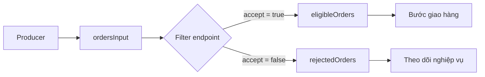

# Filter endpoint

Trong module **SPRING_INTEGRATION_CORE**, filter endpoint là nơi áp dụng một điều kiện để quyết định thông điệp có tiếp tục trong luồng hay không. Bài này thuộc chương **Filter**, nối kiến thức về `Message`, `MessageChannel` và endpoint với cách cấu hình Java DSL, xử lý từ chối, xử lý lỗi và kiểm thử một luồng tích hợp.

Sau bài học, bạn có thể đặt filter vào đúng vị trí trong flow, chọn cách tiếp nhận thông điệp, khai báo nhánh từ chối và kiểm tra được hành vi của cả hai nhánh. Ví dụ xuyên suốt là tiếp nhận sự kiện đơn hàng trước khi chuyển sang bước xử lý giao hàng.

## 1. Bài toán: đơn hàng nào được tiếp tục?

Giả sử hệ thống nhận sự kiện `OrderPlaced` từ nhiều nguồn. Bước giao hàng chỉ tiếp nhận đơn thỏa mãn đồng thời ba điều kiện:

- Tổng tiền tính bằng đồng Việt Nam lớn hơn `0`.
- Mã tiền tệ là `VND`.
- Đơn chưa bị hủy.

Đơn không đạt điều kiện được chuyển sang kênh theo dõi nghiệp vụ. Chúng vẫn là những sự kiện hệ thống đã tiếp nhận; việc không phù hợp với bước giao hàng chưa đủ để kết luận rằng hạ tầng đang gặp lỗi.



Filter thực hiện quyết định có/không cho một đường đi tiếp. Router phù hợp hơn khi cần lựa chọn nhiều đích như giao hàng nội địa, quốc tế và nhận tại cửa hàng. Nhánh discard giúp filter biểu diễn thêm đường xử lý cho kết quả `false`. [Tài liệu Filter](https://docs.spring.io/spring-integration/reference/filter.html).

Trong ví dụ này, điều kiện tổng tiền chỉ là quy tắc của luồng giao hàng. Nó không thay thế việc kiểm tra định dạng sự kiện, xác thực nguồn gửi hoặc kiểm tra toàn vẹn dữ liệu ở biên hệ thống.

## 2. Một filter endpoint gồm những gì?

Cần phân biệt điều kiện lựa chọn, handler thực thi điều kiện và endpoint kết nối handler với channel.

| Thành phần | Trách nhiệm | Ví dụ trong bài |
|---|---|---|
| Input channel | Nhận thông điệp từ bước trước | `ordersInput` |
| Selector | Trả về quyết định chấp nhận | `isEligible(order)` |
| `MessageFilter` | Gọi selector và thực hiện chính sách chuyển tiếp/từ chối | Handler do DSL tạo |
| Consumer endpoint | Gắn handler vào cơ chế nhận thông điệp, quản lý vòng đời | Endpoint `orderEligibilityFilter` |
| Output channel | Nhận thông điệp được chấp nhận | `eligibleOrders` |
| Discard channel | Nhận thông điệp không được chấp nhận, nếu cấu hình | `rejectedOrders` |

`MessageFilter` ủy quyền việc lựa chọn cho `MessageSelector`. Hợp đồng của selector là `boolean accept(Message<?> message)`. Kết quả boolean điều khiển đường đi; nó không trở thành payload đầu ra. [Javadoc MessageFilter](https://docs.spring.io/spring-integration/api/org/springframework/integration/filter/MessageFilter.html), [Javadoc MessageSelector](https://docs.spring.io/spring-integration/api/org/springframework/integration/core/MessageSelector.html).

Consumer endpoint có hai hình thức quan trọng:

- Với `SubscribableChannel`, chẳng hạn `DirectChannel`, framework dùng cơ chế nhận theo sự kiện, thường là `EventDrivenConsumer`.
- Với `PollableChannel`, chẳng hạn `QueueChannel`, framework dùng `PollingConsumer` để lấy thông điệp theo lịch.

Vì vậy, chỉ tạo `new MessageFilter(selector)` chưa tạo thành một endpoint đang lắng nghe channel. Cần cấu hình kết nối và vòng đời; Java DSL và annotation đảm nhiệm phần này. [Tài liệu Message Endpoints](https://docs.spring.io/spring-integration/reference/endpoint.html).

Một selector nên trả lời câu hỏi nghiệp vụ một cách rõ ràng. Việc cập nhật trạng thái giao hàng, ghi thanh toán hoặc gửi email nên nằm ở các endpoint tiếp theo. Cách tổ chức đó giúp chạy lại điều kiện lọc mà không vô tình lặp lại tác dụng phụ.

## 3. Cấu hình đầy đủ bằng Java DSL

Ví dụ dùng Java 17 trở lên và API Java DSL `IntegrationFlow.from(...)`. Môi trường thực hành cần `spring-integration-core` cùng các thành phần Spring Context tương thích. Phần kiểm thử bên dưới dùng JUnit Jupiter. Nếu dự án dùng Spring Boot, có thể sử dụng starter integration và starter test theo bộ dependency do dự án quản lý; không trộn tùy ý phiên bản Spring giữa các thư viện.

Lưu lớp minh họa sau trong package `example.integration` của một dự án thực hành:

```java
package example.integration;

import org.springframework.beans.factory.annotation.Qualifier;
import org.springframework.context.annotation.Bean;
import org.springframework.context.annotation.Configuration;
import org.springframework.integration.channel.DirectChannel;
import org.springframework.integration.channel.QueueChannel;
import org.springframework.integration.config.EnableIntegration;
import org.springframework.integration.dsl.IntegrationFlow;
import org.springframework.messaging.MessageChannel;

@Configuration
@EnableIntegration
public class OrderFilterConfig {

    public record OrderPlaced(
            String orderId,
            long totalInDong,
            String currency,
            boolean cancelled) {
    }

    @Bean
    public DirectChannel ordersInput() {
        return new DirectChannel();
    }

    @Bean
    public QueueChannel eligibleOrders() {
        return new QueueChannel(100);
    }

    @Bean
    public QueueChannel rejectedOrders() {
        return new QueueChannel(100);
    }

    @Bean
    public IntegrationFlow eligibleOrdersFlow(
            @Qualifier("ordersInput") MessageChannel input) {

        return IntegrationFlow.from(input)
                .filter(OrderPlaced.class,
                        OrderFilterConfig::isEligible,
                        endpoint -> endpoint
                                .id("orderEligibilityFilter")
                                .discardChannel("rejectedOrders")
                                .throwExceptionOnRejection(false))
                .channel("eligibleOrders")
                .get();
    }

    public static boolean isEligible(OrderPlaced order) {
        return order.totalInDong() > 0
                && "VND".equals(order.currency())
                && !order.cancelled();
    }
}
```

Ba phần của lời gọi `.filter(...)` phục vụ các mục đích khác nhau:

1. `OrderPlaced.class` xác định kiểu payload mà điều kiện nhận vào.
2. `OrderFilterConfig::isEligible` cung cấp điều kiện lọc payload.
3. `endpoint -> ...` cấu hình endpoint và chính sách từ chối.

Sau khi context khởi động, DSL tạo và nối các bean tích hợp thực tế. `IntegrationFlow` là mô tả cấu hình; thông điệp được xử lý bởi các channel, handler và consumer endpoint đã đăng ký. [Tài liệu DSL Basics](https://docs.spring.io/spring-integration/reference/dsl/java-basics.html).

Dòng `.channel("eligibleOrders")` là đích cho nhánh chấp nhận. `discardChannel("rejectedOrders")` là đích cho nhánh từ chối. Tên `orderEligibilityFilter` giúp nhận diện endpoint khi theo dõi vận hành hoặc điều khiển vòng đời.

### Thử gửi một sự kiện

Đoạn sau đặt trong phương thức của một lớp chạy thử cùng package, sau khi import `AnnotationConfigApplicationContext` và `MessageBuilder`:

```java
try (var context = new AnnotationConfigApplicationContext(
        OrderFilterConfig.class)) {

    var input = context.getBean("ordersInput", MessageChannel.class);
    var accepted = context.getBean("eligibleOrders", QueueChannel.class);
    var rejected = context.getBean("rejectedOrders", QueueChannel.class);

    var order = new OrderFilterConfig.OrderPlaced(
            "ORD-101", 250_000, "VND", false);

    var message = MessageBuilder.withPayload(order)
            .setHeader("traceId", "trace-101")
            .build();

    boolean delivered = input.send(message);
    System.out.println(delivered);          // true
    System.out.println(accepted.receive(0)); // Message chứa ORD-101
    System.out.println(rejected.receive(0)); // null
}
```

Các kiểu `MessageChannel` và `QueueChannel` có package như trong lớp cấu hình. Hai import bổ sung là:

```java
import org.springframework.context.annotation.AnnotationConfigApplicationContext;
import org.springframework.integration.support.MessageBuilder;
```

Trong ví dụ, input là `DirectChannel`: selector chạy trên chính luồng gọi `send()`. Hai channel đầu ra là queue để có thể lấy kết quả thủ công bằng `receive(0)`. Chúng chưa có consumer giao hàng hoặc consumer theo dõi nghiệp vụ. [Tài liệu triển khai MessageChannel](https://docs.spring.io/spring-integration/reference/channel/implementations.html).

Queue giới hạn `100` giúp thể hiện dung lượng cụ thể cho bài thực hành. Khi chưa có consumer và queue đầy, thao tác gửi tiếp có thể chờ. Khi triển khai thực tế, cần thiết kế khả năng tiêu thụ, timeout và lưu trữ; một `QueueChannel` thông thường lưu thông điệp trong bộ nhớ.

## 4. Điều kiện đọc payload hay toàn bộ Message?

Biểu thức sau nhận **payload**:

```java
.filter(OrderPlaced.class, OrderFilterConfig::isEligible)
```

Nếu điều kiện còn phụ thuộc header, hãy dùng `MessageSelector` để thể hiện rõ rằng đầu vào là một `Message<?>`. Ví dụ, thay phần thân của bean `eligibleOrdersFlow` bằng đoạn sau và import `org.springframework.integration.core.MessageSelector`:

```java
MessageSelector selector = message ->
        message.getPayload() instanceof OrderPlaced order
                && isEligible(order)
                && "partner-a".equals(
                        message.getHeaders().get("source"));

return IntegrationFlow.from(input)
        .filter(selector, endpoint -> endpoint
                .id("orderEligibilityFilter")
                .discardChannel("rejectedOrders"))
        .channel("eligibleOrders")
        .get();
```

Biến `input`, kiểu `OrderPlaced` và hàm `isEligible` được giữ như cấu hình chính. Đây là phương án thay thế cho filter trước đó, không phải một consumer bổ sung cùng gắn vào `ordersInput`.

Với quy tắc mới, thiếu header `source` hoặc giá trị khác `partner-a` dẫn tới từ chối. Producer muốn thông điệp đi tiếp cần đặt header tương ứng:

```java
MessageBuilder.withPayload(order)
        .setHeader("source", "partner-a")
        .setHeader("traceId", "trace-101")
        .build();
```

`MessageSelector` cho phép đọc cả payload và headers qua cùng một đối tượng. Việc gán lambda cho kiểu này cũng tránh hiểu nhầm rằng một lambda payload thông thường sẽ tự động nhận `Message`. [Javadoc MessageSelector](https://docs.spring.io/spring-integration/api/org/springframework/integration/core/MessageSelector.html), [lưu ý về lambda trong Java DSL](https://docs.spring.io/spring-integration/reference/dsl/java-basics.html).

Filter không tự chuẩn hóa `vnd` thành `VND` hoặc thêm lý do từ chối. Nếu cần các thay đổi đó, hãy đặt transformer hoặc header enricher ở vị trí rõ ràng trong flow. Trong ví dụ, thông điệp đi tiếp vẫn mang dữ liệu đơn hàng và header `traceId`, thay vì một boolean thể hiện quyết định.

## 5. Chọn chính sách cho kết quả false

Hai tùy chọn quan trọng là `discardChannel` và `throwExceptionOnRejection`.

| Có discard channel? | `throwExceptionOnRejection` | Hành vi khi selector trả `false` |
|---|---|---|
| Không | `false` | Không chuyển tiếp và không ném lỗi từ chối |
| Có | `false` | Gửi thông điệp gốc sang discard channel |
| Không | `true` | Ném `MessageRejectedException` |
| Có | `true` | Thực hiện gửi sang discard channel, sau đó ném `MessageRejectedException` nếu bước gửi hoàn tất bình thường |

Giá trị mặc định của cờ là `false`. Việc có discard channel không vô hiệu hóa cờ ném lỗi. Nếu chính bước gửi discard thất bại, lỗi gửi cũng có thể ngắt quá trình xử lý. [Javadoc FilterEndpointSpec](https://docs.spring.io/spring-integration/api/org/springframework/integration/dsl/FilterEndpointSpec.html).

Từ Spring Integration 6.1, trường hợp bỏ thông điệp mà không có discard channel và không ném lỗi có log cảnh báo. Khi chủ đích là bỏ qua hoàn toàn, có thể khai báo `.discardChannel("nullChannel")` để dùng `NullChannel` của framework. [Tài liệu cấu hình Filter](https://docs.spring.io/spring-integration/reference/filter.html).

Lựa chọn trong bài là `discardChannel` cùng cờ `false`: một đơn bị hủy cần có nơi theo dõi, nhưng không cần làm lần gửi thất bại. Trái lại, một luồng có hợp đồng bắt buộc mọi thông điệp đều hợp lệ có thể chọn cờ `true` để bên gọi nhận biết việc vi phạm.

Một chi tiết dễ nhầm là `input.send(message)` vẫn có thể trả `true` khi selector trả `false`. Trong cấu hình chính, thao tác gửi đã được endpoint xử lý thành công bằng cách chuyển thông điệp sang `rejectedOrders`. Muốn biết kết quả nghiệp vụ, hãy đọc đúng nhánh hoặc thiết kế một phản hồi nghiệp vụ riêng.

### Discard khác xử lý lỗi

`discardChannel` nhận thông điệp bị từ chối theo điều kiện. Một `ErrorMessage` dùng trong cơ chế xử lý lỗi thường có payload là exception. Nếu selector tự ném exception, chẳng hạn do gọi dịch vụ bên ngoài bị lỗi, điều đó không tương đương với việc selector trả `false`. [Javadoc MessageFilter](https://docs.spring.io/spring-integration/api/org/springframework/integration/filter/MessageFilter.html), [tài liệu Error Handling](https://docs.spring.io/spring-integration/reference/error-handling.html).

Với đầu vào `DirectChannel` của bài, exception từ quá trình xử lý đồng bộ được truyền về bên gọi `send()`. Chỉ đặt header `errorChannel` không khiến mọi lỗi đồng bộ tự chuyển thành thông điệp lỗi. Với tác vụ bất đồng bộ hoặc scheduled poller do framework quản lý, cơ chế báo lỗi có thể phát `ErrorMessage` tới error channel thích hợp. [Tài liệu Error Handling](https://docs.spring.io/spring-integration/reference/error-handling.html).

Nếu bật cả discard và ném lỗi, hãy xét việc gửi lại: thao tác theo dõi ở nhánh discard có thể đã xảy ra trước khi bên gọi nhận lỗi. Một lần thử lại có thể ghi nhận trùng đơn. Thiết kế này cần khóa nghiệp vụ hoặc cách xử lý lặp phù hợp với hệ thống nguồn.

## 6. Biểu diễn endpoint bằng annotation

Khi quy tắc thuộc về một phương thức của bean nghiệp vụ, có thể dùng `@Filter`. Ví dụ sau là phương án thay thế bean DSL `eligibleOrdersFlow` trong cấu hình chính; giữ nguyên các bean channel và `@EnableIntegration`.

```java
@org.springframework.integration.annotation.Filter(
        inputChannel = "ordersInput",
        outputChannel = "eligibleOrders",
        discardChannel = "rejectedOrders",
        throwExceptionOnRejection = "false")
public boolean acceptOrder(OrderPlaced order) {
    return isEligible(order);
}
```

Vì phương thức được đặt trong lớp `@Configuration` đã đăng ký, framework có thể phát hiện annotation trên bean đó. Nếu tách phương thức sang một lớp chính sách riêng, lớp ấy cũng phải được đăng ký làm Spring bean.

Phương thức annotation nhận payload hoặc `Message<?>` và trả `boolean`/`Boolean`. Các thuộc tính annotation như `throwExceptionOnRejection` dùng chuỗi, khác với lời gọi Java DSL nhận boolean. [Javadoc @Filter](https://docs.spring.io/spring-integration/api/org/springframework/integration/annotation/Filter.html).

Không đồng thời giữ cả consumer annotation và consumer DSL trên `ordersInput` nếu mục tiêu là thay thế cách cấu hình. `DirectChannel` có ngữ nghĩa point-to-point; nhiều subscriber có thể chia nhau thông điệp. Việc cùng nghe một channel không có nghĩa là hai điều kiện được thực hiện nối tiếp. [Tài liệu DirectChannel](https://docs.spring.io/spring-integration/reference/channel/implementations.html).

## 7. Khi input chuyển thành QueueChannel

Giả sử producer cần đẩy sự kiện vào một hàng đợi nội bộ rồi quay lại công việc khác. Có thể thay bean `ordersInput` bằng:

```java
@Bean
public QueueChannel ordersInput() {
    return new QueueChannel(100);
}
```

Bean flow vẫn nhận input qua `MessageChannel`. Tuy nhiên, endpoint cần một poller, được khai báo cục bộ hoặc thông qua cấu hình poller mặc định. Ví dụ thay cấu hình flow bằng:

```java
@Bean
public IntegrationFlow eligibleOrdersFlow(
        @Qualifier("ordersInput") MessageChannel input) {

    return IntegrationFlow.from(input)
            .filter(OrderPlaced.class,
                    OrderFilterConfig::isEligible,
                    endpoint -> endpoint
                            .id("orderEligibilityFilter")
                            .poller(Pollers.fixedDelay(
                                            Duration.ofMillis(100))
                                    .maxMessagesPerPoll(10))
                            .discardChannel("rejectedOrders"))
            .channel("eligibleOrders")
            .get();
}
```

Các import bổ sung là `java.time.Duration` và `org.springframework.integration.dsl.Pollers`. `fixedDelay` đặt khoảng nghỉ giữa các lượt polling, còn `maxMessagesPerPoll(10)` giới hạn số thông điệp lấy trong một lượt. Poller thuộc endpoint đang tiêu thụ từ input, không thuộc selector. [Tài liệu Java DSL Pollers](https://docs.spring.io/spring-integration/reference/dsl/java-pollers.html).

Khác với ví dụ đồng bộ, gửi vào queue thành công chưa có nghĩa selector đã chạy. Khi kiểm thử biến thể này, cần chờ kết quả với timeout hữu hạn, chẳng hạn `receive(2_000)`, thay vì kiểm tra tức thời bằng `receive(0)`.

Endpoint còn có vòng đời. Chẳng hạn, `.autoStartup(false)` khiến consumer không tự bắt đầu khi context khởi động. Với một `DirectChannel` chỉ có consumer đó, gửi khi consumer chưa chạy có thể gặp lỗi không có subscriber. Với input queue, thông điệp có thể nằm chờ trong giới hạn dung lượng. Vì vậy, cần phân biệt endpoint chưa chạy với điều kiện lọc đang từ chối. [Tài liệu Message Endpoints](https://docs.spring.io/spring-integration/reference/endpoint.html).

## 8. Đặt filter trong luồng có gateway

Ví dụ chính là luồng một chiều: đầu ra được đưa vào queue để bước sau xử lý. Nếu đổi producer thành một gateway có phương thức trả kết quả, hợp đồng mới yêu cầu flow tạo phản hồi.

Một filter từ chối thông điệp không tự tạo kết quả như `REJECTED`. Nếu không có endpoint nào trả lời ở nhánh này, gateway có thể không nhận được phản hồi và phải xử lý theo cấu hình chờ phản hồi. Cần chọn rõ một trong các cách: dùng gateway một chiều cho sự kiện, biến nhánh từ chối thành phản hồi nghiệp vụ, hoặc dùng lỗi khi việc từ chối là vi phạm hợp đồng. [Tài liệu Messaging Gateways](https://docs.spring.io/spring-integration/reference/gateway.html).

Ngay cả nhánh chấp nhận của cấu hình chính cũng chưa phải flow request-reply hoàn chỉnh: thông điệp dừng ở `eligibleOrders`, chưa có consumer trả kết quả cho gateway. Thêm gateway ở đầu luồng không tự bổ sung bước xử lý còn thiếu này.

Nếu yêu cầu là trả `OrderDecision` với cả trạng thái và lý do, một phương thức nghiệp vụ tạo đối tượng quyết định rồi router chọn các nhánh thường diễn đạt hợp đồng rõ hơn việc dùng boolean cho mọi nhu cầu.

## 9. Kiểm thử hành vi của endpoint

Kiểm tra `isEligible()` riêng giúp xác nhận quy tắc. Kiểm thử qua channel còn xác nhận endpoint đã đăng ký, output/discard được nối đúng và header ứng dụng đi theo thông điệp.

Hai test dưới đây dùng cấu hình Java DSL đồng bộ ở mục 3, không dùng các biến thể ở mục 4, 6 hoặc 7. Mỗi test mở context riêng để dữ liệu queue không lẫn giữa các lần kiểm tra. Có thể dùng JUnit Jupiter cùng Spring Context mà không cần mock endpoint; Spring Integration cũng có các module hỗ trợ kiểm thử khi cần thay thế một phần của flow. [Tài liệu Testing support](https://docs.spring.io/spring-integration/reference/testing.html).

```java
package example.integration;

import org.junit.jupiter.api.Test;
import org.springframework.context.annotation.AnnotationConfigApplicationContext;
import org.springframework.integration.channel.QueueChannel;
import org.springframework.integration.support.MessageBuilder;
import org.springframework.messaging.Message;
import org.springframework.messaging.MessageChannel;

import static org.junit.jupiter.api.Assertions.*;

class OrderFilterEndpointTest {

    @Test
    void forwardsEligibleOrderWithTraceHeader() {
        try (var context = new AnnotationConfigApplicationContext(
                OrderFilterConfig.class)) {

            var input = context.getBean("ordersInput", MessageChannel.class);
            var accepted = context.getBean("eligibleOrders", QueueChannel.class);
            var rejected = context.getBean("rejectedOrders", QueueChannel.class);
            var order = new OrderFilterConfig.OrderPlaced(
                    "ORD-101", 250_000, "VND", false);
            Message<?> original = MessageBuilder.withPayload(order)
                    .setHeader("traceId", "trace-101")
                    .build();

            assertTrue(input.send(original));

            Message<?> result = accepted.receive(0);
            assertNotNull(result);
            assertEquals(order, result.getPayload());
            assertEquals("trace-101", result.getHeaders().get("traceId"));
            assertNull(accepted.receive(0));
            assertNull(rejected.receive(0));
        }
    }

    @Test
    void sendsCancelledOrderToDiscardChannel() {
        try (var context = new AnnotationConfigApplicationContext(
                OrderFilterConfig.class)) {

            var input = context.getBean("ordersInput", MessageChannel.class);
            var accepted = context.getBean("eligibleOrders", QueueChannel.class);
            var rejected = context.getBean("rejectedOrders", QueueChannel.class);
            var order = new OrderFilterConfig.OrderPlaced(
                    "ORD-102", 250_000, "VND", true);
            Message<?> original = MessageBuilder.withPayload(order)
                    .setHeader("traceId", "trace-102")
                    .build();

            assertTrue(input.send(original));

            assertNull(accepted.receive(0));
            Message<?> result = rejected.receive(0);
            assertNotNull(result);
            assertEquals(order, result.getPayload());
            assertEquals("trace-102", result.getHeaders().get("traceId"));
            assertNull(rejected.receive(0));
        }
    }
}
```

Các assertion trên hai channel thể hiện kết quả nghiệp vụ rõ hơn một assertion rằng `send()` trả `true`. Với cấu hình `DirectChannel` này, khi `send()` trả về bình thường thì filter đã xử lý xong nên phép đọc không chờ là phù hợp.

Khi mở rộng bộ kiểm thử cho dự án, nên bổ sung dữ liệu ở các biên và kiểm tra chính sách đã chọn:

| Tình huống | Quan sát cần xác nhận |
|---|---|
| `totalInDong = 0` hoặc số âm | Chỉ xuất hiện ở nhánh discard |
| Tiền tệ khác `VND` hoặc `null` | Không đi tới bước giao hàng |
| Thiếu header `source` khi dùng biến thể selector | Bị từ chối theo quy tắc nguồn gửi |
| Selector ném exception | Được xử lý như lỗi, khác với boolean `false` |
| Bật `throwExceptionOnRejection(true)` với DirectChannel | Lần gửi nhận lỗi từ chối |
| Dùng input QueueChannel | Chờ kết quả trong thời hạn xác định, kiểm tra cả nhánh còn lại |

Không cần thêm `Thread.sleep()` vào hai test đồng bộ. Với flow có poller hoặc executor, hãy chờ điều kiện/kết quả trong một thời hạn cụ thể để tránh phụ thuộc tốc độ máy.

## 10. Chẩn đoán khi flow không hoạt động như dự kiến

| Hiện tượng | Điểm cần kiểm tra |
|---|---|
| `send()` thành công nhưng output trống | Đọc discard channel; xem dữ liệu có thỏa điều kiện hay không |
| Queue input còn thông điệp mãi | Poller đã có cấu hình chưa, endpoint đã bắt đầu chưa |
| Không có subscriber trên DirectChannel | Context có đăng ký flow/bean annotation không, endpoint có đang chạy không |
| Thông điệp lúc qua quy tắc này, lúc qua quy tắc khác | Có nhiều consumer cùng gắn vào input point-to-point hay không |
| Đơn bị hủy xuất hiện trong luồng lỗi | Có bật cờ ném lỗi từ chối không; đây có đúng chính sách nghiệp vụ mong muốn không |
| Theo dõi từ chối bị ghi lặp | Có gửi discard rồi ném lỗi và bị hệ thống nguồn thử lại không |
| Gateway chờ phản hồi | Cả nhánh chấp nhận và từ chối đã có cách hoàn thành hợp đồng phản hồi chưa |

Khi áp dụng vào một flow thực tế, hãy xác định theo thứ tự: điều kiện chấp nhận, loại input channel, đường đi của kết quả `true`, chính sách cho kết quả `false`, rồi cơ chế xử lý exception. Từ đó có thể kiểm tra từng ranh giới bằng thông điệp mẫu và quan sát đúng channel.

Trong ví dụ đơn hàng, endpoint đã thể hiện một hợp đồng cụ thể: đơn đủ điều kiện được đưa vào hàng đợi giao hàng, đơn còn lại được chuyển sang hàng đợi theo dõi, còn lỗi thực thi được xử lý theo cơ chế lỗi của luồng. Hợp đồng này là cơ sở để nối filter với transformer, router hoặc các endpoint nghiệp vụ tiếp theo mà vẫn kiểm thử được từng bước.
