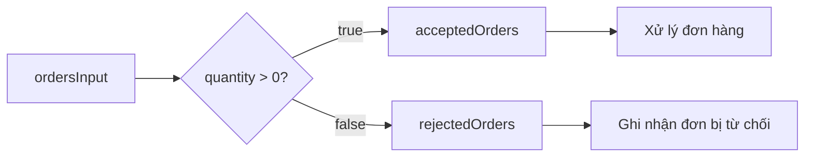

# Discard channel trong Spring Integration Filter

Trong module **SPRING_INTEGRATION_CORE**, chương **Filter** đi từ quyết định chấp nhận một thông điệp đến cách xử lý thông điệp bị từ chối. Bài này tập trung vào **discard channel**: nhánh nhận thông điệp không vượt qua bộ lọc, để ứng dụng có thể theo dõi, lưu giữ hoặc xử lý theo quy tắc nghiệp vụ.

Ví dụ xuyên suốt là luồng nhận đơn hàng. Đơn có số lượng dương được chuyển đến bước xử lý chính; đơn có số lượng không hợp lệ đi sang một nhánh riêng. Từ ví dụ này, ta kết nối các thành phần cốt lõi: `Message`, `MessageChannel`, endpoint, Java DSL, xử lý lỗi và kiểm thử.

## 1. Mục tiêu học tập

Sau bài học, bạn có thể:

- Cấu hình discard channel cho một filter bằng Java DSL.
- Giải thích quan hệ giữa `discardChannel` và `throwExceptionOnRejection`.
- Chọn cách xử lý đồng bộ hoặc dùng hàng đợi cho thông điệp bị từ chối.
- Phân biệt từ chối nghiệp vụ với lỗi thực thi và phản hồi cho gateway.
- Kiểm thử cả nhánh được chấp nhận và nhánh bị từ chối.

## 2. Discard channel là gì?

Filter gọi một selector để quyết định thông điệp có được đi tiếp hay không. Khi selector trả về `false`, discard channel là đích nhận thông điệp bị từ chối nếu được cấu hình. Tên “discard” diễn tả việc loại thông điệp khỏi luồng chính; nhánh này vẫn có thể thực hiện công việc hữu ích. [Tài liệu Filter](https://docs.spring.io/spring-integration/reference/filter.html)



Trong thiết kế ví dụ:

- `ordersInput` nhận thông điệp đầu vào.
- Filter là endpoint áp dụng quy tắc về số lượng.
- `acceptedOrders` là đầu ra của luồng chính.
- `rejectedOrders` đảm nhận vai trò discard channel.

Discard channel là **vai trò của một channel trong cấu hình filter**, không phải một lớp channel chuyên biệt. Vì vậy, quyết định “đơn bị từ chối đi đâu” và quyết định “nhánh đó chạy như thế nào” cần được thiết kế cùng nhau.

Một cách dùng phù hợp là lưu đơn không hợp lệ để người vận hành tra cứu. Nếu yêu cầu nghiệp vụ là phân loại đơn theo nhiều vùng giao hàng, phương thức thanh toán hoặc mức ưu tiên, router thường diễn đạt ý định rõ hơn một chuỗi filter.

## 3. Hành vi khi selector trả về false

Hai cấu hình cần xem cùng nhau là đích discard và cờ `throwExceptionOnRejection`:

| Kết quả selector | Discard channel | Cờ ném lỗi | Hành vi |
| --- | --- | --- | --- |
| `true` | Bất kỳ | Bất kỳ | Đi tiếp trên nhánh chính |
| `false` | Không có | `false` | Không có thông điệp đầu ra |
| `false` | Có | `false` | Gửi thông điệp sang nhánh discard |
| `false` | Không có | `true` | Ném `MessageRejectedException` |
| `false` | Có | `true` | Gửi sang discard, sau đó ném `MessageRejectedException` |

Giá trị mặc định của cờ ném lỗi là `false`. Việc có discard channel không vô hiệu hóa cờ này. Thứ tự ở hàng cuối giả định thao tác gửi discard hoàn thành bình thường; nếu chính thao tác đó thất bại, lỗi gửi hoặc lỗi consumer có thể xuất hiện trước. [API MessageFilter](https://docs.spring.io/spring-integration/api/org/springframework/integration/filter/MessageFilter.html)

Trong bài toán đơn hàng, chọn cấu hình theo hợp đồng:

- Đơn không hợp lệ là kết quả nghiệp vụ dự kiến: thường ghi nhận ở discard và không ném lỗi.
- Caller phải nhận biết ngay việc bị từ chối qua exception: cân nhắc bật cờ ném lỗi.
- Vừa ghi nhận vừa báo lỗi: phải tính đến khả năng caller gửi lại cùng một đơn.

Không nên hiểu “không có exception” là “đơn được chấp nhận”. Đây là hai tín hiệu khác nhau.

## 4. Ví dụ Java DSL hoàn chỉnh

### 4.1. Điều kiện sử dụng

Ví dụ dùng Java 17, Spring Integration 6.x và JUnit Jupiter cho kiểm thử. Ứng dụng cần dependency `org.springframework.integration:spring-integration-core`; phiên bản Spring nên do BOM hoặc cấu hình quản lý dependency của dự án quyết định.

Không cần Spring Boot để khởi tạo ví dụ. `AnnotationConfigApplicationContext` sẽ được dùng trong phần kiểm thử để tạo và đóng context.

### 4.2. Cấu hình luồng

Lưu lớp dưới đây thành `OrderFilterConfiguration.java` trong package `example.integration` khi thực hành:

```java
package example.integration;

import org.springframework.context.annotation.Bean;
import org.springframework.context.annotation.Configuration;
import org.springframework.integration.channel.DirectChannel;
import org.springframework.integration.channel.QueueChannel;
import org.springframework.integration.config.EnableIntegration;
import org.springframework.integration.dsl.IntegrationFlow;

@Configuration
@EnableIntegration
public class OrderFilterConfiguration {

    public record Order(String orderId, int quantity) {
    }

    @Bean
    public DirectChannel ordersInput() {
        return new DirectChannel();
    }

    @Bean
    public QueueChannel acceptedOrders() {
        return new QueueChannel(100);
    }

    @Bean
    public QueueChannel rejectedOrders() {
        return new QueueChannel(100);
    }

    @Bean
    public IntegrationFlow orderValidationFlow() {
        return IntegrationFlow.from(ordersInput())
                .filter(
                        Order.class,
                        order -> order.quantity() > 0,
                        spec -> spec
                                .id("positiveQuantityFilter")
                                .discardChannel(rejectedOrders())
                                .throwExceptionOnRejection(false))
                .channel(acceptedOrders())
                .get();
    }
}
```

Ở đây, hai `QueueChannel` là đích quan sát để ví dụ có thể lấy từng kết quả ra kiểm tra. Chúng chưa đại diện cho kho lưu trữ nghiệp vụ lâu dài.

Java DSL cho phép `discardChannel(...)` nhận một đối tượng `MessageChannel` hoặc tên bean. Với cách đặt tên, cấu hình tương ứng là `discardChannel("rejectedOrders")`. Ngoài ra, `discardFlow(...)` cho phép khai báo trực tiếp một nhánh xử lý thay cho channel dùng chung. [API FilterEndpointSpec](https://docs.spring.io/spring-integration/api/org/springframework/integration/dsl/FilterEndpointSpec.html)

### 4.3. Diễn giải hai lần gửi

Với payload `new Order("ORD-101", 2)`, điều kiện đúng. Thông điệp xuất hiện ở `acceptedOrders`; không có bản sao được gửi sang `rejectedOrders`.

Với payload `new Order("ORD-102", 0)`, điều kiện sai. Thông điệp xuất hiện ở `rejectedOrders`; không xuất hiện ở đầu ra chính.

Ví dụ cố ý chỉ kiểm tra số lượng. Nếu cần kiểm tra cả mã đơn và nhiều trường khác, hãy xác định quy tắc rõ ràng trước khi mở rộng selector. Một filter quá nhiều điều kiện khó giúp người vận hành biết chính xác vì sao đơn bị từ chối.

## 5. Kiểm thử hai nhánh bằng thông điệp thật

Các bài kiểm thử dưới đây dùng cùng package với lớp cấu hình. Chúng kiểm tra vị trí thông điệp, payload và header theo dõi, thay vì chỉ kiểm tra giá trị boolean của predicate.

```java
package example.integration;

import org.junit.jupiter.api.Test;
import org.springframework.context.annotation.AnnotationConfigApplicationContext;
import org.springframework.integration.channel.DirectChannel;
import org.springframework.integration.channel.QueueChannel;
import org.springframework.messaging.Message;
import org.springframework.messaging.support.MessageBuilder;

import static org.junit.jupiter.api.Assertions.*;

class OrderFilterConfigurationTest {

    @Test
    void validOrderGoesOnlyToAcceptedChannel() {
        try (var context = new AnnotationConfigApplicationContext(
                OrderFilterConfiguration.class)) {

            var input = context.getBean("ordersInput", DirectChannel.class);
            var accepted = context.getBean("acceptedOrders", QueueChannel.class);
            var rejected = context.getBean("rejectedOrders", QueueChannel.class);

            var order = new OrderFilterConfiguration.Order("ORD-101", 2);
            Message<?> request = MessageBuilder.withPayload(order)
                    .setHeader("traceId", "trace-accepted")
                    .build();

            assertTrue(input.send(request, 1_000));

            Message<?> result = accepted.receive(1_000);
            assertNotNull(result);
            assertEquals(order, result.getPayload());
            assertEquals("trace-accepted", result.getHeaders().get("traceId"));
            assertNull(rejected.receive(0));
        }
    }

    @Test
    void invalidOrderGoesOnlyToDiscardChannel() {
        try (var context = new AnnotationConfigApplicationContext(
                OrderFilterConfiguration.class)) {

            var input = context.getBean("ordersInput", DirectChannel.class);
            var accepted = context.getBean("acceptedOrders", QueueChannel.class);
            var rejected = context.getBean("rejectedOrders", QueueChannel.class);

            var order = new OrderFilterConfiguration.Order("ORD-102", 0);
            Message<?> request = MessageBuilder.withPayload(order)
                    .setHeader("traceId", "trace-rejected")
                    .build();

            assertTrue(input.send(request, 1_000));

            Message<?> result = rejected.receive(1_000);
            assertNotNull(result);
            assertEquals(order, result.getPayload());
            assertEquals(request.getHeaders().getId(),
                    result.getHeaders().getId());
            assertEquals("trace-rejected", result.getHeaders().get("traceId"));
            assertNull(accepted.receive(0));
        }
    }
}
```

Mỗi test tạo một context riêng nên không còn thông điệp từ test trước. Trong cấu hình này, filter được gọi qua `DirectChannel`; thao tác đưa thông điệp vào queue đích hoàn thành trước khi `send` trả về. Vì vậy, kiểm tra queue đối diện bằng `receive(0)` có ý nghĩa ở đây.

Giá trị `true` của `input.send(...)` xuất hiện ở cả hai test. Điều đó minh họa rằng gửi thành công vào endpoint không đồng nghĩa thông điệp được selector chấp nhận.

### 5.1. Kiểm thử discard kết hợp ném lỗi

Đoạn kiểm thử độc lập sau có thể đặt trong một lớp test khác của cùng package:

```java
package example.integration;

import org.junit.jupiter.api.Test;
import org.springframework.integration.MessageRejectedException;
import org.springframework.integration.channel.QueueChannel;
import org.springframework.integration.filter.MessageFilter;
import org.springframework.messaging.Message;
import org.springframework.messaging.support.MessageBuilder;

import static org.junit.jupiter.api.Assertions.*;

class DiscardAndRejectTest {

    @Test
    void sendsToDiscardBeforeThrowingRejection() {
        var discarded = new QueueChannel(10);
        var filter = new MessageFilter(message -> false);
        filter.setDiscardChannel(discarded);
        filter.setThrowExceptionOnRejection(true);
        filter.afterPropertiesSet();

        Message<?> request = MessageBuilder
                .withPayload("invalid-order")
                .build();

        MessageRejectedException error = assertThrows(
                MessageRejectedException.class,
                () -> filter.handleMessage(request));

        Message<?> discardedMessage = discarded.receive(0);
        assertNotNull(discardedMessage);
        assertEquals(request.getPayload(), discardedMessage.getPayload());
        assertEquals(request.getHeaders().getId(),
                discardedMessage.getHeaders().getId());
        assertEquals(request, error.getFailedMessage());
    }
}
```

Test này khoanh vùng hành vi của `MessageFilter`, không khởi tạo cả ứng dụng. Nó không chứng minh các tác dụng phụ của consumer sẽ tồn tại sau rollback trong một giao dịch thật; giao dịch và cơ chế lưu trữ cần kiểm thử riêng theo cấu hình triển khai.

## 6. Đọc thông điệp bị từ chối và ghi nhận lý do

Discard consumer nhận thông điệp bị từ chối, không mặc nhiên nhận một `ErrorMessage`. Trong ví dụ, payload vẫn là `Order`, còn header `traceId` giúp liên kết với lần gửi ban đầu.

Ứng dụng nên quy định một bản ghi từ chối có cấu trúc. Ví dụ:

```java
public record RejectedOrder(
        String orderId,
        String reasonCode,
        String traceId) {
}
```

Với filter chỉ kiểm tra số lượng như ví dụ, nhánh discard có thể tạo bản ghi:

```java
var order = (OrderFilterConfiguration.Order) message.getPayload();

var rejection = new RejectedOrder(
        order.orderId(),
        "NON_POSITIVE_QUANTITY",
        message.getHeaders().get("traceId", String.class));
```

Biến `message` trong đoạn trên là tham số mà discard consumer đang xử lý. `RejectedOrder` là mô hình do ứng dụng định nghĩa; filter không tự tạo trường `reasonCode` này.

Nếu selector có nhiều điều kiện, một giá trị `false` không chứa đủ thông tin để giải thích từng nguyên nhân. Khi đó có thể đặt một transformer trước filter để tạo kết quả kiểm tra gồm dữ liệu gốc, trạng thái hợp lệ và mã lý do. Filter chỉ đọc trạng thái; nhánh discard dùng mã lý do đã tính.

Cách tổ chức này cũng tránh việc consumer tính lại quy tắc dựa trên dữ liệu bên ngoài đã thay đổi. Ví dụ, số dư tồn kho đọc lần thứ hai có thể khác thời điểm selector ra quyết định.

Khi thực hành, hãy bắt đầu với ba thông tin: mã đơn, mã lý do và mã theo dõi. Chỉ đưa thêm dữ liệu vào bản ghi nếu nó giúp tra cứu hoặc xử lý lại.

## 7. Chọn channel cho nhánh discard

Hành vi cơ bản của các channel cần phân biệt:

| Loại channel | Đặc tính cần nhớ |
| --- | --- |
| `DirectChannel` | Gọi consumer trên luồng của bên gửi |
| `QueueChannel` | Đưa thông điệp vào hàng đợi để lấy ra sau |
| `ExecutorChannel` | Giao việc cho executor |
| `PublishSubscribeChannel` | Phát đến các subscriber |
| `nullChannel` | Tiêu thụ rồi bỏ thông điệp |

Một `QueueChannel` giới hạn dung lượng có thể chặn bên gửi khi đầy; timeout gửi cần được xem xét. Queue trong bộ nhớ không tự có độ bền qua lần khởi động lại. `DirectChannel` không cung cấp cơ chế phát đồng loạt đến nhiều consumer. [Message Channel Implementations](https://docs.spring.io/spring-integration/reference/channel/implementations.html)

Áp dụng vào bài toán đơn hàng:

- Dùng `DirectChannel` nếu bước ghi nhận nhỏ, cần hoàn thành trước khi trả quyền điều khiển cho caller.
- Dùng queue nếu muốn tách tốc độ tiếp nhận khỏi tốc độ xử lý bản ghi từ chối.
- Dùng publish-subscribe nếu cả bộ phận thống kê và bộ phận xử lý từ chối đều phải nhận từng sự kiện.
- Dùng `nullChannel` khi yêu cầu thực sự là bỏ thông điệp và đã xác định cách quan sát tỷ lệ bị loại.

Trong ví dụ ở mục 4, chưa có consumer chạy nền cho `rejectedOrders`. Test gọi `receive` trực tiếp. Trong ứng dụng, nếu chọn một endpoint đọc từ `QueueChannel`, hãy cấu hình poller và tốc độ xử lý phù hợp.

Đối với dữ liệu cần phục hồi sau sự cố, yêu cầu thiết kế nên nêu rõ nơi lưu bền vững, thời hạn giữ và cách xử lý lại. Chỉ đặt tên queue là `rejectedOrders` chưa đáp ứng những yêu cầu đó.

Cũng cần lưu ý: timeout truyền vào lệnh `input.send(...)` ở test không phải thời hạn tổng cho toàn bộ consumer, các lệnh I/O và thao tác gửi tiếp phía sau.

## 8. Phân biệt discard channel và errorChannel

Ba tình huống khác nhau cần có cách xử lý riêng:

| Tình huống | Bản chất | Ví dụ |
| --- | --- | --- |
| Selector trả về `false` | Từ chối theo quy tắc | Số lượng đơn bằng 0 |
| Selector ném exception | Không thực hiện được phép kiểm tra | Dịch vụ kiểm tra điều kiện bị lỗi |
| Consumer của nhánh discard ném exception | Không hoàn thành việc xử lý từ chối | Kho lưu bản ghi không truy cập được |

Cơ chế xử lý lỗi có thể đóng gói exception thành `ErrorMessage`; payload lúc đó là lỗi. Với luồng đồng bộ qua `DirectChannel`, exception thông thường truyền về bên gọi. Với xử lý bất đồng bộ, cần cơ chế chuyển lỗi bằng thông điệp theo cấu hình endpoint hoặc gateway. Không phải mọi exception đều tự xuất hiện ở global `errorChannel`. [Error Handling](https://docs.spring.io/spring-integration/reference/error-handling.html)

Một thiết kế phù hợp cho ví dụ:

1. Đơn có số lượng không hợp lệ đi đến `rejectedOrders`.
2. Nhánh này tạo bản ghi `RejectedOrder`.
3. Nếu thao tác lưu thất bại, chính lỗi lưu cần đi theo chính sách xử lý lỗi kỹ thuật.
4. Đơn bị từ chối và lỗi ghi nhận được đếm bằng hai chỉ số khác nhau.

Không nên cấu hình discard channel trùng với global `errorChannel` nếu các consumer đang kỳ vọng `ErrorMessage`. Cách đặt tên đó dễ tạo xung đột hợp đồng payload: một bên gửi `Order`, bên kia lại đọc exception.

## 9. Retry, advice và xử lý trùng

Mặc định, hành động discard và việc ném lỗi do từ chối nằm trong phạm vi request-handler advice của filter. Nếu có retry advice và một consumer đồng bộ phía discard ném lỗi, quá trình có thể được thực hiện lại. `discardWithinAdvice(false)` đưa hành động discard và lỗi từ chối ra ngoài phạm vi advice đó. [Advising Filters](https://docs.spring.io/spring-integration/reference/handler-advice/advising-filters.html)

Tình huống cần phân tích trước khi thêm retry:

1. Lần đầu, đơn `ORD-102` bị từ chối và được ghi vào hệ thống theo dõi.
2. Một bước kế tiếp trong cùng phạm vi retry thất bại.
3. Retry thực hiện lại bước ghi nhận.
4. Hệ thống có hai bản ghi cho cùng một sự kiện nếu chưa kiểm soát trùng.

Với trường hợp này, có thể chọn khóa duy nhất dựa trên mã sự kiện và mã quy tắc. Nếu một đơn được sửa rồi gửi lại hợp lệ, mã sự kiện mới cần phân biệt với lần gửi cũ; chỉ dùng `orderId` làm khóa có thể chặn nhầm lần cập nhật hợp lệ.

Cấu hình minh họa khi đã có bean advice tên `validationAdvice`:

```java
.filter(
        OrderFilterConfiguration.Order.class,
        order -> order.quantity() > 0,
        spec -> spec
                .discardChannel("rejectedOrders")
                .advice(validationAdvice)
                .discardWithinAdvice(false))
```

Đây là phần thay thế cho đoạn filter, không phải một cấu hình độc lập. Cần cung cấp `validationAdvice` có kiểu `org.aopalliance.aop.Advice` khi tích hợp.

Việc đặt `discardWithinAdvice(false)` không loại bỏ mọi khả năng gửi trùng. Caller, broker hoặc một advice bao ngoài phạm vi này vẫn có thể thực hiện lại luồng. Nếu nhánh discard chỉ đưa vào queue, lỗi của consumer chạy sau đó cũng không được retry advice của filter tự động xử lý.

Quy tắc quyết định là: retry cần có khả năng thay đổi kết quả. Gửi lại một đơn có số lượng 0 mà không sửa dữ liệu thường chỉ tạo thêm cùng một lần từ chối.

## 10. Discard trong luồng có gateway

Gateway có giá trị trả về cần nhận được một reply phù hợp. Nếu request bị filter chặn và nhánh discard chỉ ghi nhận, gateway có thể phải chờ đến timeout. Việc lưu thông điệp bị từ chối không tự tạo phản hồi nghiệp vụ. [Messaging Gateways](https://docs.spring.io/spring-integration/reference/gateway.html)

Giả sử API yêu cầu:

```text
submit(order) -> OrderResult
```

Ta nên định nghĩa rõ kết quả như:

```java
public record OrderResult(
        String orderId,
        String status,
        String reasonCode) {
}
```

Có thể chọn một trong các thiết kế:

| Hợp đồng mong muốn | Cách tổ chức |
| --- | --- |
| Gửi sự kiện, không chờ kết quả nghiệp vụ | Gateway gửi một chiều hoặc đầu vào bất đồng bộ |
| Trả kết quả chấp nhận hoặc từ chối | Cả hai nhánh tạo `OrderResult` và chuyển về đích reply |
| Báo từ chối bằng exception | Bật cờ ném lỗi và thống nhất cách gateway truyền hoặc ánh xạ lỗi |

Nếu dùng nhánh discard để tạo kết quả từ chối, phải nối rõ kết quả về kênh phản hồi và giữ thông tin tương quan cần thiết. Một nhánh DSL kết thúc bằng handler chỉ ghi log không đáp ứng hợp đồng trả `OrderResult`.

Ví dụ ở mục 4 là ví dụ gửi thông điệp và quan sát hai queue, chưa phải một luồng request-reply hoàn chỉnh cho gateway. Khi đổi sang gateway, cần thiết kế lại đường đi của phản hồi cho cả đơn hợp lệ lẫn đơn bị từ chối.

## 11. Tác động khi đặt filter trước aggregator

Aggregator thường chờ một nhóm thông điệp đủ điều kiện trước khi phát kết quả. Với chiến lược mặc định dựa vào sequence, việc lọc mất một phần tử sau splitter có thể khiến nhóm thiếu thông điệp so với `sequenceSize`. [Aggregator](https://docs.spring.io/spring-integration/reference/aggregator.html)

Ví dụ suy luận từ mô hình này:

```text
Một nhóm gồm 3 dòng đơn hàng
  -> splitter tạo 3 thông điệp, sequenceSize = 3
  -> filter loại dòng thứ hai sang discard
  -> aggregator của nhánh chính chỉ nhận 2 thông điệp
```

Nhánh discard đã ghi nhận dòng không hợp lệ nhưng nhóm chính vẫn thiếu một phần tử. Ghi nhận từ chối và hoàn tất tổng hợp là hai công việc cần phối hợp.

Một số hướng thiết kế:

- Kiểm tra cả đơn trước khi tách dòng, nếu quy tắc áp dụng cho toàn bộ đơn.
- Đưa cả kết quả hợp lệ và không hợp lệ vào tập kết quả cần tổng hợp.
- Dùng release strategy và chính sách timeout phù hợp với hợp đồng xử lý từng phần.

Không nên sửa tùy tiện `sequenceSize` của từng thông điệp còn lại. Trong ví dụ có ba dòng, hệ thống cần một cách đáng tin cậy để biết nhóm phải chờ những kết quả nào.

## 12. Quan sát và vận hành nhánh discard

Đối với luồng đơn hàng, các câu hỏi vận hành nên có câu trả lời cụ thể:

| Câu hỏi | Dữ liệu cần theo dõi |
| --- | --- |
| Có bao nhiêu đơn bị từ chối? | Bộ đếm theo mã quy tắc |
| Tỷ lệ từ chối có tăng bất thường? | Số lần từ chối so với số lần kiểm tra trong cùng khoảng thời gian |
| Nhánh ghi nhận có bị chậm? | Độ sâu queue và tuổi thông điệp |
| Một lần gửi đang ở đâu? | Mã sự kiện, `orderId`, `traceId` |
| Đã sửa dữ liệu thì xử lý lại thế nào? | Quy trình gửi lại và nhận diện sự kiện mới |

Cần định nghĩa bộ đếm đo **số lần thử** hay **số sự kiện duy nhất**. Khi retry xảy ra, hai con số có thể khác nhau. Ví dụ, một đơn bị thử ba lần không nhất thiết là ba đơn nghiệp vụ khác nhau.

Spring Integration không tự tạo đầy đủ mô hình audit, mã lý do và quy trình xử lý lại chỉ từ cấu hình `discardChannel`. Những phần này thuộc thiết kế ứng dụng.

Một bài thực hành mở rộng hữu ích là thay thao tác đọc queue trong test bằng một consumer ghi `RejectedOrder`, rồi quan sát điều gì xảy ra khi consumer không theo kịp tốc độ đơn bị từ chối.

## 13. Lỗi thường gặp và cách kiểm tra

| Biểu hiện | Điều cần kiểm tra |
| --- | --- |
| Không thấy đơn ở nhánh chính | Selector có từ chối không; nhánh discard có đang nhận đơn không |
| Đã cấu hình discard nhưng caller vẫn nhận lỗi | Cờ ném lỗi, lỗi gửi discard hoặc exception từ consumer |
| Queue từ chối tăng liên tục | Consumer, poller, tốc độ xử lý và chính sách dung lượng |
| Có nhiều bản ghi cho cùng sự kiện | Retry ở mọi tầng và khóa chống trùng |
| Gateway chờ lâu khi đơn không hợp lệ | Nhánh từ chối có trả đúng reply không |
| Aggregator không hoàn tất nhóm | Số phần tử bị loại và điều kiện release |
| Handler của `errorChannel` đọc sai kiểu | Có gửi payload nghiệp vụ trực tiếp vào kênh lỗi không |

Khi chẩn đoán, hãy theo một mã sự kiện từ đầu vào đến đích cuối cùng. Chỉ nhìn giá trị trả về của `send` hoặc chỉ xem log đầu vào sẽ không đủ để xác định đơn đã đi nhánh nào.

## 14. Tự thực hành

Dùng cấu hình ở mục 4 và các kiểm thử ở mục 5 để thực hiện lần lượt:

1. Gửi đơn có số lượng `1`, `0` và `-1`; xác nhận đúng một nhánh nhận mỗi đơn.
2. Thêm header `sourceSystem`; kiểm tra nhánh discard vẫn đọc được header này.
3. Bật `throwExceptionOnRejection(true)`; xác nhận đơn bị từ chối vẫn có ở discard khi thao tác gửi thành công.
4. Thay nhánh discard bằng consumer đồng bộ có thể ném lỗi; phân biệt lỗi của consumer với kết quả `false` của selector.
5. Đề xuất hợp đồng `OrderResult` cho gateway và vẽ đường phản hồi của cả hai nhánh.

Kết quả cần giải thích được là **đơn bị từ chối được xử lý ở đâu, caller nhìn thấy tín hiệu nào và điều gì xảy ra nếu nhánh xử lý từ chối thất bại**.
