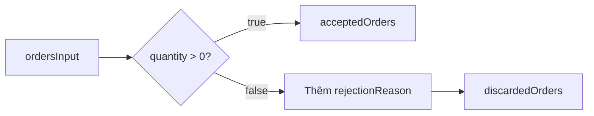

# Discard flow trong Spring Integration

Trong chương **Filter** của module **SPRING_INTEGRATION_CORE**, discard flow là nhánh xử lý dành cho thông điệp không vượt qua điều kiện lọc. Thay vì chỉ dừng thông điệp, ta có thể lưu lý do từ chối, ghi nhận sự kiện nghiệp vụ hoặc chuyển dữ liệu sang nơi xử lý riêng.

Bài học tập trung vào cách phối hợp `Message`, `MessageChannel`, filter endpoint và Java DSL để thiết kế nhánh này. Ví dụ xuyên suốt là tiếp nhận đơn hàng: số lượng dương được chấp nhận; số lượng bằng hoặc nhỏ hơn không được đưa vào xử lý đơn hàng.

## 1. Discard flow giải quyết việc gì?

Giả sử hệ thống nhận ba đơn:

| Mã đơn | Số lượng | Yêu cầu nghiệp vụ |
| --- | ---: | --- |
| ORD-101 | 3 | Cho phép xử lý tiếp |
| ORD-102 | 0 | Từ chối và lưu lý do |
| ORD-103 | -2 | Từ chối và lưu lý do |

Một filter chỉ cần quyết định chấp nhận hay từ chối. Trong Spring Integration, selector trả `true` thì thông điệp được chuyển tiếp qua đầu ra thông thường; trả `false` thì thông điệp bị từ chối và chính sách discard được áp dụng. [Tài liệu Filter](https://docs.spring.io/spring-integration/reference/filter.html).

Discard flow giúp diễn đạt yêu cầu “từ chối và lưu lý do” thành một nhánh có cấu trúc:



Ở ví dụ này, `discardedOrders` là nơi tiếp nhận đơn bị từ chối để kiểm tra hoặc xử lý sau. Nó không tự trở thành dead-letter queue của broker. Nếu cần hàng đợi của hệ thống nhắn tin, phải bổ sung adapter và chính sách lưu trữ tương ứng.

Một discard flow phù hợp khi “không được đi tiếp” vẫn là kết quả nghiệp vụ cần theo dõi: dữ liệu ngoài phạm vi tiếp nhận, giao dịch không đủ điều kiện hoặc sự kiện trùng đã được nhận diện.

## 2. Selector, discard channel và discard flow

Ba khái niệm có vai trò khác nhau:

| Thành phần | Trách nhiệm |
| --- | --- |
| Selector | Đánh giá điều kiện để chấp nhận thông điệp |
| Discard channel | Chỉ định kênh nhận thông điệp bị từ chối |
| Discard flow | Mô tả các bước xử lý của nhánh từ chối ngay trong cấu hình DSL |

`discardFlow(IntegrationFlow)` là lựa chọn thay cho `discardChannel(...)` trên `FilterEndpointSpec`. Với một filter, hãy chọn một cách cấu hình nhánh từ chối. [API FilterEndpointSpec](https://docs.spring.io/spring-integration/api/org/springframework/integration/dsl/FilterEndpointSpec.html).

Không hình dung discard flow như một khối `catch`: nó chạy khi selector trả `false`. Nếu selector không đánh giá được dữ liệu và ném exception, việc xử lý đi theo cơ chế lỗi; nhánh discard không tự được gọi để thay thế lỗi đó. [API MessageFilter](https://docs.spring.io/spring-integration/api/org/springframework/integration/filter/MessageFilter.html).

Nhánh từ chối nhận thông điệp bị lọc, không tự nhận một `ErrorMessage`. Filter cũng không tự tạo mã lý do nghiệp vụ. Với quy tắc “quantity phải dương”, ứng dụng có thể đặt `rejectionReason=NON_POSITIVE_QUANTITY`; khi có nhiều quy tắc, cần mô hình kết quả đánh giá rõ ràng.

## 3. Ví dụ Java DSL đầy đủ

Ví dụ dùng cú pháp `IntegrationFlow.from(...)` của Spring Integration 6 trở lên và Java record. Dự án cần có `spring-integration-core`, Spring Context và JDK tương thích với phiên bản Spring đang sử dụng. Nếu dùng Spring Boot, có thể lấy các phụ thuộc tích hợp từ `spring-boot-starter-integration` và để cơ chế quản lý phụ thuộc của dự án quyết định phiên bản.

Để tập trung vào discard flow, giả định payload đầu vào đã là `Order` và `orderId` đã được kiểm tra ở biên tiếp nhận. Bài này chỉ lọc theo `quantity`.

```java
package example.integration;

import org.springframework.beans.factory.annotation.Qualifier;
import org.springframework.context.annotation.Bean;
import org.springframework.context.annotation.Configuration;
import org.springframework.integration.annotation.EnableIntegration;
import org.springframework.integration.channel.DirectChannel;
import org.springframework.integration.channel.QueueChannel;
import org.springframework.integration.dsl.IntegrationFlow;
import org.springframework.messaging.MessageChannel;

@Configuration(proxyBeanMethods = false)
@EnableIntegration
public class OrderDiscardConfiguration {

    public record Order(String orderId, int quantity) {
    }

    @Bean
    public MessageChannel ordersInput() {
        return new DirectChannel();
    }

    @Bean
    public QueueChannel acceptedOrders() {
        return new QueueChannel(100);
    }

    @Bean
    public QueueChannel discardedOrders() {
        return new QueueChannel(100);
    }

    @Bean
    public IntegrationFlow orderFlow(
            @Qualifier("ordersInput") MessageChannel input,
            @Qualifier("acceptedOrders") QueueChannel accepted,
            @Qualifier("discardedOrders") QueueChannel discarded) {

        return IntegrationFlow.from(input)
                .filter(Order.class,
                        order -> order.quantity() > 0,
                        endpoint -> endpoint
                                .id("positiveQuantityFilter")
                                .throwExceptionOnRejection(false)
                                .discardFlow(rejected -> rejected
                                        .enrichHeaders(headers -> headers.header(
                                                "rejectionReason",
                                                "NON_POSITIVE_QUANTITY"))
                                        .channel(discarded)))
                .channel(accepted)
                .get();
    }
}
```

Đọc cấu hình theo đường đi của từng đơn:

1. `ordersInput` nhận `Message<Order>`.
2. Filter kiểm tra số lượng.
3. Nếu hợp lệ, thông điệp đi tới `acceptedOrders`.
4. Nếu bị từ chối, nhánh `rejected` thêm header lý do và gửi tới `discardedOrders`.

Dòng `.channel(accepted)` nằm sau filter thuộc nhánh được chấp nhận. Nhánh discard không tự quay về dòng đó. Vì vậy, việc lưu đơn bị từ chối không làm đơn trở thành đơn hợp lệ.

Java DSL hỗ trợ subflow để mô tả nhánh ngay trong cấu hình; framework tạo kết nối cần thiết giữa filter và nhánh discard. Không cần tự đặt tên kênh trung gian cho ví dụ trên. [Tài liệu Sub-flows support](https://docs.spring.io/spring-integration/reference/dsl/java-subflows.html).

Hai `QueueChannel` ở cuối được dùng làm nơi quan sát kết quả. Bài thực hành lấy thông điệp bằng `receive(...)`, nên không cần poller. Khi thay việc đọc thủ công bằng một endpoint tiêu thụ từ queue, phải cấu hình cơ chế polling cho endpoint đó.

### Thông điệp nào được giữ lại?

Đơn bị từ chối vẫn có payload `Order`. Nhánh chỉ bổ sung header `rejectionReason`, để người xử lý sau còn biết đơn nào và dữ liệu nào bị từ chối.

Header tùy chỉnh như `requestId` có ích để đối chiếu đầu vào và kết quả. Không dùng giả định “ID kỹ thuật của mọi message luôn giống nhau” để thiết kế truy vết: việc tạo message mới qua các bước xử lý có thể thay đổi ID. Trong ví dụ, tiêu chí đối chiếu là `requestId` do ứng dụng đặt.

## 4. Kiểm thử hai nhánh của ví dụ

Hai bài kiểm thử dưới đây dùng JUnit Jupiter. Đặt cùng package với cấu hình ở mục trước. Mỗi bài tạo một application context riêng để các queue không chứa kết quả của bài khác.

```java
package example.integration;

import org.junit.jupiter.api.Test;
import org.springframework.context.annotation.AnnotationConfigApplicationContext;
import org.springframework.integration.channel.QueueChannel;
import org.springframework.messaging.Message;
import org.springframework.messaging.MessageChannel;
import org.springframework.messaging.support.MessageBuilder;

import example.integration.OrderDiscardConfiguration.Order;

import static org.junit.jupiter.api.Assertions.*;

class OrderDiscardFlowTest {

    @Test
    void forwardsAcceptedOrderOnly() {
        try (var context = new AnnotationConfigApplicationContext(
                OrderDiscardConfiguration.class)) {

            var input = context.getBean("ordersInput", MessageChannel.class);
            var accepted = context.getBean("acceptedOrders", QueueChannel.class);
            var discarded = context.getBean("discardedOrders", QueueChannel.class);

            var order = new Order("ORD-101", 3);
            var request = MessageBuilder.withPayload(order)
                    .setHeader("requestId", "REQ-101")
                    .build();

            assertTrue(input.send(request, 1000));

            Message<?> result = accepted.receive(1000);
            assertNotNull(result);
            assertEquals(order, result.getPayload());
            assertEquals("REQ-101", result.getHeaders().get("requestId"));
            assertNull(result.getHeaders().get("rejectionReason"));
            assertNull(discarded.receive(0));
        }
    }

    @Test
    void capturesRejectedOrderWithReason() {
        try (var context = new AnnotationConfigApplicationContext(
                OrderDiscardConfiguration.class)) {

            var input = context.getBean("ordersInput", MessageChannel.class);
            var accepted = context.getBean("acceptedOrders", QueueChannel.class);
            var discarded = context.getBean("discardedOrders", QueueChannel.class);

            var order = new Order("ORD-102", 0);
            var request = MessageBuilder.withPayload(order)
                    .setHeader("requestId", "REQ-102")
                    .build();

            assertTrue(input.send(request, 1000));

            Message<?> result = discarded.receive(1000);
            assertNotNull(result);
            assertEquals(order, result.getPayload());
            assertEquals("REQ-102", result.getHeaders().get("requestId"));
            assertEquals("NON_POSITIVE_QUANTITY",
                    result.getHeaders().get("rejectionReason"));
            assertNull(accepted.receive(0));
        }
    }
}
```

Mỗi bài kiểm tra cả nơi phải có thông điệp và nơi phải rỗng. Chỉ kiểm tra “đã ghi log từ chối” sẽ chưa chứng minh rằng đơn bị từ chối không lọt sang nhánh chấp nhận.

`input.send(...)` thành công trong bài thứ hai không có nghĩa đơn được chấp nhận về nghiệp vụ. Với cấu hình này, filter đã xử lý kết quả từ chối và gửi thành công sang nhánh discard.

Các đoạn kiểm thử là mã thực hành cho người học; việc đọc bài không đồng nghĩa chúng đã được thực thi trong dự án.

## 5. Chọn discardFlow hay discardChannel

Dùng `discardFlow` khi nhánh ngắn và gắn chặt với điều kiện lọc. Ví dụ hiện tại chỉ có hai việc: thêm lý do và gửi tới nơi tiếp nhận đơn bị từ chối.

Khi nhiều filter cần dùng chung một nơi tiếp nhận, một discard channel có tên sẽ tạo ranh giới cấu hình rõ hơn. Ví dụ sau là phương án thay thế cho phần filter trong `orderFlow`:

```java
.filter(Order.class,
        order -> order.quantity() > 0,
        endpoint -> endpoint
                .throwExceptionOnRejection(false)
                .discardChannel("rejectedOrders"))
.channel(accepted)
```

Định nghĩa thêm một flow riêng trong cùng lớp cấu hình:

```java
@Bean
public IntegrationFlow rejectedOrdersFlow(
        @Qualifier("discardedOrders") QueueChannel discarded) {

    return IntegrationFlow.from("rejectedOrders")
            .enrichHeaders(headers -> headers.header(
                    "rejectionReason",
                    "NON_POSITIVE_QUANTITY"))
            .channel(discarded)
            .get();
}
```

Ở phương án này, `rejectedOrders` là đầu vào của flow chuyên xử lý từ chối; `discardedOrders` vẫn là queue nhận kết quả cuối.

Mã lý do cố định trên chỉ phù hợp khi mọi thông điệp đi vào flow đều bị từ chối bởi cùng quy tắc số lượng. Nếu dùng chung cho nhiều bộ lọc, mỗi nguồn cần cung cấp đúng mã lý do trước khi gửi tới kênh chung, hoặc gửi một đối tượng chứa kết quả đánh giá.

## 6. Kết thúc discard flow có chủ đích

Một nhánh từ chối có thể kết thúc bằng một trong các cách:

| Cách kết thúc | Ý nghĩa trong thiết kế |
| --- | --- |
| Gửi tới queue | Giữ thông điệp để consumer khác nhận |
| Gọi handler không trả kết quả | Hoàn tất tác vụ như ghi nhận từ chối |
| Gửi tới `nullChannel` | Chủ động bỏ thông điệp sau các bước cần thiết |
| Gửi kết quả về reply channel | Trả một phản hồi từ chối theo hợp đồng đã thiết kế |

Nếu chỉ cần ghi nhận và bỏ thông điệp, có thể thay nhánh của ví dụ bằng đoạn sau. Khi đặt trong `OrderDiscardConfiguration`, tên `Order` là record đã khai báo ở mục 3.

```java
.discardFlow(rejected -> rejected
        .log(org.springframework.integration.handler.LoggingHandler.Level.INFO,
                "orders.rejected",
                message -> "Rejected orderId="
                        + ((Order) message.getPayload()).orderId()
                        + ", reason=NON_POSITIVE_QUANTITY")
        .nullChannel())
```

Từ Spring Integration 6.0, `.log()` ở cuối flow có hành vi nhất quán với khi ở giữa flow; không nên coi nó là bước chấm dứt xử lý một chiều. Với nhánh chỉ ghi log rồi bỏ, `.nullChannel()` thể hiện rõ điểm kết thúc và tránh việc xử lý tiếp theo cơ chế reply. [Tài liệu Operator log()](https://docs.spring.io/spring-integration/reference/dsl/java-log.html).

Việc biến đổi payload trong nhánh từ chối cũng cần có mục đích rõ ràng. Nếu chuyển `Order` thành một bản ghi từ chối để lưu trữ, hãy giữ mã đơn, mã lý do và mã truy vết. Không cần mang toàn bộ dữ liệu khách hàng vào một log chỉ phục vụ đếm số đơn bị từ chối.

## 7. Quan hệ với throwExceptionOnRejection

`throwExceptionOnRejection` kiểm soát việc filter có báo lỗi khi selector trả `false` hay không.

| Selector | Có nhánh discard | throwExceptionOnRejection | Kết quả |
| --- | --- | --- | --- |
| `true` | Có hoặc không | Bất kỳ | Đi qua đầu ra thông thường |
| `false` | Không | `false` | Bị loại khỏi đường đi thông thường |
| `false` | Có | `false` | Gửi sang nhánh discard |
| `false` | Không | `true` | Ném `MessageRejectedException` |
| `false` | Có | `true` | Thực hiện discard, rồi ném lỗi từ chối nếu bước discard không thất bại trước |

Mặc định cờ này là `false`. Việc cấu hình discard channel không vô hiệu hóa cờ ném lỗi. [API FilterEndpointSpec](https://docs.spring.io/spring-integration/api/org/springframework/integration/dsl/FilterEndpointSpec.html).

Với yêu cầu “đơn không hợp lệ là kết quả nghiệp vụ thông thường”, ví dụ chọn `false`. Nếu hợp đồng yêu cầu caller nhận lỗi từ chối, cân nhắc `true` và cách xử lý lỗi của điểm vào.

Khi không có discard channel và không ném lỗi từ chối, thông điệp không đi tiếp. Từ phiên bản 6.1, filter phát cảnh báo cho trường hợp này; có thể cấu hình `nullChannel` làm discard channel để thể hiện việc bỏ có chủ đích. [Tài liệu Filter](https://docs.spring.io/spring-integration/reference/filter.html).

Đừng bật ném lỗi chỉ để có số liệu thống kê. Ví dụ đơn số lượng bằng không không trở nên hợp lệ khi gửi lại ngay cùng dữ liệu; việc retry vô điều kiện chỉ làm tăng tải.

## 8. Phân biệt từ chối nghiệp vụ và lỗi xử lý

Hai tình huống sau cần chính sách khác nhau:

| Tình huống | Ví dụ | Hướng xử lý |
| --- | --- | --- |
| Không thỏa điều kiện | `quantity == 0` | Ghi nhận từ chối nghiệp vụ |
| Không thể hoàn thành bước xử lý | Kho lưu bản ghi từ chối mất kết nối | Áp dụng chính sách lỗi, retry hoặc phục hồi đã chọn |

Nếu bước ghi nhận trong discard flow ném exception, cấu hình `throwExceptionOnRejection(false)` không có tác dụng nuốt exception đó. Cờ này chỉ điều khiển lỗi do quyết định từ chối của filter.

Cách caller quan sát lỗi phụ thuộc đường đi:

- Với `DirectChannel`, handler chạy trên luồng gửi, nên exception có thể truyền về caller.
- Với ranh giới bất đồng bộ, lỗi xảy ra ở tác vụ xử lý sau đó. Cơ chế lỗi của Spring Integration có thể tạo `ErrorMessage`, ưu tiên kênh từ header `errorChannel`, rồi mới tới kênh lỗi toàn cục theo cấu hình. [Tài liệu Error Handling](https://docs.spring.io/spring-integration/reference/error-handling.html).

Do đó, một header `errorChannel` không tự biến mọi exception từ lời gọi `send` đồng bộ thành thông điệp lỗi. Cần xác định endpoint, executor hoặc poller nào đang chịu trách nhiệm xử lý lỗi.

Trong thiết kế đơn hàng, có thể tách hai mã vận hành: `NON_POSITIVE_QUANTITY` cho dữ liệu bị từ chối và `REJECTION_STORE_UNAVAILABLE` cho lỗi không lưu được kết quả từ chối. Hai mã này dẫn tới hai hành động khác nhau của người vận hành.

## 9. Request-reply gateway cần một kết quả rõ ràng

Giả sử gateway có phương thức trả về `OrderResult`. Nhánh hợp lệ tạo kết quả, còn nhánh từ chối chỉ ghi log rồi kết thúc. Caller lúc này không có phản hồi nghiệp vụ từ nhánh từ chối và có thể phải chờ đến reply timeout.

Việc discard flow đã chạy xong không tự tạo một `OrderResult`. Hãy chọn hợp đồng phù hợp:

- Nếu chỉ tiếp nhận lệnh, một gateway trả `void` biểu đạt giao tiếp một chiều. Điều đó không mặc nhiên làm xử lý trở thành bất đồng bộ.
- Nếu caller cần biết kết quả, thiết kế phản hồi từ chối có kiểu phù hợp, chẳng hạn `OrderResult(orderId, REJECTED, reason)`, và bảo đảm nó được gửi về reply channel.
- Nếu hợp đồng dùng exception, kết hợp chính sách từ chối với cấu hình xử lý lỗi của gateway.

Gateway sử dụng reply channel và timeout để chờ phản hồi; kết quả cuối cùng khi không có reply còn phụ thuộc cấu hình gateway. [Tài liệu Messaging Gateways](https://docs.spring.io/spring-integration/reference/gateway.html).

Ví dụ queue ở mục 3 phục vụ quan sát hai đầu ra, chưa phải thiết kế gateway trả kết quả. Không ghép thêm một phương thức trả `OrderResult` vào ví dụ đó rồi kỳ vọng queue tự trả lời.

Cũng cần kiểm soát kiểu dữ liệu: nếu handler cuối nhánh từ chối trả một chuỗi “đã lưu”, chuỗi đó không nên vô tình trở thành phản hồi cho một gateway đang chờ đối tượng kết quả nghiệp vụ.

## 10. Queue, luồng thực thi và khả năng lưu giữ

Tên “flow” chỉ mô tả cấu trúc xử lý. Nó không tự tạo thread riêng.

`DirectChannel` gọi consumer trên luồng gửi. `QueueChannel` giữ thông điệp để consumer nhận sau; queue mặc định nằm trong bộ nhớ. Khi cần dữ liệu tồn tại qua việc khởi động lại ứng dụng, phải chọn cấu hình lưu trữ bền vững hoặc kết nối tới hệ thống nhắn tin phù hợp. [Tài liệu Message Channel Implementations](https://docs.spring.io/spring-integration/reference/channel/implementations.html).

Trong ví dụ:

- Đánh giá điều kiện và thêm header diễn ra trước khi `send` hoàn tất.
- Hai queue chỉ lưu kết quả trong bộ nhớ của application context.
- Chưa có consumer tự động xử lý đơn trong queue.

Với hệ thống thực tế, cần trả lời ba câu hỏi thiết kế:

1. Đơn bị từ chối có phải lưu lại sau khi ứng dụng khởi động lại không?
2. Khi nơi lưu kết quả từ chối chậm hoặc đầy, phía tiếp nhận phải chờ, báo lỗi hay chuyển sang một nơi lưu dự phòng?
3. Nếu cùng thông điệp được xử lý lại, bản ghi từ chối có được phép xuất hiện nhiều lần không?

Các câu trả lời quyết định cách lưu dữ liệu, giới hạn hàng đợi và khóa chống trùng. Một lựa chọn cho bản ghi nghiệp vụ là `orderId + validationRuleVersion`, nếu quy tắc nghiệp vụ xác nhận cặp này nhận diện duy nhất một lần đánh giá cần lưu.

Việc gửi thông điệp vào queue không tự chứng minh rằng bản ghi từ chối đã được lưu vào cơ sở dữ liệu. Nếu yêu cầu nguyên tử giữa hai tài nguyên, phải thiết kế transaction hoặc cơ chế đảm bảo giao nhận tương ứng.

## 11. Retry advice có thể bao cả nhánh discard

Khi advice được gắn vào filter, phạm vi advice là một điểm cần hiểu rõ. Mặc định, hoạt động discard và lỗi từ chối nằm trong phạm vi advice; lỗi ở nhánh discard đồng bộ có thể kích hoạt retry. Cấu hình `discardWithinAdvice(false)` đưa hoạt động discard ra ngoài phạm vi advice của filter. [Tài liệu Advising Filters](https://docs.spring.io/spring-integration/reference/handler-advice/advising-filters.html).

Ví dụ về vị trí cấu hình, không phải một cấu hình retry hoàn chỉnh:

```java
.filter(Order.class,
        order -> order.quantity() > 0,
        endpoint -> endpoint
                .discardWithinAdvice(false)
                .discardFlow(rejected -> rejected
                        .channel("discardedOrders")))
```

Trong đoạn này, nếu chưa gắn advice thì việc đổi cờ không tự tạo retry. Khi có retry, hãy xác định chính xác thao tác nào cần thử lại.

Ví dụ, việc gửi thông báo từ chối thành công nhưng ghi audit thất bại có thể dẫn tới gửi thông báo nhiều lần nếu toàn bộ nhánh được chạy lại. Thiết kế lưu kết quả có tính idempotent hoặc đặt retry tại thao tác cần phục hồi sẽ làm hành vi dễ dự đoán hơn.

Cờ `discardWithinAdvice` không phải công tắc tạo transaction cho cả hệ thống, cũng không làm transaction đi xuyên qua một ranh giới thread.

## 12. Bài thực hành mở rộng

Dùng cấu hình ở mục 3 làm điểm bắt đầu:

1. Bổ sung trường hợp số lượng âm và kiểm tra header lý do.
2. Thay nơi tiếp nhận đơn bị từ chối bằng handler lưu một bản ghi gồm mã đơn, lý do và `requestId`.
3. Mô phỏng handler lưu bản ghi ném exception để quan sát cách caller nhận lỗi trên đường đi đồng bộ.
4. Nếu nghiệp vụ cần phản hồi, thiết kế một kiểu `OrderResult` chung cho cả kết quả chấp nhận và từ chối, rồi xác định đường trả lời riêng cho mỗi nhánh.

Khi mở rộng nhiều quy tắc, có thể đánh giá dữ liệu một lần thành `ValidationResult` gồm trạng thái và mã lý do. Filter quyết định dựa trên trạng thái đã đánh giá, còn discard flow lưu kết quả đó. Cách này giúp tránh việc selector và nhánh từ chối tính lại quy tắc theo hai cách khác nhau.

Tiêu chí hoàn thành bài thực hành là: đơn hợp lệ chỉ xuất hiện ở nhánh chấp nhận; đơn không hợp lệ có lý do rõ ràng; lỗi kỹ thuật có đường xử lý xác định; mỗi hợp đồng request-reply đều có cách kết thúc mà caller hiểu được.
