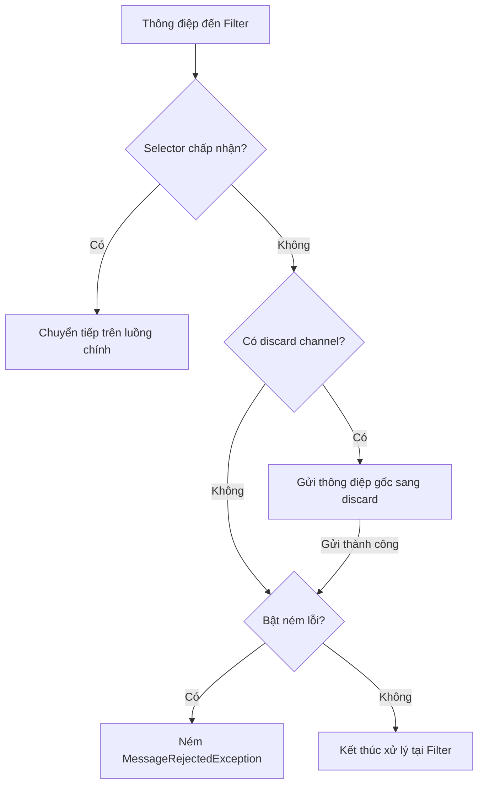

# throw-exception-on-rejection: báo lỗi khi Filter từ chối thông điệp

Trong Spring Integration, một Filter có thể từ chối thông điệp vì điều kiện nghiệp vụ không được đáp ứng. Thuộc tính `throw-exception-on-rejection` quyết định có biến kết quả từ chối đó thành ngoại lệ hay không. Đây là lựa chọn quan trọng khi thiết kế hợp đồng giữa bên gửi, endpoint lọc và luồng xử lý lỗi.

Bài học thuộc chương **Filter** của module **SPRING_INTEGRATION_CORE**. Nội dung tập trung vào cách cấu hình chính sách từ chối, quan sát kết quả qua `MessageChannel`, xử lý lỗi tại gateway và kiểm thử luồng bằng Java DSL.

## 1. Kết quả lọc và chính sách từ chối

Filter sử dụng một selector để quyết định thông điệp có được tiếp tục trên luồng chính hay không. Selector trả về `true` cho phép đi tiếp; `false` kích hoạt chính sách từ chối. Filter chuyển tiếp thông điệp được chấp nhận, không dùng kết quả boolean làm payload đầu ra. Xem [tài liệu Filter](https://docs.spring.io/spring-integration/reference/filter.html).

Các cách đặt cùng một tùy chọn:

| Cách cấu hình | Cú pháp |
| --- | --- |
| XML | `throw-exception-on-rejection="true"` |
| Java DSL | `.throwExceptionOnRejection(true)` |
| Đối tượng `MessageFilter` | `setThrowExceptionOnRejection(true)` |
| Annotation `@Filter` | `throwExceptionOnRejection = "true"` |

Giá trị mặc định là `false`. Khi chọn `true` và selector trả về `false`, `MessageFilter` ném `org.springframework.integration.MessageRejectedException`. Tùy chọn này không thay đổi tiêu chí chấp nhận thông điệp. Hợp đồng của setter được mô tả trong [Javadoc MessageFilter](https://docs.spring.io/spring-integration/api/org/springframework/integration/filter/MessageFilter.html#setThrowExceptionOnRejection(boolean)).

Ví dụ nghiệp vụ xuyên suốt: hệ thống nhận yêu cầu đặt hàng và chỉ cho phép số lượng dương. Với một lệnh đặt hàng trực tiếp, số lượng bằng `0` cần được báo lại cho bên gọi. Với một luồng sự kiện chỉ quan tâm đơn hợp lệ, cùng điều kiện lọc có thể dẫn đến việc bỏ qua hoặc chuyển sang nhánh theo dõi.

Hai quyết định cần tách rõ trong thiết kế:

1. **Selector:** đơn hàng nào được đi tiếp?
2. **Chính sách từ chối:** đơn không đạt điều kiện được bỏ qua, chuyển sang nhánh khác hay báo lỗi?

## 2. Quan hệ với discard-channel

`discardChannel` nhận thông điệp gốc bị từ chối. Cờ ném lỗi vẫn được xét khi có discard channel: nếu gửi sang discard channel thành công, Filter tiếp tục ném lỗi khi cờ là `true`. Đây là hành vi được nêu trong [Javadoc FilterEndpointSpec](https://docs.spring.io/spring-integration/api/org/springframework/integration/dsl/FilterEndpointSpec.html).

Trong bảng sau, giả sử selector, kênh đầu ra và nhánh discard đều hoạt động bình thường, không có advice can thiệp:

| Selector | Cờ ném lỗi | Discard channel | Kết quả tại Filter |
| --- | --- | --- | --- |
| `true` | Bất kỳ | Có hoặc không | Thông điệp đi tiếp trên luồng chính |
| `false` | `false` | Không | Kết thúc xử lý thông điệp tại Filter |
| `false` | `false` | Có | Gửi thông điệp gốc sang discard, không ném lỗi do từ chối |
| `false` | `true` | Không | Ném `MessageRejectedException` |
| `false` | `true` | Có | Gửi sang discard trước, sau đó ném `MessageRejectedException` |

Luồng quyết định có thể biểu diễn như sau:



Sơ đồ thể hiện thứ tự xử lý thông thường, chưa thể hiện lỗi phát sinh khi gửi sang discard. Trong mã nguồn, thao tác gửi discard đứng trước thao tác tạo `MessageRejectedException`; nếu việc gửi đó ném lỗi, ngoại lệ quan sát được có thể là lỗi gửi hoặc lỗi xử lý ở nhánh discard. Xem [mã nguồn MessageFilter, phiên bản 6.5.0](https://github.com/spring-projects/spring-integration/blob/v6.5.0/spring-integration-core/src/main/java/org/springframework/integration/filter/MessageFilter.java).

Từ Spring Integration 6.1, từ chối với cờ `false` và không có discard channel còn tạo log cảnh báo. Nếu chủ đích là bỏ thông điệp và không muốn cảnh báo này, có thể dùng `nullChannel` làm discard channel. `nullChannel` không vô hiệu hóa cờ ném lỗi khi cờ đó đang là `true`. Chi tiết thay đổi logging nằm trong [phần cấu hình Filter](https://docs.spring.io/spring-integration/reference/filter.html#filter-namespace).

## 3. Ví dụ Java DSL có thể chạy độc lập

Ví dụ sau dùng Java 17 trở lên và API Java DSL `IntegrationFlow.from(...)` của Spring Integration 6.x trở lên. Cần có `spring-integration-core` cùng các dependency Spring tương thích, hoặc một ứng dụng đã dùng Spring Boot starter cho Integration. Dùng phiên bản do dự án quản lý; bài học không yêu cầu thay đổi dependency của dự án hiện tại.

`ordersInput` là `DirectChannel` với một endpoint lọc. Hai `QueueChannel` giúp quan sát nhánh chấp nhận và nhánh từ chối mà không cần khai báo consumer riêng cho các kênh đích.

```java
import org.springframework.context.annotation.AnnotationConfigApplicationContext;
import org.springframework.context.annotation.Bean;
import org.springframework.context.annotation.Configuration;
import org.springframework.integration.MessageRejectedException;
import org.springframework.integration.channel.DirectChannel;
import org.springframework.integration.channel.QueueChannel;
import org.springframework.integration.config.EnableIntegration;
import org.springframework.integration.dsl.IntegrationFlow;
import org.springframework.messaging.Message;
import org.springframework.messaging.support.MessageBuilder;

@Configuration
@EnableIntegration
public class FilterRejectionExample {

    public record Order(String id, int quantity) {
    }

    @Bean
    public DirectChannel ordersInput() {
        return new DirectChannel();
    }

    @Bean
    public QueueChannel acceptedOrders() {
        return new QueueChannel();
    }

    @Bean
    public QueueChannel rejectedOrders() {
        return new QueueChannel();
    }

    @Bean
    public IntegrationFlow orderValidationFlow() {
        return IntegrationFlow.from("ordersInput")
                .<Order>filter(
                        order -> order.quantity() > 0,
                        endpoint -> endpoint
                                .id("positiveQuantityFilter")
                                .discardChannel("rejectedOrders")
                                .throwExceptionOnRejection(true))
                .channel("acceptedOrders")
                .get();
    }

    public static void main(String[] args) {
        try (var context = new AnnotationConfigApplicationContext(
                FilterRejectionExample.class)) {

            DirectChannel input = context.getBean(
                    "ordersInput", DirectChannel.class);
            QueueChannel accepted = context.getBean(
                    "acceptedOrders", QueueChannel.class);
            QueueChannel rejected = context.getBean(
                    "rejectedOrders", QueueChannel.class);

            Message<Order> valid = MessageBuilder
                    .withPayload(new Order("ORD-101", 2))
                    .setHeader("correlationId", "REQ-101")
                    .build();

            input.send(valid);
            System.out.println("accepted=" + (accepted.receive(0) != null));

            Message<Order> invalid = MessageBuilder
                    .withPayload(new Order("ORD-102", 0))
                    .setHeader("correlationId", "REQ-102")
                    .build();

            try {
                input.send(invalid);
            }
            catch (MessageRejectedException ex) {
                System.out.println("rejected=" + ex.getClass().getSimpleName());
                System.out.println("sameFailedMessage="
                        + (ex.getFailedMessage() == invalid));
            }

            System.out.println("discarded=" + (rejected.receive(0) != null));
            System.out.println("extraAccepted=" + (accepted.receive(0) != null));
        }
    }
}
```

Kết quả nghiệp vụ dự kiến, bỏ qua log của framework:

```text
accepted=true
rejected=MessageRejectedException
sameFailedMessage=true
discarded=true
extraAccepted=false
```

Các điểm cần đọc trong flow:

- Predicate nhận payload `Order`; kết quả `false` là quyết định từ chối.
- Phần cấu hình `endpoint` đặt chính sách cho Filter được DSL tạo ra. Phương thức `.filter(...)` chỉ xây dựng flow; lỗi xuất hiện khi một thông điệp thực sự đi qua endpoint.
- `rejectedOrders` nhận thông điệp gốc, không nhận `ErrorMessage` do Filter tự tạo.
- `acceptedOrders` không nhận đơn không hợp lệ, dù nhánh discard đã chạy.

Ví dụ này chủ động dùng hàng đợi trong bộ nhớ để quan sát kết quả. Việc lấy được thông điệp từ hàng đợi discard không thể hiện rằng một hệ thống lưu trữ bên ngoài đã ghi nhận thành công.

## 4. Cấu hình tương đương bằng XML và annotation

### 4.1. XML

Đây là một cấu hình thay thế cho flow Java DSL ở trên, sử dụng namespace Spring Integration và SpEL. Không nạp đồng thời hai cấu hình có cùng tên channel vào một application context.

```xml
<?xml version="1.0" encoding="UTF-8"?>
<beans xmlns="http://www.springframework.org/schema/beans"
       xmlns:xsi="http://www.w3.org/2001/XMLSchema-instance"
       xmlns:int="http://www.springframework.org/schema/integration"
       xsi:schemaLocation="
           http://www.springframework.org/schema/beans
           https://www.springframework.org/schema/beans/spring-beans.xsd
           http://www.springframework.org/schema/integration
           https://www.springframework.org/schema/integration/spring-integration.xsd">

    <int:channel id="ordersInput"/>

    <int:channel id="acceptedOrders">
        <int:queue/>
    </int:channel>

    <int:channel id="rejectedOrders">
        <int:queue/>
    </int:channel>

    <int:filter id="positiveQuantityFilter"
                input-channel="ordersInput"
                output-channel="acceptedOrders"
                expression="payload.quantity &gt; 0"
                discard-channel="rejectedOrders"
                throw-exception-on-rejection="true"/>
</beans>
```

Khi payload là `Order`, biểu thức kiểm tra số lượng, còn `throw-exception-on-rejection` chọn hành vi khi biểu thức trả về `false`. Có thể bỏ `discard-channel` nếu chỉ cần báo lỗi mà không cần nhánh nhận thông điệp bị loại. Tài liệu chính thức trình bày cú pháp XML trong [Filter](https://docs.spring.io/spring-integration/reference/filter.html).

### 4.2. Annotation

Ví dụ độc lập dưới đây lọc chuỗi rỗng. Nó giả định application context đã bật Integration, component scanning và đã có các channel `textInput`, `acceptedText`, `rejectedText`:

```java
import org.springframework.integration.annotation.Filter;
import org.springframework.stereotype.Component;

@Component
public class TextAdmissionPolicy {

    @Filter(
            inputChannel = "textInput",
            outputChannel = "acceptedText",
            discardChannel = "rejectedText",
            throwExceptionOnRejection = "true")
    public boolean accept(String payload) {
        return !payload.isBlank();
    }
}
```

Thuộc tính annotation có kiểu `String`, vì vậy cú pháp là `"true"`. Nó cũng hỗ trợ property placeholder, ví dụ `throwExceptionOnRejection = "${app.filter.throw-on-rejection:true}"`. Đây là cấu hình cho endpoint cụ thể, không phải một cờ tự động áp dụng cho mọi Filter. Xem [Javadoc @Filter](https://docs.spring.io/spring-integration/api/org/springframework/integration/annotation/Filter.html).

## 5. Không đồng nhất giá trị trả về của send với kết quả nghiệp vụ

`MessageChannel.send(...)` trả về boolean về thao tác gửi. Không nên dùng nó như kết quả predicate của Filter.

Với `DirectChannel` chỉ có một subscriber là Filter và không có advice thay đổi kết quả:

| Tình huống | Điều bên gửi quan sát |
| --- | --- |
| Selector chấp nhận, đầu ra nhận bình thường | `send(...)` có thể hoàn tất với `true` |
| Selector từ chối, cờ ném lỗi là `false` | `send(...)` vẫn có thể hoàn tất với `true` |
| Selector từ chối, cờ ném lỗi là `true` | Lời gọi `send(...)` ném ngoại lệ thay vì trả một giá trị boolean |

Diễn giải cho ví dụ đặt hàng: `true` có thể chỉ cho biết thông điệp đã được giao cho endpoint, còn endpoint đã xử lý nó bằng cách loại bỏ. Nếu hợp đồng yêu cầu người gọi biết đơn có được chấp nhận, hãy thiết kế phản hồi rõ ràng hoặc chọn chính sách ném lỗi phù hợp.

Kết quả cũng phụ thuộc vào dispatcher. `DirectChannel` có nhiều subscriber có thể thực hiện failover khi một handler ném ngoại lệ, tùy cấu hình. Khi muốn kiểm chứng hành vi của một Filter, dùng một endpoint nhận trên kênh đầu vào như ví dụ, hoặc xác định rõ chính sách failover. Xem [cấu hình DirectChannel](https://docs.spring.io/spring-integration/reference/channel/configuration.html#channel-configuration-directchannel).

## 6. Ai nhận lỗi phụ thuộc vào ranh giới luồng thực thi

### 6.1. DirectChannel: lỗi truyền theo call stack

Trong ví dụ Java DSL, Filter chạy trên thread gọi `input.send(...)`. Vì thế bên gửi có thể bắt `MessageRejectedException` ngay tại lời gọi này. Việc thêm header `errorChannel` vào thông điệp không tự biến mọi ngoại lệ đồng bộ thành thông điệp lỗi gửi tới kênh đó. Cơ chế truyền lỗi đồng bộ và bất đồng bộ được phân biệt trong [Error Handling](https://docs.spring.io/spring-integration/reference/error-handling.html).

`MessageRejectedException` kế thừa `MessageHandlingException` và cung cấp `getFailedMessage()` qua `MessagingException`. Có thể dùng thông điệp lỗi để lấy mã tương quan; không nên dựa vào toàn bộ chuỗi mô tả exception làm mã lỗi nghiệp vụ. Xem [Javadoc MessageRejectedException](https://docs.spring.io/spring-integration/api/org/springframework/integration/MessageRejectedException.html).

```java
try {
    input.send(invalid);
}
catch (MessageRejectedException ex) {
    Message<?> failed = ex.getFailedMessage();
    Object correlationId = failed == null
            ? null
            : failed.getHeaders().get("correlationId");

    System.out.println("ORDER_REJECTED, correlationId=" + correlationId);
}
```

Trong các topology phức tạp hơn, một lớp trung gian có thể bọc ngoại lệ. Khi phân loại lỗi, cần kiểm tra cả chuỗi nguyên nhân thay vì giả định ngoại lệ ngoài cùng luôn là `MessageRejectedException`.

### 6.2. ExecutorChannel hoặc consumer chạy bằng poller

Khi việc xử lý chuyển sang worker thread, `try/catch` quanh thao tác gửi ban đầu không bắt được lỗi phát sinh sau đó trong worker theo cách truyền ngoại lệ Java thông thường. Với cơ chế xử lý lỗi tiêu chuẩn của Spring Integration, lỗi được đóng gói thành `ErrorMessage`, gửi tới `errorChannel` trong header nếu có, hoặc kênh lỗi mặc định. Consumer chạy bằng poller cũng có cơ chế công bố lỗi từ tác vụ polling. Xem [Error Handling](https://docs.spring.io/spring-integration/reference/error-handling.html).

Vì vậy, trong thiết kế bất đồng bộ cần xác định nơi nhận lỗi cùng với nơi nhận thông điệp được chấp nhận. Không thể kết luận đặt hàng thành công chỉ vì thao tác đưa thông điệp vào executor hoặc queue đã hoàn tất.

Ví dụ handler quan sát lỗi, được đăng ký riêng trong một cấu hình đã bật Integration và có bean channel `orderErrors`:

```java
import org.springframework.integration.annotation.ServiceActivator;
import org.springframework.integration.MessageRejectedException;
import org.springframework.messaging.MessagingException;
import org.springframework.messaging.support.ErrorMessage;
import org.springframework.stereotype.Component;

@Component
public class OrderErrorObserver {

    @ServiceActivator(inputChannel = "orderErrors")
    public void observe(ErrorMessage error) {
        Throwable current = error.getPayload();
        MessageRejectedException rejection = null;

        while (current != null) {
            if (current instanceof MessageRejectedException rejected) {
                rejection = rejected;
                break;
            }
            current = current.getCause();
        }

        if (rejection != null) {
            System.out.println("ORDER_REJECTED");
            return;
        }

        throw new MessagingException(
                error, "Unexpected order processing failure", error.getPayload());
    }
}
```

Khi dùng handler này với một luồng worker được Spring Integration quản lý, bên gửi có thể đặt `.setErrorChannelName("orderErrors")` trên `MessageBuilder`. Bản thân việc định nghĩa `OrderErrorObserver` không tạo ranh giới bất đồng bộ hay thay thế cấu hình error handler của một executor tự viết.

Handler minh họa coi rejection là sự kiện đã được xử lý sau khi ghi nhận. Trong ứng dụng thực tế, có thể thay thao tác in bằng lưu trạng thái hoặc phát sự kiện. Với lỗi khác, ví dụ không âm thầm coi là từ chối nghiệp vụ mà ném tiếp để có thể quan sát và xử lý theo chính sách của hệ thống.

### 6.3. Discard và error channel mang dữ liệu khác nhau

| Đường đi | Dữ liệu nhận được | Mục đích thường gặp |
| --- | --- | --- |
| `discardChannel` của Filter | Thông điệp nghiệp vụ bị từ chối | Lưu yêu cầu không đạt điều kiện, theo dõi nghiệp vụ |
| Kênh nhận lỗi từ cơ chế công bố lỗi | `ErrorMessage`, payload là ngoại lệ | Phân loại lỗi, cảnh báo, recovery |

Hai đường có thể cùng xuất hiện cho một yêu cầu nếu Filter vừa có discard channel vừa bật ném lỗi. Khi cả hai đều ghi nhận sự kiện từ chối, nên dùng mã tương quan hoặc mã yêu cầu để tránh tính hai lần một kết quả nghiệp vụ.

## 7. Gateway cần một hợp đồng phản hồi rõ ràng

Xét gateway trả về kết quả xử lý đơn hàng:

```java
import org.springframework.integration.annotation.MessagingGateway;

@MessagingGateway(defaultRequestChannel = "submitOrder")
public interface OrderGateway {
    String submit(FilterRejectionExample.Order order);
}
```

Gateway phải được đăng ký bằng cơ chế scan/import phù hợp của ứng dụng. Với cấu hình độc lập, có thể dùng `@IntegrationComponentScan` trên lớp cấu hình để phát hiện interface này.

Một flow request-reply thay thế, được đặt trong lớp cấu hình có `@Bean` và `@EnableIntegration`:

```java
@Bean
public IntegrationFlow submitOrderFlow() {
    return IntegrationFlow.from("submitOrder")
            .<FilterRejectionExample.Order>filter(
                    order -> order.quantity() > 0,
                    endpoint -> endpoint.throwExceptionOnRejection(true))
            .<FilterRejectionExample.Order, String>transform(
                    order -> "ACCEPTED:" + order.id())
            .get();
}
```

Với đơn hợp lệ, transformer tạo chuỗi trả lời. Với đơn không hợp lệ, Filter ném lỗi trước transformer. Không đặt đầu ra cuối cùng vào một queue không có consumer nếu đang muốn sử dụng reply channel do gateway cung cấp.

Nếu cờ ném lỗi là `false`, thông điệp có thể dừng tại Filter mà không tạo phản hồi; gateway trả về giá trị không phải `void` khi đó phải tuân theo cấu hình chờ phản hồi và timeout. Ném lỗi giúp báo rejection sớm trong luồng đồng bộ khi không có cơ chế bắt và chuyển đổi lỗi. Gateway cũng có thể cấu hình error channel để chuyển lỗi thành kết quả khác. Các trường hợp này được mô tả trong [Messaging Gateways](https://docs.spring.io/spring-integration/reference/gateway.html).

Nếu từ chối là một kết quả phổ biến mà client cần đọc như dữ liệu, có thể thiết kế một phản hồi `OrderResult` gồm mã trạng thái và lý do. Router cùng các nhánh tạo phản hồi thường phù hợp hơn việc bỏ thông điệp trong một Filter rồi để client suy luận qua timeout.

## 8. Selector trả false khác selector ném ngoại lệ

Cờ `throwExceptionOnRejection` áp dụng cho quyết định từ chối của Filter. Nó không phải cơ chế bao mọi lỗi trong selector thành `MessageRejectedException`.

Ví dụ:

```java
order -> order.quantity() > 0
```

Số lượng `0` tạo kết quả `false`; chính sách từ chối được áp dụng.

Ngược lại:

```java
order -> inventoryClient.isOrderAdmissible(order.id())
```

Nếu `inventoryClient` ném lỗi kết nối, selector chưa tạo ra quyết định boolean. Đây là lỗi thực thi trong quá trình đánh giá. Nó có thể được bọc bởi cơ chế xử lý message nhưng không tự trở thành lỗi từ chối do cờ trên. Sự phân biệt này cũng thể hiện trong [mã nguồn MessageFilter](https://github.com/spring-projects/spring-integration/blob/v6.5.0/spring-integration-core/src/main/java/org/springframework/integration/filter/MessageFilter.java): đánh giá selector xảy ra trước phần xử lý rejection.

Về thiết kế, nên giữ điều kiện lọc dễ hiểu và hạn chế tác dụng phụ. Nếu phải gọi hệ thống bên ngoài, cần phân biệt rõ ba trường hợp: được chấp nhận, bị từ chối theo dữ liệu và chưa thể quyết định vì lỗi hạ tầng.

## 9. Retry, advice và transaction

Mặc định, hành động discard và ngoại lệ do rejection nằm trong phạm vi advice của Filter. Vì vậy, retry advice có thể nhìn thấy `MessageRejectedException`. Tùy chọn `discardWithinAdvice(false)` đưa phần discard và ném lỗi do từ chối ra sau advice chain. Đây là một tùy chọn riêng, không phải cách tắt rejection. Xem [Advising Filters](https://docs.spring.io/spring-integration/reference/handler-advice/advising-filters.html).

Áp dụng vào ví dụ đặt hàng:

- Gửi lại một đơn có số lượng `0` thường không sửa được dữ liệu. Nên phân loại rejection này thành lỗi không cần retry thay vì lặp lại theo chính sách chung cho lỗi tạm thời.
- Khi retry bao cả discard, mỗi lần thử có thể lặp lại thao tác ghi nhận đơn bị từ chối. Nếu cần lưu audit, thiết kế ghi nhận có khả năng chống trùng theo mã yêu cầu.
- `discardWithinAdvice(false)` chỉ thay đổi phạm vi request-handler advice của Filter. Nó không loại bỏ một transaction bên ngoài đang bao toàn bộ lời gọi.

Việc ném `MessageRejectedException` cũng không tự tạo transaction, tự rollback mọi thay đổi hoặc tự đưa message về broker. Kết quả rollback, acknowledgment và redelivery phụ thuộc transaction manager, inbound adapter, listener container và cơ chế lưu trữ đang dùng.

Ví dụ, nếu nhánh discard đã gửi một yêu cầu HTTP rồi Filter mới ném lỗi, một transaction cơ sở dữ liệu của bên gọi không thể mặc nhiên hoàn tác yêu cầu HTTP đó. Khi cần đảm bảo lưu dấu từ chối, hãy xác định tài nguyên nào tham gia cùng transaction và tác dụng phụ nào cần cơ chế đảm bảo riêng.

## 10. Kiểm thử hành vi quan sát được

Kiểm thử cần chứng minh cả đường đi của thông điệp và kết quả phía người gửi. Chỉ kiểm tra selector trả về `false` chưa đủ xác nhận rằng endpoint đã được cấu hình để ném lỗi.

Hai kiểm thử JUnit 5 sau sử dụng nguyên cấu hình `FilterRejectionExample` ở mục 3. Chúng không cần Spring Boot hay `spring-integration-test`; dependency bổ sung là JUnit Jupiter. Mỗi kiểm thử mở context riêng để hàng đợi không giữ thông điệp từ kiểm thử trước.

```java
import org.junit.jupiter.api.Test;
import org.springframework.context.annotation.AnnotationConfigApplicationContext;
import org.springframework.integration.MessageRejectedException;
import org.springframework.integration.channel.DirectChannel;
import org.springframework.integration.channel.QueueChannel;
import org.springframework.messaging.Message;
import org.springframework.messaging.support.MessageBuilder;

import static org.junit.jupiter.api.Assertions.*;

class FilterRejectionExampleTest {

    @Test
    void acceptedOrderReachesOnlyMainOutput() {
        try (var context = new AnnotationConfigApplicationContext(
                FilterRejectionExample.class)) {
            DirectChannel input = context.getBean(
                    "ordersInput", DirectChannel.class);
            QueueChannel accepted = context.getBean(
                    "acceptedOrders", QueueChannel.class);
            QueueChannel rejected = context.getBean(
                    "rejectedOrders", QueueChannel.class);

            Message<FilterRejectionExample.Order> message = MessageBuilder
                    .withPayload(new FilterRejectionExample.Order("ORD-201", 3))
                    .build();

            assertDoesNotThrow(() -> input.send(message));
            assertSame(message, accepted.receive(0));
            assertNull(rejected.receive(0));
        }
    }

    @Test
    void rejectedOrderIsDiscardedBeforeExceptionReturnsToSender() {
        try (var context = new AnnotationConfigApplicationContext(
                FilterRejectionExample.class)) {
            DirectChannel input = context.getBean(
                    "ordersInput", DirectChannel.class);
            QueueChannel accepted = context.getBean(
                    "acceptedOrders", QueueChannel.class);
            QueueChannel rejected = context.getBean(
                    "rejectedOrders", QueueChannel.class);

            Message<FilterRejectionExample.Order> message = MessageBuilder
                    .withPayload(new FilterRejectionExample.Order("ORD-202", 0))
                    .setHeader("correlationId", "REQ-202")
                    .build();

            MessageRejectedException exception = assertThrows(
                    MessageRejectedException.class,
                    () -> input.send(message));

            assertSame(message, exception.getFailedMessage());
            assertSame(message, rejected.receive(0));
            assertNull(accepted.receive(0));
            assertNull(rejected.receive(0));
        }
    }
}
```

`receive(0)` phù hợp ở đây vì đầu vào đồng bộ: khi `send(...)` hoàn tất hoặc ném lỗi, Filter đã thực hiện xong thao tác gửi sang queue. Nếu chuyển sang executor hoặc poller, cần chờ có giới hạn trên kênh quan sát thay vì dùng kiểm tra tức thời và giả định worker đã chạy.

Khi mở rộng bộ kiểm thử của ứng dụng, nên bổ sung các tình huống theo hợp đồng thực tế:

| Tình huống | Kết quả cần xác nhận |
| --- | --- |
| Từ chối, cờ `false`, không có discard | Không có thông điệp ở đầu ra, không có lỗi rejection tới bên gửi |
| Từ chối, cờ `true`, không có discard | Có lỗi rejection, không có thông điệp ở đầu ra |
| Nhánh discard ném lỗi | Quan sát được lỗi của nhánh discard theo topology, không giả định luôn là rejection |
| Xử lý bất đồng bộ | Lỗi tới đúng kênh lỗi, đầu ra chính không nhận thông điệp bị loại |
| Gateway request-reply | Đơn hợp lệ có phản hồi; đơn bị từ chối tuân theo hợp đồng lỗi đã chọn |
| Có retry hoặc recovery advice | Số lần ghi discard và kết quả cuối cùng đúng chính sách, không tạo bản ghi trùng ngoài dự kiến |

## 11. Chọn chính sách theo ý nghĩa của thông điệp

| Ngữ cảnh | Chính sách gợi ý | Lý do |
| --- | --- | --- |
| Lệnh đặt hàng trực tiếp cần báo kết quả | Bật ném lỗi, hoặc tạo phản hồi từ chối tường minh | Bên gọi cần nhận được một kết quả rõ ràng |
| Sự kiện không thuộc phạm vi quan tâm | Tắt ném lỗi; dùng discard hoặc `nullChannel` theo nhu cầu | Không phải mọi sự kiện bị lọc đều là sự cố |
| Yêu cầu không hợp lệ cần lưu để điều tra | Discard tới nơi ghi nhận; cân nhắc cờ ném lỗi theo hợp đồng đầu vào | Nhu cầu lưu dấu và nhu cầu báo lỗi là hai quyết định riêng |
| Sự kiện bị từ chối có nguy cơ bị nguồn gửi lặp lại vô hạn | Thiết kế chính sách lỗi cuối cùng tại adapter/container | Cờ của Filter không tự giải quyết vòng lặp redelivery |

Các lựa chọn trên là gợi ý thiết kế cho ví dụ, cần được đối chiếu với hợp đồng của nguồn gửi. Một rejection có thể là kết quả bình thường với luồng sự kiện nhưng là lỗi đầu vào đối với API đồng bộ.

Khi theo dõi vận hành, nên ghi nhận endpoint nào từ chối, mã tương quan và nhóm nguyên nhân. Một predicate chỉ trả boolean không tự cung cấp mã lý do chi tiết; nếu cần nhiều lý do, có thể bổ sung bước đánh giá trước Filter hoặc dùng kết quả nghiệp vụ có cấu trúc. Hạn chế ghi toàn bộ payload vào log nếu chỉ cần mã yêu cầu để tra cứu.

## 12. Những nhầm lẫn thường gặp

- **Đã có discard channel thì không còn lỗi:** cờ `true` vẫn làm Filter ném lỗi sau bước gửi discard thành công.
- **Cờ `false` nghĩa là mọi lỗi bị bỏ qua:** lỗi thực thi selector, lỗi gửi đầu ra và lỗi nhánh discard vẫn có thể xảy ra.
- **`send(...)` trả `true` nghĩa là đơn đã được chấp nhận:** kết quả gửi không thay thế kết quả nghiệp vụ.
- **Filter ném lỗi thì luôn có `ErrorMessage` ở global `errorChannel`:** cần xét thread thực thi, gateway và error handler của topology.
- **Bật cờ là đủ để bảo đảm rollback hoặc không mất thông điệp:** còn phải xét tài nguyên giao dịch và cơ chế nhận/gửi thực tế.
- **Một gateway trả dữ liệu có thể bỏ thông điệp mà không cần quyết định về phản hồi:** cần thiết kế rõ lỗi, kết quả từ chối hoặc timeout.

Điểm cốt lõi của `throw-exception-on-rejection` là biến một quyết định không cho đi tiếp thành tín hiệu lỗi tại Filter. Để sử dụng đúng, hãy xác định đồng thời nơi thông điệp bị từ chối sẽ đến, nơi lỗi sẽ được quan sát và điều bên gọi cần nhận được.
