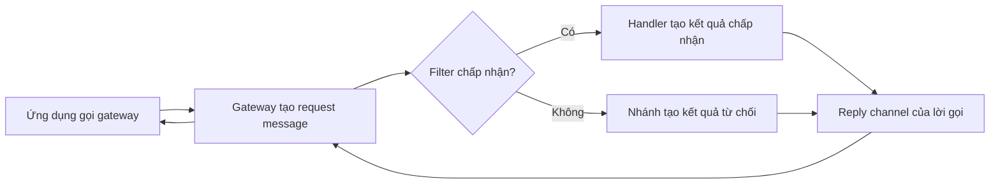

# Filter trong request-reply flow

## 1. Mục tiêu và tình huống sử dụng

Trong module `SPRING_INTEGRATION_CORE`, filter là endpoint quyết định một `Message` có được đi tiếp trên luồng chính hay không. Khi đặt filter sau một gateway có giá trị trả về, quyết định này còn ảnh hưởng đến việc lời gọi của ứng dụng có hoàn tất đúng hợp đồng hay không.

Giả sử một dịch vụ tiếp nhận yêu cầu kiểm tra đơn hàng:

```java
OrderReply reply = orderGateway.evaluate(new OrderRequest("OD-101", 250));
```

Ứng dụng mong nhận kết quả chấp nhận, kết quả từ chối có lý do, hoặc một ngoại lệ xác định. Nếu filter chỉ loại bỏ yêu cầu có số lượng lớn hơn giới hạn, ứng dụng có thể phải chờ hết timeout mà không biết yêu cầu đã bị từ chối ngay từ đầu.

Sau bài này, người học có thể:

- Giải thích sự khác nhau giữa kết quả selector, message đi tiếp và phản hồi mà caller nhận được.
- Thiết kế chính sách cho nhánh bị loại trong một luồng request-reply.
- Dùng `throwExceptionOnRejection`, `discardChannel`, `discardFlow` và gateway timeout đúng vai trò.
- Giữ đường trả lời qua `replyChannel` khi tạo phản hồi nghiệp vụ.
- Viết kiểm thử cho cả nhánh chấp nhận, từ chối và mất phản hồi.

Các ví dụ dùng Java DSL, Java record và API thuộc Spring Integration 6.x/7.x. Hãy chọn JDK, Spring Framework và Spring Integration tương thích trong ứng dụng của mình. Tùy chọn `errorOnTimeout` được ghi riêng vì chỉ có trên `@MessagingGateway` từ Spring Integration 6.2. Bài không phụ thuộc một giá trị timeout mặc định của framework.

## 2. Hợp đồng request-reply đi qua filter

### 2.1. Ba câu hỏi khác nhau

Một filter thường được mô tả bằng điều kiện boolean, nhưng khi phân tích request-reply cần tách ba câu hỏi:

| Câu hỏi | Thành phần trả lời | Ví dụ |
|---|---|---|
| Message có được chấp nhận không? | Selector của filter | `request.quantity() <= 100` |
| Message được xử lý ở đâu? | Output chính hoặc nhánh discard | Nhánh kiểm tra tiếp hoặc nhánh tạo kết quả từ chối |
| Caller nhận được gì? | Endpoint tạo reply, cơ chế lỗi và gateway | `OrderReply`, ngoại lệ hoặc hết thời gian chờ |

Giá trị `false` của selector chỉ là quyết định không chuyển message sang output chính. Nó không trở thành payload `false` trả về gateway. Tương tự, giá trị `true` cho phép message đi tiếp; nó chưa phải kết quả chấp nhận nghiệp vụ cuối cùng.

Filter chuyển tiếp message được chấp nhận, không tự biến request thành response. Predicate cũng có thể ném ngoại lệ do lỗi thực thi; tình huống đó khác với việc predicate thực thi bình thường và trả về `false`. Cơ chế chọn và loại message được mô tả trong [Spring Integration — Filter](https://docs.spring.io/spring-integration/reference/filter.html).

### 2.2. Đường trả lời

Với gateway thông thường, một lời gọi tạo request message và kèm đường trả lời trong header `replyChannel`. Endpoint cuối có khả năng tạo reply sẽ chuyển kết quả về đường đó khi không có output channel tường minh.



Nhánh discard không mặc nhiên nối lại với những endpoint nằm sau filter trong luồng chính. Nếu muốn nhánh này trả lời caller, phải đặt endpoint tạo reply trên chính nhánh đó và duy trì đường trả lời thích hợp. Nếu cả hai nhánh cần một bước hậu xử lý chung, hãy nối chúng đến channel chung một cách tường minh.

Gateway hỗ trợ reply channel tạm theo từng lời gọi, nên không cần tự tạo một queue dùng chung chỉ để nhận response. Cơ chế này và các cấu hình reply channel được trình bày trong [Messaging Gateways — Setting the Default Reply Channel](https://docs.spring.io/spring-integration/reference/gateway.html#gateway-default-reply-channel).

### 2.3. Bất biến thiết kế

Với API yêu cầu phản hồi, có thể đặt một bất biến ở cấp thiết kế:

> Mỗi request được tiếp nhận phải có đúng một kết cục dành cho caller: một phản hồi theo hợp đồng hoặc một lỗi được truyền về theo chính sách đã định.

Đây là yêu cầu thiết kế của ứng dụng, không phải cam kết xử lý exactly-once do filter cung cấp. Retry, fan-out, giao dịch và lỗi mạng vẫn có thể làm phát sinh xử lý lặp hoặc phản hồi muộn.

Khi duyệt sơ đồ luồng, hãy lần theo cả đường `true` lẫn `false` cho đến nơi tạo reply hoặc truyền lỗi. Một nhánh kết thúc ở thao tác ghi log chưa đáp ứng bất biến này.

## 3. Chọn chính sách cho message bị từ chối

### 3.1. Bảng hành vi

Bảng dưới giả định request được gửi qua gateway có kiểu trả về là một object, không có error flow tùy biến chuyển đổi lỗi:

| Cấu hình khi selector trả `false` | Message đi đâu? | Điều caller quan sát |
|---|---|---|
| Không discard, `throwExceptionOnRejection(false)` | Không đi tiếp trên output chính | Không có reply; gateway chờ theo cấu hình |
| `throwExceptionOnRejection(true)` | Filter phát sinh lỗi từ chối | Lỗi có thể được truyền về caller qua cơ chế lỗi của luồng |
| Discard chỉ ghi log/lưu audit | Sang nhánh discard, nhánh đó không tạo reply | Vẫn thiếu reply |
| Discard tạo response và giữ đường trả lời | Sang nhánh discard rồi gửi response | Caller nhận kết quả từ chối nghiệp vụ |
| Discard trỏ đến `nullChannel` | Message bị tiêu thụ và bỏ đi | Vẫn thiếu reply |

Nếu không có discard channel và không bật ném lỗi, các phiên bản từ 6.1 có thể ghi cảnh báo khi loại message. Cảnh báo trong log không tạo ra response cho lời gọi đang chờ. Xem hành vi cụ thể của [MessageFilter](https://docs.spring.io/spring-integration/api/org/springframework/integration/filter/MessageFilter.html).

### 3.2. Khi nào trả kết quả từ chối?

Dùng response nghiệp vụ khi việc không đáp ứng điều kiện là một kết quả dự kiến mà caller cần phân biệt rõ. Ví dụ: số lượng vượt giới hạn nhận đơn, sản phẩm không nằm trong phạm vi phục vụ, hoặc yêu cầu cần chuyển sang quy trình khác.

Một response có cấu trúc giúp giao diện hiển thị lý do và giúp caller quyết định có sửa dữ liệu hay không. Không nên bắt caller suy ra từ timeout rằng “chắc đã bị từ chối”.

### 3.3. Khi nào ném lỗi?

Dùng lỗi khi hợp đồng API quy định đầu vào đó không được phép đi vào luồng, hoặc khi thiếu điều kiện bắt buộc được coi là vi phạm. Cần phân biệt lỗi từ chối với lỗi hạ tầng để caller không retry một yêu cầu luôn bị cùng một quy tắc loại bỏ.

### 3.4. Khi nào chấp nhận không có reply?

Chỉ chọn hành vi này khi hợp đồng thực sự cho phép không có phản hồi. Ví dụ, một gateway `void` phục vụ luồng thông báo một chiều hoặc một API đã công bố rõ khả năng “không có kết quả”.

Việc đổi kiểu gateway từ `OrderReply` thành `void` là thay đổi hợp đồng nghiệp vụ, không phải một cách sửa timeout thuần kỹ thuật. Bài này tập trung vào trường hợp caller cần biết quyết định xử lý.

## 4. Ví dụ đầy đủ: trả kết quả cho cả hai nhánh

### 4.1. Quy tắc của ví dụ

Dịch vụ kiểm tra số lượng có nằm trong khoảng từ 1 đến 100 hay không:

- Trong khoảng: trả `accepted = true`.
- Ngoài khoảng: trả `accepted = false` và mã lý do.
- Cả hai kết quả phải giữ nguyên `orderId` để caller đối chiếu.

Ví dụ chỉ kiểm tra chính sách số lượng, chưa đặt hàng, chưa trừ tồn kho và chưa thực hiện thanh toán. Nhờ vậy có thể quan sát riêng vai trò của filter trong request-reply.

Đặt các lớp sau trong cùng package `example.integration.filterreply`, mỗi kiểu `public` trong một file Java riêng. Ứng dụng cần thư viện Spring Integration Core; phần kiểm thử cần Spring Test và JUnit Jupiter. Nếu dùng Spring Boot, có thể dùng starter integration và starter test theo dependency management của ứng dụng.

### 4.2. Kiểu dữ liệu

```java
package example.integration.filterreply;

public record OrderRequest(String orderId, int quantity) {
}
```

```java
package example.integration.filterreply;

public record OrderReply(String orderId, boolean accepted, String reason) {
}
```

Record phản hồi biểu diễn rõ quyết định. Một response `accepted = false` vẫn là phản hồi hợp lệ, khác hoàn toàn với việc không có message trả về.

### 4.3. Gateway

```java
package example.integration.filterreply;

import org.springframework.integration.annotation.MessagingGateway;

@MessagingGateway(
        defaultRequestChannel = "orderRequests",
        defaultRequestTimeout = "1000",
        defaultReplyTimeout = "1000")
public interface OrderGateway {

    OrderReply evaluate(OrderRequest request);
}
```

Các timeout được khai báo bằng mili giây và là giá trị minh họa. Không suy ra rằng tổng thời gian chạy lời gọi luôn nhỏ hơn hoặc bằng một giây; phần về timeout bên dưới giải thích giới hạn này.

Gateway là interface nên cần được đăng ký bởi cơ chế scan gateway. `@IntegrationComponentScan` phục vụ mục đích đó trong cấu hình Java thuần. Xem [MessagingGateway API](https://docs.spring.io/spring-integration/api/org/springframework/integration/annotation/MessagingGateway.html).

### 4.4. Cấu hình Java DSL

```java
package example.integration.filterreply;

import org.springframework.context.annotation.Bean;
import org.springframework.context.annotation.Configuration;
import org.springframework.integration.annotation.IntegrationComponentScan;
import org.springframework.integration.channel.DirectChannel;
import org.springframework.integration.config.EnableIntegration;
import org.springframework.integration.dsl.IntegrationFlow;
import org.springframework.messaging.MessageChannel;

@Configuration
@EnableIntegration
@IntegrationComponentScan(basePackageClasses = OrderGateway.class)
public class OrderFlowConfiguration {

    @Bean
    public MessageChannel orderRequests() {
        return new DirectChannel();
    }

    @Bean
    public IntegrationFlow orderFlow() {
        return IntegrationFlow.from("orderRequests")
                .filter(OrderRequest.class,
                        request -> request.quantity() > 0
                                && request.quantity() <= 100,
                        filter -> filter
                                .id("quantityPolicyFilter")
                                .throwExceptionOnRejection(false)
                                .discardFlow(rejected -> rejected
                                        .handle(OrderRequest.class,
                                                (request, headers) ->
                                                        new OrderReply(
                                                                request.orderId(),
                                                                false,
                                                                "QUANTITY_OUT_OF_POLICY"),
                                                endpoint -> endpoint
                                                        .requiresReply(true))))
                .handle(OrderRequest.class,
                        (request, headers) -> new OrderReply(
                                request.orderId(),
                                true,
                                "ACCEPTED"),
                        endpoint -> endpoint.requiresReply(true))
                .get();
    }
}
```

`discardFlow` định nghĩa nhánh xử lý message bị loại. API cũng cho phép dùng `discardChannel` nếu cần tách nhánh thành flow riêng. Không dùng đồng thời hai cách để biểu diễn cùng một đường discard. Tham khảo [FilterEndpointSpec](https://docs.spring.io/spring-integration/api/org/springframework/integration/dsl/FilterEndpointSpec.html).

### 4.5. Lần theo một lời gọi

Với `new OrderRequest("OD-101", 3)`:

1. Gateway tạo request message chứa payload và các header phục vụ lời gọi.
2. Filter trả `true`, chuyển request sang handler chính.
3. Handler trả payload `OrderReply("OD-101", true, "ACCEPTED")`.
4. Endpoint gửi response theo đường trả lời của request; gateway trả payload cho ứng dụng.

Với `new OrderRequest("OD-102", 250)`:

1. Filter trả `false`, nên handler chính không được gọi.
2. Nhánh discard nhận request và tạo `OrderReply("OD-102", false, "QUANTITY_OUT_OF_POLICY")`.
3. Reply của nhánh discard trở về gateway.
4. Sau filter không có request được chấp nhận để chạy tiếp trên nhánh chính.

Handler trong nhánh discard trả object bình thường; endpoint của Spring Integration lo việc tạo reply message và duy trì header theo cơ chế mặc định. Cấu hình này không có bước loại bỏ header hay thay đường trả lời.

Điểm cần quan sát là response từ nhánh discard đi về gateway, không quay lại handler chấp nhận sau filter. Nếu đặt thêm bước định dạng response sau handler chính, bước đó sẽ không tự chạy cho response từ chối.

## 5. Biến thể: từ chối bằng ngoại lệ

Khi hợp đồng yêu cầu lỗi thay vì response `accepted = false`, có thể thay bean `orderFlow()` ở trên bằng biến thể sau. Giữ nguyên gateway, channel và cấu hình đăng ký gateway; chỉ dùng một phiên bản flow cho cùng kênh request.

```java
@Bean
public IntegrationFlow orderFlow() {
    return IntegrationFlow.from("orderRequests")
            .filter(OrderRequest.class,
                    request -> request.quantity() > 0
                            && request.quantity() <= 100,
                    filter -> filter
                            .id("quantityPolicyFilter")
                            .throwExceptionOnRejection(true))
            .handle(OrderRequest.class,
                    (request, headers) -> new OrderReply(
                            request.orderId(),
                            true,
                            "ACCEPTED"),
                    endpoint -> endpoint.requiresReply(true))
            .get();
}
```

Khi selector trả `false`, filter phát sinh `org.springframework.integration.MessageRejectedException`. Với ví dụ dùng `DirectChannel` và không khai báo error flow riêng cho gateway, lỗi được truyền về caller; cần tính đến khả năng bọc ngoại lệ khi quan sát cause chain. Việc handler chính không chạy vẫn là điều kiện phải kiểm tra.

Đặt `throwExceptionOnRejection(true)` không có nghĩa mọi lỗi đều là lỗi từ chối. Nếu predicate truy cập dữ liệu sai và phát sinh `NullPointerException`, đó là lỗi thực thi của predicate. Chỉ chuyển đổi lỗi sang mã từ chối khi nhận diện đúng loại và ngữ cảnh.

### 5.1. Discard audit kết hợp ném lỗi

Có thể vừa đưa request bị loại sang một discard channel phục vụ audit, vừa bật ném lỗi. Theo API, sau khi gửi sang discard, filter vẫn ném lỗi từ chối; hai cấu hình không loại trừ nhau.

Trong thiết kế này, nhánh audit chỉ nên ghi nhận thông tin, không đồng thời tạo response nghiệp vụ. Nếu nhánh discard đã trả một kết quả rồi filter lại ném lỗi, lời gọi có thể chứa hai tín hiệu kết thúc mâu thuẫn. Thứ tự và ranh giới luồng còn làm việc chẩn đoán khó hơn.

Ngoài ra, audit đồng bộ có thể chậm hoặc thất bại trước khi lời gọi hoàn tất. Nếu audit là side effect bền vững hoặc có retry, hãy thiết kế idempotency theo định danh nghiệp vụ. Một message bị từ chối không tự có bảo đảm audit đúng một lần.

### 5.2. Không retry lỗi từ chối một cách máy móc

Giả sử giới hạn luôn là 100 và request có số lượng 250. Gửi lại cùng request nhiều lần sẽ lặp lại cùng quyết định. Caller cần sửa yêu cầu hoặc chuyển quy trình, không chỉ tăng số lần thử.

Nếu thay đổi giới hạn phụ thuộc trạng thái bên ngoài, hãy mô tả rõ điều kiện nào được retry. Khi đó quyết định retry thuộc hợp đồng nghiệp vụ và chính sách lỗi của toàn luồng, không nằm trong giá trị boolean của filter.

## 6. `requiresReply` bảo vệ phần nào của luồng?

Trong ví dụ, cả handler chính và handler của nhánh discard có:

```java
endpoint -> endpoint.requiresReply(true)
```

Cấu hình này yêu cầu endpoint đó tạo reply; khi handler trả `null` trái hợp đồng, lỗi như `ReplyRequiredException` giúp phát hiện sớm hơn việc chờ gateway hết timeout. Đây là kiểm tra tại một endpoint có khả năng tạo reply, không phải kiểm tra toàn bộ đồ thị tích hợp.

Vì vậy:

- Đặt `requiresReply(true)` ở handler sau filter không bảo vệ nhánh request đã bị filter loại bỏ, vì handler đó không được gọi.
- Cấu hình này không tự tạo response từ chối.
- Nó không phát hiện hoặc ngắt một handler đang chạy mãi chưa trả về.
- Nếu endpoint có output channel riêng, việc nó tạo output chưa chứng minh gateway đã nhận response đúng đường.

Filter cũng là một reply-producing handler và có thể có cấu hình kế thừa, nhưng đối với việc selector từ chối, nên thể hiện chính sách bằng `throwExceptionOnRejection` hoặc nhánh discard tạo reply. Không bật `requiresReply(true)` ngay trên filter trong biến thể discard trả response: nhánh chính của filter không tạo kết quả khi từ chối, dù nhánh discard đã tự trả lời.

Vai trò của cờ này được định nghĩa tại [AbstractReplyProducingMessageHandler](https://docs.spring.io/spring-integration/api/org/springframework/integration/handler/AbstractReplyProducingMessageHandler.html).

## 7. Timeout không thay thế phản hồi nghiệp vụ

### 7.1. Hai giai đoạn khác nhau

| Cấu hình | Giai đoạn được giới hạn | Không nên diễn giải thành |
|---|---|---|
| `defaultRequestTimeout` | Chờ gửi request khi channel hỗ trợ chặn gửi, ví dụ queue đầy | Giới hạn toàn bộ xử lý nghiệp vụ |
| `defaultReplyTimeout` | Chờ response tại gateway sau khi bước gửi trả quyền điều khiển | Cơ chế tự hủy handler đang chạy |
| Timeout I/O của client downstream | Chờ thao tác mạng mà client đó thực hiện | Quyết định từ chối của filter |

Nếu filter bỏ request và luồng gửi kết thúc bình thường, gateway bắt đầu chờ nhưng không có response đến. Với gateway trả object như ví dụ, khi hết thời gian chờ và không bật chính sách ném lỗi timeout, kết quả thường là `null`.

`null` không mang thông tin vì sao không có response. Nó có thể bắt nguồn từ filter bỏ message, handler trả `null`, nhánh kết thúc ở consumer `void`, hoặc phản hồi không đến kịp. Không ánh xạ mọi trường hợp này thành “không được phép đặt hàng”.

### 7.2. Trường hợp dùng `DirectChannel`

`DirectChannel` chuyển việc xử lý cho subscriber trên luồng của bên gửi. Trong ví dụ không có handoff bất đồng bộ, lời gọi gateway phải đi qua handler trước khi bước gửi hoàn tất.

Nếu handler mất năm giây, `defaultReplyTimeout = "1000"` không ngắt handler sau một giây. Nếu handler đã tạo reply trước khi trả về, gateway có thể nhận kết quả ngay khi quyền điều khiển quay lại, dù tổng lời gọi đã mất hơn một giây.

Đây là lý do cần timeout của HTTP client, JDBC driver hoặc dịch vụ downstream tại nơi thực hiện I/O. Tăng hay giảm reply timeout của gateway không thay thế được giới hạn cho thao tác đó. Ranh giới thực thi của các loại channel được mô tả trong [Message Channel Implementations](https://docs.spring.io/spring-integration/reference/channel/implementations.html).

### 7.3. Khi có ranh giới bất đồng bộ

Nếu request được chuyển qua `ExecutorChannel`, hoặc được xử lý về sau bởi consumer có poller của `QueueChannel`, bên gửi có thể trở về gateway trước khi xử lý nghiệp vụ hoàn tất. Lúc này thời gian chờ reply có thể hết trong khi worker vẫn làm việc.

Một timeout ở caller không tự thu hồi request đã gửi và không tự rollback side effect của worker. Khi cho phép retry, hãy dùng mã request/idempotency phù hợp và quan sát phản hồi muộn.

Có thể ước lượng thời gian quan sát được như sau:

```text
Thời gian lời gọi = thời gian bước gửi chưa trả về + thời gian chờ reply
```

Đây là mô hình phân tích các giai đoạn, không phải công thức đặt SLA bằng cách cộng hai giá trị cấu hình timeout. Bước gửi qua channel đồng bộ có thể chứa toàn bộ thời gian chạy handler.

### 7.4. Chuyển hết thời gian chờ thành lỗi rõ ràng

Từ Spring Integration 6.2, có thể dùng:

```java
@MessagingGateway(
        defaultRequestChannel = "orderRequests",
        defaultRequestTimeout = "1000",
        defaultReplyTimeout = "1000",
        errorOnTimeout = true)
public interface OrderGateway {

    OrderReply evaluate(OrderRequest request);
}
```

Tùy chọn này giúp caller nhận lỗi timeout thay cho kết quả `null` khi chờ reply thất bại; nếu có error channel tùy biến thì lỗi còn chịu chính sách xử lý của error flow. Nó không đổi request bị từ chối thành một response nghiệp vụ, cũng không ngắt handler đồng bộ.

Ứng dụng vẫn cần ba kết quả phân biệt: response chấp nhận, response từ chối có lý do, và lỗi kỹ thuật/timeout. Tham khảo các tình huống chính thức tại [Gateway Behavior When No Response Arrives](https://docs.spring.io/spring-integration/reference/gateway.html#gateway-no-response).

## 8. Discard channel, reply channel và error channel

### 8.1. Ba đường mang ý nghĩa khác nhau

| Đường | Message thường mang theo | Mục đích |
|---|---|---|
| Output chính | Request được filter chấp nhận | Tiếp tục luồng xử lý bình thường |
| Discard channel/flow | Request gốc bị selector loại | Xử lý từ chối, ghi nhận hoặc tạo reply từ chối |
| Error channel | `ErrorMessage` chứa lỗi | Xử lý ngoại lệ và áp dụng chính sách lỗi |

`discardChannel` không phải `errorChannel`. Việc selector trả `false` chỉ phát sinh ngoại lệ nếu chính sách filter hoặc bước xử lý liên quan thực sự làm điều đó. Ngược lại, lỗi I/O ở handler chính không tự trở thành request trên nhánh discard.

### 8.2. Đừng làm mất đường trả lời

Khi tạo response bằng endpoint thông thường và trả POJO, framework thực hiện đóng gói reply và truyền header theo cấu hình. Nếu dùng custom handler tự tạo rồi gửi message, cần chủ động duy trì đường reply của request và tránh ghi đè nhầm.

Một số lỗi thiết kế thường gặp:

- Loại bỏ `replyChannel` khi làm sạch header trước khi nhánh cuối trả lời.
- Cấu hình output cố định sang một kênh audit thay vì đường quay về gateway.
- Tự tạo reply message trong code riêng rồi gửi đi mà không giữ ngữ cảnh của lời gọi.
- Gửi response trực tiếp từ custom code rồi đồng thời trả một payload khác cho endpoint tự phát response lần nữa.

Ưu tiên trả payload từ handler như ví dụ chính khi không có nhu cầu điều khiển message ở mức thấp. Nếu cần output chung cho cả hai nhánh, hãy biểu diễn channel chung trong sơ đồ và xác định endpoint cuối cùng trả về caller.

### 8.3. Lỗi đồng bộ và lỗi bất đồng bộ

Với xử lý đồng bộ, ngoại lệ có thể đi ngược call stack về bên gửi. Sau một ranh giới bất đồng bộ, cơ chế lỗi phải truyền thông tin bằng message; không thể dựa vào `throw` của worker để trực tiếp quay về stack của caller.

Spring Integration có cơ chế phân phối `ErrorMessage` dựa trên ngữ cảnh lỗi và error channel. Nếu cấu hình gateway error flow để chuyển lỗi thành response, flow đó cần tạo reply đúng kiểu và theo đúng ngữ cảnh request. Một consumer chỉ ghi log lỗi rồi kết thúc không bảo đảm caller nhận được phản hồi.

Không giả định mọi lỗi đều đi đến một bean toàn cục tên `errorChannel`; cần kiểm tra header, error handler của thành phần bất đồng bộ và cấu hình gateway cụ thể. Xem [Spring Integration — Error Handling](https://docs.spring.io/spring-integration/reference/error-handling.html).

## 9. Kiểm thử hợp đồng qua gateway

### 9.1. Vì sao chỉ kiểm tra predicate chưa đủ?

Unit test cho biểu thức số lượng có thể chứng minh quy tắc đúng, nhưng không chứng minh nhánh discard đã trả lời đúng gateway. Một lỗi wiring vẫn có thể khiến caller hết thời gian chờ dù predicate chạy chính xác.

Kiểm thử request-reply cần đi từ phương thức gateway đến kết quả quan sát được. Với ví dụ chính, tối thiểu phải kiểm tra số lượng hợp lệ, vượt giới hạn, bằng không và đúng biên trên.

### 9.2. Kiểm thử ví dụ hai nhánh đều trả kết quả

Đặt test cùng package với các kiểu của ví dụ:

```java
package example.integration.filterreply;

import org.junit.jupiter.api.Test;
import org.springframework.beans.factory.annotation.Autowired;
import org.springframework.test.context.junit.jupiter.SpringJUnitConfig;

import static org.junit.jupiter.api.Assertions.assertEquals;
import static org.junit.jupiter.api.Assertions.assertFalse;
import static org.junit.jupiter.api.Assertions.assertNotNull;
import static org.junit.jupiter.api.Assertions.assertTrue;

@SpringJUnitConfig(OrderFlowConfiguration.class)
class OrderRequestReplyTest {

    @Autowired
    private OrderGateway gateway;

    @Test
    void returnsAcceptedReplyForQuantityWithinPolicy() {
        OrderReply reply = gateway.evaluate(new OrderRequest("OD-201", 4));

        assertNotNull(reply);
        assertEquals("OD-201", reply.orderId());
        assertTrue(reply.accepted());
        assertEquals("ACCEPTED", reply.reason());
    }

    @Test
    void returnsRejectedReplyInsteadOfLosingTheResponse() {
        OrderReply reply = gateway.evaluate(new OrderRequest("OD-202", 250));

        assertNotNull(reply);
        assertEquals("OD-202", reply.orderId());
        assertFalse(reply.accepted());
        assertEquals("QUANTITY_OUT_OF_POLICY", reply.reason());
    }

    @Test
    void rejectsZeroQuantity() {
        OrderReply reply = gateway.evaluate(new OrderRequest("OD-203", 0));

        assertNotNull(reply);
        assertFalse(reply.accepted());
        assertEquals("QUANTITY_OUT_OF_POLICY", reply.reason());
    }

    @Test
    void acceptsTheUpperBoundary() {
        OrderReply reply = gateway.evaluate(new OrderRequest("OD-204", 100));

        assertNotNull(reply);
        assertTrue(reply.accepted());
    }
}
```

Các test này kiểm tra cả nội dung và khả năng nhận response. Không cần khẳng định request phải hoàn tất trong vài mili giây trên mọi máy; đó là một kiểm tra thời gian dễ bị ảnh hưởng bởi môi trường và không trực tiếp chứng minh wiring đúng.

Nếu handler chính có side effect như ghi đơn, bổ sung mock hoặc bộ đếm tại ranh giới nghiệp vụ để xác nhận request bị loại không gọi handler đó. Khi có hai lời gọi đồng thời, kiểm tra mỗi `orderId` nhận đúng response của nó để phát hiện thiết kế reply channel dùng chung sai cách.

### 9.3. Ma trận kiểm thử cho các biến thể

| Kịch bản | Kết quả cần xác nhận |
|---|---|
| Request qua filter | Có reply đúng kiểu, đúng định danh và đúng dữ liệu |
| Request bị loại, discard tạo reply | Có kết quả từ chối; handler chính không chạy |
| Request bị loại, ném lỗi | Cause chain có lỗi từ chối; không chạy nghiệp vụ chính |
| Predicate ném lỗi | Phân biệt lỗi thực thi với quyết định selector `false` |
| Discard chỉ ghi log | Gateway chờ hết timeout hữu hạn theo chính sách đã chọn |
| Handler chính trả `null`, có `requiresReply(true)` | Lỗi thiếu reply được phát hiện tại handler |
| Có xử lý bất đồng bộ và reply muộn | Caller hết thời gian chờ; worker không bị coi là đã hủy |
| Retry sau timeout | Side effect được bảo vệ theo idempotency của ứng dụng |

Khi kiểm thử tình huống cố ý mất phản hồi, dùng reply timeout ngắn nhưng hữu hạn trong cấu hình test để lỗi không làm treo cả bộ test. Nếu dùng biến thể ném lỗi, cấu hình test riêng thay flow; không đăng ký cả flow trả response và flow ném lỗi làm hai subscriber cạnh tranh trên cùng `DirectChannel`.

## 10. Những cách sửa dễ gây hiểu nhầm

### 10.1. “Đã có discard channel nên caller sẽ nhận phản hồi”

Discard channel chỉ xác định nơi gửi request bị loại. Hãy kiểm tra consumer trên channel đó có tạo response và đưa response về đúng lời gọi hay không.

Một nhánh chỉ ghi audit có thể hoạt động đúng mục đích audit nhưng vẫn thiếu kết quả cho caller. Cách sửa là chọn rõ response nghiệp vụ hoặc lỗi, rồi hoàn thiện nhánh tương ứng.

### 10.2. “Nối `nullChannel` để hết lỗi là được”

`nullChannel` là điểm tiêu thụ message. Nó có thể phù hợp với luồng một chiều cần bỏ thông báo, nhưng không tạo ra response cho một phương thức gateway đang chờ giá trị trả về.

Dùng nó trên nhánh discard của request-reply chỉ chuyển việc bỏ message thành một cấu hình tường minh; vấn đề hợp đồng phản hồi vẫn còn.

### 10.3. “Giảm timeout sẽ sửa được filter”

Giảm timeout giúp caller nhận biết sớm việc không có kết quả trong một số tình huống. Nó không cung cấp mã lý do từ chối và không khôi phục đường trả lời bị mất.

Với một lỗi wiring ổn định, mọi request bị từ chối vẫn đi đến timeout, chỉ nhanh hơn trước. Cần sửa nhánh `false` của luồng.

### 10.4. “Bật `requiresReply` ở cuối luồng là đủ”

Request bị filter loại bỏ không đến endpoint cuối. Cờ này chỉ có tác dụng với message mà endpoint thực sự xử lý. Phải thiết kế kết cục cho nhánh discard hoặc bật ném lỗi tại filter.

### 10.5. “Dùng publish-subscribe để chạy cả xử lý và phản hồi”

Nếu nhiều subscriber cùng tạo reply cho cùng một request, caller có thể nhận kết quả không phù hợp với ý định thiết kế. Fan-out cần một chính sách thu thập kết quả hoặc một nhánh duy nhất chịu trách nhiệm trả lời.

Với quy tắc boolean đơn giản, filter kèm nhánh discard đủ biểu đạt. Nếu có nhiều kết quả nghiệp vụ và các nhánh cần hội tụ, router thường giúp thể hiện các trạng thái rõ hơn. Nếu cần nhiều nhánh cùng trả kết quả, phải thiết kế cơ chế tương quan và tổng hợp thay vì kỳ vọng gateway tự hợp nhất.

## 11. Chẩn đoán một request bị chờ hết timeout

Có thể lần theo thứ tự sau:

1. **Request có vào filter không?** Quan sát định danh request và endpoint; phân biệt không gửi được với bị loại.
2. **Selector trả gì?** Ghi nhận quyết định `true`/`false` và mã quy tắc; kiểm tra có ngoại lệ xảy ra trong predicate không.
3. **Nhánh nào thực sự chạy?** Request bị loại phải đến nhánh discard hoặc phát sinh lỗi theo cấu hình.
4. **Endpoint cuối có tạo output không?** Đối chiếu handler trả object, trả `null` hay là consumer `void`.
5. **Output được gửi đến đâu?** Kiểm tra output channel tường minh, `replyChannel` và các bước lọc header.
6. **Có đổi thread không?** Nếu có, xem error flow và thời điểm phản hồi so với timeout của caller.
7. **Có nhiều nơi cùng trả lời không?** Kiểm tra fan-out, custom send và retry để tìm response lặp hoặc muộn.

Để quan sát vận hành, ứng dụng có thể thống kê số request được chấp nhận, số request bị từ chối theo mã lý do, lỗi kỹ thuật, timeout và thời gian chờ phản hồi. Phân tách các nhóm này giúp tránh việc một đợt tăng timeout che lấp lỗi mất reply.

Nên dùng định danh nghiệp vụ/request ID trong log thay vì dựa hoàn toàn vào `MessageHeaders.ID`, vì message mới có thể có ID mới. Không dùng header `replyChannel` làm định danh nghiệp vụ. Các nhãn metric nên có số lượng giá trị hữu hạn, chẳng hạn mã chính sách; định danh từng đơn phù hợp hơn với log hoặc trace.

## 12. Bài tập thực hành

Từ ví dụ hai nhánh đều trả response:

1. Thêm kiểm thử số lượng `-1`, `1`, `100` và `101`; xác nhận kết quả theo cùng chính sách.
2. Thay `discardFlow` bằng `discardChannel("rejectedOrderRequests")` cùng một flow riêng tạo `OrderReply`; giữ nguyên kết quả mà caller quan sát.
3. Đổi nhánh discard thành chỉ ghi log và quan sát gateway hết thời gian chờ với timeout test hữu hạn. Sau đó phục hồi nhánh trả kết quả.
4. Chuyển sang biến thể `throwExceptionOnRejection(true)` trong context riêng và xác nhận loại lỗi từ chối.
5. Cho handler chính trả `null` có điều kiện để thấy vai trò của `requiresReply(true)`; không nhầm tình huống đó với filter loại request.
6. Nếu thêm `ExecutorChannel`, xác định rõ error channel, cơ chế truyền lỗi về gateway và hành vi khi response đến sau timeout.

Kết quả cần đạt là mô tả được trọn đường đi của một request ở từng trường hợp, bao gồm kết cục mà caller nhận. Chỉ nhìn vào predicate hoặc log “đã loại message” chưa đủ để xác nhận một request-reply flow đã hoàn chỉnh.
