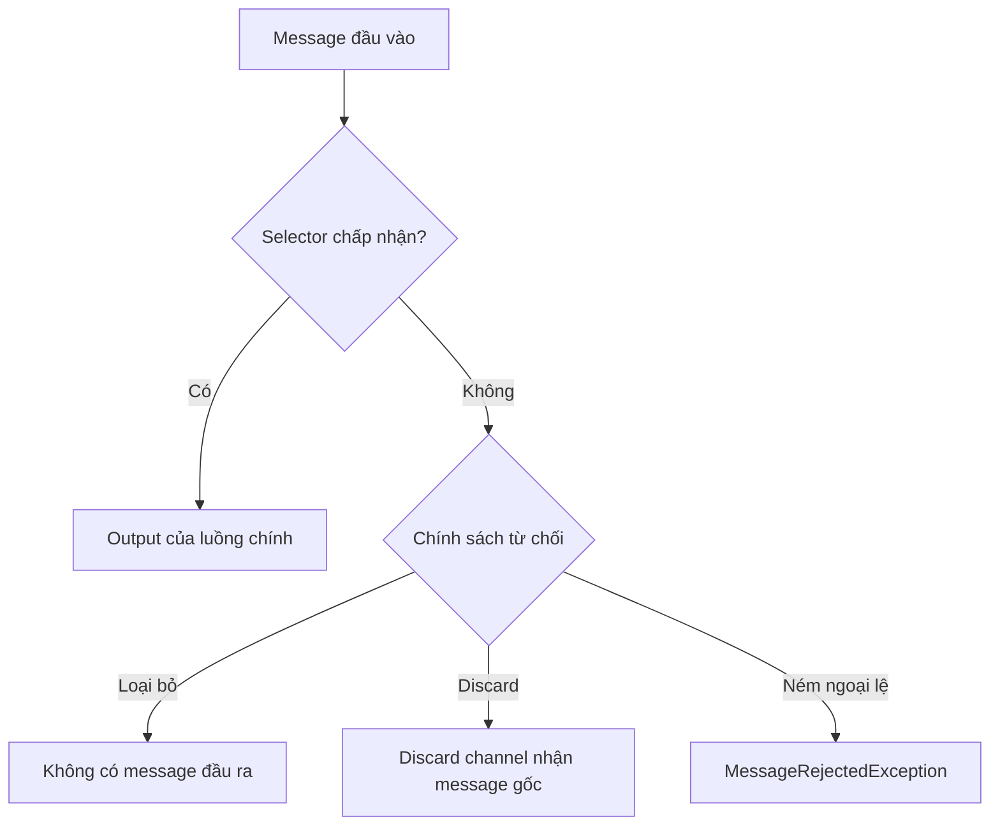

# Filter và null output

## 1. Hiểu đúng việc một filter không có đầu ra

Trong Spring Integration, **filter quyết định message có được đi tiếp trên luồng chính hay không**. Filter sử dụng một selector để đánh giá điều kiện:

- Selector trả về `true`: filter cho message đầu vào đi tiếp.
- Selector trả về `false`: filter từ chối message; cách xử lý tiếp theo phụ thuộc vào discard channel và cấu hình ném ngoại lệ.

Nếu message bị từ chối và filter không ném ngoại lệ, filter không tạo reply cho luồng chính. Ở mức triển khai của một handler tạo reply, tình huống này được biểu diễn bằng kết quả xử lý `null`. Trong bài này, đó là ý nghĩa của **null output**.

Điểm cần giữ rõ là: **null output không phải một message có payload bằng `null`**. Nó biểu thị việc không có message đầu ra trên nhánh chính.

Một filter nhận một message và cho ra **không hoặc một message trên luồng chính**:

```text
                         selector = true
                    ┌──────────────────────> message đi tiếp
message đầu vào ───> filter
                    └──────────────────────> không có reply trên luồng chính
                         selector = false
```

Mô hình này giúp thiết kế đúng hợp đồng giữa filter, `MessageChannel`, endpoint phía sau và gateway gọi vào hệ thống. Nó đặc biệt quan trọng khi người gọi đang chờ một câu trả lời hoặc khi phía sau filter là một aggregator.

## 2. Phân biệt các ý nghĩa của `null`

### 2.1. Payload bằng `null` không phải cách biểu diễn message bị loại

Một `Message<?>` hợp lệ trong Spring Messaging yêu cầu payload khác `null`. Vì vậy, không biểu diễn việc bị từ chối bằng cách tạo message như sau:

```java
// Không hợp lệ: payload không được bằng null.
MessageBuilder.withPayload(null).build();
```

Ngược lại, những giá trị sau vẫn là payload có thật:

```java
MessageBuilder.withPayload("").build();
MessageBuilder.withPayload(List.of()).build();
MessageBuilder.withPayload(Optional.empty()).build();
```

Chuỗi rỗng, danh sách rỗng và `Optional.empty()` đều là các đối tượng khác `null`. Chúng có được chấp nhận hay không là quyết định của selector. Việc payload “rỗng” theo nghĩa nghiệp vụ không tự động làm filter loại message.

### 2.2. Selector quyết định bằng boolean

Selector của filter phải đưa ra quyết định chấp nhận hoặc từ chối. Nó không tạo payload đầu ra:

```java
.filter(String.class, text -> !text.isBlank())
```

Trong ví dụ này:

- `"READY"` cho kết quả `true`.
- `"   "` cho kết quả `false`.
- Filter không thay chuỗi khoảng trắng thành `null`.
- Filter cũng không tự `trim()` chuỗi được chấp nhận.

Không trả `null` từ predicate để biểu thị từ chối. API selector có kết quả `boolean`; nếu logic trung gian dùng `Boolean` và trả `null`, việc chuyển sang `boolean` có thể gây lỗi unboxing. Đó là lỗi thực thi, không phải một quyết định từ chối bình thường.

### 2.3. Không có message ở endpoint phía sau

Nếu filter loại message, endpoint tiếp theo không được gọi với đối số `null`; endpoint đó đơn giản là không được gọi cho message này.

```java
.filter(String.class, text -> !text.isBlank())
.transform(String.class, String::trim)
```

Với đầu vào `"   "`, transformer không chạy. Với đầu vào `"  READY  "`, filter chấp nhận chuỗi nguyên bản rồi transformer mới tạo payload `"READY"`.

Sự phân biệt này giải thích vì sao thêm một bước phía sau filter để “bắt null” không giải quyết được việc message bị loại:

```java
.filter(String.class, text -> !text.isBlank())
.handle(message -> {
    // Đoạn này chỉ chạy khi filter đã chấp nhận message.
    // Nó không được gọi để thông báo rằng filter vừa loại message.
});
```

## 3. Ba cách xử lý khi selector từ chối

Khi selector trả về `false`, lựa chọn cấu hình quyết định cách quan sát và xử lý message bị loại.

| Cấu hình | Kết quả trên luồng chính | Xử lý message bị từ chối |
|---|---|---|
| Không có discard channel; `throwExceptionOnRejection=false` | Không có reply | Kết thúc xử lý tại filter |
| Có discard channel; `throwExceptionOnRejection=false` | Không có reply từ nhánh chính | Gửi message gốc sang discard channel |
| `throwExceptionOnRejection=true` | Không có kết quả chấp nhận bình thường | Phát sinh `MessageRejectedException` |

Mặc định, `throwExceptionOnRejection` là `false`. Vì vậy, nếu không cấu hình đường discard, một message bị từ chối có thể kết thúc tại filter mà không tạo ngoại lệ.



Sơ đồ trình bày ba lựa chọn thiết kế thường gặp. Discard channel và việc ném ngoại lệ là các tùy chọn riêng; không nên suy luận từ sơ đồ rằng API bắt buộc chúng loại trừ nhau. Ví dụ trong bài dùng từng chính sách riêng để làm rõ hành vi.

### 3.1. Loại bỏ là một kết quả hợp lệ khi nào?

Loại bỏ phù hợp khi hợp đồng của luồng cho phép đầu vào không tạo kết quả, chẳng hạn:

- Bỏ qua sự kiện không thuộc phạm vi xử lý của một subscriber.
- Chặn bản ghi không đáp ứng điều kiện trước khi thực hiện công việc phía sau.
- Bỏ qua thông báo không cần tạo hành động nghiệp vụ.

Tuy nhiên, filter không tự phát hiện trùng lặp hay tự nhớ trạng thái. Nếu điều kiện phụ thuộc lịch sử xử lý, selector hoặc thành phần chuyên trách phải cung cấp cơ chế đó.

### 3.2. Discard channel cung cấp đường xử lý riêng

Discard channel giúp đưa message bị từ chối sang nơi ghi nhận lý do, thống kê hoặc xử lý riêng. Message được gửi sang đó là message nghiệp vụ ban đầu, không tự động trở thành một `ErrorMessage`.

Selector chỉ trả về một quyết định. Nếu cần lưu lý do cụ thể như `MISSING_CUSTOMER`, `EMPTY_TEXT` hay `UNSUPPORTED_REGION`, hãy thiết kế thêm bước phân loại hoặc một kết quả nghiệp vụ có cấu trúc. Không giả định filter tự gắn header chứa lý do từ chối.

### 3.3. Ném ngoại lệ làm thay đổi hợp đồng của luồng

Với `throwExceptionOnRejection=true`, việc từ chối trở thành một lỗi xử lý dưới dạng `MessageRejectedException`.

Đây là lựa chọn phù hợp khi đầu vào vi phạm điều kiện bắt buộc và bên gọi cần nhận lỗi. Nó cũng ảnh hưởng đến retry, rollback và cơ chế xử lý lỗi của endpoint. Một message luôn vi phạm cùng điều kiện thường sẽ tiếp tục bị từ chối khi retry mà không có thay đổi dữ liệu hoặc trạng thái.

## 4. Ví dụ Java DSL: tách message hợp lệ và message bị loại

Ví dụ dưới đây dùng Java 17, Java DSL của Spring Integration 6 và ba channel:

- `text.input`: nhận chuỗi đầu vào bằng `DirectChannel`.
- `text.accepted`: giữ message được chấp nhận bằng `QueueChannel`.
- `text.rejected`: giữ message bị từ chối bằng `QueueChannel`.

Ứng dụng cần các thư viện `spring-integration-core` và Spring Context trên classpath. Đây là cấu hình minh họa độc lập, không yêu cầu gateway.

```java
import org.springframework.context.annotation.Bean;
import org.springframework.context.annotation.Configuration;
import org.springframework.integration.channel.DirectChannel;
import org.springframework.integration.channel.QueueChannel;
import org.springframework.integration.config.EnableIntegration;
import org.springframework.integration.dsl.IntegrationFlow;
import org.springframework.messaging.MessageChannel;

@Configuration
@EnableIntegration
public class FilterNullOutputConfig {

    @Bean(name = "text.input")
    public MessageChannel textInput() {
        return new DirectChannel();
    }

    @Bean(name = "text.accepted")
    public QueueChannel textAccepted() {
        return new QueueChannel();
    }

    @Bean(name = "text.rejected")
    public QueueChannel textRejected() {
        return new QueueChannel();
    }

    @Bean
    public IntegrationFlow nonBlankTextFlow() {
        return IntegrationFlow.from("text.input")
                .filter(
                        String.class,
                        text -> !text.isBlank(),
                        endpoint -> endpoint
                                .discardChannel("text.rejected")
                                .throwExceptionOnRejection(false))
                .channel("text.accepted")
                .get();
    }
}
```

Hành vi mong đợi:

| Payload đầu vào | Selector | `text.accepted` | `text.rejected` |
|---|---|---|---|
| `"READY"` | `true` | Nhận `"READY"` | Không nhận |
| `"  READY  "` | `true` | Nhận `"  READY  "` | Không nhận |
| `"   "` | `false` | Không nhận | Nhận `"   "` |
| `""` | `false` | Không nhận | Nhận `""` |

Filter giữ payload của message được chấp nhận. Việc khai báo `String.class` trong DSL cho biết kiểu đầu vào dùng khi gọi selector; nó không phải một bước chuẩn hóa nội dung.

Trong ví dụ này, cả hai channel kết quả đều là queue, nên có thể quan sát riêng hai nhánh bằng thao tác `receive()`. Queue không tự tạo subscriber xử lý message; cần consumer riêng nếu muốn tiếp tục xử lý thực tế.

## 5. Kiểm thử: xác nhận không có output, không tìm payload null

Một kiểm thử hữu ích cần chứng minh hai việc khác nhau:

1. Message hợp lệ đi vào channel được chấp nhận và không đi vào discard channel.
2. Message bị từ chối không xuất hiện ở channel được chấp nhận, nhưng có mặt ở discard channel nếu đã cấu hình.

Ví dụ JUnit Jupiter dưới đây dùng `FilterNullOutputConfig` ở phần trước và Spring Test. Các queue ban đầu rỗng; đây là một phương thức kiểm thử kiểm tra lần lượt cả hai nhánh.

```java
import org.junit.jupiter.api.Test;
import org.junit.jupiter.api.extension.ExtendWith;
import org.springframework.beans.factory.annotation.Autowired;
import org.springframework.beans.factory.annotation.Qualifier;
import org.springframework.integration.channel.QueueChannel;
import org.springframework.messaging.Message;
import org.springframework.messaging.MessageChannel;
import org.springframework.messaging.support.MessageBuilder;
import org.springframework.test.context.ContextConfiguration;
import org.springframework.test.context.junit.jupiter.SpringExtension;

import static org.junit.jupiter.api.Assertions.assertEquals;
import static org.junit.jupiter.api.Assertions.assertNotNull;
import static org.junit.jupiter.api.Assertions.assertNull;
import static org.junit.jupiter.api.Assertions.assertTrue;

@ExtendWith(SpringExtension.class)
@ContextConfiguration(classes = FilterNullOutputConfig.class)
class FilterNullOutputTest {

    @Autowired
    @Qualifier("text.input")
    private MessageChannel input;

    @Autowired
    @Qualifier("text.accepted")
    private QueueChannel accepted;

    @Autowired
    @Qualifier("text.rejected")
    private QueueChannel rejected;

    @Test
    void shouldSeparateAcceptedAndRejectedMessages() {
        boolean sentValid = input.send(
                MessageBuilder.withPayload("READY").build());

        assertTrue(sentValid);

        Message<?> acceptedMessage = accepted.receive(0);
        assertNotNull(acceptedMessage);
        assertEquals("READY", acceptedMessage.getPayload());
        assertNull(rejected.receive(0));

        boolean sentBlank = input.send(
                MessageBuilder.withPayload("   ").build());

        assertTrue(sentBlank);
        assertNull(accepted.receive(0));

        Message<?> rejectedMessage = rejected.receive(0);
        assertNotNull(rejectedMessage);
        assertEquals("   ", rejectedMessage.getPayload());
    }
}
```

`receive(0)` không chờ: nó trả về message sẵn có hoặc `null` nếu queue đang rỗng. Giá trị `null` ở đây là kết quả của thao tác lấy message, không phải payload của một message.

Kiểm tra tức thời này phù hợp vì `DirectChannel` gọi filter đồng bộ và việc gửi vào queue đã hoàn tất khi `input.send(...)` trả về. Với executor hoặc consumer bất đồng bộ, cần dùng thời gian chờ hữu hạn hoặc cơ chế đồng bộ kiểm thử phù hợp; đọc queue ngay lập tức có thể cho kết quả rỗng chỉ vì công việc chưa chạy xong.

### Vì sao `send()` trả về `true` dù message bị từ chối?

Trong cấu hình trên, message đã được channel chuyển đến handler và handler hoàn tất việc xử lý theo chính sách đã cấu hình. Giá trị trả về của `MessageChannel.send()` không phải kết quả của selector và không chứng minh nghiệp vụ đã chấp nhận message.

Không dùng đoạn mã sau để suy luận trạng thái nghiệp vụ:

```java
boolean acceptedByBusinessRule = input.send(message);
```

Nếu bên gửi cần biết quyết định nghiệp vụ, cần một reply tường minh hoặc một cơ chế theo dõi kết quả đã được thiết kế trong hợp đồng của hệ thống.

## 6. Chọn giữa bỏ qua và ném ngoại lệ trong DSL

Các đoạn dưới đây là những phương án thay thế cho bước `.filter(...)`, không phải các filter cần nối lần lượt vào cùng một luồng.

### 6.1. Chỉ bỏ qua message bị từ chối

```java
.filter(String.class, text -> !text.isBlank())
```

Khi selector trả về `false`, không có message đi tiếp và không có discard channel nhận message. Một handler nằm sau filter không thể dùng trường hợp này để tạo phản hồi từ chối.

### 6.2. Gửi message bị từ chối sang nhánh riêng

```java
.filter(
        String.class,
        text -> !text.isBlank(),
        endpoint -> endpoint.discardChannel("text.rejected"))
```

Ở đây, nhánh chính vẫn không có output cho message bị từ chối. Discard channel tạo một đường xử lý khác, có thể dùng cho việc quan sát hoặc xử lý nghiệp vụ bổ sung.

Consumer của discard channel vẫn là thành phần thực thi. Nếu việc gửi sang channel đó thất bại hoặc consumer đồng bộ ném lỗi, lời gọi filter có thể thất bại. “Bị từ chối mà không chủ động ném ngoại lệ” không đồng nghĩa mọi thao tác trên đường discard đều chắc chắn thành công.

### 6.3. Xem từ chối là lỗi của lời gọi

```java
.filter(
        String.class,
        text -> !text.isBlank(),
        endpoint -> endpoint.throwExceptionOnRejection(true))
```

Trong luồng dùng `DirectChannel`, ngoại lệ từ quá trình xử lý có thể truyền về lời gọi gửi message. Gateway hoặc các thành phần xử lý lỗi bao quanh có thể chuyển đổi cách lỗi được biểu diễn cho bên gọi.

Nên chọn chính sách dựa trên hợp đồng của luồng:

| Nhu cầu | Hướng thiết kế |
|---|---|
| Một sự kiện có thể bị bỏ qua mà không cần phản hồi | Filter có thể kết thúc xử lý khi từ chối |
| Cần giữ lại message bị loại để xử lý riêng | Cấu hình discard channel và consumer tương ứng |
| Đầu vào vi phạm điều kiện bắt buộc, bên gọi cần nhận lỗi | Bật `throwExceptionOnRejection` và thiết kế đường xử lý lỗi |
| Bên gọi luôn cần kết quả chấp nhận hoặc từ chối | Trả một kết quả nghiệp vụ rõ ràng cho cả hai trường hợp |

## 7. Tác động đến messaging gateway đang chờ reply

### 7.1. Luồng đồng bộ vẫn có thể kết thúc mà không có câu trả lời

Xét gateway có phương thức trả về `String`:

```java
import org.springframework.integration.annotation.MessagingGateway;

@MessagingGateway(
        defaultRequestChannel = "text.rpc",
        defaultReplyTimeout = "1000")
public interface TextGateway {

    String accept(String text);
}
```

Gateway này cần được đăng ký bằng cơ chế quét integration component, chẳng hạn `@IntegrationComponentScan`. Ví dụ đặt reply timeout là `1000` mili giây để việc chờ có giới hạn; không dựa vào timeout mặc định.

Một flow tương ứng có thể là:

```java
@Bean
public IntegrationFlow textRpcFlow() {
    return IntegrationFlow.from("text.rpc")
            .filter(String.class, text -> !text.isBlank())
            .transform(String.class, text -> "ACCEPTED: " + text)
            .get();
}
```

Trong flow này, không cố định output vào một queue kết quả. Với message được chấp nhận, kết quả của transformer có thể được gửi về `replyChannel` do gateway cung cấp.

- Đầu vào `"READY"`: transformer tạo reply `"ACCEPTED: READY"`.
- Đầu vào `"   "`: filter loại message, transformer không chạy và nhánh chính không tạo reply.

Gateway không nhận được một reply mang payload `null` khi filter từ chối. Nó không có reply để nhận. Với gateway đồng bộ trả về kiểu tham chiếu như ví dụ, khi hết thời gian chờ mà không có reply, kết quả có thể là `null`. Không nên hiểu kết quả đó là một phản hồi nghiệp vụ “đã từ chối” nếu hợp đồng chưa quy định như vậy.

Tăng reply timeout chỉ kéo dài việc chờ; nó không tạo ra câu trả lời còn thiếu. Nếu chưa có consumer đăng ký, hoặc consumer thực thi chậm, đó là các nguyên nhân khác cần phân biệt với việc filter chủ động loại message.

### 7.2. Discard channel không tự hoàn tất request-reply

Một discard channel dùng để ghi log hoặc giữ message trong queue không tự gửi phản hồi cho gateway. Trong ví dụ có `text.rejected` là `QueueChannel`, message chỉ nằm ở queue cho đến khi được lấy ra.

Có thể thiết kế một discard flow tạo reply từ chối bằng cách sử dụng thông tin reply của message. Tuy nhiên, phản hồi đó phải là hành vi được cấu hình và kiểm thử rõ ràng. Không suy luận rằng chỉ cần khai báo `discardChannel(...)` là gateway sẽ nhận được câu trả lời.

### 7.3. Luôn cần câu trả lời: trả kết quả nghiệp vụ tường minh

Nếu phương thức mang nghĩa “kiểm tra và trả quyết định”, có thể dùng transformer để tạo kết quả cho mọi đầu vào hợp lệ về kiểu:

```java
public record TextDecision(
        boolean accepted,
        String reason,
        String original) {
}
```

```java
@Bean
public IntegrationFlow textDecisionFlow() {
    return IntegrationFlow.from("text.decision")
            .transform(String.class, text -> {
                boolean accepted = !text.isBlank();
                String reason = accepted ? "ACCEPTED" : "EMPTY_TEXT";
                return new TextDecision(accepted, reason, text);
            })
            .get();
}
```

Gateway dùng flow này cần gửi vào `text.decision` và khai báo kiểu trả về `TextDecision`. Một `TextDecision(false, "EMPTY_TEXT", "   ")` là kết quả nghiệp vụ có thật, khác với việc không có reply.

Nếu hai nhánh cần xử lý khác nhau, router cũng là lựa chọn phù hợp: định tuyến sang nhánh chấp nhận và nhánh từ chối, đồng thời bảo đảm cả hai nhánh tạo phản hồi theo hợp đồng của gateway.

## 8. `requiresReply` và `throwExceptionOnRejection` giải quyết hai vấn đề khác nhau

Hai cấu hình thường bị nhầm lẫn vì đều có thể khiến trường hợp không có kết quả trở thành lỗi:

| Cấu hình | Điều kiện được diễn đạt |
|---|---|
| `throwExceptionOnRejection` của filter | Selector từ chối có phải là lỗi hay không |
| `requiresReply` của handler tạo reply | Handler có bắt buộc tạo một reply hay không |

Trong cơ chế handler tạo reply, nếu bật `requiresReply` mà việc xử lý trả về `null`, Spring Integration có thể phát sinh `ReplyRequiredException`. Nó báo rằng hợp đồng yêu cầu reply đã bị vi phạm.

Với filter, nếu mục tiêu là báo rõ việc selector từ chối, `throwExceptionOnRejection` diễn đạt đúng chính sách đó. Nếu filter được phép bỏ qua message, việc buộc filter phải tạo reply lại mâu thuẫn với hành vi bỏ qua đã chọn.

Không coi `requiresReply` là cấu hình để tạo message rỗng hay tự chuyển message bị từ chối thành một kết quả thay thế. Khi cần kết quả thay thế, phải tạo kết quả đó trong một nhánh xử lý rõ ràng.

## 9. Null output, discard và error flow

### 9.1. Từ chối bình thường không tự tạo `ErrorMessage`

Nếu selector trả về `false` và filter không được cấu hình ném ngoại lệ, không có lỗi chỉ vì nhánh chính không có output. Vì thế, khai báo một `errorChannel` không khiến mọi message bị loại tự động chuyển đến đó.

```text
selector = false + không ném ngoại lệ
    -> quyết định lọc bình thường

selector ném ngoại lệ hoặc filter ném lỗi từ chối
    -> lỗi xử lý cần được xử lý theo hạ tầng của luồng
```

Ví dụ, selector đọc dữ liệu tham chiếu và gặp lỗi truy cập cơ sở dữ liệu là một tình huống khác với selector đọc thành công rồi quyết định từ chối. Không nên chuyển mọi lỗi kỹ thuật thành `false`, vì làm vậy sẽ che khuất nguyên nhân và biến một lần xử lý lỗi thành một lần loại bỏ bình thường.

### 9.2. Discard channel và error channel có vai trò khác nhau

| Đặc điểm | Discard channel | Error channel |
|---|---|---|
| Mục đích | Xử lý message không vượt qua điều kiện | Xử lý lỗi thực thi |
| Message thường nhận | Message gốc bị từ chối | `ErrorMessage` chứa thông tin ngoại lệ khi hạ tầng chuyển lỗi thành message |
| Có tự nhận khi selector trả `false`? | Chỉ khi đã cấu hình làm discard channel | Không chỉ vì selector trả `false` |
| Cần consumer phù hợp? | Có | Có |

Không gán discard channel vào một flow vốn chỉ chấp nhận `ErrorMessage` rồi kỳ vọng filter tự bọc message nghiệp vụ thành ngoại lệ.

### 9.3. Cách lỗi đi về phụ thuộc ranh giới thực thi

Với luồng đồng bộ qua `DirectChannel`, ngoại lệ thường truyền về call stack đang gửi message. Khi có poller hoặc executor, lỗi có thể được chuyển thành `ErrorMessage` qua cơ chế xử lý lỗi đã cấu hình cho hạ tầng đó.

Vì vậy, khi bật `throwExceptionOnRejection`, cần xác định nơi ngoại lệ sẽ được xử lý. Không mặc định rằng một channel tên `errorChannel` luôn nhận mọi lỗi ở mọi mô hình thực thi.

## 10. Filter trước aggregator: thiếu output có thể làm nhóm không hoàn tất

Giả sử một splitter tạo năm message và gắn thông tin nhóm với kích thước kỳ vọng là năm. Sau đó một filter loại một message:

```text
Splitter: 5 message
    -> Filter: chấp nhận 4, loại 1
    -> Aggregator: chỉ nhận 4 message
```

Nếu điều kiện hoàn tất nhóm của aggregator dựa trên việc nhận đủ năm phần tử, nhóm chưa đạt điều kiện release. Message bị loại không để lại một “message null” để aggregator đếm thay.

Các hướng thiết kế có thể cân nhắc:

- Lọc dữ liệu trước bước tách hoặc trước khi xác định số phần tử kỳ vọng, nếu phù hợp với nghiệp vụ.
- Thiết kế lại điều kiện release theo thông tin nghiệp vụ thực sự có sẵn.
- Dùng chính sách timeout và xử lý nhóm chưa đầy đủ theo yêu cầu của hệ thống.
- Nếu mỗi phần tử bắt buộc có một kết quả, tạo kết quả chấp nhận hoặc từ chối cho từng phần tử để luồng tổng hợp nhận đủ thông tin.

Không tự sửa `sequenceSize` bằng một con số đoán trước khi chưa xác định đầy đủ số phần tử của nhóm và ảnh hưởng của việc xử lý đồng thời. Điều cần giải quyết là hợp đồng hoàn tất nhóm sau khi đã có khả năng loại message.

## 11. Chẩn đoán một luồng “gửi thành công nhưng không thấy kết quả”

Kiểm tra theo đường đi thực tế của message:

1. **Xác định selector đã trả về gì.** Với payload cụ thể, điều kiện có thực sự chấp nhận hay đang loại message theo đúng quy tắc?
2. **Xác định chính sách từ chối.** Có discard channel hay ném ngoại lệ không? Nếu cả hai đều không có, việc không thấy output có thể là kết quả đã được cấu hình.
3. **Quan sát nhánh chính và nhánh discard riêng.** Nhánh chính không có message không đủ để kết luận message đã biến mất do lỗi.
4. **Phân biệt mất output với lỗi thực thi.** Sai kiểu đầu vào, lỗi trong selector, lỗi gửi vào discard channel và lỗi ở endpoint phía sau là các tình huống khác nhau.
5. **Kiểm tra hợp đồng của bên gọi.** Gateway có đang chờ reply không? Nhánh từ chối có tạo phản hồi hay chỉ kết thúc xử lý?
6. **Kiểm tra cách nhận kết quả.** Queue có được đọc chưa, consumer có hoạt động không, và luồng có ranh giới bất đồng bộ nào không?
7. **Kiểm tra thành phần phụ thuộc số lượng message.** Aggregator hoặc cơ chế đếm có đang kỳ vọng cả những message đã bị loại không?

Khi triển khai quan sát, nên đếm riêng số đầu vào, số được chấp nhận, số bị từ chối và số lỗi. Chỉ dùng số message đi qua output sẽ không phân biệt được “đã loại theo quy tắc” với “chưa xử lý xong” hoặc “đã gặp lỗi”.

Với một lần xử lý đã hoàn tất, không có retry hoặc nhân bản message và không có lỗi, mỗi message đầu vào của filter rơi vào một trong hai quyết định: chấp nhận hoặc từ chối. Khi có retry hoặc gửi lại, số lần đánh giá selector có thể lớn hơn số message nghiệp vụ duy nhất; các bộ đếm cần có định nghĩa tương ứng.

## 12. Các nguyên tắc cần áp dụng

- Dùng filter khi luồng cho phép có đầu vào không tạo message trên nhánh chính.
- Hiểu `null output` là không có reply, không phải một `Message` chứa payload `null`.
- Dùng discard channel khi cần một đường xử lý riêng cho message bị từ chối.
- Dùng chính sách ném ngoại lệ khi từ chối cần được biểu diễn như lỗi của lời gọi.
- Tạo kết quả nghiệp vụ tường minh khi gateway luôn cần biết quyết định.
- Kiểm thử sự có mặt hoặc vắng mặt của message ở đúng channel, đồng thời xét mô hình đồng bộ hay bất đồng bộ.
- Xem xét lại hợp đồng đếm và hoàn tất nhóm khi đặt filter trước aggregator.
