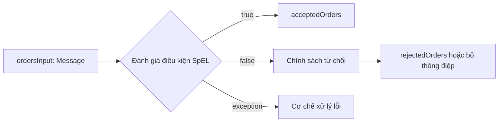

# Filter với SpEL

## 1. Mục tiêu và vị trí trong luồng tích hợp

Trong module **SPRING_INTEGRATION_CORE**, chương **Filter** tập trung vào quyết định một thông điệp có đủ điều kiện đi tiếp hay không. Bài này dùng Spring Expression Language (SpEL) để biểu diễn quyết định ấy bằng các điều kiện ngắn trên payload, header và bean nghiệp vụ.

Sau bài học, bạn có thể:

- Viết biểu thức có kết quả Boolean cho một filter.
- Đọc đúng `payload`, `headers` và tham chiếu bean trong ngữ cảnh của thông điệp.
- Cấu hình cùng một điều kiện bằng Java DSL hoặc XML.
- Thiết kế đường đi cho thông điệp bị loại và phân biệt chúng với lỗi thực thi.
- Kiểm tra điều kiện biên, dữ liệu thiếu và sự bảo toàn dữ liệu qua filter.

Giả định người học đã biết `Message<?>` gồm payload và headers, `MessageChannel` vận chuyển thông điệp, còn endpoint thực hiện một bước xử lý. Các ví dụ dùng API Java DSL với `IntegrationFlow.from(...)`, không yêu cầu adapter bên ngoài. Khi ghép vào ứng dụng, dùng bộ phiên bản Spring tương thích do dự án hoặc Spring Boot quản lý.

Tình huống xuyên suốt: hệ thống tiếp nhận đơn hàng từ nhiều nguồn. Nhánh xử lý đơn web chỉ nhận đơn ở trạng thái `READY`, đạt tổng tiền tối thiểu và được đánh dấu rõ là dữ liệu thật. Đơn không đạt điều kiện đi vào hàng đợi để quan sát.

## 2. Filter biến kết quả biểu thức thành quyết định

Về ý nghĩa, filter thực hiện:

```text
accept(message) = evaluate(expression, message)

true  -> chuyển thông điệp sang nhánh đi tiếp
false -> áp dụng chính sách từ chối
lỗi   -> áp dụng cơ chế xử lý lỗi của luồng
```

Filter không lấy kết quả `true` hoặc `false` làm payload đầu ra. Nó dùng kết quả đó để quyết định chuyển tiếp thông điệp đầu vào. Vì vậy, một đơn hàng đi qua filter vẫn là đơn hàng. Xem định nghĩa và cấu hình trong [Spring Integration — Filter](https://docs.spring.io/spring-integration/reference/filter.html).



Ví dụ khởi đầu:

```spel
headers['source'] == 'WEB'
```

Điều kiện này chỉ xét nguồn gửi. Nó không đổi tên header, không chuẩn hóa chữ hoa và không xác thực cấu trúc đơn hàng.

Cần phân biệt ba cách sử dụng biểu thức trong một luồng:

| Thành phần | Câu hỏi cần trả lời | Ví dụ ý định |
| --- | --- | --- |
| Filter | Thông điệp này có được đi tiếp không? | Chỉ nhận đơn web |
| Router | Thông điệp này sẽ đi đến đâu? | Chia đơn theo khu vực |
| Transformer | Dữ liệu đầu ra cần có dạng nào? | Chuyển JSON thành đối tượng đơn hàng |

Đây cũng là cơ sở chọn đúng endpoint: nếu yêu cầu chính là đổi dữ liệu, hãy đặt transformer trước filter; nếu có nhiều nhánh nghiệp vụ đồng cấp, nên diễn đạt bằng router.

## 3. Ngữ cảnh đánh giá: gốc là Message

Trong filter dùng SpEL, hãy bắt đầu từ thông điệp. `payload` và `headers` là thuộc tính của đối tượng gốc `Message`; `@beanName` tham chiếu bean trong application context. Spring Integration cung cấp các accessor và cơ chế giải quyết bean cho ngữ cảnh này. Tham khảo [Spring Integration — SpEL](https://docs.spring.io/spring-integration/reference/spel.html).

| Cú pháp | Cách hiểu | Điều kiện sử dụng |
| --- | --- | --- |
| `payload` | Toàn bộ payload | Biết kiểu dữ liệu thực tế |
| `payload.status` | Thuộc tính status của payload JavaBean | Có getter tương ứng |
| `payload['status']` | Giá trị theo khóa trong payload Map | Payload thực sự là Map |
| `headers['source']` | Header source | Giá trị có thể vắng mặt |
| `headers['x-correlation-id']` | Header có dấu gạch nối | Dùng dấu ngoặc vuông để tránh nhầm toán tử |
| `#root.payload` | Payload thông qua đối tượng gốc | Hữu ích khi cần viết tường minh |
| `@orderPolicy.accept(payload)` | Gọi phương thức của bean orderPolicy | Bean và phương thức phải tồn tại |

### 3.1. Phân biệt JavaBean, Map và chuỗi JSON

Với payload là JavaBean có `getStatus()`, có thể dùng:

```spel
payload.status == 'READY'
```

Với payload là `Map<String, Object>`, nên thể hiện rõ truy cập khóa:

```spel
payload['status'] == 'READY'
```

Với payload là chuỗi:

```json
{"status":"READY","totalMinor":150000}
```

đó vẫn là một `String`. Không nên giả định `payload.status` tự động phân tích JSON. Cách bố trí dễ hiểu là:

```text
JSON String
  -> transformer phân tích JSON thành Map/DTO
  -> chuẩn hóa kiểu dữ liệu
  -> filter SpEL
  -> xử lý nghiệp vụ
```

Nếu dự án chủ động cấu hình accessor JSON riêng, hành vi truy cập có thể khác. Bài này dùng Map nên không phụ thuộc cấu hình đó.

### 3.2. Không tự thêm dấu # vào tên thuộc tính

Trong ví dụ này, `payload` là thuộc tính của đối tượng gốc, không phải biến SpEL do ứng dụng tự đăng ký. Vì vậy dùng `payload`, không mặc định dùng `#payload`.

Tương tự, `@orderPolicy` là tham chiếu bean; `#orderPolicy` lại là truy cập biến. Hai cách viết không có cùng nghĩa.

## 4. Hợp đồng dữ liệu trước khi viết điều kiện

Một biểu thức ngắn chỉ đáng tin khi dữ liệu đầu vào có hợp đồng rõ ràng. Ví dụ đơn hàng sử dụng hợp đồng sau:

| Vị trí | Tên | Kiểu | Ý nghĩa |
| --- | --- | --- | --- |
| Payload Map | `id` | String | Mã đơn hàng |
| Payload Map | `status` | String | Chỉ `READY` được tiếp nhận |
| Payload Map | `totalMinor` | Long | Tổng tiền theo đơn vị tiền nhỏ nhất |
| Header | `source` | String | Phải bằng `WEB` |
| Header | `testMode` | Boolean | Phải bằng `false` |
| Header | `correlationId` | String | Đối chiếu thông điệp giữa các bước |

Ngưỡng minh họa là `100000` đơn vị tiền nhỏ nhất. Đây là dữ liệu giả lập cho bài học; khi áp dụng cần thống nhất đơn vị và loại tiền.

Quy ước xử lý dữ liệu thiếu:

- Thiếu `status`, `totalMinor`, `source` hoặc `testMode`: không đủ điều kiện.
- Trường tồn tại nhưng sai kiểu: cần được chặn hoặc chuẩn hóa ở bước trước.
- Thiếu `correlationId`: không tác động điều kiện trong ví dụ, nhưng làm giảm khả năng truy vết.

Không dùng chuỗi `"false"` thay cho Boolean `false`. Cũng không dựa vào việc SpEL có thể chuyển đổi một số kiểu để thay thế hợp đồng dữ liệu. Đặc biệt, dữ liệu từ HTTP hoặc JSON cần được chuẩn hóa trước khi xét điều kiện.

Điều kiện đầy đủ:

```spel
payload['status'] == 'READY'
and payload['totalMinor'] != null
and payload['totalMinor'] ge 100000
and headers['source'] == 'WEB'
and headers['testMode'] == false
```

Có thể đọc thành năm phép kiểm tra liên tiếp:

1. Đơn đã sẵn sàng.
2. Có tổng tiền.
3. Tổng tiền đạt ngưỡng.
4. Nguồn gửi đúng nhánh web.
5. Header xác nhận đây là dữ liệu thật.

Điều kiện dùng `and` để dừng sớm khi vế trái sai. Phép kiểm tra `!= null` được đặt trước phép so sánh số để ý định nghiệp vụ rõ ràng.

## 5. Những toán tử nên dùng

SpEL hỗ trợ toán tử so sánh và toán tử logic, gồm cả cách viết bằng chữ phù hợp khi nhúng trong XML. Xem [Spring Framework — Operators](https://docs.spring.io/spring-framework/reference/core/expressions/language-ref/operators.html).

| Mục đích | Ví dụ |
| --- | --- |
| Bằng / khác | `payload['status'] eq 'READY'`, `headers['source'] ne 'BATCH'` |
| Đạt ngưỡng | `payload['totalMinor'] ge 100000` |
| Nhỏ hơn ngưỡng | `payload['totalMinor'] lt 100000` |
| Kết hợp điều kiện | `A and B`, `A or B`, `not A` |
| Kiểm tra tiền tố | `headers['source'] != null and headers['source'].startsWith('WEB')` |
| Kiểm tra định dạng chuỗi | `payload['id'] != null and payload['id'] matches 'ORD-[0-9]+'` |

Khi phối hợp `and` với `or`, dùng ngoặc để thể hiện chính sách:

```spel
(headers['source'] == 'WEB' or headers['source'] == 'MOBILE')
and payload['status'] == 'READY'
```

Đừng để người đọc phải suy luận thứ tự ưu tiên toán tử để biết một nguồn gửi có được bỏ qua điều kiện trạng thái hay không.

### 5.1. Thiếu header và giá trị mặc định

Giả sử `testMode` vắng mặt. Biểu thức chính:

```spel
headers['testMode'] == false
```

không đạt điều kiện vì giá trị thiếu không bằng Boolean `false`.

Nếu một hệ thống khác chủ động coi thiếu header là dữ liệu thật, có thể biểu diễn chính sách ấy bằng:

```spel
(headers['testMode'] ?: false) == false
```

Đây là một chính sách khác. Chỉ đổi biểu thức khi yêu cầu nghiệp vụ đã xác định cách xử lý thiếu dữ liệu; không thêm mặc định chỉ để tránh lỗi.

### 5.2. Safe navigation không thay thế quyết định Boolean

Với payload JavaBean có `customer` và `getActive()`, ví dụ:

```spel
payload.customer?.active == true
```

Nếu `customer` vắng mặt, truy cập an toàn trả về `null`, rồi phép so sánh cho kết quả `false`. Nếu chỉ viết `payload.customer?.active`, kết quả có thể là `null` và không đáp ứng hợp đồng Boolean rõ ràng của selector.

Trong một chuỗi truy cập, cần bảo vệ từng điểm có thể null, chẳng hạn:

```spel
payload.customer?.address?.country == 'VN'
```

Safe navigation bảo vệ thao tác truy cập cụ thể; nó không làm dừng toàn bộ phần biểu thức còn lại và không sửa lỗi tên thuộc tính. Xem [Spring Framework — Safe Navigation Operator](https://docs.spring.io/spring-framework/reference/core/expressions/language-ref/operator-safe-navigation.html).

## 6. Cấu hình luồng bằng Java DSL

Ví dụ cần `spring-integration-core` và các phụ thuộc Spring tương thích. Nếu dùng Spring Boot, có thể dùng starter Integration theo cơ chế quản lý phiên bản của Boot. Không cần Kafka, RabbitMQ hay máy chủ bên ngoài cho luồng này.

Tạo lớp cấu hình sau trong package `example.integration`:

```java
package example.integration;

import org.springframework.context.annotation.Bean;
import org.springframework.context.annotation.Configuration;
import org.springframework.integration.channel.DirectChannel;
import org.springframework.integration.channel.QueueChannel;
import org.springframework.integration.config.EnableIntegration;
import org.springframework.integration.dsl.IntegrationFlow;
import org.springframework.messaging.MessageChannel;

@Configuration
@EnableIntegration
public class OrderFilterConfig {

    static final String ELIGIBLE_ORDER =
            "payload['status'] == 'READY'"
            + " and payload['totalMinor'] != null"
            + " and payload['totalMinor'] ge 100000"
            + " and headers['source'] == 'WEB'"
            + " and headers['testMode'] == false";

    @Bean
    public MessageChannel ordersInput() {
        return new DirectChannel();
    }

    @Bean
    public QueueChannel acceptedOrders() {
        return new QueueChannel(100);
    }

    @Bean
    public QueueChannel rejectedOrders() {
        return new QueueChannel(100);
    }

    @Bean
    public IntegrationFlow orderFilterFlow() {
        return IntegrationFlow.from("ordersInput")
                .filter(ELIGIBLE_ORDER, endpoint -> endpoint
                        .id("webOrderFilter")
                        .discardChannel("rejectedOrders")
                        .throwExceptionOnRejection(false))
                .channel("acceptedOrders")
                .get();
    }
}
```

Trong cấu hình:

- `ordersInput` là `DirectChannel`: filter chạy trên luồng gọi `send`.
- Chuỗi `ELIGIBLE_ORDER` mô tả điều kiện, còn cấu hình endpoint mô tả cách tiếp nhận và từ chối thông điệp.
- `id("webOrderFilter")` đặt định danh cho endpoint để dễ tìm cấu hình.
- `acceptedOrders` và `rejectedOrders` là hai `QueueChannel` để bài thực hành có thể nhận kết quả chủ động.
- Capacity 100 chỉ dành cho ví dụ. Khi áp dụng cần có consumer và chính sách timeout phù hợp, tránh để hàng đợi đầy làm kẹt bước gửi.

Overload `filter(String, Consumer<FilterEndpointSpec>)` nhận chuỗi SpEL và phần cấu hình endpoint; xem [Java DSL — BaseIntegrationFlowDefinition](https://docs.spring.io/spring-integration/api/org/springframework/integration/dsl/BaseIntegrationFlowDefinition.html).

Việc khai báo `@EnableIntegration` giúp ví dụ hoạt động trong Spring application context thông thường. Nếu dùng môi trường đã tự cấu hình Integration, cần tích hợp theo cách cấu hình sẵn có của dự án.

### 6.1. Tạo và gửi một thông điệp

Đoạn sau minh họa phần thân phương thức trong ứng dụng đã lấy được bean `ordersInput`:

```java
Map<String, Object> order = new HashMap<>();
order.put("id", "ORD-101");
order.put("status", "READY");
order.put("totalMinor", 150000L);

Message<Map<String, Object>> request =
        MessageBuilder.withPayload(order)
                .setHeader("source", "WEB")
                .setHeader("testMode", false)
                .setHeader("correlationId", "checkout-101")
                .build();

ordersInput.send(request, 1000);
```

Các import cho đoạn gửi:

```java
import java.util.HashMap;
import java.util.Map;

import org.springframework.messaging.Message;
import org.springframework.messaging.support.MessageBuilder;
```

Đơn `ORD-101` đạt cả năm điều kiện nên sẽ nằm trong `acceptedOrders`. Nếu đổi `totalMinor` thành `99999L`, đơn sẽ đi vào `rejectedOrders`.

Giá trị trả về của `MessageChannel.send(...)` thể hiện việc gửi thông điệp theo hợp đồng channel. Đừng dùng nó làm kết quả nghiệp vụ “đơn được filter chấp nhận”. Với chính sách discard không ném lỗi, một lần gửi thành công vẫn có thể dẫn tới `rejectedOrders`.

## 7. Cấu hình tương đương bằng XML

Java DSL và XML bên dưới là hai lựa chọn thay thế. Không nạp cả hai vào cùng context khi chúng khai báo trùng tên bean.

```xml
<?xml version="1.0" encoding="UTF-8"?>
<beans xmlns="http://www.springframework.org/schema/beans"
       xmlns:xsi="http://www.w3.org/2001/XMLSchema-instance"
       xmlns:int="http://www.springframework.org/schema/integration"
       xsi:schemaLocation="
         http://www.springframework.org/schema/beans
         https://www.springframework.org/schema/beans/spring-beans.xsd
         http://www.springframework.org/schema/integration
         https://www.springframework.org/schema/integration/spring-integration.xsd">

    <int:channel id="ordersInput"/>

    <int:channel id="acceptedOrders">
        <int:queue capacity="100"/>
    </int:channel>

    <int:channel id="rejectedOrders">
        <int:queue capacity="100"/>
    </int:channel>

    <int:filter id="webOrderFilter"
                input-channel="ordersInput"
                output-channel="acceptedOrders"
                discard-channel="rejectedOrders"
                throw-exception-on-rejection="false"
                expression="payload['status'] == 'READY'
                    and payload['totalMinor'] != null
                    and payload['totalMinor'] ge 100000
                    and headers['source'] == 'WEB'
                    and headers['testMode'] == false"/>
</beans>
```

Dùng `ge`, `lt`, `and` trong XML giúp tránh các ký tự cần escape như dấu nhỏ hơn hoặc dấu `&`. Dấu nháy kép bao thuộc tính XML; dấu nháy đơn bao các chuỗi ký tự bên trong SpEL.

### 7.1. Phân biệt ba thời điểm xử lý

| Cách viết | Vai trò | Ví dụ |
| --- | --- | --- |
| `expression="..."` của filter | Biểu thức được đánh giá trên từng Message | `expression="headers['source'] == 'WEB'"` |
| `${...}` | Property placeholder do cấu hình Spring giải quyết | `expression="payload['totalMinor'] ge ${orders.min-total-minor}"` |
| `#{...}` | Biểu thức của container Spring trong giá trị cấu hình | Đọc một giá trị bean khi khởi tạo cấu hình |

Không bọc toàn bộ điều kiện của filter bằng `#{...}` chỉ vì đó là SpEL. Ở thuộc tính `expression`, chuỗi điều kiện đã được filter dùng làm biểu thức đánh giá trên thông điệp. Bọc thêm sai chỗ có thể khiến container đánh giá biểu thức trước khi có Message.

Ví dụ property placeholder cần được cấu hình để thực sự giải quyết `${orders.min-total-minor}`, và giá trị phải là số hợp lệ. Trong ví dụ Java DSL chính, điều kiện dùng hằng số để người học tập trung vào ngữ nghĩa filter.

## 8. Đưa quy tắc phức tạp sang bean

SpEL phù hợp với các phép so sánh và phối hợp điều kiện ngắn. Khi quy tắc có nhiều nhánh, cần kiểm tra chặt kiểu dữ liệu hoặc dùng chung ở nhiều flow, có thể chuyển phần nghiệp vụ sang lớp Java thuần.

Ví dụ lớp sau thay phần kiểm tra trạng thái và tổng tiền:

```java
package example.integration;

import java.util.Map;

public final class OrderPolicy {

    private final long minTotalMinor;

    public OrderPolicy(long minTotalMinor) {
        this.minTotalMinor = minTotalMinor;
    }

    public boolean accept(Map<String, Object> order) {
        Object amount = order.get("totalMinor");
        return "READY".equals(order.get("status"))
                && amount instanceof Long
                && ((Long) amount) >= minTotalMinor;
    }
}
```

Thêm bean này vào `OrderFilterConfig`:

```java
@Bean
public OrderPolicy orderPolicy() {
    return new OrderPolicy(100000L);
}
```

Sau đó thay chuỗi điều kiện ở `filter(...)` bằng:

```spel
headers['source'] == 'WEB'
and headers['testMode'] == false
and @orderPolicy.accept(payload)
```

Ở biến thể này, kiểm tra `instanceof Long` chủ động khiến tổng tiền sai kiểu trả về `false`. Đây là quyết định thiết kế của `OrderPolicy`, không phải bảo đảm chung của mọi biểu thức SpEL. Luồng vẫn giả định payload là Map.

Một cách khác là truyền toàn bộ Message nếu quy tắc cần cả header:

```spel
@messagePolicy.accept(#root)
```

Khi ấy phương thức của bean nên nhận `Message<?>` và trả về `boolean`. Đừng lẫn `#root` là Message với `payload` là đối tượng nghiệp vụ.

Quy tắc chọn cách triển khai:

| Dạng quy tắc | Cách diễn đạt phù hợp |
| --- | --- |
| Một đến vài phép so sánh dễ đọc | SpEL trực tiếp |
| Nghiệp vụ dùng chung, nhiều nhánh hoặc cần unit test riêng | Bean Java trả về boolean |
| Chọn nhiều đích dựa trên kết quả phân loại | Router |
| Đọc DB hoặc gọi API để bổ sung dữ liệu | Một bước xử lý riêng trước filter |

Cố gắng giữ predicate không có tác dụng phụ. Ví dụ không trừ tồn kho, ghi thanh toán hoặc gửi email trong `accept`. Khi luồng được retry hoặc thông điệp được phát lại, những thao tác đó có thể lặp dù filter chỉ đang được dùng để quyết định.

## 9. Từ chối thông điệp và lỗi đánh giá là hai tình huống khác nhau

### 9.1. Biểu thức trả về false

Với dữ liệu hợp lệ về cấu trúc nhưng không đạt điều kiện, chính sách endpoint quyết định bước tiếp theo:

| Discard channel | throwExceptionOnRejection | Hành vi khi selector trả về false |
| --- | --- | --- |
| Không có | `false` | Không chuyển tiếp vào output |
| Có | `false` | Gửi thông điệp bị loại tới discard channel |
| Không có | `true` | Ném `MessageRejectedException` |
| Có | `true` | Gửi tới discard channel, sau đó ném lỗi từ chối nếu bước gửi hoàn tất |

Việc có discard channel không vô hiệu hóa cờ ném lỗi. Xem [API MessageFilter](https://docs.spring.io/spring-integration/api/org/springframework/integration/filter/MessageFilter.html).

Với Spring Integration từ 6.1, trường hợp không cấu hình discard channel và không ném lỗi từ chối có log cảnh báo cho thông điệp bị loại. Nếu chủ ý bỏ hoàn toàn, có thể chọn `nullChannel` làm discard channel; cần coi đây là chính sách có chủ đích, không phải cách che lỗi dữ liệu. Hành vi log được mô tả trong [tài liệu Filter](https://docs.spring.io/spring-integration/reference/filter.html).

Cấu hình chính chọn `rejectedOrders` và `false` vì “không thuộc nhóm đơn web cần xử lý” là kết quả nghiệp vụ bình thường. Nếu hệ thống xác định mọi đơn gửi đến đây đều bắt buộc đạt quy tắc, cấu hình ném lỗi có thể phù hợp hơn.

### 9.2. Biểu thức không đánh giá được

Các ví dụ lỗi:

```spel
payload['totalMinor'].unknownMethod() > 0
```

```spel
@missingPolicy.accept(payload)
```

Đây không phải kết quả `false`. Chúng là lỗi truy cập hoặc thực thi biểu thức. Không nên kỳ vọng `discardChannel` tự động nhận các trường hợp đó.

Lớp `ExpressionEvaluatingSelector` yêu cầu kết quả đánh giá là Boolean. Hãy viết phép so sánh hoặc phương thức trả về boolean, thay vì chỉ trả về một đối tượng như `payload` hoặc một giá trị có thể null. Xem [API ExpressionEvaluatingSelector](https://docs.spring.io/spring-integration/api/org/springframework/integration/filter/ExpressionEvaluatingSelector.html).

Lỗi cú pháp thường lộ ra khi parse biểu thức trong quá trình cấu hình. Lỗi phụ thuộc payload, kiểu dữ liệu hoặc bean được gọi có thể chỉ xuất hiện khi thông điệp được xử lý. Khởi tạo context thành công chưa chứng minh tất cả dữ liệu đều chạy đúng.

### 9.3. Lỗi được quan sát ở đâu?

Trong ví dụ dùng `DirectChannel`, lỗi xử lý lan về bên gọi `send`. Chỉ thêm header `errorChannel` không khiến mọi lỗi đồng bộ tự động chuyển thành thông điệp lỗi.

Nếu filter được gọi từ poller hoặc cơ chế bất đồng bộ của Spring Integration, cơ chế error handler tương ứng có thể đóng gói exception thành `ErrorMessage` và gửi đến error channel. Cần kiểm tra ranh giới thực thi và cấu hình cụ thể. Xem [Spring Integration — Error Handling](https://docs.spring.io/spring-integration/reference/error-handling.html).

### 9.4. Chú ý khi đứng sau gateway hoặc trước aggregator

Với gateway có request-reply, một thông điệp bị loại có thể khiến phía gọi không nhận được phản hồi mong đợi. Chỉ định discard channel không tự tạo phản hồi nghiệp vụ. Cần thiết kế một trong các cách: trả kết quả từ chối rõ ràng, đưa ra exception theo hợp đồng gateway, hoặc dùng phương thức một chiều nếu đúng nhu cầu.

Nếu filter nằm giữa splitter và aggregator, hãy tính cả các phần tử bị loại khi xác định điều kiện giải phóng nhóm. Chẳng hạn, một đơn được tách thành ba phần nhưng chỉ hai phần qua filter thì quy tắc “chờ đủ ba” sẽ cần chính sách xử lý phần thiếu. Đây là hệ quả của thiết kế luồng; sửa biểu thức SpEL không tự giải quyết điều kiện hoàn thành nhóm.

## 10. Kiểm tra biểu thức bằng dữ liệu cụ thể

Trước khi nhìn vào code kiểm thử, hãy viết bảng quyết định. Với mọi dòng bên dưới, giả định các trường không nêu vẫn đáp ứng hợp đồng ở mục 4.

| Tình huống | Giá trị khác biệt | Kết quả mong đợi |
| --- | --- | --- |
| Ngay dưới ngưỡng | `totalMinor = 99999L` | rejectedOrders |
| Đúng ngưỡng | `totalMinor = 100000L` | acceptedOrders |
| Trên ngưỡng | `totalMinor = 100001L` | acceptedOrders |
| Chưa sẵn sàng | `status = 'DRAFT'` | rejectedOrders |
| Khác nguồn | `source = 'BATCH'` | rejectedOrders |
| Dữ liệu thử | `testMode = true` | rejectedOrders |
| Thiếu xác nhận dữ liệu thật | Không có testMode | rejectedOrders |
| Thiếu tổng tiền | Không có totalMinor | rejectedOrders |
| Sai dạng payload | Payload là String thay vì Map | Lỗi đánh giá, không coi như false |

Bảng này đặc biệt hữu ích khi người sửa biểu thức đổi `ge` thành `gt`, hoặc thêm mặc định cho header. Cả hai thay đổi trông nhỏ nhưng làm thay đổi tập thông điệp được tiếp nhận.

### 10.1. Kiểm thử luồng Spring với JUnit Jupiter

Ví dụ dưới dùng chính `OrderFilterConfig` ở mục 6. Ngoài các dependency chạy luồng, test cần `spring-test` và JUnit Jupiter, gồm module hỗ trợ parameterized test. Dự án cũng cần cấu hình trình chạy test dùng JUnit Platform.

Đặt lớp test trong cùng package `example.integration`:

```java
package example.integration;

import java.util.HashMap;
import java.util.Map;

import org.junit.jupiter.api.Test;
import org.junit.jupiter.params.ParameterizedTest;
import org.junit.jupiter.params.provider.CsvSource;
import org.springframework.beans.factory.annotation.Autowired;
import org.springframework.beans.factory.annotation.Qualifier;
import org.springframework.integration.channel.QueueChannel;
import org.springframework.messaging.Message;
import org.springframework.messaging.MessageChannel;
import org.springframework.messaging.MessagingException;
import org.springframework.messaging.support.MessageBuilder;
import org.springframework.test.context.junit.jupiter.SpringJUnitConfig;

import static org.junit.jupiter.api.Assertions.*;

@SpringJUnitConfig(OrderFilterConfig.class)
class OrderFilterTest {

    @Autowired
    @Qualifier("ordersInput")
    MessageChannel input;

    @Autowired
    @Qualifier("acceptedOrders")
    QueueChannel accepted;

    @Autowired
    @Qualifier("rejectedOrders")
    QueueChannel rejected;

    @ParameterizedTest
    @CsvSource({
        "99999, false",
        "100000, true",
        "100001, true"
    })
    void routesAtAmountBoundary(long amount, boolean shouldAccept) {
        Message<Map<String, Object>> request = order(amount);

        assertTrue(input.send(request, 1000));

        QueueChannel expected = shouldAccept ? accepted : rejected;
        QueueChannel other = shouldAccept ? rejected : accepted;
        Message<?> result = expected.receive(1000);

        assertNotNull(result);
        assertEquals(request.getPayload(), result.getPayload());
        assertEquals("checkout-101",
                result.getHeaders().get("correlationId"));
        assertNull(other.receive(0));
    }

    @Test
    void rejectsAnOrderWithoutTotal() {
        Map<String, Object> payload =
                new HashMap<>(order(150000L).getPayload());
        payload.remove("totalMinor");

        Message<?> request = MessageBuilder.withPayload(payload)
                .setHeader("source", "WEB")
                .setHeader("testMode", false)
                .build();

        assertTrue(input.send(request, 1000));
        assertNotNull(rejected.receive(1000));
        assertNull(accepted.receive(0));
    }

    @Test
    void rejectsAnOrderWithoutTestMode() {
        Message<?> request = MessageBuilder.fromMessage(order(150000L))
                .removeHeader("testMode")
                .build();

        assertTrue(input.send(request, 1000));
        assertNotNull(rejected.receive(1000));
        assertNull(accepted.receive(0));
    }

    @Test
    void invalidPayloadCausesAnErrorInsteadOfDiscard() {
        Message<?> request = MessageBuilder.withPayload("not-a-map")
                .setHeader("source", "WEB")
                .setHeader("testMode", false)
                .build();

        assertThrows(MessagingException.class,
                () -> input.send(request, 1000));

        assertNull(accepted.receive(0));
        assertNull(rejected.receive(0));
    }

    private static Message<Map<String, Object>> order(long amount) {
        Map<String, Object> payload = new HashMap<>();
        payload.put("id", "ORD-101");
        payload.put("status", "READY");
        payload.put("totalMinor", amount);

        return MessageBuilder.withPayload(payload)
                .setHeader("source", "WEB")
                .setHeader("testMode", false)
                .setHeader("correlationId", "checkout-101")
                .build();
    }
}
```

Nhóm test xác nhận ba loại hành vi:

1. **Điều kiện nghiệp vụ:** kiểm tra ngay dưới, đúng và trên ngưỡng.
2. **Dữ liệu thiếu:** tổng tiền và header bắt buộc không làm thông điệp lọt qua.
3. **Lỗi thực thi:** payload không đúng hợp đồng không bị ngầm chuyển thành một lần từ chối bình thường.

Test còn kiểm tra payload và correlation header để chứng minh filter được dùng như bước lựa chọn, không phải transformer. Không cần kiểm tra chuỗi thông báo exception cụ thể vì nó có thể thay đổi theo phiên bản.

Khi ghép các test vào dự án, dùng các dependency và trình chạy test tương thích với bộ phiên bản Spring của dự án.

### 10.2. Tại sao cần kiểm thử qua application context?

Một test dùng riêng `SpelExpressionParser` có thể hữu ích để thử toán tử, nhưng không thay thế hoàn toàn test flow:

- Context của flow có bean resolver và accessor do Spring Integration cấu hình.
- Filter có chính sách output, discard và exception cần được kiểm tra cùng nhau.
- Việc gọi `@orderPolicy` cần bean thật hoặc bean kiểm thử trong context.
- Đổi loại channel có thể làm thay đổi nơi quan sát exception.

Vì thế, khi kiểm tra biểu thức dùng bean hoặc headers, ưu tiên ít nhất một test đi qua endpoint đã cấu hình. Nếu tách nghiệp vụ sang `OrderPolicy`, có thể bổ sung unit test Java thuần cho các nhánh nghiệp vụ của lớp ấy.

## 11. Chẩn đoán những lỗi thường gặp

| Triệu chứng | Nguyên nhân nên kiểm tra | Cách sửa theo ý định |
| --- | --- | --- |
| Khởi động lỗi parse SpEL | Thiếu dấu nháy, ngoặc hoặc toán tử | Tách biểu thức thành từng điều kiện dễ đọc |
| Không đọc được status | Payload là JSON String hoặc tên thuộc tính sai | Kiểm tra kiểu payload, thêm transformer trước filter |
| Đơn đúng ngưỡng bị loại | Dùng `gt` thay vì `ge` | Xác định lại ngưỡng bao gồm hay loại trừ |
| Đơn thiếu header vẫn được nhận | Tự thêm mặc định không đúng chính sách | Đối chiếu quy tắc dữ liệu thiếu |
| So sánh lúc được lúc lỗi | Kiểu số hoặc Boolean không thống nhất | Chuẩn hóa dữ liệu trước filter |
| Không tìm thấy bean policy | Sai tên bean hoặc context chưa đăng ký | Kiểm tra tên sau dấu `@` |
| Bật discard nhưng phía gọi vẫn lỗi | Cờ ném lỗi từ chối đang bật hoặc discard flow lỗi | Xem riêng chính sách từ chối và lỗi đường discard |
| Gateway chờ mà không có kết quả | Thông điệp bị loại và không có phản hồi nghiệp vụ | Thiết kế rõ phản hồi từ chối hoặc exception |
| Aggregator không hoàn thành | Filter đã loại một phần các thông điệp nhóm | Đối chiếu release strategy và dữ liệu đã bị loại |

Khi debug, thu thập tối thiểu: tên endpoint, kiểu payload, các header có liên quan đến điều kiện và nguyên nhân gốc của exception. Không cần log toàn bộ payload nếu nó chứa thông tin nhạy cảm; mã đơn và correlation ID thường đủ để đối chiếu.

Nên tách thống kê thành ba nhóm:

- Số thông điệp được chấp nhận.
- Số thông điệp bị từ chối do quy tắc.
- Số lần đánh giá hoặc thực thi bị lỗi.

Ví dụ, nhiều đơn có `source = BATCH` có thể là hành vi bình thường. Nhiều lỗi truy cập `totalMinor` sau một lần triển khai lại gợi ý hợp đồng dữ liệu vừa thay đổi. Gộp cả hai vào một con số “discard” sẽ làm mất thông tin cần để sửa hệ thống.

## 12. Nguyên tắc triển khai

### 12.1. Giữ biểu thức tập trung vào lựa chọn

Đặt các thao tác chuẩn hóa ở transformer hoặc bước xử lý riêng. Ví dụ, nếu nguồn gửi có thể là `web`, `Web` và `WEB`, hãy quyết định rõ việc chuẩn hóa trước khi viết điều kiện so sánh.

Nếu biểu thức dài đến mức khó nhận ra lý do một đơn bị loại, nên chia quy tắc thành các bước có tên hoặc đưa sang policy bean. Một filter trả về false không tự sinh lý do chi tiết cho người dùng; yêu cầu giải thích nhiều lỗi xác thực nên được thiết kế bằng kết quả validation riêng.

### 12.2. Đưa dữ liệu vào Message, giữ biểu thức ở phía ứng dụng

Không ghép một phần biểu thức từ giá trị header do người gửi kiểm soát:

```text
Không nên: "payload['status'] == '" + statusFromRequest + "'"
Nên:      so sánh dữ liệu Message bằng một biểu thức đã được ứng dụng định nghĩa
```

Ví dụ, nếu hệ thống có một header cấu hình nội bộ đáng tin cậy:

```spel
payload['status'] == headers['expectedStatus']
```

Đây chỉ là cách biểu diễn so sánh dữ liệu. Không được dùng `expectedStatus` do bên gửi tùy ý đặt để quyết định chính sách của ứng dụng. Với quy tắc cố định như trạng thái `READY`, giữ giá trị cố định trong cấu hình hoặc trong policy bean.

SpEL có thể gọi phương thức và bean. Vì vậy, tiếp nhận nguyên một biểu thức từ request không tương đương tiếp nhận một trường dữ liệu thông thường.

### 12.3. Xem xét chi phí và tính lặp lại

Điều kiện nên rẻ, dễ dự đoán và tránh thay đổi trạng thái. Nếu cần dữ liệu bên ngoài, hãy lấy dữ liệu ở một bước có timeout, retry và khả năng quan sát phù hợp, rồi để filter xét kết quả đã có.

Đặt hằng số biểu thức ở nơi dễ đối chiếu với test. Không parse lại chuỗi SpEL trong một lambda cho từng thông điệp khi DSL đã cung cấp `filter(String)`.

Với thông điệp bị từ chối, đường discard cũng cần được vận hành: có consumer, giới hạn hàng đợi và cách xử lý khi bước gửi không thành công. Việc thông điệp không vào output chính không có nghĩa đường xử lý còn lại không thể gây lỗi.

## 13. Thực hành củng cố

Giữ cấu hình đơn hàng của mục 6 và thực hiện lần lượt:

1. Đổi nguồn gửi từ `WEB` thành `BATCH`; xác nhận thông điệp đến rejectedOrders.
2. Cho phép cả `WEB` và `MOBILE`, vẫn giữ yêu cầu `READY`; dùng ngoặc để nhóm điều kiện nguồn.
3. Thử ba tổng tiền `99999L`, `100000L`, `100001L`; giải thích vì sao đúng ngưỡng được nhận.
4. Bỏ header testMode; đối chiếu kết quả với chính sách yêu cầu xác nhận rõ dữ liệu thật.
5. Chuyển kiểm tra trạng thái và tổng tiền sang `OrderPolicy`; giữ các test hành vi của flow.
6. Trong một cấu hình thực hành riêng, bật `throwExceptionOnRejection(true)` cùng discard channel; quan sát cả thông điệp bị loại và exception ở bên gọi đồng bộ.

Tiêu chí hoàn thành: giải thích được thông điệp đi vào output, discard hay error dựa trên dữ liệu và cấu hình; không suy luận chỉ từ việc `send` trả về true.

## 14. Điểm cần ghi nhớ

Filter dùng SpEL là một điểm quyết định trong luồng thông điệp. Hiệu quả của nó phụ thuộc vào ba phần được thiết kế cùng nhau: hợp đồng dữ liệu đầu vào, biểu thức Boolean rõ nghĩa và chính sách xử lý khi không được chấp nhận.

Trong ví dụ đơn hàng, SpEL chỉ mô tả điều kiện lựa chọn. Channel đưa thông điệp tới bước tiếp theo, endpoint áp dụng chính sách từ chối, còn cơ chế lỗi xử lý trường hợp không thể đánh giá hoặc thực thi. Sự phân công này giúp mở rộng flow bằng gateway, transformer, router hay aggregator mà vẫn hiểu được từng quyết định.
