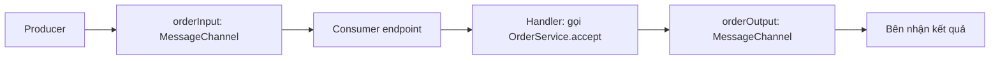
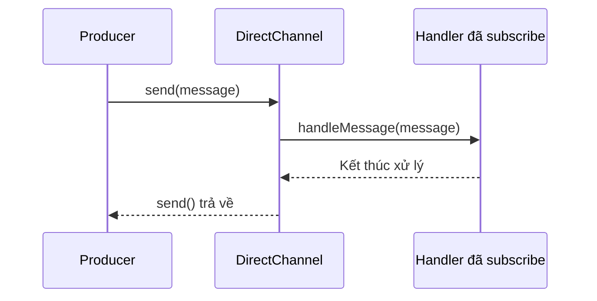
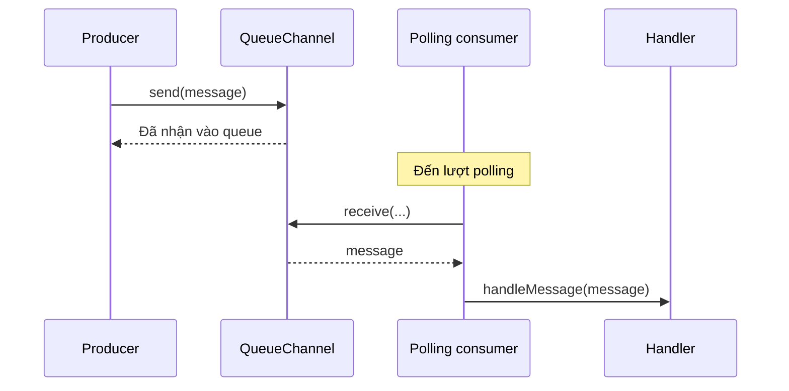

# Message endpoint trong một flow

## 1. Mục tiêu và phạm vi

Trong chương **Mô hình message flow** của module **SPRING_INTEGRATION_CORE**, bài này giải thích cách một thành phần xử lý được nối vào luồng thông điệp. Sau bài học, bạn cần đọc được một flow và chỉ ra:

- Message đi vào endpoint qua channel nào.
- Endpoint nhận message bằng subscription hay polling.
- Handler nào thực hiện logic và có tạo kết quả hay không.
- Kết quả, lỗi và việc dừng/chạy endpoint được xử lý ở đâu.

Các ví dụ dùng Java 17 trở lên và API Java DSL của Spring Integration 6.x, với `IntegrationFlow.from(...)`. Dự án thực hành cần có `spring-integration-core` cùng các dependency Spring tương thích; phần kiểm thử cần JUnit Jupiter. Phiên bản dependency nên được quản lý thống nhất bởi BOM hoặc Spring Boot của dự án.

Bài tập trung vào cấu trúc endpoint trong core. Transformer, router, filter và aggregator xuất hiện để nhận diện vai trò của từng bước; thuật toán và cấu hình chuyên sâu của từng mẫu được học riêng.

## 2. Endpoint đứng ở đâu trong mô hình message flow?

Giả sử một ứng dụng nhận yêu cầu đặt hàng. Một đối tượng `OrderService` có thể kiểm tra đơn và trả về phiếu tiếp nhận. Tuy nhiên, chỉ đăng ký đối tượng đó thành Spring bean chưa trả lời được các câu hỏi: ai nhận message, nhận từ đâu và khi nào gọi phương thức?

Message endpoint đảm nhiệm việc gắn thành phần xử lý vào hạ tầng messaging. Với consumer thông thường, hãy phân biệt ba lớp:

| Thành phần | Câu hỏi nó trả lời | Ví dụ trong luồng đơn hàng |
| --- | --- | --- |
| `Message` | Dữ liệu và ngữ cảnh nào được chuyển đi? | Payload là `Order`, header có `traceId` |
| `MessageChannel` | Message được chuyển qua đâu? | `orderInput`, `orderOutput` |
| Endpoint và handler của nó | Nhận message thế nào và xử lý điều gì? | Consumer gọi `OrderService.accept(...)` |

Một cách vẽ chi tiết hơn:



Trong sơ đồ nghiệp vụ, người ta thường gộp endpoint và handler thành một ô “Tiếp nhận đơn”. Trong cấu hình và lúc chẩn đoán lỗi, việc tách chúng ra giúp xác định chính xác trách nhiệm.

Endpoint trong bài này là khái niệm messaging, không nhất thiết là URL HTTP. Transformer giữa hai channel cũng là một bước xử lý của flow dù không mở cổng mạng nào. Tài liệu [Message Endpoints](https://docs.spring.io/spring-integration/reference/6.5/endpoint.html) mô tả endpoint là thành phần nối các thành phần messaging với channel.

### Endpoint không thay thế service nghiệp vụ

Ví dụ:

```java
public Receipt accept(Order order) {
    // Kiểm tra và tiếp nhận đơn.
}
```

Phương thức trên mô tả nghiệp vụ. Cấu hình endpoint bổ sung ngữ cảnh tích hợp:

```text
Nhận từ orderInput
    -> gọi accept(payload)
    -> gửi kết quả vào orderOutput
```

Điều này cho phép kiểm tra logic tiếp nhận đơn độc lập với cách message được đưa vào hệ thống.

## 3. Handler và consumer endpoint là hai vai trò khác nhau

Ở mức hạ tầng, handler có hợp đồng cơ bản sau:

```java
package org.springframework.messaging;

public interface MessageHandler {
    void handleMessage(Message<?> message);
}
```

Chữ `void` ở đây không có nghĩa mọi bước trong flow đều không thể trả kết quả. Một handler do framework cung cấp có thể gọi phương thức POJO, lấy giá trị trả về rồi gửi một message mới tới channel kế tiếp.

Đối với consumer endpoint thông thường:

- **Handler** thực hiện thao tác: biến đổi, kiểm tra, định tuyến, gọi service hoặc kết hợp message.
- **Consumer endpoint** quản lý việc nhận message và đưa message cho handler.
- **Channel đầu ra** là nơi handler có khả năng tạo output gửi kết quả tới.

Bạn thường viết POJO hoặc lambda và để DSL tạo phần kết nối. Không cần tự triển khai `MessageHandler`, `EventDrivenConsumer` hay `PollingConsumer` chỉ để gọi một service.

Ví dụ, DSL có thể gọi phương thức trên bean:

```java
.handle(orderService, "accept")
```

Hoặc dùng lambda xử lý payload và headers:

```java
.handle(String.class, (payload, headers) ->
        payload.strip().toUpperCase(java.util.Locale.ROOT))
```

Hai cách này được hỗ trợ bởi `.handle()`; cách dùng lambda và `GenericHandler` được giải thích trong [Service Activators and the .handle() method](https://docs.spring.io/spring-integration/reference/6.5/dsl/java-handle.html).

Khi đọc cấu hình, cần phân biệt tên của flow, channel, endpoint và service. Đổi tên bean `orderService` không đồng nghĩa đã đổi tên endpoint nhận message.

## 4. Các vai trò endpoint thường gặp

Các động từ trong Java DSL biểu diễn những mẫu xử lý khác nhau. Bảng dưới minh họa bằng một hệ thống tiếp nhận đơn hàng:

| Vai trò | Cách biểu diễn thường gặp | Công việc trong ví dụ |
| --- | --- | --- |
| Transformer | `.transform(...)` | Chuẩn hóa mã sản phẩm trước khi kiểm tra đơn |
| Filter | `.filter(...)` | Chỉ cho đơn đủ điều kiện đi tiếp |
| Router | `.route(...)` | Chuyển đơn tới kho phù hợp |
| Splitter | `.split(...)` | Tách đơn thành các dòng hàng |
| Aggregator | `.aggregate(...)` | Gom kết quả xử lý các dòng hàng |
| Service activator | `.handle(...)` | Gọi service tiếp nhận đơn |
| Bridge | `.bridge(...)` | Nối hai channel mà không thêm nghiệp vụ |
| Channel adapter | Adapter inbound hoặc outbound | Đưa dữ liệu từ nguồn vào flow hoặc gửi ra đích |
| Gateway | Messaging gateway hoặc gateway của giao thức | Nối một tương tác request-reply với messaging |

Các tên EIP tương ứng với động từ DSL được liệt kê trong [DSL Basics](https://docs.spring.io/spring-integration/reference/6.5/dsl/java-basics.html).

Không phải mỗi message đầu vào đều tạo đúng một message đầu ra. Ví dụ, một đơn không hợp lệ có thể dừng ở filter; splitter có thể tạo nhiều message dòng hàng; bước gom kết quả có thể cần chờ các dòng khác. Khi thiết kế một bước, hãy ghi rõ điều kiện để có output thay vì mặc định “gọi xong là đi tiếp”.

### Endpoint tại ranh giới hệ thống

Một inbound adapter có thể tạo message từ nguồn bên ngoài; outbound adapter đưa dữ liệu ra đích. Riêng inbound adapter dạng polling thường dùng `SourcePollingChannelAdapter` để đọc `MessageSource`. Nó khác với `PollingConsumer` đọc message đã nằm trong channel. Các adapter nhận callback hoặc listener từ giao thức không nhất thiết dùng polling. Xem [Channel Adapter](https://docs.spring.io/spring-integration/reference/channel-adapter.html).

Vì vậy, “mọi endpoint đều đọc một input channel” chỉ phù hợp với nhóm consumer đang xét, không phải định nghĩa bao trùm mọi endpoint.

## 5. Hai cách consumer endpoint nhận message

### 5.1. Event-driven consumer

Với `SubscribableChannel`, framework đăng ký handler vào channel. Khi channel dispatch message, handler được gọi mà không cần poller hỏi định kỳ.



`DirectChannel` thường được dùng cho đoạn xử lý cùng thread với bên gửi. Event-driven mô tả cách nhận message; tính đồng bộ hay bất đồng bộ còn phụ thuộc channel và executor.

### 5.2. Polling consumer

Với `PollableChannel`, chẳng hạn `QueueChannel`, message được đưa vào hàng đợi. Consumer endpoint cần poller để lấy message rồi gọi handler.



Hai kiểu consumer và sự phụ thuộc vào loại channel được trình bày trong [Message Endpoints](https://docs.spring.io/spring-integration/reference/6.5/endpoint.html).

| Input channel | Cơ chế nhận của consumer thông thường | Có cần poller? | Thread thực hiện xử lý |
| --- | --- | --- | --- |
| `DirectChannel` | Subscription | Không | Thông thường là thread gọi `send()` |
| `ExecutorChannel` | Subscription | Không | Thường là executor được cấu hình; cần xét cả chính sách từ chối tác vụ |
| `QueueChannel` | Polling | Có, cấu hình riêng hoặc default poller | Thread của tác vụ polling hoặc executor được gán cho poller |

Các đặc tính dispatch và buffering của channel được mô tả trong [Message Channel Implementations](https://docs.spring.io/spring-integration/reference/channel/implementations.html).

**Hệ quả thiết kế:** đổi `DirectChannel` thành `QueueChannel` làm thay đổi thời điểm xử lý và cách nhận lỗi. Đây là thay đổi hành vi của flow, dù phương thức nghiệp vụ giữ nguyên.

## 6. Ví dụ đầy đủ: endpoint tiếp nhận đơn hàng

### 6.1. Yêu cầu

Một message chứa `Order` đi vào `orderInput`. Service kiểm tra số lượng và mã sản phẩm, sau đó tạo `Receipt`. Kết quả đi vào `orderOutput` để bên gọi hoặc bài kiểm thử có thể lấy ra.

```text
orderInput: DirectChannel
    -> acceptOrderEndpoint
         handler gọi OrderService.accept(Order)
    -> orderOutput: QueueChannel
```

Đầu vào dùng `DirectChannel`, nên endpoint tiếp nhận không cần poller. Đầu ra là queue, nhưng trong ví dụ này bên nhận chủ động gọi `receive()`; không có consumer endpoint downstream nào cần được cấu hình tại đó.

### 6.2. Cấu hình Java

Đặt mã sau trong `example/OrderEndpointConfig.java` của dự án thực hành:

```java
package example;

import java.util.Locale;

import org.springframework.beans.factory.annotation.Qualifier;
import org.springframework.context.annotation.Bean;
import org.springframework.context.annotation.Configuration;
import org.springframework.integration.channel.DirectChannel;
import org.springframework.integration.channel.QueueChannel;
import org.springframework.integration.config.EnableIntegration;
import org.springframework.integration.dsl.IntegrationFlow;

@Configuration(proxyBeanMethods = false)
@EnableIntegration
public class OrderEndpointConfig {

    public record Order(String orderId, String sku, int quantity) {
    }

    public record Receipt(
            String orderId,
            String normalizedSku,
            int quantity,
            String status) {
    }

    public static class OrderService {

        public Receipt accept(Order order) {
            if (order.quantity() <= 0) {
                throw new IllegalArgumentException(
                        "Số lượng phải lớn hơn 0");
            }
            if (order.sku() == null || order.sku().isBlank()) {
                throw new IllegalArgumentException(
                        "Mã sản phẩm không được để trống");
            }

            return new Receipt(
                    order.orderId(),
                    order.sku().strip().toUpperCase(Locale.ROOT),
                    order.quantity(),
                    "ACCEPTED");
        }
    }

    @Bean
    public DirectChannel orderInput() {
        return new DirectChannel();
    }

    @Bean
    public QueueChannel orderOutput() {
        return new QueueChannel(10);
    }

    @Bean
    public OrderService orderService() {
        return new OrderService();
    }

    @Bean
    public IntegrationFlow orderFlow(
            @Qualifier("orderInput") DirectChannel input,
            @Qualifier("orderOutput") QueueChannel output,
            OrderService service) {

        return IntegrationFlow.from(input)
                .handle(service, "accept",
                        endpoint -> endpoint
                                .id("acceptOrderEndpoint")
                                .requiresReply(true))
                .channel(output)
                .get();
    }
}
```

Đây là ví dụ core sử dụng Spring context trực tiếp, không phụ thuộc vào việc Spring Boot tự cấu hình hạ tầng. `@EnableIntegration` bật hạ tầng tích hợp cần thiết trong cấu hình này.

### 6.3. Đọc từng phần của flow

- `IntegrationFlow.from(input)` chọn channel bắt đầu.
- `.handle(service, "accept", ...)` khai báo service activator gọi phương thức nghiệp vụ.
- `.id("acceptOrderEndpoint")` đặt định danh cho consumer endpoint.
- `.requiresReply(true)` yêu cầu lời gọi này tạo kết quả khác `null`.
- `.channel(output)` nối kết quả tới `orderOutput`.
- `.get()` hoàn thành mô tả flow.

Các builder thu thập thành phần để Spring đăng ký thành bean. Chuỗi DSL này được thực thi khi dựng cấu hình; với mỗi message đến, các thành phần đã đăng ký mới xử lý message. Xem [Java DSL](https://docs.spring.io/spring-integration/reference/6.5/dsl.html).

Trong ví dụ có bốn định danh đáng phân biệt:

| Định danh | Đối tượng hoặc vai trò |
| --- | --- |
| `orderFlow` | Bean mô tả tập hợp thành phần của flow |
| `orderInput` | Channel đầu vào |
| `acceptOrderEndpoint` | Consumer endpoint do DSL cấu hình |
| `orderService` | Bean chứa phương thức nghiệp vụ |

### 6.4. Gửi một message và lấy kết quả

Mã sau có thể đặt trong `example/OrderEndpointDemo.java`:

```java
package example;

import org.springframework.context.annotation.AnnotationConfigApplicationContext;
import org.springframework.integration.channel.QueueChannel;
import org.springframework.messaging.Message;
import org.springframework.messaging.MessageChannel;
import org.springframework.messaging.support.MessageBuilder;

public class OrderEndpointDemo {

    public static void main(String[] args) {
        try (var context = new AnnotationConfigApplicationContext(
                OrderEndpointConfig.class)) {

            MessageChannel input = context.getBean(
                    "orderInput", MessageChannel.class);
            QueueChannel output = context.getBean(
                    "orderOutput", QueueChannel.class);

            Message<OrderEndpointConfig.Order> request =
                    MessageBuilder.withPayload(
                            new OrderEndpointConfig.Order(
                                    "ORD-42", " book-01 ", 2))
                            .setHeader("traceId", "trace-42")
                            .build();

            if (!input.send(request, 1_000)) {
                throw new IllegalStateException(
                        "Không gửi được yêu cầu");
            }

            Message<?> reply = output.receive(1_000);
            if (reply == null) {
                throw new IllegalStateException(
                        "Không nhận được kết quả");
            }

            System.out.println(reply.getPayload());
            System.out.println(reply.getHeaders().get("traceId"));
        }
    }
}
```

Kết quả mong đợi:

```text
Receipt[orderId=ORD-42, normalizedSku=BOOK-01, quantity=2, status=ACCEPTED]
trace-42
```

Đây là output kỳ vọng để đối chiếu khi thực hành. Điểm cần quan sát là payload mới có kiểu `Receipt`, còn `traceId` vẫn giúp liên hệ với yêu cầu ban đầu.

Trong flow cụ thể này, xử lý chạy đồng bộ từ `orderInput` đến lúc enqueue kết quả vào `orderOutput`. Tham số timeout của `send()` không phải giới hạn thời gian chạy của `OrderService.accept()`; nó không tự ngắt một lời gọi nghiệp vụ kéo dài.

## 7. Kết quả từ endpoint đi đâu?

Đối với service activator tạo reply, các trường hợp thông dụng là:

| Tình huống | Hành vi cần hiểu |
| --- | --- |
| Có output channel cấu hình rõ | Kết quả được gửi vào output channel |
| Không có output channel, request có `replyChannel` | Dùng địa chỉ trả lời trong header |
| Request không có địa chỉ, kết quả trả về là `Message` có `replyChannel` | Có thể dùng địa chỉ trả lời trên message kết quả |
| Có kết quả nhưng không xác định được đích | Phát sinh lỗi xác định đích trả lời |
| Phương thức trả `void` hoặc `null` | Mặc định không tạo reply |
| `requiresReply(true)` nhưng trả `null` | Phát sinh `ReplyRequiredException` |

Các quy tắc trả lời, ánh xạ payload vào tham số POJO và sao chép header của service activator được mô tả trong [Service Activator](https://docs.spring.io/spring-integration/reference/service-activator.html).

Ví dụ đơn hàng đặt output channel rõ ràng, nên không cần tự đặt `replyChannel`. Với gateway request-reply, header địa chỉ trả lời thường là cơ chế nối kết quả về lời gọi ban đầu.

### Bước cuối trả void không tự chuyển tiếp message cũ

Xét ý tưởng:

```text
orderInput -> lưu lịch sử đơn hàng bằng phương thức void -> gửi email
```

Nếu bước lưu lịch sử được cấu hình như service activator và chỉ trả `void`, không có reply tự động để kích hoạt bước gửi email. Khi thiết kế, cần chọn rõ một trong các cách phù hợp:

- Cho bước đó trả đối tượng cần dùng ở bước sau.
- Tách việc ghi lịch sử thành nhánh phụ nếu yêu cầu nghiệp vụ cho phép.
- Dùng một thao tác có hợp đồng chuyển tiếp thích hợp.

Tương tự, khi một filter từ chối đơn, bên gọi request-reply cần có phương án nhận phản hồi từ chối hoặc timeout được xác định. “Không có output” có thể là quyết định nghiệp vụ hợp lệ, nhưng phải nhất quán với hợp đồng của bên gọi.

## 8. Chuyển đầu vào sang QueueChannel: poller nằm ở đâu?

Giả sử việc tiếp nhận đơn cần tách khỏi thread gửi. Trong `OrderEndpointConfig`, thay bean `orderInput` và phương thức `orderFlow` ở mục 6 bằng phiên bản dưới; bổ sung bean `orderErrors`. Giữ `orderOutput`, `OrderService` và hai record như cũ.

Thêm các import:

```java
import java.time.Duration;

import org.springframework.integration.dsl.Pollers;
```

Các phương thức thay thế và bổ sung:

```java
@Bean
public QueueChannel orderInput() {
    return new QueueChannel(100);
}

@Bean
public QueueChannel orderErrors() {
    return new QueueChannel(10);
}

@Bean
public IntegrationFlow orderFlow(
        @Qualifier("orderInput") QueueChannel input,
        @Qualifier("orderOutput") QueueChannel output,
        OrderService service) {

    return IntegrationFlow.from(input)
            .handle(service, "accept",
                    endpoint -> endpoint
                            .id("acceptOrderEndpoint")
                            .requiresReply(true)
                            .poller(Pollers.fixedDelay(
                                            Duration.ofMillis(200))
                                    .maxMessagesPerPoll(5)
                                    .receiveTimeout(0)
                                    .errorChannel("orderErrors")))
            .channel(output)
            .get();
}
```

Đây là **cấu hình thay thế**, không đăng ký đồng thời với phiên bản cũ có cùng tên bean.

Poller được đặt trên endpoint tiêu thụ `orderInput`. Nó không được gắn vào queue như một lịch chạy nghiệp vụ dùng chung cho mọi consumer.

### Ý nghĩa của cấu hình

| Thuộc tính | Ý nghĩa trong ví dụ |
| --- | --- |
| `fixedDelay(200 ms)` | Với cấu hình không có executor riêng này, chờ khoảng 200 ms sau khi tác vụ polling trước hoàn tất rồi chạy lượt tiếp |
| `maxMessagesPerPoll(5)` | Trong một lượt, lấy và xử lý tối đa 5 message, có thể kết thúc sớm khi không còn message |
| `receiveTimeout(0)` | Mỗi lần nhận không chờ thêm nếu queue đang rỗng |
| `errorChannel("orderErrors")` | Đặt channel nhận lỗi cho tác vụ polling này |

API cấu hình poller được mô tả trong [PollerSpec](https://docs.spring.io/spring-integration/api/org/springframework/integration/dsl/PollerSpec.html).

Số 5 không tạo 5 thread và không biến payload thành danh sách 5 phần tử. Trong ví dụ, một tác vụ polling lần lượt đưa từng message cho handler. Muốn xử lý song song cần thiết kế executor hoặc nhiều consumer và xem xét khả năng chạy đồng thời của service.

Nếu mỗi đơn mất 40 ms và queue luôn đủ dữ liệu, một lượt xử lý 5 đơn mất xấp xỉ 200 ms. Cộng khoảng nghỉ 200 ms, ước lượng đơn giản là 5 đơn mỗi 400 ms, tức khoảng 12,5 đơn/giây. Đây là tính toán theo giả định của ví dụ, bỏ qua overhead và sai số lập lịch; không phải cam kết thông lượng của framework.

### Vì sao cấu hình cũ không còn đủ?

Với `DirectChannel`, endpoint subscribe để nhận message. Với queue, subscription không phải cách lấy dữ liệu. Endpoint cần cấu hình poller riêng hoặc một default poller hợp lệ trong context. Nếu không có cả hai, ứng dụng có thể lỗi khi khởi tạo endpoint.

Ngoài ra, `send()` vào queue thành công chỉ xác nhận message đã được queue chấp nhận. Nó không xác nhận `accept(...)` đã chạy hay đơn đã được tiếp nhận.

Queue mặc định lưu trong bộ nhớ; cần cấu hình message store phù hợp nếu yêu cầu lưu bền. Không suy ra rằng “đã vào queue” đồng nghĩa “sẽ tự phục hồi sau khi tiến trình chết”. Xem [Configuring Message Channels](https://docs.spring.io/spring-integration/reference/channel/configuration.html).

## 9. Xử lý lỗi phụ thuộc ranh giới thực thi

### 9.1. Flow đồng bộ qua DirectChannel

Trong cấu hình gốc, nếu quantity bằng 0, service ném `IllegalArgumentException`. Lỗi thường được bọc trong ngoại lệ messaging và truyền về lời gọi `input.send(...)`.

Bên gọi có thể bắt lỗi tại đó:

```java
try {
    input.send(MessageBuilder.withPayload(
            new OrderEndpointConfig.Order(
                    "ORD-BAD", "BOOK-01", 0))
            .build());
}
catch (org.springframework.messaging.MessagingException ex) {
    // Quyết định phản hồi hoặc ghi nhận lỗi ở ranh giới lời gọi.
}
```

### 9.2. Flow qua queue và poller

Ở cấu hình queue, lỗi xảy ra trong tác vụ polling sau khi sender đã đưa message vào queue. `try/catch` quanh `send()` không bắt được lỗi nghiệp vụ phát sinh về sau trong tác vụ đó.

Spring Integration có cơ chế phát hành `ErrorMessage` cho lỗi từ tác vụ bất đồng bộ và poller. Khi dùng cơ chế mặc định, header `errorChannel` của message được ưu tiên trước channel lỗi mặc định; cấu hình poller trong ví dụ chủ động đặt đích lỗi `orderErrors`. Hành vi đồng bộ và bất đồng bộ được giải thích trong [Error Handling](https://docs.spring.io/spring-integration/reference/error-handling.html).

Để quan sát ví dụ queue, có thể lấy lỗi bằng:

```java
QueueChannel errors = context.getBean(
        "orderErrors", QueueChannel.class);

Message<?> errorMessage = errors.receive(2_000);
if (errorMessage != null) {
    Throwable failure = (Throwable) errorMessage.getPayload();
    System.out.println(failure.getMessage());
}
```

Đoạn này dùng các import `Message` và `QueueChannel` như chương trình demo. Nó là cách quan sát thủ công; một ứng dụng vận hành liên tục cần có bên tiêu thụ channel lỗi.

Để theo dõi đơn lỗi, thông tin hữu ích gồm mã đơn, `traceId`, endpoint gây lỗi và nguyên nhân gốc. Khi payload lỗi là `MessagingException`, có thể kiểm tra `getFailedMessage()` và xử lý cả trường hợp giá trị đó không có.

Việc gửi lỗi vào channel không tự retry hay đưa message trở lại queue. Chính sách retry, recovery và lưu vết đơn thất bại là quyết định bổ sung của flow.

## 10. Vòng đời và định danh endpoint

Endpoint được quản lý vòng đời bởi Spring. Các endpoint dựa trên `AbstractEndpoint` hỗ trợ khởi động, dừng và thuộc tính `autoStartup`; mặc định thuộc tính này là `true`. Xem [AbstractEndpoint](https://docs.spring.io/spring-integration/api/org/springframework/integration/endpoint/AbstractEndpoint.html).

Trong ví dụ, tên `acceptOrderEndpoint` được đặt rõ để có thể tìm và điều khiển thành phần này:

```java
org.springframework.context.Lifecycle endpoint =
        context.getBean(
                "acceptOrderEndpoint",
                org.springframework.context.Lifecycle.class);

endpoint.stop();
// Quan sát hệ thống khi endpoint không còn nhận message mới.

endpoint.start();
```

Đây là thao tác minh họa trong context đã khởi tạo, không phải hướng dẫn dừng endpoint giữa một giao dịch nghiệp vụ.

Một số hệ quả cần dự đoán trước:

- Nếu endpoint là subscriber duy nhất của `DirectChannel` và bị dừng, gửi vào channel đó có thể lỗi do không có subscriber.
- Nếu consumer của queue bị dừng, message có thể tiếp tục chờ trong queue cho tới khi hết dung lượng.
- Dừng một endpoint không tự xóa dữ liệu trong channel hay hoàn tác tác dụng phụ đã thực hiện.

Có thể dùng `.autoStartup(false)` trong phần cấu hình endpoint khi muốn chủ động gọi `start()`. `.id(...)` đặt định danh endpoint; nó không tự đổi tên channel hay bean nghiệp vụ. API tương ứng được mô tả trong [ConsumerEndpointSpec](https://docs.spring.io/spring-integration/api/org/springframework/integration/dsl/ConsumerEndpointSpec.html) và [EndpointSpec](https://docs.spring.io/spring-integration/api/org/springframework/integration/dsl/EndpointSpec.html).

Đặt tên theo chức năng như `acceptOrderEndpoint` giúp liên hệ log và cấu hình. Tên như `step2` dễ mất ý nghĩa khi flow được chia nhánh hoặc chèn thêm bước.

## 11. Kiểm thử hợp đồng của endpoint

Kiểm thử service thuần Java trả lời “đơn hợp lệ tạo receipt nào?”. Kiểm thử flow còn cần trả lời “message có đi qua đúng channel, tạo output và giữ ngữ cảnh cần thiết không?”.

Hai kiểm thử JUnit Jupiter sau dùng **cấu hình DirectChannel gốc ở mục 6**. Đặt trong `example/OrderEndpointTest.java` của nguồn kiểm thử:

```java
package example;

import org.junit.jupiter.api.Test;
import org.springframework.context.annotation.AnnotationConfigApplicationContext;
import org.springframework.integration.channel.QueueChannel;
import org.springframework.messaging.Message;
import org.springframework.messaging.MessageChannel;
import org.springframework.messaging.MessagingException;
import org.springframework.messaging.support.MessageBuilder;

import static org.junit.jupiter.api.Assertions.*;

class OrderEndpointTest {

    @Test
    void validOrderProducesReceiptAndPreservesTraceId() {
        try (var context = new AnnotationConfigApplicationContext(
                OrderEndpointConfig.class)) {

            MessageChannel input = context.getBean(
                    "orderInput", MessageChannel.class);
            QueueChannel output = context.getBean(
                    "orderOutput", QueueChannel.class);

            boolean sent = input.send(
                    MessageBuilder.withPayload(
                            new OrderEndpointConfig.Order(
                                    "ORD-42", " book-01 ", 2))
                            .setHeader("traceId", "trace-42")
                            .build(),
                    1_000);

            assertTrue(sent);

            Message<?> reply = output.receive(1_000);
            assertNotNull(reply);

            var receipt = assertInstanceOf(
                    OrderEndpointConfig.Receipt.class,
                    reply.getPayload());

            assertEquals("ORD-42", receipt.orderId());
            assertEquals("BOOK-01", receipt.normalizedSku());
            assertEquals(2, receipt.quantity());
            assertEquals("ACCEPTED", receipt.status());
            assertEquals(
                    "trace-42", reply.getHeaders().get("traceId"));
            assertNull(output.receive(0));
        }
    }

    @Test
    void invalidOrderFailsAtTheSynchronousSendBoundary() {
        try (var context = new AnnotationConfigApplicationContext(
                OrderEndpointConfig.class)) {

            MessageChannel input = context.getBean(
                    "orderInput", MessageChannel.class);
            QueueChannel output = context.getBean(
                    "orderOutput", QueueChannel.class);

            assertThrows(MessagingException.class, () ->
                    input.send(MessageBuilder.withPayload(
                            new OrderEndpointConfig.Order(
                                    "ORD-BAD", "BOOK-01", 0))
                            .build()));

            assertNull(output.receive(0));
        }
    }
}
```

Các assertion thể hiện hợp đồng mong đợi của ví dụ. Khi chuyển sang cấu hình queue ở mục 8, kiểm thử lỗi cũng phải đổi: xác nhận gửi vào input thành công, sau đó nhận lỗi từ `orderErrors`. Không tiếp tục dùng assertion “`send()` phải ném lỗi nghiệp vụ”.

Đối với xử lý bất đồng bộ, dùng `receive(timeout)` trên channel quan sát được giúp bài kiểm thử có điều kiện chờ rõ ràng. Một khoảng `Thread.sleep(...)` cố định không cho biết bước nào đã hoàn tất.

## 12. Chẩn đoán khi message không đi tiếp

Nên xác định message dừng ở ranh giới nào trước khi sửa logic nghiệp vụ:

| Hiện tượng | Giả thuyết cần kiểm tra | Cách kiểm tra trực tiếp |
| --- | --- | --- |
| Gửi vào direct channel bị lỗi không có subscriber | Endpoint chưa được đăng ký, bị dừng hoặc nối sai input | Kiểm tra tên channel, bean endpoint và trạng thái chạy |
| Queue có dữ liệu nhưng service không được gọi | Consumer thiếu poller hoặc chưa chạy | Xem cấu hình poller và vòng đời endpoint |
| Service đã chạy nhưng bước sau im lặng | Phương thức trả `null`/`void`, message bị filter hoặc output đi sai đích | Kiểm tra hợp đồng output và channel kế tiếp |
| Có kết quả nhưng phát sinh lỗi đích trả lời | Không có output channel hay địa chỉ reply phù hợp | Kiểm tra cấu hình output và `replyChannel` |
| Sender không thấy lỗi dù đơn thất bại | Xử lý đã tách sang poller hoặc executor | Quan sát channel lỗi của đoạn xử lý đó |
| Luồng chạy được nhưng số message chờ tăng | Tốc độ xử lý thấp hơn tốc độ đến hoặc consumer bị dừng | Đối chiếu tốc độ vào/ra, thời gian handler và queue |
| Một trong nhiều handler nhận message ngoài dự kiến | Nhiều consumer cạnh tranh trên cùng channel điểm-điểm | Kiểm tra topology; dùng publish-subscribe nếu cần phát tới nhiều bên |

Với ví dụ đơn hàng, một chuỗi quan sát cụ thể là:

```text
Đã gửi ORD-42 vào orderInput?
    -> acceptOrderEndpoint đang chạy?
    -> OrderService.accept đã được gọi?
    -> Có Receipt trong orderOutput?
    -> Nếu không, có lỗi tại ranh giới đồng bộ hoặc orderErrors?
```

Mỗi bước thu hẹp phạm vi kiểm tra. Việc thấy bean `orderService` trong context chưa đủ chứng minh endpoint đã được gắn vào input channel.

## 13. Thực hành củng cố

Thực hiện lần lượt trên dự án thử nghiệm:

1. Với cấu hình gốc, gửi một đơn hợp lệ và kiểm tra `Receipt`, `traceId`, cùng việc không có output dư.
2. Gửi đơn có quantity bằng 0; xác nhận lỗi xuất hiện tại lời gọi đồng bộ và không tạo receipt.
3. Thay input bằng queue theo mục 8; gửi lại đơn lỗi và quan sát `orderErrors`.
4. Dừng `acceptOrderEndpoint`, đưa một message hợp lệ vào queue, rồi chạy lại endpoint để quan sát message được xử lý sau đó.
5. Tách chuẩn hóa SKU thành transformer đứng trước service; chỉ ra channel và endpoint của từng bước trên sơ đồ mới.

Ở bước 5, nếu dùng input queue, poller thuộc về consumer đầu tiên đọc queue. Các bước nối tiếp qua direct channel nhận message bằng subscription. Khi chuyển đổi topology, cần kiểm tra lại vị trí poller thay vì giữ nó ở service activator theo thói quen.

Một bản thiết kế flow có thể được diễn đạt ngắn gọn bằng bốn thông tin cho mỗi bước: **đầu vào, cách nhận, xử lý, đầu ra hoặc lỗi**. Với endpoint tiếp nhận đơn:

```text
Đầu vào: orderInput
Cách nhận: subscription với DirectChannel; polling với QueueChannel
Xử lý: OrderService.accept(Order)
Đầu ra: Receipt vào orderOutput
Lỗi: trả về sender ở cấu hình đồng bộ;
     quan sát qua orderErrors ở cấu hình poller đã nêu
```
