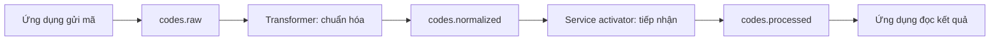

# Input channel và output channel

Trong chương **Mô hình message flow** của module **SPRING_INTEGRATION_CORE**, input channel và output channel giúp mô tả đường đi của thông điệp qua từng endpoint. Nắm được hai vai trò này là bước nền để nối transformer, service activator, filter, router hoặc aggregator thành một luồng xử lý có thể quan sát và kiểm thử.

Bài học tập trung vào câu hỏi: **endpoint nhận thông điệp từ đâu, và kết quả của endpoint đi tiếp tới đâu?** Các ví dụ sử dụng luồng chuẩn hóa mã đơn hàng, sau đó mở rộng sang trả lời theo từng yêu cầu và xử lý qua hàng đợi.

## 1. Kết quả cần đạt

Sau bài học, bạn có thể:

- Chỉ ra input channel và output channel của từng bước trên sơ đồ luồng.
- Phân biệt vai trò của channel với kiểu triển khai như `DirectChannel` hoặc `QueueChannel`.
- Nối endpoint bằng Java DSL và đọc cấu hình tương đương bằng annotation.
- Giải thích quan hệ giữa output channel được cấu hình và header `replyChannel`.
- Dự đoán hành vi khi thiếu consumer, thiếu poller hoặc thiếu đích nhận kết quả.
- Thiết kế kiểm thử đi từ channel đầu vào tới thông điệp ở channel đầu ra.

## 2. Hai vai trò được xác định theo endpoint

Xét một luồng tiếp nhận mã đơn hàng:



Với endpoint chuẩn hóa, `codes.raw` là input channel và `codes.normalized` là output channel. Với endpoint tiếp nhận, `codes.normalized` lại là input channel; `codes.processed` là output channel.

| Thành phần được xét | Input channel | Output channel | Công việc |
| --- | --- | --- | --- |
| Transformer chuẩn hóa | `codes.raw` | `codes.normalized` | Bỏ khoảng trắng và chuyển thành chữ hoa |
| Service activator tiếp nhận | `codes.normalized` | `codes.processed` | Sinh kết quả tiếp nhận |

**Một channel có thể đồng thời là đầu ra của endpoint trước và đầu vào của endpoint sau.** Không cần tạo hai channel riêng chỉ để gọi một cái là input và một cái là output.

Các tên như `inputChannel`, `outputChannel` hay `codes.normalized` là tên bean hoặc tên tham chiếu trong cấu hình. Chúng không tạo ra lớp Java chuyên biệt tên `InputChannel` hay `OutputChannel`.

Một cách đọc sơ đồ hiệu quả là đặt ngón tay tại một endpoint rồi trả lời lần lượt:

1. Thông điệp tới endpoint này qua cạnh nào?
2. Endpoint làm thay đổi gì hoặc gọi nghiệp vụ gì?
3. Endpoint có tạo kết quả không?
4. Nếu có kết quả, cạnh nào mang kết quả sang bước tiếp theo?

Chỉ sau đó mới chuyển sang endpoint kế bên. Cách đọc này tránh nhầm tên của toàn luồng với vai trò cục bộ của từng channel.

## 3. Channel chuyển giao, endpoint xử lý

Về giao diện, `MessageChannel` cung cấp thao tác gửi. `PollableChannel` bổ sung thao tác nhận chủ động; `SubscribableChannel` cho phép đăng ký handler để được gọi khi có thông điệp. Cách tiêu thụ vì vậy phụ thuộc giao diện mà channel triển khai. Xem [The MessageChannel Interface](https://docs.spring.io/spring-integration/reference/channel/interfaces.html).

```java
// Các chữ ký chính, lược bỏ phần khai báo interface.
boolean send(Message<?> message);
boolean send(Message<?> message, long timeout);

// Có trên PollableChannel.
Message<?> receive();
Message<?> receive(long timeout);
```

Tham số thời gian ở các thao tác trên dùng đơn vị mili giây. Khi không gửi được trong thời hạn, thao tác gửi có thể trả `false`; lỗi chuyển giao hoặc xử lý cũng có thể phát sinh exception. Khi nhận có thời hạn mà không có thông điệp, kết quả là `null`.

Quan trọng nhất: giá trị `boolean` từ `send()` không phải kết quả nghiệp vụ. Kết quả như `ACCEPTED:ORD-42` nằm trong một thông điệp được chuyển tiếp hoặc trả lời bằng cơ chế request–reply.

Ví dụ sau chỉ kiểm tra việc gửi được chấp nhận:

```java
Message<String> request = MessageBuilder
        .withPayload("  ord-42  ")
        .setHeader("traceId", "trace-42")
        .build();

boolean sent = inputChannel.send(request, 1_000);
if (!sent) {
    throw new IllegalStateException("Không gửi được yêu cầu trong thời hạn");
}
```

Muốn đánh giá nghiệp vụ đã hoàn thành, ứng dụng phải xác định điểm quan sát phù hợp: một reply của gateway, một thông điệp ở channel kết quả, hay trạng thái nghiệp vụ đã lưu. Chỉ quan sát biến `sent` sẽ bỏ sót những công việc được xử lý sau thời điểm gửi.

## 4. Vai trò input/output độc lập với cách chuyển giao

Input/output mô tả vị trí của channel trong luồng. Kiểu channel mô tả cách giao thông điệp tại vị trí đó.

| Kiểu channel | Cách chuyển giao chính | Tình huống minh họa |
| --- | --- | --- |
| `DirectChannel` | Gọi một subscriber trên thread của bên gửi | Hai bước xử lý nối tiếp trong cùng tiến trình |
| `QueueChannel` | Giữ thông điệp để consumer lấy ra | Bước sau nhận công việc qua hàng đợi |
| `ExecutorChannel` | Chuyển việc gọi handler qua executor | Tách việc xử lý khỏi thread gửi, tùy executor |
| `PublishSubscribeChannel` | Phát tới các subscriber | Thông báo một sự kiện tới nhiều bên |

Các đặc điểm chuyển giao này được mô tả tại [Message Channel Implementations](https://docs.spring.io/spring-integration/reference/channel/implementations.html).

Với `DirectChannel`, nhiều subscriber không đồng nghĩa mỗi subscriber nhận một bản sao; cơ chế phân phối còn có load balancing và failover. Khi thiết kế hai tác vụ đều phải nhận sự kiện, cần diễn đạt rõ yêu cầu phát nhiều nơi. Xem [DirectChannel API](https://docs.spring.io/spring-integration/api/org/springframework/integration/channel/DirectChannel.html).

Ví dụ, sau chuẩn hóa mã đơn hàng:

- Nếu chỉ bước tiếp nhận cần kết quả, một channel điểm tới điểm là lựa chọn dễ hiểu.
- Nếu cả kiểm toán và thông báo đều phải nhìn thấy sự kiện đã tiếp nhận, cần một nhánh phát tới nhiều bên.
- Nếu bước tiếp nhận chạy chậm, có thể cân nhắc hàng đợi, giới hạn dung lượng và thời gian chờ.

Tên `codes.output` không làm channel bất đồng bộ. Tên `codes.input` cũng không bảo đảm có sẵn một queue.

## 5. Ví dụ Java DSL: hai endpoint, ba channel

### 5.1. Giả định để đọc ví dụ

Ví dụ sử dụng Java 17 trở lên, thư viện `spring-integration-core` cùng các phụ thuộc Spring tương thích. Kiểm thử ở phần sau dùng JUnit Jupiter. Nếu dự án dùng Spring Boot, nên để BOM của dự án quản lý phiên bản; nếu dùng Spring thuần, cần căn chỉnh các phiên bản Spring trước khi ghép mã.

Cấu hình dưới đây dùng `@EnableIntegration` và `AnnotationConfigApplicationContext`, nên không phụ thuộc vào việc tự động cấu hình của Spring Boot. Mỗi lớp `public` trong bài là một tệp Java riêng khi người học đưa vào dự án thực hành; bài học không yêu cầu sửa cấu hình build hiện có.

### 5.2. Cấu hình luồng

```java
import java.util.Locale;

import org.springframework.beans.factory.annotation.Qualifier;
import org.springframework.context.annotation.Bean;
import org.springframework.context.annotation.Configuration;
import org.springframework.integration.channel.DirectChannel;
import org.springframework.integration.channel.QueueChannel;
import org.springframework.integration.config.EnableIntegration;
import org.springframework.integration.dsl.IntegrationFlow;
import org.springframework.messaging.MessageChannel;

@Configuration
@EnableIntegration
public class CodeFlowConfig {

    @Bean(name = "codes.raw")
    public MessageChannel rawCodes() {
        return new DirectChannel();
    }

    @Bean(name = "codes.normalized")
    public MessageChannel normalizedCodes() {
        return new DirectChannel();
    }

    @Bean(name = "codes.processed")
    public QueueChannel processedCodes() {
        return new QueueChannel(20);
    }

    @Bean
    public IntegrationFlow codeFlow(
            @Qualifier("codes.raw") MessageChannel raw,
            @Qualifier("codes.normalized") MessageChannel normalized,
            @Qualifier("codes.processed") QueueChannel processed) {

        return IntegrationFlow.from(raw)
                .transform(String.class,
                        payload -> payload.strip().toUpperCase(Locale.ROOT))
                .channel(normalized)
                .handle(String.class,
                        (payload, headers) -> "ACCEPTED:" + payload)
                .channel(processed)
                .get();
    }
}
```

Java DSL xây dựng và đăng ký các channel, handler, endpoint trong Spring context. Nó vẫn cấu hình mô hình messaging của Spring Integration. Xem [Java DSL](https://docs.spring.io/spring-integration/reference/dsl.html).

### 5.3. Đọc cấu hình theo các cổng vào và ra

Trong ví dụ:

- `IntegrationFlow.from(raw)` xác định điểm vào của flow; transformer kế tiếp tiêu thụ từ `raw`.
- `.channel(normalized)` đặt channel chuyển giao sau transformer, trước service activator.
- `.handle(...)` gọi logic tiếp nhận bằng service activator.
- `.channel(processed)` đặt đích nhận kết quả tiếp nhận.
- `.get()` hoàn tất việc xây dựng đối tượng cấu hình flow.

Nếu bỏ `.channel(normalized)`, DSL có thể nối các endpoint bằng channel nội bộ được sinh tự động. Channel đặt tên hữu ích khi cần một ranh giới rõ ràng giữa các flow hoặc một điểm quan sát ổn định. Xem [Message Channels trong Java DSL](https://docs.spring.io/spring-integration/reference/dsl/java-channels.html).

Không nên tạo nhiều channel đặt tên chỉ vì mỗi câu lệnh DSL trông như một bước riêng. Hãy đặt tên ở những điểm mang ý nghĩa với thiết kế, chẳng hạn “đã chuẩn hóa”, “chờ xử lý” hoặc “đã hoàn thành”.

### 5.4. Lần theo một thông điệp

Với payload đầu vào `"  ord-42  "`:

| Chặng | Payload quan sát được | Bên nhận kế tiếp |
| --- | --- | --- |
| Gửi vào `codes.raw` | `"  ord-42  "` | Transformer |
| Sau chuẩn hóa, qua `codes.normalized` | `"ORD-42"` | Service activator |
| Sau tiếp nhận, vào `codes.processed` | `"ACCEPTED:ORD-42"` | Consumer đọc queue |

Đây là các giá trị dự kiến từ mã ví dụ. Transformer tạo nội dung đã chuẩn hóa; service activator tạo nội dung tiếp nhận. Việc đặt tên channel chỉ giúp xác định nơi các nội dung đó được chuyển giao.

Trong luồng này, consumer cuối do ứng dụng hoặc kiểm thử gọi `receive()` trực tiếp. Không có endpoint tự động tiêu thụ `codes.processed`, vì thế không cần poller tại queue cuối này.

## 6. Đọc cùng một cách nối bằng annotation

Cấu hình annotation thường ghi tên channel ngay trên phương thức xử lý:

```java
import java.util.Locale;

import org.springframework.integration.annotation.ServiceActivator;

public class CodeEndpoints {

    @ServiceActivator(
            inputChannel = "codes.raw",
            outputChannel = "codes.normalized")
    public String normalize(String raw) {
        return raw.strip().toUpperCase(Locale.ROOT);
    }

    @ServiceActivator(
            inputChannel = "codes.normalized",
            outputChannel = "codes.processed")
    public String accept(String normalized) {
        return "ACCEPTED:" + normalized;
    }
}
```

Để dùng biến thể này, giữ ba bean channel và `@EnableIntegration` từ ví dụ trước, bỏ bean `codeFlow`, rồi đăng ký `CodeEndpoints` bằng một bean:

```java
@Bean
public CodeEndpoints codeEndpoints() {
    return new CodeEndpoints();
}
```

Đây là hai cách biểu diễn thay thế. Không đăng ký đồng thời cả `codeFlow` và `CodeEndpoints` cho cùng bài thực hành: khi đó hai cấu hình cùng gắn consumer vào các channel đã có, khiến kết quả phụ thuộc cơ chế phân phối.

Tên thuộc tính `inputChannel` và `outputChannel` trên annotation là tên bean cần được phân giải. Có thể đối chiếu cách cấu hình tại [Service Activator](https://docs.spring.io/spring-integration/reference/service-activator.html).

## 7. Output channel và `replyChannel`: đích tiếp theo khác đích trả lời

Output channel được cấu hình trên endpoint trả lời câu hỏi: **kết quả của bước này phải đi đâu?** Header `replyChannel` trên thông điệp giúp mang địa chỉ trả lời theo từng yêu cầu.

Đối với service activator có kết quả khác `null`, thứ tự tìm đích cơ bản là:

1. Dùng output channel đã cấu hình.
2. Nếu chưa có, xét header `replyChannel` của request.
3. Nếu request không có header này và kết quả là một `Message`, có thể xét `replyChannel` trên message kết quả.
4. Nếu vẫn không có đích phù hợp, phát sinh lỗi phân giải đích.

Giá trị `replyChannel` có thể là đối tượng `MessageChannel` hoặc tên channel. Xem quy tắc tại [Service Activator — đích nhận reply](https://docs.spring.io/spring-integration/reference/service-activator.html).

### 7.1. Tạo một luồng dựa vào địa chỉ trả lời

Hai bean dưới đây có thể được thêm vào `CodeFlowConfig`. Chúng tạo một flow riêng, với channel khác ví dụ ban đầu:

```java
@Bean(name = "codes.requests")
public MessageChannel codeRequests() {
    return new DirectChannel();
}

@Bean
public IntegrationFlow requestReplyFlow(
        @Qualifier("codes.requests") MessageChannel requests) {

    return IntegrationFlow.from(requests)
            .handle(String.class,
                    (payload, headers) -> "LOOKUP:" + payload)
            .get();
}
```

Ở đây không có `.channel(...)` sau `.handle(...)`. Người gửi sẽ cung cấp địa chỉ nhận phản hồi qua header:

```java
import org.springframework.messaging.Message;
import org.springframework.messaging.MessageHeaders;
import org.springframework.messaging.support.MessageBuilder;

QueueChannel replies = new QueueChannel(1);
Message<String> request = MessageBuilder.withPayload("ORD-42")
        .setHeader(MessageHeaders.REPLY_CHANNEL, replies)
        .build();

boolean sent = requests.send(request, 1_000);
if (!sent) {
    throw new IllegalStateException("Không gửi được yêu cầu tra cứu");
}

Message<?> response = replies.receive(1_000);
if (response == null) {
    throw new IllegalStateException("Không nhận được phản hồi tra cứu");
}

System.out.println(response.getPayload()); // Dự kiến: LOOKUP:ORD-42
```

Biến `requests` trong đoạn gọi là bean `codes.requests` lấy từ context. `replies` là queue tạm của riêng lần gọi minh họa, nên không cần tên bean và không cần một poller; chính người gọi lấy kết quả bằng `receive()`.

### 7.2. Điều gì xảy ra nếu có cả hai đích?

Giả sử request mang `replyChannel = replies`, nhưng endpoint tra cứu lại được cấu hình:

```java
return IntegrationFlow.from(requests)
        .handle(String.class,
                (payload, headers) -> "LOOKUP:" + payload)
        .channel(processed)
        .get();
```

Trong biến thể này, `processed` là queue kết quả được inject vào bean flow. Kết quả tới đó trước; nó không tự được gửi thêm một bản vào `replies`. Nếu không còn endpoint nào đọc `processed` rồi trả tiếp, `replies.receive(...)` sẽ hết thời gian chờ.

Đây là một cách giải thích phổ biến cho hiện tượng: “handler đã trả giá trị nhưng bên gọi vẫn không nhận được reply”. Cần xem đích sau handler và xem flow có thực sự tiếp tục tới địa chỉ trả lời hay không.

### 7.3. Khi dùng messaging gateway

Gateway biến lời gọi phương thức thành request message và thường chuẩn bị một reply channel tạm. Endpoint cuối có thể trả kết quả theo địa chỉ này; người gọi nhận kết quả dưới dạng giá trị trả về của phương thức. Việc gắn cứng output channel cuối vào một queue không có consumer có thể làm đứt đường trả lời. Xem [Messaging Gateways](https://docs.spring.io/spring-integration/reference/gateway.html).

Trong bài thực hành, queue tạm giúp nhìn thấy đường đi của reply. Khi thiết kế API nghiệp vụ, gateway thường giúp bên gọi không phải tự tạo message và quản lý việc chờ nhận.

## 8. Phân biệt không có kết quả, bỏ kết quả và thiếu đích

Không phải endpoint nào cũng phát ra message mới. Một bước ghi nhật ký hoặc cập nhật trạng thái có thể kết thúc sau khi thực hiện tác vụ.

Với service activator, phương thức trả `void` hoặc `null` mặc định có thể kết thúc mà không phát reply. Khi bật `requiresReply`, việc không tạo kết quả trở thành lỗi `ReplyRequiredException`. Tùy chọn này yêu cầu có kết quả, không tự bổ sung một đích nhận. Xem [AbstractReplyProducingMessageHandler API](https://docs.spring.io/spring-integration/api/org/springframework/integration/handler/AbstractReplyProducingMessageHandler.html).

Ba tình huống cần được diễn đạt khác nhau trong thiết kế:

| Ý định | Cách thể hiện | Câu hỏi cần kiểm tra |
| --- | --- | --- |
| Chỉ thực hiện một tác vụ | Handler kết thúc bằng `void` | Bên gọi có đang chờ reply không? |
| Có kết quả nhưng chủ động bỏ | Gửi kết quả tới `nullChannel` | Đây có phải kết quả mà nghiệp vụ cần giữ không? |
| Muốn chuyển kết quả tiếp | Cấu hình đích hoặc dùng địa chỉ trả lời | Đích có tồn tại và có consumer phù hợp không? |

`nullChannel` là channel đặc biệt được framework cung cấp để nhận và bỏ thông điệp. Đặt đích tới đó diễn đạt rõ ý định kết thúc đối với kết quả không cần sử dụng. Xem [Special Channels](https://docs.spring.io/spring-integration/reference/channel/special-channels.html).

Không nên dùng `nullChannel` chỉ để che lỗi một request đáng lẽ phải có phản hồi. Với yêu cầu tra cứu, “không tìm thấy đơn hàng” thường nên được biểu diễn bằng một kết quả nghiệp vụ rõ ràng thay vì vô tình trả `null` rồi để người gọi chờ.

## 9. Đổi đầu vào của endpoint sang queue: cần thêm gì?

Trong ví dụ ban đầu, service activator nhận từ `codes.normalized`, hiện là `DirectChannel`. Nếu đổi channel này sang `QueueChannel`, việc gửi chỉ đưa thông điệp vào queue. Một endpoint tiêu thụ từ `PollableChannel` cần poller được cấu hình tại endpoint hoặc một poller mặc định áp dụng cho nó. Xem [Poller — Polling Consumer](https://docs.spring.io/spring-integration/reference/polling-consumer.html).

Thay bean `normalizedCodes` trong `CodeFlowConfig`:

```java
@Bean(name = "codes.normalized")
public MessageChannel normalizedCodes() {
    return new QueueChannel(100);
}
```

Sau đó thay phần xây flow bằng đoạn sau, đồng thời bổ sung import `org.springframework.integration.dsl.Pollers`:

```java
return IntegrationFlow.from(raw)
        .transform(String.class,
                payload -> payload.strip().toUpperCase(Locale.ROOT))
        .channel(normalized)
        .handle(String.class,
                (payload, headers) -> "ACCEPTED:" + payload,
                endpoint -> endpoint.poller(
                        Pollers.fixedDelay(100).maxMessagesPerPoll(10)))
        .channel(processed)
        .get();
```

Poller gắn vào endpoint `.handle(...)` vì endpoint này tiêu thụ từ `normalized`. Không gắn nó vào transformer đang nhận từ `raw`, vốn vẫn là `DirectChannel`.

Trong biến thể này:

- Transformer có thể hoàn thành trên thread gửi và đặt kết quả vào queue trung gian.
- Endpoint tiếp nhận chạy khi poller lấy được thông điệp.
- Bên gửi có thể quay lại công việc của mình trước khi kết quả tiếp nhận xuất hiện.
- Các giả định về transaction theo thread và cách bắt exception phải được xem lại khi vượt ranh giới queue.

Một `QueueChannel` thông thường lưu trong bộ nhớ theo mặc định; việc có queue không tự bảo đảm dữ liệu tồn tại sau khi tiến trình dừng. Cần lựa chọn cơ chế lưu trữ phù hợp nếu yêu cầu nghiệp vụ đòi hỏi độ bền. Xem [Message Channel Implementations — queue storage](https://docs.spring.io/spring-integration/reference/channel/implementations.html).

## 10. Phân biệt ba thời gian chờ

Cùng là timeout nhưng các thời gian chờ có thể bảo vệ những thao tác khác nhau:

| Thao tác | Đang chờ điều gì? | Ví dụ |
| --- | --- | --- |
| `channel.send(message, timeout)` | Channel chấp nhận việc gửi theo cơ chế của nó | Queue có chỗ trống |
| `queue.receive(timeout)` | Có một message để nhận | Kết quả tiếp nhận đã vào queue |
| Chờ reply của gateway | Có phản hồi cho lời gọi | Tra cứu trả kết quả về bên gọi |

Không nên diễn giải `raw.send(message, 1_000)` là “toàn bộ nghiệp vụ bắt buộc xong trong một giây”. Với `DirectChannel`, handler được gọi trên thread gửi; tham số này không phải cơ chế cưỡng bức dừng một phương thức nghiệp vụ đang chạy lâu. Với queue, gửi thành công cũng chưa chứng minh consumer đã xử lý.

Có thể quan sát áp lực queue bằng ví dụ nhỏ, độc lập với Spring context:

```java
QueueChannel pending = new QueueChannel(1);

boolean first = pending.send(
        MessageBuilder.withPayload("ORD-42").build(), 0);
boolean second = pending.send(
        MessageBuilder.withPayload("ORD-43").build(), 0);

// Dự kiến: first == true; second == false vì chưa có ai lấy ORD-42.
Message<?> firstMessage = pending.receive(0);
Message<?> noMessage = pending.receive(0);
// Dự kiến: firstMessage chứa ORD-42; noMessage == null.
```

Queue có giới hạn giúp bộc lộ tình huống consumer không theo kịp. Nếu không có giới hạn thực tế, bộ nhớ có thể trở thành điểm chịu tải. Xem [QueueChannel API](https://docs.spring.io/spring-integration/api/org/springframework/integration/channel/QueueChannel.html).

## 11. Đường kết quả và đường lỗi

Output channel mang kết quả xử lý theo thiết kế. `errorChannel` phục vụ luồng xử lý lỗi; nó không thay thế output channel.

Với chuỗi xử lý đồng bộ qua `DirectChannel`, exception từ handler thường quay lại lời gọi gửi. Với các tác vụ bất đồng bộ do Spring Integration quản lý, như poller, lỗi có thể được đóng gói thành `ErrorMessage` và chuyển tới địa chỉ trong header `errorChannel`, hoặc channel lỗi mặc định khi không có header này. Xem [Error Handling](https://docs.spring.io/spring-integration/reference/error-handling.html).

Ví dụ thiết kế cho đơn hàng nên chỉ rõ:

- Kết quả đã tiếp nhận được quan sát ở `codes.processed`.
- Dữ liệu không hợp lệ được từ chối theo một hợp đồng nghiệp vụ đã chọn.
- Lỗi kỹ thuật khi tiếp nhận được quan sát qua exception hoặc flow lỗi tương ứng với mô hình thực thi.

Việc thêm header `errorChannel` không tự biến mọi exception trên cùng thread thành message lỗi. Khi chẩn đoán, phải xác định bước đang chạy trên thread gửi, thread poller hay executor nào.

## 12. Kiểm thử đường đi từ input tới output

Kiểm thử nên chứng minh hợp đồng tại ranh giới channel: một message đầu vào tạo ra nội dung và metadata cần thiết tại đầu ra. Với `CodeFlowConfig` nguyên bản, có thể dùng kiểm thử JUnit sau:

```java
import org.junit.jupiter.api.Test;
import org.springframework.context.annotation.AnnotationConfigApplicationContext;
import org.springframework.integration.channel.QueueChannel;
import org.springframework.messaging.Message;
import org.springframework.messaging.MessageChannel;
import org.springframework.messaging.support.MessageBuilder;

import static org.junit.jupiter.api.Assertions.assertEquals;
import static org.junit.jupiter.api.Assertions.assertNotNull;
import static org.junit.jupiter.api.Assertions.assertNull;
import static org.junit.jupiter.api.Assertions.assertTrue;

class CodeFlowTest {

    @Test
    void sendsNormalizedCodeToProcessedChannel() {
        try (var context =
                     new AnnotationConfigApplicationContext(CodeFlowConfig.class)) {

            MessageChannel input = context.getBean(
                    "codes.raw", MessageChannel.class);
            QueueChannel output = context.getBean(
                    "codes.processed", QueueChannel.class);

            Message<String> request = MessageBuilder
                    .withPayload("  ord-42  ")
                    .setHeader("traceId", "trace-42")
                    .build();

            assertTrue(input.send(request, 1_000));

            Message<?> result = output.receive(1_000);
            assertNotNull(result);
            assertEquals("ACCEPTED:ORD-42", result.getPayload());
            assertEquals("trace-42", result.getHeaders().get("traceId"));
            assertNull(output.receive(0));
        }
    }
}
```

Kiểm thử này kiểm tra ba điều có ý nghĩa với ví dụ: dữ liệu được chuẩn hóa rồi tiếp nhận, header dùng để theo dõi còn tới đầu ra, và queue không có kết quả dư ngay sau lần nhận đầu trong flow đồng bộ này.

Khi áp dụng biến thể có poller, vẫn có thể chờ message bằng `receive(timeout)`. Không cần thêm `Thread.sleep()` để đoán thời điểm xử lý. Tuy nhiên, phép kiểm tra queue rỗng ngay lập tức không chứng minh rằng trong tương lai sẽ không có message dư từ một flow bất đồng bộ.

Các khối mã và giá trị dự kiến trong bài là hướng dẫn thực hành; bài viết không khẳng định kiểm thử đã được thực thi trong workspace.

## 13. Chẩn đoán từ triệu chứng

| Triệu chứng | Điểm cần kiểm tra | Hướng xử lý |
| --- | --- | --- |
| Gửi vào `DirectChannel` báo không có subscriber | Endpoint đã đăng ký, đã khởi động và dùng đúng bean chưa? | Kiểm tra cấu hình consumer cùng tên channel |
| Queue trung gian tăng nhưng không có kết quả | Endpoint lấy từ queue có poller không? | Gắn poller vào đúng endpoint tiêu thụ |
| Handler chạy nhưng báo không tìm thấy đích reply | Handler có tạo kết quả trong khi thiếu đích không? | Hoàn thiện output channel hoặc địa chỉ trả lời |
| Caller chờ mãi dù có message trong queue kết quả | Queue đó có nối tiếp tới đường trả lời không? | Vẽ lại đường đi từ output của handler tới caller |
| Hai chức năng chỉ nhận luân phiên | Có đang dùng channel điểm tới điểm cho hai subscriber không? | Chọn cấu trúc phát nhiều nơi nếu cả hai đều phải nhận |
| `send()` trả về trước khi thấy kết quả | Luồng có queue hoặc executor trung gian không? | Quan sát điểm hoàn thành nghiệp vụ thích hợp |
| Queue đầy làm gửi bị chờ hoặc trả `false` | Consumer có theo kịp và timeout có phù hợp không? | Xử lý tải, giới hạn và hành vi khi gửi thất bại |
| Luồng mất metadata để trả lời | Có bước tạo message mới và bỏ header không? | Kiểm tra chính sách sao chép header tại bước đó |

Trình tự chẩn đoán nên đi theo một thông điệp cụ thể. Ghi lại tên channel vào, endpoint vừa chạy, payload dự kiến và channel ra. Sau đó mới kiểm tra thread, consumer và timeout ở đoạn bị đứt.

Tránh gắn thêm một consumer vào channel điểm tới điểm chỉ để xem dữ liệu: consumer quan sát có thể lấy mất công việc của consumer nghiệp vụ. Với nhu cầu quan sát, cần chọn cơ chế theo dõi không làm thay đổi mục tiêu phân phối.

## 14. Liên hệ với các mẫu tích hợp khác

Mô hình input/output vẫn hữu ích khi thêm các endpoint phức tạp hơn:

| Endpoint | Câu hỏi cần đặt khi vẽ đường đi |
| --- | --- |
| Transformer | Nội dung mới được chuyển tới bước nào? |
| Filter | Message được chấp nhận đi tiếp đâu, message bị loại được xử lý thế nào? |
| Router | Những nhánh đầu ra nào có thể được chọn? |
| Aggregator | Khi nào có kết quả nhóm để gửi tiếp? |
| Gateway | Request vào đâu, reply quay lại lời gọi bằng đường nào? |

Không nên suy từ sơ đồ đơn giản rằng mọi endpoint luôn tạo đúng một output cho mỗi input. Khi mở rộng bài thực hành, cần ghi thêm điều kiện đi tiếp, khả năng không có kết quả, nhiều nhánh hoặc việc chờ một nhóm message.

## 15. Thực hành củng cố

### Bài tập A: gọi tên đúng vai trò

Vẽ lại luồng ban đầu, sau đó đánh dấu `codes.normalized` theo góc nhìn của từng endpoint.

**Kết quả cần giải thích:** channel này là đầu ra của bước chuẩn hóa và đầu vào của bước tiếp nhận. Hai nhãn không mâu thuẫn vì được gắn theo hai endpoint khác nhau.

### Bài tập B: quan sát việc ưu tiên output

Dùng flow `codes.requests`, tạo queue tạm `replies` và gửi request có `replyChannel`. Sau đó cấu hình output của handler sang một queue khác mà không nối thêm consumer.

**Kết quả cần quan sát:** queue output được cấu hình nhận nội dung tra cứu; queue tạm của caller không có reply trong thời gian chờ. Giải thích bằng đường đi thực tế, không chỉ bằng việc handler có lệnh `return`.

### Bài tập C: đưa queue vào giữa hai bước

Đổi `codes.normalized` thành `QueueChannel(100)` và thêm poller cho endpoint tiếp nhận. Dùng kiểm thử có `receive(timeout)` để đợi kết quả.

**Kết quả cần giải thích:** thao tác gửi vào queue và thời điểm hoàn thành nghiệp vụ là hai mốc khác nhau. Đồng thời phân biệt queue trung gian cần endpoint polling với queue cuối được kiểm thử nhận trực tiếp.

### Bài tập D: xác định hợp đồng kết thúc

Giả sử bước tiếp nhận chỉ lưu trạng thái và không cần trả dữ liệu. Viết ra hợp đồng của bên gọi trước khi chọn handler `void`, reply xác nhận hoặc gửi kết quả tới `nullChannel`.

**Tiêu chí đạt:** lựa chọn kết thúc phải phù hợp với việc bên gọi có chờ phản hồi hay không; không để một yêu cầu cần kết quả kết thúc âm thầm.

## 16. Ghi nhớ khi thiết kế luồng

Trước mỗi endpoint, xác định channel đưa công việc tới nó và cơ chế nhận. Sau mỗi endpoint, xác định có kết quả hay không và ai sẽ tiêu thụ kết quả đó. Tại ranh giới với bên gọi, vẽ riêng đường trả lời và đường lỗi nếu chúng là một phần của hợp đồng.

Với cách đọc này, một sơ đồ message flow thể hiện được cả đường đi lẫn trách nhiệm: channel chuyển giao thông điệp, endpoint thực hiện một bước xử lý, còn gateway giúp kết nối luồng với lời gọi nghiệp vụ.
