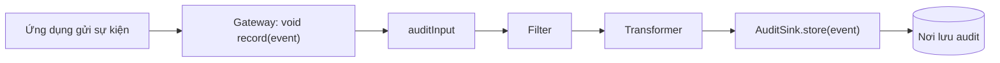
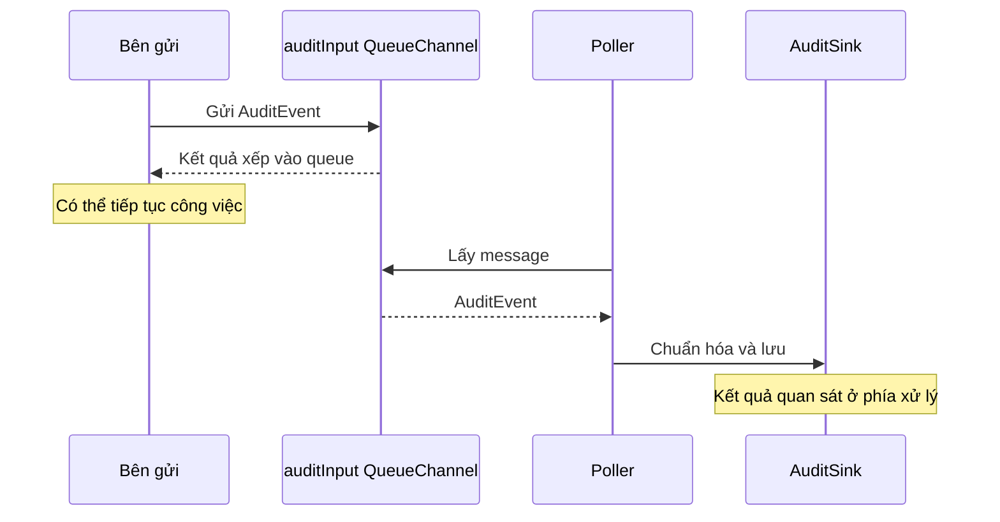

# One-way flow

## 1. Mục tiêu và ngữ cảnh

Trong chương **Mô hình message flow** của module **SPRING_INTEGRATION_CORE**, one-way flow là mô hình gửi thông điệp để thực hiện một công việc mà bên gửi không nhận một thông điệp kết quả nghiệp vụ qua chính lần gửi đó.

Bài học dùng tình huống tiếp nhận sự kiện audit của đơn hàng: ứng dụng gửi sự kiện, luồng chuẩn hóa dữ liệu rồi chuyển đến nơi lưu trữ. Qua tình huống này, bạn sẽ:

- Ghép `Message`, `MessageChannel`, endpoint và gateway thành một luồng một chiều.
- Dùng Java DSL để lọc, biến đổi và kết thúc luồng bằng một tác vụ có tác dụng phụ.
- Phân biệt hợp đồng không có reply với cách thực thi đồng bộ hoặc bất đồng bộ.
- Xác định ý nghĩa của việc gửi thành công, lỗi xử lý và kết quả nghiệp vụ.
- Kiểm thử tác dụng phụ, dữ liệu bị loại và tình huống hàng đợi đầy.

Các ví dụ dùng Java 17 và API Spring Integration 6.5. Chúng minh họa mô hình xử lý trong một ứng dụng Spring; không yêu cầu broker hay hệ thống lưu trữ bên ngoài. Dependency chính là `org.springframework.integration:spring-integration-core`; phần kiểm thử dùng JUnit Jupiter. Dự án cần quản lý các phiên bản Spring tương thích, chẳng hạn qua BOM phù hợp với ứng dụng.

## 2. One-way flow xác định điều gì?

### 2.1. Hợp đồng trao đổi thông điệp

Có thể biểu diễn hợp đồng của một one-way flow như sau:

```text
Bên gửi → thông điệp đầu vào → các bước xử lý → tác dụng phụ
```

Tác dụng phụ có thể là ghi một bản ghi, gửi email, cập nhật chỉ mục hoặc chuyển thông điệp sang một hệ thống khác. Hợp đồng này không yêu cầu một reply chứa kết quả nghiệp vụ quay về bên gửi.



Một luồng có nhiều endpoint vẫn có thể là one-way. Transformer tạo dữ liệu cho endpoint tiếp theo không có nghĩa là nó trả kết quả cho bên gọi gateway. Điều quyết định là hợp đồng tại ranh giới giữa bên gửi và luồng.

Nếu một công việc hoàn tất sau đó được công bố qua sự kiện `AuditStored`, ứng dụng đã bổ sung một kênh thông báo kết quả riêng. Khi cần nối thông báo này với yêu cầu gốc, phải thiết kế khóa tương quan và vòng đời theo dõi công việc.

### 2.2. Không có reply vẫn có kết quả kỹ thuật

Phương thức Java luôn kết thúc bằng cách trả quyền điều khiển hoặc ném ngoại lệ. Với gateway trả `void`, ứng dụng không nhận giá trị nghiệp vụ từ luồng, nhưng lời gọi vẫn có thể gặp lỗi gửi hoặc lỗi xử lý đồng bộ.

Tương tự, giá trị `boolean` của `MessageChannel.send(...)` mô tả kết quả gửi theo implementation của channel. Đây không phải một reply nghiệp vụ. API cho phép `true`, `false` và ngoại lệ tùy tình huống. [Javadoc MessageChannel](https://docs.spring.io/spring-framework/docs/current/javadoc-api/org/springframework/messaging/MessageChannel.html).

Vì vậy, cần tách ba câu hỏi:

| Câu hỏi | Ví dụ bằng chứng |
| --- | --- |
| Thông điệp đã được gửi vào channel chưa? | `send` trả `true` |
| Endpoint đích đã thực hiện công việc chưa? | Sink ghi nhận sự kiện hoặc phát sinh lỗi |
| Kết quả đã bền vững và có thể khôi phục chưa? | Transaction đã commit, dữ liệu có trong kho bền vững |

Một tín hiệu ở hàng trên không tự chứng minh các hàng dưới.

## 3. Các thành phần tham gia

### 3.1. Message: dữ liệu và ngữ cảnh

Một `Message<T>` mang payload và headers. Với sự kiện audit:

| Thành phần | Nội dung minh họa | Mục đích |
| --- | --- | --- |
| Payload | `AuditEvent` | Dữ liệu nghiệp vụ cần xử lý |
| Header `traceId` tự định nghĩa | `trace-order-42` | Nối log giữa các bước |
| Header `errorChannel` | Tên hoặc tham chiếu channel lỗi | Chỉ định đường xử lý lỗi khi cơ chế tương ứng sử dụng |
| Header `replyChannel` | Có thể tồn tại tùy cách gửi | Địa chỉ reply của hạ tầng messaging |

Không nên xác định one-way bằng cách kiểm tra có header `replyChannel` hay không. Với gateway `void`, Spring Integration từ phiên bản 5.4 có thể đặt header này đến `nullChannel` khi bên gửi chưa cung cấp. Mục đích là loại bỏ reply có thể xuất hiện ở phía sau, phù hợp với hợp đồng gateway. [Messaging Gateways — reply channel](https://docs.spring.io/spring-integration/reference/6.5/gateway.html#gateway-default-reply-channel).

Trong thiết kế nghiệp vụ, nên có `eventId` riêng và giữ nguyên khi gửi lại cùng một sự kiện. Không dùng việc tạo một `Message` mới để xác định một nghiệp vụ mới: một lần thử gửi lại vẫn có thể biểu diễn cùng công việc ban đầu.

### 3.2. Channel: đường nối và ranh giới thực thi

`DirectChannel` gọi subscriber trong thread của bên gửi. `QueueChannel` cung cấp vùng đệm để consumer lấy thông điệp. `ExecutorChannel` giao việc dispatch cho executor. Chọn channel ảnh hưởng đến thời điểm lời gọi quay về và cách quan sát lỗi. [Message Channel Implementations](https://docs.spring.io/spring-integration/reference/6.5/channel/implementations.html).

Trong ví dụ audit, nếu endpoint lưu trữ chạy trên cùng thread thì tốc độ của nơi lưu trữ trực tiếp ảnh hưởng đến lời gọi gửi. Khi thêm một ranh giới bất đồng bộ, ứng dụng cần quan sát công việc sau thời điểm tiếp nhận.

### 3.3. Endpoint: từng bước xử lý

Các toán tử Java DSL ánh xạ đến endpoint quen thuộc: `filter` chọn thông điệp, `transform` biến đổi dữ liệu và `handle` gọi một service activator. DSL tạo và nối các thành phần trong Spring context; khai báo `IntegrationFlow` tự nó chưa phải một lần gửi thông điệp. [DSL Basics](https://docs.spring.io/spring-integration/reference/6.5/dsl/java-basics.html).

Trong luồng audit:

1. Gateway chuyển lời gọi Java thành message.
2. Channel đưa message đến filter.
3. Filter giữ sự kiện có hành động hợp lệ theo quy tắc minh họa.
4. Transformer chuẩn hóa payload.
5. Service activator gọi sink để lưu sự kiện và kết thúc luồng.

## 4. One-way và mô hình thread là hai quyết định riêng

Bảng sau mô tả một flow kết thúc bằng sink không trả reply:

| Điểm vào | Thời điểm bên gửi có thể tiếp tục | Điều cần theo dõi thêm |
| --- | --- | --- |
| `DirectChannel`, toàn bộ flow cùng thread | Sau khi chuỗi lời gọi đồng bộ kết thúc | Lỗi có thể xuất hiện ngay tại lời gọi gửi |
| `QueueChannel` có consumer chạy bằng poller | Sau khi thông điệp được xếp vào queue | Consumer có chạy và xử lý thành công hay không |
| `ExecutorChannel` với thread pool | Sau khi tác vụ được executor tiếp nhận theo cấu hình | Tác vụ có hoàn tất và pool có quá tải hay không |

Với `DirectChannel`, `void record(event)` vẫn có thể chờ 500 ms nếu sink cần 500 ms để ghi dữ liệu. Gateway không đợi một reply, nhưng thread gọi vẫn đang chạy các endpoint. [Javadoc DirectChannel](https://docs.spring.io/spring-integration/api/org/springframework/integration/channel/DirectChannel.html).

Với `ExecutorChannel`, cần đọc cấu hình executor và chính sách từ chối tác vụ. Một chính sách như `CallerRunsPolicy` có thể khiến thread gửi thực hiện công việc khi pool đầy. Đồng thời, không giả định transaction của bên gửi tự đi qua ranh giới executor. [Javadoc ExecutorChannel](https://docs.spring.io/spring-integration/api/org/springframework/integration/channel/ExecutorChannel.html), [ExecutorChannel trong reference](https://docs.spring.io/spring-integration/reference/6.5/channel/implementations.html#executorchannel).

Hai hệ quả thiết kế:

- Chọn one-way vì bên gửi không cần reply trong hợp đồng hiện tại.
- Chọn bất đồng bộ khi cần tách thời gian thực thi, với cơ chế theo dõi và quản lý tải tương ứng.

Nếu bên gọi cần biết ngay “đã lưu thành công hay chưa” để quyết định bước nghiệp vụ tiếp theo, cần cân nhắc request-reply hoặc một mô hình theo dõi trạng thái công việc rõ ràng.

## 5. Ví dụ hoàn chỉnh: tiếp nhận sự kiện audit bằng Java DSL

Ví dụ cơ bản chạy đồng bộ để thấy rõ quan hệ giữa gửi, xử lý và tác dụng phụ. Đặt các kiểu dưới đây trong cùng package `example.integration.oneway`; mỗi kiểu `public` ở một tệp Java riêng khi thực hành.

### 5.1. Payload

```java
package example.integration.oneway;

import java.time.Instant;
import java.util.Objects;
import java.util.UUID;

public record AuditEvent(
        UUID eventId,
        String orderId,
        String action,
        Instant occurredAt) {

    public AuditEvent {
        Objects.requireNonNull(eventId, "eventId");
        Objects.requireNonNull(orderId, "orderId");
        Objects.requireNonNull(action, "action");
        Objects.requireNonNull(occurredAt, "occurredAt");
    }
}
```

`eventId` định danh sự kiện. `occurredAt` là thời điểm nghiệp vụ xảy ra, có thể khác thời điểm xử lý. Các field trong payload này đều dùng kiểu dữ liệu bất biến, thuận tiện khi chuyển giữa các thread.

### 5.2. Gateway một chiều

```java
package example.integration.oneway;

import org.springframework.integration.annotation.MessagingGateway;

@MessagingGateway(
        defaultRequestChannel = "auditInput",
        defaultRequestTimeout = "1000")
public interface AuditGateway {

    void record(AuditEvent event);
}
```

Chữ ký `void` diễn đạt việc không trả kết quả nghiệp vụ. `defaultRequestTimeout` là cấu hình thời gian chờ gửi request ở nơi channel có áp dụng; nó không đặt thời hạn thực thi cho mọi endpoint. Khi flow dùng toàn `DirectChannel`, cấu hình này không tự ngắt một tác vụ ghi dữ liệu chậm. Các thuộc tính này được mô tả trong [Javadoc MessagingGateway](https://docs.spring.io/spring-integration/api/org/springframework/integration/annotation/MessagingGateway.html).

### 5.3. Sink có tác dụng phụ

```java
package example.integration.oneway;

import java.util.List;
import java.util.concurrent.CopyOnWriteArrayList;

public class AuditSink {

    private final List<AuditEvent> events = new CopyOnWriteArrayList<>();

    public void store(AuditEvent event) {
        events.add(event);
    }

    public List<AuditEvent> snapshot() {
        return List.copyOf(events);
    }
}
```

`store` trả `void` và thực hiện tác dụng phụ. Danh sách này chỉ hỗ trợ quan sát trong bài học; dữ liệu mất khi ứng dụng dừng và dung lượng tăng theo số sự kiện. Khi thay bằng database, cần bổ sung transaction, kiểm soát lỗi và quy tắc chống ghi trùng thích hợp.

### 5.4. Khai báo flow

```java
package example.integration.oneway;

import java.util.Locale;

import org.springframework.beans.factory.annotation.Qualifier;
import org.springframework.context.annotation.Bean;
import org.springframework.context.annotation.Configuration;
import org.springframework.integration.annotation.IntegrationComponentScan;
import org.springframework.integration.channel.DirectChannel;
import org.springframework.integration.config.EnableIntegration;
import org.springframework.integration.dsl.IntegrationFlow;
import org.springframework.messaging.MessageChannel;

@Configuration(proxyBeanMethods = false)
@EnableIntegration
@IntegrationComponentScan(basePackageClasses = AuditGateway.class)
public class AuditFlowConfiguration {

    @Bean
    public MessageChannel auditInput() {
        return new DirectChannel();
    }

    @Bean
    public AuditSink auditSink() {
        return new AuditSink();
    }

    @Bean
    public IntegrationFlow auditFlow(
            @Qualifier("auditInput") MessageChannel auditInput,
            AuditSink auditSink) {

        return IntegrationFlow.from(auditInput)
                .filter(AuditEvent.class,
                        event -> !event.action().isBlank())
                .transform(AuditEvent.class, event -> new AuditEvent(
                        event.eventId(),
                        event.orderId().trim(),
                        event.action().trim().toUpperCase(Locale.ROOT),
                        event.occurredAt()))
                .handle(auditSink, "store")
                .get();
    }
}
```

`@IntegrationComponentScan` giúp phát hiện interface `@MessagingGateway` và đăng ký proxy. Trong một ứng dụng Spring thông thường, cần cấu hình việc quét gateway rõ ràng; chỉ khai báo interface chưa đủ. [Javadoc MessagingGateway — scanning](https://docs.spring.io/spring-integration/api/org/springframework/integration/annotation/MessagingGateway.html).

Flow có hai đường đi:

- `action` có nội dung: tạo payload đã chuẩn hóa rồi gọi `AuditSink.store`.
- `action` chỉ chứa khoảng trắng: kết thúc tại filter, không có bản ghi mới.

Quy tắc loại bỏ trên chỉ là quyết định minh họa. Với dữ liệu audit bắt buộc phải lưu, hãy thiết kế đường tiếp nhận dữ liệu lỗi hoặc từ chối có thể quan sát được, thay vì bỏ qua sự kiện một cách âm thầm.

Transformer trả một `AuditEvent` mới để truyền tiếp trong nội bộ flow. Sink cuối cùng không tạo output nên không phát sinh một kết quả nghiệp vụ trả cho gateway.

### 5.5. Gọi thử

```java
package example.integration.oneway;

import java.time.Instant;
import java.util.UUID;

import org.springframework.context.annotation.AnnotationConfigApplicationContext;

public class OneWayDemo {

    public static void main(String[] args) {
        try (var context = new AnnotationConfigApplicationContext(
                AuditFlowConfiguration.class)) {

            AuditGateway gateway = context.getBean(AuditGateway.class);
            AuditSink sink = context.getBean(AuditSink.class);

            gateway.record(new AuditEvent(
                    UUID.randomUUID(),
                    " ORDER-42 ",
                    " order_created ",
                    Instant.parse("2026-01-01T10:00:00Z")));

            System.out.println(sink.snapshot().get(0).orderId());
            System.out.println(sink.snapshot().get(0).action());
        }
    }
}
```

Kết quả dự kiến:

```text
ORDER-42
ORDER_CREATED
```

Có thể đọc sink ngay sau `record` trong ví dụ này vì toàn bộ đường xử lý đang chạy đồng bộ. Nếu thay điểm vào bằng queue có poller, hai câu lệnh đọc ngay sau khi gửi có thể chạy trước lúc sink nhận sự kiện.

## 6. Kết thúc luồng đúng cách

### 6.1. Handler cuối không có output

Cấu hình:

```java
.handle(auditSink, "store")
```

kết thúc tại một service activator gọi phương thức `void`. Đây là điểm kết thúc rõ ràng cho một tác vụ như ghi audit.

Không đặt `requiresReply(true)` cho endpoint được thiết kế không tạo reply. Thuộc tính này yêu cầu endpoint phải sinh kết quả và mâu thuẫn với mục đích của sink.

### 6.2. Handler cuối có trả dữ liệu

Giả sử một thư viện cung cấp:

```java
public Receipt save(AuditEvent event) {
    // Lưu dữ liệu và trả thông tin tiếp nhận.
    return new Receipt(event.eventId());
}
```

Service activator trả giá trị khác `null` sẽ tìm nơi gửi output. Khi chưa cấu hình output channel, nó có thể dùng `replyChannel` của message; nếu không có đích phù hợp, có thể xảy ra lỗi phân giải đích. [Service Activator — output và reply](https://docs.spring.io/spring-integration/reference/6.5/service-activator.html).

Nếu hợp đồng hiện tại không sử dụng `Receipt`, có thể kết thúc output một cách tường minh:

```java
@Bean
public IntegrationFlow saveAndDiscardFlow(
        ReceiptRepository repository) {

    return IntegrationFlow.from("receiptInput")
            .handle(repository, "save")
            .channel("nullChannel")
            .get();
}
```

Đây là một biến thể độc lập: `ReceiptRepository` là service của ứng dụng, có phương thức `save` nhận `AuditEvent` và trả `Receipt`. Đoạn này không thuộc bộ lớp audit tối thiểu ở mục 5.

`nullChannel` là channel đặc biệt dùng để tiêu thụ output không cần xử lý tiếp. Việc đưa một giá trị đến đó không tạo bằng chứng lưu trữ hay cơ chế retry. [Special Channels](https://docs.spring.io/spring-integration/reference/6.5/channel/special-channels.html).

Khi sink thật sự trả `void`, hãy kết thúc ngay ở sink. Thêm một bước phía sau endpoint không tạo output sẽ không khiến bước đó được chạy.

### 6.3. Router và aggregator không làm thay đổi hợp đồng một cách tự động

Một router có thể đưa sự kiện đến sink khác nhau tùy loại hành động. Một aggregator có thể gom nhiều sự kiện rồi tạo một batch cho sink. Cả hai vẫn có thể nằm trong one-way flow nếu ứng dụng không yêu cầu reply trở về tại điểm gửi.

Khi bổ sung các endpoint này, cần thiết kế đường kết thúc của từng nhánh và trường hợp nhóm chưa đủ điều kiện phát hành. Các output nội bộ phải có đích xử lý phù hợp.

## 7. Gửi qua MessageChannel thay vì gateway

Gateway thuận tiện khi muốn application service gọi một interface nghiệp vụ. Trong mã tích hợp cần thao tác trực tiếp với headers, cũng có thể gửi `Message`:

```java
import java.time.Instant;
import java.util.UUID;

import org.springframework.messaging.Message;
import org.springframework.messaging.MessageChannel;
import org.springframework.messaging.support.MessageBuilder;

AuditEvent event = new AuditEvent(
        UUID.randomUUID(),
        "ORDER-42",
        "ORDER_CREATED",
        Instant.now());

Message<AuditEvent> message = MessageBuilder
        .withPayload(event)
        .setHeader("traceId", "trace-order-42")
        .build();

// auditInput là bean MessageChannel đã lấy từ Spring context.
boolean sent = auditInput.send(message, 500);

if (!sent) {
    throw new IllegalStateException("Không gửi được sự kiện audit");
}
```

`500` là timeout gửi tính bằng millisecond. Việc nhận `false` khác với ngoại lệ: đoạn mã cần có quyết định cho cả kết quả không gửi được và lỗi ném ra. Timeout này không phải một giới hạn chung cho toàn bộ thời gian xử lý. [MessageChannel.send](https://docs.spring.io/spring-framework/docs/current/javadoc-api/org/springframework/messaging/MessageChannel.html#send(org.springframework.messaging.Message,long)).

Với flow audit đồng bộ ở mục 5, message có thể được gửi thành công nhưng bị filter loại. Vì vậy, không dùng `sent == true` làm assertion rằng sink đã lưu một sự kiện.

## 8. Biến thể bất đồng bộ bằng QueueChannel

### 8.1. Đặt ranh giới bất đồng bộ

Muốn tách việc tiếp nhận khỏi việc ghi audit, có thể thay điểm vào bằng queue và cấu hình consumer chạy theo poller:



Mũi tên quay về từ queue biểu diễn kết quả kỹ thuật của thao tác gửi, không phải một reply chứa kết quả audit.

`QueueChannel` lưu từng message trong một queue có thể giới hạn dung lượng. Việc có queue không tự tạo consumer và cũng không tự tạo thread xử lý. [Javadoc QueueChannel](https://docs.spring.io/spring-integration/api/org/springframework/integration/channel/QueueChannel.html).

### 8.2. Thay bean channel và cấu hình consumer đầu tiên

Trong `AuditFlowConfiguration`, thay **hai bean** `auditInput` và `auditFlow` bằng các phiên bản sau; giữ các phần cấu hình còn lại:

```java
// Thêm các import:
// import org.springframework.integration.channel.QueueChannel;
// import org.springframework.integration.dsl.Pollers;

@Bean
public MessageChannel auditInput() {
    return new QueueChannel(100);
}

@Bean
public IntegrationFlow auditFlow(
        @Qualifier("auditInput") MessageChannel auditInput,
        AuditSink auditSink) {

    return IntegrationFlow.from(auditInput)
            .filter(AuditEvent.class,
                    event -> !event.action().isBlank(),
                    endpoint -> endpoint.poller(
                            Pollers.fixedDelay(100)
                                    .maxMessagesPerPoll(10)))
            .transform(AuditEvent.class, event -> new AuditEvent(
                    event.eventId(),
                    event.orderId().trim(),
                    event.action().trim().toUpperCase(Locale.ROOT),
                    event.occurredAt()))
            .handle(auditSink, "store")
            .get();
}
```

Filter là consumer đầu tiên của `auditInput`, nên poller được gắn ngay tại endpoint này. Các bước tiếp theo tiếp tục chạy trên thread xử lý nếu không có thêm ranh giới thực thi.

Khi endpoint đọc từ một `PollableChannel` như `QueueChannel`, Spring Integration dùng polling consumer. Nếu không khai báo poller tại endpoint, ứng dụng phải có default poller phù hợp. [Poller — Polling Consumer](https://docs.spring.io/spring-integration/reference/6.5/polling-consumer.html).

Trong cấu hình minh họa:

- Queue giữ tối đa 100 message.
- Mỗi đợt poll lấy tối đa 10 message.
- `fixedDelay(100)` đặt khoảng nghỉ giữa các đợt chạy theo cơ chế fixed delay.

Các con số này là lựa chọn của ví dụ, cần điều chỉnh dựa trên tốc độ đến và thời gian ghi thực tế.

### 8.3. Phân biệt vùng đệm, độ bền và quá tải

Một queue trong bộ nhớ giúp hấp thụ đợt tải ngắn. Nó không bảo vệ dữ liệu khi tiến trình mất đột ngột. Nếu yêu cầu khôi phục sau sự cố, cần chọn persistent message store hoặc hệ thống messaging bền vững cùng cấu hình giao nhận tương ứng. [Message Channel Implementations — lưu trữ queue](https://docs.spring.io/spring-integration/reference/6.5/channel/implementations.html#queuechannel).

Ví dụ tính toán vận hành: nếu bình quân nhận 20 sự kiện/giây nhưng chỉ xử lý được 10 sự kiện/giây, lượng tồn tăng khoảng 10 sự kiện/giây. Với queue 100 phần tử đang rỗng, sau khoảng 10 giây hệ thống bắt đầu chạm giới hạn, giả sử tải và tốc độ xử lý giữ nguyên.

Khi đó cần chọn hành vi cụ thể: chờ trong một khoảng có giới hạn, từ chối để bên gửi thử lại, giảm tốc độ nhận hoặc chuyển qua một cơ chế lưu đệm khác. Tăng queue chỉ kéo dài thời gian trước khi đầy nếu mức tải vượt năng lực xử lý liên tục.

## 9. Xử lý lỗi trong one-way flow

### 9.1. Lỗi trước và sau khi chuyển thread

Cần phân biệt lỗi tại thời điểm gửi với lỗi trong tác vụ xử lý sau đó:

| Vị trí lỗi | Ví dụ | Nơi cần quan sát |
| --- | --- | --- |
| Trước khi message được tiếp nhận | Queue không còn chỗ trong thời gian chờ | Bên gửi hoặc cơ chế lỗi của gateway |
| Trong flow chạy cùng thread | Phương thức lưu ném ngoại lệ | Call stack đang gửi, nếu không chuyển lỗi sang nơi khác |
| Trong consumer bất đồng bộ | Poller lấy message rồi ghi thất bại | Error flow của tác vụ xử lý |
| Trong chính error flow | Kho lưu thất bại cũng không truy cập được | Log, metric và đường phục hồi dự phòng |

Với cấu hình đồng bộ mặc định, ngoại lệ có thể truyền về bên gọi. Với tác vụ bất đồng bộ, lỗi không thể tự quay lại call stack đã kết thúc; hạ tầng Spring Integration có thể đóng gói lỗi thành `ErrorMessage` và gửi theo `errorChannel` của message hoặc global `errorChannel`. [Error Handling](https://docs.spring.io/spring-integration/reference/6.5/error-handling.html).

Một header `errorChannel` không tự bắt mọi ngoại lệ của mọi lời gọi `MessageChannel.send`. Hành vi còn phụ thuộc gateway, poller, executor và advice được sử dụng.

### 9.2. Cấu hình error flow riêng cho biến thể queue

Với biến thể ở mục 8, thay annotation của `AuditGateway`:

```java
@MessagingGateway(
        defaultRequestChannel = "auditInput",
        defaultRequestTimeout = "1000",
        errorChannel = "auditErrors")
public interface AuditGateway {

    void record(AuditEvent event);
}
```

Thêm hai bean sau vào cấu hình:

```java
// Thêm import:
// import org.springframework.messaging.MessageHandler;

@Bean
public MessageChannel auditErrors() {
    return new DirectChannel();
}

@Bean
public IntegrationFlow auditErrorFlow(
        @Qualifier("auditErrors") MessageChannel auditErrors) {

    return IntegrationFlow.from(auditErrors)
            .handle((MessageHandler) message -> {
                Throwable failure = (Throwable) message.getPayload();
                System.err.println(
                        "Xử lý audit thất bại: " + failure.getMessage());
            })
            .get();
}
```

Với gateway `void` có cấu hình `errorChannel`, tên channel lỗi được đưa vào header để phần xử lý bất đồng bộ sử dụng. Error flow ở đây kết thúc bằng `MessageHandler` không tạo reply. [Messaging Gateways — error handling](https://docs.spring.io/spring-integration/reference/6.5/gateway.html#gateway-error-handling).

Nếu gửi trực tiếp vào channel, bên gửi cần thiết lập header tương ứng khi muốn dùng đường lỗi riêng:

```java
Message<AuditEvent> message = MessageBuilder
        .withPayload(event)
        .setErrorChannelName("auditErrors")
        .build();
```

Ghi ra `System.err` chỉ minh họa cách nhận lỗi. Một triển khai thực tế nên lưu đủ ngữ cảnh để xử lý lại, chẳng hạn `eventId`, endpoint lỗi, nguyên nhân và số lần thử; tránh ghi dữ liệu nhạy cảm không cần thiết.

### 9.3. Error flow và retry là những cơ chế khác nhau

Nhận `ErrorMessage` không tự đưa message ban đầu trở lại `auditInput`. Nếu muốn thử lại, phải thiết kế phạm vi retry, điều kiện và điểm kết thúc.

Một chính sách cho audit có thể là:

1. Lỗi kết nối ngắn hạn: thử lại có giới hạn, kèm khoảng nghỉ.
2. Dữ liệu không đáp ứng hợp đồng: chuyển sang nơi giữ dữ liệu lỗi để sửa.
3. Hết số lần thử: ghi nhận thất bại bền vững và cho phép vận hành xử lý lại.

Trong biến thể queue dùng bộ nhớ ở bài này, không giả định rằng một message đã được lấy ra sẽ tự xuất hiện lại khi handler thất bại.

Khi error flow tiếp nhận và xử lý lỗi mà không ném lại, lời gọi gateway đồng bộ có thể hoàn tất bình thường theo cấu hình đó. Ứng dụng cần xác định rõ tín hiệu “đã xử lý lỗi” khác với “đã lưu audit”.

## 10. Độ tin cậy của tác dụng phụ

### 10.1. Định nghĩa mốc hoàn tất

Trước khi đưa flow vào sử dụng, hãy viết rõ mốc hoàn tất của nghiệp vụ:

| Mốc | Ý nghĩa trong tình huống audit |
| --- | --- |
| Accepted | Hệ thống nhận trách nhiệm xử lý theo hợp đồng tiếp nhận |
| Processed | Handler đã thực hiện logic và không báo lỗi |
| Persisted | Bản ghi đã được commit vào nơi lưu bền vững |
| Delivered | Hệ thống đích đã xác nhận theo giao thức đã chọn |

Các mốc trên là cách đặt tên cho hợp đồng của ứng dụng, không phải bộ trạng thái tự động có sẵn khi khai báo `IntegrationFlow`.

Nếu giao diện HTTP trả `202 Accepted` sau khi xếp vào queue, nội dung API cần thể hiện việc đã tiếp nhận để xử lý. Nếu muốn khách hàng tra cứu tiến độ, ứng dụng cần cấp mã công việc và cung cấp nơi lưu trạng thái tương ứng.

### 10.2. Giữ khóa nghiệp vụ khi gửi lại

Xét tình huống:

1. Consumer đã lưu sự kiện audit.
2. Tiến trình gặp sự cố trước khi cập nhật trạng thái hoàn tất.
3. Cơ chế phục hồi gửi lại cùng sự kiện.
4. Consumer nhận lần thứ hai.

Nếu mỗi lần nhận đều chèn một bản ghi mới, sẽ có dữ liệu trùng. Một phương án là đặt ràng buộc unique cho `eventId` và quy định cách xử lý khi khóa đã tồn tại.

Khi một tác vụ gồm nhiều thay đổi dữ liệu, việc đánh dấu “đã xử lý” và tác dụng phụ cần có quan hệ transaction phù hợp. Đánh dấu trước rồi mới ghi có thể bỏ sót công việc; ghi trước rồi mới đánh dấu có thể dẫn đến lặp tác dụng phụ sau sự cố.

Nếu tác dụng phụ là gọi một dịch vụ bên ngoài, cần xem dịch vụ đó có hỗ trợ khóa idempotency hoặc cách đối chiếu kết quả hay không. Việc dùng `void` ở gateway không giải quyết các khoảng trống giữa những hệ thống độc lập.

### 10.3. Giữ quan hệ với giao dịch tạo sự kiện

Nếu cập nhật đơn hàng và gửi audit là hai thao tác độc lập, có thể xảy ra trường hợp đơn hàng đã được lưu nhưng sự kiện chưa được gửi. Khi yêu cầu không được mất sự kiện, một hướng thiết kế là lưu dữ liệu nghiệp vụ và bản ghi outbox trong cùng transaction, sau đó có tiến trình chuyển outbox vào luồng xử lý.

Đây là quyết định về độ tin cậy quanh flow. Bản thân một one-way flow không tự cung cấp atomicity giữa database, queue trong bộ nhớ và hệ thống bên ngoài.

## 11. Kiểm thử một flow không trả reply

### 11.1. Kiểm tra tác dụng phụ ở phiên bản đồng bộ

Bộ kiểm thử dưới đây dùng đúng các lớp ở mục 5, trước khi thay sang cấu hình queue. Mỗi test tạo context riêng để không dùng chung danh sách sự kiện.

```java
package example.integration.oneway;

import java.time.Instant;
import java.util.UUID;

import org.junit.jupiter.api.Test;
import org.springframework.context.annotation.AnnotationConfigApplicationContext;
import org.springframework.integration.channel.QueueChannel;
import org.springframework.messaging.Message;
import org.springframework.messaging.support.MessageBuilder;

import static org.junit.jupiter.api.Assertions.assertEquals;
import static org.junit.jupiter.api.Assertions.assertFalse;
import static org.junit.jupiter.api.Assertions.assertNotNull;
import static org.junit.jupiter.api.Assertions.assertTrue;

class OneWayFlowTest {

    @Test
    void recordsNormalizedEventBeforeSynchronousCallReturns() {
        try (var context = new AnnotationConfigApplicationContext(
                AuditFlowConfiguration.class)) {

            AuditGateway gateway = context.getBean(AuditGateway.class);
            AuditSink sink = context.getBean(AuditSink.class);

            UUID eventId = UUID.randomUUID();
            Instant occurredAt = Instant.parse("2026-01-01T10:00:00Z");

            gateway.record(new AuditEvent(
                    eventId, " ORDER-42 ", " order_created ", occurredAt));

            assertEquals(1, sink.snapshot().size());

            AuditEvent stored = sink.snapshot().get(0);
            assertEquals(eventId, stored.eventId());
            assertEquals("ORDER-42", stored.orderId());
            assertEquals("ORDER_CREATED", stored.action());
            assertEquals(occurredAt, stored.occurredAt());
        }
    }

    @Test
    void dropsEventWhenActionIsBlank() {
        try (var context = new AnnotationConfigApplicationContext(
                AuditFlowConfiguration.class)) {

            AuditGateway gateway = context.getBean(AuditGateway.class);
            AuditSink sink = context.getBean(AuditSink.class);

            gateway.record(new AuditEvent(
                    UUID.randomUUID(), "ORDER-42", "   ", Instant.now()));

            assertTrue(sink.snapshot().isEmpty());
        }
    }

    @Test
    void returnsFalseWhenBoundedQueueCannotAcceptAnotherMessage() {
        QueueChannel queue = new QueueChannel(1);

        Message<String> first =
                MessageBuilder.withPayload("first").build();
        Message<String> second =
                MessageBuilder.withPayload("second").build();

        assertTrue(queue.send(first, 0));
        assertFalse(queue.send(second, 0));

        Message<?> received = queue.receive(0);
        assertNotNull(received);
        assertEquals("first", received.getPayload());
    }
}
```

Hai test đầu xác minh hành vi nghiệp vụ của flow: dữ liệu đã chuẩn hóa và quyết định loại bỏ. Test cuối kiểm tra giới hạn tiếp nhận của queue, độc lập với Spring context.

Không đổi test đầu thành việc chỉ kiểm tra gateway không ném lỗi: lời gọi không ném lỗi chưa chứng minh sink có dữ liệu đúng.

### 11.2. Kiểm thử phiên bản bất đồng bộ

Khi chuyển sang queue, thay cách chờ kết quả bằng một tín hiệu có thời hạn, chẳng hạn:

- Sink dành cho test đưa kết quả vào `BlockingQueue`; test dùng `poll` với timeout.
- Error handler dành cho test đưa `ErrorMessage` vào một queue để test nhận và kiểm tra.
- `CountDownLatch` báo tác vụ đã chạy đến một điểm xác định.

Ví dụ nguyên tắc chờ kết quả:

```java
// observedEvents là BlockingQueue<AuditEvent> do sink dành cho test ghi vào.
gateway.record(event);

AuditEvent processed = observedEvents.poll(
        2, java.util.concurrent.TimeUnit.SECONDS);

assertNotNull(processed);
assertEquals(event.eventId(), processed.eventId());
```

Đoạn này là mẫu đồng bộ hóa test; cần nối `observedEvents` vào sink dành cho test. Nó không phải phần bổ sung tự chạy với `AuditSink` của mục 5.

Không dùng một khoảng `Thread.sleep` cố định làm bằng chứng hoàn tất. Với kịch bản lỗi bất đồng bộ, test cần đợi ở đường lỗi rồi kiểm tra nguyên nhân và danh tính sự kiện liên quan.

Các kịch bản nên có khi mở rộng ứng dụng:

| Kịch bản | Điều cần chứng minh |
| --- | --- |
| Consumer ghi thành công | Tác dụng phụ đúng với cùng `eventId` |
| Dữ liệu bị filter loại | Không có tác dụng phụ ngoài dự kiến |
| Queue đầy | Có phản ứng rõ ràng ở bên tiếp nhận |
| Consumer ném ngoại lệ | Error flow nhận được lỗi |
| Nhận lại cùng sự kiện | Quy tắc chống ghi trùng hoạt động |
| Dừng và khởi động lại | Hành vi khôi phục đúng với loại lưu trữ đã chọn |

## 12. Lỗi thiết kế thường gặp

| Cách hiểu hoặc cấu hình | Hệ quả | Cách điều chỉnh |
| --- | --- | --- |
| Gateway `void` chắc chắn trả ngay | Bên gọi vẫn chờ các endpoint đồng bộ | Xác định ranh giới thread bằng channel và executor |
| `send == true` đồng nghĩa đã lưu | Có thể chỉ mới xếp queue hoặc bị filter loại | Quan sát tác dụng phụ và mốc commit |
| Đổi sang queue nhưng quên consumer/poller | Thông điệp tồn đọng hoặc cấu hình endpoint không khởi động được | Gắn poller cho consumer đọc queue |
| Endpoint cuối trả dữ liệu nhưng thiếu đích output | Có thể phát sinh lỗi phân giải reply destination | Chuyển output tới nơi cần dùng hoặc `nullChannel` |
| Thêm endpoint sau một sink `void` | Endpoint sau không nhận output | Đặt logic cần chạy trước sink hoặc thay hợp đồng endpoint |
| Chỉ `try/catch` quanh lời gọi bất đồng bộ | Bỏ sót lỗi phát sinh ở thread xử lý | Có error flow và tín hiệu quan sát |
| Error flow chỉ log nhưng gọi đó là retry | Thông điệp không được xử lý lại | Khai báo chính sách thử lại và đường thất bại cuối |
| Dùng queue bộ nhớ cho yêu cầu không mất dữ liệu | Không có dữ liệu để khôi phục sau sự cố tiến trình | Thiết kế lưu trữ bền vững theo hợp đồng |
| Tạo `eventId` mới khi gửi lại | Khó nhận diện cùng một sự kiện | Giữ khóa nghiệp vụ qua các lần thử |
| Gửi đồng thời nhiều sự kiện rồi giả định hoàn tất theo thứ tự | Tác dụng phụ có thể xuất hiện khác thứ tự mong muốn | Thiết kế mức song song và quy tắc thứ tự theo khóa |

## 13. Thực hành củng cố

Thực hiện trên ví dụ audit:

1. Chạy phiên bản `DirectChannel` và ghi lại tên thread tại nơi gọi gateway cùng trong `AuditSink.store`.
2. Thêm một độ trễ mô phỏng vào sink, đo thời gian lời gọi `record` và giải thích kết quả.
3. Thay bằng `QueueChannel` có poller, dùng tín hiệu có timeout để đợi kết quả.
4. Cho sink ném lỗi với một sự kiện xác định, quan sát `auditErrors` ở phiên bản bất đồng bộ.
5. Giữ nguyên `eventId` khi gửi lại và thiết kế một sink không tạo bản ghi trùng.
6. Mô tả bằng lời dữ liệu nào có thể mất nếu tiến trình dừng sau khi xếp queue nhưng trước khi lưu.

Sau bài học, bạn cần đọc một flow và chỉ ra được: điểm gửi, điểm chuyển thread, endpoint kết thúc, đường xử lý lỗi và bằng chứng hoàn tất nghiệp vụ. Đó là cơ sở để sử dụng one-way flow đúng hợp đồng khi thiết kế các mẫu tích hợp tiếp theo.

