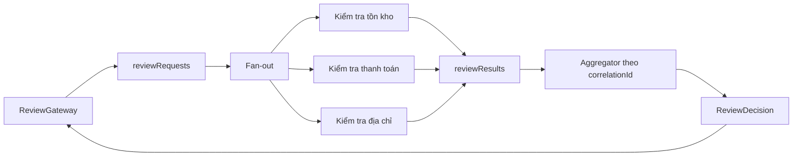

# Fan-out và fan-in

Trong chương **Mô hình message flow** của module **SPRING_INTEGRATION_CORE**, fan-out và fan-in giúp thiết kế một yêu cầu đi qua nhiều nhánh xử lý rồi tạo ra kết quả chung. Đây là nền tảng cho những luồng như kiểm tra đơn hàng, lấy báo giá từ nhiều nhà cung cấp hoặc tổng hợp dữ liệu từ nhiều hệ thống.

Bài học sử dụng `Message`, `MessageChannel`, endpoint, gateway và Java DSL để xây dựng một luồng hoàn chỉnh. Trọng tâm là hợp đồng giữa các nhánh: message nào thuộc cùng yêu cầu, khi nào đủ kết quả, xử lý thế nào khi thiếu một nhánh và ai nhận phản hồi cuối cùng.

## 1. Mục tiêu và kiến thức cần có

Sau bài học, bạn có thể:

- Phân biệt phát một yêu cầu đến nhiều nhánh với chia tải giữa nhiều consumer.
- Chọn `PublishSubscribeChannel`, recipient list hoặc splitter theo hình dạng dữ liệu và tập người nhận.
- Thiết kế fan-in bằng aggregator với correlation, điều kiện release và phép tổng hợp rõ ràng.
- Giữ đúng header khi biến đổi message, đặt timeout ở đúng tầng và xử lý kết quả đến muộn.
- Đọc, triển khai và kiểm thử một luồng Java DSL có các nhánh chạy trên executor.

Bạn nên biết cấu trúc `Message<T>`, payload và header, ý nghĩa của `DirectChannel`, cũng như cách khai báo một `IntegrationFlow`. Ví dụ dùng Java 17 trở lên với Spring Integration Java DSL hiện đại. Khi dùng Spring Boot, để BOM của phiên bản Boot đang sử dụng quản lý các dependency tương thích.

## 2. Fan-out và fan-in mô tả hình dạng nào?

**Fan-out** là đưa một đầu vào đến nhiều nhánh xử lý. Các nhánh có thể nhận cùng dữ liệu hoặc nhận những phần dữ liệu khác nhau, tùy thành phần phân phối.

**Fan-in** là đưa các nhánh về một điểm tiếp nhận chung. Có hai trường hợp cần tách biệt:

1. **Hợp luồng message:** nhiều nhánh gửi vào một channel, nhưng mỗi message vẫn được xử lý riêng.
2. **Gom kết quả theo yêu cầu:** giữ các kết quả liên quan, chờ điều kiện hoàn thành rồi tạo một kết quả tổng hợp. Trường hợp này cần thành phần có trạng thái như aggregator.

Ví dụ kiểm tra đơn hàng:



Channel `reviewResults` chỉ đưa các kết quả đến cùng endpoint. **Aggregator** mới thực hiện việc nhớ kết quả đã đến và quyết định lúc nào phát `ReviewDecision`.

Một hệ thống phát sự kiện `OrderCreated` cho email, analytics và audit chỉ cần fan-out nếu không phải tạo phản hồi chung. Việc ép ba tác vụ này chờ nhau có thể làm tăng phụ thuộc vận hành mà nghiệp vụ không yêu cầu.

## 3. Chọn channel: nhiều subscriber chưa chắc là fan-out

| Thành phần | Một message được chuyển đến đâu? | Vai trò trong bài toán |
| --- | --- | --- |
| `DirectChannel` | Một handler nhận để xử lý trong lần dispatch thành công | Nối các bước hoặc chia tải giữa consumer, không broadcast |
| `ExecutorChannel` | Một handler được dispatch qua executor | Tách thread cho một tuyến xử lý, không tự tạo nhiều bản gửi |
| `QueueChannel` | Message được một consumer lấy khỏi queue | Buffer và competing consumers |
| `PublishSubscribeChannel` | Phát đến các handler đang subscribe | Fan-out đến nhiều nhánh |
| Channel chung phía sau các nhánh | Nhận từng message từ từng nhánh | Hợp luồng đầu vào cho endpoint tiếp theo |
| Aggregator | Nhận và lưu nhiều message liên quan | Gom kết quả thành đầu ra theo chính sách |

Ví dụ, ba service activator cùng subscribe vào một `DirectChannel` không có nghĩa mỗi message đi qua cả ba service. Point-to-point và publish-subscribe là hai hợp đồng phân phối khác nhau. [Tài liệu Message Channel Implementations](https://docs.spring.io/spring-integration/reference/channel/implementations.html).

Cũng cần phân biệt **fan-out về logic** với **chạy song song**. `PublishSubscribeChannel` không có executor mặc định gọi subscriber trên thread gửi. Muốn có khả năng thực thi đồng thời giữa các nhánh, phải cung cấp executor hoặc đặt ranh giới bất đồng bộ thích hợp. Có executor vẫn chưa bảo đảm song song nếu pool chỉ có một worker.

## 4. Những cách triển khai fan-out

### 4.1. Publish-subscribe: cùng yêu cầu cho nhiều nhánh

Dùng `PublishSubscribeChannel` khi nhiều subscriber cần nhận cùng đầu vào. Trong ví dụ đơn hàng, tồn kho, thanh toán và địa chỉ cùng đọc một `ReviewRequest`.

Nếu các nhánh sẽ quay về aggregator dùng chiến lược sequence mặc định, bật `applySequence(true)`. Channel sẽ tạo các `Message` có sequence header riêng, nhưng payload vẫn có thể là cùng tham chiếu đối tượng. Vì thế, payload nên bất biến hoặc được sao chép có chủ đích trước khi nhánh sửa dữ liệu. [Cấu hình PublishSubscribeChannel](https://docs.spring.io/spring-integration/reference/channel/configuration.html).

Không được giả định rằng message mới đồng nghĩa với một bản sao sâu của toàn bộ payload.

### 4.2. Recipient list: chọn tập nhánh theo yêu cầu

Dùng `RecipientListRouter` hoặc DSL `routeToRecipients(...)` khi danh sách người nhận cần thể hiện trực tiếp trong cấu hình, có thể kèm điều kiện chọn từng recipient. Khi dùng sequence để gom kết quả, bật `applySequence(true)` cho router. [Tài liệu RecipientListRouter](https://docs.spring.io/spring-integration/reference/router/implementations.html#recipientlistrouter).

Ví dụ về quyết định thiết kế:

| Đơn hàng | Nhánh được chọn trước khi gửi | Số phản hồi mong đợi |
| --- | --- | --- |
| Giao hàng thông thường | Tồn kho, thanh toán, địa chỉ | 3 |
| Nhận tại cửa hàng | Tồn kho, thanh toán | 2 |
| Hàng số | Thanh toán, kiểm tra quyền truy cập | 2 |

Nếu tập nhánh thay đổi, bộ tổng hợp cũng phải biết tập mong đợi tương ứng. Không thể giữ phép kiểm tra cố định “phải có đủ ba nhánh” cho mọi loại đơn hàng.

### 4.3. Splitter: nhiều phần tử từ một payload

Dùng splitter khi đầu vào là một cấu trúc cần tách thành các phần tử, chẳng hạn một đơn hàng có 20 dòng sản phẩm. Mỗi message con mang một dòng sản phẩm thay vì toàn bộ yêu cầu kiểm tra đơn hàng.

Splitter hỗ trợ thiết lập các header correlation và sequence cho kết quả tách. Với nguồn như `Iterator` không biết trước kích thước, `sequenceSize` có thể bằng `0`; không được mặc định rằng aggregator luôn suy ra được lúc nhận đủ. [Tài liệu Splitter](https://docs.spring.io/spring-integration/reference/splitter.html).

### 4.4. Scatter-gather: đóng gói cả phân phối và gom kết quả

`ScatterGatherHandler` kết hợp bước gửi đến nhiều nơi với aggregator trong một endpoint request-reply. Đây là lựa chọn phù hợp khi thao tác nghiệp vụ là “gửi đi nhiều nơi rồi trả về một câu trả lời”, chẳng hạn chọn báo giá tốt nhất.

Các nhánh thường trả về theo `replyChannel` mà scatter-gather thiết lập, hoặc qua `gatherChannel` được cấu hình riêng. Không tự gắn một output channel tùy ý khiến phản hồi đi ra ngoài bộ gom. [Tài liệu Scatter-Gather](https://docs.spring.io/spring-integration/reference/scatter-gather.html).

Bài này triển khai fan-out và aggregator tách rời để quan sát rõ điểm phân phối, điểm hội tụ và các header truyền qua luồng.

## 5. Hợp đồng để gom đúng kết quả

### 5.1. Ba câu hỏi độc lập

Một aggregator cần trả lời ba câu hỏi:

| Câu hỏi | Thành phần chịu trách nhiệm | Ví dụ |
| --- | --- | --- |
| Kết quả nào thuộc cùng một nhóm? | `CorrelationStrategy` | Cùng `correlationId` |
| Nhóm đã đủ điều kiện phát chưa? | `ReleaseStrategy` | Đã có kết quả từ mọi nhánh cần thiết |
| Tạo đầu ra thế nào? | `MessageGroupProcessor` | Tạo quyết định chấp thuận hoặc từ chối |

Mặc định, correlation dựa vào header `correlationId`; release dựa vào kích thước sequence. Aggregator lưu trạng thái các nhóm trong message store trong lúc chờ. [Tài liệu Aggregator](https://docs.spring.io/spring-integration/reference/aggregator.html).

**Release không có nghĩa nghiệp vụ thành công.** Nếu cả ba nhánh đã trả lời, nhóm có thể được phát dù thanh toán bị từ chối. Kết luận nghiệp vụ do phép tổng hợp quyết định.

### 5.2. Những header cần theo dõi

| Header | Ý nghĩa |
| --- | --- |
| `correlationId` | Khóa để gom những kết quả thuộc cùng một lượt xử lý |
| `sequenceNumber` | Vị trí của message trong sequence được tạo ở điểm phân nhánh |
| `sequenceSize` | Số message kỳ vọng theo sequence đó |
| `replyChannel` | Nơi nhận phản hồi, thường do gateway tạo |
| `errorChannel` | Nơi xử lý lỗi theo cơ chế được cấu hình |

Trong Java, các hằng correlation và sequence nằm ở `IntegrationMessageHeaderAccessor`; `replyChannel` và `errorChannel` thuộc `MessageHeaders`.

Một diễn tiến giả định khi có ba nhánh:

```text
Yêu cầu gốc: message id = M1

inventory -> correlationId=M1, sequenceNumber=1, sequenceSize=3
payment   -> correlationId=M1, sequenceNumber=2, sequenceSize=3
address   -> correlationId=M1, sequenceNumber=3, sequenceSize=3

Thứ tự về aggregator: address -> inventory -> payment
Nhóm M1:                1/3        2/3          3/3 -> phát kết quả
```

`sequenceNumber` thể hiện vị trí ở điểm phân phối, không phải thứ tự hoàn tất. Dùng trường nghiệp vụ `branch` để nhận diện loại kết quả; không viết logic “phần tử đầu tiên luôn là tồn kho”.

### 5.3. Khóa nghiệp vụ và khóa lượt xử lý

Một `orderId` có thể xuất hiện trong nhiều lần kiểm tra: khách sửa địa chỉ, đổi phương thức thanh toán hoặc gửi lại yêu cầu. Vì vậy, chỉ gom theo `orderId` có thể trộn kết quả của các lượt xử lý khác nhau.

Ví dụ trong bài dựa vào correlation do `applySequence(true)` thiết lập từ message đầu vào của mỗi lượt fan-out. Với giao thức tự thiết kế, nên truyền một `requestId` hoặc `reviewAttemptId` riêng, thống nhất chính sách giữ hoặc tạo lại khóa đó khi retry.

Nếu có nhiều tenant, nhiều loại thao tác hoặc nhiều phiên bản quy trình, khóa cũng phải phân biệt được những phạm vi đó. Việc dùng lại một mã đơn hàng không đủ để xác định cùng một nhóm.

### 5.4. Giữ header qua transformer và biên hệ thống

Trong ví dụ bên dưới, transformer trả về payload mới và để endpoint tạo message phản hồi theo cơ chế truyền header của framework. Nếu tự tạo message trong code, cần sao chép header cần thiết, chẳng hạn:

```java
Message<BranchResult> reply = MessageBuilder
        .withPayload(result)
        .copyHeaders(requestMessage.getHeaders())
        .build();
```

Đoạn này dùng `org.springframework.messaging.Message` và `org.springframework.messaging.support.MessageBuilder`; `result` là kết quả nhánh, `requestMessage` là message đầu vào của nhánh. Không sao chép một cách máy móc các header đã lỗi thời nếu đang cố ý mở một lượt correlation mới.

Khi đi qua HTTP hoặc broker, thiết kế ánh xạ correlation, branch, deadline và địa chỉ phản hồi vào giao thức. Một đối tượng `replyChannel` nội bộ không phải địa chỉ có thể mang nguyên trạng sang tiến trình khác.

## 6. Ví dụ Java DSL: ba nhánh kiểm tra đơn hàng

### 6.1. Quy tắc nghiệp vụ và dependency

Luồng nhận một yêu cầu và kiểm tra ba điều kiện độc lập:

- `INVENTORY`: số lượng yêu cầu có trong tồn kho.
- `PAYMENT`: thanh toán đã được cho phép.
- `ADDRESS`: địa chỉ nằm trong vùng hỗ trợ.

Quyết định chỉ chấp thuận khi có đủ ba kết quả và tất cả đều `PASS`. Nếu timeout khiến thiếu nhánh, kết quả phải ghi rõ `complete=false`, `approved=false` và tập `missing`.

Để ví dụ tập trung vào message flow, dữ liệu kiểm tra nằm ngay trong request. Trong ứng dụng thực, thay từng phép kiểm tra bằng lời gọi service tương ứng; không dùng cờ do client gửi làm bằng chứng thanh toán hay tồn kho thực tế.

Dependency tối thiểu là `org.springframework.integration:spring-integration-core`, hoặc `org.springframework.boot:spring-boot-starter-integration` khi dùng Boot. Test minh họa cần JUnit Jupiter và Spring Test; `spring-boot-starter-test` đáp ứng phần này trong ứng dụng Boot. Bài không yêu cầu một module Java DSL tách riêng.

### 6.2. Gateway và kiểu dữ liệu phản hồi

Tệp minh họa `ReviewGateway.java`:

```java
package example.fanout;

import org.springframework.integration.annotation.MessagingGateway;

import example.fanout.ReviewFlowConfig.ReviewDecision;
import example.fanout.ReviewFlowConfig.ReviewRequest;

@MessagingGateway(
        defaultRequestChannel = "reviewRequests",
        defaultReplyTimeout = "3000")
public interface ReviewGateway {

    ReviewDecision review(ReviewRequest request);
}
```

Gateway cho bên gọi một API Java thông thường. Phản hồi được gửi về temporary reply channel gắn trong header; ví dụ không cần khai báo một reply channel dùng chung cho tất cả người gọi. [Tài liệu Messaging Gateways](https://docs.spring.io/spring-integration/reference/gateway.html).

### 6.3. Cấu hình các nhánh và aggregator

Tệp minh họa `ReviewFlowConfig.java`:

```java
package example.fanout;

import java.util.EnumMap;
import java.util.EnumSet;
import java.util.Map;
import java.util.Objects;
import java.util.Set;
import java.util.logging.Logger;

import org.springframework.context.annotation.Bean;
import org.springframework.context.annotation.Configuration;
import org.springframework.integration.config.EnableIntegration;
import org.springframework.integration.annotation.IntegrationComponentScan;
import org.springframework.integration.dsl.IntegrationFlow;
import org.springframework.integration.store.MessageGroup;
import org.springframework.messaging.Message;
import org.springframework.scheduling.concurrent.ThreadPoolTaskExecutor;

@Configuration
@EnableIntegration
@IntegrationComponentScan(basePackageClasses = ReviewGateway.class)
public class ReviewFlowConfig {

    private static final Logger LOGGER =
            Logger.getLogger(ReviewFlowConfig.class.getName());

    public enum Branch {
        INVENTORY, PAYMENT, ADDRESS
    }

    public enum Status {
        PASS, FAIL, ERROR
    }

    public record ReviewRequest(
            String orderId,
            int quantity,
            int availableQuantity,
            boolean paymentAuthorized,
            boolean addressSupported) {

        public ReviewRequest {
            Objects.requireNonNull(orderId, "orderId");
            if (quantity <= 0 || availableQuantity < 0) {
                throw new IllegalArgumentException("Invalid quantity");
            }
        }
    }

    public record BranchResult(
            String orderId,
            Branch branch,
            Status status) {
    }

    public record ReviewDecision(
            String orderId,
            boolean complete,
            boolean approved,
            Map<Branch, BranchResult> results,
            Set<Branch> missing) {

        public ReviewDecision {
            results = Map.copyOf(results);
            missing = Set.copyOf(missing);
        }
    }

    @Bean
    public ThreadPoolTaskExecutor reviewExecutor() {
        ThreadPoolTaskExecutor executor = new ThreadPoolTaskExecutor();
        executor.setCorePoolSize(3);
        executor.setMaxPoolSize(3);
        executor.setQueueCapacity(100);
        executor.setThreadNamePrefix("review-");
        return executor;
    }

    @Bean
    public IntegrationFlow reviewFanOutFlow(
            ThreadPoolTaskExecutor reviewExecutor) {

        return IntegrationFlow.from("reviewRequests")
                .publishSubscribeChannel(reviewExecutor, subscribers -> subscribers
                        .applySequence(true)
                        .subscribe(flow -> flow
                                .transform(ReviewRequest.class, request -> result(
                                        request,
                                        Branch.INVENTORY,
                                        request.availableQuantity()
                                                >= request.quantity()))
                                .channel("reviewResults"))
                        .subscribe(flow -> flow
                                .transform(ReviewRequest.class, request -> result(
                                        request,
                                        Branch.PAYMENT,
                                        request.paymentAuthorized()))
                                .channel("reviewResults"))
                        .subscribe(flow -> flow
                                .transform(ReviewRequest.class, request -> result(
                                        request,
                                        Branch.ADDRESS,
                                        request.addressSupported()))
                                .channel("reviewResults")))
                .get();
    }

    @Bean
    public IntegrationFlow reviewFanInFlow() {
        return IntegrationFlow.from("reviewResults")
                .aggregate(aggregator -> aggregator
                        .outputProcessor(ReviewFlowConfig::decide)
                        .groupTimeout(2_000L)
                        .sendPartialResultOnExpiry(true)
                        .expireGroupsUponCompletion(false)
                        .expireGroupsUponTimeout(false)
                        .minimumTimeoutForEmptyGroups(60_000L)
                        .discardChannel("reviewDiscards"))
                .get();
    }

    @Bean
    public IntegrationFlow reviewDiscardFlow() {
        return IntegrationFlow.from("reviewDiscards")
                .handle(message -> LOGGER.warning(
                        "Discarded review result; messageId="
                                + message.getHeaders().getId()))
                .get();
    }

    private static BranchResult result(
            ReviewRequest request, Branch branch, boolean passed) {
        return new BranchResult(
                request.orderId(), branch, passed ? Status.PASS : Status.FAIL);
    }

    private static ReviewDecision decide(MessageGroup group) {
        Map<Branch, BranchResult> results = new EnumMap<>(Branch.class);
        String orderId = null;

        for (Message<?> message : group.getMessages()) {
            BranchResult result = (BranchResult) message.getPayload();
            if (orderId == null) {
                orderId = result.orderId();
            } else if (!orderId.equals(result.orderId())) {
                throw new IllegalStateException("Mixed orders in one group");
            }
            if (results.putIfAbsent(result.branch(), result) != null) {
                throw new IllegalStateException("Duplicate branch result");
            }
        }

        Set<Branch> missing = EnumSet.allOf(Branch.class);
        missing.removeAll(results.keySet());

        boolean complete = missing.isEmpty();
        boolean approved = complete && results.values().stream()
                .allMatch(result -> result.status() == Status.PASS);

        return new ReviewDecision(
                orderId, complete, approved, results, missing);
    }
}
```

`reviewRequests`, `reviewResults` và `reviewDiscards` được DSL đăng ký thành channel khi cần; không cần poller cho các tuyến subscribable này. `ThreadPoolTaskExecutor` là bean do Spring quản lý vòng đời, vì vậy không gọi `initialize()` thủ công trong phương thức `@Bean`.

Đây là ví dụ trong cùng một tiến trình. Nó dùng message store mặc định trong bộ nhớ, tập nhánh cố định và hợp đồng mỗi nhánh phát tối đa một kết quả. `Status.ERROR` được dành cho phần mở rộng xử lý lỗi ở mục 9; ba phép kiểm tra thuần trong ví dụ chỉ tạo `PASS` hoặc `FAIL`.

### 6.4. Đọc luồng từng bước

1. Gateway tạo message từ `ReviewRequest` và gắn địa chỉ phản hồi cho lượt gọi.
2. Điểm publish-subscribe thêm sequence header và dispatch ba subflow qua executor.
3. Mỗi transformer tạo một `BranchResult` bất biến rồi gửi vào `reviewResults`.
4. Aggregator gom theo correlation mặc định. Với ba phản hồi hợp lệ, sequence cho biết nhóm đã đủ để release.
5. `decide(...)` tạo map theo loại nhánh, tính tập còn thiếu và quyết định nghiệp vụ.
6. Đầu ra aggregator trở về `replyChannel` của gateway; caller nhận một `ReviewDecision`.
7. Nếu nhóm đang thiếu phản hồi và hết thời gian chờ của nhóm, cấu hình cho phép tổng hợp phần đã nhận. Đầu ra vẫn thể hiện rõ trạng thái chưa đầy đủ.

Việc kết thúc `reviewFanOutFlow` ngay sau publish-subscribe là có chủ đích: chỉ ba subflow đã khai báo tham gia fan-out. Khi nối tiếp DSL sau điểm publish-subscribe, phải đọc kỹ topology vì phần tiếp diễn có thể trở thành một subscriber nữa và làm thay đổi số message kỳ vọng.

### 6.5. Kết quả minh họa

Với request:

```java
ReviewRequest request = new ReviewRequest(
        "ORDER-42", 2, 10, true, true);
ReviewDecision decision = reviewGateway.review(request);
```

Đầu ra có ý nghĩa:

```text
orderId = ORDER-42
complete = true
approved = true
results.keys = {INVENTORY, PAYMENT, ADDRESS}
missing = {}
```

Nếu `paymentAuthorized=false`, đầu ra vẫn có `complete=true`, nhưng `approved=false` và kết quả `PAYMENT` là `FAIL`. Hoàn tất việc thu thập và chấp thuận nghiệp vụ là hai thuộc tính riêng.

Nếu chỉ nhận được kết quả từ tồn kho và địa chỉ trước khi nhóm timeout, đầu ra có `complete=false`, `approved=false`, `missing={PAYMENT}`. Ví dụ không tự tạo một kết quả thanh toán giả để lấp phần còn thiếu.

Các phương thức DSL cho phép cấu hình bộ xử lý đầu ra và chính sách nhóm được mô tả tại [AggregatorSpec](https://docs.spring.io/spring-integration/api/org/springframework/integration/dsl/AggregatorSpec.html) và [CorrelationHandlerSpec](https://docs.spring.io/spring-integration/api/org/springframework/integration/dsl/CorrelationHandlerSpec.html).

## 7. Điều kiện release phải khớp hợp đồng nhánh

### 7.1. Chọn chính sách theo nghiệp vụ

| Chính sách | Khi nào có thể release? | Điều phải quyết định trước |
| --- | --- | --- |
| Chờ tất cả | Đủ tập nhánh mong đợi | Nhánh lỗi có trả một kết quả trạng thái không? |
| Chờ quorum | Có đủ số nhánh khác nhau theo ngưỡng | Ngưỡng đó có thực sự cho phép ra quyết định không? |
| Thành công đầu tiên | Có kết quả thành công phù hợp | Các nhánh còn chạy được xử lý và hủy thế nào? |
| Kết quả một phần | Đến deadline hoặc điều kiện dừng | Đầu ra biểu diễn phần còn thiếu ra sao? |
| Chờ tập nhánh bắt buộc | Đủ các nhánh quan trọng | Kết quả tùy chọn đến sau có được cập nhật không? |

Trong kiểm tra đơn hàng, quorum hai trên ba không đủ để chấp thuận nếu thanh toán là điều kiện bắt buộc. Trong chọn báo giá, một báo giá hợp lệ có thể đủ để trả về, tùy hợp đồng dịch vụ.

### 7.2. Đếm message không tương đương đếm nhánh

Với ba nhánh, điều kiện `group.size() == 3` chỉ an toàn khi mỗi nhánh chắc chắn gửi đúng một phản hồi, không có duplicate và tập nhánh không thay đổi. Chiến lược `SimpleSequenceSizeReleaseStrategy` đếm kích thước nhóm theo sequence size và không tự kiểm tra trùng sequence number. [API SimpleSequenceSizeReleaseStrategy](https://docs.spring.io/spring-integration/api/org/springframework/integration/aggregator/SimpleSequenceSizeReleaseStrategy.html).

Một tình huống nguy hiểm:

```text
Nhận: INVENTORY, INVENTORY do retry, ADDRESS
Tổng message: 3
Tổng nhánh khác nhau: 2
Thiếu: PAYMENT
```

Ví dụ `decide(...)` chủ động từ chối duplicate như một vi phạm giao thức. Đây không phải cơ chế deduplication để xử lý hệ thống có delivery lặp bình thường.

Nếu cho phép duplicate, cần xử lý idempotency trước aggregator hoặc thay cả điều kiện release lẫn quy tắc tổng hợp. Chẳng hạn, release dựa trên tập nhánh:

```java
.releaseStrategy(group -> {
    Set<Branch> received = EnumSet.noneOf(Branch.class);
    for (Message<?> message : group.getMessages()) {
        BranchResult result = (BranchResult) message.getPayload();
        received.add(result.branch());
    }
    return received.containsAll(EnumSet.allOf(Branch.class));
})
```

Đây là cấu hình thay thế cho phần release, sử dụng các kiểu từ ví dụ trước. Nếu áp dụng, phải sửa `decide(...)` để xử lý duplicate theo chính sách đã chọn; chỉ thêm `releaseStrategy` không làm code tự trở thành idempotent. Khi hai phản hồi cùng nhánh mâu thuẫn, cần quyết định giữ phản hồi đầu, chọn phiên bản mới hơn hay coi đó là lỗi dữ liệu.

Với tập nhánh động, thay `EnumSet.allOf(...)` bằng tập mong đợi được xác định cho chính lượt yêu cầu đó. Nên xác định tập này ở điểm fan-out, thay vì đoán từ các phản hồi đã đến.

## 8. Timeout: chờ ở tầng nào, tính từ lúc nào?

### 8.1. Các loại timeout khác nhau

| Loại timeout | Kiểm soát điều gì? | Không tự thực hiện điều gì? |
| --- | --- | --- |
| Timeout client của nhánh | Chờ kết nối, đọc hoặc xử lý lời gọi ra ngoài | Gom các phản hồi đã có |
| Timeout khi send vào channel | Chờ tiếp nhận khi channel có giới hạn thích hợp | Chờ tất cả handler hoàn thành |
| `groupTimeout` của aggregator | Ép xử lý nhóm đang thiếu sau thời gian chờ của nhóm | Hủy lời gọi I/O đang chạy |
| `gatherTimeout` của scatter-gather | Thời gian endpoint chờ kết quả gom | Tự định nghĩa quorum hay nghiệp vụ thành công |
| Reply timeout của gateway | Thời gian chờ phản hồi sau khi có thể quay về bước đợi | Dọn nhóm aggregator hoặc rollback các nhánh |

Không dùng một con số timeout duy nhất rồi coi mọi tài nguyên đều đã được giải phóng. Quy trình cần cả giới hạn chờ cho caller, chính sách kết thúc nhóm và giới hạn thực thi cho từng tác vụ.

### 8.2. `groupTimeout(2_000L)` trong ví dụ

Hằng `groupTimeout` được dùng như khoảng chờ không có message mới của nhóm. Khi nhận thêm một message mà vẫn chưa đủ điều kiện release, lịch timeout được tính lại. Vì thế, nó không nhất thiết là deadline hai giây tính từ lúc gateway nhận yêu cầu.

Ví dụ suy luận:

```text
0 ms:    yêu cầu đi vào fan-out
100 ms:  INVENTORY về -> lên lịch timeout khoảng 2100 ms
900 ms:  ADDRESS về   -> lên lịch lại khoảng 2900 ms
PAYMENT không về     -> nhóm có thể phát một phần khoảng 2900 ms
```

Thời điểm thực tế còn phụ thuộc scheduler và tải hệ thống. Cách lên lịch theo nhóm, xử lý phần kết quả đã có và vòng đời sau timeout được mô tả trong [Aggregator — Group Timeout](https://docs.spring.io/spring-integration/reference/aggregator.html#aggregator-and-group-timeout).

Nếu yêu cầu deadline tuyệt đối, xác định một mốc như `deadlineEpochMs` từ đầu quy trình và dùng nó xuyên suốt các nhánh. API timeout theo hàm có thể trả `Date` để biểu diễn thời điểm hết hạn, thay vì liên tục cộng lại một khoảng chờ. Không nhầm thời điểm tạo nhóm ở aggregator với thời điểm bắt đầu toàn bộ yêu cầu. [API groupTimeout](https://docs.spring.io/spring-integration/api/org/springframework/integration/dsl/CorrelationHandlerSpec.html#groupTimeout(java.util.function.Function)).

**Không có phản hồi nào cũng là một trường hợp riêng:** nếu chưa có message nào đến aggregator, chưa có nhóm để `groupTimeout` xử lý. Gateway vẫn cần timeout của riêng nó, và một hệ thống cần phản hồi timeout nghiệp vụ chắc chắn có thể phải ghi nhận yêu cầu ngay từ đầu bằng cơ chế điều phối thích hợp.

### 8.3. Reply timeout không phải cơ chế ngắt mọi code phía sau

Ở luồng hoàn toàn đồng bộ, caller có thể còn đang chạy bên trong một service chậm; cấu hình reply timeout không tự ngắt service đó. Trong ví dụ, executor tạo ranh giới để thread gọi có thể quay về gateway chờ phản hồi.

Khi chờ phản hồi hết hạn, gateway có thể trả `null` theo cấu hình mặc định của thao tác nhận; không được mặc định lúc nào cũng có `ReviewDecision`. Cần chọn hợp đồng cho caller, ví dụ xử lý `null` hoặc cấu hình báo lỗi timeout theo API của phiên bản đang dùng. [Gateway Behavior When No Response Arrives](https://docs.spring.io/spring-integration/reference/gateway.html#gateway-behavior-no-response).

Con số 3000 ms của gateway và 2000 ms của nhóm trong ví dụ chỉ minh họa hai tầng khác nhau. Chúng không chứng minh rằng mọi partial result sẽ đến trước hạn gateway, vì nhóm có thể được tạo muộn hoặc timeout được lên lịch lại. Với SLA thực, phải có một ngân sách tính cả thời gian queue, I/O, gom kết quả và gửi phản hồi.

### 8.4. Hoàn tất nhóm, giữ dấu vết và phản hồi đến muộn

Ví dụ cấu hình:

```text
expireGroupsUponCompletion(false)
expireGroupsUponTimeout(false)
minimumTimeoutForEmptyGroups(60000)
```

Mục đích là giữ dấu vết nhóm đã hoàn tất trong một khoảng thời gian để phản hồi muộn không tạo ngay một lượt gom mới. `reviewDiscards` tiếp nhận các message bị loại trong cửa sổ này. Sau khi dấu vết được dọn, một message dùng lại correlation cũ có thể mở nhóm mới; thời gian giữ 60 giây là lựa chọn minh họa, cần điều chỉnh theo độ trễ và retry thực tế.

Nếu chọn xóa hoàn toàn nhóm ngay khi hoàn tất, phải chấp nhận hoặc ngăn việc message đến muộn tạo nhóm mới. Nếu giữ dấu vết vô thời hạn, bộ nhớ hoặc store tiếp tục tăng. Cần thiết kế cả hai phía: thời gian chống phản hồi muộn và chính sách dọn trạng thái. [API quản lý vòng đời nhóm](https://docs.spring.io/spring-integration/api/org/springframework/integration/aggregator/AbstractCorrelatingMessageHandler.html).

## 9. Nhánh bị lỗi hoặc không phát phản hồi

### 9.1. Filter có thể làm nhóm không đủ

Giả sử `applySequence` tạo sequence size bằng 3, nhưng một filter trong nhánh địa chỉ loại message và không tạo phản hồi thay thế. Aggregator chỉ nhận tối đa hai message; việc hai nhánh kia thành công không khiến nhóm tự đủ.

Có hai thiết kế phù hợp, tùy nghĩa nghiệp vụ:

- Nếu nhánh không áp dụng, xác định điều này trước khi fan-out và loại nhánh khỏi tập mong đợi.
- Nếu nhánh đã tham gia, trả một kết quả có trạng thái rõ ràng như `NOT_APPLICABLE`, `FAIL` hoặc `ERROR`, theo hợp đồng của nhóm.

Không hạ số lượng kỳ vọng chỉ để che một nhánh đánh rơi message.

### 9.2. Exception và kết quả nghiệp vụ là hai đường đi

Trong luồng cùng thread, exception thường truyền theo call stack. Khi tác vụ xử lý chạy trên executor, framework hỗ trợ chuyển lỗi thành `ErrorMessage` đến error channel thích hợp. Chỉ đặt `try/catch` quanh `send(...)` không đủ để thu mọi lỗi phát sinh sau khi dispatch bất đồng bộ. [Tài liệu Error Handling](https://docs.spring.io/spring-integration/reference/error-handling.html).

Một error flow ghi log lỗi không tự tạo ra `BranchResult` mà aggregator đang chờ. Phải chọn rõ một trong các chính sách:

1. **Dừng yêu cầu bằng lỗi:** chuyển lỗi về bên gọi theo hợp đồng gateway và dọn trạng thái nhóm còn dang dở.
2. **Thu thập trạng thái từng nhánh:** chuyển những lỗi đã được phân loại thành `BranchResult(ERROR)` rồi gửi về fan-in, giữ correlation và nhận diện nhánh.
3. **Tiếp tục với kết quả thiếu:** để chính sách timeout tạo phản hồi chưa đầy đủ, đồng thời ghi nhận lỗi nhánh để vận hành có thể truy vết.

Trong hướng thứ hai, chỉ chuyển những lỗi hạ tầng hoặc nghiệp vụ mà hợp đồng đã cho phép; không bắt toàn bộ `Throwable` rồi biến lỗi lập trình thành phản hồi thành công. Một kết quả `ERROR` có thể làm nhóm đủ phản hồi, nhưng vẫn phải dẫn đến `approved=false` trong ví dụ đơn hàng.

Retry nên có giới hạn và nằm trong ngân sách thời gian của nhánh. Sau khi nhóm đã trả kết quả cuối, retry còn chạy không có nghĩa kết quả của nó được ghép trở lại quyết định cũ.

### 9.3. Các nhánh có tác động bên ngoài

Không nên coi fan-out là một giao dịch nguyên tử bao trùm mọi nhánh. Ví dụ, giữ hàng có thể thành công trong khi thu tiền lỗi; một lần timeout của caller cũng không tự hoàn tác lần giữ hàng đó.

Nếu cần thay đổi trạng thái bên ngoài, thiết kế idempotency cho từng thao tác, ghi nhận tiến trình và quy tắc bù trừ hoặc khôi phục. Với một tác vụ chỉ kiểm tra dữ liệu, ưu tiên để các nhánh không có side effect sẽ giúp hợp đồng dễ hiểu hơn.

## 10. Thứ tự, sequence lồng nhau và kết quả lặp

### 10.1. Không dùng thứ tự đến làm thứ tự nghiệp vụ

Một nhánh nhanh thường về trước nhưng không có bảo đảm rằng lần gọi sau vẫn giữ thứ tự ấy. Map theo `Branch` trong ví dụ giúp thuật toán không phụ thuộc thứ tự.

Nếu cần giữ từng message và phát chúng theo `sequenceNumber`, cân nhắc resequencer. Resequencer sắp thứ tự các message, trong khi aggregator tạo kết quả tổng hợp. [Tài liệu Resequencer](https://docs.spring.io/spring-integration/reference/resequencer.html).

### 10.2. Fan-out có thể lồng trong split-aggregate

Ví dụ một batch có nhiều đơn hàng, mỗi đơn lại có ba nhánh kiểm tra:

```text
Batch
  -> Splitter theo đơn hàng                    [sequence bên ngoài]
     -> Fan-out tồn kho, thanh toán, địa chỉ    [sequence bên trong]
        -> Aggregator cho một đơn hàng
     -> Aggregator cho toàn bộ batch
```

Hai cấp sequence biểu diễn hai hợp đồng khác nhau. Bộ gom bên trong phải kết thúc đúng cấp để bộ gom bên ngoài còn nhận diện được từng phần của batch.

Framework có cơ chế sequence details và thao tác pop sequence cho các thành phần chuẩn; thuộc tính `popSequence` kiểm soát phần xử lý tương ứng. Không tự xóa mọi header correlation và sequence ngay khi gom xong cấp trong. [API popSequence](https://docs.spring.io/spring-integration/api/org/springframework/integration/aggregator/AbstractCorrelatingMessageHandler.html#setPopSequence(boolean)).

Nếu tự xây message hoặc dùng correlation riêng ở mỗi tầng, viết rõ sơ đồ các khóa trước khi cấu hình. Dùng một `orderId` duy nhất cho cả batch lẫn các nhánh sẽ làm mất sự phân cấp này.

### 10.3. Correlation không thay thế idempotency

Correlation xác định nhóm; idempotency xác định hai lần nhận có đại diện cùng một tác vụ hay cùng một kết quả không.

Một khóa deduplication có thể gồm `reviewAttemptId + branch`, kèm phiên bản kết quả nếu nghiệp vụ cho phép cập nhật. Việc có cùng `correlationId` không tự biến hai message thành một, và việc aggregator chỉ phát một lần không bảo đảm side effect của từng nhánh chỉ xảy ra một lần.

Nếu retry cả yêu cầu nhưng tái sử dụng cùng correlation trong khi nhóm cũ còn được đánh dấu hoàn tất, các phản hồi mới có thể bị xem là đến muộn. Phải phân biệt retry cùng một attempt với một lần đánh giá nghiệp vụ mới.

## 11. Hiệu năng, bộ nhớ và ranh giới giao dịch

### 11.1. Ước lượng thời gian xử lý

Với ba nhánh độc lập, đủ worker và bỏ qua thời gian xếp hàng:

```text
Fan-out cùng thread:
T xấp xỉ T_inventory + T_payment + T_address + T_aggregate

Fan-out có khả năng chạy đồng thời:
T xấp xỉ max(T_inventory, T_payment, T_address) + T_aggregate
```

Đây là mô hình ước lượng, không phải cam kết của framework. Nếu cả ba nhánh cùng chờ một connection pool cạn, chạy trên executor vẫn có thể chậm hơn dự kiến.

### 11.2. Giới hạn số task và số nhóm đang mở

Mỗi yêu cầu ba nhánh có thể tạo ba task. Với 200 yêu cầu/giây, điểm fan-out có thể tạo khoảng 600 task/giây trước retry. Trong ví dụ, queue capacity của executor được tính theo task, không phải theo số đơn hàng.

Nếu một request bị từ chối khi enqueue một nhánh, các nhánh đã được nhận trước đó vẫn có thể tiếp tục. Cần định nghĩa chính sách quá tải cùng với phản hồi cho caller và xử lý nhóm thiếu, thay vì coi enqueue là thao tác nguyên tử cho cả ba nhánh.

Một ước lượng cho trạng thái đang mở là:

```text
Số nhóm đang mở xấp xỉ tốc độ yêu cầu vào x thời gian nhóm tồn tại trung bình
```

Ví dụ, 200 yêu cầu/giây và thời gian tồn tại trung bình 0,3 giây cho khoảng 60 nhóm đang mở. Khi nhánh treo kéo thời gian này lên 5 giây, con số có thể thành khoảng 1000 nhóm, chưa tính dấu vết nhóm hoàn tất và task trong queue.

Theo dõi số nhóm đang mở, tuổi nhóm lâu nhất, kết quả thiếu theo nhánh, tỷ lệ discard, timeout gateway và tình trạng executor. Đưa request ID vào log hoặc trace để truy vết; tránh dùng mỗi request ID làm nhãn metric có số giá trị quá lớn.

### 11.3. Lưu trạng thái và chạy nhiều instance

Message store trong bộ nhớ phù hợp để học và minh họa, nhưng mất trạng thái khi tiến trình dừng. Nếu phải phục hồi các nhóm sau restart, chọn persistent `MessageGroupStore` phù hợp và thiết kế cách nhận lại phản hồi. [Tài liệu Message Store](https://docs.spring.io/spring-integration/reference/message-store.html).

Lưu nhóm bền vững không làm temporary reply channel của một lời gọi Java sống lại sau restart. Với quy trình dài cần phục hồi, thường phải có một địa chỉ phản hồi bền vững, nơi lưu kết quả hoặc cơ chế truy vấn trạng thái.

Khi nhiều instance cùng tham gia, cần bảo đảm phản hồi cùng correlation đến bộ gom phù hợp; nếu dùng store chung, còn phải phối hợp lock, transaction và việc expire nhóm. Chỉ đổi implementation của store chưa đủ để kết luận toàn bộ luồng đã có bảo đảm xử lý đúng một lần.

### 11.4. Transaction không tự truyền qua executor

Transaction gắn với thread gửi không mặc nhiên đi theo các tác vụ trên executor. Nếu một nhánh cần transaction cơ sở dữ liệu, đặt ranh giới transaction phù hợp tại chính nhánh đó; các nhánh có thể commit độc lập. [ExecutorChannel và ranh giới thread](https://docs.spring.io/spring-integration/reference/channel/configuration.html#executorchannel).

Vì thế, không suy luận “gateway trả lỗi thì tất cả nhánh đều rollback”. Nếu cần tính nhất quán giữa các hệ thống, đó là một yêu cầu điều phối bổ sung cần được mô hình hóa riêng.

## 12. Kiểm thử những hành vi quyết định tính đúng

### 12.1. Test thành công và từ chối nghiệp vụ

Tệp test minh họa dùng các kiểu đã khai báo trong cấu hình:

```java
package example.fanout;

import org.junit.jupiter.api.Test;
import org.springframework.beans.factory.annotation.Autowired;
import org.springframework.test.context.junit.jupiter.SpringJUnitConfig;

import example.fanout.ReviewFlowConfig.Branch;
import example.fanout.ReviewFlowConfig.ReviewDecision;
import example.fanout.ReviewFlowConfig.ReviewRequest;
import example.fanout.ReviewFlowConfig.Status;

import static org.junit.jupiter.api.Assertions.assertEquals;
import static org.junit.jupiter.api.Assertions.assertFalse;
import static org.junit.jupiter.api.Assertions.assertNotNull;
import static org.junit.jupiter.api.Assertions.assertTrue;

@SpringJUnitConfig(ReviewFlowConfig.class)
class ReviewFlowTest {

    @Autowired
    ReviewGateway gateway;

    @Test
    void approvesOnlyWhenAllChecksPass() {
        ReviewDecision decision = gateway.review(
                new ReviewRequest("ORDER-42", 2, 10, true, true));

        assertNotNull(decision);
        assertEquals("ORDER-42", decision.orderId());
        assertTrue(decision.complete());
        assertTrue(decision.approved());
        assertEquals(3, decision.results().size());
        assertTrue(decision.missing().isEmpty());
    }

    @Test
    void completedCollectionCanStillRejectTheOrder() {
        ReviewDecision decision = gateway.review(
                new ReviewRequest("ORDER-43", 2, 10, false, true));

        assertNotNull(decision);
        assertTrue(decision.complete());
        assertFalse(decision.approved());
        assertEquals(Status.FAIL,
                decision.results().get(Branch.PAYMENT).status());
    }
}
```

Các test này kiểm tra hợp đồng đầu ra, không kiểm tra một thứ tự hoàn tất cố định giữa các nhánh. Spring Integration cũng cung cấp các công cụ thay thế handler và kiểm thử luồng khi cần tách hệ thống bên ngoài khỏi test. [Testing Support](https://docs.spring.io/spring-integration/reference/testing.html).

### 12.2. Các tình huống cần thêm khi đưa luồng vào ứng dụng

| Tình huống | Cách tạo điều kiện kiểm thử | Điều cần xác nhận |
| --- | --- | --- |
| Kết quả đảo thứ tự | Điều khiển nhánh bằng latch hoặc các channel test | Quyết định không đổi theo thứ tự đến |
| Hai lượt kiểm tra cùng `orderId` | Gửi hai yêu cầu có dữ liệu khác nhau đồng thời | Không trộn map kết quả hoặc reply giữa hai caller |
| Thiếu một nhánh | Stub một nhánh không phát kết quả | Có kết quả một phần với đúng `missing`, nếu hợp đồng chọn partial |
| Không nhánh nào phản hồi | Chặn mọi phản hồi trước aggregator | Caller kết thúc theo timeout; không trông chờ group timeout chưa tồn tại |
| Duplicate cùng nhánh | Gửi hai phản hồi cùng branch | Bị từ chối hoặc deduplicate đúng chính sách |
| Phản hồi đến sau khi nhóm đóng | Gửi kết quả sau thời điểm release trong cửa sổ giữ dấu vết | Đi vào discard, không tạo quyết định thứ hai |
| Executor quá tải | Giới hạn pool và queue trong cấu hình test | Chính sách từ chối được thể hiện rõ, không treo caller |
| Lỗi nhánh | Stub trả lỗi đã phân loại hoặc ném exception | Đúng error flow hoặc đúng `BranchResult(ERROR)` |

Với test bất đồng bộ, dùng timeout hữu hạn cho thao tác chờ và điều khiển quan hệ trước/sau bằng latch hoặc message. Không kết luận tính đúng chỉ từ một lần `Thread.sleep(...)` rồi đo thời gian tuyệt đối.

Các đoạn test trong bài là mã hướng dẫn; chúng không phải báo cáo đã biên dịch hoặc chạy trong repository.

## 13. Những lỗi thiết kế thường gặp

| Hiện tượng | Nguyên nhân thường gặp | Hướng xử lý |
| --- | --- | --- |
| Chỉ một nhánh xử lý mỗi request | Dùng point-to-point thay cho broadcast | Chọn publish-subscribe hoặc recipient list |
| Các nhánh không chạy đồng thời | Fan-out vẫn dùng thread gửi hoặc pool quá nhỏ | Xác định ranh giới executor và năng lực thực tế |
| Aggregator chờ mãi | Sai correlation, mất header hoặc thiếu phản hồi | Kiểm tra hợp đồng header và đường đi từng nhánh |
| Nhóm bị trộn nhiều lượt đánh giá | Correlation chỉ dùng mã đơn hàng | Thêm khóa riêng cho từng lượt xử lý |
| Chấp thuận khi chưa kiểm tra thanh toán | Đếm message thay vì nhận diện nhánh | Dùng tập nhánh mong đợi và chính sách duplicate |
| Caller timeout nhưng tài nguyên vẫn tăng | Chỉ cấu hình timeout gateway | Bổ sung giới hạn nhánh, kết thúc nhóm và dọn trạng thái |
| Có quyết định thứ hai từ phản hồi muộn | Xóa trạng thái nhóm quá sớm | Giữ dấu vết đủ lâu và xử lý late reply |
| Dữ liệu bị sửa chéo giữa các nhánh | Các message dùng chung payload mutable | Dùng payload bất biến hoặc sao chép có chủ đích |
| Một lỗi không tạo được phản hồi tổng hợp | Error flow chỉ ghi log | Chọn rõ dừng bằng lỗi, trả trạng thái lỗi hay trả partial |

## 14. Thực hành mở rộng

Bắt đầu từ ví dụ ba nhánh và mở rộng theo thứ tự sau:

1. Thay phần thanh toán bằng service giả có thể trả `PASS`, `FAIL` và lỗi hạ tầng đã phân loại. Biểu diễn lỗi được phép thu thập bằng `Status.ERROR` và giữ đúng correlation.
2. Tạo một biến thể nhận hàng tại cửa hàng với tập nhánh mong đợi chỉ gồm tồn kho và thanh toán. Điều chỉnh cả fan-out và phép tính `missing`.
3. Dùng channel hoặc latch trong test để làm một nhánh không trả lời, rồi kiểm tra phản hồi một phần và đường discard khi phản hồi ấy đến muộn.
4. Thêm định danh attempt và cơ chế deduplication cho phản hồi cùng nhánh, sau đó kiểm tra hai request cùng mã đơn hàng chạy đồng thời.
5. Xác định deadline tuyệt đối từ lúc tiếp nhận yêu cầu; tính ngân sách cho queue, client timeout, tổng hợp và trả phản hồi thay vì chỉ tăng timeout gateway.

Kết quả cần thể hiện được bốn trường hợp riêng: đủ phản hồi và chấp thuận, đủ phản hồi và từ chối, chưa đủ phản hồi, và lỗi theo hợp đồng. Khi từng trường hợp có một đường đi rõ ràng, topology fan-out/fan-in mới diễn tả đầy đủ hành vi mà bên gọi có thể trông đợi.
