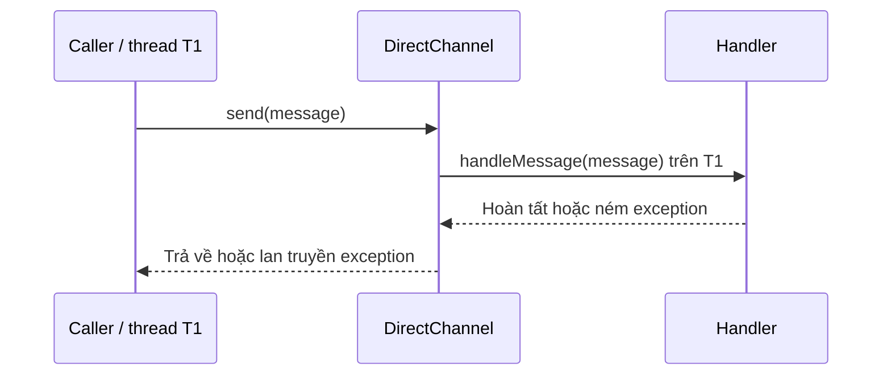
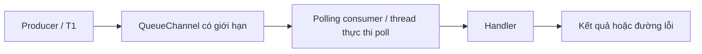
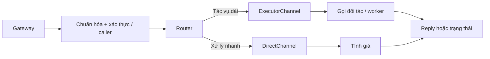

# Synchronous và asynchronous flow

## 1. Mục tiêu và bối cảnh

Trong chương **Mô hình message flow** của module **SPRING_INTEGRATION_CORE**, bài học này giải thích cách thông điệp đi qua các endpoint khi xử lý đồng bộ và bất đồng bộ. Trọng tâm là mối quan hệ giữa `Message`, `MessageChannel`, thread thực thi và hợp đồng trả kết quả cho bên gọi.

Sau bài học, bạn có thể:

- Đánh dấu các đoạn chạy cùng thread và vị trí bàn giao công việc trong một flow Java DSL.
- Chọn `DirectChannel`, `ExecutorChannel` hoặc `QueueChannel` theo yêu cầu xử lý.
- Phân biệt việc gửi thành công, nhận phản hồi và hoàn thành nghiệp vụ.
- Thiết kế đường trả kết quả, đường lỗi, timeout và giới hạn tải qua ranh giới bất đồng bộ.
- Kiểm chứng mô hình thực thi bằng kiểm thử có đồng bộ hóa rõ ràng.

Ví dụ xuyên suốt là tiếp nhận một yêu cầu xử lý đơn hàng: chuẩn hóa dữ liệu, xác thực, thực hiện nghiệp vụ và ghi nhận kết quả. Transformer, filter, router và aggregator đều chịu ảnh hưởng của mô hình thực thi này, dù mỗi endpoint thực hiện một chức năng khác nhau.

## 2. Ba câu hỏi cần tách riêng

Khi nói một flow “đồng bộ” hoặc “bất đồng bộ”, hãy xác định rõ đang nói về điều gì.

| Khía cạnh | Câu hỏi cần trả lời | Ví dụ |
|---|---|---|
| Thread thực thi | Handler chạy trên thread của bên gửi hay được bàn giao sang thread khác? | `DirectChannel` so với `ExecutorChannel` dùng thread pool |
| Hợp đồng lời gọi | Caller cần kết quả ngay trong lời gọi, nhận kết quả qua future hay chỉ gửi yêu cầu? | `String process(...)`, `CompletableFuture<String> process(...)`, `void submit(...)` |
| Mức đồng thời | Nhiều message hoặc nhiều nhánh có được xử lý cùng lúc không? | Một worker xử lý tuần tự so với một pool có nhiều worker |

Ba khía cạnh này có thể kết hợp độc lập. Chẳng hạn:

- Một flow chuyển công việc sang worker nhưng gateway trả về `String`: caller vẫn chờ phản hồi.
- Một flow dùng một worker và queue: xử lý tách khỏi producer nhưng các message vẫn có thể được xử lý lần lượt.
- Nhiều request cùng đi vào `DirectChannel` từ nhiều thread: mỗi request chạy trên thread gửi của nó, nên ứng dụng vẫn có xử lý đồng thời.
- Một gateway trả về `void` gửi vào `DirectChannel`: không cần reply nhưng vẫn phải chạy hết phần xử lý đồng bộ trước khi lời gọi trở về.

Do đó, **bất đồng bộ không đồng nghĩa với song song, không chặn hay có kết quả nhanh hơn**. Cần xem cả channel, executor, endpoint và chữ ký gateway.

## 3. Synchronous flow: tiếp tục trên call stack hiện tại

### 3.1. Vai trò của DirectChannel

`DirectChannel` gọi một subscriber cho mỗi message ngay trên thread gửi. Nếu các endpoint tiếp theo cũng nối bằng direct channel và không tự tạo tác vụ bất đồng bộ, chúng tiếp tục trên thread đó. Đây là đặc tính được nêu trong [API của DirectChannel](https://docs.spring.io/spring-integration/api/org/springframework/integration/channel/DirectChannel.html).

Ví dụ:

```text
thread http-17:
  caller
    -> input.send(message)
       -> transformer
          -> filter
             -> service activator
    <- send() trở về
```

Không có worker mới chỉ vì một phương thức được bọc trong service activator. Tương tự, viết nhiều bước trong Java DSL không tự tạo nhiều thread.



### 3.2. send() trả về điều gì?

`MessageChannel.send(...)` trả về một giá trị `boolean`, không trả về kết quả nghiệp vụ. Khi cần request–reply, sử dụng gateway hoặc API request–reply thích hợp.

Với một chuỗi đồng bộ kết thúc ở handler nghiệp vụ, việc `send()` trở về bình thường cho biết chuỗi gọi đã trở về bình thường. Tuy nhiên, vẫn phải xem hành vi endpoint:

- Filter có thể loại message mà không ném lỗi.
- Router có thể chuyển sang một nhánh khác với nhánh caller mong đợi.
- Handler có thể chỉ ghi nhận yêu cầu để một hệ thống khác xử lý về sau.
- Flow có thể chứa một ranh giới bất đồng bộ ở sâu bên trong.

Vì vậy, muốn xác nhận “đơn hàng đã hoàn thành”, hãy định nghĩa một kết quả nghiệp vụ rõ ràng; không suy ra từ tên channel hoặc chỉ từ `true`.

### 3.3. Điểm mạnh và chi phí

Đồng bộ phù hợp với các thao tác ngắn cần kết quả trực tiếp: kiểm tra đầu vào, chuẩn hóa thông điệp, tính toán giá hoặc một chuỗi cập nhật dữ liệu có phạm vi rõ ràng.

Đổi lại, caller chịu toàn bộ thời gian chạy của đoạn đồng bộ. Nếu một service gọi mạng bị chậm, thread caller cũng bị giữ lại. Độ trễ có thể lan ngược lên các tài nguyên tiếp nhận request.

Một router hoặc transformer chạy nhanh không cần được chuyển sang worker chỉ để được gọi là “bất đồng bộ”. Ranh giới thread có chi phí lập lịch, chuyển ngữ cảnh, điều phối lỗi và quan sát trạng thái.

## 4. Asynchronous flow: tạo ranh giới bàn giao công việc

### 4.1. ExecutorChannel

`ExecutorChannel` giao việc dispatch cho một `Executor`. Với executor thực sự chạy trên thread pool, handler thường chạy trên worker thay vì thread gửi. Loại channel này vẫn có ngữ nghĩa point-to-point. Xem [API của ExecutorChannel](https://docs.spring.io/spring-integration/api/org/springframework/integration/channel/ExecutorChannel.html).

```text
thread http-17:
  validate -> ExecutorChannel.send(message) -> tiếp tục

thread order-worker-1:
  handler -> ghi nhận kết quả
```

Sau khi được chấp nhận, worker có thể bắt đầu trước hoặc sau thời điểm `send()` trở về. Không có bảo đảm rằng log “đã gửi” luôn xuất hiện trước log “bắt đầu xử lý”.

Đặc tính thực tế còn phụ thuộc executor. Ví dụ, một executor chạy trực tiếp tác vụ trên thread gọi sẽ không tạo ranh giới thread như thread pool. Nếu cần xử lý trực tiếp, `DirectChannel` diễn đạt ý định rõ hơn.

### 4.2. QueueChannel và polling consumer

`QueueChannel` chứa message để consumer lấy sau. Bản thân queue không tạo worker và không tự gọi handler. Với endpoint nhận từ queue, cần cấu hình poller hoặc có thành phần chủ động `receive()`. Spring Integration sử dụng `PollingConsumer` cho endpoint nối với `PollableChannel`; xem [cơ chế Poller](https://docs.spring.io/spring-integration/reference/polling-consumer.html).



Trong mô hình polling thông thường, producer không phải chạy handler. Dù vậy, nếu tự gọi `receive()` rồi gọi handler trên chính thread producer, bạn đang chủ động tạo một cách thực thi khác. Hãy đánh giá toàn bộ cơ chế tiêu thụ, không chỉ tên class của channel.

### 4.3. So sánh theo mục đích

| Channel | Cách chuyển message | Có cần poller cho endpoint tiêu thụ? | Ý nghĩa điển hình của gửi thành công |
|---|---|---|---|
| `DirectChannel` | Gọi một subscriber trên thread gửi | Không | Đoạn dispatch đồng bộ đã trở về bình thường |
| `ExecutorChannel` với thread pool | Nộp tác vụ dispatch cho executor | Không | Tác vụ đã được chấp nhận; nghiệp vụ có thể chưa xong |
| `QueueChannel` | Đưa message vào queue | Có, nếu tiêu thụ bằng polling endpoint | Message đã được đưa vào queue |
| `PublishSubscribeChannel` | Phát tới các subscriber | Không | Phụ thuộc cấu hình thực thi và subscriber |

Broadcast và bất đồng bộ là hai lựa chọn khác nhau. `PublishSubscribeChannel` không có executor thường gọi subscriber trên thread gửi; thêm executor sẽ thay đổi cách thực thi. Các channel dựa trên queue cũng không mặc nhiên lưu bền dữ liệu. Xem [các triển khai MessageChannel](https://docs.spring.io/spring-integration/reference/channel/implementations.html).

## 5. Ví dụ Java DSL: nhìn thấy ranh giới thread

### 5.1. Điều kiện sử dụng ví dụ

Các ví dụ dùng Java 17 trở lên và API `IntegrationFlow.from(...)`. Dự án cần có `spring-integration-core`; nếu dùng Spring Boot, có thể sử dụng starter Integration theo dependency management của dự án. Không thêm dependency Java DSL riêng cho các dòng Spring Integration hiện đại.

Đoạn dưới là một cấu hình Spring độc lập. Nó không phụ thuộc controller, cơ sở dữ liệu hay một ứng dụng mẫu khác. Lưu lớp thành `FlowExecutionConfig.java` trong dự án thực hành. Java DSL đăng ký các thành phần khi `IntegrationFlow` được khai báo thành bean; xem [hướng dẫn Java DSL](https://docs.spring.io/spring-integration/reference/dsl.html).

```java
import java.util.concurrent.ThreadPoolExecutor;

import org.springframework.beans.factory.annotation.Qualifier;
import org.springframework.context.annotation.Bean;
import org.springframework.context.annotation.Configuration;
import org.springframework.integration.channel.DirectChannel;
import org.springframework.integration.channel.ExecutorChannel;
import org.springframework.integration.config.EnableIntegration;
import org.springframework.integration.dsl.IntegrationFlow;
import org.springframework.scheduling.concurrent.ThreadPoolTaskExecutor;

@Configuration
@EnableIntegration
public class FlowExecutionConfig {

    @Bean
    public DirectChannel syncInput() {
        return new DirectChannel();
    }

    @Bean
    public DirectChannel asyncInput() {
        return new DirectChannel();
    }

    @Bean
    public DirectChannel flowErrors() {
        return new DirectChannel();
    }

    @Bean
    public ThreadPoolTaskExecutor flowExecutor() {
        ThreadPoolTaskExecutor executor = new ThreadPoolTaskExecutor();
        executor.setCorePoolSize(2);
        executor.setMaxPoolSize(4);
        executor.setQueueCapacity(20);
        executor.setThreadNamePrefix("order-worker-");
        executor.setRejectedExecutionHandler(
                new ThreadPoolExecutor.AbortPolicy());
        executor.setWaitForTasksToCompleteOnShutdown(true);
        executor.setAwaitTerminationSeconds(10);
        return executor;
    }

    @Bean
    public ExecutorChannel asyncWork(
            @Qualifier("flowExecutor") ThreadPoolTaskExecutor executor) {
        return new ExecutorChannel(executor);
    }

    @Bean
    public IntegrationFlow synchronousFlow(
            @Qualifier("syncInput") DirectChannel input) {
        return IntegrationFlow.from(input)
                .transform(String.class, String::trim)
                .handle(String.class, (payload, headers) -> {
                    process("sync-handler", payload);
                    return null;
                })
                .get();
    }

    @Bean
    public IntegrationFlow asynchronousFlow(
            @Qualifier("asyncInput") DirectChannel input,
            @Qualifier("asyncWork") ExecutorChannel work) {
        return IntegrationFlow.from(input)
                .transform(String.class, text -> {
                    trace("before-handoff", text);
                    return text.trim();
                })
                .channel(work)
                .handle(String.class, (payload, headers) -> {
                    process("async-handler", payload);
                    return null;
                })
                .get();
    }

    @Bean
    public IntegrationFlow errorFlow(
            @Qualifier("flowErrors") DirectChannel errors) {
        return IntegrationFlow.from(errors)
                .handle(Throwable.class, (failure, headers) -> {
                    System.err.printf("[%s] failure: %s%n",
                            Thread.currentThread().getName(),
                            failure.getMessage());
                    return null;
                })
                .get();
    }

    private static void process(String stage, String payload) {
        trace(stage, payload);
        if ("FAIL".equals(payload)) {
            throw new IllegalArgumentException("Cannot process FAIL");
        }
    }

    private static void trace(String stage, String payload) {
        System.out.printf("[%s] %s: %s%n",
                Thread.currentThread().getName(), stage, payload);
    }
}
```

Spring quản lý vòng đời của `ThreadPoolTaskExecutor` bean; ví dụ không tự gọi `initialize()` hoặc tự tạo một pool mới cho mỗi message.

### 5.2. Gửi message và đọc log

Dùng một chương trình console riêng để nạp cấu hình:

```java
import org.springframework.context.annotation.AnnotationConfigApplicationContext;
import org.springframework.messaging.MessageChannel;
import org.springframework.messaging.support.MessageBuilder;

public class FlowExecutionDemo {

    public static void main(String[] args) {
        try (var context =
                new AnnotationConfigApplicationContext(FlowExecutionConfig.class)) {

            MessageChannel sync = context.getBean(
                    "syncInput", MessageChannel.class);
            MessageChannel async = context.getBean(
                    "asyncInput", MessageChannel.class);

            sync.send(MessageBuilder.withPayload("  order-101  ").build());
            System.out.println("sync send returned");

            async.send(MessageBuilder.withPayload("  order-102  ")
                    .setHeader("errorChannel", "flowErrors")
                    .build());
            System.out.println("async send returned");
        }
    }
}
```

Cách đọc:

- `sync-handler` chạy trên thread `main` và xuất hiện trước `sync send returned`.
- `before-handoff` cũng chạy trên `main`: đoạn này còn ở trước `ExecutorChannel`.
- `async-handler` chạy trên một thread có tiền tố `order-worker-`.
- Không dùng thứ tự hai dòng log cuối để kết luận về mô hình thực thi; worker có thể chạy rất nhanh.

Các log chỉ giúp quan sát. Kiểm thử ở phần sau sẽ chứng minh hành vi mà không phụ thuộc tốc độ máy.

## 6. Bổ sung QueueChannel: tách nơi nhận và thời điểm xử lý

Thêm các import sau vào `FlowExecutionConfig`:

```java
import java.time.Duration;

import org.springframework.integration.channel.QueueChannel;
import org.springframework.integration.dsl.Pollers;
```

Thêm hai bean sau vào cùng lớp cấu hình:

```java
@Bean
public QueueChannel queuedInput() {
    return new QueueChannel(50);
}

@Bean
public IntegrationFlow queuedFlow(
        @Qualifier("queuedInput") QueueChannel input) {
    return IntegrationFlow.from(input)
            .handle(String.class, (payload, headers) -> {
                process("queue-handler", payload.trim());
                return null;
            }, endpoint -> endpoint.poller(
                    Pollers.fixedDelay(Duration.ofMillis(100))
                            .maxMessagesPerPoll(5)))
            .get();
}
```

Poller nằm ở endpoint đầu tiên đọc từ queue. Không phải thêm poller cho mọi endpoint ở phía sau nếu các endpoint đó nối với nhau bằng subscribable channel.

Cấu hình này giới hạn một lượt poll lấy tối đa năm message. `maxMessagesPerPoll(5)` **không có nghĩa là năm thread**. `fixedDelay` xác định độ trễ giữa các lượt chạy theo cơ chế trigger; nó không cam kết mỗi message có độ trễ xử lý đúng 100 ms. Xem [API Pollers](https://docs.spring.io/spring-integration/api/org/springframework/integration/dsl/Pollers.html).

Khi producer muốn giới hạn thời gian chờ chỗ trống:

```java
QueueChannel queue = context.getBean("queuedInput", QueueChannel.class);

boolean accepted = queue.send(
        MessageBuilder.withPayload("order-103")
                .setHeader("errorChannel", "flowErrors")
                .build(),
        200); // milliseconds

if (!accepted) {
    throw new IllegalStateException("Queue did not accept the message");
}
```

Queue có capacity 50 giới hạn số message nằm trong queue, không giới hạn toàn bộ số request đang xử lý trong hệ thống. Cần tính cả message đã được lấy ra và các tài nguyên downstream.

Nếu không có consumer, gửi vẫn có thể thành công cho đến khi queue đầy. Vì vậy, queue depth và tình trạng polling endpoint cần được quan sát cùng nhau. Khả năng cấu hình capacity và các thao tác queue được mô tả trong [API QueueChannel](https://docs.spring.io/spring-integration/api/org/springframework/integration/channel/QueueChannel.html).

## 7. Gateway: xử lý tách thread nhưng caller vẫn có thể chờ

### 7.1. Ba kiểu hợp đồng

| Chữ ký phương thức | Hợp đồng caller nhìn thấy | Điều cần xem thêm |
|---|---|---|
| `String process(String input)` | Cần reply trước khi có kết quả trả về | Reply path, timeout và xử lý lỗi |
| `CompletableFuture<String> process(String input)` | Nhận một future để theo dõi kết quả về sau | Async executor của gateway và cách dùng future |
| `void submit(String input)` | Không yêu cầu reply nghiệp vụ | Channel gửi request có bàn giao bất đồng bộ hay không |

Gateway sử dụng `replyChannel` để kết nối phản hồi với lời gọi đang đợi. Một flow chạy trên worker vẫn có thể tạo reply cho một gateway đồng bộ. Với gateway bất đồng bộ dùng executor, một `CompletableFuture` cho phép caller nhận kết quả sau. Xem [Messaging Gateways](https://docs.spring.io/spring-integration/reference/gateway.html).

### 7.2. Ví dụ hai gateway method dùng chung một reply flow

Ví dụ sau mở rộng cấu hình ở phần 5. Đặt interface và lớp cấu hình dưới đây trong cùng package thực hành. Interface `OrderGateway` cần được quét bằng `@IntegrationComponentScan`; annotation `@MessagingGateway` không được đăng ký chỉ nhờ component scan thông thường. Xem [API MessagingGateway](https://docs.spring.io/spring-integration/api/org/springframework/integration/annotation/MessagingGateway.html).

```java
import java.util.concurrent.CompletableFuture;

import org.springframework.integration.annotation.Gateway;
import org.springframework.integration.annotation.MessagingGateway;

@MessagingGateway(asyncExecutor = "gatewayExecutor")
public interface OrderGateway {

    @Gateway(requestChannel = "replyInput",
            requestTimeout = 1000, replyTimeout = 2000)
    String processAndWait(String input);

    @Gateway(requestChannel = "replyInput",
            requestTimeout = 1000, replyTimeout = 2000)
    CompletableFuture<String> processLater(String input);
}
```

```java
import java.util.Locale;
import java.util.concurrent.ThreadPoolExecutor;

import org.springframework.beans.factory.annotation.Qualifier;
import org.springframework.context.annotation.Bean;
import org.springframework.context.annotation.Configuration;
import org.springframework.context.annotation.Import;
import org.springframework.integration.channel.ExecutorChannel;
import org.springframework.integration.config.IntegrationComponentScan;
import org.springframework.integration.dsl.IntegrationFlow;
import org.springframework.scheduling.concurrent.ThreadPoolTaskExecutor;

@Configuration
@Import(FlowExecutionConfig.class)
@IntegrationComponentScan(basePackageClasses = OrderGateway.class)
public class GatewayExampleConfig {

    @Bean
    public ThreadPoolTaskExecutor gatewayExecutor() {
        ThreadPoolTaskExecutor executor = new ThreadPoolTaskExecutor();
        executor.setCorePoolSize(2);
        executor.setMaxPoolSize(2);
        executor.setQueueCapacity(10);
        executor.setThreadNamePrefix("gateway-worker-");
        executor.setRejectedExecutionHandler(
                new ThreadPoolExecutor.AbortPolicy());
        executor.setWaitForTasksToCompleteOnShutdown(true);
        executor.setAwaitTerminationSeconds(10);
        return executor;
    }

    @Bean
    public ExecutorChannel replyInput(
            @Qualifier("flowExecutor") ThreadPoolTaskExecutor executor) {
        return new ExecutorChannel(executor);
    }

    @Bean
    public IntegrationFlow replyFlow(
            @Qualifier("replyInput") ExecutorChannel input) {
        return IntegrationFlow.from(input)
                .transform(String.class,
                        text -> text.trim().toUpperCase(Locale.ROOT))
                .get();
    }
}
```

Cách gọi từ một context đã nạp `GatewayExampleConfig`:

```java
OrderGateway gateway = context.getBean(OrderGateway.class);

String first = gateway.processAndWait(" order-104 ");
// Caller chờ reply từ flow chạy trên flowExecutor.

var future = gateway.processLater(" order-105 ");
future.thenAccept(result -> System.out.println("Reply: " + result));
// Caller có thể làm việc khác; giữ ứng dụng sống để nhận kết quả.
```

Ở ví dụ này, pool của gateway và pool của handler được tách riêng. Nếu dùng chung một pool hữu hạn, có thể xảy ra tình trạng các worker gateway đều đang chờ reply trong khi các tác vụ tạo reply lại nằm trong hàng đợi của chính pool đó. Cần xem cấu trúc chờ khi chia sẻ executor.

Gọi `future.get()` hoặc `future.join()` ngay sau khi nhận future khiến caller lại chờ. Đồng thời, future không chứng minh toàn bộ phần xử lý bên dưới sử dụng I/O không chặn.

### 7.3. Request timeout và reply timeout

Hai timeout có phạm vi khác nhau:

- **Request timeout**: thời gian chờ gửi request vào channel nếu cơ chế gửi hỗ trợ chờ, ví dụ queue đang đầy.
- **Reply timeout**: thời gian chờ message phản hồi sau bước gửi request trong cơ chế request–reply.

Các thuộc tính timeout của `@Gateway` có đơn vị milliseconds; xem [API Gateway](https://docs.spring.io/spring-integration/api/org/springframework/integration/annotation/Gateway.html).

Không dùng reply timeout làm thời hạn tổng cho mọi đoạn code. Trong chuỗi toàn direct channel, một handler chậm đang chạy ngay trên call stack có thể giữ lời gọi trước khi gateway bước vào giai đoạn chờ reply. Các trường hợp này được phân tích trong [Gateway Behavior When No Response Arrives](https://docs.spring.io/spring-integration/reference/gateway.html#gateway-behavior-no-response).

Timeout cũng không tự hủy nghiệp vụ đang chạy. Ví dụ, caller hết thời gian chờ nhưng worker vẫn có thể hoàn tất cập nhật đơn hàng. Khi retry, cần định danh yêu cầu và thiết kế idempotency để tránh thực hiện tác dụng phụ hai lần.

Nếu filter loại message, router đưa message vào nhánh kết thúc hoặc handler trả `null`, gateway request–reply có thể không nhận được reply. Cần thiết kế kết quả từ chối, ném lỗi phù hợp hoặc dùng hợp đồng one-way nếu nghiệp vụ không có phản hồi.

## 8. Xử lý lỗi qua ranh giới thread

### 8.1. Lỗi trong đoạn đồng bộ

Với `syncInput` ở phần 5:

```java
try {
    sync.send(MessageBuilder.withPayload("FAIL").build());
} catch (org.springframework.messaging.MessagingException exception) {
    System.err.println("Caller observed: " + exception.getMessage());
}
```

Exception từ handler có thể được framework bọc trong exception của messaging. Khi cần phân loại lỗi, xem cause và message thất bại thay vì chỉ kiểm tra chuỗi thông báo.

### 8.2. Lỗi trong worker

Một `try/catch` quanh `async.send(...)` có thể bắt lỗi xảy ra trong giai đoạn gửi, chẳng hạn executor từ chối nhận tác vụ. Nó không bắt trực tiếp exception được ném về sau trên một worker độc lập.

Với cơ chế xử lý lỗi của Spring Integration, lỗi trong tác vụ bất đồng bộ hoặc poller có thể được chuyển thành `ErrorMessage`, có payload là `Throwable`. Đích ưu tiên là header `errorChannel` của message; nếu không có thì dùng channel toàn cục tên `errorChannel`. Xem [Error Handling](https://docs.spring.io/spring-integration/reference/error-handling.html).

Ví dụ này dùng channel riêng `flowErrors`:

```java
async.send(MessageBuilder.withPayload("FAIL")
        .setHeader("errorChannel", "flowErrors")
        .build());
```

Handler ở `errorFlow` sẽ ghi nhận lỗi trên đường xử lý lỗi. Vì `flowErrors` là `DirectChannel`, chính thread đang phát error message chạy error handler; cấu hình đường lỗi cũng cần được xem xét về thời gian xử lý và khả năng thất bại.

### 8.3. Đường lỗi phải phù hợp hợp đồng kết quả

| Tình huống | Cách phản hồi phù hợp |
|---|---|
| Gửi one-way, không cần kết quả trực tiếp | Ghi nhận trạng thái lỗi gắn với mã yêu cầu; retry hoặc chuyển xử lý thủ công theo chính sách |
| Gateway chờ reply | Đảm bảo lỗi được đưa về cơ chế request–reply, hoặc error flow tạo kết quả thay thế rõ ràng |
| Cần kết quả trong future | Định nghĩa cách hoàn thành future khi thành công, lỗi hoặc timeout |
| Lỗi tạm thời từ hệ thống ngoài | Giới hạn retry, có thời gian chờ và bảo vệ tác dụng phụ bằng idempotency |

Error flow ở phần 5 kết thúc bằng `return null`, phù hợp ví dụ gửi one-way. Không áp dụng nguyên xi đường lỗi chỉ ghi log này cho một gateway đang cần kết quả: caller có thể tiếp tục chờ đến timeout.

Ví dụ gateway ở phần 7 không gắn header `errorChannel=flowErrors` và để cơ chế gateway quản lý đường lỗi của nó. Nếu tự thay thế error channel trong request–reply, phải thiết kế cả đường lỗi lẫn đường trả kết quả.

Việc đưa lỗi sang channel cũng không tự tạo retry, rollback hay một kho lưu message lỗi. Mỗi hành vi cần được cấu hình theo yêu cầu nghiệp vụ.

## 9. Transaction và context khi đổi thread

### 9.1. DirectChannel có thể giữ cùng phạm vi transaction

Giả sử một phương thức Spring được gọi qua transactional proxy mở transaction, sau đó gửi message qua một chuỗi direct channel tới các thao tác dữ liệu tham gia cùng transaction:

```text
thread T1:
  bắt đầu transaction
    -> cập nhật bản ghi đơn hàng
    -> DirectChannel
       -> cập nhật bản ghi tồn kho
  commit hoặc rollback theo kết quả và quy tắc transaction
```

Cùng thread tạo điều kiện để các thao tác tham gia transaction hiện hành. Nó không tự biến mọi tài nguyên thành một transaction chung: vẫn cần transaction manager, tài nguyên hỗ trợ và propagation phù hợp.

### 9.2. Bàn giao không truyền transaction sang worker

```text
thread T1, transaction A:
  cập nhật đơn hàng
  -> bàn giao sang executor
  tiếp tục và kết thúc transaction A

thread T2:
  xử lý tồn kho
  có thể mở transaction B độc lập
```

Với transaction thông thường gắn với thread, worker không tự kế thừa transaction A. Nếu T2 thất bại sau khi A đã commit, lỗi đó không thể tự quay lại rollback A. Một poller cũng có thể mở transaction riêng, nhưng điều này không có nghĩa nó tiếp nối transaction của producer. Xem [Transaction Boundaries](https://docs.spring.io/spring-integration/reference/transactions.html#transaction-boundaries).

Rủi ro còn xuất hiện khi worker chạy trước lúc transaction producer commit: dữ liệu mà worker cần đọc có thể chưa sẵn sàng theo isolation của cơ sở dữ liệu.

Khi cần gắn việc cập nhật dữ liệu với phát yêu cầu xử lý bền vững, hãy đánh giá transactional outbox, message store có transaction hoặc broker phù hợp. Thêm queue trong bộ nhớ không giải quyết tính nguyên tử của hai thao tác này.

### 9.3. Các context khác

MDC của logging, security context và dữ liệu tự lưu trong `ThreadLocal` cũng cần được đánh giá khi chuyển thread. Không mặc định rằng chúng đều được truyền sang worker.

Một cách thiết kế dễ theo dõi là mang các giá trị cần thiết như `requestId`, `orderId`, `tenantId` trong message headers theo quy ước của ứng dụng. Nếu cần truyền context thực thi, sử dụng cơ chế propagation hoặc task decoration thích hợp với context đó; không truyền một transaction đang mở bằng cách sao chép dữ liệu thread-local.

## 10. Tải, giới hạn bộ đệm và thứ tự xử lý

### 10.1. Bất đồng bộ chuyển nơi chờ

Sau khi thêm executor hoặc queue, producer có thể trở về sớm hơn, nhưng lượng công việc không biến mất. Nếu tốc độ tiếp nhận cao hơn khả năng xử lý trong thời gian dài, số message chờ sẽ tăng.

Một phép tính minh họa, với giả định mỗi worker chỉ xử lý một message tại một thời điểm:

```text
Thời gian xử lý trung bình: 200 ms/message
Số worker:                  4
Thông lượng lý tưởng:       4 / 0,2 = 20 message/giây

Tốc độ tiếp nhận:           50 message/giây
Tốc độ backlog tăng:        khoảng 30 message/giây
```

Đây là ước lượng theo giả định, không phải benchmark của Spring Integration. Thời gian gọi mạng, contention, kết nối cơ sở dữ liệu và các phân vị độ trễ có thể làm kết quả thực tế thấp hơn.

Queue chỉ hấp thụ được một lượng tăng tải hữu hạn. Tăng capacity không làm handler xử lý nhanh hơn.

### 10.2. Quyết định rõ khi hệ thống đầy

| Cơ chế | Lựa chọn khi không còn khả năng tiếp nhận |
|---|---|
| Queue có giới hạn | Chờ trong thời gian hữu hạn, trả `false` nếu không gửi được và xử lý kết quả |
| Executor có queue hữu hạn | Từ chối tác vụ theo chính sách đã chọn; caller cần xử lý lỗi tiếp nhận |
| Chạy tác vụ trên caller khi quá tải | Caller chậm lại; hành vi thread và độ trễ thay đổi |
| Lưu bền để xử lý sau | Cần thiết kế tài nguyên lưu trữ, retry, hạn mức và vận hành |

Ví dụ ở phần 5 dùng `AbortPolicy` để thể hiện rõ lỗi khi executor không tiếp nhận được. `CallerRunsPolicy` có thể khiến chính thread gửi thực thi tác vụ khi pool bão hòa; khi đó không còn bảo đảm mọi handler đều chạy trên worker. Không dựa vào hành vi này để truyền transaction.

Đừng giả định cấu hình `maxPoolSize=4` khiến pool sử dụng ngay bốn worker. Chính sách tạo thread còn phụ thuộc core size và trạng thái queue. Cần cấu hình đồng thời core size, max size và capacity; xem [ThreadPoolTaskExecutor](https://docs.spring.io/spring-framework/docs/current/javadoc-api/org/springframework/scheduling/concurrent/ThreadPoolTaskExecutor.html).

“Backpressure” trong thiết kế này là cách producer phản ứng khi downstream không tiếp nhận kịp: chờ, giảm tốc, từ chối hoặc lưu lại. Không suy ra cơ chế điều tiết kiểu Reactive Streams chỉ từ việc có `ExecutorChannel`.

### 10.3. FIFO không bảo đảm thứ tự hoàn tất

Giả sử message A được lấy trước B:

```text
worker-1: A -> gọi dịch vụ chậm --------> hoàn tất A
worker-2:      B -> xử lý nhanh -> hoàn tất B
```

Thứ tự hoàn tất có thể là B rồi A. Nếu cùng một đơn hàng có chuỗi `Created -> Paid -> Shipped`, xử lý đồng thời tùy ý có thể làm sai trạng thái.

Những hướng thiết kế cần cân nhắc:

- Xử lý tuần tự với một consumer khi thông lượng cho phép.
- Phân phối theo khóa nghiệp vụ để các sự kiện cùng đơn hàng đi vào cùng một đường xử lý tuần tự.
- Kiểm tra phiên bản hoặc trạng thái hợp lệ trước khi cập nhật.
- Dùng resequencing khi dữ liệu và yêu cầu cho phép, kèm chính sách cho message đến thiếu hoặc đến muộn.

Chỉ thêm `correlationId` không tự bảo đảm thứ tự. Nó hỗ trợ liên kết message; quy tắc thực thi vẫn cần được thiết kế.

### 10.4. Bộ nhớ, lưu bền và vòng đời

Queue trong bộ nhớ và hàng đợi tác vụ của executor không phải cam kết chống mất dữ liệu khi tiến trình dừng đột ngột. Hoàn tất `send()` sau bàn giao không tương đương một xác nhận nghiệp vụ đã được lưu bền.

Khi dữ liệu quan trọng, cần xác định rõ thời điểm được phép báo “đã tiếp nhận”, nơi lưu trạng thái và cách khôi phục công việc chưa hoàn tất.

Khi tắt ứng dụng, thời gian chờ hoàn thành tác vụ phải phù hợp với thời hạn dừng tiến trình của môi trường triển khai. Thời gian chờ shutdown hữu hạn trong ví dụ chỉ hỗ trợ quá trình dừng có kiểm soát; nó không thay thế lưu trữ bền vững.

## 11. Kiểm thử mô hình thực thi

### 11.1. Kiểm chứng bằng latch và danh tính thread

Đoạn JUnit Jupiter sau kiểm tra ba đặc tính nhỏ, không cần khởi tạo toàn bộ ứng dụng:

1. `DirectChannel` chạy handler trên thread gửi trước khi `send()` trở về.
2. `ExecutorChannel` dùng executor riêng có thể trả về trong khi handler chưa hoàn thành.
3. Queue đầy từ chối một lần gửi không chờ.

```java
import java.util.concurrent.CountDownLatch;
import java.util.concurrent.Executors;
import java.util.concurrent.TimeUnit;
import java.util.concurrent.atomic.AtomicBoolean;
import java.util.concurrent.atomic.AtomicReference;

import org.junit.jupiter.api.Test;
import org.springframework.integration.channel.DirectChannel;
import org.springframework.integration.channel.ExecutorChannel;
import org.springframework.integration.channel.QueueChannel;
import org.springframework.messaging.support.MessageBuilder;

import static org.junit.jupiter.api.Assertions.*;

class ChannelExecutionTest {

    @Test
    void directChannelCompletesOnSenderThread() {
        DirectChannel channel = new DirectChannel();
        Thread sender = Thread.currentThread();
        AtomicReference<Thread> handlerThread = new AtomicReference<>();
        AtomicBoolean completed = new AtomicBoolean();

        channel.subscribe(message -> {
            handlerThread.set(Thread.currentThread());
            completed.set(true);
        });

        boolean accepted = channel.send(
                MessageBuilder.withPayload("order-201").build());

        assertTrue(accepted);
        assertTrue(completed.get());
        assertSame(sender, handlerThread.get());
    }

    @Test
    void executorChannelReturnsBeforeHandlerCompletes() throws Exception {
        var executor = Executors.newSingleThreadExecutor();
        CountDownLatch entered = new CountDownLatch(1);
        CountDownLatch release = new CountDownLatch(1);
        CountDownLatch finished = new CountDownLatch(1);
        AtomicReference<Thread> handlerThread = new AtomicReference<>();
        Thread sender = Thread.currentThread();

        try {
            ExecutorChannel channel = new ExecutorChannel(executor);
            channel.subscribe(message -> {
                handlerThread.set(Thread.currentThread());
                entered.countDown();
                try {
                    release.await();
                } catch (InterruptedException exception) {
                    Thread.currentThread().interrupt();
                    throw new IllegalStateException(exception);
                } finally {
                    finished.countDown();
                }
            });

            assertTrue(channel.send(
                    MessageBuilder.withPayload("order-202").build()));

            assertTrue(entered.await(5, TimeUnit.SECONDS));
            assertNotSame(sender, handlerThread.get());
            assertEquals(1L, finished.getCount());

            release.countDown();
            assertTrue(finished.await(5, TimeUnit.SECONDS));
        } finally {
            release.countDown();
            executor.shutdownNow();
            executor.awaitTermination(5, TimeUnit.SECONDS);
        }
    }

    @Test
    void boundedQueueRejectsImmediateSendWhenFull() {
        QueueChannel queue = new QueueChannel(1);

        assertTrue(queue.send(
                MessageBuilder.withPayload("first").build(), 0));
        assertFalse(queue.send(
                MessageBuilder.withPayload("second").build(), 0));

        var received = queue.receive(0);
        assertNotNull(received);
        assertEquals("first", received.getPayload());
    }
}
```

Latch `release` giữ handler ở trạng thái chưa hoàn tất cho đến khi test cho phép tiếp tục. Timeout của `await` là giới hạn chờ của kiểm thử, không phải giả định rằng hệ thống sẽ hoàn thành trong một khoảng ngủ cố định.

Những test nhỏ này kiểm chứng cơ chế dispatch và queue. Chúng chưa kiểm chứng error channel, gateway hay transaction trong một Spring context.

### 11.2. Các kiểm thử tích hợp cần bổ sung trong ứng dụng thực tế

| Hành vi cần bảo đảm | Cách kiểm tra |
|---|---|
| Worker thất bại được ghi nhận | Gửi message gây lỗi trong context có error flow; kiểm tra nhận được error message gắn đúng yêu cầu |
| Gateway có phản hồi | Kiểm tra reply đúng cả khi có ranh giới executor và khi xử lý thành công rất nhanh |
| Không có reply | Tạo nhánh không trả lời, cấu hình timeout hữu hạn và kiểm tra hành vi caller |
| Hệ thống bão hòa | Giữ worker, lấp đầy queue rồi kiểm tra chính sách từ chối hoặc chờ |
| Có yêu cầu giữ thứ tự | Dùng nhiều message cùng khóa và độ trễ khác nhau để kiểm tra thứ tự tác dụng phụ |
| Tách transaction | Dùng cơ sở dữ liệu thực của test và đồng bộ hóa thời điểm commit/thất bại giữa hai thread |

Không dùng một test chỉ dựa vào `Thread.sleep(100)` rồi kiểm tra kết quả. Nó có thể chạy thành công trên máy nhanh và thất bại trên CI mà không phản ánh thay đổi nghiệp vụ.

## 12. Áp dụng vào transformer, router, filter và aggregator

Các Enterprise Integration Patterns mô tả nhiệm vụ của endpoint; lựa chọn channel và cơ chế thực thi quyết định thread chạy nhiệm vụ đó.

| Thành phần | Ảnh hưởng của synchronous/asynchronous flow |
|---|---|
| Transformer | Chạy trên thread nhận message hiện tại, trừ khi logic hoặc ranh giới channel chuyển tác vụ đi |
| Filter | Có thể kết thúc một nhánh; request–reply phải xử lý trường hợp không tạo reply |
| Router | Mỗi nhánh có thể có mô hình thực thi riêng theo channel đích |
| Service activator | Lời gọi dịch vụ có thể giữ thread hiện tại; cần xét thời gian xử lý và timeout của dịch vụ |
| Aggregator | Cần lưu và chờ đủ điều kiện phát kết quả; kết quả có thể được phát vào thời điểm hoặc thread khác với message đầu tiên của nhóm |
| Gateway | Chuyển hợp đồng Java thành tương tác messaging; chữ ký trả về không tự mô tả mọi ranh giới thread downstream |

Ví dụ một flow hỗn hợp:



Khi thêm aggregator cho nhiều phản hồi đối tác, hãy xác định mã tương quan, điều kiện release, timeout nhóm và xử lý phản hồi muộn. Việc chờ đủ một nhóm message là một yêu cầu điều phối bổ sung; thêm executor chưa giải quyết yêu cầu đó.

Một ranh giới bất đồng bộ đặt sau filter cũng không làm phần trước nó chạy trên worker. Khi đọc flow, hãy đánh dấu từng đoạn thay vì gắn một nhãn duy nhất cho toàn bộ sơ đồ.

## 13. Chọn mô hình cho một yêu cầu cụ thể

Giả sử ứng dụng có hai tác vụ:

- Xác thực và tính giá: thường ngắn, người dùng cần biết kết quả để tiếp tục.
- Tạo báo cáo và gửi email: có thể kéo dài, người dùng có thể theo dõi trạng thái sau.

Một thiết kế có thể là:

```text
Nhánh tính giá:
  request -> gateway request–reply -> DirectChannel -> tính giá -> reply

Nhánh báo cáo:
  request -> xác thực -> tiếp nhận theo chính sách lưu trữ
          -> xử lý nền -> cập nhật trạng thái -> thông báo kết quả
```

Các tiêu chí ra quyết định:

| Yêu cầu | Hướng thiết kế |
|---|---|
| Caller cần kết quả và tác vụ ngắn | Giữ flow đồng bộ nếu đáp ứng ngân sách độ trễ |
| Tác vụ dài, caller chấp nhận theo dõi sau | Bàn giao bất đồng bộ, trả mã yêu cầu và cung cấp trạng thái |
| Producer có các đợt tăng tải ngắn | Bộ đệm có giới hạn, chính sách khi đầy và số liệu queue |
| Không được mất yêu cầu khi restart | Cơ chế lưu bền và khôi phục; không chỉ queue trong bộ nhớ |
| Cần rollback các thao tác cùng một transaction | Duy trì phạm vi transaction phù hợp; xem lại ranh giới thread và tài nguyên |
| Cần nhiều nhánh độc lập chạy đồng thời | Thiết kế fan-out, executor và cơ chế thu kết quả nếu cần |
| Cần giữ thứ tự theo một thực thể | Phân phối theo khóa, điều phối tuần tự hoặc kiểm soát phiên bản |

Chỉ báo “đã tiếp nhận để xử lý” sau khi hệ thống đã đạt đúng mức bảo đảm đã cam kết. Nếu API yêu cầu xác nhận tiếp nhận bền vững, chỉ nộp vào một executor trong bộ nhớ là chưa đủ.

## 14. Bài thực hành

Thực hiện trên dự án thực hành riêng:

1. Chạy `FlowExecutionDemo`, ghi lại thread của `sync-handler`, `before-handoff` và `async-handler`.
2. Gửi payload `FAIL` vào nhánh đồng bộ rồi nhánh bất đồng bộ có `errorChannel=flowErrors`; giải thích sự khác nhau ở nơi quan sát lỗi.
3. Bổ sung `queuedFlow`, tạm dừng polling endpoint và kiểm tra queue có thể nhận message khi handler chưa chạy.
4. Chạy ba kiểm thử JUnit ở phần 11, sau đó giải thích vì sao latch kiểm chứng được trạng thái “đã gửi nhưng chưa hoàn thành”.
5. Dùng `OrderGateway` để so sánh `processAndWait` và `processLater`; xác định nơi caller phải chờ trong từng cách sử dụng.
6. Thiết kế một nhánh filter từ chối đơn hàng và một kết quả từ chối rõ ràng cho gateway, tránh để caller chỉ chờ đến timeout.

Kết quả mong đợi là một sơ đồ có đánh dấu ranh giới thread, hợp đồng phản hồi và đường lỗi. Bạn cần giải thích được ba thời điểm khác nhau: **đã tiếp nhận**, **đã thực thi** và **đã xác nhận kết quả nghiệp vụ**.
