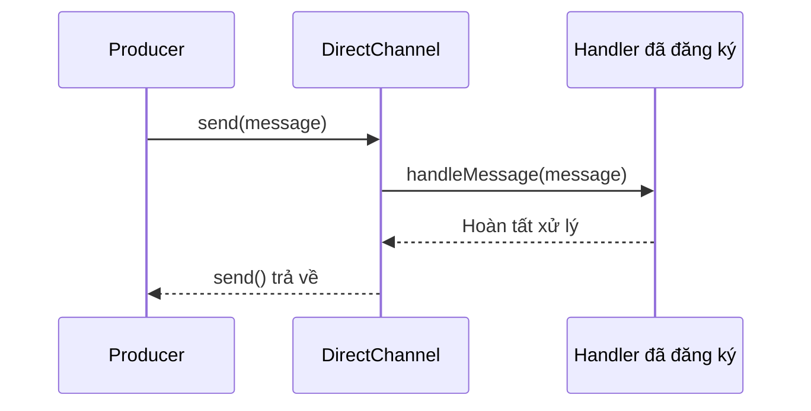
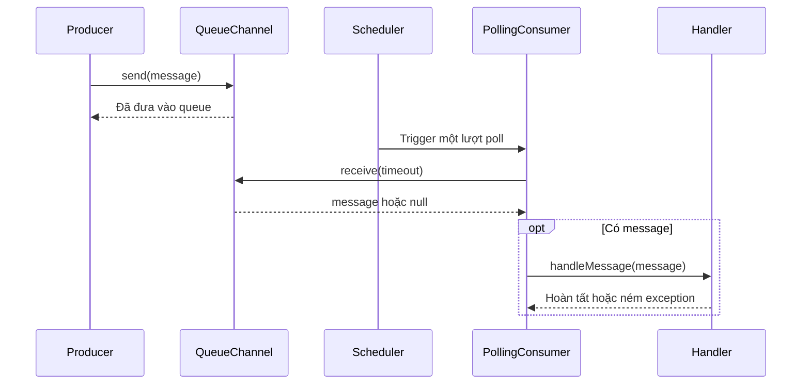
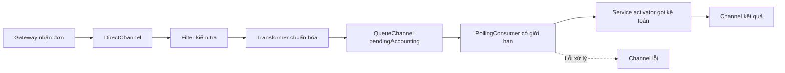

# Event-driven và polling consumer

## 1. Vị trí của bài học

Trong chương **Mô hình message flow** của module **SPRING_INTEGRATION_CORE**, bài này giải thích cách một endpoint nhận message để thực thi logic. Đây là nền tảng để thiết kế luồng bằng `Message`, `MessageChannel`, endpoint, gateway và Java DSL; cùng một transformer, router, filter hay service activator có thể được kích hoạt theo những cách khác nhau.

Sau bài học, bạn cần làm được các việc sau:

- Nhìn vào input channel để xác định consumer nhận message bằng đăng ký hay bằng polling.
- Vẽ đúng luồng thực thi và thời điểm producer được xem là gửi thành công.
- Đặt poller ở đúng endpoint; phân biệt lịch polling, thời gian chờ nhận và số message mỗi lượt.
- Chọn cơ chế phù hợp với độ trễ, khả năng đệm, giới hạn tài nguyên và yêu cầu xử lý lỗi.
- Viết kiểm thử quan sát kết quả bất đồng bộ bằng timeout hữu hạn.

Các ví dụ dùng Java 17 và cách cấu hình của Spring Integration 6.5. Đây là mốc API để diễn giải bài, không phải yêu cầu nâng phiên bản dự án. Phần kiểm thử dùng JUnit Jupiter và Spring Test. Ví dụ được trình bày để thực hành trong dự án có các dependency tương thích; bài không cung cấp build file.

## 2. Message, handler và consumer endpoint có vai trò gì?

Giả sử ứng dụng nhận một yêu cầu đặt hàng:

```text
Message<Order>
    → input channel
    → consumer endpoint
    → handler kiểm tra đơn hàng
    → output channel
```

Cần tách ba trách nhiệm:

| Thành phần | Trách nhiệm trong ví dụ |
| --- | --- |
| `Message<Order>` | Mang payload đơn hàng cùng các header như mã tương quan |
| `MessageChannel` | Cung cấp cơ chế chuyển hoặc lưu message giữa các thành phần |
| Handler | Thực thi nghiệp vụ: kiểm tra, chuyển đổi, định tuyến hoặc gọi dịch vụ |
| Consumer endpoint | Kết nối channel với handler và quản lý cách handler được kích hoạt |

Handler trả lời câu hỏi “xử lý message như thế nào?”. Consumer endpoint trả lời câu hỏi “nhận message bằng cách nào và khi nào gọi handler?”.

Với mô hình imperative thông thường trong bài:

- Input là `SubscribableChannel`: framework có thể tạo `EventDrivenConsumer`.
- Input là `PollableChannel`: framework có thể tạo `PollingConsumer`, cần cấu hình poller riêng hoặc poller mặc định.

Bạn thường cấu hình `.handle(...)`, `.transform(...)` hoặc `@ServiceActivator`, thay vì tự khởi tạo hai lớp endpoint trên. Cơ chế nhận phụ thuộc vào loại input channel, không phụ thuộc việc handler được gọi là transformer hay service activator. Các endpoint reactive có cơ chế riêng, nằm ngoài phạm vi đối chiếu này. Xem [Message Endpoints](https://docs.spring.io/spring-integration/reference/6.5/endpoint.html).

## 3. Event-driven consumer: channel kích hoạt handler

### 3.1. Cơ chế đăng ký

Event-driven consumer đăng ký handler với một channel hỗ trợ subscription. Khi có message được gửi tới, channel phân phối message tới handler theo chính sách của channel.



Sơ đồ trên mô tả `DirectChannel` và handler đồng bộ. Không có timer định kỳ hỏi channel xem có message hay không.

Từ “event-driven” nói về cơ chế kích hoạt consumer. Payload có thể là lệnh `CreateOrder`, tài liệu hoặc thông báo `OrderCreated`. Không cần biến mọi payload thành domain event mới dùng được consumer này.

### 3.2. Event-driven không tự tạo luồng mới

Với `DirectChannel`, handler được gọi trên chính luồng đang gọi `send()`. Nếu handler mất 300 ms và không có bước bàn giao bất đồng bộ, lời gọi gửi phải chờ phần xử lý đó.

Một `ExecutorChannel` cũng hỗ trợ subscription nhưng có thể chuyển việc xử lý sang executor. `PublishSubscribeChannel` cung cấp cơ chế broadcast và có thể dùng executor. Vì vậy cần đọc cấu hình channel để suy ra luồng thực thi. Những đặc điểm channel này được mô tả trong [Message Channel Implementations](https://docs.spring.io/spring-integration/reference/6.5/channel/implementations.html).

Ví dụ đặt hàng có thể dùng hai cách tổ chức:

```text
request-thread
    → DirectChannel
    → kiểm tra số lượng
    → tạo kết quả
    → trả về request-thread

request-thread
    → ExecutorChannel
    → bàn giao công việc
worker-thread
    → kiểm tra số lượng
    → tạo kết quả
```

Cả hai đều có thể dùng event-driven consumer. Chúng khác nhau ở chính sách thực thi của channel.

### 3.3. Subscription không đồng nghĩa broadcast

Khi một channel có nhiều handler đăng ký, hãy kiểm tra semantics của channel:

- `DirectChannel` phân phối theo mô hình point-to-point; không phải mỗi subscriber đều nhận một bản sao.
- `PublishSubscribeChannel` phục vụ nhu cầu gửi tới các subscriber theo mô hình broadcast.

Nếu nghiệp vụ cần vừa ghi audit vừa gửi email cho mỗi đơn hàng, chỉ đăng ký hai service activator vào cùng một `DirectChannel` không diễn đạt đúng yêu cầu. Hãy thiết kế nhánh broadcast hoặc định tuyến rõ ràng.

## 4. Polling consumer: endpoint chủ động nhận message

### 4.1. Cơ chế nhận

Với `QueueChannel`, producer có thể đưa message vào hàng đợi trước khi consumer sẵn sàng nhận. Polling consumer được kích hoạt theo trigger, gọi `receive(timeout)` rồi chuyển message nhận được cho handler.



Một lượt poll có thể nhận nhiều message liên tiếp, tùy `maxMessagesPerPoll`. Nếu không nhận được message và `receive(...)` trả về `null`, vòng nhận của lượt đó kết thúc.

Phải phân biệt:

1. Producer gửi message vào queue.
2. Consumer lấy message khỏi queue.
3. Handler hoàn thành nghiệp vụ.

Ba mốc này không đồng thời. Producer nhận kết quả gửi thành công ở mốc đầu không chứng minh nghiệp vụ đã hoàn tất ở mốc cuối.

### 4.2. Ai cung cấp luồng thực thi?

Trong cấu hình polling thông thường, scheduler kích hoạt tác vụ poll. Khi không cấu hình executor riêng cho poller, việc nhận và chuỗi xử lý đồng bộ phía sau chạy trên luồng thực thi tác vụ đó.

Nếu thêm executor vào poller hoặc một `ExecutorChannel` phía sau, cần vẽ thêm ranh giới luồng. Việc tăng số thread scheduler cũng không tự động biến một polling endpoint thành nhiều worker xử lý đồng thời.

### 4.3. Polling không đồng nghĩa lưu bền

`QueueChannel` mặc định đệm trong bộ nhớ. Nếu tiến trình dừng, không nên dựa vào queue này để bảo đảm đơn hàng còn tồn tại.

Cần tách hai quyết định:

- **Kích hoạt consumer:** đăng ký hay polling?
- **Độ bền message:** bộ nhớ, message store hoặc hạ tầng broker phù hợp?

Một queue trong bộ nhớ có thể hữu ích để hấp thụ một đợt tải ngắn, nhưng không thay thế cơ chế lưu bền cho yêu cầu phục hồi sau sự cố.

## 5. So sánh theo từng ranh giới thiết kế

| Tiêu chí | Event-driven với `DirectChannel` | Polling với `QueueChannel` |
| --- | --- | --- |
| Cách nhận | Channel gọi handler đã đăng ký | Endpoint gọi `receive(...)` theo poller |
| Poller ở consumer | Không cần | Cần poller riêng hoặc mặc định |
| Luồng trong cấu hình cơ bản | Luồng gửi | Luồng thực thi tác vụ polling |
| Chỗ đệm message | Không có queue đệm của channel | Queue có sức chứa được cấu hình |
| Khi handler chậm | Lời gọi gửi chờ xử lý đồng bộ | Queue có thể tăng, rồi ảnh hưởng producer khi đầy |
| Khi gửi thành công | Chuỗi xử lý đồng bộ đã trở về, tới ranh giới bàn giao nếu có | Message đã được chấp nhận vào queue |
| Nhận lỗi handler | Có thể truyền exception về caller | Cần quan sát đường lỗi của tác vụ polling |
| Điều tiết nhận | Phụ thuộc tốc độ caller và handler | Có thể điều chỉnh trigger và số message mỗi lượt |
| Lưu bền mặc định | Không cung cấp lưu bền | Queue mặc định cũng không lưu bền |

Cột thứ hai và thứ ba là hai cấu hình cụ thể. Không mở rộng kết luận “cùng luồng” cho mọi event-driven consumer.

Ví dụ lựa chọn:

- Kiểm tra đơn hàng nhanh và cần trả lỗi ngay cho caller: chuỗi đồng bộ qua `DirectChannel` thường dễ diễn giải.
- Nhận một đợt công việc rồi xử lý dần trong phạm vi một tiến trình: queue có giới hạn và polling có thể phù hợp.
- Cần xử lý bất đồng bộ ngay khi có message: cân nhắc channel dùng executor, đồng thời thiết kế giới hạn tài nguyên.
- Cần tiếp tục công việc sau khi ứng dụng khởi động lại: bổ sung lưu bền và chiến lược phục hồi trước khi kết luận về kiến trúc.

## 6. Đọc đúng cấu hình poller

### 6.1. Các tham số độc lập

| Tham số | Ý nghĩa | Không nên hiểu thành |
| --- | --- | --- |
| `fixedDelay` | Khoảng nghỉ sau khi tác vụ theo trigger hoàn tất trước lần tiếp theo | Khoảng cách chính xác giữa mọi message |
| `fixedRate` | Lịch nhịp theo chu kỳ thay vì khoảng nghỉ sau hoàn tất | Cam kết có worker mới chạy song song mỗi chu kỳ |
| `cron` | Lịch theo biểu thức thời gian | Giới hạn số message trong một lượt |
| `maxMessagesPerPoll` | Giới hạn số message nhận và xử lý trong một lượt poll | Số thread hoặc kích thước payload dạng danh sách |
| `receiveTimeout` | Thời gian chờ cho một lần nhận từ pollable channel | Timeout của toàn bộ handler |
| `taskExecutor` | Executor thực thi công việc polling khi được cấu hình | Cơ chế tự tăng tài nguyên không giới hạn |

Diễn giải `fixedDelay` đơn giản nhất khi không có executor riêng cho poller. Khi có bàn giao qua executor, việc tác vụ lập lịch hoàn tất có thể khác thời điểm mọi công việc nghiệp vụ đã hoàn tất. Cần đánh giá lại tính đồng thời và hàng đợi executor.

Trong API `@Poller`, mặc định `maxMessagesPerPoll` khác nhau: `PollingConsumer` dùng `-1`, còn polling inbound adapter dùng `1`; `receiveTimeout` mặc định cho polling consumer là 1.000 ms. Nên khai báo giá trị hữu hạn, rõ ràng trong ví dụ học tập. Xem [Poller API](https://www.springframework.org/spring-integration/docs/6.5.x/api/org/springframework/integration/annotation/Poller.html).

### 6.2. Ví dụ đọc cấu hình

```java
Pollers.fixedDelay(200)
        .maxMessagesPerPoll(5)
        .receiveTimeout(0)
```

Với các overload dùng số ở đây, `200` và `0` có đơn vị mili giây:

- Sau mỗi tác vụ poll hoàn tất, chờ khoảng 200 ms trước lượt kế tiếp.
- Mỗi lượt nhận tối đa 5 message, xử lý lần lượt trong cấu hình không có executor riêng.
- Nếu queue rỗng tại thời điểm nhận, trả về ngay.
- Không bảo đảm xử lý đúng 5 message: có thể không có message hoặc chỉ nhận được ít hơn.

Năm message vẫn được giao cho handler bằng các lần gọi riêng. Nếu muốn xử lý một payload chứa danh sách hoặc gom nhóm theo correlation, cần thiết kế batch hoặc aggregator riêng.

### 6.3. Receive timeout không phải thời gian ngủ bắt buộc

Giả sử `receiveTimeout = 1000` và queue đang rỗng. Nếu 30 ms sau có message, lời gọi nhận có thể thức dậy để trả message; không phải luôn đợi đủ một giây.

Ngược lại, `receiveTimeout = 0` làm lần nhận kết thúc ngay khi queue rỗng. Message tới ngay sau đó phải chờ cơ hội nhận tiếp theo.

Tình huống này tạo ra lựa chọn về tài nguyên:

- Timeout dài giữ một luồng chờ nhận, nhưng có thể đáp ứng nhanh khi message đến trong lúc chờ.
- Timeout bằng 0 với chu kỳ ngắn tạo nhiều lần kiểm tra rỗng.
- Chu kỳ dài có thể làm tăng thời gian chờ khi message vừa bỏ lỡ một lần nhận.

Đây là cách phân tích độ trễ của flow; không suy ra timeout của HTTP, JDBC hay tác vụ nghiệp vụ từ `receiveTimeout`.

### 6.4. Đặt poller ở endpoint lấy message

```text
input
  → transformer A
  → QueueChannel pending
  → service activator B
  → output
```

Poller thuộc endpoint B, vì B nhận từ `pending`. Transformer A chỉ gửi vào queue nên không cần poller vì output của nó là queue.

Nếu B lại gửi vào queue khác và transformer C nhận từ queue đó, C cũng cần poller. Đánh giá từng input channel của từng endpoint, thay vì gán một nhãn polling cho toàn bộ flow.

## 7. Ví dụ Java DSL: cùng nghiệp vụ, hai cách kích hoạt

### 7.1. Cấu hình đầy đủ

Ví dụ có hai đầu vào và hai channel để quan sát:

- `eventInput`: gọi handler qua `DirectChannel`.
- `queuedInput`: đệm tối đa 100 message, được lấy bởi polling consumer.
- `processed`: chứa kết quả để chương trình thực hành hoặc test đọc.
- `orderErrors`: chứa lỗi của poller để quan sát.

Đăng ký cấu hình sau trong một Spring application context. Java DSL là cách khai báo các bean channel, handler và endpoint; nó không thay thế quy tắc thực thi của chúng. Xem [Java DSL](https://docs.spring.io/spring-integration/reference/6.5/dsl.html).

```java
package example.integration;

import org.springframework.context.annotation.Bean;
import org.springframework.context.annotation.Configuration;
import org.springframework.integration.channel.DirectChannel;
import org.springframework.integration.channel.QueueChannel;
import org.springframework.integration.config.EnableIntegration;
import org.springframework.integration.dsl.IntegrationFlow;
import org.springframework.integration.dsl.Pollers;

@Configuration
@EnableIntegration
public class ConsumerModelsConfig {

    public record Order(String id, int quantity) {
    }

    public record Receipt(String orderId, String path, String threadName) {
    }

    @Bean
    public DirectChannel eventInput() {
        return new DirectChannel();
    }

    @Bean
    public QueueChannel queuedInput() {
        return new QueueChannel(100);
    }

    @Bean
    public QueueChannel processed() {
        return new QueueChannel(100);
    }

    @Bean
    public QueueChannel orderErrors() {
        return new QueueChannel(100);
    }

    @Bean
    public IntegrationFlow eventOrderFlow() {
        return IntegrationFlow.from("eventInput")
                .handle(Order.class,
                        (order, headers) -> process(order, "event"))
                .channel("processed")
                .get();
    }

    @Bean
    public IntegrationFlow queuedOrderFlow() {
        return IntegrationFlow.from("queuedInput")
                .handle(Order.class,
                        (order, headers) -> process(order, "poll"),
                        endpoint -> endpoint
                                .id("queuedOrderConsumer")
                                .poller(Pollers.fixedDelay(200)
                                        .maxMessagesPerPoll(5)
                                        .receiveTimeout(0)
                                        .errorChannel("orderErrors")))
                .channel("processed")
                .get();
    }

    private Receipt process(Order order, String path) {
        if (order.quantity() <= 0) {
            throw new IllegalArgumentException(
                    "Số lượng phải lớn hơn 0: " + order.id());
        }

        return new Receipt(
                order.id(),
                path,
                Thread.currentThread().getName());
    }
}
```

Poller nằm trên `.handle(...)` nhận từ `queuedInput`. Handler của `eventOrderFlow` không có poller vì nhận từ `eventInput` là `DirectChannel`.

Hai queue quan sát không có consumer endpoint trong cấu hình này. Test đọc chúng bằng `receive(...)` trực tiếp, nên không cần gắn poller chỉ để chúng tồn tại. Trong ứng dụng chạy lâu dài, phải bổ sung nơi tiêu thụ kết quả và lỗi; nếu không, các queue quan sát có thể đầy và làm nghẽn flow.

### 7.2. Gửi message và diễn giải kết quả

Đoạn sau đặt trong phương thức có các bean tương ứng được inject:

```java
Message<ConsumerModelsConfig.Order> message =
        MessageBuilder.withPayload(
                new ConsumerModelsConfig.Order("ORD-101", 2))
                .setHeader("correlationId", "checkout-101")
                .build();

boolean accepted = queuedInput.send(message, 100);

if (!accepted) {
    throw new IllegalStateException("Hàng đợi đang đầy");
}
```

Các kiểu cần import là `org.springframework.messaging.Message` và `org.springframework.messaging.support.MessageBuilder`.

Timeout 100 ms ở `send` là thời gian chờ đưa vào queue khi thiếu chỗ. Nó độc lập với `receiveTimeout` của consumer. Nếu `accepted` là `true`, kết luận được rằng queue đã chấp nhận message, chưa thể kết luận `process(...)` đã thành công.

Trong chính cấu hình demo, kết quả xử lý được quan sát bằng message trong `processed`; lỗi polling được quan sát ở `orderErrors`. Một API nghiệp vụ thực tế cần hợp đồng rõ ràng về phản hồi ngay, trạng thái xử lý sau hoặc thông báo kết quả.

### 7.3. Những điều ví dụ cố ý thể hiện

Nếu gửi cùng một đơn hàng hợp lệ qua `eventInput`, `Receipt.threadName` sẽ là tên luồng gửi. Nếu gửi qua `queuedInput`, tên luồng là luồng thực thi tác vụ polling.

Nếu gửi số lượng bằng 0 qua `eventInput`, lời gọi gửi nhận exception của chuỗi xử lý đồng bộ. Nếu gửi qua `queuedInput`, lời gọi gửi có thể đã thành công; exception phát sinh sau đó ở poller và được chuyển tới đường lỗi.

Việc hai flow cùng gọi `process(...)` giúp quan sát đúng thay đổi về cách kích hoạt, thay vì trộn thêm khác biệt nghiệp vụ.

## 8. Cách biểu diễn bằng annotation và poller mặc định

### 8.1. Annotation tương đương cho handler nhận từ queue

Nếu chọn cấu hình annotation thay cho `queuedOrderFlow`, có thể đăng ký bean sau bằng component scan hoặc bằng `@Bean`:

```java
package example.integration;

import org.springframework.integration.annotation.Poller;
import org.springframework.integration.annotation.ServiceActivator;
import org.springframework.stereotype.Component;

@Component
public class QueuedOrderHandler {

    @ServiceActivator(
            inputChannel = "queuedInput",
            outputChannel = "processed",
            poller = @Poller(
                    fixedDelay = "200",
                    maxMessagesPerPoll = "5",
                    receiveTimeout = "0",
                    errorChannel = "orderErrors"))
    public ConsumerModelsConfig.Receipt handle(
            ConsumerModelsConfig.Order order) {

        if (order.quantity() <= 0) {
            throw new IllegalArgumentException(
                    "Số lượng phải lớn hơn 0: " + order.id());
        }

        return new ConsumerModelsConfig.Receipt(
                order.id(),
                "poll-annotation",
                Thread.currentThread().getName());
    }
}
```

Các thuộc tính số của `@Poller` có kiểu chuỗi. Với ví dụ thay thế này, giữ các channel và bỏ bean `queuedOrderFlow` để tránh vô tình có hai consumer cạnh tranh đọc cùng queue.

Không gắn `@Poller` vào một service activator nhận từ `DirectChannel` để “làm chậm nó”. Hãy đặt queue hoặc cơ chế điều tiết đúng vị trí trong thiết kế.

### 8.2. Poller mặc định

Có thể khai báo một poller mặc định cho các endpoint polling chưa có cấu hình riêng:

```java
import java.time.Duration;

import org.springframework.context.annotation.Bean;
import org.springframework.integration.scheduling.PollerMetadata;
import org.springframework.scheduling.support.PeriodicTrigger;

@Bean(name = PollerMetadata.DEFAULT_POLLER)
public PollerMetadata defaultPoller() {
    PollerMetadata metadata = new PollerMetadata();
    metadata.setTrigger(new PeriodicTrigger(Duration.ofMillis(200)));
    metadata.setMaxMessagesPerPoll(5);
    metadata.setReceiveTimeout(0);
    return metadata;
}
```

Đặt phương thức này trong một lớp `@Configuration`. Khi đó, endpoint nhận từ pollable channel có thể dùng mặc định nếu không khai báo poller riêng. Cấu hình riêng giúp thể hiện yêu cầu khác biệt của từng endpoint.

Poller mặc định không biến `DirectChannel` thành queue và không khiến mọi endpoint trong ứng dụng chạy theo lịch. Cơ chế `@Poller`, tham chiếu metadata và mặc định được trình bày trong [Annotation Support](https://docs.spring.io/spring-integration/reference/6.5/configuration/annotations.html).

## 9. Polling channel khác polling nguồn dữ liệu

Hai cấu trúc sau đều dùng poller nhưng polling những đối tượng khác nhau.

### 9.1. Lấy message đã có trong channel

```text
Producer → QueueChannel → PollingConsumer → Handler
```

`PollingConsumer` gọi `receive(...)` trên `PollableChannel`. Message đã được producer tạo và gửi vào channel trước đó.

### 9.2. Hỏi nguồn để tạo hoặc nhận message đầu vào

```text
Nguồn file / database / dịch vụ
    ← receive() từ MessageSource
    ← SourcePollingChannelAdapter có poller
    → DirectChannel
    → EventDrivenConsumer
    → Handler
```

`SourcePollingChannelAdapter` gọi `MessageSource.receive()` để lấy message từ nguồn rồi gửi vào output channel. Nguồn trả `null` khi không có dữ liệu để phát trong lần nhận đó.

Vì vậy một flow có thể bắt đầu bằng polling nguồn, rồi dùng event-driven consumer cho các bước phía sau. Adapter nguồn dùng poller không kéo theo yêu cầu gắn poller vào mọi handler. Hai dạng này được phân biệt trong [Poller](https://docs.spring.io/spring-integration/reference/6.5/polling-consumer.html).

Ví dụ bổ sung sau có thể đặt trong cấu hình Java DSL để minh họa một nguồn hữu hạn, rồi bàn giao vào `eventInput` của demo:

```java
@Bean
public IntegrationFlow sampleSourceFlow() {
    java.util.Queue<Order> sourceData =
            new java.util.concurrent.ConcurrentLinkedQueue<>();

    sourceData.add(new Order("SRC-1", 1));
    sourceData.add(new Order("SRC-2", 2));

    return IntegrationFlow
            .fromSupplier(sourceData::poll,
                    endpoint -> endpoint.poller(
                            Pollers.fixedDelay(1000)
                                    .maxMessagesPerPoll(1)))
            .channel("eventInput")
            .get();
}
```

Đây là nguồn trong bộ nhớ để mô phỏng, không phải adapter file hay database. `fromSupplier` tạo cấu trúc polling nguồn; khi supplier trả `null`, không có message mới để phát. Đặt `maxMessagesPerPoll(1)` để mỗi lượt chỉ lấy tối đa một phần tử.

Nếu thêm bean này vào context, nó sẽ tự phát message khi được kích hoạt. Khi chạy các kiểm thử ở phần sau, dùng nguyên cấu hình ở mục 7 để kết quả không bị trộn với message từ nguồn bổ sung.

## 10. Lỗi, retry và transaction qua ranh giới luồng

### 10.1. Lỗi đồng bộ và lỗi trong poller

Với chuỗi đồng bộ qua `DirectChannel`, exception có thể truyền trở lại caller theo call stack. Header `errorChannel` trên message không tự biến mọi exception đồng bộ thành message lỗi.

Với poller trong demo, framework dùng cơ chế xử lý lỗi để gửi `ErrorMessage` tới channel thích hợp. Cấu hình `.errorChannel("orderErrors")` cung cấp đích lỗi cho poller; header `errorChannel` của request có thể được ưu tiên khi cơ chế phân giải có request message. Không nên đặt header đó trong demo nếu muốn quan sát đúng queue `orderErrors`.

Payload của `ErrorMessage` là `Throwable`, thường có wrapper messaging exception. Với `MessagingException`, có thể kiểm tra `getFailedMessage()` để tìm message thất bại khi thông tin đó hiện diện. Xem [Error Handling](https://docs.spring.io/spring-integration/reference/6.5/error-handling.html).

### 10.2. Gửi lỗi không có nghĩa tự retry

Trong demo, message đã được lấy khỏi `queuedInput` trước khi `process(...)` ném exception. Việc gửi một `ErrorMessage` vào `orderErrors` không đưa đơn hàng trở lại queue đầu vào.

Nếu cần phục hồi, phải thiết kế riêng:

- Retry có giới hạn cho lỗi tạm thời.
- Chuyển sang nơi giữ message lỗi khi không thể tiếp tục.
- Lưu đủ mã đơn hàng, correlation và nguyên nhân để điều tra.
- Bảo đảm xử lý lặp không tạo tác dụng phụ trùng khi retry hoặc phát lại.

Ví dụ thanh toán cần một khóa nghiệp vụ chống thu tiền trùng. Tăng `maxMessagesPerPoll` hay thêm queue không giải quyết được yêu cầu này.

### 10.3. Transaction không tự đi theo message sang luồng khác

Transaction Spring thông thường gắn với luồng thực thi. Một chuỗi đồng bộ qua `DirectChannel` có thể tiếp tục trong transaction hiện có khi các tài nguyên và cấu hình phù hợp. Qua queue hoặc executor, không giả định transaction của producer tiếp tục ở consumer.

Poller có thể được cấu hình transaction để bao quanh việc nhận và xử lý với các tài nguyên tham gia phù hợp. Tuy nhiên, thêm transaction manager không làm một `QueueChannel` bộ nhớ trở thành tài nguyên có khả năng tự khôi phục message sau rollback. Xem [Transaction Support](https://docs.spring.io/spring-integration/reference/6.5/transactions.html).

Khi phân tích thiết kế, viết rõ ba điều:

1. Transaction bắt đầu ở lời gọi nào?
2. Việc nhận message và cập nhật dữ liệu có cùng tham gia transaction không?
3. Khi thất bại hoặc tiến trình dừng, thành phần nào lưu và phát lại công việc?

Không suy ra bảo đảm exactly-once chỉ từ việc flow có poller hoặc có `@Transactional`.

## 11. Tính thử năng lực xử lý và nguy cơ đầy queue

Giả sử dùng cấu hình giống demo:

- Một tác vụ poll xử lý tuần tự, không có executor riêng.
- Queue luôn có đủ message để nhận hết giới hạn mỗi lượt.
- `B = 5` message mỗi lượt.
- `D = 0,2` giây fixed delay.
- `s = 0,04` giây xử lý một message.
- Bỏ qua chi phí framework, nhận và gửi kết quả; queue kết quả không gây chờ.

Một lượt có thời gian xử lý xấp xỉ:

```text
T_xử_lý = B × s = 5 × 0,04 = 0,2 giây

T_chu_kỳ ≈ D + B × s = 0,4 giây

μ ≈ B / (D + B × s)
  = 5 / 0,4
  = 12,5 message/giây
```

Đây là phép ước lượng của ví dụ với các giả định trên, không phải công thức cam kết hiệu năng của framework.

Nếu đầu vào ổn định `λ = 30` message/giây, backlog tăng khoảng:

```text
λ - μ = 30 - 12,5 = 17,5 message/giây
```

Queue 100 phần tử từ trạng thái gần rỗng sẽ đầy theo bậc thời gian khoảng `100 / 17,5 ≈ 5,7` giây nếu tốc độ này kéo dài. Con số thực tế dao động theo nhịp gửi, từng lượt poll và thời gian xử lý.

Từ phép tính có thể rút ra:

- Queue chỉ hấp thụ chênh lệch tạm thời; nếu đầu vào lâu dài vượt đầu ra, queue hữu hạn sẽ đầy.
- Tăng giới hạn nhận mỗi lượt giảm phần chi phí delay trên mỗi message nhưng không loại bỏ chi phí nghiệp vụ.
- Với `s = 40 ms`, một worker tuần tự có giới hạn lý tưởng khoảng 25 message/giây khi bỏ qua mọi chi phí khác. Chỉ giảm delay không đủ cho 30 message/giây.
- Nếu xử lý song song, cần kiểm tra giới hạn hệ thống đích, an toàn luồng, ordering và tính idempotent.

Đối với queue đầy, producer phải có chính sách cụ thể: chờ hữu hạn, từ chối có kiểm soát hoặc chuyển sang lưu trữ phù hợp. Tránh để một lời gọi gửi không có timeout giữ request thread vô thời hạn.

## 12. Kiểm thử hành vi quan sát được

### 12.1. Bộ kiểm thử cho cấu hình mục 7

Bộ kiểm thử sau xác nhận ba điều: xử lý event-driven qua `DirectChannel` chạy trên luồng gửi, polling xử lý ở luồng khác và lỗi polling có đường quan sát riêng. Dùng context không có `sampleSourceFlow` và không có handler annotation thay thế.

```java
package example.integration;

import org.junit.jupiter.api.Test;
import org.springframework.beans.factory.annotation.Autowired;
import org.springframework.beans.factory.annotation.Qualifier;
import org.springframework.integration.channel.QueueChannel;
import org.springframework.messaging.Message;
import org.springframework.messaging.MessageChannel;
import org.springframework.messaging.support.ErrorMessage;
import org.springframework.messaging.support.GenericMessage;
import org.springframework.test.context.junit.jupiter.SpringJUnitConfig;

import static org.junit.jupiter.api.Assertions.*;

@SpringJUnitConfig(ConsumerModelsConfig.class)
class ConsumerModelsTest {

    @Autowired
    @Qualifier("eventInput")
    MessageChannel eventInput;

    @Autowired
    @Qualifier("queuedInput")
    MessageChannel queuedInput;

    @Autowired
    @Qualifier("processed")
    QueueChannel processed;

    @Autowired
    @Qualifier("orderErrors")
    QueueChannel orderErrors;

    @Test
    void directChannelCompletesOnCallerThread() {
        String callerThread = Thread.currentThread().getName();

        boolean sent = eventInput.send(new GenericMessage<>(
                new ConsumerModelsConfig.Order("DIRECT-1", 2)), 100);

        assertTrue(sent);

        Message<?> result = processed.receive(0);
        assertNotNull(result);

        ConsumerModelsConfig.Receipt receipt = assertInstanceOf(
                ConsumerModelsConfig.Receipt.class,
                result.getPayload());

        assertEquals("DIRECT-1", receipt.orderId());
        assertEquals("event", receipt.path());
        assertEquals(callerThread, receipt.threadName());
    }

    @Test
    void queueIsConsumedByPollingTask() {
        String callerThread = Thread.currentThread().getName();

        boolean accepted = queuedInput.send(new GenericMessage<>(
                new ConsumerModelsConfig.Order("QUEUED-1", 3)), 100);

        assertTrue(accepted);

        Message<?> result = processed.receive(3000);
        assertNotNull(result);

        ConsumerModelsConfig.Receipt receipt = assertInstanceOf(
                ConsumerModelsConfig.Receipt.class,
                result.getPayload());

        assertEquals("QUEUED-1", receipt.orderId());
        assertEquals("poll", receipt.path());
        assertNotEquals(callerThread, receipt.threadName());
    }

    @Test
    void invalidQueuedOrderProducesErrorMessage() {
        boolean accepted = queuedInput.send(new GenericMessage<>(
                new ConsumerModelsConfig.Order("BAD-1", 0)), 100);

        assertTrue(accepted);

        Message<?> error = orderErrors.receive(3000);
        assertNotNull(error);

        ErrorMessage errorMessage =
                assertInstanceOf(ErrorMessage.class, error);

        Throwable cause = errorMessage.getPayload();
        while (cause.getCause() != null) {
            cause = cause.getCause();
        }

        assertInstanceOf(IllegalArgumentException.class, cause);
        assertTrue(cause.getMessage().contains("BAD-1"));
    }
}
```

Các test trên chia sẻ queue trong cùng context, nên chạy tuần tự theo cấu hình thông thường của JUnit Jupiter. Nếu dự án bật chạy test song song hoặc có producer khác cùng gửi, cần tách context hoặc đối chiếu kết quả theo correlation thay vì giả định message đọc được thuộc test hiện tại.

Các timeout 3 giây là giới hạn chờ của kiểm thử, không phải SLA của hệ thống. Đoạn kiểm thử được cung cấp làm ví dụ trong bài; chưa thể coi là kết quả đã chạy trên dự án của người học.

### 12.2. Tránh kiểm thử phụ thuộc thời điểm mong manh

Không nên dùng cách sau để kết luận poller hoạt động:

```java
queuedInput.send(message);
Thread.sleep(200);
assertEquals(0, queuedInput.getQueueSize());
```

Cách này có hai vấn đề:

- Thread có thể chưa được scheduler cấp thời gian khi hết 200 ms.
- Queue rỗng chỉ chứng minh message đã được lấy, chưa chứng minh nghiệp vụ thành công.

Đọc kết quả với timeout hữu hạn như ví dụ phía trên phản ánh đúng điều cần kiểm chứng. Với side effect ngoài channel, có thể chờ một điều kiện quan sát tương đương hoặc dùng latch trong test fixture.

Nếu muốn kiểm tra message nằm lại khi endpoint dừng, hãy dừng consumer một cách chủ động trong fixture; không dựa vào giả định “poller chắc chưa kịp chạy” ngay sau `send()`.

## 13. Một flow có thể phối hợp cả hai cơ chế

Xét quy trình nhận đơn và đồng bộ sang hệ thống kế toán chậm:



Trước queue, kiểm tra và chuẩn hóa có thể chạy đồng bộ trên luồng khởi tạo flow. Sau queue, polling consumer quyết định lúc lấy công việc gọi kế toán.

Nếu thêm router hoặc aggregator:

- Router nhận từ direct channel có thể chạy trên luồng gửi; mỗi nhánh có thể tạo ranh giới khác nhau.
- Aggregator có trạng thái và điều kiện release; thời gian chờ đủ nhóm không phải `receiveTimeout` của poller.
- Chỉ các endpoint nhận từ pollable channel mới cần poller theo mô hình imperative đang xét.

Gateway cũng không làm mọi thao tác trở thành bất đồng bộ. Một gateway request-reply đi qua queue có thể vẫn giữ caller chờ reply theo cấu hình. Cần thiết kế hợp đồng phản hồi: trả kết quả hoàn tất hay trả mã tiếp nhận để tra cứu sau.

Trong ví dụ kế toán, việc queue có giới hạn chưa đủ để bảo đảm không vượt giới hạn API. `maxMessagesPerPoll` giới hạn số lần nhận mỗi lượt, không tự cung cấp giới hạn tốc độ toàn cục cho nhiều instance hoặc các flow khác cùng gọi hệ thống đích.

## 14. Các lỗi thiết kế thường gặp

| Hiện tượng hoặc suy luận | Cần kiểm tra | Hướng xử lý |
| --- | --- | --- |
| Context không khởi động khi handler nhận từ queue | Endpoint có poller riêng hoặc mặc định chưa? | Khai báo poller tại endpoint nhận |
| Gắn poller vào handler nhận từ `DirectChannel` | Input có hỗ trợ `receive` không? | Bỏ poller hoặc đặt queue theo thiết kế |
| API gửi thành công nhưng không có kết quả | Đã có consumer, endpoint đã start, queue có backlog không? | Theo dõi cả mốc nhận và mốc hoàn thành |
| Handler chậm làm request chậm | Có chuỗi đồng bộ qua direct channel không? | Đánh giá lại hợp đồng và ranh giới thực thi |
| Queue không có giới hạn làm bộ nhớ tăng | Tốc độ đầu vào có vượt đầu ra kéo dài không? | Giới hạn queue và xử lý quá tải |
| “Mỗi poll 10 message” được hiểu là 10 worker | Có executor hoặc consumer đồng thời thực sự không? | Tách số lần nhận khỏi số luồng xử lý |
| Đơn hàng lỗi không tự xuất hiện lại | Queue và receive có hỗ trợ phục hồi không? | Thiết kế retry, lưu lỗi và phát lại |
| Kết quả hoàn thành sai thứ tự | Có nhiều consumer, executor hoặc retry không? | Xác định yêu cầu thứ tự theo khóa nghiệp vụ |
| Scheduler bận làm nhiều flow trễ | Tác vụ nào chặn lâu và tài nguyên được chia sẻ ra sao? | Đo thời gian, giới hạn công việc và bố trí executor phù hợp |
| Test chập chờn | Có sleep cố định hoặc đọc nhầm message của test khác không? | Chờ điều kiện hữu hạn và cô lập dữ liệu test |

FIFO của một queue không bảo đảm thứ tự hoàn tất khi xử lý đồng thời. Hai message có thể được nhận theo thứ tự nhưng message thứ hai hoàn thành trước vì công việc của nó nhanh hơn.

## 15. Quy trình quyết định cho một endpoint mới

Khi thêm endpoint vào flow, hãy trả lời theo thứ tự:

1. **Input là gì?** Một subscribable channel, một pollable channel hay nguồn dữ liệu cần polling?
2. **Caller cần biết điều gì?** Công việc đã hoàn tất hay mới được tiếp nhận?
3. **Luồng nào chạy handler?** Ghi cụ thể luồng gửi, tác vụ scheduler hoặc executor được cấu hình.
4. **Công việc chờ ở đâu?** Queue có giới hạn bao nhiêu, có lưu bền không, gửi đầy thì xử lý thế nào?
5. **Lỗi đi đâu?** Exception về caller hay `ErrorMessage`; ai tiêu thụ và ai chịu trách nhiệm phát lại?
6. **Năng lực xử lý có đủ không?** Dùng số đo thời gian xử lý và backlog để điều chỉnh poller.
7. **Kiểm chứng bằng tín hiệu nào?** Kết quả nghiệp vụ, channel kết quả hoặc trạng thái lưu trữ; đặt giới hạn thời gian chờ trong test.

Đối với bài này, mô hình cần giữ rõ là: channel quyết định cơ chế nhận của consumer, cấu hình thực thi quyết định ranh giới luồng, còn độ bền và khả năng phục hồi cần các quyết định riêng.
