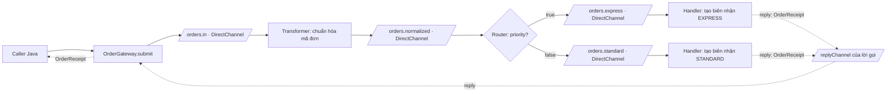
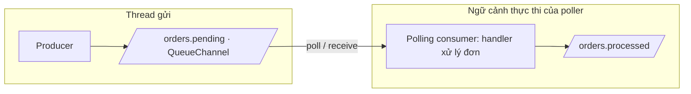
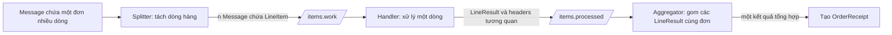
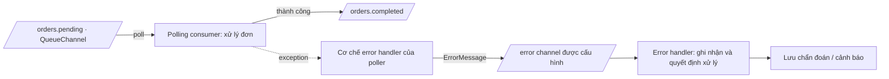

# Sơ đồ hóa một integration flow

## 1. Mục tiêu và cách nhìn một luồng tích hợp

Trong Spring Integration Core, một integration flow là đường đi của các message qua channel và endpoint để thực hiện một công việc. Sơ đồ tốt phải giúp người đọc trả lời được: message đi vào từ đâu, mang dữ liệu gì, được xử lý ở đâu, có thể rẽ sang nhánh nào, phản hồi về đâu và điều gì xảy ra khi một bước thất bại.

Chương **Mô hình message flow** tập trung vào cách các thành phần phối hợp. Bài này hướng dẫn chuyển yêu cầu nghiệp vụ thành sơ đồ và đối chiếu sơ đồ đó với Java DSL. Transformer, router, filter và aggregator xuất hiện như các vai trò trong luồng; trọng tâm là biểu diễn đúng mối quan hệ giữa chúng.

Sau bài học, bạn có thể:

- Phân biệt message, channel và endpoint khi vẽ sơ đồ.
- Thể hiện đường request, reply, nhánh định tuyến và đường lỗi.
- Nhận ra ranh giới thực thi đồng bộ, bất đồng bộ và vị trí cần poller.
- Ánh xạ một sơ đồ sang các thành phần có tên trong Java DSL.
- Dùng sơ đồ để xác định các hành vi cần kiểm thử.

Một integration flow là đồ thị có hướng, nhưng mỗi mũi tên còn mang ý nghĩa về hợp đồng dữ liệu và cách chuyển giao công việc. Sơ đồ chỉ có các ô “nhận → xử lý → lưu” thường chưa đủ để triển khai hoặc đánh giá hành vi của một ứng dụng Spring Integration.

## 2. Xác định đúng đối tượng cần vẽ

### 2.1. Message là dữ liệu đang di chuyển

`Message<T>` chứa hai phần chính:

- `payload`: dữ liệu nghiệp vụ, chẳng hạn `OrderRequest` hoặc `OrderReceipt`.
- `headers`: thông tin phục vụ truyền và xử lý message, chẳng hạn định tuyến, tương quan, trả lời hoặc xử lý lỗi.

Message thường được ghi trên cạnh nối giữa các thành phần. Không cần tạo một endpoint tên “Message” chỉ để biểu diễn dữ liệu đi qua hệ thống.

Ở mức khái niệm:

```text
Message<OrderRequest>
├── payload: OrderRequest(orderId="ORD-42", priority=true)
└── headers
    ├── replyChannel: nơi nhận phản hồi cho lời gọi này
    └── các header kỹ thuật khác
```

`replyChannel` không nhất thiết là tên một bean channel do ứng dụng khai báo. Gateway có thể thiết lập channel trả lời tạm thời cho lời gọi. Khi vẽ, hãy phân biệt channel do ứng dụng đặt tên với channel phản hồi được framework quản lý.

Nếu transformer thay đổi `OrderRequest` thành một kiểu khác, sơ đồ cần ghi kiểu mới ở cạnh đầu ra. Việc giữ nguyên tên nghiệp vụ cho mọi mũi tên có thể che mất một thay đổi hợp đồng quan trọng.

### 2.2. Channel là điểm chuyển giao message

`MessageChannel` là nơi producer gửi message và consumer tiếp nhận message theo cơ chế của channel đó. Channel không tự thực hiện công việc nghiệp vụ như chuẩn hóa đơn hàng hoặc tính tổng tiền.

Một số loại channel cần thể hiện rõ trên sơ đồ:

| Channel | Ý nghĩa khi đọc sơ đồ | Hệ quả thiết kế |
|---|---|---|
| `DirectChannel` | Chuyển message trực tiếp tới một subscriber được chọn | Với handler đồng bộ, xử lý tiếp diễn trong thread gửi; không có bộ đệm hàng đợi |
| `QueueChannel` | Message được đặt vào hàng đợi để consumer lấy ra | Cần cơ chế polling; cấu hình lưu trữ quyết định khả năng giữ message qua lần khởi động lại |
| `ExecutorChannel` | Chuyển công việc qua `TaskExecutor` | Có thể tách thread xử lý; không nên suy ra một ranh giới bất đồng bộ chắc chắn nếu chưa biết executor và chính sách thực thi |
| `PublishSubscribeChannel` | Phân phối message tới các subscriber hiện có theo cơ chế publish-subscribe | Là fan-out; không mặc nhiên chạy song song hoặc tự gom kết quả |

Ví dụ, hai handler cùng subscribe vào một `DirectChannel` không có nghĩa cả hai đều xử lý mỗi message. Nếu yêu cầu là gửi cho cả xử lý nghiệp vụ và audit, sơ đồ cần thể hiện rõ cơ chế fan-out phù hợp.

### 2.3. Endpoint là nơi có hành vi

Endpoint kết nối hành vi xử lý với hạ tầng messaging. Khi đọc sơ đồ, tên trong ô nên mô tả vai trò và công việc cụ thể.

| Vai trò | Tên có thể dùng trên sơ đồ | Điều cần thể hiện |
|---|---|---|
| Transformer | `Chuẩn hóa mã đơn` | Payload trước và sau chuyển đổi |
| Router | `Định tuyến theo độ ưu tiên` | Mỗi điều kiện và channel đích |
| Filter | `Chỉ nhận đơn hợp lệ` | Đường chấp nhận và cách xử lý message bị loại |
| Service activator | `Tạo biên nhận xử lý` | Tác vụ nghiệp vụ và có tạo reply hay không |
| Splitter | `Tách các dòng hàng` | Một message đầu vào tạo nhiều message đầu ra |
| Aggregator | `Gom kết quả các dòng hàng` | Khóa tương quan, điều kiện giải phóng và chính sách timeout |
| Gateway | `OrderGateway.submit` | Ranh giới gọi từ Java sang messaging hoặc một luồng con |
| Channel adapter | `Nhận dữ liệu từ nguồn` | Ranh giới với hệ thống bên ngoài và hướng truyền dữ liệu |

Không phải mọi bước DSL đều là một endpoint nghiệp vụ độc lập. DSL có thể tạo các channel nối nội bộ; biểu diễn bean, endpoint và channel chi tiết đến đâu phụ thuộc mục đích của sơ đồ.

## 3. Chọn cấp độ và quy ước trước khi vẽ

Nên tách hai cấp độ có mục đích khác nhau:

1. **Sơ đồ nghiệp vụ:** nguồn vào, các phép xử lý chính, nhánh thành công, nhánh bị từ chối và hệ thống đích. Dùng để thống nhất yêu cầu.
2. **Sơ đồ triển khai:** gateway, tên channel, loại channel, endpoint, poller, đường reply và đường lỗi. Dùng để đối chiếu cấu hình và tìm lỗi thực thi.

Một bài toán có thể cần cả hai sơ đồ. Không nên gắn các chi tiết thread, persistence hoặc retry vào sơ đồ nếu cấu hình chưa xác định chúng.

Trong bài này sử dụng quy ước:

| Ký hiệu | Ý nghĩa |
|---|---|
| Hình chữ nhật | Endpoint hoặc thành phần thực hiện hành vi |
| Hình bình hành | Channel |
| Hình thoi | Router hoặc quyết định định tuyến |
| Mũi tên liền | Đường truyền message theo hướng chính của sơ đồ |
| Mũi tên nét đứt có nhãn `reply` | Đường trả lời logic |
| Mũi tên nét đứt có nhãn `exception` | Quan hệ phát sinh lỗi; xem giải thích của từng sơ đồ |
| Nhóm có ghi chú thread | Ngữ cảnh thực thi đã được cấu hình rõ |

Nét đứt không mang nghĩa “bất đồng bộ”. Bất đồng bộ phải được xác định từ channel, executor hoặc cơ chế polling. Các sơ đồ dưới đây được giản lược có chủ đích và không phải bản vẽ toàn bộ bean mà Spring tạo ra.

## 4. Từ yêu cầu nghiệp vụ đến sơ đồ triển khai

### 4.1. Chốt hợp đồng và các kết quả có thể xảy ra

Xét yêu cầu minh họa:

> Ứng dụng Java gửi một yêu cầu có mã đơn và cờ ưu tiên. Luồng loại bỏ khoảng trắng ở hai đầu mã đơn, từ chối mã rỗng, chọn nhánh ưu tiên hoặc thông thường và trả một biên nhận cho caller.

Ví dụ này chỉ minh họa mô hình message flow. Biên nhận xác nhận nhánh được chọn; nó chưa có nghĩa đơn hàng đã được lưu vào cơ sở dữ liệu hoặc hoàn tất vận chuyển.

Hợp đồng:

```text
Đầu vào:  OrderRequest(orderId, priority)
Thành công: OrderReceipt(orderId, route)
Không hợp lệ: phát sinh ngoại lệ
Caller: chờ kết quả từ OrderGateway.submit(...)
```

Có hai nhánh định tuyến nhưng mỗi request chỉ đi vào một nhánh. Không có yêu cầu gom kết quả, vì vậy sơ đồ không cần aggregator.

### 4.2. Vẽ đường chính và đường trả lời



Các điểm cần đọc đúng:

- `orders.in`, `orders.normalized`, `orders.express` và `orders.standard` là các channel do ứng dụng đặt tên.
- Transformer vừa chuẩn hóa mã, vừa có thể phát sinh ngoại lệ nếu mã sau chuẩn hóa rỗng.
- Router chọn một channel dựa trên `priority`. Hai nhánh không chạy đồng thời cho cùng một request.
- Các handler trả về `OrderReceipt`. Khi không cấu hình output channel riêng, cơ chế reply của handler có thể sử dụng `replyChannel` trong message.
- Channel phản hồi trong sơ đồ đại diện cho cơ chế reply của lời gọi gateway, không phải yêu cầu khai báo thêm một bean tên `replyChannel`.
- Toàn bộ đường chính dùng `DirectChannel` với các handler đồng bộ trong ví dụ. Việc có nhiều ô trong sơ đồ không tạo thêm thread.

### 4.3. Ghi dữ liệu tại các điểm quan trọng

Không cần ghi toàn bộ headers trên mọi cạnh. Ưu tiên những thông tin giúp kiểm tra hợp đồng giữa các bước.

| Vị trí | Payload minh họa | Điều cần giữ đúng |
|---|---|---|
| Sau gateway | `OrderRequest(" ORD-42 ", true)` | Có đường trả lời cho lời gọi |
| Sau transformer | `OrderRequest("ORD-42", true)` | Cờ ưu tiên không bị thay đổi; headers cần cho reply được bảo toàn |
| Sau router | Vẫn là `OrderRequest("ORD-42", true)` | Chỉ chọn `orders.express` |
| Sau handler ưu tiên | `OrderReceipt("ORD-42", "EXPRESS")` | Kiểu reply khớp hợp đồng của gateway |
| Tại caller | Đối tượng `OrderReceipt` | Caller nhận payload trả lời thay vì phải thao tác trực tiếp với `Message` |

Nếu một bước tự dựng message mới và làm mất `replyChannel`, hình vẽ vẫn có thể trông hợp lý nhưng request có thể không nhận được reply. Khi đánh giá sơ đồ triển khai, hãy kiểm tra cả headers và payload.

### 4.4. Quy trình vẽ có thể lặp lại cho bài toán khác

1. Viết tên nguồn vào và hợp đồng payload.
2. Liệt kê các phép biến đổi hoặc quyết định nghiệp vụ theo thứ tự.
3. Đặt channel tại các điểm cần định danh, chia nhánh hoặc thay đổi cách chuyển giao.
4. Ghi điều kiện trên mọi cạnh đi ra từ router.
5. Với mỗi nhánh kết thúc, ghi kết quả: reply, tác vụ một chiều, discard hoặc lỗi.
6. Đánh dấu các bước tạo nhiều message hoặc giữ message để chờ đủ nhóm.
7. Bổ sung ranh giới thread, polling và lưu trữ nếu đã có cấu hình tương ứng.
8. Đối chiếu tên và hợp đồng trên sơ đồ với Java DSL.

Sơ đồ đủ dùng khi người khác có thể lần theo một message cụ thể mà không phải tự đoán một nhánh sẽ kết thúc thế nào.

## 5. Đối chiếu sơ đồ với Java DSL

Ví dụ sau dùng các dependency Spring Integration Core, Spring Context và Java hỗ trợ `record`. Tất cả các file minh họa nằm trong package `example.integration`; mỗi khai báo `public` dưới đây thuộc file Java riêng cùng tên. Ứng dụng cần khởi tạo Spring application context chứa cấu hình này.

### 5.1. Hợp đồng dữ liệu và gateway

```java
package example.integration;

public record OrderRequest(String orderId, boolean priority) {
}
```

```java
package example.integration;

public record OrderReceipt(String orderId, String route) {
}
```

```java
package example.integration;

import org.springframework.integration.annotation.MessagingGateway;

@MessagingGateway(defaultRequestChannel = "orders.in")
public interface OrderGateway {
    OrderReceipt submit(OrderRequest request);
}
```

Gateway chuyển lời gọi `submit` thành request message, gửi vào `orders.in`, chờ reply và trả payload theo kiểu khai báo. Trong ví dụ này, ứng dụng dùng proxy gateway do Spring tạo, không tự cài đặt interface `OrderGateway`.

### 5.2. Cấu hình các channel và endpoint

```java
package example.integration;

import org.springframework.context.annotation.Bean;
import org.springframework.context.annotation.Configuration;
import org.springframework.integration.annotation.IntegrationComponentScan;
import org.springframework.integration.channel.DirectChannel;
import org.springframework.integration.config.EnableIntegration;
import org.springframework.integration.dsl.IntegrationFlow;
import org.springframework.messaging.MessageChannel;

@Configuration
@EnableIntegration
@IntegrationComponentScan(basePackageClasses = OrderGateway.class)
public class OrderFlowConfiguration {

    @Bean(name = "orders.in")
    public MessageChannel ordersIn() {
        return new DirectChannel();
    }

    @Bean(name = "orders.normalized")
    public MessageChannel normalizedOrders() {
        return new DirectChannel();
    }

    @Bean(name = "orders.express")
    public MessageChannel expressOrders() {
        return new DirectChannel();
    }

    @Bean(name = "orders.standard")
    public MessageChannel standardOrders() {
        return new DirectChannel();
    }

    @Bean
    public IntegrationFlow orderRoutingFlow() {
        return IntegrationFlow.from("orders.in")
                .<OrderRequest, OrderRequest>transform(this::normalize)
                .channel("orders.normalized")
                .route(OrderRequest.class, OrderRequest::priority,
                        mapping -> mapping
                                .channelMapping(true, "orders.express")
                                .channelMapping(false, "orders.standard"))
                .get();
    }

    @Bean
    public IntegrationFlow expressOrderFlow() {
        return IntegrationFlow.from("orders.express")
                .handle(OrderRequest.class, (order, headers) ->
                        new OrderReceipt(order.orderId(), "EXPRESS"))
                .get();
    }

    @Bean
    public IntegrationFlow standardOrderFlow() {
        return IntegrationFlow.from("orders.standard")
                .handle(OrderRequest.class, (order, headers) ->
                        new OrderReceipt(order.orderId(), "STANDARD"))
                .get();
    }

    private OrderRequest normalize(OrderRequest order) {
        if (order.orderId() == null) {
            throw new IllegalArgumentException("orderId must not be null");
        }
        String normalizedId = order.orderId().trim();
        if (normalizedId.isEmpty()) {
            throw new IllegalArgumentException("orderId must not be blank");
        }
        return new OrderRequest(normalizedId, order.priority());
    }
}
```

Trong một component nhận `OrderGateway` qua dependency injection, lời gọi minh họa là:

```java
OrderReceipt receipt = gateway.submit(
        new OrderRequest(" ORD-42 ", true));

// receipt.orderId() bằng "ORD-42"
// receipt.route() bằng "EXPRESS"
```

Cấu hình có ba bean `IntegrationFlow`, trong khi sơ đồ thể hiện một luồng nghiệp vụ từ caller đến kết quả. Ranh giới bean flow không đồng nghĩa ranh giới thread hoặc ranh giới giao dịch.

Ví dụ không khai báo output channel trên hai handler cuối. Giá trị trả về của handler trở thành reply message và được gửi theo cơ chế reply hiện có của request. Transformer được cấu hình theo cách thông thường bảo toàn các headers cần thiết cho luồng trả lời.

### 5.3. Bảng ánh xạ sơ đồ với cấu hình

| Thành phần trên sơ đồ | Thành phần trong cấu hình | Vai trò |
|---|---|---|
| `OrderGateway.submit` | `@MessagingGateway` | Chuyển lời gọi Java thành request/reply messaging |
| `orders.in` | Bean `DirectChannel` | Điểm vào của flow định tuyến |
| Chuẩn hóa mã đơn | `.transform(this::normalize)` | Đổi payload trước khi định tuyến |
| `orders.normalized` | `.channel("orders.normalized")` | Điểm chuyển giao có tên sau chuẩn hóa |
| Router theo độ ưu tiên | `.route(... OrderRequest::priority ...)` | Chọn một trong hai channel |
| Nhánh ưu tiên | `expressOrderFlow()` | Tạo payload reply có route `EXPRESS` |
| Nhánh thông thường | `standardOrderFlow()` | Tạo payload reply có route `STANDARD` |
| Đường reply | Giá trị trả về từ `.handle(...)` và cơ chế gateway | Đưa kết quả về đúng caller |

Nếu thêm một channel vào sơ đồ mà chưa có trong cấu hình, hoặc đổi tên channel trong code, bảng này giúp phát hiện sự lệch nhau. Với sơ đồ triển khai, tên định danh nên thống nhất; với sơ đồ nghiệp vụ, có thể dùng tên diễn giải nhưng cần giữ bảng ánh xạ tương ứng.

## 6. Biểu diễn thread và polling

### 6.1. Luồng trực tiếp trong ví dụ

Với cấu hình đã cho và các handler đồng bộ, thread gọi gateway đi qua transformer, router và handler được chọn. Caller nhận kết quả sau khi xử lý hoàn thành hoặc nhận ngoại lệ khi xử lý thất bại.

```text
Thread của caller
  submit()
    → orders.in
    → normalize
    → orders.normalized
    → router
    → orders.express hoặc orders.standard
    → tạo OrderReceipt
  nhận kết quả
```

Một handler tốn nhiều thời gian sẽ giữ thread này lâu hơn. Việc đổi tên channel hoặc chia cấu hình thành nhiều bean flow không làm công việc tự chạy nền.

### 6.2. Khi thay điểm chuyển giao bằng QueueChannel

Giả sử có yêu cầu nhận đơn rồi xử lý bằng worker polling. Sơ đồ triển khai cần thêm hàng đợi và cơ chế lấy message:



`Polling consumer` ở đây là endpoint tiêu thụ từ channel có thể polling; poller cung cấp lịch và cơ chế thực thi. Mũi tên `poll / receive` biểu diễn chiều message đi từ queue tới endpoint, dù thao tác lấy message do consumer chủ động thực hiện.

Khi đối chiếu cấu hình, cần trả lời:

- Channel thật sự có phải `QueueChannel` hay chỉ là một `DirectChannel` mang tên `queue`?
- Endpoint đọc queue đã có poller phù hợp chưa?
- Tần suất polling, số message mỗi lượt và khả năng xử lý có đáp ứng lưu lượng không?
- Queue dùng bộ nhớ hay message store nào; chính sách khi queue đầy là gì?
- Message đã được đưa vào queue có đồng nghĩa công việc nghiệp vụ đã hoàn tất không?

Một `QueueChannel` dùng bộ nhớ không tự trở thành hàng đợi bền vững. Nếu sơ đồ ghi “không mất đơn khi khởi động lại”, cấu hình lưu trữ và xử lý giao dịch phải chứng minh được cam kết đó.

### 6.3. Bất đồng bộ bên trong và hợp đồng của caller

Nếu điểm vào của gateway được thay bằng queue nhưng phương thức vẫn trả `OrderReceipt`, caller vẫn có thể phải chờ reply. Việc worker chạy trong ngữ cảnh khác không tự biến phương thức Java thành lời gọi một chiều.

Cần phân biệt ba điều:

| Câu hỏi | Thành phần quyết định |
|---|---|
| Handler chạy trong ngữ cảnh nào? | Channel, poller và executor |
| Caller có chờ kết quả không? | Hợp đồng gateway, kiểu trả về và cấu hình chờ |
| Message tồn tại qua lần khởi động lại không? | Message store, giao dịch và cấu hình hạ tầng |

Không suy ra câu trả lời cho cả ba từ một mũi tên có nhãn “async”. Đặc biệt, timeout chờ reply không bảo đảm tác vụ đang chạy đã bị hủy.

## 7. Vẽ đúng các nhánh và điểm hội tụ

### 7.1. Router: chọn đường đi

Router quyết định channel đích. Với ví dụ `priority` kiểu boolean, ánh xạ `true` và `false` bao phủ hai giá trị nghiệp vụ có thể có.

Nếu chuyển sang trạng thái kiểu chuỗi như `EXPRESS`, `STANDARD`, `INTERNATIONAL`, sơ đồ cần chỉ rõ điều xảy ra với giá trị không được hỗ trợ: chuyển vào default channel, đưa tới xử lý từ chối hoặc phát sinh lỗi theo cấu hình. Một đường “default” trên sơ đồ cũng phải có triển khai tương ứng.

Một số router có thể chọn nhiều channel. Vì vậy, nhãn “router” tự nó chưa chứng minh rằng mỗi message chỉ đi vào một nhánh; chính quy tắc định tuyến mới quyết định điều đó.

### 7.2. Filter: thể hiện cả đường bị loại

Filter quyết định chấp nhận hoặc loại message. Trong luồng request/reply, message bị loại mà không có phản hồi có thể khiến caller chờ đến timeout hoặc nhận kết quả không phù hợp hợp đồng.

Ví dụ sơ đồ ở mức logic:

```text
orders.in
  → Filter: số lượng hợp lệ?
      ├── chấp nhận → xử lý đơn → reply thành công
      └── loại      → discard flow → tạo reply từ chối
```

Nếu dùng discard channel, hãy vẽ cả consumer xử lý message bị loại. Việc gửi vào discard channel không tự tạo phản hồi từ chối; consumer phải tạo kết quả phù hợp và dùng đường reply đúng. Một lựa chọn khác là cấu hình từ chối bằng ngoại lệ khi hợp đồng yêu cầu caller nhận lỗi.

Filter chỉ cho biết quyết định giữ hoặc loại message. Đích đến và cách kết thúc lời gọi cần được thiết kế riêng.

### 7.3. Publish-subscribe: nhân bản việc phân phối

Giả sử mỗi đơn cần vừa xử lý nghiệp vụ vừa ghi audit:

```text
orders.events [PublishSubscribeChannel]
  ├── subscriber xử lý nghiệp vụ
  └── subscriber ghi audit
```

Sơ đồ này diễn tả fan-out, nhưng chưa xác định:

- Hai subscriber chạy tuần tự hay qua executor.
- Lỗi của subscriber ảnh hưởng việc phân phối như thế nào.
- Nhánh nào có quyền tạo reply cho request ban đầu.
- Có cần chờ kết quả của cả hai subscriber hay không.

Không nên để cả hai subscriber vô tình gửi reply vào cùng cơ chế trả lời của một request chỉ cần một kết quả. Nếu nhánh audit chỉ nhận thông tin phụ, có thể cân nhắc wire tap hoặc một thiết kế phân phối sự kiện phù hợp. Sơ đồ vẫn phải ghi rõ yêu cầu về việc chờ audit, xử lý lỗi và độ bền dữ liệu.

### 7.4. Splitter và aggregator: từ một tới nhiều rồi trở về một

Khi một đơn có nhiều dòng hàng, có thể tách các dòng để xử lý rồi gom kết quả. Đây là phép hội tụ cần trạng thái, khác việc hai mũi tên cùng trỏ vào một service activator.



Sơ đồ chi tiết của aggregator cần ghi ít nhất:

| Thông tin | Ví dụ | Lý do |
|---|---|---|
| Khóa tương quan | `correlationId` theo nhóm dòng của một đơn | Không trộn kết quả thuộc các đơn khác nhau |
| Điều kiện giải phóng | Nhận đủ số phần tử kỳ vọng | Xác định khi nào có thể tạo kết quả tổng hợp |
| Metadata trình tự | `sequenceNumber`, `sequenceSize` khi dùng chiến lược dựa trên trình tự | Biết vị trí và kích thước nhóm |
| Chính sách timeout | Từ chối cả đơn hoặc tạo kết quả thiếu một phần | Xử lý nhóm không bao giờ đủ |
| Nơi giữ nhóm | Message store được cấu hình | Làm rõ vòng đời và khả năng phục hồi trạng thái |

Nếu dùng cơ chế trình tự do splitter tạo, cần bảo toàn các headers tương quan qua từng nhánh. Nếu dùng chiến lược tương quan tùy chỉnh theo mã đơn, hãy ghi đúng chiến lược đó thay vì mặc nhiên cho rằng aggregator tự hiểu payload.

Một trường hợp dễ bỏ sót: splitter tạo ba message, nhưng filter loại một message trước aggregator. Nếu điều kiện giải phóng vẫn yêu cầu ba kết quả, hai message còn lại sẽ không đủ để giải phóng nhóm. Sơ đồ cần thể hiện một quyết định nhất quán, chẳng hạn:

- Mỗi dòng luôn trả một `LineResult`, kể cả kết quả thất bại, để vẫn đủ số phần tử.
- Timeout đưa nhóm thiếu kết quả sang xử lý lỗi hoặc kết quả một phần được chấp nhận.
- Thiết kế lại điều kiện giải phóng để phù hợp hợp đồng nghiệp vụ.

Tương tự, nếu subscriber của một publish-subscribe flow cần được gom bằng metadata trình tự, phải cấu hình phát metadata phù hợp hoặc dùng chiến lược tương quan riêng. Không suy ra khả năng gom nhóm chỉ từ hình vẽ fan-out rồi hội tụ.

## 8. Vẽ đường lỗi như một luồng có hợp đồng

### 8.1. Ngoại lệ đồng bộ trong ví dụ Java DSL

Cấu hình `OrderGateway` ở trên không chỉ định error channel riêng. Khi chuẩn hóa mã rỗng, ngoại lệ phát sinh trong chuỗi xử lý đồng bộ được truyền về qua lời gọi gateway; tùy tầng xử lý, ngoại lệ có thể được bọc trong ngoại lệ messaging và cần xem nguyên nhân gốc.

Đường lỗi ở mức logic:

```text
Caller → gateway → orders.in → normalize
                                  └── exception → lời gọi gateway thất bại
```

Không cần vẽ mọi lỗi đồng bộ như thể chúng tự được gửi đến bean `errorChannel`. Việc một channel lỗi tồn tại trong application context không chứng minh rằng mọi ngoại lệ ở mọi nơi đều được chuyển vào đó.

Gateway có thể được cấu hình cơ chế xử lý lỗi riêng. Khi thêm cơ chế đó, hãy cập nhật sơ đồ và hợp đồng caller theo hành vi thực tế.

### 8.2. Lỗi sau ranh giới polling

Với poller hoặc cơ chế thực thi bất đồng bộ, thread gọi ban đầu thường không còn nằm trên call stack xử lý lỗi. Framework có các cơ chế công bố lỗi; đường đi cụ thể phụ thuộc endpoint và cấu hình error handler.

Một sơ đồ triển khai có thể mô tả:



Mũi tên `exception` ở đây mô tả quan hệ phát sinh lỗi, không phải handler chủ động gửi message nghiệp vụ vào một channel tên `exception`. Chính cơ chế xử lý lỗi tương ứng tạo hoặc công bố `ErrorMessage` theo cấu hình.

`ErrorMessage` có payload là `Throwable`. Khi ngoại lệ là một `MessagingException` có giữ `failedMessage`, error flow có thể lấy message đã thất bại để chẩn đoán. Không giả định mọi `Throwable` đều có `failedMessage`.

Cần ghi rõ error channel thực tế: header `errorChannel` của message, channel lỗi mặc định khi cơ chế công bố lỗi hỗ trợ, hoặc đích được chỉ định trong cấu hình. Những nhãn chung như “log lỗi” không đủ để biết thành phần nào nhận lỗi.

### 8.3. Error flow và reply flow là hai trách nhiệm riêng

Ghi log lỗi không tự tạo phản hồi cho caller. Nếu caller đang chờ kết quả mà error flow chỉ ghi log, lời gọi vẫn có thể hết thời gian chờ.

Để sơ đồ đầy đủ, phải xác định một kết quả theo hợp đồng:

- Lời gọi thất bại bằng ngoại lệ qua cơ chế đã cấu hình.
- Error flow tạo một kết quả từ chối và đưa về đúng đường reply.
- Caller nhận xác nhận tiếp nhận ngay, sau đó tra cứu trạng thái xử lý bằng một cơ chế riêng.

Nếu gateway trả `OrderReceipt`, một error handler không thể tùy tiện trả payload kiểu `ErrorResponse` không tương thích rồi coi là đã hoàn tất hợp đồng. Có thể thiết kế một kiểu kết quả chung biểu diễn cả thành công và từ chối, hoặc duy trì hợp đồng ngoại lệ.

### 8.4. Biểu diễn retry đúng phạm vi

Nếu có retry quanh lời gọi một dịch vụ ngoài, nên ghi chú vào endpoint đó:

```text
Handler gọi dịch vụ giao vận
  retry: theo chính sách đã cấu hình
  hết retry: recovery / error flow
```

Mũi tên vòng về `orders.in` mang nghĩa gửi lại toàn bộ message qua nhiều bước, khác retry cục bộ quanh một handler. Sự khác nhau quyết định việc các tác dụng phụ trước đó có bị lặp lại hay không.

Sơ đồ cần ghi phạm vi retry và đích sau khi hết retry. Nếu tác vụ có thể chạy nhiều lần, phải làm rõ yêu cầu idempotency ở bước có tác dụng phụ, chẳng hạn tạo vận đơn hoặc ghi thanh toán.

## 9. Dùng sơ đồ để chọn tình huống kiểm thử

Sơ đồ có ích khi mỗi nhánh hoặc ranh giới quan trọng có hành vi kiểm chứng được. Với ví dụ Java DSL, có thể lập bảng kiểm thử sau:

| Tình huống | Kết quả cần quan sát | Phần sơ đồ được kiểm chứng |
|---|---|---|
| `orderId=" ORD-42 "`, `priority=true` | Biên nhận `ORD-42`, route `EXPRESS` | Chuẩn hóa, router, nhánh ưu tiên và reply |
| `orderId="ORD-43"`, `priority=false` | Biên nhận `ORD-43`, route `STANDARD` | Nhánh thông thường và reply |
| `orderId="   "` | Lời gọi thất bại; nguyên nhân thể hiện mã không hợp lệ | Đường lỗi của transformer |
| `orderId=null` | Lời gọi thất bại theo kiểm tra đầu vào | Hợp đồng lỗi đầu vào |
| Hai request liên tiếp hoặc đồng thời | Mỗi caller nhận biên nhận đúng mã đơn của mình | Tương quan request/reply |

Đối với sơ đồ mở rộng có queue, filter hoặc aggregator, cần bổ sung các tình huống có ý nghĩa tương ứng:

- Queue có message nhưng consumer chưa polling: chứng minh việc enqueue chưa đồng nghĩa xử lý xong.
- Filter loại message: kiểm tra caller nhận kết quả từ chối hoặc lỗi theo hợp đồng đã chọn.
- Một phần tử không tới aggregator: kiểm tra timeout và đích xử lý nhóm thiếu.
- Handler phát sinh lỗi sau khi đã rời thread gửi: kiểm tra error flow nhận lỗi.
- Retry một handler có tác dụng phụ: kiểm tra không tạo kết quả nghiệp vụ trùng theo yêu cầu idempotency.

Không dùng thời gian ngủ cố định làm bằng chứng duy nhất cho xử lý bất đồng bộ. Nên chờ có giới hạn theo điều kiện hoặc nhận message từ channel kiểm thử phù hợp. Thời gian chờ kiểm thử cần hữu hạn để lỗi thiếu reply không làm bộ kiểm thử treo.

Kiểm thử theo sơ đồ tập trung vào hợp đồng và các nhánh quan sát được. Không cần kiểm tra mọi channel nội bộ do DSL tự sinh nếu chúng không phải giao diện cần duy trì.

## 10. Những lỗi sơ đồ thường dẫn tới triển khai sai

| Cách biểu diễn dễ gây hiểu nhầm | Hệ quả | Cách sửa |
|---|---|---|
| Vẽ channel như một bước “xử lý đơn” | Không biết logic nằm ở handler nào | Tách channel chuyển giao và endpoint thực hiện công việc |
| Ghi mỗi tên channel, bỏ loại channel | Khó xác định thread, buffering và polling | Ghi loại ở những điểm ảnh hưởng hành vi |
| Vẽ hai consumer của `DirectChannel` như hai nhánh nhận cùng message | Hiểu nhầm point-to-point thành fan-out | Thể hiện cơ chế phân phối đúng với cấu hình |
| Router có nhánh không ghi điều kiện | Không biết input nào đi tới đâu | Ghi điều kiện và cách xử lý trường hợp không ánh xạ |
| Filter chỉ có đường chấp nhận | Bỏ sót request bị loại và không có reply | Vẽ discard, từ chối hoặc ngoại lệ theo thiết kế |
| Hai mũi tên hội tụ vào một handler và ghi “gom kết quả” | Giả định handler thường có trạng thái chờ nhóm | Dùng aggregator nếu cần tương quan và chờ đủ kết quả |
| Dùng `PublishSubscribeChannel` rồi ghi “parallel” | Bỏ qua executor và chính sách thực thi | Chỉ ghi song song khi cấu hình thực sự đáp ứng |
| Thêm `QueueChannel` nhưng không vẽ polling consumer | Message nằm trong queue không được xử lý | Chỉ rõ endpoint tiêu thụ và poller |
| Ghi “persistent” chỉ vì có queue | Cam kết khả năng phục hồi không có cơ sở | Ghi message store và các bảo đảm thực tế |
| Nối mọi endpoint với `errorChannel` | Che mất khác biệt giữa ngoại lệ đồng bộ và lỗi được công bố | Ghi cơ chế bắt hoặc công bố lỗi thực tế |
| Error flow kết thúc bằng log nhưng request vẫn chờ | Caller thiếu phản hồi khi thất bại | Thiết kế kết quả lỗi và đường trả lời |
| Vẽ vòng retry về đầu luồng cho mọi lỗi | Có thể lặp tác dụng phụ ở các bước trước | Ghi retry tại đúng endpoint hoặc nêu rõ phạm vi gửi lại |

## 11. Bài tập: bổ sung kiểm tra tồn kho cho đơn ưu tiên

Mở rộng ví dụ với yêu cầu:

1. Đơn thông thường vẫn tạo biên nhận `STANDARD`.
2. Đơn ưu tiên cần kiểm tra tồn kho trước khi tạo biên nhận.
3. Nếu đủ hàng, tạo biên nhận `EXPRESS`.
4. Nếu thiếu hàng, trả biên nhận có route `REJECTED_OUT_OF_STOCK`.
5. Nếu dịch vụ kiểm tra tồn kho không truy cập được, lời gọi thất bại bằng ngoại lệ.
6. Mỗi request phải có đúng một kết quả thành công hoặc kết thúc bằng lỗi.

Hãy vẽ sơ đồ trước khi viết DSL, trong đó ghi rõ payload tại đầu ra của bước kiểm tra tồn kho. Một hướng thiết kế là dùng `StockCheckResult`, chứa yêu cầu ban đầu và trạng thái còn hàng, để không làm mất mã đơn cần cho reply.

Gợi ý phân rã:

```text
OrderRequest
  → chuẩn hóa
  → router theo priority
      ├── false → tạo OrderReceipt(STANDARD) → reply
      └── true  → kiểm tra tồn kho
                    ├── kết quả còn hàng
                    │     → tạo OrderReceipt(EXPRESS) → reply
                    ├── kết quả thiếu hàng
                    │     → tạo OrderReceipt(REJECTED_OUT_OF_STOCK) → reply
                    └── lỗi kỹ thuật
                          → ngoại lệ theo hợp đồng của gateway
```

Ở mức triển khai, sau endpoint kiểm tra tồn kho cần một router đọc trạng thái trong kết quả để chọn hai nhánh nghiệp vụ. Nhánh lỗi kỹ thuật mô tả ngoại lệ của endpoint; không cần biến nó thành một giá trị “thiếu hàng”. Các channel giữa những endpoint này cần được thể hiện và đặt tên nếu sơ đồ dùng để đối chiếu DSL.

Tự kiểm tra lời giải:

- Nhánh thông thường có vô tình đi qua dịch vụ tồn kho không?
- Payload sau kiểm tra tồn kho còn đủ dữ liệu tạo biên nhận không?
- Cả nhánh đủ hàng và thiếu hàng có trả `OrderReceipt` không?
- Lỗi kỹ thuật có bị xử lý như một trường hợp nghiệp vụ bình thường không?
- Sơ đồ và cấu hình có cùng cơ chế thread, reply và lỗi không?

## 12. Checklist trước khi chuyển sơ đồ sang triển khai

- [ ] Có nguồn vào và hợp đồng payload đầu vào.
- [ ] Phân biệt channel chuyển giao với endpoint xử lý.
- [ ] Tên channel quan trọng thống nhất với Java DSL.
- [ ] Các cạnh chính thể hiện được thay đổi kiểu payload.
- [ ] Router có điều kiện rõ và cách xử lý giá trị không ánh xạ.
- [ ] Filter có kết quả xác định cho message bị loại.
- [ ] Fan-out thể hiện đúng số nhánh nhận message và trách nhiệm tạo reply.
- [ ] Aggregator có khóa tương quan, điều kiện giải phóng và cách xử lý nhóm không đủ.
- [ ] Queue có consumer polling và không bị gán bảo đảm lưu trữ chưa được cấu hình.
- [ ] Thread hoặc executor chỉ được ghi khi có cơ sở từ cấu hình.
- [ ] Mỗi đường request/reply có kết quả hoặc cơ chế lỗi xác định.
- [ ] Đường lỗi thể hiện ai công bố lỗi, ai nhận lỗi và tác động tới caller.
- [ ] Retry, nếu có, chỉ rõ phạm vi và kết quả sau khi hết retry.
- [ ] Các nhánh và ranh giới quan trọng có tình huống kiểm thử tương ứng.

Sơ đồ integration flow là bản mô tả có thể đối chiếu với cấu hình: dữ liệu nào đi qua channel nào, endpoint nào chịu trách nhiệm xử lý và điều kiện nào kết thúc một request. Khi các thông tin này rõ ràng, sơ đồ trở thành công cụ thiết kế, trao đổi và chẩn đoán hành vi của Spring Integration Core.
