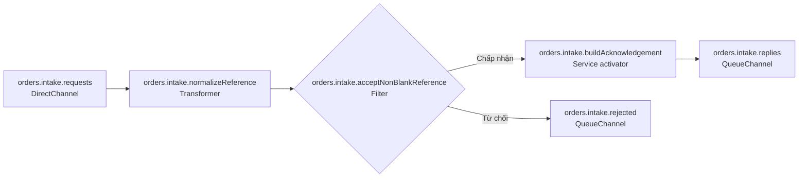

# Đặt tên các bước trong flow

**Module:** `SPRING_INTEGRATION_CORE`  
**Chương:** Mô hình message flow

Một flow có thể chạy đúng nhưng vẫn khó bảo trì nếu các bước chỉ mang tên `step1`, `transformer2` hoặc tên do framework tự sinh. Khi thông điệp bị từ chối, nhóm vận hành cần biết quy tắc nào đã từ chối nó. Khi phải thay một dịch vụ bên ngoài trong kiểm thử, người viết test cần tìm đúng thành phần của flow.

Trong phạm vi các thành phần cốt lõi của Spring Integration, bài này hướng dẫn đặt tên cho flow, `MessageChannel`, endpoint, handler và gateway. Transformer, filter, router, aggregator và luồng xử lý lỗi là những tình huống để áp dụng cùng một cách đặt tên. Mục tiêu là đọc tên để hiểu trách nhiệm của bước, đồng thời biết chính xác tên đó tham chiếu tới đối tượng nào trong Spring.

## 1. Một bước xử lý có những loại tên nào?

Xét đường đi đơn giản:

```text
Message → channel nhận yêu cầu → endpoint chuẩn hóa → channel kết quả
```

Các tên ở đây không thay thế cho nhau:

| Đối tượng | Ý nghĩa | Ví dụ |
| --- | --- | --- |
| Bean `IntegrationFlow` | Định danh toàn bộ cấu hình flow | `ordersIntakeFlow` |
| Bean `MessageChannel` | Địa chỉ trao đổi thông điệp trong ứng dụng | `orders.intake.requests` |
| Consumer endpoint | Thành phần nhận message và điều phối việc gọi handler | `orders.intake.normalizeReference` |
| Message handler | Đối tượng thực hiện hoặc ủy quyền công việc xử lý message | Có tên bean riêng; cách đặt tên phụ thuộc cấu hình |
| Bean nghiệp vụ | Đối tượng Java được handler gọi | `orderService` |
| Messaging gateway | Cổng Java để bên gọi đi vào hệ thống messaging | `ordersGateway` |
| `MessageHeaders.ID` | Nhận diện một message cụ thể | Một giá trị UUID |
| Header nghiệp vụ | Nhận diện đơn hàng, giao dịch hoặc yêu cầu | `orderId`, `requestId` |

Đối với consuming endpoint, Spring Integration phân biệt consumer và message handler thành hai bean. Với cấu hình annotation, `@EndpointId` giúp chỉ định tên consumer; quy tắc tên handler còn phụ thuộc việc phương thức có `@Bean` hay không. Đây là lý do không nên dùng từ “tên bước” khi chưa nói rõ đang chỉ endpoint hay handler. Xem [quy tắc tên endpoint và handler](https://docs.spring.io/spring-integration/reference/overview.html#endpoint-bean-names).

Ví dụ, `orders.intake.normalizeReference` trả lời câu hỏi “bước nào đang chạy?”, còn `orderId=ORD-42` trả lời “đơn hàng nào đang được xử lý?”. Đổi tên endpoint không đổi `MessageHeaders.ID` và không tự tạo header nghiệp vụ.

## 2. Xây dựng quy ước tên dễ đọc

Quy ước dưới đây là lựa chọn thiết kế cho ví dụ trong bài, không phải cú pháp bắt buộc của Spring Integration:

```text
Endpoint: <miền-nghiệp-vụ>.<flow>.<động-từ-và-đối-tượng>
Channel:  <miền-nghiệp-vụ>.<flow>.<nội-dung-hoặc-trạng-thái>
Flow:     tên bean Java mô tả một khả năng nghiệp vụ
```

Áp dụng cho tiếp nhận đơn hàng:

| Vai trò | Tên đề xuất | Người đọc hiểu được điều gì? |
| --- | --- | --- |
| Toàn bộ flow | `ordersIntakeFlow` | Flow tiếp nhận đơn hàng |
| Channel đầu vào | `orders.intake.requests` | Yêu cầu đang chờ xử lý |
| Transformer | `orders.intake.normalizeReference` | Chuẩn hóa mã tham chiếu |
| Filter | `orders.intake.acceptNonBlankReference` | Chỉ cho mã không rỗng đi tiếp |
| Handler tạo phản hồi | `orders.intake.buildAcknowledgement` | Tạo kết quả xác nhận |
| Channel kết quả | `orders.intake.replies` | Chứa kết quả xử lý |
| Channel bị từ chối | `orders.intake.rejected` | Chứa message không đạt điều kiện |
| Channel lỗi kỹ thuật | `orders.intake.errors` | Địa chỉ dành cho thông điệp lỗi khi đã được cấu hình |

Trong quy ước này, endpoint mang động từ vì nó thực hiện một việc; channel mang danh từ hoặc trạng thái vì nó là nơi message đi qua. Nhờ đó, `normalizeReference` và `normalizedReferences` gợi ra hai vai trò khác nhau.

### 2.1. Ưu tiên trách nhiệm nghiệp vụ

| Tên khó hiểu | Tên có ý nghĩa hơn | Lý do |
| --- | --- | --- |
| `step1` | `orders.intake.normalizeReference` | Không phụ thuộc vị trí trong chuỗi |
| `transformer2` | `orders.export.toPartnerDocument` | Nêu rõ dạng dữ liệu đích |
| `filterOrder` | `orders.intake.acceptPositiveTotal` | Nêu điều kiện được chấp nhận |
| `router` | `orders.fulfillment.routeByDeliveryMethod` | Nêu tiêu chí phân nhánh |
| `aggregate` | `orders.fulfillment.assembleShipmentResult` | Nêu kết quả được gom lại |
| `callApi` | `orders.payment.authorizePayment` | Nêu tác vụ của hệ thống được gọi |

Tên `validateOrder` có thể gây hiểu nhầm nếu bước chỉ kiểm tra một điều kiện rồi loại message. Khi đó, `acceptPositiveTotal` diễn đạt chính xác hơn. Nếu bước kiểm tra nhiều ràng buộc và ném lỗi khi vi phạm, `validateOrder` có thể phù hợp, miễn trách nhiệm ấy được mô tả rõ.

### 2.2. Giữ tên ổn định và vừa đủ cụ thể

Không đưa số thứ tự vào tên dùng cho vận hành. Chèn một bước kiểm tra trước `step3` sẽ khiến tên và vị trí lệch nhau, hoặc buộc đổi nhiều tên liên quan.

Không đưa `orderId`, timestamp hoặc số lần retry vào tên bean. Đây là dữ liệu của từng lần xử lý và nên nằm trong header, log hoặc thông tin trace. Tên thành phần cần ổn định giữa các message để có thể tổng hợp lỗi và so sánh số liệu.

Dùng cùng một ngôn ngữ cho tên trong mã nguồn. Bài này giải thích bằng tiếng Việt và dùng tên tiếng Anh trong Java. Dấu chấm phân chia phạm vi; phần hành động dùng camelCase. Nhóm có thể chọn kiểu khác, nhưng nên áp dụng nhất quán.

## 3. Đặt tên bằng Java DSL

### 3.1. Tên flow đến từ bean `IntegrationFlow`

```java
@Bean
public IntegrationFlow ordersIntakeFlow() {
    return IntegrationFlow.from("orders.intake.requests")
            .transform(String.class,
                    value -> value.trim(),
                    endpoint -> endpoint.id("orders.intake.normalizeReference"))
            .channel("orders.intake.replies")
            .get();
}
```

Nếu không chỉ định tên khác trong `@Bean`, tên phương thức là tên bean của flow: `ordersIntakeFlow`.

Tham số `endpoint` trong lambda là đối tượng cấu hình endpoint. Lời gọi `endpoint.id(...)` đặt tên endpoint được tạo cho bước transformer. Nó không đặt lại tên cho flow và không phải phương thức thêm header `id` vào message. Java DSL cung cấp `EndpointSpec.id()` để chỉ định tên bean endpoint thay cho tên được sinh tự động. Xem [cấu hình endpoint trong Java DSL](https://docs.spring.io/spring-integration/reference/dsl/java-endpoints.html).

### 3.2. Tên channel là địa chỉ kết nối

```java
.channel("orders.intake.replies")
```

Lời gọi này kết nối flow với channel có tên tương ứng. Nếu chưa có bean channel, DSL có thể tạo `DirectChannel` cho tên ấy. Với channel dùng chung hoặc cần kiểu cụ thể như `QueueChannel`, nên khai báo một bean rồi tham chiếu lại bằng tên hoặc đối tượng. Không tạo hai đối tượng channel riêng biệt có cùng tên trong hai flow. Xem [cách Java DSL tạo và tham chiếu channel](https://docs.spring.io/spring-integration/reference/dsl/java-channels.html).

Một tên như `orders.intake.replies` không nói channel là đồng bộ hay bất đồng bộ, có lưu bền vững hay không. Những đặc tính đó phụ thuộc lớp channel và cấu hình thực tế.

### 3.3. Tên tự sinh có vai trò gì?

Framework vẫn có thể nối các bước bằng channel nội bộ và sinh tên cho thành phần chưa được đặt tên. Những tên như `ordersIntakeFlow.channel#0` hữu ích khi xem cấu trúc ứng dụng, nhưng không nên được xem là giao diện ổn định cho test hoặc công cụ vận hành. Thêm một bước có thể làm thay đổi phần đánh số. Xem [mô hình tên thành phần được sinh trong Java DSL](https://docs.spring.io/spring-integration/docs/6.1.x/reference/html/dsl.html).

Nên đặt tên tường minh cho:

- Bước có quy tắc nghiệp vụ cần được nhận diện khi xảy ra lỗi.
- Endpoint cần start/stop hoặc tham chiếu từ công cụ quản trị.
- Channel là đầu vào, đầu ra, nhánh từ chối hoặc điểm nối giữa các flow.
- Thành phần cần thay thế hoặc chặn lại trong kiểm thử tích hợp.

Không cần chèn channel có tên sau mọi dòng DSL chỉ để đánh dấu bước. Đặt ID cho endpoint đã đủ trong nhiều trường hợp.

## 4. Ví dụ đầy đủ: tiếp nhận mã tham chiếu đơn hàng

Ví dụ sử dụng Java 17 và API Java DSL của Spring Integration 6.x. Cấu hình độc lập cần `spring-integration-core` cùng các thư viện Spring tương thích. Đây là flow xử lý trong bộ nhớ, dùng chuỗi để tập trung vào cách đặt tên.

Quy tắc xử lý:

1. Nhận một chuỗi mã tham chiếu.
2. Xóa khoảng trắng ở hai đầu và chuyển thành chữ hoa.
3. Chuyển chuỗi rỗng sang channel bị từ chối.
4. Với chuỗi hợp lệ, tạo phản hồi dạng `ACCEPTED:<mã>`.



Tạo lớp `OrdersFlowConfig` trong package của ví dụ:

```java
package example.integration;

import java.util.Locale;

import org.springframework.context.annotation.Bean;
import org.springframework.context.annotation.Configuration;
import org.springframework.integration.channel.DirectChannel;
import org.springframework.integration.channel.QueueChannel;
import org.springframework.integration.config.EnableIntegration;
import org.springframework.integration.dsl.IntegrationFlow;

@Configuration
@EnableIntegration
public class OrdersFlowConfig {

    public static final String REQUESTS = "orders.intake.requests";
    public static final String REPLIES = "orders.intake.replies";
    public static final String REJECTED = "orders.intake.rejected";

    public static final String NORMALIZE =
            "orders.intake.normalizeReference";
    public static final String ACCEPT_NON_BLANK =
            "orders.intake.acceptNonBlankReference";
    public static final String BUILD_ACK =
            "orders.intake.buildAcknowledgement";

    @Bean(name = REQUESTS)
    public DirectChannel requestsChannel() {
        return new DirectChannel();
    }

    @Bean(name = REPLIES)
    public QueueChannel repliesChannel() {
        return new QueueChannel();
    }

    @Bean(name = REJECTED)
    public QueueChannel rejectedChannel() {
        return new QueueChannel();
    }

    @Bean
    public IntegrationFlow ordersIntakeFlow() {
        return IntegrationFlow.from(REQUESTS)
                .transform(String.class,
                        value -> value.trim().toUpperCase(Locale.ROOT),
                        endpoint -> endpoint.id(NORMALIZE))
                .filter(String.class,
                        value -> !value.isBlank(),
                        endpoint -> endpoint
                                .id(ACCEPT_NON_BLANK)
                                .discardChannel(REJECTED))
                .handle(String.class,
                        (reference, headers) -> "ACCEPTED:" + reference,
                        endpoint -> endpoint.id(BUILD_ACK))
                .channel(REPLIES)
                .get();
    }
}
```

Các hằng số giúp cấu hình và test dùng chung tên. Không bắt buộc phải đưa mọi tên bean trong ứng dụng vào một lớp hằng số khổng lồ; nên giữ các tên thuộc cùng flow gần cấu hình của flow đó.

Trong ví dụ:

- `@Bean(name = REQUESTS)` đặt tên bean channel; tên bean là `orders.intake.requests`, không phải `requestsChannel`.
- `ordersIntakeFlow` là tên bean flow vì `@Bean` của phương thức này không chỉ định tên khác.
- Ba lời gọi `.id(...)` nhận diện ba consumer endpoint có trách nhiệm riêng.
- `.channel(REPLIES)` khai báo nơi nhận kết quả, không đổi tên bước tạo phản hồi.
- `REJECTED` chứa message bị filter từ chối; tại thời điểm đó payload đã được bước trước chuẩn hóa.

`discardChannel` dành cho message không qua selector. Việc từ chối theo quy tắc nghiệp vụ không tự đồng nghĩa với ngoại lệ kỹ thuật. Filter còn có lựa chọn `throwExceptionOnRejection` nếu thiết kế yêu cầu ném lỗi. Xem [hành vi của Message Filter](https://docs.spring.io/spring-integration/reference/6.3/filter.html).

Với payload `"  ord-42  "`, channel kết quả nhận `"ACCEPTED:ORD-42"`. Với payload `"   "`, channel bị từ chối nhận chuỗi rỗng và channel kết quả không nhận message nào.

## 5. Endpoint, handler và POJO nghiệp vụ

Một dòng DSL như `.handle(orderService, "register", ...)` có thể liên quan đến ba đối tượng:

```text
Consumer endpoint → MessageHandler thích ứng → orderService.register(...)
```

Đặt tên endpoint `orders.intake.registerOrder` không đổi tên bean `orderService` và không đổi tên phương thức `register`.

Khi tra cứu bean, cần biết mục đích:

| Mục đích | Đối tượng thường cần |
| --- | --- |
| Điều khiển vòng đời bước xử lý | Endpoint |
| Thay thế việc xử lý message trong một bài test | Handler hoặc cơ chế mock tương ứng |
| Kiểm thử quy tắc nghiệp vụ độc lập | POJO nghiệp vụ |
| Gửi message vào flow | Channel hoặc messaging gateway |

Không suy ra rằng mọi cấu hình đều sinh handler có tên `<endpoint>.handler`. Đặc biệt, handler đã được khai báo bằng `@Bean` có tên riêng. Khi cần tra cứu handler, hãy dùng quy tắc của kiểu cấu hình đang áp dụng hoặc kiểm tra tên và kiểu bean thực tế.

### 5.1. Cấu hình annotation với `@EndpointId`

Đoạn sau là một phương án minh họa riêng, thay cho bước tương đương trong DSL; không nạp đồng thời hai cấu hình có cùng endpoint ID.

```java
package example.integration;

import java.util.Locale;

import org.springframework.integration.annotation.EndpointId;
import org.springframework.integration.annotation.Transformer;
import org.springframework.stereotype.Component;

@Component
public class ReferenceNormalizer {

    @EndpointId("orders.intake.normalizeReference")
    @Transformer(
            inputChannel = "orders.intake.rawReferences",
            outputChannel = "orders.intake.normalizedReferences")
    public String normalize(String reference) {
        return reference.trim().toUpperCase(Locale.ROOT);
    }
}
```

Với POJO được Spring phát hiện bằng component scanning và phương thức không có `@Bean`, các tên tương ứng là:

```text
POJO:      referenceNormalizer
Consumer:  orders.intake.normalizeReference
Handler:   orders.intake.normalizeReference.handler
```

Nếu dùng phương thức `@Bean` để trả về handler, tên handler theo `@Bean`, còn `@EndpointId` đặt tên consumer. Vì vậy cần phân biệt hai trường hợp trước khi dùng tên để tra cứu hoặc thay thế thành phần. Xem [Javadoc của `@EndpointId`](https://docs.spring.io/spring-integration/api/org/springframework/integration/annotation/EndpointId.html).

## 6. Áp dụng cho các mẫu xử lý khác

### 6.1. Transformer, filter, router và aggregator

| Mẫu | Câu hỏi giúp chọn tên endpoint | Ví dụ |
| --- | --- | --- |
| Transformer | Đầu vào được biến đổi thành dạng nào? | `orders.export.toPartnerDocument` |
| Filter | Điều kiện nào cho phép message đi tiếp? | `orders.intake.acceptSupportedCurrency` |
| Router | Tiêu chí nào quyết định nhánh? | `orders.fulfillment.routeByDeliveryMethod` |
| Aggregator | Các phần được gom thành kết quả gì? | `orders.fulfillment.assembleShipmentResult` |
| Service activator | Tác vụ nghiệp vụ nào được gọi? | `orders.payment.authorizePayment` |
| Gateway endpoint gọi flow khác | Đang yêu cầu khả năng nào? | `orders.payment.requestAuthorization` |

Với router, đặt tên riêng cho endpoint chọn nhánh và channel của từng nhánh:

```text
Endpoint: orders.fulfillment.routeByDeliveryMethod
Nhánh:    orders.fulfillment.homeDelivery
Nhánh:    orders.fulfillment.storePickup
Dự phòng: orders.fulfillment.unsupportedDelivery
```

Tên `homeDelivery` là tên channel trong quy ước của bài. Giá trị khóa mà router trả về có thể là `HOME`, được cấu hình ánh xạ sang channel ấy. Đổi tên channel không tự đổi khóa nghiệp vụ trong payload hoặc header.

Với aggregator, tên endpoint `assembleShipmentResult` mô tả công việc gom kết quả. Tên endpoint không phải correlation key và không thay cho chiến lược xác định message thuộc cùng một nhóm. Chẳng hạn, các message cùng `orderId` có thể được gom theo cấu hình correlation; việc đặt ID cho endpoint không tạo cấu hình đó.

### 6.2. Gateway cần phân biệt tên bean và channel đích

Messaging gateway cho bên gọi Java một phương thức để gửi message vào flow. Tên gateway như `ordersGateway` giúp nhận diện bean proxy; `orders.intake.requests` vẫn là tên channel đích. Với gateway dựng từ interface trong DSL, framework có cơ chế định danh gateway riêng. Xem [gateway trong định nghĩa IntegrationFlow](https://docs.spring.io/spring-integration/docs/6.1.x/reference/html/dsl.html#java-dsl-gateway).

Nếu gateway cần trả kết quả, phải thiết kế đường reply tương ứng. Ví dụ ở mục 4 chủ động đưa kết quả vào `QueueChannel` có tên. Chỉ đặt tên một gateway rồi trỏ vào đầu vào của ví dụ không tự làm kết quả trong queue quay về giá trị trả về của phương thức gateway.

### 6.3. Phạm vi tên phải bao quát toàn ApplicationContext

Hai flow khai báo cùng endpoint ID `normalizeReference` trong cùng context có thể xung đột. Hai tên bean flow khác nhau không tự bảo đảm những ID tường minh bên trong chúng khác nhau.

Đặt phạm vi rõ ràng:

```text
orders.intake.normalizeReference
returns.intake.normalizeReference
```

Một channel dùng chung thì nên là một bean chung được nhiều flow tham chiếu. Hai đối tượng channel được tạo riêng và vô tình có cùng tên là một lỗi cấu hình, không phải cách chia sẻ channel.

Khi đăng ký nhiều bản sao của flow ở runtime, `IntegrationFlowContext` có tùy chọn `useFlowIdAsPrefix()` để thêm flow ID vào tên thành phần và tránh va chạm. Cơ chế này đòi hỏi flow ID tường minh; đừng giả định nó đã được bật cho mọi flow khai báo bằng `@Bean`. Xem [đăng ký flow động và tiền tố flow ID](https://docs.spring.io/spring-integration/reference/dsl/java-runtime-flows.html).

## 7. Dùng tên để tìm lỗi và quan sát flow

Tên tốt giúp kết nối ba thông tin:

```text
Bước xử lý: orders.intake.normalizeReference
Dữ liệu:    orderId=ORD-42
Ngữ cảnh:   requestId=req-817
```

Endpoint ID nhận diện thành phần, còn các giá trị header nhận diện lần xử lý. Khi đọc log, trước hết tìm bước, sau đó dùng thông tin nghiệp vụ hoặc trace để lần theo message. Không nên giả định chỉ đặt ID là mọi log sẽ tự in đủ ba thông tin; cần cấu hình logging, tracing hoặc instrumentation phù hợp.

### 7.1. Tên channel không tự cấu hình xử lý lỗi

Khai báo bean `orders.intake.errors` chỉ tạo một channel có tên. Để nhận lỗi, cần có đường gửi lỗi tương ứng, chẳng hạn header `errorChannel` và cơ chế xử lý lỗi phù hợp với nơi message chạy.

Với lời gọi đồng bộ qua `DirectChannel`, ngoại lệ có thể truyền về bên gửi. Với xử lý bất đồng bộ hoặc polling, lỗi thường được xử lý qua cơ chế phát `ErrorMessage` của hạ tầng tương ứng. Vì vậy, khi tìm lỗi phải xem cả tên endpoint lẫn ranh giới thực thi. Xem [cơ chế xử lý lỗi của Spring Integration](https://docs.spring.io/spring-integration/reference/error-handling.html).

Trong thiết kế tên, nên tách rõ:

| Tên | Ý nghĩa thiết kế |
| --- | --- |
| `orders.intake.rejected` | Message không đạt quy tắc chấp nhận |
| `orders.intake.errors` | Thông điệp lỗi kỹ thuật khi đường xử lý lỗi đã được nối |
| `orders.intake.recordFailure` | Endpoint ghi nhận hoặc xử lý thất bại |

Tên `retryPayment` chỉ phù hợp nếu chính bước đó có trách nhiệm retry. Nếu retry được áp dụng bằng advice quanh một bước gọi dịch vụ, tên endpoint vẫn có thể là `authorizePayment`; không cần đổi tên theo số lần thử.

## 8. Kiểm thử hành vi qua các channel có tên

Kiểm thử nên gửi message vào đầu vào thật của flow rồi kiểm tra kết quả hoặc nhánh bị từ chối. Cách này đồng thời chứng minh các channel có tên đã được nối đúng.

Ví dụ bên dưới dùng cấu hình ở mục 4, JUnit Jupiter và `spring-test`. Chạy trong một dự án đã có các dependency tương thích; đây không phải cấu hình Spring Boot nên không cần khởi động cả ứng dụng.

```java
package example.integration;

import org.junit.jupiter.api.Test;
import org.springframework.beans.factory.annotation.Autowired;
import org.springframework.beans.factory.annotation.Qualifier;
import org.springframework.integration.channel.QueueChannel;
import org.springframework.messaging.Message;
import org.springframework.messaging.MessageChannel;
import org.springframework.messaging.support.MessageBuilder;
import org.springframework.test.context.junit.jupiter.SpringJUnitConfig;

import static org.junit.jupiter.api.Assertions.assertEquals;
import static org.junit.jupiter.api.Assertions.assertNotNull;
import static org.junit.jupiter.api.Assertions.assertNull;
import static org.junit.jupiter.api.Assertions.assertTrue;

@SpringJUnitConfig(OrdersFlowConfig.class)
class OrdersFlowConfigTest {

    @Autowired
    @Qualifier(OrdersFlowConfig.REQUESTS)
    MessageChannel requests;

    @Autowired
    @Qualifier(OrdersFlowConfig.REPLIES)
    QueueChannel replies;

    @Autowired
    @Qualifier(OrdersFlowConfig.REJECTED)
    QueueChannel rejected;

    @Test
    void normalizesReferenceAndBuildsAcknowledgement() {
        Message<String> request = MessageBuilder
                .withPayload("  ord-42  ")
                .setHeader("orderId", "ORD-42")
                .build();

        assertTrue(requests.send(request));

        Message<?> reply = replies.receive(1000);
        assertNotNull(reply);
        assertEquals("ACCEPTED:ORD-42", reply.getPayload());
        assertEquals("ORD-42", reply.getHeaders().get("orderId"));
        assertNull(rejected.receive(0));
    }

    @Test
    void rejectsReferenceThatBecomesBlankAfterNormalization() {
        assertTrue(requests.send(
                MessageBuilder.withPayload("   ").build()));

        Message<?> discarded = rejected.receive(1000);
        assertNotNull(discarded);
        assertEquals("", discarded.getPayload());
        assertNull(replies.receive(0));
    }
}
```

`@Qualifier` tìm đúng bean theo tên dù ứng dụng có nhiều channel cùng kiểu. Test kiểm tra payload, header và hướng đi; không chỉ kiểm tra rằng một bean tồn tại.

Ở ví dụ này, đầu vào là `DirectChannel`, còn hai đầu ra là queue trong bộ nhớ. Khi lệnh `send` hoàn tất, chuỗi xử lý đồng bộ đã thực hiện việc gửi vào queue tương ứng. Nếu thay bằng `ExecutorChannel` hoặc thêm ranh giới bất đồng bộ, cách chờ kết quả và kiểm tra không có message cần được điều chỉnh.

Khi cần mock một endpoint tích hợp với hệ thống ngoài, Spring Integration có `MockIntegrationContext` và API thay thế handler. Phải cung cấp tên endpoint theo API đó yêu cầu, không nhầm với tên bean dịch vụ nghiệp vụ. Xem [hỗ trợ kiểm thử tích hợp](https://docs.spring.io/spring-integration/reference/testing.html).

## 9. Những lỗi đặt tên thường gặp

| Lỗi | Hệ quả | Cách sửa |
| --- | --- | --- |
| Dùng cùng tên cho flow, channel và endpoint | Khó đọc cấu hình, có thể xung đột bean | Chia rõ tên flow, địa chỉ channel và hành động endpoint |
| Chỉ đổi tên phương thức Java | Endpoint có thể vẫn mang ID cũ hoặc tên tự sinh | Đặt ID ở đúng cấu hình endpoint |
| Tưởng `.channel("normalizeReference")` đặt tên transformer | Tạo hoặc tham chiếu một channel thay vì đổi tên endpoint | Đặt tên qua lambda cấu hình `.id(...)` |
| Dùng `step1`, `step2` làm hợp đồng với test | Chèn bước làm tên lệch ý nghĩa | Dùng trách nhiệm nghiệp vụ ổn định |
| Dùng tên tự sinh có `#0` trong công cụ quản trị | Refactor cấu trúc có thể làm tham chiếu không còn đúng | Chỉ định ID cho điểm cần quản trị |
| Đưa mã đơn hàng vào tên thành phần | Khó tổng hợp log và số liệu theo bước | Giữ tên tĩnh, đưa mã đơn vào header |
| Đặt tên `errors` nhưng chưa nối đường lỗi | Channel không nhận lỗi như mong đợi | Cấu hình cơ chế gửi lỗi và consumer tương ứng |
| Đổi endpoint ID mà bỏ sót nơi tham chiếu | Test, cấu hình quản trị hoặc quy tắc quan sát bị lệch | Tìm và cập nhật các tham chiếu trước khi triển khai |

Đổi tên bean channel có thể làm thay đổi địa chỉ mà gateway, router hoặc flow khác đang sử dụng. Đổi endpoint ID có thể ảnh hưởng test, cấu hình điều khiển vòng đời và công cụ quan sát. Hai loại đổi tên cần được xem xét theo các phụ thuộc riêng.

## 10. Thực hành đặt tên trước khi nối flow

Với một flow tiếp nhận đơn hàng rồi gửi yêu cầu thanh toán, hãy viết danh sách trách nhiệm trước:

```text
Nhận yêu cầu
→ Chuẩn hóa dữ liệu
→ Chỉ nhận loại tiền tệ được hỗ trợ
→ Yêu cầu cấp phép thanh toán
→ Tạo kết quả tiếp nhận
```

Một bộ tên nhất quán có thể là:

```text
Flow:      ordersIntakeFlow
Input:     orders.intake.requests
Endpoint:  orders.intake.normalizeOrder
Endpoint:  orders.intake.acceptSupportedCurrency
Endpoint:  orders.payment.requestAuthorization
Endpoint:  orders.intake.buildAcknowledgement
Output:    orders.intake.replies
Rejected:  orders.intake.rejected
Errors:    orders.intake.errors
```

Sau đó gắn từng tên với đúng đối tượng: channel là điểm trao đổi message, endpoint là bước xử lý, gateway là cổng gọi. Với mỗi endpoint, mô tả thêm đầu vào, đầu ra và hành vi thất bại trong một câu. Nếu chưa mô tả được ngắn gọn, bước đó có thể đang chứa nhiều trách nhiệm hoặc tên đang quá chung chung.

Khi bổ sung router, aggregator hay xử lý lỗi, tiếp tục dùng cùng quy ước phạm vi và trách nhiệm. Một tên hữu ích cho phép người đọc nối được mã Java DSL, sơ đồ flow, thông điệp log và điểm kiểm thử mà không phải đoán ý nghĩa từ vị trí của bước.