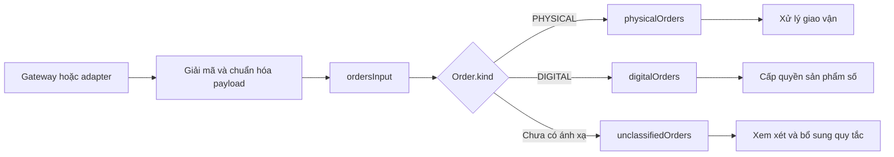

# Router theo payload

Trong chương **Router** của module **SPRING_INTEGRATION_CORE**, router theo payload giúp chọn luồng xử lý dựa trên dữ liệu của thông điệp. Ví dụ, một cổng nhận đơn hàng có thể chuyển đơn hàng vật lý sang luồng giao vận và đơn hàng số sang luồng cấp quyền tải xuống.

Bài này đặt router vào quan hệ với các thành phần cốt lõi của Spring Integration: gateway đưa yêu cầu vào hệ thống, `Message` mang dữ liệu, `MessageChannel` nối các bước, còn endpoint thực hiện quyết định hoặc công việc của từng bước. Trọng tâm là thiết kế quyết định định tuyến bằng Java DSL, xử lý trường hợp không có tuyến và kiểm thử kết quả.

## 1. Mục tiêu và kiến thức cần có

Sau bài học, bạn có thể:

- Phân biệt định tuyến theo **kiểu Java của payload** và theo **giá trị bên trong payload**.
- Viết luồng Java DSL ánh xạ khóa nghiệp vụ sang các kênh đích.
- Dùng `PayloadTypeRouter` khi các loại thông điệp có các kiểu Java khác nhau.
- Thiết kế tuyến mặc định và phân biệt dữ liệu chưa được hỗ trợ với lỗi của hệ thống.
- Kiểm thử payload, header và tính độc lập giữa các nhánh.

Bạn nên biết `Message<T>`, `DirectChannel`, `QueueChannel`, khai báo Spring bean và khái niệm `IntegrationFlow`. Các ví dụ dùng Java 17 trở lên và `spring-integration-core` với Java DSL được tích hợp sẵn. Phiên bản thư viện theo cấu hình quản lý dependency của dự án. Phần kiểm thử dùng JUnit Jupiter.

## 2. Router đưa ra quyết định gì?

Một thông điệp có thể được hình dung như sau:

```text
Message<Order>
├── payload: Order(id="O-101", kind=PHYSICAL)
└── headers: traceId="trace-101", ...
```

Với router theo payload, hàm quyết định đọc `Order` để chọn đích:

```text
Order -> khóa định tuyến -> ánh xạ -> MessageChannel đích
```

Ví dụ:

```text
Order("O-101", PHYSICAL) -> "PHYSICAL" -> physicalOrders
Order("O-102", DIGITAL)  -> "DIGITAL"  -> digitalOrders
```

**Khóa định tuyến và tên kênh là hai khái niệm riêng.** `PHYSICAL` diễn đạt loại đơn hàng; `physicalOrders` là tên bean của một kênh trong cấu hình tích hợp. Tách hai khái niệm này giúp thay đổi cách tổ chức luồng mà không phải sửa mô hình dữ liệu nghiệp vụ.

Trong bài này, mỗi đơn hàng chọn đúng một kênh đích. Router nói chung có thể được cấu hình để gửi đến nhiều đích; yêu cầu phát cùng thông điệp đến nhiều bộ phận cần một thiết kế riêng về phát tin và phối hợp kết quả.

Router không biến kết quả của hàm định tuyến thành payload mới. Nếu hàm trả về chuỗi `PHYSICAL`, kênh đích vẫn nhận thông điệp chứa `Order`. Khi cần đổi JSON thành DTO hoặc chuẩn hóa dữ liệu, hãy thực hiện bằng transformer ở bước thích hợp.

Java DSL hỗ trợ cấu hình router bằng lambda, biểu thức, phương thức của đối tượng và các router chuyên dụng. Với lambda, khai báo rõ kiểu đầu vào và kiểu khóa giúp người đọc nhận ra hợp đồng của quyết định. [Tham khảo Java DSL cho router](https://docs.spring.io/spring-integration/reference/dsl/java-routers.html).

## 3. Hai cách hiểu của “theo payload”

| Cách định tuyến | Câu hỏi được trả lời | Ví dụ đầu vào | Công cụ phù hợp |
| --- | --- | --- | --- |
| Theo kiểu payload | Payload thuộc loại đối tượng nào? | `PhysicalOrder`, `DigitalOrder` | `PayloadTypeRouter` |
| Theo giá trị trong payload | Đối tượng này mang thông tin nghiệp vụ gì? | `Order.kind()` là `PHYSICAL` hoặc `DIGITAL` | Lambda, POJO hoặc biểu thức trong `.route(...)` |
| Theo header | Thông tin điều khiển bên ngoài payload là gì? | Header `tenantId`, `region` | Router đọc header; không phải trọng tâm bài này |

Hai đơn hàng cùng là `Order` nhưng khác `kind` không thể được phân biệt chỉ bằng `PayloadTypeRouter`. Ngược lại, nếu thông điệp được mô hình hóa thành hai lớp độc lập, kiểm tra kiểu có thể là lựa chọn đơn giản.

Kiểu mà router quan sát là kiểu của đối tượng đang nằm trong thông điệp tại thời điểm đó. Chuỗi JSON chứa trường `kind` vẫn là `String` nếu chưa được giải mã. Một JSON object đã chuyển thành `Map` cũng chưa trở thành `Order`.



Bước giải mã chỉ cần khi nguồn bên ngoài chưa tạo được `Order`. Trong ví dụ Java dưới đây, phía gửi xây dựng `Order` trực tiếp.

## 4. Ví dụ hoàn chỉnh: định tuyến theo loại đơn hàng

### 4.1. Hợp đồng định tuyến

Hệ thống đã hỗ trợ hai nhánh nghiệp vụ và dành một nhánh cho dữ liệu chưa được phân loại:

| Giá trị `kind` | Khóa do hàm trả về | Kênh nhận | Chính sách |
| --- | --- | --- | --- |
| `PHYSICAL` | `PHYSICAL` | `physicalOrders` | Xử lý đơn hàng vật lý |
| `DIGITAL` | `DIGITAL` | `digitalOrders` | Xử lý đơn hàng số |
| `SERVICE` | `SERVICE` | `unclassifiedOrders` | Chưa hỗ trợ trong luồng hiện tại |
| `null` | `UNKNOWN` | `unclassifiedOrders` | Thiếu dữ liệu phân loại |

Cho phép `kind == null` trong ví dụ là một quyết định nghiệp vụ có chủ đích để minh họa tuyến mặc định. Một hệ thống yêu cầu loại đơn hàng bắt buộc có thể từ chối dữ liệu này ở bước kiểm tra đầu vào.

### 4.2. Cấu hình Java

Đặt đoạn sau trong `PayloadRoutingConfig.java` của một dự án Java đã có Spring Integration:

```java
package demo.integration;

import org.springframework.context.annotation.Bean;
import org.springframework.context.annotation.Configuration;
import org.springframework.integration.channel.DirectChannel;
import org.springframework.integration.channel.QueueChannel;
import org.springframework.integration.config.EnableIntegration;
import org.springframework.integration.dsl.IntegrationFlow;
import org.springframework.messaging.MessageChannel;

@Configuration
@EnableIntegration
public class PayloadRoutingConfig {

    public enum OrderKind {
        PHYSICAL, DIGITAL, SERVICE
    }

    public record Order(String id, OrderKind kind) {
    }

    @Bean
    public MessageChannel ordersInput() {
        return new DirectChannel();
    }

    @Bean
    public QueueChannel physicalOrders() {
        return new QueueChannel();
    }

    @Bean
    public QueueChannel digitalOrders() {
        return new QueueChannel();
    }

    @Bean
    public QueueChannel unclassifiedOrders() {
        return new QueueChannel();
    }

    public static String routeKey(Order order) {
        return order.kind() == null
                ? "UNKNOWN"
                : order.kind().name();
    }

    @Bean
    public IntegrationFlow orderRoutingFlow() {
        return IntegrationFlow.from("ordersInput")
                .<Order, String>route(
                        PayloadRoutingConfig::routeKey,
                        router -> router
                                .channelMapping(
                                        "PHYSICAL", "physicalOrders")
                                .channelMapping(
                                        "DIGITAL", "digitalOrders")
                                .channelKeyFallback(false)
                                .resolutionRequired(true)
                                .defaultOutputChannel(
                                        "unclassifiedOrders"))
                .get();
    }
}
```

Các bean `QueueChannel` đóng vai trò hộp thư đích để quan sát hoặc kiểm thử; cấu hình này chưa thêm endpoint tiêu thụ các hộp thư. Nếu nối một luồng tiêu thụ vào `QueueChannel`, luồng đó cần cơ chế polling phù hợp. Việc gửi vào queue và việc xử lý xong nghiệp vụ là hai mốc khác nhau.

### 4.3. Đọc cấu hình theo đường đi của một message

Với `Order("O-101", PHYSICAL)`:

1. `ordersInput` nhận thông điệp trên một `DirectChannel`.
2. Endpoint router gọi `routeKey` với payload kiểu `Order`.
3. Hàm trả về khóa `PHYSICAL`.
4. `channelMapping` ánh xạ khóa này sang bean `physicalOrders`.
5. Thông điệp chứa `Order` được đưa vào queue đó.

`<Order, String>` cho biết kiểu payload mà hàm mong đợi và kiểu khóa mà hàm trả về. Nó không thay thế việc giải mã và kiểm tra hợp đồng dữ liệu ở đầu hệ thống.

Cấu hình có ba lựa chọn quan trọng:

- `channelKeyFallback(false)`: khóa chưa có ánh xạ không được dùng tiếp như tên kênh.
- `resolutionRequired(true)`: một tên kênh đã được chọn phải phân giải được thành `MessageChannel`; sai tên cấu hình cần được phát hiện.
- `defaultOutputChannel("unclassifiedOrders")`: khi quyết định định tuyến không tìm ra kênh đích, đưa thông điệp vào nhánh đã quy định.

Vì vậy, `SERVICE` không có ánh xạ sẽ đi vào `unclassifiedOrders`. Nếu ánh xạ `PHYSICAL` trỏ nhầm sang một bean không tồn tại, đó là lỗi phân giải kênh; cấu hình trên yêu cầu báo lỗi.

Các tùy chọn ánh xạ và phân giải thuộc nhóm API của `AbstractMappingMessageRouter`. Khai báo `channelKeyFallback(false)` rõ ràng làm cho ý định chỉ dùng các khóa đã ánh xạ dễ nhận biết khi đọc cấu hình. [API ánh xạ khóa sang kênh](https://docs.spring.io/spring-integration/api/org/springframework/integration/router/AbstractMappingMessageRouter.html).

### 4.4. Gửi thử và quan sát đích

Đoạn sau là một chương trình minh họa riêng, đặt trong `PayloadRouterDemo.java` cùng package:

```java
package demo.integration;

import org.springframework.context.annotation.AnnotationConfigApplicationContext;
import org.springframework.integration.channel.QueueChannel;
import org.springframework.messaging.Message;
import org.springframework.messaging.MessageChannel;
import org.springframework.messaging.support.MessageBuilder;

import demo.integration.PayloadRoutingConfig.Order;
import demo.integration.PayloadRoutingConfig.OrderKind;

public class PayloadRouterDemo {

    public static void main(String[] args) {
        try (var context = new AnnotationConfigApplicationContext(
                PayloadRoutingConfig.class)) {

            MessageChannel input = context.getBean(
                    "ordersInput", MessageChannel.class);

            input.send(MessageBuilder
                    .withPayload(new Order("O-101", OrderKind.PHYSICAL))
                    .setHeader("traceId", "trace-101")
                    .build());

            QueueChannel physical = context.getBean(
                    "physicalOrders", QueueChannel.class);
            QueueChannel digital = context.getBean(
                    "digitalOrders", QueueChannel.class);

            Message<?> routed = physical.receive(1000);
            if (routed == null) {
                throw new IllegalStateException(
                        "Không nhận được đơn hàng vật lý");
            }

            System.out.println(routed.getPayload());
            System.out.println(routed.getHeaders().get("traceId"));
            System.out.println(digital.receive(0));
        }
    }
}
```

Kết quả quan sát mong đợi:

```text
Order[id=O-101, kind=PHYSICAL]
trace-101
null
```

`receive(1000)` chờ tối đa 1.000 mili giây. `receive(0)` kiểm tra ngay queue còn lại. Không cần `Thread.sleep` để chờ luồng này: router chạy đồng bộ khi gửi vào `DirectChannel`, rồi đưa kết quả vào queue trước khi lệnh gửi hoàn tất thành công.

## 5. Khi nào dùng PayloadTypeRouter?

Giả sử hợp đồng thông điệp được thiết kế thành các kiểu riêng:

```java
public record PhysicalOrder(String id) {
}

public record DigitalOrder(String id) {
}
```

Khi đó, router có thể chọn kênh từ kiểu payload. Để thử cách này, thêm import sau vào `PayloadRoutingConfig`:

```java
import org.springframework.integration.router.PayloadTypeRouter;
```

Sau đó thêm hai record ở trên và hai bean dưới đây vào trong lớp cấu hình. Ví dụ này dùng một kênh đầu vào riêng và tái sử dụng ba queue đã khai báo:

```java
@Bean
public MessageChannel typedOrdersInput() {
    return new DirectChannel();
}

@Bean
public IntegrationFlow typedOrderRoutingFlow() {
    PayloadTypeRouter router = new PayloadTypeRouter();
    router.setChannelMapping(
            PhysicalOrder.class.getName(), "physicalOrders");
    router.setChannelMapping(
            DigitalOrder.class.getName(), "digitalOrders");
    router.setChannelKeyFallback(false);
    router.setResolutionRequired(true);
    router.setDefaultOutputChannelName("unclassifiedOrders");

    return IntegrationFlow.from("typedOrdersInput")
            .route(router)
            .get();
}
```

`PayloadTypeRouter` là router chuyên dụng do Spring Integration cung cấp; Java DSL có thể gắn trực tiếp đối tượng router vào một flow. Dùng `Class.getName()` để tạo khóa kiểu giúp tránh gõ sai tên lớp đầy đủ, kể cả khi các lớp nằm bên trong lớp khác. [Các router được Spring Integration cung cấp](https://docs.spring.io/spring-integration/reference/router/implementations.html).

Hành vi mong đợi của ví dụ:

| Payload gửi vào `typedOrdersInput` | Kênh nhận |
| --- | --- |
| `new PhysicalOrder("P-1")` | `physicalOrders` |
| `new DigitalOrder("D-1")` | `digitalOrders` |
| Chuỗi JSON `{"kind":"PHYSICAL"}` | `unclassifiedOrders` vì payload vẫn là `String` |
| `new Order("O-1", OrderKind.PHYSICAL)` | `unclassifiedOrders` vì chưa ánh xạ kiểu `Order` |

### 5.1. Kế thừa và tính đặc hiệu

`PayloadTypeRouter` có thể xét phân cấp kiểu payload khi chọn ánh xạ phù hợp. Nó không chỉ thực hiện đúng một phép so sánh chuỗi với `payload.getClass().getName()`. Nếu dùng lớp cha hoặc interface chung làm khóa, hãy kiểm thử các lớp con đại diện và tránh các ánh xạ chồng lấn khó hiểu. [API của PayloadTypeRouter](https://docs.spring.io/spring-integration/api/org/springframework/integration/router/PayloadTypeRouter.html).

Điều này khác với tự viết lambda `Object::getClass` rồi ánh xạ từng `Class`: lambda đó trả về đúng lớp runtime, không tự bổ sung thuật toán tìm ánh xạ theo phân cấp kiểu.

Kiểu generic của phần tử cũng không đủ để phân biệt các collection sau khi type erasure. Ví dụ, `List<PhysicalOrder>` và `List<DigitalOrder>` có thể đều có payload runtime là `ArrayList`. Nếu cần phân biệt, dùng lớp bao nghiệp vụ hoặc đọc thông tin phân loại đã được xác định rõ trong nội dung.

### 5.2. Chọn mô hình theo hợp đồng dữ liệu

Dùng router theo kiểu khi mỗi kiểu có ý nghĩa và cấu trúc xử lý riêng. Dùng router theo trường dữ liệu khi các bản tin cùng một mô hình nhưng cần phân nhánh theo trạng thái, quốc gia, loại sản phẩm hoặc mức ưu tiên.

Không nên tạo thêm nhiều lớp Java chỉ để thay thế một trường phân loại đơn giản. Cũng không nên ép mọi loại thông điệp khác nhau vào `Map<String, Object>` nếu điều đó làm mất hợp đồng dữ liệu cần kiểm tra.

## 6. Biểu thức SpEL và phương thức nghiệp vụ

Cùng quyết định theo `Order.kind()` có thể được biểu diễn bằng SpEL. Ví dụ sau **thay thế** bean `orderRoutingFlow` ở phần 4; không khai báo cả hai flow cùng tiêu thụ `ordersInput` cho một bài thử:

```java
@Bean
public IntegrationFlow orderRoutingFlow() {
    return IntegrationFlow.from("ordersInput")
            .route(
                    "payload.kind() == null ? 'UNKNOWN' : payload.kind().name()",
                    router -> router
                            .channelMapping("PHYSICAL", "physicalOrders")
                            .channelMapping("DIGITAL", "digitalOrders")
                            .channelKeyFallback(false)
                            .resolutionRequired(true)
                            .defaultOutputChannel("unclassifiedOrders"))
            .get();
}
```

Biểu thức đọc `payload`; nó không đọc header. Cú pháp gọi `kind()` thể hiện rõ rằng mô hình đang dùng Java record.

Generic router có thể lấy dữ liệu từ payload để quyết định tên hoặc khóa kênh. Việc chọn lambda hay biểu thức là cách diễn đạt quyết định, không làm thay đổi vai trò của router trong sơ đồ luồng. [Cấu hình generic router](https://docs.spring.io/spring-integration/reference/router/namespace.html).

| Cách viết | Khi phù hợp | Điểm cần cân nhắc |
| --- | --- | --- |
| Lambda ngắn | Một trường hoặc một điều kiện rõ ràng | Giữ thân lambda dễ đọc |
| Phương thức riêng | Có nhiều quy tắc và thứ tự ưu tiên | Đặt tên theo ý nghĩa nghiệp vụ; kiểm thử quyết định riêng |
| SpEL | Biểu thức nhỏ trong cấu hình | Sai tên thành phần trong biểu thức thường chỉ lộ ra khi chạy |
| `PayloadTypeRouter` | Mỗi nhánh gắn với một kiểu payload | Hiểu ánh xạ theo kiểu và phân cấp kiểu |

Không đưa thao tác cập nhật cơ sở dữ liệu, gọi thanh toán hoặc gửi email vào hàm chọn tuyến. Khi một thông điệp được gửi lại, router có thể được gọi lại; quyết định ít tác dụng phụ giúp việc thử lại và kiểm thử dễ dự đoán hơn.

Nếu có nhiều điều kiện, cần ghi rõ ưu tiên. Ví dụ, với quy tắc “đơn hàng thiếu thông tin vào nhánh xem xét; sau đó mới xét ưu tiên khách hàng; cuối cùng xét loại hàng”, bảng quyết định phải phản ánh đúng thứ tự đó. Một chuỗi điều kiện vô tình đổi thứ tự có thể làm thông điệp đi vào nhánh khác dù tất cả điều kiện riêng lẻ đều đúng.

## 7. Tuyến mặc định và lỗi là những trường hợp khác nhau

Tuyến mặc định là chính sách cho tình huống không xác định được đích; nó không phải một khối `catch` bao quanh cả hệ thống.

Đối với cấu hình của phần 4:

| Tình huống | Hành vi dự kiến | Cách xử lý phù hợp |
| --- | --- | --- |
| `kind == SERVICE` | Không có ánh xạ; đến `unclassifiedOrders` | Xem xét hỗ trợ thêm loại đơn hàng |
| `kind == null` | Hàm trả `UNKNOWN`; đến `unclassifiedOrders` | Bổ sung dữ liệu hoặc áp dụng chính sách từ chối |
| Khóa `PHYSICAL` ánh xạ đến một tên bean không tồn tại | Lỗi phân giải kênh do `resolutionRequired(true)` | Sửa cấu hình và kiểm thử context |
| Hàm `routeKey` ném exception | Quyết định định tuyến thất bại | Xử lý theo cơ chế lỗi của điểm gọi hoặc luồng |
| Gửi được vào nhánh nhưng handler của nhánh lỗi | Lỗi xử lý sau khi đã chọn tuyến | Xử lý lỗi nghiệp vụ tại nhánh phù hợp |
| Payload không đáp ứng hợp đồng `Order` | Có thể thất bại khi liên kết hoặc xử lý đối số | Kiểm tra kiểu và giải mã trước router |

`defaultOutputChannel` chỉ được dùng khi bước tìm đích không cung cấp kênh để gửi. `resolutionRequired(false)` cho phép bỏ qua việc không phân giải được tên kênh; nếu sau đó không còn đích nào và có kênh mặc định, thông điệp có thể đi vào kênh mặc định. Tùy chọn đó không tự xử lý exception do hàm nghiệp vụ hay handler phía sau ném ra. [Các tham số chung của router](https://docs.spring.io/spring-integration/reference/router/common-parameters.html).

### 7.1. Chọn chính sách theo bản chất của tình huống

**Dữ liệu hợp lệ nhưng chưa được hỗ trợ:** chuyển vào queue xem xét có thể hợp lý. Nên có người hoặc tiến trình tiêu thụ queue này, kèm tiêu chí xử lý lại.

**Dữ liệu sai hợp đồng:** có thể dùng bước validation hoặc filter để loại bỏ hay chuyển sang nhánh từ chối trước router. Không cần biểu diễn mọi lỗi dữ liệu thành một loại đơn hàng mới.

**Lỗi lập trình hoặc lỗi hạ tầng:** để lộ lỗi qua cơ chế xử lý lỗi đã thiết kế. Nếu tên bean gõ sai cũng bị coi như “loại đơn hàng mới”, hệ thống dễ tích lũy các bản tin hợp lệ trong nhánh xem xét mà không phát hiện nguyên nhân.

Không dùng `nullChannel` làm nơi mặc định trừ khi yêu cầu nghiệp vụ thực sự cho phép bỏ thông điệp. Một queue chưa được giám sát cũng chưa tạo thành quy trình khắc phục hoàn chỉnh.

### 7.2. Vì sao không phải mọi exception đều vào errorChannel?

Trong ví dụ, lệnh gửi vào `DirectChannel` gọi router đồng bộ. Exception phát sinh khi xử lý đồng bộ có thể lan về bên gọi; chỉ khai báo một bean tên `errorChannel` không có nghĩa mọi lệnh `send()` sẽ tự bắt và gửi exception vào bean đó.

Khi thêm poller, executor hoặc gateway, cần xét cơ chế xử lý lỗi và ranh giới luồng thực thi tương ứng. Nếu thông điệp đã nằm trong `QueueChannel`, lỗi của endpoint tiêu thụ sau đó thuộc giai đoạn khác với lệnh gửi ban đầu.

Tương tự, tuyến mặc định không phải cơ chế thử lại. Một đơn hàng hợp lệ gặp lỗi thanh toán không nên tự động bị đổi thành “chưa phân loại” chỉ vì handler thanh toán ném exception.

## 8. Kiểm thử kết quả định tuyến

Chỉ kiểm thử `routeKey()` chưa chứng minh luồng đã nối đúng tên kênh. Kiểm thử mức luồng cần xác nhận:

1. Kênh mong đợi nhận được thông điệp.
2. Payload và các header nghiệp vụ cần thiết được giữ lại.
3. Hai kênh còn lại không nhận cùng thông điệp trong thiết kế chỉ chọn một đích.
4. Trường hợp không có ánh xạ tuân theo tuyến mặc định.

Đặt lớp sau trong `PayloadRoutingConfigTest.java`, cùng package với cấu hình. Test tạo context mới cho mỗi phương thức để queue của các lần kiểm thử không ảnh hưởng nhau:

```java
package demo.integration;

import java.util.List;

import org.junit.jupiter.api.AfterEach;
import org.junit.jupiter.api.BeforeEach;
import org.junit.jupiter.api.Test;
import org.springframework.context.annotation.AnnotationConfigApplicationContext;
import org.springframework.integration.channel.QueueChannel;
import org.springframework.messaging.Message;
import org.springframework.messaging.MessageChannel;
import org.springframework.messaging.support.MessageBuilder;

import demo.integration.PayloadRoutingConfig.Order;
import demo.integration.PayloadRoutingConfig.OrderKind;

import static org.junit.jupiter.api.Assertions.assertEquals;
import static org.junit.jupiter.api.Assertions.assertNotNull;
import static org.junit.jupiter.api.Assertions.assertNull;
import static org.junit.jupiter.api.Assertions.assertSame;
import static org.junit.jupiter.api.Assertions.assertTrue;

class PayloadRoutingConfigTest {

    private AnnotationConfigApplicationContext context;
    private MessageChannel input;

    @BeforeEach
    void openContext() {
        context = new AnnotationConfigApplicationContext(
                PayloadRoutingConfig.class);
        input = context.getBean("ordersInput", MessageChannel.class);
    }

    @AfterEach
    void closeContext() {
        if (context != null) {
            context.close();
        }
    }

    @Test
    void routesPhysicalOrder() {
        assertRouted(
                new Order("O-101", OrderKind.PHYSICAL),
                "physicalOrders");
    }

    @Test
    void routesDigitalOrder() {
        assertRouted(
                new Order("O-102", OrderKind.DIGITAL),
                "digitalOrders");
    }

    @Test
    void routesUnsupportedKindToDefault() {
        assertRouted(
                new Order("O-103", OrderKind.SERVICE),
                "unclassifiedOrders");
    }

    @Test
    void routesMissingKindToDefault() {
        assertRouted(
                new Order("O-104", null),
                "unclassifiedOrders");
    }

    private void assertRouted(Order order, String expectedChannel) {
        Message<Order> original = MessageBuilder
                .withPayload(order)
                .setHeader("traceId", "trace-test")
                .build();

        assertTrue(input.send(original));

        QueueChannel target = context.getBean(
                expectedChannel, QueueChannel.class);
        Message<?> received = target.receive(1000);

        assertNotNull(received, "Kênh đích phải nhận được message");
        assertSame(order, received.getPayload());
        assertEquals("trace-test", received.getHeaders().get("traceId"));
        assertNull(target.receive(0), "Không được có bản sao thứ hai");

        for (String name : List.of(
                "physicalOrders", "digitalOrders", "unclassifiedOrders")) {
            if (!name.equals(expectedChannel)) {
                QueueChannel other = context.getBean(
                        name, QueueChannel.class);
                assertNull(other.receive(0),
                        "Kênh không được chọn phải rỗng: " + name);
            }
        }
    }
}
```

Các test trên minh họa hợp đồng của luồng, bao gồm việc thông điệp đến đúng đích và không bị phát nhầm sang nhánh khác. `assertSame` áp dụng vì cấu hình này không có transformer thay đối tượng payload.

Khi bổ sung `PayloadTypeRouter`, cần thêm các test cho `PhysicalOrder`, `DigitalOrder` và một kiểu chưa được ánh xạ. Nếu dựa vào kế thừa, hãy thêm lớp con cụ thể. Khi thêm ranh giới bất đồng bộ, phép kiểm tra “queue khác đang rỗng” cần một khoảng quan sát có giới hạn phù hợp với cơ chế xử lý mới.

Các ca lỗi cấu hình và exception cần được kiểm thử riêng theo mục tiêu: chẳng hạn, khóa hợp lệ nhưng tên kênh bị gõ sai phải tạo lỗi với chính sách phân giải đang dùng. Chúng không nên được gộp với ca “loại đơn hàng chưa hỗ trợ”.

## 9. Những lỗi thiết kế thường gặp

### 9.1. Lấy tên kênh trực tiếp từ dữ liệu bên ngoài

Nếu payload có trường như `destination`, việc trả nguyên trường này để chọn bean kênh khiến hợp đồng nghiệp vụ phụ thuộc vào chi tiết bên trong ứng dụng. Thiết kế với tập khóa xác định và ánh xạ rõ ràng giúp kiểm soát các đích được phép.

Trong ví dụ, enum biểu diễn loại đơn hàng; trường dữ liệu đó không thể tùy ý chọn một bean bất kỳ trong context. `channelKeyFallback(false)` cũng thể hiện rằng khóa chưa ánh xạ phải đi theo chính sách mặc định.

### 9.2. Đăng ký hai consumer để mong tự chia theo payload

Hai handler cùng đăng ký vào một `DirectChannel` không tự tạo thành quy tắc “handler A nhận hàng vật lý, handler B nhận hàng số”. Cần một router thực sự đọc payload rồi gửi sang hai kênh riêng.

Đó cũng là lý do ví dụ SpEL thay thế flow lambda thay vì được đăng ký song song trên cùng `ordersInput`.

### 9.3. Dùng router làm validation và transformer

Nếu dữ liệu còn ở dạng JSON chuỗi, hãy giải mã trước khi gọi `Order.kind()`. Nếu `id` bắt buộc hoặc nội dung chưa hợp lệ, hãy làm rõ bước validation. Việc gom giải mã, kiểm tra, gọi dịch vụ và định tuyến vào một hàm khiến một lỗi khó được quy về đúng giai đoạn.

### 9.4. Cho rằng mỗi nhánh tự chạy trên một thread khác

Router chọn kênh; loại kênh và endpoint tiếp theo mới quyết định cách thực thi. Nhánh sử dụng `DirectChannel` có thể tiếp tục chạy trên thread của phía gửi. `QueueChannel` giữ bản tin để phía nhận lấy ra sau; bản thân queue không tự tạo worker xử lý nghiệp vụ.

### 9.5. Dùng gateway chờ phản hồi nhưng chỉ đưa message vào queue

Một gateway có hợp đồng request–reply cần đường trả lời hoàn chỉnh. Router và các queue trong ví dụ chỉ chứng minh việc chuyển thông điệp; chúng chưa tạo một phản hồi nghiệp vụ.

Nếu dùng gateway trả về `void`, có thể mô tả hành vi gửi một chiều. Nếu phương thức gateway trả về kết quả, từng nhánh cần cơ chế tạo và đưa phản hồi về bên gọi theo cấu hình của hệ thống.

### 9.6. Ghép các nhánh loại trừ nhau bằng aggregator

Mỗi đơn hàng của ví dụ chỉ đi vào một nhánh. Một aggregator chờ cả kết quả từ nhánh vật lý lẫn nhánh số cho cùng đơn hàng sẽ không nhận đủ hai kết quả theo thiết kế này.

Nếu yêu cầu đổi thành gửi đến nhiều bộ phận rồi tổng hợp, hãy xác định lại việc phát tin, correlation và điều kiện hoàn tất. Đó là một mô hình khác với chọn duy nhất một đích theo `kind`.

## 10. Bài thực hành mở rộng

Mở rộng ví dụ để đơn hàng `SERVICE` có kênh xử lý riêng, đồng thời giữ `unclassifiedOrders` cho trường hợp thiếu dữ liệu phân loại.

Thực hiện lần lượt:

1. Khai báo queue `serviceOrders`.
2. Thêm ánh xạ `SERVICE` sang queue đó.
3. Cập nhật test để `SERVICE` không còn đi vào nhánh mặc định.
4. Giữ test `kind == null` đi vào `unclassifiedOrders`.
5. Gửi liên tiếp nhiều đơn hàng và kiểm tra mỗi `id` chỉ xuất hiện ở đúng một queue.

Tiêu chí hoàn thành:

| Dữ liệu | Kết quả cần quan sát |
| --- | --- |
| Một đơn hàng cho mỗi giá trị enum | Mỗi queue nghiệp vụ nhận đúng đơn hàng tương ứng |
| Một đơn hàng không có `kind` | Chỉ queue mặc định nhận được |
| Header `traceId` trên mọi message | Được giữ tại kênh đích |
| Nhiều message liên tiếp | Không bị chuyển nhầm hoặc tạo thêm bản sao trong luồng này |

Nếu muốn bổ sung điều kiện ưu tiên, hãy viết bảng quyết định trước: dữ liệu nào được xem xét đầu tiên, điều kiện nào có thể đồng thời đúng và đích nào thắng khi có nhiều điều kiện phù hợp. Sau đó mới chuyển bảng đó thành hàm chọn khóa.
