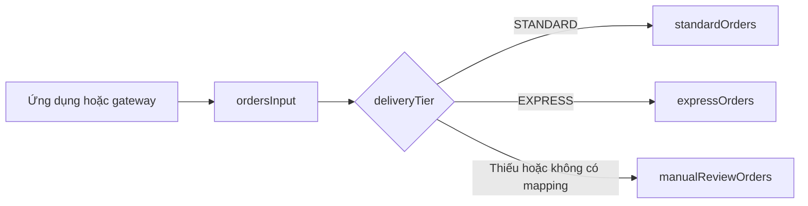

# Router theo header

## 1. Mục tiêu và bối cảnh

Trong chương **Router** của **SPRING_INTEGRATION_CORE**, router theo header giúp lựa chọn đường xử lý dựa trên metadata của thông điệp. Ví dụ, cùng một kiểu đơn hàng có thể đi vào luồng giao tiêu chuẩn hoặc giao nhanh tùy giá trị header `deliveryTier`.

Bài học kết nối các thành phần cốt lõi của Spring Integration: `Message` mang dữ liệu, `MessageChannel` nối các bước, endpoint tiếp nhận và xử lý thông điệp, còn Java DSL mô tả cách ghép chúng thành luồng. Từ ví dụ định tuyến đơn hàng, người học sẽ biết cách:

- Phân biệt tên header, giá trị header, khóa định tuyến và tên channel.
- Cấu hình `HeaderValueRouter` với mapping tường minh và Java DSL.
- Chọn hành vi cho header thiếu, giá trị lạ và channel bị cấu hình sai.
- Chuẩn hóa header bằng header enricher, kết nối với gateway và xử lý lỗi.
- Viết kiểm thử chứng minh thông điệp tới đúng nhánh và không rơi vào nhánh khác.

Phạm vi chính là định tuyến **theo giá trị một header**. Transformer, filter và aggregator chỉ được nhắc tới khi cần phân biệt trách nhiệm với router.

## 2. Router đọc gì trong một Message?

Một `Message<T>` gồm payload và các header:

```text
Message<ShippingOrder>
├── payload: ShippingOrder(orderId="OD-101", totalVnd=250000)
└── headers
    ├── deliveryTier = "EXPRESS"
    ├── traceId = "trace-101"
    └── các header do framework quản lý
```

Payload chứa nội dung nghiệp vụ. Header cung cấp thông tin bổ sung cho việc xử lý, chẳng hạn tuyến giao hàng, nguồn gửi hoặc mã theo dõi. Header được truy cập theo tên khóa; `deliveryTier` và `DeliveryTier` là hai khóa khác nhau.

`MessageHeaders` có giao diện giống `Map<String, Object>` nhưng không cho phép sửa cấu trúc trực tiếp. Muốn thêm hoặc đổi header, dùng `MessageBuilder` hoặc một bước header enricher. Tính bất biến của vỏ thông điệp không làm cho mọi đối tượng nằm trong payload hoặc header tự trở thành bất biến. [Tài liệu Message](https://docs.spring.io/spring-integration/reference/message.html)

Router theo header quyết định **gửi Message tới đâu**. Với cấu hình thông thường, nó không chuyển `ShippingOrder` thành một kiểu payload khác và không tự thực hiện nghiệp vụ giao hàng. Khi bật thêm header sequence, router có thể tạo thông điệp mang metadata sequence cho các nhánh.

So sánh theo trách nhiệm:

| Thành phần | Câu hỏi chính | Ví dụ trong luồng đơn hàng |
|---|---|---|
| Transformer | Dữ liệu cần đổi thành dạng nào? | Đổi JSON thành `ShippingOrder` |
| Header enricher | Cần thêm hoặc chuẩn hóa metadata nào? | Chuẩn hóa `deliveryTier` |
| Filter | Thông điệp có được đi tiếp không? | Chặn đơn hàng không hợp lệ |
| Router | Thông điệp đi vào nhánh nào? | Chọn giao nhanh hay tiêu chuẩn |
| Service activator | Cần thực hiện hành động nào? | Gọi dịch vụ vận chuyển |
| Aggregator | Những thông điệp nào cần gom thành một nhóm? | Gom kết quả của các nhánh đã tách |

Header routing phù hợp khi nhiều nơi cần dùng chung một quyết định phân loại. Nếu quyết định phụ thuộc nhiều quy tắc như giá trị đơn hàng, địa chỉ và năng lực kho, một bước nghiệp vụ có thể tính khóa định tuyến trước; router sau đó chỉ ánh xạ khóa tới channel.

## 3. Thiết kế hợp đồng header trước khi cấu hình

Ví dụ xuyên suốt bài sử dụng hợp đồng sau:

| Thuộc tính | Quy ước |
|---|---|
| Header | `deliveryTier` |
| Kiểu dữ liệu được ứng dụng chấp nhận | Một `String` đơn trị |
| Giá trị hợp lệ | `STANDARD`, `EXPRESS` |
| Phân biệt hoa thường | Có, nếu chưa chuẩn hóa |
| Giá trị không được hỗ trợ | Đưa vào `manualReviewOrders` |
| Không có header | Đưa vào `manualReviewOrders` |
| Tên channel nội bộ | Không được coi là giá trị nghiệp vụ hợp lệ |
| Mapping hợp lệ nhưng channel đích không tồn tại | Báo lỗi cấu hình |

Ở đây `EXPRESS` là **giá trị nghiệp vụ**, còn `expressOrders` là **tên bean channel**. Hai giá trị này không cần giống nhau. Mapping tường minh giúp đổi tên channel mà không bắt producer sửa hợp đồng header.



Sơ đồ mô tả hợp đồng đơn trị của ví dụ. Các channel đầu ra dùng hàng đợi để quan sát kết quả. Trong ứng dụng thực, mỗi nhánh có consumer thực hiện nghiệp vụ tương ứng.

## 4. HeaderValueRouter phân giải đích như thế nào?

`HeaderValueRouter` nhận tên header trong constructor. Nó đọc giá trị tại header đó rồi sử dụng cơ chế mapping của `AbstractMappingMessageRouter` để tìm channel. Có thể định tuyến bằng mã nghiệp vụ có mapping, hoặc dùng trực tiếp tên channel làm giá trị header khi ứng dụng chủ động cho phép. [Router Implementations](https://docs.spring.io/spring-integration/reference/router/implementations.html)

Với header chuỗi đơn trị, có thể hình dung quá trình thành năm bước:

1. Đọc header `deliveryTier`.
2. Tìm mapping tương ứng, ví dụ `EXPRESS → expressOrders`.
3. Nếu không có mapping, xét có cho phép dùng chính khóa làm tên channel hay không.
4. Phân giải tên channel đã chọn thành một `MessageChannel`.
5. Gửi thông điệp tới các đích tìm được; nếu không có đích thì xét channel mặc định.

Hai thao tác ở bước 3 và bước 5 khác nhau:

- `channelKeyFallback`: cho phép lấy một khóa chưa có mapping để thử tìm channel cùng tên.
- `defaultOutputChannel`: nơi nhận thông điệp khi không chọn được channel đầu ra.

Ví dụ, với `channelKeyFallback=true`, header `deliveryTier=expressOrders` có thể dẫn tới bean `expressOrders` dù không có mapping cho giá trị đó. Để hợp đồng chỉ chấp nhận các mã nghiệp vụ đã khai báo, ví dụ sẽ đặt `channelKeyFallback=false`. API cũng lưu ý lựa chọn này giúp tránh định tuyến tới channel ngoài dự kiến. [AbstractMappingMessageRouter API](https://docs.spring.io/spring-integration/api/org/springframework/integration/router/AbstractMappingMessageRouter.html)

Đây là cách giới hạn khóa **chuỗi** dùng cho routing; việc xác thực kiểu và hình dạng dữ liệu đầu vào vẫn cần được thực hiện ở biên hệ thống, như phần chuẩn hóa bên dưới.

## 5. Ví dụ hoàn chỉnh bằng Java configuration và Java DSL

### 5.1. Điều kiện sử dụng ví dụ

Ví dụ dùng Java 17 trở lên để khai báo `record`, cùng API `IntegrationFlow.from(...)` và cấu hình router theo Spring Integration 6.x. Khi áp dụng cho nhánh phiên bản khác, dùng tài liệu tương ứng với dependency của dự án.

Trong dự án Spring Boot đã có parent hoặc BOM quản lý phiên bản phù hợp, cần các dependency sau:

```xml
<dependencies>
    <dependency>
        <groupId>org.springframework.boot</groupId>
        <artifactId>spring-boot-starter-integration</artifactId>
    </dependency>
    <dependency>
        <groupId>org.springframework.boot</groupId>
        <artifactId>spring-boot-starter-test</artifactId>
        <scope>test</scope>
    </dependency>
</dependencies>
```

Đoạn trên là phần dependency để ghép vào một dự án Boot đã được quản lý phiên bản, không phải một `pom.xml` độc lập. Không khai báo một phiên bản Spring Integration riêng khác với bộ dependency đã chọn nếu chưa kiểm tra tương thích. Dự án Spring thuần có thể dùng `spring-integration-core` và JUnit Jupiter với phiên bản tương thích do dự án quản lý.

### 5.2. Cấu hình luồng

```java
package example.integration;

import org.springframework.beans.factory.annotation.Qualifier;
import org.springframework.context.annotation.Bean;
import org.springframework.context.annotation.Configuration;
import org.springframework.integration.channel.DirectChannel;
import org.springframework.integration.channel.QueueChannel;
import org.springframework.integration.config.EnableIntegration;
import org.springframework.integration.dsl.IntegrationFlow;
import org.springframework.integration.router.HeaderValueRouter;
import org.springframework.messaging.MessageChannel;

@Configuration
@EnableIntegration
public class OrderRoutingConfiguration {

    public static final String DELIVERY_TIER = "deliveryTier";

    public record ShippingOrder(String orderId, long totalVnd) {
    }

    @Bean
    public MessageChannel ordersInput() {
        return new DirectChannel();
    }

    @Bean
    public QueueChannel standardOrders() {
        return new QueueChannel(100);
    }

    @Bean
    public QueueChannel expressOrders() {
        return new QueueChannel(100);
    }

    @Bean
    public QueueChannel manualReviewOrders() {
        return new QueueChannel(100);
    }

    @Bean
    public HeaderValueRouter deliveryTierRouter(
            @Qualifier("manualReviewOrders") QueueChannel reviewChannel) {

        HeaderValueRouter router = new HeaderValueRouter(DELIVERY_TIER);
        router.setChannelMapping("STANDARD", "standardOrders");
        router.setChannelMapping("EXPRESS", "expressOrders");
        router.setDefaultOutputChannel(reviewChannel);
        router.setChannelKeyFallback(false);
        router.setResolutionRequired(true);
        router.setSendTimeout(1_000L);
        return router;
    }

    @Bean
    public IntegrationFlow orderRoutingFlow(
            @Qualifier("ordersInput") MessageChannel input,
            HeaderValueRouter deliveryTierRouter) {

        return IntegrationFlow.from(input)
                .route(deliveryTierRouter)
                .get();
    }
}
```

Các phần quan trọng của cấu hình:

- `@EnableIntegration` đăng ký hạ tầng Spring Integration cho context Spring thuần dùng trong ví dụ và kiểm thử.
- `ordersInput` là `DirectChannel`: router được gọi trên thread gửi vào channel này.
- Java DSL tạo endpoint nối input với router. Chỉ tạo bean `HeaderValueRouter` mà không nối vào luồng thì chưa có consumer xử lý input.
- Mapping giữ mã nghiệp vụ độc lập với tên bean channel.
- Nhánh mặc định tiếp nhận các thông điệp cần xem xét; nó chưa tự lưu dữ liệu hay mở một quy trình xử lý thủ công.
- `resolutionRequired=true` giữ lỗi rõ ràng nếu một mapping trỏ tới channel không tồn tại.
- `sendTimeout` giới hạn thời gian chờ khi router gửi vào channel có hỗ trợ timeout, chẳng hạn hàng đợi đã đầy. Nó không phải timeout cho toàn bộ nghiệp vụ phía sau.

Ba `QueueChannel(100)` là hàng đợi trong bộ nhớ có sức chứa giới hạn. Chúng không tự có worker, không tự lưu bền qua lần khởi động lại và chưa có consumer trong ví dụ. Điều này có chủ đích để kiểm thử lấy thông điệp từ từng nhánh. Một consumer được nối vào `QueueChannel` theo mô hình polling cần được cấu hình poller. [Message Channel Implementations](https://docs.spring.io/spring-integration/reference/channel/implementations.html)

Nếu consumer của nhánh được nối bằng `DirectChannel`, việc xử lý ở nhánh đó có thể diễn ra ngay trong lời gọi gửi ban đầu. Vì vậy, nhìn thấy `.route(...)` không đồng nghĩa luồng đã trở thành bất đồng bộ.

### 5.3. Gửi và quan sát một thông điệp

```java
package example.integration;

import org.springframework.context.annotation.AnnotationConfigApplicationContext;
import org.springframework.integration.channel.QueueChannel;
import org.springframework.messaging.Message;
import org.springframework.messaging.MessageChannel;
import org.springframework.messaging.support.MessageBuilder;

public class HeaderRoutingDemo {

    public static void main(String[] args) {
        try (var context = new AnnotationConfigApplicationContext(
                OrderRoutingConfiguration.class)) {

            MessageChannel input = context.getBean(
                    "ordersInput", MessageChannel.class);
            QueueChannel express = context.getBean(
                    "expressOrders", QueueChannel.class);

            var order = new OrderRoutingConfiguration.ShippingOrder(
                    "OD-101", 250_000L);

            Message<OrderRoutingConfiguration.ShippingOrder> message =
                    MessageBuilder.withPayload(order)
                            .setHeader("deliveryTier", "EXPRESS")
                            .setHeader("traceId", "trace-101")
                            .build();

            if (!input.send(message)) {
                throw new IllegalStateException("Không gửi được đơn hàng");
            }

            Message<?> received = express.receive(1_000);
            if (received == null) {
                throw new IllegalStateException("Không nhận được ở nhánh EXPRESS");
            }

            System.out.println(received.getPayload());
            System.out.println(received.getHeaders().get("traceId"));
        }
    }
}
```

Kết quả mong đợi: nhánh `expressOrders` nhận đơn `OD-101`, header `traceId` vẫn là `trace-101`. Router không tính lại tiền đơn hàng và không thay payload bằng chính giá trị `EXPRESS`.

Việc `send()` hoàn tất ở ví dụ chứng minh thông điệp đã được đưa vào hàng đợi đích. Nó chưa chứng minh đã giao hàng thành công. Muốn biết nghiệp vụ hoàn tất cần có cơ chế kết quả hoặc xác nhận tương ứng.

## 6. Biến thể Java DSL đọc header bằng SpEL

Nếu muốn khai báo mapping ngay trong DSL, có thể thay **phương thức `orderRoutingFlow`** ở ví dụ bằng phương thức sau:

```java
@Bean
public IntegrationFlow orderRoutingFlow(
        @Qualifier("ordersInput") MessageChannel input) {

    return IntegrationFlow.from(input)
            .route("headers['deliveryTier']", router -> router
                    .channelMapping("STANDARD", "standardOrders")
                    .channelMapping("EXPRESS", "expressOrders")
                    .defaultOutputChannel("manualReviewOrders")
                    .channelKeyFallback(false)
                    .resolutionRequired(true)
                    .sendTimeout(1_000L))
            .get();
}
```

Giữ nguyên các bean channel. Khi chọn cách này, có thể bỏ bean `deliveryTierRouter` vì flow đã cấu hình router biểu thức riêng. Hai cách là hai lựa chọn triển khai cho cùng hợp đồng; không đăng ký đồng thời hai flow cùng tiêu thụ `ordersInput` rồi kỳ vọng cả hai đều nhận mỗi thông điệp.

`headers['deliveryTier']` được đánh giá trên thông điệp và lấy ra header cần dùng. Với lambda của DSL, cần chú ý overload đang nhận **payload** hay **Message**: một lambda nhận `ShippingOrder` không thể tự đọc header nếu không được cấp thông điệp. [Message Routers trong Java DSL](https://docs.spring.io/spring-integration/reference/dsl/java-routers.html)

Biến thể này dùng router đánh giá biểu thức, không phải một đối tượng `HeaderValueRouter` được khởi tạo tường minh. Nếu cần đúng kiểu router để quản lý hoặc kiểm thử cấu hình, dùng cách ở phần 5.

## 7. Header thiếu, giá trị lạ và lỗi mapping

### 7.1. Hành vi của cấu hình ví dụ

Bảng sau giả định chưa thêm bước chuẩn hóa và đầu vào tuân theo kiểu chuỗi đơn trị:

| Header `deliveryTier` | Kết quả | Giải thích |
|---|---|---|
| `STANDARD` | `standardOrders` | Có mapping |
| `EXPRESS` | `expressOrders` | Có mapping |
| Không có header | `manualReviewOrders` | Không chọn được đích |
| `SAME_DAY` | `manualReviewOrders` | Không có mapping, không thử tên channel |
| `express` | `manualReviewOrders` | Khác giá trị `EXPRESS` |
| ` EXPRESS ` | `manualReviewOrders` | Chuỗi đơn này chưa được trim |
| `expressOrders` | `manualReviewOrders` | Tên bean tồn tại nhưng không có mapping cho khóa này |
| `BROKEN`, nếu map tới `missingOrders` không tồn tại | Ném `MessagingException` | Đã chọn tên channel nhưng không phân giải được |

Trường hợp cuối cho thấy **có channel mặc định không đồng nghĩa mọi lỗi đều đi vào channel đó**. Với `resolutionRequired=true`, lỗi phân giải một tên channel đã chọn sẽ được báo ra.

### 7.2. Ba tùy chọn cần hiểu cùng nhau

| Tùy chọn | Ý nghĩa | Giá trị trong ví dụ |
|---|---|---|
| `channelKeyFallback` | Khi thiếu mapping, có dùng khóa chuỗi làm tên channel không? | `false` |
| `resolutionRequired` | Có báo lỗi nếu tên channel được chọn không phân giải được không? | `true` |
| `defaultOutputChannel` | Nếu không chọn được đích nào thì gửi tới đâu? | `manualReviewOrders` |

Từ Spring Integration 6.0, việc đặt channel mặc định cũng chuyển `channelKeyFallback` sang `false` nếu tùy chọn này chưa được đặt tường minh. Ví dụ vẫn đặt `false` trực tiếp để thể hiện hợp đồng. Cấu hình có channel mặc định, đồng thời đặt tường minh `channelKeyFallback=true` và `resolutionRequired=true`, bị từ chối khi khởi tạo do ý nghĩa không nhất quán. [Common Router Parameters](https://docs.spring.io/spring-integration/reference/router/common-parameters.html)

Nếu chọn `resolutionRequired=false`, các tên channel không phân giải được sẽ bị bỏ qua; khi cuối cùng không có đích nào thì mới xét channel mặc định. Với thông điệp có nhiều đích, một đích hợp lệ có thể đủ để thông điệp không đi vào nhánh mặc định.

Do đó, không nên giảm `resolutionRequired` chỉ để làm biến mất lỗi gõ sai tên bean. Với bài toán này, `SAME_DAY` là dữ liệu cần xem xét, còn `EXPRESS → expresOrders` khi bean thực là `expressOrders` là lỗi cấu hình cần sửa.

Không có đích và không có channel mặc định vẫn có thể làm router ném lỗi; `resolutionRequired=false` không phải lệnh bỏ thông điệp. Nếu nghiệp vụ chủ động loại bỏ thông điệp, có thể cấu hình mặc định tới `nullChannel`, đồng thời xác định cách thống kê các trường hợp loại bỏ. [HeaderValueRouter và hành vi khi không có đích](https://docs.spring.io/spring-integration/reference/router/implementations.html)

## 8. Chuẩn hóa và kiểm soát đầu vào bằng header enricher

Có hai chính sách khác nhau cần lựa chọn rõ:

- Hợp đồng nghiêm ngặt: chỉ nhận đúng `STANDARD` hoặc `EXPRESS`.
- Hợp đồng có chuẩn hóa: chấp nhận khoảng trắng ngoài và chữ thường, rồi đưa về một mã chuẩn.

Nếu chọn chính sách thứ hai, thêm một phương thức vào `OrderRoutingConfiguration`:

```java
private static String canonicalTier(Object raw) {
    if (!(raw instanceof String text)) {
        return "UNSUPPORTED";
    }

    String normalized = text.trim().toUpperCase(java.util.Locale.ROOT);
    return switch (normalized) {
        case "STANDARD", "EXPRESS" -> normalized;
        default -> "UNSUPPORTED";
    };
}
```

Sau đó thay phương thức flow gốc bằng phiên bản sau, vẫn dùng bean `deliveryTierRouter`:

```java
@Bean
public IntegrationFlow orderRoutingFlow(
        @Qualifier("ordersInput") MessageChannel input,
        HeaderValueRouter deliveryTierRouter) {

    return IntegrationFlow.from(input)
            .enrichHeaders(headers -> headers.headerFunction(
                    DELIVERY_TIER,
                    message -> canonicalTier(
                            message.getHeaders().get(DELIVERY_TIER)),
                    true))
            .route(deliveryTierRouter)
            .get();
}
```

Tham số `true` cho phép ghi đè header đã có. Nếu không cho phép ghi đè, một giá trị như `" express "` có thể còn nguyên, khiến kết quả chuẩn hóa không được sử dụng. Đây là tùy chọn của bước header enricher, độc lập với các tùy chọn phân giải channel. [HeaderEnricherSpec API](https://docs.spring.io/spring-integration/api/org/springframework/integration/dsl/HeaderEnricherSpec.html)

Hàm này giới hạn đầu ra của bước chuẩn hóa thành ba chuỗi: `STANDARD`, `EXPRESS`, `UNSUPPORTED`. Theo chính sách đã chọn, thiếu header, sai kiểu hoặc chuỗi đa giá trị đều trở thành `UNSUPPORTED` và đi vào nhánh duyệt thủ công. `" express "` trở thành `EXPRESS`.

Header enricher phù hợp cho việc tạo metadata mới trước một bước xử lý. Không dùng `message.getHeaders().put(...)` để cập nhật thông điệp hiện có. [Content Enricher — Header Enricher](https://docs.spring.io/spring-integration/reference/content-enrichment.html)

Nếu cần chẩn đoán giá trị gốc, ghi nhận nó tại biên vào hoặc lưu dưới một header riêng theo chính sách dữ liệu của ứng dụng. Sau chuẩn hóa, `deliveryTier` đã mang giá trị chuẩn, không còn bảo toàn mọi ký tự của chuỗi đầu vào.

Tại biên HTTP hoặc message broker, cần kiểm tra rõ adapter có ánh xạ header bên ngoài thành header nội bộ hay không. Tên và kiểu dữ liệu của HTTP header, thuộc tính broker và Spring Message header không tự động có cùng một hợp đồng. Thông tin dùng để cấp quyền hoặc chọn tenant phải được xác thực từ ngữ cảnh đáng tin cậy trước khi đưa vào quyết định routing.

## 9. Không mặc định HeaderValueRouter chỉ có một đích

Một tên header không đồng nghĩa chỉ có một channel đích. `HeaderValueRouter` hỗ trợ chuỗi chứa dấu phẩy; ví dụ `STANDARD,EXPRESS` được tách thành nhiều khóa định tuyến. Hành vi này có trong mã nguồn Spring Integration 6.5.0. [Mã nguồn HeaderValueRouter](https://github.com/spring-projects/spring-integration/blob/v6.5.0/spring-integration-core/src/main/java/org/springframework/integration/router/HeaderValueRouter.java)

Với cấu hình gốc ở phần 5:

```java
MessageBuilder.withPayload(order)
        .setHeader("deliveryTier", "STANDARD,EXPRESS")
        .build();
```

Thông điệp có thể tới cả `standardOrders` lẫn `expressOrders`. Nếu thay bằng `STANDARD,UNKNOWN`, khóa `STANDARD` chọn được đích, còn khóa chưa map bị bỏ qua do tắt `channelKeyFallback`; nhánh mặc định không phải nơi nhận riêng phần `UNKNOWN`. Channel mặc định được xét khi cả quá trình không chọn được đích. [Cơ chế mapping và tập hợp channel](https://github.com/spring-projects/spring-integration/blob/main/spring-integration-core/src/main/java/org/springframework/integration/router/AbstractMappingMessageRouter.java)

Lớp mapping còn hỗ trợ một số dạng khóa ngoài chuỗi, gồm đối tượng channel trực tiếp. Vì vậy, `channelKeyFallback=false` không thay thế xác thực kiểu đầu vào. Nếu header chỉ được phép là một mã nghiệp vụ, cần giới hạn kiểu và tập giá trị như bước `canonicalTier` ở phần 8.

Đối với ví dụ đơn hàng, đi vào hai luồng vận chuyển có thể tạo xử lý trùng. Chuẩn hóa `STANDARD,EXPRESS` thành `UNSUPPORTED` giúp giữ hợp đồng một tuyến cho mỗi đơn. Nếu nghiệp vụ thật sự cần nhiều đích, hãy thiết kế điều đó tường minh và đặt tên header phù hợp, chẳng hạn `requestedChecks`.

Khi nhiều nhánh cần gửi kết quả về aggregator, có thể cân nhắc `applySequence=true` để thêm thông tin thứ tự và kích thước nhóm. Tùy chọn này mặc định là `false`; nó không tự tạo aggregator, không tự gom kết quả và không làm việc gửi tới nhiều channel trở thành một giao dịch nguyên tử. [Tham số apply-sequence](https://docs.spring.io/spring-integration/reference/router/common-parameters.html)

## 10. Channel mặc định khác với xử lý lỗi

`manualReviewOrders` trong ví dụ là **nhánh routing nghiệp vụ**. Nó nhận chính thông điệp đơn hàng khi không chọn được tuyến. Đây không phải `errorChannel` và payload của nó không tự trở thành exception.

| Trường hợp | Điều đang xảy ra | Cách xử lý phù hợp |
|---|---|---|
| Header có mã mới chưa hỗ trợ | Chưa có tuyến nghiệp vụ | Nhánh duyệt thủ công hoặc quy tắc từ chối rõ ràng |
| Mapping trỏ tới bean không tồn tại | Lỗi cấu hình channel | Sửa cấu hình; kiểm thử phải phát hiện |
| Đích là DirectChannel chưa có subscriber | Không có consumer nhận | Nối endpoint hoặc kiểm tra lifecycle |
| Hàng đợi đích đã đầy | Không gửi được trong thời gian cho phép | Xác định timeout, backpressure và cơ chế phục hồi |
| Handler của nhánh ném exception | Lỗi xử lý sau định tuyến | Xử lý lỗi theo thread và ranh giới giao dịch |

Với input `DirectChannel`, lỗi router hoặc lỗi trong một nhánh đồng bộ có thể truyền về bên gọi `send()`. Chỉ gắn một header `errorChannel` không làm lời gọi gửi trực tiếp tự biến mọi exception thành thông điệp lỗi.

Khi một consumer chạy qua hạ tầng bất đồng bộ của Spring Integration, chẳng hạn poller hoặc executor tương ứng, cơ chế xử lý lỗi có thể phát `ErrorMessage` tới channel được cấu hình. Cần cấu hình và kiểm thử đúng điểm chuyển thread; không thể suy ra hành vi lỗi chỉ từ tên router. [Error Handling](https://docs.spring.io/spring-integration/reference/error-handling.html)

Trong ví dụ, enqueue thành công rồi consumer xử lý đơn hàng thất bại sau đó là hai sự kiện khác nhau. Router đã chọn đúng tuyến vẫn có thể dẫn tới nghiệp vụ thất bại. Theo dõi trạng thái đơn hàng và việc thử lại phải nằm ở phần xử lý tương ứng.

`ignoreSendFailures` cũng không có nghĩa thử tuyến dự phòng. Bỏ qua lỗi gửi có thể làm một số nhánh nhận được thông điệp còn nhánh khác không nhận; điều đó cần được thiết kế và quan sát rõ khi dùng routing nhiều đích.

## 11. Kết nối với messaging gateway

Ứng dụng nghiệp vụ có thể dùng gateway để không phải tự tạo `Message` mỗi lần gọi. Ví dụ interface đặt trong package được Integration component scan:

```java
package example.integration;

import org.springframework.integration.annotation.MessagingGateway;
import org.springframework.messaging.handler.annotation.Header;
import org.springframework.messaging.handler.annotation.Payload;

@MessagingGateway(defaultRequestChannel = "ordersInput")
public interface ShippingGateway {

    void submit(
            @Payload OrderRoutingConfiguration.ShippingOrder order,
            @Header("deliveryTier") String deliveryTier);
}
```

Trong cấu hình Spring thuần, thêm `@IntegrationComponentScan(basePackageClasses = ShippingGateway.class)` với import `org.springframework.integration.annotation.IntegrationComponentScan` để phát hiện interface gateway. Sau đó inject `ShippingGateway` và gọi `submit(order, "EXPRESS")`.

`@Payload` xác định dữ liệu chính; `@Header` đưa tham số thứ hai vào metadata. Router vẫn áp dụng cùng hợp đồng như khi gửi `Message` trực tiếp. Gateway giúp che API messaging sau một interface nghiệp vụ. [Messaging Gateways](https://docs.spring.io/spring-integration/reference/gateway.html)

Phương thức `void` phù hợp với ví dụ chỉ gửi vào hàng đợi đích. Nó không cam kết đơn hàng đã được vận chuyển, cũng không tự làm quá trình gửi trở thành bất đồng bộ. Nếu cần request/reply, phải thiết kế các nhánh có phản hồi và quy định timeout; đổi `void` thành một kiểu kết quả mà không có nơi tạo reply sẽ không hoàn thiện hợp đồng đó.

## 12. Kiểm thử hành vi routing

Đoạn kiểm thử sau dành cho **cấu hình gốc ở phần 5**, chưa thêm chuẩn hóa ở phần 8. Mỗi lượt kiểm thử mở context mới để không lẫn thông điệp trong queue hoặc mapping đã sửa giữa các trường hợp.

Các thư viện JUnit Jupiter, gồm parameterized tests, có trong dependency test đã nêu. Không cần mock router: mục tiêu là kiểm tra cả endpoint, phân giải bean và các channel thật trong bộ nhớ.

```java
package example.integration;

import org.junit.jupiter.api.AfterEach;
import org.junit.jupiter.api.BeforeEach;
import org.junit.jupiter.api.Test;
import org.junit.jupiter.params.ParameterizedTest;
import org.junit.jupiter.params.provider.CsvSource;
import org.junit.jupiter.params.provider.ValueSource;
import org.springframework.context.annotation.AnnotationConfigApplicationContext;
import org.springframework.integration.channel.QueueChannel;
import org.springframework.integration.router.HeaderValueRouter;
import org.springframework.messaging.Message;
import org.springframework.messaging.MessageChannel;
import org.springframework.messaging.MessagingException;
import org.springframework.messaging.support.MessageBuilder;

import static org.junit.jupiter.api.Assertions.*;

class OrderRoutingTest {

    private AnnotationConfigApplicationContext context;
    private MessageChannel input;
    private QueueChannel standard;
    private QueueChannel express;
    private QueueChannel review;

    @BeforeEach
    void setUp() {
        context = new AnnotationConfigApplicationContext(
                OrderRoutingConfiguration.class);
        input = context.getBean("ordersInput", MessageChannel.class);
        standard = context.getBean("standardOrders", QueueChannel.class);
        express = context.getBean("expressOrders", QueueChannel.class);
        review = context.getBean("manualReviewOrders", QueueChannel.class);
    }

    @AfterEach
    void tearDown() {
        if (context != null) {
            context.close();
        }
    }

    @ParameterizedTest
    @CsvSource({
            "STANDARD, standardOrders",
            "EXPRESS, expressOrders"
    })
    void routesMappedValueToExactlyOneChannel(
            String tier, String targetChannelName) {

        Message<?> sent = message(tier);
        assertTrue(input.send(sent));

        QueueChannel target = context.getBean(
                targetChannelName, QueueChannel.class);
        Message<?> received = target.receive(0);

        assertNotNull(received);
        assertEquals(sent.getPayload(), received.getPayload());
        assertEquals("trace-test", received.getHeaders().get("traceId"));
        assertEquals(tier, received.getHeaders().get("deliveryTier"));
        assertAllQueuesEmpty();
    }

    @ParameterizedTest
    @ValueSource(strings = {
            "SAME_DAY", "express", " EXPRESS ", "expressOrders", ""
    })
    void sendsUnmappedValueToReview(String tier) {
        Message<?> sent = message(tier);
        assertTrue(input.send(sent));

        Message<?> received = review.receive(0);
        assertNotNull(received);
        assertEquals(sent.getPayload(), received.getPayload());
        assertAllQueuesEmpty();
    }

    @Test
    void sendsMissingHeaderToReview() {
        var order = new OrderRoutingConfiguration.ShippingOrder(
                "OD-MISSING", 100_000L);

        assertTrue(input.send(MessageBuilder.withPayload(order).build()));

        Message<?> received = review.receive(0);
        assertNotNull(received);
        assertEquals(order, received.getPayload());
        assertAllQueuesEmpty();
    }

    @Test
    void failsWhenMappedChannelDoesNotExist() {
        HeaderValueRouter router = context.getBean(HeaderValueRouter.class);
        router.setChannelMapping("BROKEN", "missingOrders");

        assertThrows(MessagingException.class,
                () -> input.send(message("BROKEN")));

        assertAllQueuesEmpty();
    }

    private Message<?> message(String tier) {
        return MessageBuilder.withPayload(
                        new OrderRoutingConfiguration.ShippingOrder(
                                "OD-TEST", 150_000L))
                .setHeader("deliveryTier", tier)
                .setHeader("traceId", "trace-test")
                .build();
    }

    private void assertAllQueuesEmpty() {
        assertNull(standard.receive(0));
        assertNull(express.receive(0));
        assertNull(review.receive(0));
    }
}
```

`receive(0)` không chờ. Nó phù hợp ở đây vì input là `DirectChannel`, việc định tuyến và enqueue đã hoàn tất trước khi `send()` trả về. Cách kiểm thử này không dùng `Thread.sleep()` và không giả định lịch chạy của một worker khác.

`assertAllQueuesEmpty()` được gọi **sau khi lấy thông điệp mong đợi**. Nhờ đó, kiểm thử phát hiện cả trường hợp còn dư thông điệp ở chính đích đúng lẫn thông điệp lọt sang nhánh khác. Chỉ khẳng định `send()` trả về `true` sẽ không chứng minh tuyến được chọn là chính xác.

Khi áp dụng bước chuẩn hóa, cập nhật kỳ vọng và thêm các trường hợp tương ứng:

| Đầu vào sau khi chọn chính sách chuẩn hóa | Kỳ vọng |
|---|---|
| `" express "` | Chỉ `expressOrders` |
| `"standard"` | Chỉ `standardOrders` |
| Không có header | Chỉ `manualReviewOrders` |
| `"STANDARD,EXPRESS"` | Chỉ `manualReviewOrders` |
| Header là một số hoặc một đối tượng channel | Chỉ `manualReviewOrders` |

Nếu thay input bằng `ExecutorChannel` hoặc thêm polling trước router, phải chờ kết quả với timeout có giới hạn hoặc cơ chế đồng bộ phù hợp. Không tiếp tục dùng kiểm tra tức thì rồi kết luận routing thất bại.

## 13. Chẩn đoán và vận hành

Khi một thông điệp đi sai nhánh, kiểm tra theo chuỗi dữ kiện thực tế:

1. Header có tồn tại ngay trước router không? Ghi nhận đúng tên khóa và kiểu dữ liệu.
2. Giá trị có khoảng trắng, khác hoa thường hoặc chứa nhiều khóa không?
3. Mapping đang có là gì? Tên channel đích có đúng bean và đúng kiểu không?
4. `channelKeyFallback` và `resolutionRequired` có phản ánh chính sách mong muốn không?
5. Router đã gửi thành công nhưng consumer phía sau chưa chạy, hay việc gửi thực sự thất bại?

Với mỗi quyết định routing, có thể quan sát mã tuyến, nhánh được chọn, mã đơn hàng và `traceId`. Khi tạo metric, dùng mã tuyến có tập giá trị giới hạn; không dùng từng `orderId` hoặc mọi chuỗi header lạ làm nhãn metric vì số lượng nhãn sẽ tăng theo dữ liệu.

Nhánh mặc định cần được vận hành như một phần thật của hệ thống: có consumer hoặc nơi lưu bền phù hợp, có người hoặc quy trình xử lý và có số liệu tồn đọng. Một `QueueChannel` trong bộ nhớ chỉ giúp quan sát routing trong bài học; tên `manualReviewOrders` không tự tạo những khả năng đó.

Không retry vô hạn lỗi mapping sai hoặc header không thuộc hợp đồng. Nếu có retry ở điểm gọi dịch vụ vận chuyển, phải cân nhắc idempotency theo đơn hàng hoặc yêu cầu nghiệp vụ để tránh tạo nhiều lần giao khi kết quả lần trước chưa rõ.

## 14. Những điểm cần ghi nhớ

Router theo header tách quyết định chọn đường khỏi việc thực hiện nghiệp vụ ở mỗi nhánh. Hợp đồng ổn định nên dùng mã như `STANDARD`, `EXPRESS`, rồi mapping chúng sang channel nội bộ.

Cấu hình của bài cho phép giá trị thiếu hoặc không được hỗ trợ đi vào nhánh xem xét, đồng thời giữ lỗi cho mapping trỏ sai channel. Chuẩn hóa và giới hạn kiểu đầu vào giúp bảo đảm hợp đồng một tuyến, đặc biệt khi router hỗ trợ nhiều khóa hoặc đích trực tiếp.

Kết quả cần chứng minh qua kiểm thử là **đúng đích, không thừa đích, giữ dữ liệu cần thiết và có hành vi lỗi rõ ràng**. Chỉ xác nhận router đã nhận thông điệp hoặc lời gọi `send()` thành công chưa đủ để kết luận luồng xử lý đúng.

## Tài liệu tham khảo

- [HeaderValueRouter API](https://docs.spring.io/spring-integration/api/org/springframework/integration/router/HeaderValueRouter.html): lớp router chuyên đọc header.
- [AbstractMappingMessageRouter API](https://docs.spring.io/spring-integration/api/org/springframework/integration/router/AbstractMappingMessageRouter.html): mapping, phân giải channel và tùy chọn fallback.
- [Router Implementations](https://docs.spring.io/spring-integration/reference/router/implementations.html): cách cấu hình các loại router.
- [Common Router Parameters](https://docs.spring.io/spring-integration/reference/router/common-parameters.html): channel mặc định, sequence và hành vi lỗi gửi.
- [Java DSL Message Routers](https://docs.spring.io/spring-integration/reference/dsl/java-routers.html): router biểu thức và cấu hình bằng DSL.
- [Error Handling](https://docs.spring.io/spring-integration/reference/error-handling.html): lỗi đồng bộ và thông điệp lỗi bất đồng bộ.

Các trang reference/API không khóa phiên bản có thể chuyển sang nhánh tài liệu mới hơn. Khi đưa ví dụ vào dự án cụ thể, chọn đúng phiên bản tài liệu tương ứng với dependency của dự án.
