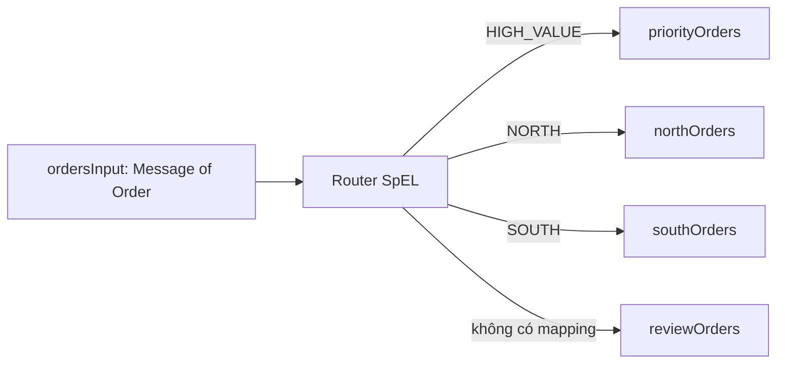

# Router theo SpEL

## 1. Mục tiêu và phạm vi

Trong chương **Router** của module **SPRING_INTEGRATION_CORE**, bài học này hướng dẫn dùng Spring Expression Language (SpEL) để quyết định một thông điệp sẽ đi tới channel nào. Nội dung gắn với các thành phần cốt lõi: `Message`, `MessageChannel`, router endpoint và Java DSL; đồng thời đặt quyết định định tuyến trong luồng xử lý lỗi và kiểm thử.

Sau bài học, bạn có thể:

- Đọc payload và header từ biểu thức của router.
- Phân biệt khóa định tuyến, tên channel và đối tượng channel.
- Cấu hình nhánh mặc định mà vẫn phát hiện channel bị khai báo sai.
- Định tuyến một thông điệp tới một hoặc nhiều đích.
- Viết kiểm thử xác nhận cả nhánh được chọn và nhánh không được chọn.

Ví dụ chính dùng Java 17 trở lên và API Spring Integration 6.5.x. Cần có `spring-integration-core`; phần kiểm thử dùng JUnit Jupiter và `spring-test`, hoặc bộ phụ thuộc test do Spring Boot quản lý. Dùng bộ phiên bản tương thích của dự án; bài không yêu cầu một phiên bản Spring Boot cụ thể.

Bạn nên biết cách khai báo bean, gửi một `Message` vào channel và phân biệt `DirectChannel` với `QueueChannel`. Các đoạn Java bên dưới là mã minh họa để đưa vào dự án thực hành.

## 2. Router đánh giá SpEL như thế nào?

Giả sử hệ thống nhận đơn hàng. Đơn giá trị lớn cần đi vào luồng ưu tiên; các đơn còn lại được phân theo vùng. Router thực hiện chuỗi quyết định:

```text
Message<Order>
    → đánh giá biểu thức
    → nhận khóa định tuyến
    → tìm mapping của khóa
    → phân giải tên channel thành MessageChannel
    → gửi Message tới đích
```

Biểu thức cung cấp **kết quả để chọn đích**. Kết quả đó không thay thế payload như ở transformer. Ví dụ, biểu thức trả về `'NORTH'` thì payload gửi đi vẫn là đối tượng đơn hàng.

Ở router SpEL, đối tượng gốc là `Message`, nên có thể truy cập `payload` và `headers` trực tiếp. Tham chiếu bean dùng cú pháp `@tenBean`. Đây là ngữ cảnh đánh giá do Spring Integration cung cấp. [Tài liệu ngữ cảnh SpEL](https://docs.spring.io/spring-integration/reference/6.5/spel.html)

| Thành phần | Ý nghĩa | Ví dụ |
| --- | --- | --- |
| `payload` | Payload của thông điệp đầu vào | `payload.total` |
| `headers` | Các header của thông điệp | `headers['region']` |
| `#root` | Đối tượng gốc đang được đánh giá | `#root.payload.total` |
| `'NORTH'` | Chuỗi hằng trong SpEL | Khóa nghiệp vụ `NORTH` |
| `@routingPolicy` | Bean có tên `routingPolicy` | `@routingPolicy.choose(payload)` |

Nếu payload là JavaBean có `getTotal()`, biểu thức `payload.total` đọc property thông qua getter. Nếu payload là map, có thể viết `payload['total']` để thể hiện rõ thao tác lấy giá trị theo khóa.

Payload là một chuỗi JSON không tự biến thành đối tượng miền của ví dụ. Hãy chuyển JSON thành `Order` trước router nếu muốn dùng `payload.total` theo hợp đồng của bài.

## 3. Cú pháp biểu thức cần dùng đúng

### 3.1. Biểu thức của router và chuỗi hằng

Trong Java DSL:

```java
.route("headers['region']")
```

Chuỗi Java bên ngoài chứa biểu thức SpEL. Cặp nháy đơn bên trong biểu diễn khóa header.

Hai biểu thức sau có ý nghĩa khác nhau:

```text
payload.region       → đọc property region của payload
'payload.region'     → trả về nguyên chuỗi payload.region
```

Tham số `expression` của router và overload `.route(String expression)` đã nhận biểu thức SpEL. Viết trực tiếp `payload.total`; không bọc thêm `#{...}` như một số chỗ dùng `@Value`.

### 3.2. Điều kiện và giá trị mặc định

```text
payload.total >= 10000000 ? 'HIGH_VALUE' : 'STANDARD'

headers['region'] ?: 'UNKNOWN'
```

Biểu thức thứ nhất là toán tử ba ngôi. Biểu thức thứ hai dùng Elvis: trả về `'UNKNOWN'` khi header không có hoặc là chuỗi rỗng. Chuỗi chỉ gồm khoảng trắng vẫn cần được chuẩn hóa riêng. [Toán tử Elvis trong SpEL](https://docs.spring.io/spring-framework/reference/core/expressions/language-ref/operator-elvis.html)

### 3.3. Safe navigation

Nếu hợp đồng cho phép header `region` là chuỗi hoặc không có, có thể viết:

```text
headers['region']?.trim() ?: 'UNKNOWN'
```

Với mô hình dữ liệu khác có `customer` và `address` có thể vắng mặt:

```text
payload.customer?.address?.region ?: 'UNKNOWN'
```

Mỗi bước có thể gặp `null` cần được bảo vệ phù hợp. `?.` không sửa tên property sai và không chuyển một kiểu payload sai thành kiểu đúng. [Safe navigation trong SpEL](https://docs.spring.io/spring-framework/reference/core/expressions/language-ref/operator-safe-navigation.html)

Các biểu thức trên là những lựa chọn thiết kế riêng. Ví dụ chính tiếp theo giữ nguyên header để giúp quan sát rõ hợp đồng đầu vào.

## 4. Chọn khóa nghiệp vụ hay trả về tên channel?

### 4.1. Trả về khóa rồi ánh xạ

```java
.route("headers['region']", r -> r
    .channelMapping("NORTH", "northOrders")
    .channelMapping("SOUTH", "southOrders")
    .channelKeyFallback(false)
    .defaultOutputChannel("reviewOrders"))
```

Đoạn này giả định các channel đã được khai báo. `NORTH` là khóa nghiệp vụ; `northOrders` là tên bean channel. Tách hai giá trị giúp đổi cấu trúc luồng mà không buộc bên gửi phải biết tên bean bên trong ứng dụng.

Đây là cách bài học sử dụng cho ví dụ hoàn chỉnh.

### 4.2. Trả về thẳng tên channel

Một router khác có thể nhận tên channel trực tiếp:

```java
.route("headers['targetChannel']")
```

Với cấu hình mặc định của router này, nếu header là `northOrders`, router cố tìm channel tương ứng trong application context. Nó không tạo channel mới và cũng không tự tạo hàng đợi trên một message broker.

Cách viết này phù hợp khi danh tính đích là một phần hợp đồng nội bộ được kiểm soát. Nếu dữ liệu đến từ bên ngoài, nên giữ một tập khóa nghiệp vụ được ánh xạ rõ ràng.

Spring Integration hỗ trợ cả biểu thức trả về khóa để mapping lẫn biểu thức trả về tên channel. [Router với SpEL](https://docs.spring.io/spring-integration/reference/6.5/router/spel.html)

## 5. Ví dụ hoàn chỉnh: phân luồng đơn hàng

### 5.1. Quy tắc nghiệp vụ

Payload là `Order`; `total` biểu diễn số tiền VND nguyên bằng `long`. Header `region` là chuỗi vùng giao hàng.

Áp dụng quy tắc theo thứ tự:

1. Nếu `total >= 10_000_000`, chọn `HIGH_VALUE`, không phụ thuộc vùng.
2. Với đơn còn lại, dùng header `region`.
3. Header vắng mặt hoặc rỗng được biểu diễn bằng khóa `UNKNOWN`.
4. Khóa không được khai báo mapping đi vào `reviewOrders`.

| Tổng tiền | Header `region` | Kết quả SpEL | Channel nhận |
| --- | --- | --- | --- |
| 12.000.000 | `NORTH` | `HIGH_VALUE` | `priorityOrders` |
| 10.000.000 | Không có | `HIGH_VALUE` | `priorityOrders` |
| 9.999.999 | `NORTH` | `NORTH` | `northOrders` |
| 500.000 | `SOUTH` | `SOUTH` | `southOrders` |
| 500.000 | `WEST` | `WEST` | `reviewOrders` |
| 500.000 | Không có | `UNKNOWN` | `reviewOrders` |
| 500.000 | Chuỗi rỗng | `UNKNOWN` | `reviewOrders` |
| 500.000 | `priorityOrders` | `priorityOrders` | `reviewOrders` |

Dòng cuối chủ ý dùng một tên bean có thật nhưng không phải khóa đã cho phép. Kết quả vẫn phải vào nhánh xem xét.



### 5.2. Cấu hình Java DSL

Đặt lớp sau trong package `example.integration` của dự án thực hành:

```java
package example.integration;

import org.springframework.context.annotation.Bean;
import org.springframework.context.annotation.Configuration;
import org.springframework.integration.channel.DirectChannel;
import org.springframework.integration.channel.QueueChannel;
import org.springframework.integration.config.EnableIntegration;
import org.springframework.integration.dsl.IntegrationFlow;

@Configuration
@EnableIntegration
public class SpelOrderRoutingConfiguration {

    @Bean
    public DirectChannel ordersInput() {
        return new DirectChannel();
    }

    @Bean
    public QueueChannel priorityOrders() {
        return new QueueChannel(100);
    }

    @Bean
    public QueueChannel northOrders() {
        return new QueueChannel(100);
    }

    @Bean
    public QueueChannel southOrders() {
        return new QueueChannel(100);
    }

    @Bean
    public QueueChannel reviewOrders() {
        return new QueueChannel(100);
    }

    @Bean
    public IntegrationFlow orderRoutingFlow() {
        String expression =
                "payload.total >= 10000000 ? 'HIGH_VALUE' : "
                + "(headers['region'] ?: 'UNKNOWN')";

        return IntegrationFlow.from("ordersInput")
                .route(expression, r -> r
                        .channelMapping("HIGH_VALUE", "priorityOrders")
                        .channelMapping("NORTH", "northOrders")
                        .channelMapping("SOUTH", "southOrders")
                        .channelKeyFallback(false)
                        .resolutionRequired(true)
                        .defaultOutputChannel("reviewOrders")
                        .sendTimeout(500))
                .get();
    }

    public static final class Order {

        private final String id;
        private final long total;

        public Order(String id, long total) {
            this.id = id;
            this.total = total;
        }

        public String getId() {
            return this.id;
        }

        public long getTotal() {
            return this.total;
        }
    }
}
```

`@EnableIntegration` kích hoạt hạ tầng Spring Integration trong cấu hình Spring thuần. Với ứng dụng Spring Boot đã có cấu hình tự động phù hợp, hạ tầng này thường đã được bật.

Các output channel là `QueueChannel` để bài thực hành có thể lấy thông điệp ra và quan sát. Chúng chứa thông điệp trong bộ nhớ. Trong ứng dụng thật, cần nối consumer hoặc flow xử lý tiếp; việc router gửi thành công vào queue chưa chứng minh nghiệp vụ cuối cùng đã hoàn tất.

`ordersInput` là `DirectChannel`, nên router được gọi ngay trên luồng gửi. Không cần poller cho router trong ví dụ này. Khi đổi đầu vào router thành một `QueueChannel`, cần cấu hình cơ chế polling cho endpoint đọc từ đó.

### 5.3. Gửi thử một thông điệp

Trong một phương thức đã được tiêm `MessageChannel ordersInput` và `QueueChannel priorityOrders`:

```java
var order = new SpelOrderRoutingConfiguration.Order("OD-1001", 12_000_000L);

var message = org.springframework.integration.support.MessageBuilder
        .withPayload(order)
        .setHeader("region", "NORTH")
        .setHeader("traceId", "trace-1001")
        .build();

ordersInput.send(message);

org.springframework.messaging.Message<?> routed =
        priorityOrders.receive(1_000);
```

`routed` có payload là đơn `OD-1001`. Header `region=NORTH` không khiến đơn đi sang `northOrders`, vì nhánh giá trị lớn được xét trước.

Nếu muốn nhận phản hồi nghiệp vụ qua messaging gateway, cần thiết kế một nhánh xử lý tạo reply và đưa reply về đúng cơ chế trả lời. Router chỉ quyết định đường đi; bản thân việc chọn một output queue không tạo phản hồi cho lời gọi gateway.

## 6. Nhánh mặc định và phân giải channel

Ba tùy chọn sau giải quyết ba câu hỏi khác nhau:

| Tùy chọn | Câu hỏi được giải quyết |
| --- | --- |
| `channelKeyFallback` | Nếu khóa không có mapping, có thử dùng chính khóa làm tên channel không? |
| `resolutionRequired` | Nếu một tên channel cần tìm nhưng không tìm thấy, có báo lỗi không? |
| `defaultOutputChannel` | Nếu không xác định được đích gửi thông thường, chuyển thông điệp đi đâu? |

Trong cấu hình của bài:

- `WEST` không có mapping và `channelKeyFallback(false)`: không thử tìm bean tên `WEST`; thông điệp đi vào `reviewOrders`.
- `NORTH` có mapping nhưng tên đích bị viết sai thành `northOrderz`: `resolutionRequired(true)` khiến lỗi được phát hiện.
- Biểu thức trả về `null` hoặc một tập đích rỗng: không có đích thường, nên dùng nhánh mặc định.
- Biểu thức truy cập property không tồn tại: việc đánh giá thất bại; đây không phải khóa lạ để đưa vào nhánh mặc định.

Cách phân biệt này dựa trên hai bước riêng: chọn tên đích rồi phân giải tên đó. Có thể xem logic ở [AbstractMappingMessageRouter](https://github.com/spring-projects/spring-integration/blob/v6.5.0/spring-integration-core/src/main/java/org/springframework/integration/router/AbstractMappingMessageRouter.java).

**Lưu ý phiên bản:** từ Spring Integration 6.0, khai báo default output cũng đặt `channelKeyFallback` về `false` nếu chưa cấu hình nó tường minh. Ví dụ vẫn khai báo `false` để hợp đồng dễ đọc. Nếu chủ động bật `channelKeyFallback(true)` cùng default output, cần `resolutionRequired(false)`; tổ hợp default output với cả hai tùy chọn đều `true` bị từ chối khi khởi tạo. [Tham số chung của router](https://docs.spring.io/spring-integration/reference/6.5/router/common-parameters.html)

Không có default output và không xác định được đích gửi sẽ dẫn đến lỗi giao thông điệp. Nếu nghiệp vụ chủ ý bỏ thông điệp, có thể dùng `nullChannel`; với đơn chưa xác định vùng, một nhánh xem xét thường hữu ích hơn vì còn dữ liệu để xử lý.

## 7. Cấu hình bằng XML hoặc router bean

### 7.1. XML tương đương

Đây là phần định nghĩa router, giả định các channel cùng tên đã được khai báo:

```xml
<int:router id="orderRouter"
            input-channel="ordersInput"
            expression="payload.total ge 10000000 ? 'HIGH_VALUE' : (headers['region'] ?: 'UNKNOWN')"
            channel-key-fallback="false"
            resolution-required="true"
            default-output-channel="reviewOrders">
    <int:mapping value="HIGH_VALUE" channel="priorityOrders"/>
    <int:mapping value="NORTH" channel="northOrders"/>
    <int:mapping value="SOUTH" channel="southOrders"/>
</int:router>
```

Prefix `int` cần được khai báo theo namespace `http://www.springframework.org/schema/integration` trong tài liệu XML chứa đoạn này. Toán tử `ge` tương đương `>=`; dùng toán tử dạng chữ cũng giúp tránh rắc rối escape khi biểu thức có dấu so sánh trong XML.

### 7.2. ExpressionEvaluatingRouter

Nếu muốn khai báo router bean trực tiếp, có thể **thay thế bean `orderRoutingFlow`** bằng phương thức sau trong cùng lớp cấu hình:

```java
@Bean
@org.springframework.integration.annotation.Router(inputChannel = "ordersInput")
public org.springframework.integration.router.ExpressionEvaluatingRouter orderRouter() {
    var router = new org.springframework.integration.router.ExpressionEvaluatingRouter(
            "payload.total >= 10000000 ? 'HIGH_VALUE' : "
            + "(headers['region'] ?: 'UNKNOWN')");

    router.setChannelMapping("HIGH_VALUE", "priorityOrders");
    router.setChannelMapping("NORTH", "northOrders");
    router.setChannelMapping("SOUTH", "southOrders");
    router.setChannelKeyFallback(false);
    router.setResolutionRequired(true);
    router.setDefaultOutputChannelName("reviewOrders");
    router.setSendTimeout(500);

    return router;
}
```

Ba cách khai báo là các lựa chọn thay thế. Không đăng ký đồng thời nhiều router tiêu thụ cùng `DirectChannel` chỉ để thử ba cú pháp; điều đó tạo nhiều subscriber và thay đổi cách phân phối thông điệp đầu vào.

## 8. Trả về nhiều đích

Biểu thức có thể trả về collection. Giả sử một flow khác đã có các channel `dispatchInput`, `fulfillmentOrders`, `auditOrders` và `reviewOrders`:

```java
@Bean
public IntegrationFlow dispatchFlow() {
    return IntegrationFlow.from("dispatchInput")
            .route("headers['routeKeys']", r -> r
                    .channelMapping("FULFILL", "fulfillmentOrders")
                    .channelMapping("AUDIT", "auditOrders")
                    .channelKeyFallback(false)
                    .resolutionRequired(true)
                    .defaultOutputChannel("reviewOrders")
                    .applySequence(true))
            .get();
}
```

Bên gửi đặt header:

```java
.setHeader("routeKeys", java.util.List.of("FULFILL", "AUDIT"))
```

Thông điệp được chuyển tới cả hai channel. Một `List<String>` thể hiện tập khóa rõ hơn việc ghép chuỗi thủ công. Khả năng nhận collection được mô tả trong [Router với SpEL](https://docs.spring.io/spring-integration/reference/6.5/router/spel.html).

Với đoạn cấu hình này:

| Giá trị `routeKeys` | Kết quả |
| --- | --- |
| `["FULFILL", "AUDIT"]` | Gửi tới hai channel đã mapping |
| `["FULFILL", "UNKNOWN"]` | Gửi tới `fulfillmentOrders`; khóa lạ không tạo thêm một bản gửi mặc định |
| `["UNKNOWN"]` | Đi vào `reviewOrders` |
| Danh sách rỗng hoặc không có header | Đi vào `reviewOrders` |

Nhánh mặc định được chọn cho toàn bộ thông điệp khi không có đích thường, không phải một nhánh bổ sung cho từng khóa lạ.

`applySequence(true)` yêu cầu router gắn thông tin thứ tự và kích thước nhóm cho các bản gửi; điều này hữu ích khi phía sau dùng aggregator theo chiến lược mặc định. Nó không tạo aggregator hoặc cơ chế chờ kết quả. [Tham số apply-sequence](https://docs.spring.io/spring-integration/reference/6.5/router/common-parameters.html)

Gửi nhiều đích cũng không tự tạo xử lý song song hoặc bảo đảm tất cả cùng thành công. Loại channel và cấu hình downstream quyết định mô hình thực thi. Nếu payload có thể bị sửa, không nên để các nhánh cùng thay đổi đối tượng đó; ví dụ `Order` của bài chỉ cung cấp trạng thái bất biến.

## 9. Phân biệt lỗi biểu thức, lỗi định tuyến và lỗi downstream

| Tình huống | Điểm thất bại | Hướng xử lý |
| --- | --- | --- |
| Viết `payload.totla` | Đánh giá SpEL | Sửa biểu thức, bổ sung ca kiểm thử |
| Payload là chuỗi trong khi router chờ `Order` | Hợp đồng dữ liệu | Chuyển đổi hoặc kiểm tra kiểu trước router |
| Khóa vùng chưa được hỗ trợ | Chọn mapping | Chuyển vào nhánh xem xét đã thiết kế |
| Mapping trỏ tới channel không có | Phân giải đích | Sửa wiring; giữ cơ chế báo lỗi cấu hình |
| Queue đích đầy quá thời gian gửi | Gửi thông điệp | Xử lý lỗi giao nhận, điều chỉnh dung lượng hoặc tốc độ tiêu thụ |
| Handler sau một `DirectChannel` ném lỗi | Thực thi downstream | Xử lý tại ranh giới gọi hoặc cơ chế lỗi của flow |

Đặt `resolutionRequired(false)` không làm biểu thức sai trở thành hợp lệ. Đặt default output cũng không tương đương với `catch (Exception)`.

`ignoreSendFailures` mặc định là `false`. Với router nhiều đích, một lần gửi thất bại có thể ngăn các lần gửi sau; bật tùy chọn bỏ qua lỗi thay đổi hành vi đó, nhưng không cung cấp retry hay rollback cho những đích đã nhận. [Hành vi khi gửi thất bại](https://docs.spring.io/spring-integration/reference/6.5/router/common-parameters.html)

Trong ví dụ chính, lỗi xảy ra khi router đang chạy trên `DirectChannel` được truyền về bên gọi `send()`. Chỉ đặt header `errorChannel` không tự biến mọi lỗi đồng bộ thành thông điệp lỗi. Với xử lý qua executor hoặc poller do framework quản lý, cần xét cơ chế xuất bản `ErrorMessage` và error handler tương ứng. [Xử lý lỗi trong Spring Integration](https://docs.spring.io/spring-integration/reference/6.5/error-handling.html)

Vì vậy, nhánh `reviewOrders` dành cho quyết định nghiệp vụ chưa xác định, còn lỗi kỹ thuật cần được quan sát qua cơ chế lỗi thích hợp.

## 10. Kiểm thử ví dụ Java DSL

Kiểm thử routing cần kiểm tra hai phía: thông điệp xuất hiện đúng đích và không xuất hiện ở đích khác. Chỉ kiểm tra giá trị của biểu thức sẽ bỏ sót mapping hoặc channel bị nối sai.

Lớp dưới dùng cùng package với cấu hình ở mục 5. Ngoài `spring-test`, cần JUnit Jupiter và module tham số hóa `junit-jupiter-params` nếu bộ test hiện tại chưa bao gồm.

```java
package example.integration;

import java.util.List;
import java.util.stream.Stream;

import org.junit.jupiter.api.BeforeEach;
import org.junit.jupiter.api.Test;
import org.junit.jupiter.params.ParameterizedTest;
import org.junit.jupiter.params.provider.Arguments;
import org.junit.jupiter.params.provider.MethodSource;
import org.springframework.beans.factory.annotation.Autowired;
import org.springframework.beans.factory.annotation.Qualifier;
import org.springframework.integration.channel.QueueChannel;
import org.springframework.integration.support.MessageBuilder;
import org.springframework.messaging.Message;
import org.springframework.messaging.MessageChannel;
import org.springframework.messaging.MessagingException;
import org.springframework.test.context.junit.jupiter.SpringJUnitConfig;

import static org.junit.jupiter.api.Assertions.*;

@SpringJUnitConfig(SpelOrderRoutingConfiguration.class)
class SpelOrderRoutingConfigurationTest {

    @Autowired
    @Qualifier("ordersInput")
    MessageChannel input;

    @Autowired
    @Qualifier("priorityOrders")
    QueueChannel priority;

    @Autowired
    @Qualifier("northOrders")
    QueueChannel north;

    @Autowired
    @Qualifier("southOrders")
    QueueChannel south;

    @Autowired
    @Qualifier("reviewOrders")
    QueueChannel review;

    @BeforeEach
    void drainQueues() {
        for (QueueChannel queue : List.of(priority, north, south, review)) {
            while (queue.receive(0) != null) {
                // Xóa dữ liệu còn lại của lần kiểm thử trước.
            }
        }
    }

    static Stream<Arguments> routes() {
        return Stream.of(
                Arguments.of(12_000_000L, "NORTH", "priority"),
                Arguments.of(10_000_000L, null, "priority"),
                Arguments.of(9_999_999L, "NORTH", "north"),
                Arguments.of(500_000L, "SOUTH", "south"),
                Arguments.of(500_000L, "WEST", "review"),
                Arguments.of(500_000L, null, "review"),
                Arguments.of(500_000L, "", "review"),
                Arguments.of(500_000L, "priorityOrders", "review")
        );
    }

    @ParameterizedTest
    @MethodSource("routes")
    void routesToExactlyOneExpectedChannel(
            long total, String region, String expected) {

        var order = new SpelOrderRoutingConfiguration.Order("OD-test", total);
        var builder = MessageBuilder.withPayload(order)
                .setHeader("traceId", "trace-test");

        if (region != null) {
            builder.setHeader("region", region);
        }

        assertTrue(input.send(builder.build()));

        QueueChannel target = switch (expected) {
            case "priority" -> priority;
            case "north" -> north;
            case "south" -> south;
            case "review" -> review;
            default -> throw new IllegalArgumentException(expected);
        };

        Message<?> received = target.receive(1_000);
        assertNotNull(received);
        assertSame(order, received.getPayload());
        assertEquals("trace-test", received.getHeaders().get("traceId"));
        assertEquals(region, received.getHeaders().get("region"));

        // Đích đã nhận cũng phải không có bản gửi dư.
        for (QueueChannel queue : List.of(priority, north, south, review)) {
            assertNull(queue.receive(0));
        }
    }

    @Test
    void rejectsPayloadThatDoesNotMatchTheExpressionContract() {
        Message<String> invalid = MessageBuilder.withPayload("not-an-order")
                .setHeader("region", "NORTH")
                .build();

        assertThrows(MessagingException.class, () -> input.send(invalid));

        for (QueueChannel queue : List.of(priority, north, south, review)) {
            assertNull(queue.receive(0));
        }
    }
}
```

Các ca ở đúng ngưỡng `10_000_000` và ngay dưới ngưỡng giúp phát hiện lỗi dùng `>` thay vì `>=`. Ca `priorityOrders` xác nhận tên bean thật không vượt qua tập mapping đã cho phép. Ca payload sai xác nhận lỗi SpEL không bị nhánh mặc định che đi.

`receive(1_000)` giới hạn thời gian chờ của kiểm thử. `receive(0)` kiểm tra ngay trạng thái queue hiện tại; phép kiểm này phù hợp với ví dụ có router đồng bộ. Nếu thêm executor hoặc poller, cần chờ theo điều kiện có giới hạn trước khi kết luận không có thông điệp ở một nhánh.

Đây là mã kiểm thử minh họa cho người học. Bài viết không khẳng định các test đã được chạy trong repository hiện tại.

## 11. Khi nào nên chuyển logic khỏi SpEL?

SpEL phù hợp khi quy tắc ngắn và dễ đọc: lấy header, so sánh một ngưỡng, chọn khóa hoặc gọi một policy bean.

Khi quyết định phải duyệt nhiều dữ liệu, xử lý nhiều ngoại lệ hoặc dùng nhiều điều kiện lồng nhau, có thể để biểu thức gọi:

```text
@routingPolicy.choose(payload, headers['region'])
```

Khi đó phải khai báo bean tên `routingPolicy` với phương thức `choose` tương ứng. Nên để phương thức trả về khóa nghiệp vụ như `HIGH_VALUE` và tiếp tục giữ mapping trong cấu hình flow.

Một tiêu chí thực tế: nếu phải đọc biểu thức nhiều lần mới biết nhánh nào được ưu tiên, hãy chuyển quyết định sang phương thức Java có tên rõ ràng và kiểm thử riêng.

Tránh để phương thức quyết định routing đồng thời cập nhật cơ sở dữ liệu hoặc gửi email. Khi flow được retry, việc chọn nhánh có thể bị thực hiện lại. Các thao tác nghiệp vụ có tác dụng phụ nên nằm ở endpoint mà hợp đồng xử lý và retry được xác định rõ.

## 12. Phối hợp với những thành phần khác

| Thành phần | Vai trò trong luồng đơn hàng |
| --- | --- |
| Transformer | Đổi JSON thành `Order`, chuẩn hóa kiểu dữ liệu trước khi đọc property |
| Filter | Loại hoặc từ chối đơn không hợp lệ theo chính sách đầu vào |
| Router SpEL | Chọn nhánh xử lý dựa trên dữ liệu đã có |
| Service activator | Thực hiện nghiệp vụ tại từng nhánh |
| Aggregator | Tổng hợp các kết quả có tương quan khi flow thực sự cần chờ nhiều nhánh |
| Messaging gateway | Cung cấp giao diện gọi vào flow và hợp đồng trả lời nếu có |

Không cần đưa tất cả thành phần vào mọi flow. Với quy tắc trong bài, một router và các channel đầu ra đủ minh họa quyết định định tuyến; transformer, filter hoặc aggregator được thêm khi hợp đồng nghiệp vụ đòi hỏi.

## 13. Thực hành mở rộng

Thực hiện trên ví dụ chính:

1. Chuẩn hóa `region` bằng `trim()`; xác định rõ chuỗi trắng phải vào đâu.
2. Thêm mapping `CENTRAL → centralOrders`, khai báo channel tương ứng và thêm ca kiểm thử.
3. Viết một ca dùng đơn giá trị lớn có vùng `WEST` để xác nhận thứ tự ưu tiên.
4. Trong một cấu hình test riêng, cho mapping trỏ tới tên channel không tồn tại; quan sát lỗi phân giải với `resolutionRequired(true)`.
5. Thiết kế flow nhiều đích gồm xử lý đơn và audit; giải thích kết quả nếu một nhánh nhận thành công còn nhánh kia thất bại.

Khi hoàn tất, bạn cần giải thích được vì sao khóa lạ có thể đi vào nhánh xem xét nhưng lỗi getter, lỗi kiểu payload và lỗi wiring vẫn cần được phát hiện.

## 14. Tài liệu tham khảo

- [Spring Integration 6.5 — Router với SpEL](https://docs.spring.io/spring-integration/reference/6.5/router/spel.html): biểu thức, mapping và kết quả nhiều đích.
- [Spring Integration 6.5 — Ngữ cảnh SpEL](https://docs.spring.io/spring-integration/reference/6.5/spel.html): payload, header và tham chiếu bean.
- [Spring Integration 6.5 — Tham số chung của router](https://docs.spring.io/spring-integration/reference/6.5/router/common-parameters.html): nhánh mặc định, phân giải channel và sequence.
- [Spring Integration 6.5 — Xử lý lỗi](https://docs.spring.io/spring-integration/reference/6.5/error-handling.html): phân biệt luồng đồng bộ và bất đồng bộ.
- [Spring Framework — Elvis](https://docs.spring.io/spring-framework/reference/core/expressions/language-ref/operator-elvis.html) và [safe navigation](https://docs.spring.io/spring-framework/reference/core/expressions/language-ref/operator-safe-navigation.html): tra cứu cú pháp; các ví dụ trong bài chỉ dùng những phép toán đã có trong dòng Spring Framework 6.x.

