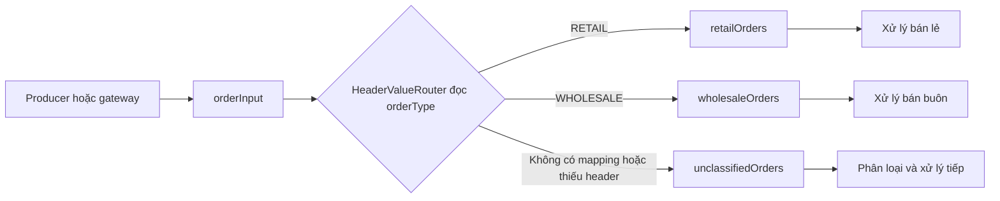

# HeaderValueRouter

## Mục tiêu và phạm vi

Trong chương Router của module SPRING_INTEGRATION_CORE, bài này trình bày cách dùng `HeaderValueRouter` để chọn nhánh xử lý dựa trên giá trị của một message header. Người học sẽ xây dựng luồng đơn hàng bằng `Message`, `MessageChannel`, endpoint và Java DSL; xác định đường đi khi header thiếu hoặc không hợp lệ; phân biệt lỗi định tuyến với lỗi ở nhánh đích; và viết kiểm thử quan sát thông điệp tại từng channel.

Ví dụ dùng Java 17 và API Spring Integration 6.5. Dự án cần dependency `org.springframework.integration:spring-integration-core`; phần kiểm thử cần `org.junit.jupiter:junit-jupiter` và cấu hình chạy JUnit Platform. Hãy dùng phiên bản dependency đồng bộ với Spring Boot BOM hoặc Spring Integration BOM đang có trong dự án.

Kiến thức nền cần có: cấu trúc `Message<T>` gồm payload và headers, cách khai báo Spring bean, sự khác nhau giữa `DirectChannel` và `QueueChannel`. Bài tập sử dụng queue trong bộ nhớ để quan sát kết quả; không cần broker bên ngoài.

## 1. Bài toán: phân nhánh đơn hàng theo metadata

Một dịch vụ nhận đơn hàng từ nhiều nguồn. Payload chứa mã đơn hàng; header `orderType` mô tả nhóm xử lý:

| Giá trị `orderType` | Ý nghĩa trong ví dụ | Channel nhận |
| --- | --- | --- |
| `RETAIL` | Đơn bán lẻ | `retailOrders` |
| `WHOLESALE` | Đơn bán buôn | `wholesaleOrders` |
| Giá trị khác hoặc thiếu header | Chưa xác định được nhóm | `unclassifiedOrders` |

Thông điệp đầu vào có thể được tạo như sau:

```java
Message<String> order = MessageBuilder.withPayload("ORDER-1001")
        .setHeader("orderType", "RETAIL")
        .setHeader("traceId", "trace-1001")
        .build();
```

`orderType` là khóa nghiệp vụ. `retailOrders` là tên bean channel trong ứng dụng. Việc tách hai loại tên giúp bên gửi không phải biết cấu trúc luồng xử lý nội bộ.



Trong bài thực hành, ba channel đích là queue để người học lấy message ra kiểm tra. Các handler nghiệp vụ trong sơ đồ là bước mở rộng, chưa được gắn vào những queue này.

## 2. HeaderValueRouter thực hiện công việc gì?

`HeaderValueRouter` là một `MessageHandler` chuyên định tuyến. Khi tạo router, ta truyền **tên header cần đọc**. Mỗi giá trị header sau đó được đối chiếu với mapping để xác định tên channel đích. Nếu cấu hình cho phép, chính giá trị header cũng có thể được dùng làm tên channel. Đây là hai cách sử dụng được mô tả trong [tài liệu HeaderValueRouter](https://docs.spring.io/spring-integration/reference/6.5/router/implementations.html#router-implementations-header-value-router).

Ví dụ cấu hình:

```java
HeaderValueRouter router = new HeaderValueRouter("orderType");
router.setChannelMapping("RETAIL", "retailOrders");
router.setChannelMapping("WHOLESALE", "wholesaleOrders");
```

Đọc từng thành phần:

| Thành phần | Giá trị | Vai trò |
| --- | --- | --- |
| `headerName` | `orderType` | Chọn header để đọc |
| Khóa mapping | `RETAIL` | Giá trị nghiệp vụ mong đợi trong header |
| Giá trị mapping | `retailOrders` | Tên channel cần tìm trong context |
| Channel thực | Bean `retailOrders` | Đối tượng nhận message |

Không viết `new HeaderValueRouter("RETAIL")` nếu muốn đọc header `orderType`: cách viết đó yêu cầu router tìm một header có tên `RETAIL`.

Với cấu hình thông thường, router chọn nơi gửi và không chuyển đổi nội dung nghiệp vụ của payload. Nếu cần chuẩn hóa metadata, thực hiện trước bước định tuyến. Nếu cần thay đổi cấu trúc payload, dùng transformer ở vị trí phù hợp trong flow.

### Các bước xử lý với một header chuỗi

1. Lấy giá trị từ `message.getHeaders().get("orderType")`.
2. Nếu giá trị có mapping, lấy tên channel từ mapping.
3. Nếu không có mapping và `channelKeyFallback=true`, thử dùng giá trị đó làm tên channel.
4. Phân giải tên channel thành đối tượng `MessageChannel`.
5. Gửi message đến đích đã xác định; khi không có đích phù hợp, xử lý theo channel mặc định hoặc phát sinh lỗi.

Cách phân giải được kế thừa từ `AbstractMappingMessageRouter`; việc lấy header nằm trong [mã nguồn HeaderValueRouter 6.5.0](https://raw.githubusercontent.com/spring-projects/spring-integration/v6.5.0/spring-integration-core/src/main/java/org/springframework/integration/router/HeaderValueRouter.java).

## 3. Ví dụ đầy đủ bằng Java DSL

Cấu hình sau tạo một router thực sự thuộc lớp `HeaderValueRouter`, rồi gắn nó vào flow bằng `.route(orderRouter)`. Các tên bean được khai báo rõ để mapping không phụ thuộc vào tên biến Java.

```java
package example.integration;

import org.springframework.beans.factory.annotation.Qualifier;
import org.springframework.context.annotation.Bean;
import org.springframework.context.annotation.Configuration;
import org.springframework.integration.channel.DirectChannel;
import org.springframework.integration.channel.QueueChannel;
import org.springframework.integration.config.EnableIntegration;
import org.springframework.integration.dsl.IntegrationFlow;
import org.springframework.integration.router.HeaderValueRouter;
import org.springframework.messaging.MessageChannel;

@Configuration(proxyBeanMethods = false)
@EnableIntegration
public class OrderRoutingConfig {

    @Bean
    public MessageChannel orderInput() {
        return new DirectChannel();
    }

    @Bean
    public QueueChannel retailOrders() {
        return new QueueChannel(20);
    }

    @Bean
    public QueueChannel wholesaleOrders() {
        return new QueueChannel(20);
    }

    @Bean
    public QueueChannel unclassifiedOrders() {
        return new QueueChannel(20);
    }

    @Bean
    public HeaderValueRouter orderRouter(
            @Qualifier("unclassifiedOrders") MessageChannel fallback) {
        HeaderValueRouter router = new HeaderValueRouter("orderType");
        router.setChannelMapping("RETAIL", "retailOrders");
        router.setChannelMapping("WHOLESALE", "wholesaleOrders");
        router.setChannelKeyFallback(false);
        router.setResolutionRequired(true);
        router.setDefaultOutputChannel(fallback);
        router.setSendTimeout(1_000);
        return router;
    }

    @Bean
    public IntegrationFlow orderRoutingFlow(
            @Qualifier("orderInput") MessageChannel input,
            HeaderValueRouter orderRouter) {
        return IntegrationFlow.from(input)
                .route(orderRouter)
                .get();
    }
}
```

`@EnableIntegration` đăng ký hạ tầng Spring Integration trong cấu hình Java độc lập. `IntegrationFlow` tạo endpoint kết nối `orderInput` với handler router. Chỉ tạo đối tượng router mà không gắn endpoint sẽ chưa làm router nhận được message từ channel.

Trong ví dụ:

- `channelKeyFallback=false` giới hạn định tuyến theo các khóa đã ánh xạ.
- `resolutionRequired=true` giữ lỗi khi mapping trỏ đến tên channel không tồn tại.
- `unclassifiedOrders` nhận dữ liệu chưa phân loại.
- `sendTimeout` giới hạn thời gian chờ gửi vào queue đang đầy; không giới hạn tổng thời gian xử lý nghiệp vụ.

Việc truyền router chuyên dụng vào `.route(...)` được hỗ trợ bởi [Java DSL cho message router](https://docs.spring.io/spring-integration/reference/6.5/dsl/java-routers.html).

### Gửi thử và đọc kết quả

Có thể dùng lớp `main` sau trong cùng package với cấu hình:

```java
package example.integration;

import org.springframework.context.annotation.AnnotationConfigApplicationContext;
import org.springframework.integration.channel.QueueChannel;
import org.springframework.messaging.Message;
import org.springframework.messaging.MessageChannel;
import org.springframework.messaging.support.MessageBuilder;

public class OrderRoutingDemo {

    public static void main(String[] args) {
        try (var context = new AnnotationConfigApplicationContext(
                OrderRoutingConfig.class)) {
            MessageChannel input = context.getBean(
                    "orderInput", MessageChannel.class);
            QueueChannel retail = context.getBean(
                    "retailOrders", QueueChannel.class);
            QueueChannel unclassified = context.getBean(
                    "unclassifiedOrders", QueueChannel.class);

            input.send(MessageBuilder.withPayload("ORDER-1001")
                    .setHeader("orderType", "RETAIL")
                    .setHeader("traceId", "trace-1001")
                    .build());

            input.send(MessageBuilder.withPayload("ORDER-1002")
                    .setHeader("orderType", "PARTNER")
                    .build());

            Message<?> first = retail.receive(1_000);
            Message<?> second = unclassified.receive(1_000);
            if (first == null || second == null) {
                throw new IllegalStateException("Không nhận đủ message");
            }

            System.out.println(first.getPayload());
            System.out.println(second.getPayload());
        }
    }
}
```

Kết quả mong đợi:

```text
ORDER-1001
ORDER-1002
```

Đơn thứ nhất nằm trong queue bán lẻ; đơn thứ hai nằm trong queue chưa phân loại. Kết quả in giống một danh sách mã đơn, nhưng mỗi mã được lấy từ một channel khác nhau.

`QueueChannel` giữ message khi chưa có consumer; với constructor có capacity, thao tác gửi có thể phải chờ khi queue đầy. Queue mặc định lưu trong bộ nhớ và không tự tạo một worker xử lý nền. Xem [các triển khai MessageChannel](https://docs.spring.io/spring-integration/reference/6.5/channel/implementations.html).

## 4. Ba tùy chọn quyết định hành vi khi không tìm thấy đích

### 4.1. channelKeyFallback: có dùng khóa làm tên channel không?

Khi `channelKeyFallback=true`, một khóa không có mapping có thể được diễn giải như tên channel. Chẳng hạn, header `orderType=retailOrders` có thể đi thẳng đến bean cùng tên nếu bean tồn tại.

Khi `channelKeyFallback=false`, header đó chỉ là một khóa không được ánh xạ. Router không tự tìm bean `retailOrders` từ giá trị chưa có trong mapping.

Trong ví dụ đơn hàng, lựa chọn thứ hai giữ hợp đồng đầu vào theo mã nghiệp vụ. Nếu sau này đổi tên channel thành `retailOrdersV2`, bên gửi vẫn dùng `RETAIL`.

### 4.2. resolutionRequired: lỗi phân giải tên có bắt buộc phải báo không?

`resolutionRequired=true`, cũng là giá trị mặc định, yêu cầu các tên channel được chọn phải phân giải thành channel thực. Mapping `RETAIL -> retialOrders` có lỗi chính tả sẽ làm phát sinh `MessagingException` khi xử lý message tương ứng.

`resolutionRequired=false` bỏ qua tên đích không phân giải được. Nếu cuối cùng không có đích và đã cấu hình channel mặc định, message có thể chuyển tới channel mặc định.

Tùy chọn này tác động đến **bước phân giải tên**. Nó không có nghĩa là bỏ qua mọi exception xảy ra trong flow.

### 4.3. defaultOutputChannel: gửi đâu khi không có đích?

Channel mặc định là nơi nhận message khi không xác định được đích để gửi theo kết quả định tuyến. Nếu không có đích và không có channel mặc định, router phát sinh `MessageDeliveryException`.

Từ Spring Integration 6.0, đặt channel mặc định cũng đặt `channelKeyFallback=false`, trừ khi tùy chọn này đã được chỉ định tường minh. Cấu hình có channel mặc định cùng với cả `channelKeyFallback=true` và `resolutionRequired=true` bị từ chối khi khởi tạo. Chi tiết nằm trong [các tham số chung của router](https://docs.spring.io/spring-integration/reference/6.5/router/common-parameters.html).

Vì vậy, ví dụ khai báo rõ cả ba tùy chọn để người đọc nhìn thấy chủ đích cấu hình. Không nên suy luận rằng chỉ thêm channel mặc định là đã biến mọi lỗi của router thành đường đi dự phòng.

### Bảng kết quả của cấu hình chính

Bảng dưới giả định `channelKeyFallback=false`, `resolutionRequired=true` và có `unclassifiedOrders`:

| Tình huống | Kết quả | Nguyên nhân |
| --- | --- | --- |
| Header `RETAIL`, mapping và channel tồn tại | `retailOrders` nhận message | Có đích hợp lệ |
| Header `WHOLESALE`, mapping và channel tồn tại | `wholesaleOrders` nhận message | Có đích hợp lệ |
| Header `PARTNER`, chưa có mapping | `unclassifiedOrders` nhận message | Khóa lạ không được dùng làm tên bean |
| Không có `orderType` | `unclassifiedOrders` nhận message | Không có khóa để chọn đích |
| Header `retailOrders`, chưa có mapping cho khóa này | `unclassifiedOrders` nhận message | Tên channel không tự trở thành khóa hợp lệ |
| Header `retail` | `unclassifiedOrders` nhận message | Khác khóa `RETAIL` |
| Header `RETAIL`, mapping trỏ đến channel không tồn tại | Ném `MessagingException` | Lỗi phân giải phải được báo |
| Channel đích tồn tại nhưng gửi thất bại | Lỗi gửi được truyền ra với cấu hình mặc định | Đã tìm được đích; đây là giai đoạn khác |

Bảng là hệ quả của cấu hình đã chọn, không phải quy tắc cho mọi router. Các nhánh ánh xạ, phân giải và bỏ qua khóa `null` có thể xem trong [mã nguồn AbstractMappingMessageRouter 6.5.0](https://raw.githubusercontent.com/spring-projects/spring-integration/v6.5.0/spring-integration-core/src/main/java/org/springframework/integration/router/AbstractMappingMessageRouter.java).

### Hai chính sách thường dùng

**Nhận dữ liệu mới nhưng phát hiện lỗi cấu hình:** giữ nguyên cấu hình chính. Giá trị chưa biết đi đến nhánh phân loại; tên đích sai vẫn làm lộ lỗi triển khai.

**Đưa cả lỗi phân giải vào nhánh phân loại:** giữ `channelKeyFallback=false` và channel mặc định, đổi thành `setResolutionRequired(false)`. Cách này cần khả năng theo dõi nhánh phân loại vì một lỗi đổi tên bean có thể bị nhìn giống dữ liệu chưa hỗ trợ.

Nếu muốn mọi header không hợp lệ đều làm request thất bại, dùng mapping tường minh, `channelKeyFallback=false` và không đặt channel mặc định. `resolutionRequired=false` một mình không đảm bảo message sẽ bị bỏ qua khi không có đích nào.

## 5. Cấu hình tương đương bằng annotation hoặc DSL biểu thức

### 5.1. Dùng @ServiceActivator cho bean router

Trong cấu hình chính, có thể bỏ bean `orderRoutingFlow` và thêm annotation dưới đây lên phương thức `orderRouter(...)`:

```java
@Bean
@ServiceActivator(inputChannel = "orderInput")
public HeaderValueRouter orderRouter(
        @Qualifier("unclassifiedOrders") MessageChannel fallback) {
    HeaderValueRouter router = new HeaderValueRouter("orderType");
    router.setChannelMapping("RETAIL", "retailOrders");
    router.setChannelMapping("WHOLESALE", "wholesaleOrders");
    router.setChannelKeyFallback(false);
    router.setResolutionRequired(true);
    router.setDefaultOutputChannel(fallback);
    router.setSendTimeout(1_000);
    return router;
}
```

Cần import thêm `org.springframework.integration.annotation.ServiceActivator`. Annotation tạo endpoint nhận từ `orderInput`; đối tượng bean trả về vẫn là handler router. Cấu hình này là phương án thay thế cho flow DSL ở ví dụ chính. Đăng ký đồng thời hai cách sẽ tạo thêm consumer trên cùng đầu vào và làm cấu trúc luồng khác với dự kiến.

### 5.2. Dùng biểu thức trong Java DSL

Nếu chỉ cần hành vi định tuyến theo header, có thể khai báo trực tiếp biểu thức và mapping:

```java
@Bean
public IntegrationFlow orderRoutingFlow() {
    return IntegrationFlow.from("orderInput")
            .route("headers['orderType']", spec -> spec
                    .channelMapping("RETAIL", "retailOrders")
                    .channelMapping("WHOLESALE", "wholesaleOrders")
                    .channelKeyFallback(false)
                    .resolutionRequired(true)
                    .defaultOutputChannel("unclassifiedOrders"))
            .get();
}
```

Biến thể này thay thế phần router bean và flow của ví dụ chính; giữ các bean channel. `.route(String, ...)` dùng router đánh giá biểu thức, không tạo một `HeaderValueRouter` chỉ vì biểu thức đọc header. Muốn kiểm soát trực tiếp lớp chuyên dụng, dùng `.route(orderRouter)` như phần trước. Các tùy chọn fluent được mô tả trong [API RouterSpec 6.5.0](https://docs.spring.io/spring-integration/docs/6.5.0/api/org/springframework/integration/dsl/RouterSpec.html).

Biểu thức `headers['orderType']` đọc metadata của toàn message. Nếu chuyển sang lambda, cần chọn overload nhận `Message` một cách tường minh; lambda nhận payload sẽ không tự có phương thức `getHeaders()`.

## 6. Thiết kế hợp đồng header

### Chuẩn hóa ở ranh giới nhận dữ liệu

Đối với bài toán này, hợp đồng đề xuất là `orderType` có kiểu `String`, viết hoa và không chứa dấu phẩy. Giá trị `RETAIL`, `retail` và ` RETAIL ` không nên được coi là tương đương nếu chưa có bước chuẩn hóa do ứng dụng định nghĩa.

Ví dụ chuẩn hóa trước khi tạo message:

```java
import java.util.Locale;
import org.springframework.messaging.Message;
import org.springframework.messaging.support.MessageBuilder;

public class OrderMessages {

    public static Message<String> create(String orderId, String rawType) {
        if (rawType == null || rawType.isBlank()) {
            throw new IllegalArgumentException("Thiếu orderType");
        }

        String orderType = rawType.trim().toUpperCase(Locale.ROOT);
        if (!orderType.matches("[A-Z_]+")) {
            throw new IllegalArgumentException("orderType sai định dạng");
        }

        return MessageBuilder.withPayload(orderId)
                .setHeader("orderType", orderType)
                .build();
    }
}
```

Đây là chính sách bổ sung của tầng nhận dữ liệu: header thiếu bị từ chối sớm. Router trong ví dụ chính vẫn có nhánh mặc định để phục vụ các producer khác và các mã hợp lệ về định dạng nhưng chưa có mapping, chẳng hạn `PARTNER`.

Trong một flow đã nhận message, có thể đặt header enricher hoặc bước kiểm tra tương đương trước router. Quy tắc chấp nhận mã mới hay từ chối ngay nên được chọn nhất quán ở ranh giới hệ thống.

### Không dùng metadata định tuyến làm bằng chứng phân quyền

Nếu client tự gửi header `orderType`, việc client chọn `WHOLESALE` không chứng minh client được phép tạo đơn bán buôn. Tầng nhận cần xác thực và kiểm tra quyền trước khi gắn hoặc chấp nhận metadata này.

Tắt `channelKeyFallback` giới hạn việc diễn giải các khóa chuỗi không có mapping thành tên channel. Vẫn cần kiểm tra kiểu và giá trị header ở đầu vào; tùy chọn đó không thay thế hợp đồng dữ liệu hay kiểm tra quyền truy cập.

## 7. Một header có thể dẫn đến nhiều đích

Với `HeaderValueRouter` 6.5, một chuỗi chứa dấu phẩy được tách thành các khóa. Ví dụ `orderType=RETAIL,WHOLESALE` có thể khiến router gửi tới cả hai nhánh đã ánh xạ. Vì thế, hợp đồng một đơn hàng chỉ thuộc một nhóm cần loại bỏ dấu phẩy hoặc kiểm tra tập giá trị cho phép ở phía trước router. Hành vi tách chuỗi được thể hiện trong [mã nguồn HeaderValueRouter](https://raw.githubusercontent.com/spring-projects/spring-integration/v6.5.0/spring-integration-core/src/main/java/org/springframework/integration/router/HeaderValueRouter.java).

Việc gửi đến nhiều đích không tự chia payload thành nhiều đơn hàng. Các nhánh nhận cùng dữ liệu nghiệp vụ. Nếu payload là đối tượng mutable, một nhánh thay đổi đối tượng có thể ảnh hưởng đến nhánh khác; nên thiết kế payload bất biến hoặc sao chép khi nghiệp vụ yêu cầu.

Khi có nhu cầu phát đến nhiều nhánh rồi gom kết quả, có thể bật:

```java
router.setApplySequence(true);
```

Tùy chọn này bổ sung thông tin correlation và sequence cho các message được gửi đến nhánh, hỗ trợ các chiến lược aggregator phù hợp. Nó không tự tạo aggregator, không tự chờ kết quả và không biến thao tác gửi nhiều đích thành một giao dịch nguyên tử. Tham khảo [lớp cơ sở AbstractMessageRouter](https://raw.githubusercontent.com/spring-projects/spring-integration/v6.5.0/spring-integration-core/src/main/java/org/springframework/integration/router/AbstractMessageRouter.java).

Nếu nhánh đầu đã xử lý thành công nhưng nhánh sau lỗi, retry toàn bộ message có thể lặp lại tác động ở nhánh đầu. Với đơn hàng, cần định nghĩa khóa chống xử lý lặp theo mã đơn hoặc mã sự kiện. Nếu yêu cầu chủ yếu là chọn nhiều người nhận theo nhiều điều kiện độc lập, `RecipientListRouter` thường biểu đạt ý định rõ hơn.

## 8. Phân biệt nhánh mặc định và xử lý lỗi

Trong ví dụ, `unclassifiedOrders` là nhánh nhận **message nghiệp vụ gốc** khi chưa xác định được loại đơn. `errorChannel` phục vụ luồng lỗi và thường nhận `ErrorMessage` có payload là exception. Hai loại message cần cách xử lý khác nhau.

| Tình huống | Nơi xử lý phù hợp trong thiết kế ví dụ |
| --- | --- |
| Đơn có mã nhóm mới `PARTNER` | `unclassifiedOrders`, bổ sung thông tin hoặc cập nhật quy tắc |
| Mapping viết sai tên bean | Báo lỗi cấu hình qua exception |
| Handler bán lẻ gọi dịch vụ ngoài bị lỗi | Chính sách retry và phục hồi của handler/điểm vào |
| Payload thiếu trường bắt buộc | Kiểm tra dữ liệu trước xử lý nghiệp vụ |
| Queue phân loại đầy | Chính sách timeout, điều tiết tải và giám sát queue |

Với `DirectChannel`, handler được gọi trong thread của bên gửi; lỗi có thể truyền ngược ra thao tác `send`. Chỉ thêm header `errorChannel` không tự chuyển mọi lỗi đồng bộ thành message lỗi. Khi xử lý bằng poller hoặc executor do Spring Integration quản lý, cơ chế xuất bản lỗi bất đồng bộ mới có vai trò tương ứng. Xem [cách xử lý lỗi của Spring Integration](https://docs.spring.io/spring-integration/reference/6.5/error-handling.html).

`ignoreSendFailures` là tùy chọn khác với `resolutionRequired`. Với giá trị mặc định `false`, lỗi gửi không bị bỏ qua. Không bật nó chỉ để làm mọi message có vẻ thành công; cần quyết định rõ nhánh nào có thể thất bại và hệ thống sẽ phục hồi ra sao.

Nếu cung cấp gateway cho thao tác gửi đơn mà các nhánh chỉ lưu vào queue, có thể dùng phương thức trả về `void`. Gateway trả về một kết quả sẽ cần một đường phản hồi thực sự từ nhánh xử lý; router và queue không tự tạo phản hồi nghiệp vụ.

## 9. Kiểm thử bằng các channel quan sát được

Cấu hình `OrderRoutingConfig` có đầu vào đồng bộ và queue đích, nên có thể kiểm thử routing mà không dùng `Thread.sleep`, broker hoặc mock router. Mỗi test dưới đây mở context riêng để không còn message hoặc thay đổi mapping từ test trước.

Lớp kiểm thử đặt cùng package với cấu hình chính:

```java
package example.integration;

import org.junit.jupiter.api.AfterEach;
import org.junit.jupiter.api.BeforeEach;
import org.junit.jupiter.api.Test;
import org.springframework.context.annotation.AnnotationConfigApplicationContext;
import org.springframework.integration.channel.QueueChannel;
import org.springframework.integration.router.HeaderValueRouter;
import org.springframework.messaging.Message;
import org.springframework.messaging.MessageChannel;
import org.springframework.messaging.MessagingException;
import org.springframework.messaging.support.MessageBuilder;

import static org.junit.jupiter.api.Assertions.*;

class OrderRoutingTest {

    private AnnotationConfigApplicationContext context;
    private MessageChannel input;
    private QueueChannel retail;
    private QueueChannel wholesale;
    private QueueChannel unclassified;
    private HeaderValueRouter router;

    @BeforeEach
    void openContext() {
        context = new AnnotationConfigApplicationContext(OrderRoutingConfig.class);
        input = context.getBean("orderInput", MessageChannel.class);
        retail = context.getBean("retailOrders", QueueChannel.class);
        wholesale = context.getBean("wholesaleOrders", QueueChannel.class);
        unclassified = context.getBean("unclassifiedOrders", QueueChannel.class);
        router = context.getBean("orderRouter", HeaderValueRouter.class);
    }

    @AfterEach
    void closeContext() {
        context.close();
    }

    private Message<String> order(String type) {
        return MessageBuilder.withPayload("ORDER-1001")
                .setHeader("orderType", type)
                .setHeader("traceId", "trace-1001")
                .build();
    }

    @Test
    void routesRetailAndPreservesBusinessData() {
        assertTrue(input.send(order("RETAIL")));

        Message<?> actual = retail.receive(1_000);
        assertNotNull(actual);
        assertEquals("ORDER-1001", actual.getPayload());
        assertEquals("RETAIL", actual.getHeaders().get("orderType"));
        assertEquals("trace-1001", actual.getHeaders().get("traceId"));
        assertNull(wholesale.receive(0));
        assertNull(unclassified.receive(0));
    }

    @Test
    void routesWholesaleOnlyToItsBranch() {
        assertTrue(input.send(order("WHOLESALE")));

        Message<?> actual = wholesale.receive(1_000);
        assertNotNull(actual);
        assertEquals("ORDER-1001", actual.getPayload());
        assertNull(retail.receive(0));
        assertNull(unclassified.receive(0));
    }

    @Test
    void routesUnknownValueToDefault() {
        assertTrue(input.send(order("PARTNER")));

        Message<?> actual = unclassified.receive(1_000);
        assertNotNull(actual);
        assertEquals("PARTNER", actual.getHeaders().get("orderType"));
        assertNull(retail.receive(0));
        assertNull(wholesale.receive(0));
    }

    @Test
    void routesMissingHeaderToDefault() {
        assertTrue(input.send(MessageBuilder.withPayload("ORDER-1002").build()));

        Message<?> actual = unclassified.receive(1_000);
        assertNotNull(actual);
        assertEquals("ORDER-1002", actual.getPayload());
        assertNull(retail.receive(0));
        assertNull(wholesale.receive(0));
    }

    @Test
    void doesNotTreatUnmappedValueAsChannelName() {
        assertTrue(input.send(order("retailOrders")));

        assertNotNull(unclassified.receive(1_000));
        assertNull(retail.receive(0));
        assertNull(wholesale.receive(0));
    }

    @Test
    void reportsMissingMappedChannel() {
        router.setChannelMapping("RETAIL", "missingRetailOrders");

        assertThrows(MessagingException.class,
                () -> input.send(order("RETAIL")));
        assertNull(unclassified.receive(0));
        assertNull(retail.receive(0));
        assertNull(wholesale.receive(0));
    }

    @Test
    void usesDefaultWhenResolutionFailureIsExplicitlyIgnored() {
        router.setChannelMapping("RETAIL", "missingRetailOrders");
        router.setResolutionRequired(false);

        assertTrue(input.send(order("RETAIL")));
        assertNotNull(unclassified.receive(1_000));
        assertNull(retail.receive(0));
        assertNull(wholesale.receive(0));
    }
}
```

Những test này quan sát hợp đồng của luồng: đích đúng nhận được message, đích khác không nhận và metadata nghiệp vụ được giữ lại. Test lỗi channel tách riêng lỗi cấu hình khỏi dữ liệu có khóa lạ. Test cuối minh họa chính sách bỏ qua lỗi phân giải bằng một thay đổi cấu hình có chủ đích.

`receive(0)` trả về ngay khi queue không có message. Trong cấu hình này, bước router đã chạy xong trước khi `input.send(...)` trả về, nên có thể kiểm tra các queue còn lại ngay lập tức. Nếu thay đầu vào bằng channel dùng executor, kiểm thử cần chờ theo điều kiện có thời hạn thay vì giữ giả định đồng bộ.

Có thể bổ sung các ca sau khi mở rộng bài thực hành:

| Ca kiểm thử | Điều cần chứng minh |
| --- | --- |
| Header `retail` hoặc ` RETAIL ` | Có đi qua bước chuẩn hóa trước khi định tuyến không |
| Header `RETAIL,WHOLESALE` | Hợp đồng một nhóm có chặn việc chọn nhiều đích không |
| Bỏ channel mặc định, gửi `PARTNER` | Message không mất âm thầm khi không có đích |
| Channel đích là `DirectChannel` chưa có subscriber | Tìm được channel khác với gửi thành công |
| Queue đích đầy | Timeout có phù hợp yêu cầu tiếp nhận đơn không |

## 10. Các lỗi thường gặp và cách chẩn đoán

| Biểu hiện | Điểm cần kiểm tra | Hướng xử lý |
| --- | --- | --- |
| Tất cả message đi vào nhánh mặc định | Tên header thực tế, kiểu và giá trị | Quan sát header tại đầu vào router; đối chiếu hợp đồng |
| `RETAIL` chạy được nhưng `retail` không chạy | Quy tắc chuẩn hóa chữ hoa/thường | Chuẩn hóa ở đầu vào hoặc bổ sung mapping theo chính sách |
| Lỗi không phân giải được channel | Tên bean trong mapping, prefix/suffix nếu có | Sửa mapping hoặc khai báo bean đúng tên |
| Đã có fallback nhưng ứng dụng lỗi lúc khởi động | Tổ hợp fallback và hai cờ đều `true` | Chọn lại chính sách cấu hình nhất quán |
| Thêm fallback nhưng mapping sai vẫn ném lỗi | `resolutionRequired` đang `true` | Giữ để phát hiện lỗi hoặc đổi chính sách một cách tường minh |
| Thông điệp đến một channel ngoài dự kiến | `channelKeyFallback` và nguồn header | Tắt dùng khóa làm tên channel, kiểm tra dữ liệu đầu vào |
| Đơn xuất hiện ở hai nhánh | Giá trị chứa dấu phẩy hoặc nhiều khóa | Ràng buộc định dạng nếu chỉ cho phép một nhóm |
| Gửi thành công nhưng nghiệp vụ chưa chạy | Channel đích là queue chưa có consumer | Gắn endpoint có poller hoặc consumer phù hợp |
| Đơn phân loại tồn đọng rồi mất khi restart | Queue mặc định chỉ lưu trong bộ nhớ | Chọn lưu trữ bền vững theo yêu cầu nghiệp vụ |

Khi điều tra, nên ghi mã message hoặc mã đơn, `traceId`, giá trị `orderType`, tên nhánh và lý do xử lý. Theo dõi số lượng đơn vào nhánh chưa phân loại và độ sâu queue giúp phân biệt mã nghiệp vụ mới với tình huống consumer đang ngừng hoạt động. Tránh ghi toàn bộ payload nếu không cần cho việc chẩn đoán.

## 11. Thực hành mở rộng

1. Thêm nhóm `EXPORT` và queue `exportOrders`; giữ producer gửi mã nghiệp vụ thay vì tên bean. Kiểm tra hai nhóm cũ vẫn đi đúng nhánh.
2. Tạo message có header `orderType=exportOrders` nhưng không có mapping cho khóa đó. Với chính sách hiện tại, message phải vào nhánh chưa phân loại.
3. Thêm bước chuẩn hóa trước router và kiểm tra ` retail ` trở thành `RETAIL`. Quy định rõ header thiếu bị từ chối ở đầu vào hay vào nhánh mặc định.
4. Cố tình viết sai channel của nhóm `EXPORT`; so sánh khi `resolutionRequired=true` và `false`. Quan sát cả exception lẫn queue mặc định.
5. Gắn consumer cho nhánh chưa phân loại để lưu mã đơn và lý do cần bổ sung thông tin. Quyết định khi nào đơn được phân loại lại và cách tránh xử lý trùng.

Hoàn thành bài thực hành khi có thể giải thích đường đi của từng nhóm đầu vào, chứng minh nhánh không liên quan không nhận message, và phân biệt được một giá trị header chưa hỗ trợ với một tên channel bị cấu hình sai.
