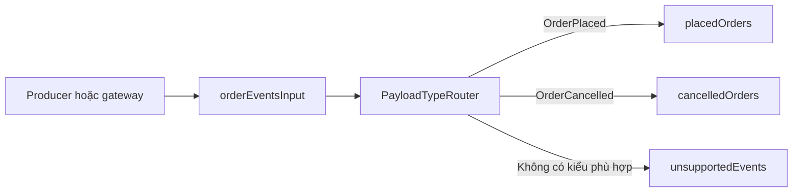
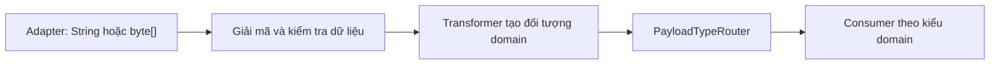

# PayloadTypeRouter

## 1. Mục tiêu và tình huống sử dụng

Trong module **SPRING_INTEGRATION_CORE**, bài học này thuộc chương **Router** và tập trung vào việc chọn nhánh xử lý dựa trên kiểu Java của payload. Sau bài học, bạn có thể cấu hình `PayloadTypeRouter`, gắn router vào endpoint bằng Java DSL, xử lý kiểu chưa hỗ trợ và viết kiểm thử cho quyết định định tuyến.

Giả sử một ứng dụng nhận các sự kiện đơn hàng trên cùng một channel:

- `OrderPlaced`: chuyển sang luồng ghi nhận đơn hàng.
- `OrderCancelled`: chuyển sang luồng hủy đơn.
- Kiểu sự kiện chưa được hỗ trợ: chuyển sang nhánh tiếp nhận riêng để theo dõi.

Producer chỉ cần gửi `Message<?>` đến channel đầu vào. Bảng mapping của router xác định channel đích tương ứng với từng kiểu payload. Khi thêm một loại sự kiện, ta có thể bổ sung mapping và consumer của nhánh đó.



Sơ đồ thể hiện việc lựa chọn đích. Nếu một mapping tồn tại nhưng channel đích bị cấu hình sai, router có thể phát sinh lỗi; tình huống đó không mặc nhiên đi vào `unsupportedEvents`.

## 2. Router nhìn vào phần nào của Message?

Một message gồm payload và headers:

```text
Message<OrderPlaced>
├── payload: OrderPlaced(...)
└── headers: id, timestamp, traceId, ...
```

Đối tượng được phân loại là `message.getPayload()`. Kiểu của lớp bao ngoài, chẳng hạn `GenericMessage`, không phải khóa định tuyến. Các trường nghiệp vụ như tổng tiền hoặc lý do hủy cũng không tham gia quyết định của `PayloadTypeRouter`.

Ví dụ, hai payload sau có cùng kiểu:

```java
new OrderPlaced("ORD-100", new BigDecimal("120000"));
new OrderPlaced("ORD-101", new BigDecimal("9000000"));
```

Chúng đi vào cùng nhánh `OrderPlaced` nếu sử dụng cùng một cấu hình router. Muốn tách đơn giá trị lớn và nhỏ, cần một router đánh giá giá trị nghiệp vụ, hoặc một bước phân loại trước router.

Cấu hình cốt lõi là ánh xạ **tên đầy đủ của kiểu Java → tên channel**:

```java
router.setChannelMapping(
        OrderPlaced.class.getName(),
        "placedOrders");
```

Tên channel là tên được bộ phân giải channel sử dụng, thường tương ứng với bean `MessageChannel` trong Spring context. Cách đăng ký bằng `setChannelMapping` và cách gắn một instance router vào Java DSL được minh họa trong [Router Implementations của Spring Integration](https://docs.spring.io/spring-integration/reference/router/implementations.html).

| Thành phần | Trách nhiệm trong luồng |
|---|---|
| `Message` | Mang dữ liệu và ngữ cảnh xử lý |
| Channel đầu vào | Nhận message từ producer và chuyển đến endpoint |
| Endpoint | Kết nối việc nhận message với handler router |
| `PayloadTypeRouter` | Chọn đích dựa trên kiểu payload và bảng mapping |
| Channel đầu ra | Chuyển message đến consumer hoặc giữ message chờ nhận |
| Consumer của nhánh | Thực thi nghiệp vụ tương ứng |

Router không tự giải tuần tự JSON và không biến `String` thành một đối tượng sự kiện. Nếu payload đang là văn bản JSON, kiểu được quan sát vẫn là `String`; nếu adapter tạo `byte[]` hay `Map`, router quan sát chính các kiểu đó. Cần transformer hoặc cấu hình chuyển đổi ở biên để tạo đúng kiểu domain trước khi định tuyến.

## 3. Cách chọn kiểu phù hợp

### 3.1. Không chỉ so sánh đúng lớp

`PayloadTypeRouter` có xét quan hệ kế thừa và interface. Khi có nhiều mapping có thể áp dụng, router tìm kiểu phù hợp gần nhất theo thuật toán của nó.

Ví dụ:

| Payload | Mapping đang có | Kết quả |
|---|---|---|
| `Integer` | `Integer`, `Number` | Chọn mapping `Integer` |
| `Integer` | Chỉ `Number` | Chọn mapping `Number` |
| `Double` | `Integer`, `Number` | Chọn mapping `Number` |
| `String` | `Integer`, `Number` | Không tìm được mapping kiểu phù hợp |

Vì vậy, thêm một mapping cụ thể có thể làm message chuyển sang nhánh mới dù mapping cho lớp cha vẫn còn. Các trường hợp khớp chính xác và khớp lớp cha có trong [bộ kiểm thử chính thức của PayloadTypeRouter, phiên bản 6.5.0](https://github.com/spring-projects/spring-integration/blob/v6.5.0/spring-integration-core/src/test/java/org/springframework/integration/router/PayloadTypeRouterTests.java).

### 3.2. Interface và trường hợp mơ hồ

Không nên diễn giải thuật toán thành quy tắc tuyệt đối “mọi lớp cha đều ưu tiên hơn mọi interface”. Một interface được triển khai trực tiếp có thể được ưu tiên hơn lớp cha ở xa hơn trong cây kiểu.

Điểm cần giữ khi thiết kế mapping:

1. Mapping đúng lớp thực tế có ưu tiên cao.
2. Nếu không có mapping đúng lớp, các kiểu tổ tiên và interface có thể là ứng viên.
3. Nếu nhiều ứng viên có cùng mức phù hợp tốt nhất, router báo lỗi mơ hồ thay vì chọn theo thứ tự khai báo.

Ví dụ về một cấu trúc dễ gây mơ hồ:

```java
interface Auditable {}
interface Billable {}

final class InvoiceEvent implements Auditable, Billable {}
```

Nếu cùng map `Auditable` và `Billable`, một `InvoiceEvent` có thể khớp hai interface trực tiếp với cùng trọng số. Cách xử lý rõ ràng là bổ sung mapping riêng cho `InvoiceEvent`, hoặc thiết kế lại tiêu chí phân nhánh.

Thuật toán tính mức phù hợp, phát hiện hòa và chỉ trả về một khóa được thể hiện trong [mã nguồn PayloadTypeRouter 6.5.0](https://github.com/spring-projects/spring-integration/blob/v6.5.0/spring-integration-core/src/main/java/org/springframework/integration/router/PayloadTypeRouter.java).

### 3.3. Một nhánh được chọn, không phát đến mọi mapping

Một payload `Integer` phù hợp với cả `Integer` và `Number` không có nghĩa message được gửi đến cả hai nhánh. Router chọn mapping phù hợp nhất.

Nếu yêu cầu là một sự kiện phải đồng thời đến bộ phận kiểm toán và thanh toán, hãy thiết kế bước phát đến nhiều người nhận, chẳng hạn `PublishSubscribeChannel` hoặc `RecipientListRouter`. Đừng dùng các interface chồng lấn để mô phỏng việc phát nhiều nhánh.

## 4. Ví dụ đầy đủ bằng Java DSL

Ví dụ dùng API `IntegrationFlow.from(...)`, Java 17 trở lên để sử dụng `record`, cùng các dependency Spring tương thích do BOM của dự án quản lý. Phần ứng dụng cần `spring-integration-core` và Spring context. Phần kiểm thử phía dưới cần thêm `spring-test`, JUnit Jupiter và test engine tương ứng.

Không cần Spring Boot để chạy cấu hình này. Nếu dự án đã dùng Boot và `spring-boot-starter-integration`, giữ cách quản lý phiên bản của dự án thay vì ghép các phiên bản Spring độc lập.

### 4.1. Cấu hình và kiểu sự kiện

Lưu ví dụ trong `PayloadTypeRoutingConfig.java`:

```java
package example.integration;

import java.math.BigDecimal;

import org.springframework.beans.factory.annotation.Qualifier;
import org.springframework.context.annotation.Bean;
import org.springframework.context.annotation.Configuration;
import org.springframework.integration.channel.DirectChannel;
import org.springframework.integration.channel.QueueChannel;
import org.springframework.integration.config.EnableIntegration;
import org.springframework.integration.dsl.IntegrationFlow;
import org.springframework.integration.router.PayloadTypeRouter;
import org.springframework.messaging.MessageChannel;

@Configuration
@EnableIntegration
public class PayloadTypeRoutingConfig {

    public record OrderPlaced(String orderId, BigDecimal total) {}

    public record OrderCancelled(String orderId, String reason) {}

    @Bean
    public DirectChannel orderEventsInput() {
        return new DirectChannel();
    }

    @Bean
    public QueueChannel placedOrders() {
        return new QueueChannel(100);
    }

    @Bean
    public QueueChannel cancelledOrders() {
        return new QueueChannel(100);
    }

    @Bean
    public QueueChannel unsupportedEvents() {
        return new QueueChannel(100);
    }

    @Bean
    public PayloadTypeRouter orderEventRouter(
            @Qualifier("unsupportedEvents") MessageChannel unsupported) {

        PayloadTypeRouter router = new PayloadTypeRouter();
        router.setChannelMapping(
                OrderPlaced.class.getName(), "placedOrders");
        router.setChannelMapping(
                OrderCancelled.class.getName(), "cancelledOrders");

        router.setChannelKeyFallback(false);
        router.setResolutionRequired(true);
        router.setDefaultOutputChannel(unsupported);
        router.setSendTimeout(1000);
        return router;
    }

    @Bean
    public IntegrationFlow orderEventRouting(
            @Qualifier("orderEventsInput") MessageChannel input,
            PayloadTypeRouter orderEventRouter) {

        return IntegrationFlow.from(input)
                .route(orderEventRouter)
                .get();
    }
}
```

Các quyết định trong cấu hình:

- `@EnableIntegration` cung cấp hạ tầng Spring Integration khi chạy cấu hình Spring thuần.
- `DirectChannel` đầu vào chuyển message đến router trên luồng gọi.
- Ba `QueueChannel` đầu ra giúp ví dụ quan sát message bằng `receive(...)`.
- `Class.getName()` tạo khóa chính xác, kể cả với các record lồng bên trong lớp cấu hình.
- `resolutionRequired=true` giữ lỗi phân giải tên channel ở trạng thái có thể phát hiện.
- `unsupportedEvents` là đích khi không có mapping kiểu phù hợp.
- `sendTimeout=1000` giới hạn thời gian router đợi gửi vào queue đang đầy; nó không giới hạn thời gian nghiệp vụ của consumer.

Các queue trong bài là nơi thu nhận kết quả để thực hành. Muốn xử lý nghiệp vụ, cần consumer nhận từ queue, thường thông qua polling endpoint; các message trong queue không tự được xử lý. Queue mặc định lưu trong bộ nhớ. Đặc tính của `QueueChannel` và `DirectChannel` được mô tả tại [Message Channel Implementations](https://docs.spring.io/spring-integration/reference/channel/implementations.html).

### 4.2. Gửi và nhận message

Lớp sau dùng đúng cấu hình phía trên:

```java
package example.integration;

import java.math.BigDecimal;
import java.util.Objects;

import org.springframework.context.annotation.AnnotationConfigApplicationContext;
import org.springframework.integration.channel.QueueChannel;
import org.springframework.messaging.MessageChannel;
import org.springframework.messaging.support.MessageBuilder;

import example.integration.PayloadTypeRoutingConfig.OrderPlaced;

public class RoutingDemo {

    public static void main(String[] args) {
        try (var context = new AnnotationConfigApplicationContext(
                PayloadTypeRoutingConfig.class)) {

            MessageChannel input =
                    context.getBean("orderEventsInput", MessageChannel.class);
            QueueChannel placed =
                    context.getBean("placedOrders", QueueChannel.class);

            var event = new OrderPlaced(
                    "ORD-100", new BigDecimal("120000"));

            var message = MessageBuilder.withPayload(event)
                    .setHeader("traceId", "trace-100")
                    .build();

            input.send(message);

            var received = Objects.requireNonNull(placed.receive(0));
            System.out.println(received.getPayload());
            System.out.println(received.getHeaders().get("traceId"));
        }
    }
}
```

Kết quả của hai dòng in:

```text
OrderPlaced[orderId=ORD-100, total=120000]
trace-100
```

Trong cấu hình này, router không bật `applySequence` và không có bước biến đổi message. Payload cùng header `traceId` được chuyển sang channel đích. Không nên đồng nhất điều đó với cam kết rằng mọi thành phần trong một flow luôn giữ nguyên message ID: transformer, interceptor hoặc việc tạo message mới có thể làm thay đổi đặc điểm ấy.

## 5. Kiểu chưa hỗ trợ, sai channel và lỗi gửi

Có ba câu hỏi khác nhau trong quá trình xử lý:

1. Có mapping nào phù hợp với kiểu payload không?
2. Tên channel trong mapping có phân giải được thành `MessageChannel` không?
3. Message có được gửi và được xử lý thành công trên channel đã chọn không?

Các câu hỏi này tương ứng với các tình huống lỗi khác nhau. Không nên sử dụng một thuộc tính duy nhất với kỳ vọng nó điều khiển tất cả.

### 5.1. Không tìm thấy mapping kiểu

Với cấu hình ở phần 4, gửi payload `String`:

```java
input.send(MessageBuilder.withPayload("event chưa hỗ trợ").build());
```

Không có mapping cho `String` hay kiểu tổ tiên phù hợp, nên message được gửi đến `unsupportedEvents`.

Nếu bỏ default output channel và vẫn không có mapping phù hợp, router không có đích để gửi và sẽ phát sinh `MessageDeliveryException`. Việc chỉ đặt `resolutionRequired=false` không phải một chỉ thị tự động bỏ message khi không có đích.

Hợp đồng “không có đích và không có default thì báo lỗi”, cũng như cách dùng `NullChannel` khi chủ ý bỏ message, được quy định trong [AbstractMessageRouter 6.5.0](https://github.com/spring-projects/spring-integration/blob/v6.5.0/spring-integration-core/src/main/java/org/springframework/integration/router/AbstractMessageRouter.java).

### 5.2. Có mapping nhưng channel đích không tồn tại

Giả sử khai báo nhầm:

```java
router.setChannelMapping(
        OrderPlaced.class.getName(), "placedOrdersTypo");
```

Router tìm được mapping cho `OrderPlaced`, nhưng không phân giải được `placedOrdersTypo`.

- Với `resolutionRequired=true`: lỗi phân giải được giữ lại; nhánh mặc định không che lỗi này.
- Với `resolutionRequired=false`: đích không phân giải được bị bỏ qua; nếu không còn đích nào và có default output channel, message có thể đi vào nhánh mặc định.

Vì vậy, trong ví dụ chính, payload mới chưa hỗ trợ được tiếp nhận riêng, còn lỗi gõ sai tên channel được phát hiện. Hai tình huống này có ý nghĩa vận hành khác nhau.

### 5.3. Channel tồn tại nhưng gửi thất bại

Một `DirectChannel` không có subscriber, queue bị đầy quá thời gian chờ, hoặc consumer ném exception là các vấn đề ở bước gửi/xử lý.

`resolutionRequired` không xử lý các lỗi này. Router cũng không tự chuyển message sang default output channel chỉ vì consumer trên đích đã chọn gặp lỗi.

Thuộc tính `ignoreSendFailures` có liên quan đến lỗi gửi, nhưng bật nó có thể che khuất thất bại và không phải cơ chế phục hồi nghiệp vụ. Giữ mặc định và thiết kế luồng lỗi rõ ràng trước khi cân nhắc bỏ qua lỗi.

### 5.4. Bảng kết quả cho các cấu hình thường gặp

Bảng giả định default channel, nếu có, đã tồn tại và nhận được message.

| Tình huống | `resolutionRequired` | Default | Hành vi |
|---|---|---|---|
| Có mapping và channel hợp lệ | `true` hoặc `false` | Có hoặc không | Gửi đến channel đã map |
| Không có mapping kiểu phù hợp | Bất kỳ | Có | Gửi đến default |
| Không có mapping kiểu phù hợp | Bất kỳ | Không | Không có đích, báo lỗi |
| Có mapping nhưng tên channel sai | `true` | Có hoặc không | Báo lỗi phân giải |
| Có mapping nhưng tên channel sai | `false` | Có | Bỏ đích không hợp lệ, gửi đến default |
| Có mapping nhưng tên channel sai | `false` | Không | Không còn đích, báo lỗi |
| Đích đã chọn nhưng consumer phát sinh lỗi | Bất kỳ | Có hoặc không | Theo cơ chế lỗi của endpoint/channel; không tự đổi sang default |

Cơ chế phân giải mapping và `resolutionRequired` nằm trong [AbstractMappingMessageRouter 6.5.0](https://github.com/spring-projects/spring-integration/blob/v6.5.0/spring-integration-core/src/main/java/org/springframework/integration/router/AbstractMappingMessageRouter.java).

### 5.5. Hiểu đúng channelKeyFallback

`channelKeyFallback` là tùy chọn chung của các mapping router: khi có một khóa chưa được map, lớp nền có thể dùng khóa đó như tên channel.

Riêng `PayloadTypeRouter`, bước tìm kiểu chủ yếu dựa trên các kiểu đã đăng ký trong bảng mapping. Không nên suy ra rằng chỉ cần tạo bean channel có tên `java.lang.String` là router sẽ tự định tuyến mọi payload `String` đến đó khi không có mapping kiểu.

Ví dụ chính tắt rõ ràng `channelKeyFallback` để thể hiện ý định sử dụng bảng mapping. Với API từ Spring Integration 6.0, cấu hình default output channel còn có tương tác với tùy chọn này; khi chưa đặt fallback tường minh, việc đặt default sẽ tắt fallback khóa. Không chủ động bật đồng thời default output channel, `channelKeyFallback=true` và `resolutionRequired=true`: cấu hình ấy bị từ chối khi khởi tạo. Xem [API AbstractMappingMessageRouter](https://docs.spring.io/spring-integration/api/org/springframework/integration/router/AbstractMappingMessageRouter.html).

## 6. Gắn router bằng annotation

Java DSL ở phần 4 đăng ký endpoint để nhận message từ `orderEventsInput`. Có thể dùng annotation để làm việc tương tự.

Nếu chọn cách annotation, bỏ bean `orderEventRouting` ở phần 4 và thay phương thức tạo router bằng phương thức dưới đây. Giữ các bean channel cùng các kiểu sự kiện:

```java
@Bean
@ServiceActivator(inputChannel = "orderEventsInput")
public PayloadTypeRouter orderEventRouter(
        @Qualifier("unsupportedEvents") MessageChannel unsupported) {

    PayloadTypeRouter router = new PayloadTypeRouter();
    router.setChannelMapping(
            OrderPlaced.class.getName(), "placedOrders");
    router.setChannelMapping(
            OrderCancelled.class.getName(), "cancelledOrders");
    router.setChannelKeyFallback(false);
    router.setResolutionRequired(true);
    router.setDefaultOutputChannel(unsupported);
    router.setSendTimeout(1000);
    return router;
}
```

Thêm import:

```java
import org.springframework.integration.annotation.ServiceActivator;
```

`@ServiceActivator` ở đây gắn một bean handler có sẵn với channel đầu vào. Chỉ khai báo `@Bean PayloadTypeRouter` mà không có endpoint hoặc DSL nhận message thì router chưa tự tiêu thụ message từ channel.

Dùng một cách đăng ký endpoint cho cùng mục đích. Nếu giữ cả DSL lẫn annotation trên cùng `DirectChannel`, bạn tạo thêm consumer cạnh tranh và cấu trúc flow không còn đúng như ví dụ một router đầu vào.

## 7. Những giới hạn cần tính trước

### 7.1. JSON cần được chuyển thành kiểu domain trước

Xét thông điệp bên ngoài có nội dung:

```json
{
  "type": "OrderPlaced",
  "orderId": "ORD-100",
  "total": 120000
}
```

Trường `type` trong JSON không tự trở thành kiểu Java của payload. Nếu payload là `String`, mapping `OrderPlaced.class.getName()` không phù hợp.

Một luồng hợp lý là:



Nếu phân nhánh theo trường `type` ngay trên dữ liệu đã parse, hãy dùng router đánh giá nội dung. Nếu ứng dụng đã chuẩn hóa thành `OrderPlaced` và `OrderCancelled`, định tuyến theo kiểu sẽ rõ ràng hơn.

### 7.2. Generic không phân biệt được theo tham số kiểu

Hai biến có kiểu khai báo `List<OrderPlaced>` và `List<OrderCancelled>` có thể cùng chứa payload thuộc lớp runtime `ArrayList`. Do type erasure, router không dùng tham số generic của biến để phân biệt hai trường hợp.

Các lựa chọn thiết kế:

- Tạo hai kiểu bao riêng, ví dụ `PlacedOrderBatch` và `CancelledOrderBatch`.
- Đưa thông tin phân loại vào header và sử dụng `HeaderValueRouter`.
- Dùng splitter trước router nếu từng phần tử cần được định tuyến độc lập.

Router không tự duyệt phần tử của collection để xác định loại sự kiện bên trong.

### 7.3. Proxy và cấu trúc kế thừa ảnh hưởng việc khớp

Vì việc chọn đích liên quan đến kiểu runtime và cây kiểu, proxy hoặc subclass do thư viện tạo có thể thay đổi cách khớp. Mapping qua một interface ổn định có thể hữu ích, nhưng cần tránh các interface chung chồng lấn và thêm kiểm thử cho kiểu thực tế tại ranh giới ứng dụng.

Việc refactor lớp, đổi package hoặc thay đổi interface cũng có thể làm bảng mapping đổi nghĩa. Ưu tiên `Class.getName()` cho cấu hình Java và kiểm tra lại các mapping ghi bằng chuỗi trong cấu hình bên ngoài.

## 8. Lỗi đồng bộ và lỗi bất đồng bộ

Với đầu vào `DirectChannel` và lời gọi `input.send(message)` như ví dụ, lỗi ở router lan về luồng gọi. Gắn một header `errorChannel` không tự biến lời gọi đồng bộ này thành một cơ chế bắt lỗi chung.

Khi flow chuyển sang xử lý bất đồng bộ bằng executor hoặc polling endpoint, lỗi cần được thu nhận tại cơ chế thực thi tương ứng. Hạ tầng Spring Integration có thể tạo `ErrorMessage` rồi gửi đến channel được chỉ định trong header `errorChannel` hoặc channel lỗi toàn cục, tùy thành phần và cấu hình.

Một gateway cũng có chính sách truyền lỗi riêng; cần đọc cấu hình gateway khi producer gọi qua gateway thay vì gọi `send` trực tiếp. Các quy tắc về luồng gọi và error channel được mô tả trong [Error Handling](https://docs.spring.io/spring-integration/reference/error-handling.html).

Nhánh `unsupportedEvents` trong bài nhận message gốc không có kiểu phù hợp. Nó không phải error channel và không tự nhận exception từ mọi consumer.

Khi bổ sung consumer thực tế, nên phân biệt:

| Sự kiện quan sát | Ý nghĩa |
|---|---|
| Message đến `unsupportedEvents` | Dữ liệu có kiểu chưa được router hỗ trợ |
| Exception phân giải channel | Bảng mapping hoặc Spring context có lỗi cấu hình |
| Exception trong consumer nghiệp vụ | Đích được chọn nhưng xử lý nghiệp vụ thất bại |
| Gửi vào queue thành công | Message đã được nhận vào queue; nghiệp vụ có thể chưa chạy |

Router không cung cấp bảo đảm xử lý đúng một lần cho toàn luồng. Nếu có retry hoặc gửi lại từ nguồn bên ngoài, consumer cần chiến lược chống xử lý trùng phù hợp với nghiệp vụ.

## 9. Kiểm thử quyết định định tuyến

Điểm cần kiểm tra là **message thực sự đến đúng channel**, đồng thời các nhánh không được chọn không nhận message. Chỉ kiểm tra giá trị trả về của `send(...)` chưa đủ để xác nhận quyết định của router.

Lớp kiểm thử sau dùng cấu hình Java DSL ở phần 4. Đặt trong cùng package `example.integration`:

```java
package example.integration;

import java.math.BigDecimal;

import org.junit.jupiter.api.BeforeEach;
import org.junit.jupiter.api.Test;

import org.springframework.beans.factory.annotation.Autowired;
import org.springframework.beans.factory.annotation.Qualifier;
import org.springframework.beans.factory.support.DefaultListableBeanFactory;
import org.springframework.integration.channel.QueueChannel;
import org.springframework.integration.router.PayloadTypeRouter;
import org.springframework.messaging.Message;
import org.springframework.messaging.MessageChannel;
import org.springframework.messaging.MessagingException;
import org.springframework.messaging.support.MessageBuilder;
import org.springframework.test.context.junit.jupiter.SpringJUnitConfig;

import example.integration.PayloadTypeRoutingConfig.OrderCancelled;
import example.integration.PayloadTypeRoutingConfig.OrderPlaced;

import static org.junit.jupiter.api.Assertions.*;

@SpringJUnitConfig(PayloadTypeRoutingConfig.class)
class PayloadTypeRoutingTest {

    @Autowired
    @Qualifier("orderEventsInput")
    MessageChannel input;

    @Autowired
    @Qualifier("placedOrders")
    QueueChannel placed;

    @Autowired
    @Qualifier("cancelledOrders")
    QueueChannel cancelled;

    @Autowired
    @Qualifier("unsupportedEvents")
    QueueChannel unsupported;

    @BeforeEach
    void clearOutputs() {
        drain(placed);
        drain(cancelled);
        drain(unsupported);
    }

    private static void drain(QueueChannel channel) {
        while (channel.receive(0) != null) {
            // Xóa kết quả còn lại để từng test độc lập.
        }
    }

    @Test
    void placedEventGoesOnlyToPlacedChannel() {
        var payload = new OrderPlaced(
                "ORD-100", new BigDecimal("120000"));
        Message<?> message = MessageBuilder.withPayload(payload)
                .setHeader("traceId", "trace-100")
                .build();

        assertTrue(input.send(message));

        Message<?> result = placed.receive(0);
        assertNotNull(result);
        assertEquals(payload, result.getPayload());
        assertEquals("trace-100", result.getHeaders().get("traceId"));
        assertNull(cancelled.receive(0));
        assertNull(unsupported.receive(0));
    }

    @Test
    void cancelledEventGoesOnlyToCancelledChannel() {
        var payload = new OrderCancelled(
                "ORD-101", "Khách yêu cầu");
        input.send(MessageBuilder.withPayload(payload).build());

        Message<?> result = cancelled.receive(0);
        assertNotNull(result);
        assertEquals(payload, result.getPayload());
        assertNull(placed.receive(0));
        assertNull(unsupported.receive(0));
    }

    @Test
    void unknownTypeGoesToDefaultChannel() {
        var payload = "sự kiện chưa được giải mã";
        input.send(MessageBuilder.withPayload(payload).build());

        Message<?> result = unsupported.receive(0);
        assertNotNull(result);
        assertEquals(payload, result.getPayload());
        assertNull(placed.receive(0));
        assertNull(cancelled.receive(0));
    }

    @Test
    void exactTypeWinsAndSuperclassRemainsFallback() {
        var numberOutput = new QueueChannel(10);
        var integerOutput = new QueueChannel(10);
        var beanFactory = new DefaultListableBeanFactory();
        beanFactory.registerSingleton("numbers", numberOutput);
        beanFactory.registerSingleton("integers", integerOutput);

        var router = new PayloadTypeRouter();
        router.setBeanFactory(beanFactory);
        router.setChannelMapping(
                Number.class.getName(), "numbers");
        router.setChannelMapping(
                Integer.class.getName(), "integers");
        router.afterPropertiesSet();

        router.handleMessage(
                MessageBuilder.withPayload(42).build());

        Message<?> integerResult = integerOutput.receive(0);
        assertNotNull(integerResult);
        assertEquals(42, integerResult.getPayload());
        assertNull(numberOutput.receive(0));

        router.handleMessage(
                MessageBuilder.withPayload(2.5d).build());

        Message<?> numberResult = numberOutput.receive(0);
        assertNotNull(numberResult);
        assertEquals(2.5d, numberResult.getPayload());
        assertNull(integerOutput.receive(0));
    }

    @Test
    void missingMappedChannelFailsEvenWithDefault() {
        var fallback = new QueueChannel(10);
        var router = new PayloadTypeRouter();
        router.setBeanFactory(new DefaultListableBeanFactory());
        router.setChannelMapping(
                OrderPlaced.class.getName(), "missingPlacedChannel");
        router.setChannelKeyFallback(false);
        router.setResolutionRequired(true);
        router.setDefaultOutputChannel(fallback);
        router.afterPropertiesSet();

        var message = MessageBuilder.withPayload(
                new OrderPlaced("ORD-102", BigDecimal.TEN))
                .build();

        assertThrows(
                MessagingException.class,
                () -> router.handleMessage(message));

        assertNull(fallback.receive(0));
    }
}
```

Ba test đầu đi qua endpoint đã đăng ký trong Spring context. Hai test cuối dựng router riêng để quan sát quy tắc chọn kiểu và chính sách phân giải channel mà không thay cấu hình của flow chính.

Việc dùng `receive(0)` phù hợp với ví dụ này: đầu vào là `DirectChannel`, router gửi vào các queue trước khi lời gọi đồng bộ kết thúc và các queue đầu ra không có consumer cạnh tranh. Nếu thêm executor hoặc polling consumer, cần cách chờ kết quả có giới hạn và một điểm quan sát phù hợp; không thể mặc định giữ nguyên cách kiểm tra tức thời.

Các trường hợp nên bổ sung khi mở rộng ứng dụng:

| Trường hợp | Điều cần xác nhận |
|---|---|
| Hai interface trực tiếp có cùng mức phù hợp | Báo mơ hồ; không gửi ngẫu nhiên vào một nhánh |
| Thêm mapping cụ thể bên cạnh mapping lớp cha | Chỉ loại cụ thể chuyển sang nhánh mới |
| Payload là JSON `String` | Không khớp nhầm mapping đối tượng domain |
| Không mapping và không default | Báo không có đích |
| Channel đúng tên nhưng không có consumer | Thể hiện lỗi gửi phù hợp với loại channel |
| Chuyển sang executor hoặc poller | Lỗi được quan sát qua cơ chế bất đồng bộ đã cấu hình |

Đây là mã kiểm thử để người học đưa vào dự án thực hành; việc trình bày mã không đồng nghĩa các test đã được chạy trong môi trường dự án của bạn.

## 10. Chọn router theo yêu cầu

| Yêu cầu | Thành phần/cách tiếp cận phù hợp |
|---|---|
| `OrderPlaced` và `OrderCancelled` có luồng xử lý riêng | `PayloadTypeRouter` |
| Cùng `OrderPlaced` nhưng phân nhánh theo tổng tiền | Router dùng biểu thức hoặc phương thức nghiệp vụ |
| Phân nhánh theo header `eventType` | `HeaderValueRouter` |
| Một sự kiện cần đến nhiều nhánh | `RecipientListRouter` hoặc `PublishSubscribeChannel`, tùy cách chọn người nhận |
| Chỉ cho message hợp lệ đi tiếp | Filter |
| Chuyển JSON thành kiểu domain | Transformer hoặc cơ chế chuyển đổi tại adapter |
| Chia danh sách rồi định tuyến từng phần tử | Splitter, sau đó router |
| Gom các message theo nhóm nghiệp vụ | Aggregator với chiến lược correlation và release phù hợp |

Trong Java DSL, một lambda trả về `payload.getClass()` có thể đáp ứng việc phân nhánh theo lớp chính xác. Tuy nhiên, không nên mặc định coi mọi router viết bằng lambda là cùng một triển khai với `PayloadTypeRouter`. Nếu cần hành vi chọn kiểu gần nhất trong cây kế thừa, dùng trực tiếp `PayloadTypeRouter` như bài này và kiểm thử quy tắc mong muốn.

Tương tự, `PayloadTypeRouter` không tự tập hợp kết quả các nhánh. Nếu bài toán cần gom nhiều phản hồi, phải thiết kế bước phát nhiều nhánh và aggregator cùng các header tương quan thích hợp.

## 11. Chẩn đoán nhanh

| Hiện tượng | Kiểm tra trước |
|---|---|
| Mọi message đều đến nhánh mặc định | Kiểu runtime thực tế của payload; bảng mapping có dùng đúng tên đầy đủ không |
| JSON có `type=OrderPlaced` nhưng không vào nhánh đơn hàng | Payload đã là `OrderPlaced` hay vẫn là `String`, `Map`, `byte[]` |
| Sau khi thêm interface, message bắt đầu lỗi | Có hai mapping cùng mức phù hợp hay không |
| Có bean router nhưng message không đi qua nó | Endpoint DSL hoặc annotation đã đăng ký đúng input channel chưa |
| Thỉnh thoảng message không qua router dự kiến | Có consumer cạnh tranh trên `DirectChannel` đầu vào không |
| Default không nhận message khi gõ sai tên channel | `resolutionRequired` có đang là `true` không |
| Gửi vào queue thành công nhưng nghiệp vụ chưa chạy | Đã có consumer hoặc polling endpoint nhận từ queue chưa |
| Exception quay về producer dù đã đặt `errorChannel` | Đang gọi đồng bộ qua `DirectChannel` hay qua cơ chế có hỗ trợ publish lỗi |
| Đổi package khiến mapping không còn khớp | Khóa cấu hình ghi bằng chuỗi có còn đúng tên lớp không |

Khi cần quan sát, ghi nhận tên kiểu payload và mã tương quan của message. Chỉ ghi nội dung payload khi có lý do nghiệp vụ và dữ liệu đã được xử lý phù hợp. Tỷ lệ message vào nhánh chưa hỗ trợ cũng là tín hiệu để phát hiện producer và consumer chưa thống nhất hợp đồng dữ liệu.

## 12. Bài tập thực hành

1. Thêm record `OrderPaid(String orderId, String paymentId)`, channel `paidOrders` và mapping tương ứng. Xác nhận sự kiện mới chỉ đến nhánh thanh toán.
2. Xóa mapping `OrderCancelled`. Giữ default output channel và xác nhận message hủy đơn đến `unsupportedEvents`.
3. Khôi phục mapping rồi đổi tên channel đích thành một tên chưa đăng ký. Xác nhận lời gọi đồng bộ báo lỗi khi `resolutionRequired=true`.
4. Chuyển `resolutionRequired` thành `false` trong tình huống bước 3. Xác nhận nhánh default nhận message và giải thích vì sao điều này có thể che lỗi cấu hình.
5. Dùng `Number` và `Integer` để kiểm tra mapping cụ thể được ưu tiên. Sau đó gửi `Double` và xác nhận mapping lớp cha vẫn có tác dụng.
6. Tạo một lớp triển khai hai marker interface trực tiếp, map cả hai interface rồi quan sát lỗi mơ hồ. Thêm mapping đúng lớp để giải quyết.
7. Gửi một chuỗi JSON mô tả `OrderPlaced`. So sánh với việc gửi đối tượng `OrderPlaced` để xác nhận router dựa trên kiểu Java thực tế.

Tiêu chí hoàn thành là giải thích được từng đích nhận message, từng lỗi xuất hiện và vì sao các nhánh còn lại không nhận message. Khi triển khai trong ứng dụng, giữ quyết định định tuyến tách khỏi xử lý nghiệp vụ để dễ kiểm thử và thay đổi bảng mapping.
