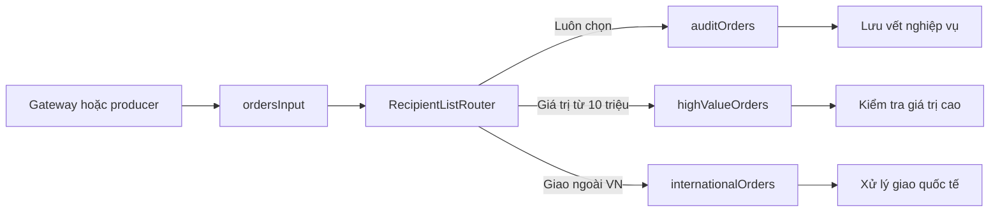

# RecipientListRouter

## 1. Bài toán: một message cần đến nhiều nhánh phù hợp

Trong chương Router của **SPRING_INTEGRATION_CORE**, `RecipientListRouter` giải quyết bài toán chọn một danh sách đích nhận cho từng message. Đây là một cách triển khai mẫu tích hợp **Recipient List**: cùng một sự kiện có thể liên quan đến nhiều bộ phận, và mỗi bộ phận chỉ nhận sự kiện đáp ứng điều kiện của mình.

Ví dụ, khi tiếp nhận đơn hàng:

- Mọi đơn hàng cần đi vào nhánh lưu vết nghiệp vụ.
- Đơn hàng có giá trị từ 10 triệu đồng cần đi vào nhánh kiểm tra giá trị cao.
- Đơn hàng giao ngoài Việt Nam cần đi vào nhánh xử lý quốc tế.

Một đơn hàng vừa có giá trị cao vừa giao quốc tế phải được chuyển đến cả ba nhánh. Nếu chỉ chọn một đích đầu tiên thỏa điều kiện, hệ thống sẽ bỏ sót công việc của các nhánh còn lại.

Sau bài học, bạn có thể:

- Giải thích cách `RecipientListRouter` kết hợp recipient và selector.
- Tạo luồng Java DSL gửi cùng message đến nhiều `MessageChannel`.
- Xác định hành vi khi không có recipient phù hợp hoặc một nhánh gửi thất bại.
- Sử dụng `applySequence` đúng mục đích khi có nhu cầu gom kết quả bằng aggregator.
- Kiểm thử tập nhánh được chọn, biên điều kiện và tác động của lỗi từng nhánh.

## 2. Recipient và selector hoạt động như thế nào?

Một **recipient** là một đích nhận được cấu hình cho router, có thể kèm một `MessageSelector`. Selector kiểm tra message và trả về `true` hoặc `false`.

Với một message đầu vào, hãy hình dung router xây dựng danh sách như sau:

```text
recipients được cấu hình
    -> đánh giá điều kiện của từng recipient
    -> lấy các đích có điều kiện đúng
    -> gửi message đến các đích đã chọn
```

Recipient không có selector là recipient luôn được chọn. Router xét các điều kiện độc lập; một điều kiện đúng không ngăn các recipient khác được xét.

| Recipient | Điều kiện | Ý nghĩa |
|---|---|---|
| `auditOrders` | Không có selector | Nhận mọi đơn hàng |
| `highValueOrders` | `total >= 10_000_000` | Nhận đơn giá trị cao |
| `internationalOrders` | `destinationCountry != VN` | Nhận đơn giao quốc tế |

Một recipient là một cấu hình đích nhận, không nhất thiết tương ứng với một người dùng hay một ứng dụng bên ngoài. Đích thường là một `MessageChannel`; phía sau channel có thể là transformer, service activator, outbound adapter hoặc một luồng tích hợp khác.

### Phân biệt với những lựa chọn gần giống

| Thành phần | Cách xác định đích | Khi phù hợp |
|---|---|---|
| Router ánh xạ một khóa sang một channel | Một giá trị quyết định đích, chẳng hạn loại đơn hàng | Phân loại đơn vào một tuyến xử lý cụ thể |
| `RecipientListRouter` | Danh sách recipient với điều kiện độc lập | Một message cần đến nhiều nhánh khác nhau theo nội dung hoặc header |
| `PublishSubscribeChannel` | Gửi tới các subscriber đã đăng ký | Các subscriber cần cùng nhận mọi message đi vào channel |
| Filter | Quyết định cho message đi tiếp hoặc bị loại | Chỉ cần một quyết định nhận/bỏ trên một tuyến |
| Splitter | Tách một message thành nhiều phần | Payload chứa tập phần tử cần xử lý riêng |

Một router khác cũng có thể trả về nhiều đích. Điểm đặc trưng của `RecipientListRouter` là cấu hình trực tiếp một danh sách recipient, mỗi recipient có thể sở hữu selector riêng.

`RecipientListRouter` không tự tách danh sách phần tử trong payload. Nếu payload là một đơn hàng có 20 dòng hàng, các nhánh vẫn nhận đơn hàng đó, trừ khi một splitter hoặc transformer khác thực hiện việc tách hay chuyển đổi.

## 3. Vị trí của router trong luồng thông điệp



Gateway chỉ là một cách đưa message vào luồng. Producer cũng có thể gọi `MessageChannel.send(...)` trực tiếp. Router nhận `Message<?>`, đánh giá payload hoặc header, rồi chuyển message đến các channel phù hợp.

Router quyết định **đích gửi**, không quyết định toàn bộ mô hình thực thi của các nhánh:

- `DirectChannel` thường chuyển việc xử lý cho subscriber ngay trên thread gửi.
- `QueueChannel` đưa message vào hàng đợi; consumer cần lấy message ra, thường thông qua polling endpoint.
- `ExecutorChannel` chuyển công việc qua executor theo cấu hình.

Vì vậy, fan-out đến ba channel không có nghĩa ba tác vụ tự động chạy song song. Nếu cả ba là `DirectChannel`, công việc downstream có thể diễn ra lần lượt trên cùng thread, và một nhánh chậm làm chậm lời gọi vào luồng.

## 4. Ví dụ hoàn chỉnh bằng Java DSL

Ví dụ sử dụng Java 17 trở lên để khai báo `record`, Spring Integration Java DSL và các channel trong bộ nhớ. Các thư viện Spring cần được quản lý bằng một bộ phiên bản tương thích của dự án; không ghép tùy ý phiên bản Spring Framework và Spring Integration.

Các lớp cần thiết nằm trong `spring-integration-core`. Phần kiểm thử phía sau cần JUnit Jupiter và Spring Test. Nếu dự án dùng Spring Boot, có thể sử dụng các starter tương ứng do dự án quản lý.

Đặt lớp dưới đây trong package `example.integration`:

```java
package example.integration;

import java.math.BigDecimal;
import java.util.Locale;
import java.util.Objects;

import org.springframework.context.annotation.Bean;
import org.springframework.context.annotation.Configuration;
import org.springframework.integration.channel.DirectChannel;
import org.springframework.integration.channel.QueueChannel;
import org.springframework.integration.config.EnableIntegration;
import org.springframework.integration.dsl.IntegrationFlow;

@Configuration
@EnableIntegration
public class OrderRoutingConfig {

    private static final BigDecimal HIGH_VALUE_THRESHOLD =
            new BigDecimal("10000000");

    public record Order(
            String id,
            BigDecimal total,
            String destinationCountry) {

        public Order {
            Objects.requireNonNull(id, "id is required");
            Objects.requireNonNull(total, "total is required");
            destinationCountry = Objects.requireNonNull(
                    destinationCountry,
                    "destinationCountry is required")
                    .trim()
                    .toUpperCase(Locale.ROOT);

            if (total.signum() < 0) {
                throw new IllegalArgumentException("total must be non-negative");
            }
            if (destinationCountry.isEmpty()) {
                throw new IllegalArgumentException(
                        "destinationCountry must not be empty");
            }
        }
    }

    @Bean
    public DirectChannel ordersInput() {
        return new DirectChannel();
    }

    @Bean
    public QueueChannel auditOrders() {
        return new QueueChannel();
    }

    @Bean
    public QueueChannel highValueOrders() {
        return new QueueChannel();
    }

    @Bean
    public QueueChannel internationalOrders() {
        return new QueueChannel();
    }

    @Bean
    public IntegrationFlow orderRoutingFlow() {
        return IntegrationFlow.from(ordersInput())
                .routeToRecipients(recipients -> recipients
                        .recipient("auditOrders")
                        .recipient("highValueOrders", message -> {
                            Order order = (Order) message.getPayload();
                            return order.total()
                                    .compareTo(HIGH_VALUE_THRESHOLD) >= 0;
                        })
                        .recipient("internationalOrders", message -> {
                            Order order = (Order) message.getPayload();
                            return !"VN".equals(order.destinationCountry());
                        })
                        .ignoreSendFailures(false))
                .get();
    }
}
```

### Giải thích các quyết định trong cấu hình

`routeToRecipients(...)` xây dựng recipient-list router trong Java DSL. Các chuỗi `auditOrders`, `highValueOrders` và `internationalOrders` là tên bean channel cần được phân giải trong application context.

Các lambda selector nhận message, vì vậy có thể đọc cả payload lẫn header. Ví dụ dùng ép kiểu sang `Order` theo hợp đồng của luồng. Producer phải gửi payload đúng kiểu; message sai kiểu cần được kiểm tra hoặc chuyển đổi ở trước router nếu nguồn đầu vào không bảo đảm hợp đồng này.

`BigDecimal.compareTo(...)` diễn đạt đúng điều kiện ngưỡng. Không chuyển số tiền sang `double` để quyết định tuyến, và không dùng `BigDecimal.equals(...)` cho phép so sánh lớn hơn hoặc bằng.

Các đích dùng `QueueChannel` để có thể kiểm tra message một cách trực tiếp trong bài thực hành. Những queue này nằm trong bộ nhớ và không tự tạo tính bền vững khi ứng dụng dừng. Trong ứng dụng thực tế, cần cấu hình consumer hoặc poller cho từng nhánh.

`ignoreSendFailures(false)` diễn đạt rõ mong muốn nhận biết lỗi gửi. Đây không phải cấu hình giao dịch bao trùm ba nhánh và cũng không bảo đảm mọi tác động downstream đã hoàn tất.

### Kết quả định tuyến mong đợi

| Tổng tiền | Quốc gia | `auditOrders` | `highValueOrders` | `internationalOrders` |
|---|---|---|---|---|
| 2.000.000 | VN | Có | Không | Không |
| 10.000.000 | VN | Có | Có | Không |
| 2.000.000 | JP | Có | Không | Có |
| 15.000.000 | JP | Có | Có | Có |

Dòng cuối là tình huống quan trọng: hai selector đều đúng nên cả hai nhánh có điều kiện đều được chọn. Nhánh `auditOrders` vẫn nhận message vì không có selector.

## 5. Kiểm thử số lượng và danh tính recipient

Kiểm thử router cần chứng minh cả hai chiều: nhánh phù hợp nhận được message và nhánh không phù hợp không nhận được message.

Lớp sau dùng cùng package với cấu hình ở trên. Các test chạy theo chế độ tuần tự mặc định của JUnit; mỗi test dọn queue trước khi gửi message mới.

```java
package example.integration;

import java.math.BigDecimal;

import org.junit.jupiter.api.BeforeEach;
import org.junit.jupiter.api.Test;
import org.springframework.beans.factory.annotation.Autowired;
import org.springframework.beans.factory.annotation.Qualifier;
import org.springframework.integration.channel.DirectChannel;
import org.springframework.integration.channel.QueueChannel;
import org.springframework.messaging.Message;
import org.springframework.messaging.support.MessageBuilder;
import org.springframework.test.context.junit.jupiter.SpringJUnitConfig;

import static org.junit.jupiter.api.Assertions.assertNotNull;
import static org.junit.jupiter.api.Assertions.assertNull;
import static org.junit.jupiter.api.Assertions.assertSame;
import static org.junit.jupiter.api.Assertions.assertTrue;

@SpringJUnitConfig(OrderRoutingConfig.class)
class OrderRoutingTest {

    @Autowired
    @Qualifier("ordersInput")
    private DirectChannel input;

    @Autowired
    @Qualifier("auditOrders")
    private QueueChannel audit;

    @Autowired
    @Qualifier("highValueOrders")
    private QueueChannel highValue;

    @Autowired
    @Qualifier("internationalOrders")
    private QueueChannel international;

    @BeforeEach
    void clearQueues() {
        drain(audit);
        drain(highValue);
        drain(international);
    }

    @Test
    void highValueInternationalOrderReachesAllRecipients() {
        var order = new OrderRoutingConfig.Order(
                "O-100", new BigDecimal("15000000"), "JP");

        assertTrue(input.send(MessageBuilder.withPayload(order).build()));

        assertReceivedExactlyOnce(audit, order);
        assertReceivedExactlyOnce(highValue, order);
        assertReceivedExactlyOnce(international, order);
    }

    @Test
    void smallDomesticOrderReachesOnlyAudit() {
        var order = new OrderRoutingConfig.Order(
                "O-101", new BigDecimal("2000000"), "VN");

        assertTrue(input.send(MessageBuilder.withPayload(order).build()));

        assertReceivedExactlyOnce(audit, order);
        assertNull(highValue.receive(0));
        assertNull(international.receive(0));
    }

    @Test
    void exactThresholdIsIncludedInHighValueBranch() {
        var order = new OrderRoutingConfig.Order(
                "O-102", new BigDecimal("10000000"), "VN");

        assertTrue(input.send(MessageBuilder.withPayload(order).build()));

        assertReceivedExactlyOnce(audit, order);
        assertReceivedExactlyOnce(highValue, order);
        assertNull(international.receive(0));
    }

    private static void assertReceivedExactlyOnce(
            QueueChannel channel,
            OrderRoutingConfig.Order expected) {

        Message<?> received = channel.receive(0);
        assertNotNull(received);
        assertSame(expected, received.getPayload());
        assertNull(channel.receive(0));
    }

    private static void drain(QueueChannel channel) {
        while (channel.receive(0) != null) {
            // Chỉ dọn dữ liệu của ví dụ kiểm thử trong bộ nhớ.
        }
    }
}
```

Trong cấu hình này, input là `DirectChannel` và router gửi trực tiếp vào các queue trước khi lời gọi `send(...)` trả về. Vì vậy, `receive(0)` có thể kiểm tra ngay mà không cần `Thread.sleep(...)`.

Nếu thay đường đi bằng một channel có executor hoặc một broker, kiểm thử phải chờ có giới hạn theo đặc tính bất đồng bộ của luồng. Không giữ nguyên giả định rằng ngay sau `send(...)` thì queue đích đã có message.

`assertSame(...)` minh họa router giữ nguyên tham chiếu payload trong cấu hình này. Việc mỗi recipient nhận đúng một message chỉ là kết quả của lần gửi đang kiểm thử, không chứng minh hệ thống có ngữ nghĩa exactly-once khi có retry, restart hoặc broker.

## 6. Selector theo payload, header và SpEL

### Theo payload

Điều kiện nghiệp vụ nên dùng dữ liệu đã được chuẩn hóa. Trong ví dụ, `destinationCountry` được chuyển về chữ hoa ngay khi tạo `Order`, tránh việc `vn` bị hiểu thành quốc gia khác `VN`.

Các selector nên ngắn, dễ kiểm thử và không có tác dụng phụ. Nếu điều kiện phức tạp, có thể gọi một phương thức quyết định tuyến:

```java
.recipient("highValueOrders", message ->
        routingPolicy.requiresHighValueReview(
                (OrderRoutingConfig.Order) message.getPayload()))
```

Đây là đoạn trích minh họa: `routingPolicy` là dependency cần tự khai báo và cung cấp cho cấu hình. Nó nên đưa ra quyết định ổn định từ dữ liệu đầu vào, thay vì vừa quyết định tuyến vừa cập nhật trạng thái đơn hàng.

### Theo header

Ví dụ chọn nhánh kiểm tra thủ công bằng một Boolean header:

```java
.recipient("manualReviewOrders", message ->
        Boolean.TRUE.equals(message.getHeaders().get("manualReview")))
```

Cần khai báo channel `manualReviewOrders` trước khi sử dụng đoạn trích này. Producer gửi header bằng `MessageBuilder`:

```java
Message<?> message = MessageBuilder.withPayload(order)
        .setHeader("manualReview", true)
        .build();
```

`Boolean.TRUE.equals(...)` xem header thiếu là không chọn nhánh. Đây là chính sách cụ thể của ví dụ. Nếu header bắt buộc, hãy xác thực ở đầu luồng và báo lỗi khi thiếu, thay vì âm thầm xem nó là `false`.

### Theo biểu thức SpEL

Java DSL cũng hỗ trợ selector bằng biểu thức, chẳng hạn:

```java
.recipient("manualReviewOrders", "headers['manualReview'] == true")
```

Biểu thức trên được đánh giá với message làm ngữ cảnh để truy cập `headers` và `payload`. Chỉ nên dùng cấu hình biểu thức do ứng dụng kiểm soát; dữ liệu nhận từ người dùng không được tự động trở thành biểu thức thực thi.

Selector trả về `false` là một kết quả định tuyến bình thường. Selector ném ngoại lệ là lỗi xử lý. Không nên bắt mọi ngoại lệ rồi trả về `false`, vì làm vậy có thể biến dữ liệu sai hoặc lỗi lập trình thành việc bỏ mất một nhánh nghiệp vụ.

## 7. Khi không có recipient phù hợp

Trong ví dụ chính, recipient `auditOrders` luôn được chọn, nên mọi `Order` hợp lệ đều có ít nhất một đích. Cấu hình `defaultOutputChannel` cho chính luồng đó không giúp phát hiện trường hợp không khớp các nhánh có điều kiện: audit đã là một recipient phù hợp.

Nếu nghiệp vụ muốn gửi đơn không khớp bất kỳ điều kiện nào sang nhánh chờ phân loại, hãy dùng một router chỉ có các recipient có điều kiện. Có thể bổ sung cấu hình độc lập sau vào cùng lớp `OrderRoutingConfig` để thực hành:

```java
@Bean
public QueueChannel unclassifiedOrders() {
    return new QueueChannel();
}

@Bean
public IntegrationFlow conditionalRoutingFlow() {
    return IntegrationFlow.from("conditionalOrdersInput")
            .routeToRecipients(recipients -> recipients
                    .recipient("highValueOrders", message -> {
                        Order order = (Order) message.getPayload();
                        return order.total()
                                .compareTo(HIGH_VALUE_THRESHOLD) >= 0;
                    })
                    .recipient("internationalOrders", message -> {
                        Order order = (Order) message.getPayload();
                        return !"VN".equals(order.destinationCountry());
                    })
                    .defaultOutputChannel("unclassifiedOrders"))
            .get();
}
```

`conditionalOrdersInput` là input channel được DSL tạo theo tên cho luồng bổ sung. Gửi đơn nhỏ, giao trong nước vào input này sẽ dẫn tới `unclassifiedOrders`. Gửi đơn giá trị cao, giao quốc tế sẽ chọn cả hai recipient có điều kiện và không cần nhánh mặc định.

Khi không xác định được recipient và không có đích mặc định, router báo lỗi định tuyến. Nếu nghiệp vụ cho phép loại bỏ message, có thể chủ động cấu hình đích mặc định là `nullChannel`; khi đó việc bỏ message phải là một quyết định đã được chấp nhận và có cách quan sát phù hợp.

Không dùng đích mặc định như một cơ chế bù trừ cho tác động đã xảy ra ở các nhánh khác. Việc chọn nhánh, gửi message và phục hồi lỗi là các trách nhiệm cần được thiết kế riêng.

## 8. Gửi đến nhiều nhánh không tạo ra một giao dịch chung

Xét thứ tự recipient trong ví dụ:

```text
1. auditOrders
2. highValueOrders
3. internationalOrders
```

Giả sử message đã vào `auditOrders`, nhưng lần gửi đến `highValueOrders` gặp lỗi. Với cấu hình không bỏ qua lỗi gửi, luồng có thể dừng và báo lỗi trước khi gửi đến `internationalOrders`.

Message đã vào queue audit không tự biến mất chỉ vì router gặp lỗi ở một lần gửi sau đó. Nếu producer retry toàn bộ message, nhánh audit có thể nhận thêm một bản nữa.

| Tình huống | Điều cần hiểu |
|---|---|
| Đã gửi thành công một vài nhánh, nhánh tiếp theo lỗi | Có thể xuất hiện kết quả thành công một phần |
| `ignoreSendFailures(false)` | Lỗi gửi không được chủ động bỏ qua; caller hoặc hạ tầng lỗi có thể nhận biết thất bại |
| `ignoreSendFailures(true)` | Cho phép router bỏ qua lỗi gửi thuộc cơ chế này để tiếp tục; cần chấp nhận rủi ro thiếu một số recipient |
| Selector ném ngoại lệ | Cần xử lý như lỗi đánh giá điều kiện, không mặc nhiên coi là lỗi gửi được bỏ qua |
| Consumer của một queue lỗi sau khi router đã gửi xong | Router đã hoàn tất lần gửi vào queue; lỗi downstream thuộc giai đoạn xử lý sau |

Không hiểu `ignoreSendFailures(true)` là bỏ qua mọi loại ngoại lệ trong toàn bộ luồng. Lỗi phân giải cấu hình, lỗi selector và lỗi xử lý bất đồng bộ có thể nằm ở các điểm khác với thao tác gửi mà router đang thực hiện.

### Hệ quả đối với retry và idempotency

Mỗi nhánh có tác động bên ngoài nên có chiến lược chống xử lý trùng phù hợp. Ví dụ, nhánh kiểm tra giá trị cao có thể lưu dấu xử lý bằng khóa gồm `orderId`, loại tác vụ và phiên bản sự kiện.

Không nên dùng riêng `orderId` nếu một đơn hàng có thể phát sinh nhiều sự kiện hợp lệ ở các thời điểm khác nhau. Khóa chống trùng phải thể hiện đúng đơn vị công việc mà nhánh cần thực hiện một lần.

Nếu các nhánh có yêu cầu giao nhận khác nhau, có thể đặt retry, hàng đợi bền vững hoặc cơ chế phục hồi ở ranh giới từng nhánh. Transaction chỉ có thể rollback những tài nguyên thực sự tham gia transaction tương ứng; một lời gọi HTTP hay một email đã gửi không tự được thu hồi bởi router.

### Error channel và caller

Với đường đi đồng bộ qua `DirectChannel`, ngoại lệ thường có thể truyền ngược về lời gọi gửi hoặc gateway. Không giả định mọi lỗi sẽ tự xuất hiện trên bean `errorChannel` toàn cục.

Với polling endpoint, executor hoặc adapter, việc tạo `ErrorMessage` và chọn error channel phụ thuộc thành phần tiếp nhận, error handler và cấu hình của luồng. Cần thiết kế nơi tiếp nhận lỗi theo ranh giới thực thi thật của hệ thống.

## 9. `applySequence` khi cần gom kết quả

Router có thể bổ sung sequence headers khi cấu hình:

```java
.routeToRecipients(recipients -> recipients
        .applySequence(true)
        .recipient("auditOrders")
        .recipient("highValueOrders", message -> {
            Order order = (Order) message.getPayload();
            return order.total()
                    .compareTo(HIGH_VALUE_THRESHOLD) >= 0;
        })
        .recipient("internationalOrders", message -> {
            Order order = (Order) message.getPayload();
            return !"VN".equals(order.destinationCountry());
        }))
```

Đây là cách thay phần `routeToRecipients(...)` của ví dụ chính, không phải thêm một router thứ hai sau router cũ. `applySequence` mặc định không được bật trên router; chỉ bật khi các phần message thực sự cần được tương quan về sau.

Các header đáng chú ý:

| Header | Vai trò |
|---|---|
| `correlationId` | Liên kết các phần thuộc cùng lần phát tán message |
| `sequenceNumber` | Vị trí của phần trong tập đích đã chọn |
| `sequenceSize` | Số phần dự kiến của tập đích đã chọn |

Với đơn giá trị cao, giao quốc tế, ví dụ chọn ba recipient nên các phần có `sequenceSize` bằng 3. Với đơn nhỏ, giao trong nước, chỉ audit được chọn nên kích thước là 1. Không đặt cứng kích thước nhóm bằng tổng số recipient được khai báo, vì mỗi message có thể chọn tập đích khác nhau.

Để aggregator gom kết quả đúng, cần thiết kế sao cho:

1. Mỗi nhánh cần chờ tạo ra kết quả theo hợp đồng đã thống nhất.
2. Các kết quả giữ được thông tin tương quan cần thiết.
3. Các kết quả được đưa về cùng đầu vào của aggregator.
4. Release strategy và timeout xử lý được tình huống nhánh lỗi hoặc không trả kết quả.

`applySequence(true)` chỉ cung cấp metadata, không tạo aggregator và không tự chờ các nhánh.

Một bẫy thường gặp là chọn ba recipient nhưng chỉ có hai nhánh trả kết quả về aggregator. Nếu aggregator chờ đủ `sequenceSize`, nhóm có thể không được phát hành. Tương tự, một recipient được chọn nhưng gửi thất bại không làm kết quả của recipient đó tự xuất hiện trong nhóm.

Nhánh audit thường chỉ có tác dụng ghi nhận và không cần tham gia việc chờ kết quả. Trong trường hợp đó, hãy thiết kế riêng việc lưu vết với nhóm xử lý cần gom, hoặc định nghĩa rõ kết quả xác nhận của audit. Không bật sequence cho mọi nhánh rồi mặc định rằng aggregator sẽ hiểu nhánh nào là tùy chọn.

## 10. Payload dùng chung và tính bất biến

Trong cấu hình mặc định của ví dụ, router chuyển tiếp payload hiện có. Khi cần thêm sequence headers, message gửi ra có thể là message mới mang các header tương ứng; payload không vì thế mà được sao chép sâu.

Điều này quan trọng nếu payload chứa đối tượng mutable:

```text
Một nhánh sửa đối tượng Order dùng chung
    -> nhánh khác có thể quan sát trạng thái đã bị sửa
    -> kết quả phụ thuộc thời điểm thực thi và thứ tự xử lý
```

Ví dụ chính dùng `record`, `String` và `BigDecimal`, nên dữ liệu đơn hàng được mô hình hóa bằng các giá trị bất biến. `record` tự nó không làm mọi thành phần bên trong trở thành bất biến: nếu record chứa một `List` có thể sửa, vẫn cần sao chép hoặc đóng gói danh sách phù hợp.

Nếu từng nhánh cần dữ liệu riêng, đặt transformer ở đầu nhánh để tạo DTO phù hợp. Không sửa payload gốc như một cách truyền thông tin giữa các recipient.

## 11. Quan sát và giới hạn vận hành

Các chỉ số hữu ích gồm:

- Số message vào router.
- Số message được chọn cho từng recipient.
- Số lần gửi thành công hoặc thất bại theo channel đích.
- Số message đi vào nhánh mặc định.
- Độ trễ, tồn đọng và lỗi consumer ở từng nhánh.

Số message đầu vào không cần bằng tổng số message ở tất cả đầu ra. Một đầu vào chọn ba recipient tạo ra ba lần chuyển tiếp. Khi lập dashboard, cần phân biệt số sự kiện nghiệp vụ với số lần giao message đến các nhánh.

`send(...)` trả về thành công khi router gửi vào `QueueChannel` không chứng minh consumer đã xử lý xong nghiệp vụ. Muốn biết tác vụ hoàn tất, cần có kết quả, sự kiện xác nhận hoặc trạng thái xử lý của nhánh đó.

Selector không nên gọi một dịch vụ từ xa chậm cho từng recipient nếu không có thiết kế timeout và khả năng chịu lỗi rõ ràng. Một hướng thường dễ kiểm soát hơn là enrich dữ liệu cần thiết trước router, sau đó chọn nhánh bằng dữ liệu đã có trên message.

Khi log, ưu tiên mã sự kiện, mã đơn hàng, recipient đã chọn và nguyên nhân lỗi. Không cần ghi toàn bộ payload nếu nó chứa dữ liệu nhạy cảm hoặc có kích thước lớn.

## 12. Các lỗi thường gặp

| Biểu hiện | Nguyên nhân có thể | Cách xử lý |
|---|---|---|
| Đơn quốc tế giá trị cao chỉ vào một nhánh | Dùng logic chỉ chọn một tuyến hoặc tự viết điều kiện loại trừ nhau | Kiểm thử trường hợp nhiều selector cùng đúng |
| Không thấy message ở nhánh mặc định | Có một recipient không điều kiện luôn được chọn | Tách chính sách audit với việc xác định trường hợp không khớp |
| Lỗi khi route đến một tên channel | Tên bean sai, channel chưa được đăng ký hoặc không phù hợp cấu hình | Kiểm tra khai báo và tên channel trong application context |
| Gửi tới `DirectChannel` báo không có subscriber | Nhánh chưa có endpoint tiếp nhận | Bổ sung consumer, hoặc chọn loại channel theo đúng cách xử lý mong muốn |
| Message nằm mãi trong `QueueChannel` | Không có consumer hoặc poller hoạt động | Kiểm tra endpoint, lịch polling và trạng thái ứng dụng |
| Aggregator không phát hành nhóm | Thiếu kết quả từ một recipient hoặc mất header tương quan | Kiểm tra hợp đồng kết quả, sequence headers, timeout và release strategy |
| Audit nhận trùng sau retry | Một vài recipient đã thành công trước khi router báo lỗi | Áp dụng idempotency và chọn ranh giới retry phù hợp |
| Đã bật fan-out nhưng vẫn chậm tuần tự | Các nhánh chạy đồng bộ hoặc selector tốn thời gian | Kiểm tra channel, thread thực thi và thời gian đánh giá selector |

## 13. Bài thực hành mở rộng

Từ cấu hình chính, thực hiện các thay đổi sau:

1. Thêm `manualReviewOrders`, chỉ nhận message có header `manualReview = true`.
2. Gửi một đơn nhỏ, giao trong nước, có header này. Xác nhận audit và manual review nhận message; hai nhánh còn lại không nhận.
3. Gửi đơn có giá trị `9999999.99` và đơn có giá trị `10000000.00` để kiểm tra biên so sánh.
4. Thử luồng `conditionalRoutingFlow` bằng một đơn nhỏ, giao trong nước. Xác nhận chỉ nhánh mặc định nhận message.
5. Tạo một nhánh đồng bộ cố tình ném ngoại lệ. Quan sát các tác động đã xảy ra trước lỗi và những nhánh chưa được thực hiện.
6. Thiết kế cách retry mà không khiến một nhánh có tác động bên ngoài thực hiện trùng công việc.
7. Nếu cần aggregator, xác định rõ những nhánh nào bắt buộc trả kết quả và cách xử lý khi thiếu một kết quả.

Câu hỏi tự kiểm tra:

- Vì sao một recipient không có selector khiến trường hợp không có recipient phù hợp không xảy ra trong ví dụ chính?
- Vì sao `ignoreSendFailures(true)` không thay thế retry hay cơ chế chống trùng?
- Vì sao có ba message trong ba queue chưa chứng minh ba tác vụ nghiệp vụ đã hoàn tất?
- Vì sao bật `applySequence` chưa đủ để gom kết quả?

## 14. Điểm cần ghi nhớ

`RecipientListRouter` phù hợp khi một message có thể thuộc nhiều tuyến nghiệp vụ cùng lúc. Mỗi recipient có điều kiện độc lập; các recipient phù hợp cùng được chọn.

Thiết kế đúng cần làm rõ tập đích, điều kiện chọn, chính sách khi không khớp, hành vi khi gửi lỗi và cách quan sát từng nhánh. Những yêu cầu như chạy song song, giao nhận bền vững, gom kết quả và chống xử lý trùng cần được đáp ứng bằng channel, endpoint và các thành phần tích hợp tương ứng.