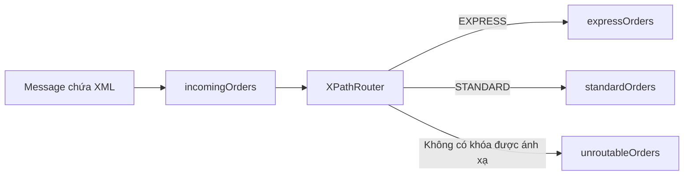

# XPathRouter

## 1. Mục tiêu và bài toán

Trong chương **Router** của module **SPRING_INTEGRATION_CORE**, `XPathRouter` giúp chọn nhánh xử lý từ nội dung XML của một `Message`. Thành phần này phù hợp với luồng tích hợp nhận đơn hàng, chứng từ hoặc thông báo nghiệp vụ mà hợp đồng dữ liệu đã là XML.

Sau bài này, bạn có thể:

- Giải thích quan hệ giữa payload XML, kết quả XPath, khóa định tuyến và `MessageChannel`.
- Cấu hình `XPathRouter` bằng Java DSL và XML namespace.
- Chọn chế độ NODESET hoặc String, khai báo namespace và xử lý giá trị thiếu.
- Thiết kế nhánh mặc định, phân biệt lỗi phân tích XML với lỗi gửi thông điệp.
- Kiểm thử nhánh được chọn và việc bảo toàn payload, header.

Giả sử hệ thống tiếp nhận đơn hàng theo hợp đồng sau:

```xml
<order xmlns="urn:example:orders" id="ORD-1042">
    <type> EXPRESS </type>
    <amount currency="VND">1250000</amount>
</order>
```

Quy tắc của ví dụ:

| Giá trị `type` sau chuẩn hóa khoảng trắng | Channel đích | Ý nghĩa |
| --- | --- | --- |
| `EXPRESS` | `expressOrders` | Xử lý giao nhanh |
| `STANDARD` | `standardOrders` | Xử lý thông thường |
| Giá trị khác hoặc thiếu | `unroutableOrders` | Lưu để kiểm tra nghiệp vụ |

Các ví dụ Java lấy API Spring Integration 6.x làm nền, đối chiếu mã nguồn 6.5.1 và dùng Java 17 trở lên. Phiên bản thư viện thực tế phải theo BOM hoặc dependency management của ứng dụng; không giả định phiên bản của tài liệu `current` trùng với dự án.

## 2. Cơ chế định tuyến

`XPathRouter` là một triển khai của Content-Based Router: quyết định đường đi từ dữ liệu trong thông điệp. Nó kế thừa `AbstractMappingMessageRouter`, nên có thể ánh xạ giá trị nghiệp vụ sang tên channel.



Một lần định tuyến gồm các bước:

1. Lấy payload và chuyển sang dạng XML mà bộ đánh giá XPath sử dụng.
2. Đánh giá biểu thức để lấy một hoặc nhiều khóa.
3. Tra bảng mapping để tìm tên channel cho từng khóa.
4. Resolve tên channel thành `MessageChannel` trong ngữ cảnh Spring.
5. Gửi thông điệp tới các channel đã xác định, hoặc dùng channel mặc định khi không có đích.

Ví dụ: `EXPRESS` là khóa nghiệp vụ; `expressOrders` là tên bean channel. Hai giá trị này không cần giống nhau. Đổi tên channel chỉ đòi hỏi cập nhật mapping, không buộc bên gửi đổi XML. Cơ chế NODESET và mapping được mô tả trong [tài liệu định tuyến XML bằng XPath](https://docs.spring.io/spring-integration/reference/xml/xpath-routing.html).

Router dùng kết quả XPath để chọn đích; payload được gửi tiếp vẫn là payload ban đầu. Nếu đầu vào là `String`, downstream vẫn nhận chuỗi XML đó. Muốn trích `<amount>` thành một payload mới, cần một transformer riêng. Đây là lý do cần phân biệt **dữ liệu dùng để quyết định đường đi** với **dữ liệu được chuyển tiếp**. Có thể xem cách router lấy khóa từ payload trong [mã nguồn XPathRouter 6.5.1](https://github.com/spring-projects/spring-integration/blob/v6.5.1/spring-integration-xml/src/main/java/org/springframework/integration/xml/router/XPathRouter.java).

## 3. NODESET và String: chọn đúng kiểu kết quả

### 3.1. Chế độ mặc định NODESET

Mặc định, `evaluateAsString` là `false`. Biểu thức được đánh giá theo chế độ chọn tập node; nội dung text của từng node trở thành một khóa định tuyến.

Ví dụ không có namespace:

```xml
<dispatch>
    <target>WAREHOUSE</target>
    <target>BILLING</target>
</dispatch>
```

Biểu thức:

```xpath
/dispatch/target
```

Cấu hình tương ứng:

```java
XPathRouter router = new XPathRouter("/dispatch/target");
router.setChannelMapping("WAREHOUSE", "warehouseRequests");
router.setChannelMapping("BILLING", "billingRequests");
router.setChannelKeyFallback(false);
```

Với các channel đích đã được đăng ký, thông điệp được gửi tới cả `warehouseRequests` và `billingRequests`. Mỗi nhánh nhận toàn bộ payload `<dispatch>...</dispatch>`, không chỉ node `<target>` của mình. Nếu cần xử lý từng phần XML thành thông điệp riêng, hãy xem xét splitter.

Chọn đúng node lá hoặc attribute chứa khóa. Với dữ liệu trên, `/dispatch` chọn node cha; text của node cha chứa nội dung của các phần tử con, không tạo ra hai khóa `WAREHOUSE` và `BILLING` riêng biệt.

### 3.2. Chế độ String

Biểu thức như `normalize-space(...)`, `string(...)` hoặc `local-name(/*)` trả về giá trị scalar. Cần bật chế độ String:

```java
XPathRouter router =
        new XPathRouter("normalize-space(/order/type)");
router.setEvaluateAsString(true);
```

Ví dụ này dành cho XML **không có namespace**. Phần thực hành phía dưới thêm namespace cho hợp đồng đơn hàng.

| Biểu thức | Chế độ phù hợp | Ý nghĩa |
| --- | --- | --- |
| `/order/type` | NODESET | Lấy text của các node `type` |
| `/order/@type` | NODESET | Lấy giá trị attribute `type` |
| `normalize-space(/order/type)` | String | Tạo một khóa và chuẩn hóa khoảng trắng |
| `local-name(/*)` | String | Dùng tên cục bộ của phần tử gốc làm khóa |
| `count(/order/item)` | String nếu muốn dùng số đếm làm khóa chuỗi | Cần mapping phù hợp, chẳng hạn `"0"` |
| `boolean(/order/priority)` | String nếu muốn định tuyến theo `"true"`/`"false"` | Kiểm tra sự tồn tại của node |

Chế độ String không bảo toàn danh sách node: khi ép một node-set thành chuỗi theo XPath 1.0, chỉ string-value của node đầu tiên theo thứ tự tài liệu được dùng. Vì vậy, bật String cho `/dispatch/target` sẽ không tạo hai nhánh như ví dụ NODESET. Quy tắc chuyển kiểu nằm trong [đặc tả XPath 1.0 của W3C](https://www.w3.org/TR/1999/REC-xpath-19991116/#section-String-Functions).

`normalize-space()` bỏ khoảng trắng đầu/cuối và gộp các đoạn khoảng trắng bên trong. Nó không chuyển `express` thành `EXPRESS`. Nếu hợp đồng yêu cầu chữ hoa, hãy kiểm tra hoặc chuẩn hóa có chủ đích ở trước router.

Biểu thức `boolean(/order/priority)` cũng không có nghĩa là đọc giá trị boolean bên trong phần tử: `<priority>false</priority>` vẫn làm biểu thức này trả về `true`, vì node tồn tại. Muốn xét nội dung, dùng điều kiện rõ ràng như `normalize-space(/order/priority) = 'true'`.

## 4. Namespace trong XML và trong XPath

XML của đơn hàng dùng default namespace `urn:example:orders`. Trong XPath 1.0, `/order/type` không tự kế thừa default namespace đó. Cần khai báo prefix trong ngữ cảnh XPath:

```java
Map<String, String> namespaces =
        Map.of("o", "urn:example:orders");

XPathRouter router = new XPathRouter(
        "normalize-space(/o:order/o:type)", namespaces);
router.setEvaluateAsString(true);
```

Prefix `o` do ứng dụng chọn. XML đầu vào có thể dùng default namespace như trên hoặc prefix khác:

```xml
<x:order xmlns:x="urn:example:orders" id="ORD-1043">
    <x:type>STANDARD</x:type>
</x:order>
```

Cả hai tài liệu đều khớp với `/o:order/o:type`, vì namespace URI và tên cục bộ mới quyết định phần tử được chọn. Các cách khai báo map hoặc cặp prefix/URI được trình bày trong [Namespace Support của Spring Integration](https://docs.spring.io/spring-integration/reference/xml/xpath-namespace-support.html).

Attribute không có prefix thường không thuộc default namespace. Với `id="ORD-1042"`, đường dẫn là `/o:order/@id`, không phải `/o:order/@o:id`.

Có thể dùng `local-name()` khi cần bỏ qua prefix, nhưng bỏ luôn việc kiểm tra namespace URI có thể khiến thông điệp thuộc hợp đồng khác cũng khớp. Khi biết namespace của hợp đồng, khai báo namespace tường minh giúp phát hiện sai khác dữ liệu sớm hơn.

## 5. Thực hành bằng Java DSL

### 5.1. Dependency

Nếu ứng dụng đã quản lý phiên bản qua Spring Boot parent hoặc một BOM phù hợp, thêm các dependency sau:

```xml
<dependency>
    <groupId>org.springframework.integration</groupId>
    <artifactId>spring-integration-core</artifactId>
</dependency>
<dependency>
    <groupId>org.springframework.integration</groupId>
    <artifactId>spring-integration-xml</artifactId>
</dependency>
```

`XPathRouter` nằm trong module XML. Các dependency kiểm thử dùng ở phần sau là `spring-test`, `junit-jupiter` và `assertj-core`, với scope `test` và phiên bản do dự án quản lý.

### 5.2. Cấu hình luồng đầy đủ

```java
import java.util.Map;

import org.springframework.context.annotation.Bean;
import org.springframework.context.annotation.Configuration;
import org.springframework.integration.channel.DirectChannel;
import org.springframework.integration.channel.QueueChannel;
import org.springframework.integration.config.EnableIntegration;
import org.springframework.integration.dsl.IntegrationFlow;
import org.springframework.integration.xml.router.XPathRouter;

@Configuration
@EnableIntegration
public class OrderRoutingConfiguration {

    @Bean
    public DirectChannel incomingOrders() {
        return new DirectChannel();
    }

    @Bean
    public QueueChannel expressOrders() {
        return new QueueChannel(100);
    }

    @Bean
    public QueueChannel standardOrders() {
        return new QueueChannel(100);
    }

    @Bean
    public QueueChannel unroutableOrders() {
        return new QueueChannel(100);
    }

    @Bean
    public XPathRouter orderTypeRouter() {
        XPathRouter router = new XPathRouter(
                "normalize-space(/o:order/o:type)",
                Map.of("o", "urn:example:orders"));

        router.setEvaluateAsString(true);
        router.setChannelMapping("EXPRESS", "expressOrders");
        router.setChannelMapping("STANDARD", "standardOrders");

        router.setChannelKeyFallback(false);
        router.setResolutionRequired(true);
        router.setDefaultOutputChannelName("unroutableOrders");
        router.setIgnoreSendFailures(false);
        router.setSendTimeout(1_000);
        return router;
    }

    @Bean
    public IntegrationFlow orderRoutingFlow(
            DirectChannel incomingOrders,
            XPathRouter orderTypeRouter) {

        return IntegrationFlow.from(incomingOrders)
                .route(orderTypeRouter)
                .get();
    }
}
```

Java DSL gắn instance router vào endpoint nhận từ `incomingOrders`; overload nhận `AbstractMessageRouter` được mô tả trong [API BaseIntegrationFlowDefinition](https://docs.spring.io/spring-integration/docs/6.5.1/api/org/springframework/integration/dsl/BaseIntegrationFlowDefinition.html).

Ý nghĩa các lựa chọn trong ví dụ:

- `DirectChannel` khiến thao tác định tuyến chạy trên thread gửi.
- Các `QueueChannel` có sức chứa 100 thông điệp, giúp quan sát đầu ra mà chưa cần viết consumer.
- `setChannelKeyFallback(false)` chỉ cho các khóa có mapping xác định đích; giá trị XML không được dùng trực tiếp làm tên channel.
- `setResolutionRequired(true)` giữ lỗi khi mapping trỏ tới channel không tồn tại.
- `unroutableOrders` nhận thông điệp không tạo ra đích từ mapping.
- Timeout gửi là 1.000 ms; với queue đầy, việc gửi có thể thất bại sau thời gian chờ. Đây không phải giới hạn thời gian chạy của handler sau một `DirectChannel`.

Các queue trên lưu trong bộ nhớ. Việc gửi thành công xác nhận thông điệp đã được đưa vào queue, chưa xác nhận nghiệp vụ đã xử lý xong. Để vận hành thực tế, cần consumer, chính sách năng lực xử lý và yêu cầu lưu bền phù hợp.

### 5.3. Vì sao vẫn để `resolutionRequired=true`?

Hai trường hợp sau cần có hành vi khác nhau:

| Tình huống | Hành vi của cấu hình trên |
| --- | --- |
| XML chứa `SAME_DAY`, không có mapping | Không tạo đích; gửi tới `unroutableOrders` |
| XML thiếu `type` hoặc `type` chỉ có khoảng trắng | Khóa chuỗi rỗng, không có mapping; gửi tới `unroutableOrders` |
| Mapping `EXPRESS` trỏ nhầm tên bean không tồn tại | Lỗi resolve channel |
| XML sai cú pháp | Lỗi parse trước khi chọn đích |

`channelKeyFallback=false` ngăn thử resolve một khóa chưa có mapping. Vì thế khóa lạ có thể về nhánh mặc định ngay cả khi `resolutionRequired=true`. Khi mapping đã có nhưng channel tương ứng bị thiếu, việc resolve vẫn phải thành công. Sự phân biệt này thể hiện trong [AbstractMappingMessageRouter 6.5.1](https://github.com/spring-projects/spring-integration/blob/v6.5.1/spring-integration-core/src/main/java/org/springframework/integration/router/AbstractMappingMessageRouter.java).

Nếu đặt `resolutionRequired=false`, tên channel không resolve được có thể bị bỏ qua. Không nên dùng lựa chọn đó chỉ để che lỗi cấu hình.

Từ Spring Integration 6.0, thiết lập default output channel cũng đặt `channelKeyFallback=false` nếu bạn chưa đặt cờ này tường minh. Ví dụ Java vẫn ghi rõ cờ để thể hiện chính sách. Cấu hình có default channel đồng thời đặt tường minh cả `channelKeyFallback=true` và `resolutionRequired=true` bị từ chối khi khởi tạo. Xem [Common Router Parameters](https://docs.spring.io/spring-integration/reference/router/common-parameters.html).

## 6. Cấu hình tương đương bằng XML namespace

Đây là lựa chọn cấu hình thay thế cho lớp Java phía trên. Hãy chọn một cách cho cùng luồng để tránh đăng ký trùng tên bean.

```xml
<?xml version="1.0" encoding="UTF-8"?>
<beans xmlns="http://www.springframework.org/schema/beans"
       xmlns:xsi="http://www.w3.org/2001/XMLSchema-instance"
       xmlns:int="http://www.springframework.org/schema/integration"
       xmlns:int-xml="http://www.springframework.org/schema/integration/xml"
       xsi:schemaLocation="
         http://www.springframework.org/schema/beans
         https://www.springframework.org/schema/beans/spring-beans.xsd
         http://www.springframework.org/schema/integration
         https://www.springframework.org/schema/integration/spring-integration.xsd
         http://www.springframework.org/schema/integration/xml
         https://www.springframework.org/schema/integration/xml/spring-integration-xml.xsd">

    <int:channel id="incomingOrders"/>

    <int:channel id="expressOrders">
        <int:queue capacity="100"/>
    </int:channel>
    <int:channel id="standardOrders">
        <int:queue capacity="100"/>
    </int:channel>
    <int:channel id="unroutableOrders">
        <int:queue capacity="100"/>
    </int:channel>

    <int-xml:xpath-router id="orderTypeRouter"
                          input-channel="incomingOrders"
                          evaluate-as-string="true"
                          resolution-required="true"
                          default-output-channel="unroutableOrders"
                          ignore-send-failures="false"
                          timeout="1000">
        <int-xml:xpath-expression
                expression="normalize-space(/o:order/o:type)"
                ns-prefix="o"
                ns-uri="urn:example:orders"/>
        <int-xml:mapping value="EXPRESS" channel="expressOrders"/>
        <int-xml:mapping value="STANDARD" channel="standardOrders"/>
    </int-xml:xpath-router>

</beans>
```

Ví dụ XML dựa vào hành vi từ phiên bản 6.0: `default-output-channel` làm tắt việc dùng khóa chưa mapping như tên channel khi cờ fallback chưa được đặt tường minh. Khai báo `xmlns:o` trên thẻ `<beans>` không thay thế `ns-prefix` và `ns-uri` trong ngữ cảnh đánh giá XPath.

## 7. Payload converter và ranh giới với transformer

`XPathRouter` mặc định dùng `DefaultXmlPayloadConverter`. Với mã nguồn 6.5.1, các dạng đầu vào phổ biến gồm `String`, DOM `Document`/`Node`, `DOMSource`, `File`, `InputStream` và `byte[]`; việc xử lý `Source` phụ thuộc dạng source cụ thể. Không nên suy ra rằng mọi `Source` tùy biến đều dùng được. Có thể đối chiếu các nhánh chuyển đổi trong [DefaultXmlPayloadConverter 6.5.1](https://github.com/spring-projects/spring-integration/blob/v6.5.1/spring-integration-xml/src/main/java/org/springframework/integration/xml/DefaultXmlPayloadConverter.java).

Một số lựa chọn thiết kế:

| Đầu vào và nhu cầu | Cách tổ chức |
| --- | --- |
| Chuỗi XML nhỏ, chỉ cần định tuyến | Đưa trực tiếp vào XPathRouter |
| POJO hoặc JSON | Chuyển sang hợp đồng XML bằng transformer, hoặc chọn router phù hợp với dữ liệu hiện có |
| Nhiều endpoint cùng đọc một tài liệu XML | Cân nhắc parse một lần thành `Document` ở đầu luồng |
| Stream cần được đọc lại sau router | Chuyển thành dạng có thể đọc lại trước khi định tuyến |
| Converter phải xử lý một dạng payload chuyên biệt | Cân nhắc `setConverter(XmlPayloadConverter)` với trách nhiệm chuyển đổi rõ ràng |

Converter nội bộ phục vụ đánh giá XPath và không tự thay payload của message. Đặc biệt, router có thể đọc hết `InputStream` trong quá trình parse nhưng vẫn chuyển tiếp payload stream ban đầu. Vì vậy, downstream không nên kỳ vọng đọc lại được stream đó từ đầu.

Nếu chủ động thêm transformer từ `String` sang `Document`, downstream sẽ nhận `Document`: thay đổi này đến từ transformer và cần được phản ánh trong hợp đồng giữa các endpoint.

## 8. Nhiều đích, sequence và aggregator

NODESET cho phép cùng một thông điệp đi tới nhiều channel khi biểu thức chọn được nhiều khóa. Đây là fan-out theo dữ liệu; router không tự tạo xử lý song song. Đích là `DirectChannel` thì handler có thể chạy ngay trên thread hiện tại; queue hoặc executor tạo ranh giới xử lý khác.

Nếu cần gom kết quả của các nhánh, có thể bật:

```java
router.setApplySequence(true);
```

Các header correlation/sequence hỗ trợ aggregator phía sau. Mặc định cờ này tắt; router cũng không tự đăng ký aggregator. Hợp đồng của tùy chọn sequence được nêu trong [AbstractMessageRouter 6.5.1](https://github.com/spring-projects/spring-integration/blob/v6.5.1/spring-integration-core/src/main/java/org/springframework/integration/router/AbstractMessageRouter.java).

Khi thiết kế nhánh gom kết quả, cần xác định:

- Mỗi nhánh trả đúng bao nhiêu kết quả và có giữ header dùng để tương quan hay không.
- Khi nhánh bị lỗi hoặc filter loại thông điệp, aggregator có thể thiếu kết quả; cần timeout và chính sách giải phóng nhóm.
- Nếu một lần gửi đã thành công rồi lần gửi sau thất bại, việc gửi trước không tự được hoàn tác chỉ vì dùng router.
- Retry toàn bộ thông điệp có thể làm một nhánh nhận lại công việc; nghiệp vụ cần cơ chế idempotency theo mã yêu cầu.

Nhánh mặc định dùng khi không có đích được chọn, không tự nhận thêm một bản cho từng khóa chưa mapping khi đã có đích hợp lệ. Ví dụ NODESET chứa `WAREHOUSE` và một khóa lạ, với fallback tắt, vẫn có thể gửi tới kho mà không gửi tới nhánh mặc định. Nếu yêu cầu mọi khóa phải hợp lệ, hãy kiểm tra toàn bộ danh sách trước router.

## 9. Nhánh mặc định và xử lý lỗi

`unroutableOrders` là nhánh dành cho trường hợp nghiệp vụ chưa có tuyến phù hợp. Nó không phải cơ chế bắt mọi exception.

| Vấn đề | Nơi phát sinh | Hướng xử lý |
| --- | --- | --- |
| `type` chưa được hỗ trợ | Bảng mapping không tạo đích | Nhánh mặc định, quan sát tần suất và cập nhật hợp đồng |
| XML không đóng thẻ | Parse payload | Error handling, ghi nhận dữ liệu không hợp lệ |
| XPath sai cú pháp | Thường khi tạo router | Sửa cấu hình trước khi ứng dụng phục vụ |
| Hàm trả String nhưng vẫn dùng NODESET | Đánh giá XPath | Bật chế độ String hoặc đổi biểu thức |
| Mapping trỏ sai channel | Resolve tên channel | Sửa bean/mapping; giữ lỗi cấu hình hiển thị rõ |
| Queue đích đầy | Gửi message | Timeout, điều tiết tải hoặc retry có kiểm soát |
| Handler sau DirectChannel ném lỗi | Xử lý downstream trên cùng thread | Bắt lỗi tại điểm gọi hoặc error flow phù hợp |

Với cấu hình `incomingOrders` là `DirectChannel`, lỗi trong khi parse hoặc định tuyến được ném về bên gọi `send(...)`. Việc thêm header `errorChannel` không tự khiến mọi lỗi đồng bộ của lệnh gửi trực tiếp được chuyển sang channel đó.

Với endpoint được poll hoặc xử lý qua executor do framework quản lý, lỗi thường được chuyển thành `ErrorMessage` qua cơ chế xử lý lỗi tương ứng. Cần kiểm tra error handler của ranh giới bất đồng bộ và header `errorChannel`; xem [Error Handling của Spring Integration](https://docs.spring.io/spring-integration/reference/error-handling.html).

Nếu có messaging gateway trước luồng, quyết định rõ bên gọi cần xác nhận gửi hay cần kết quả nghiệp vụ. Các queue trong ví dụ chưa tạo reply, nên một gateway yêu cầu request/reply sẽ cần thêm consumer và đường trả lời; router không tự sinh response.

## 10. Kiểm thử hành vi định tuyến

Kiểm thử cần quan sát cả channel được chọn và channel không được chọn. Với cấu hình trên, có thể dùng queue thật trong bộ nhớ để nhận kết quả, không cần mock router hoặc chạy dịch vụ bên ngoài.

Lớp sau dùng JUnit Jupiter, Spring Test và AssertJ; đặt cùng package với `OrderRoutingConfiguration` hoặc thêm import tương ứng.

```java
import org.junit.jupiter.api.BeforeEach;
import org.junit.jupiter.api.Test;
import org.springframework.beans.factory.annotation.Autowired;
import org.springframework.beans.factory.annotation.Qualifier;
import org.springframework.integration.channel.DirectChannel;
import org.springframework.integration.channel.QueueChannel;
import org.springframework.messaging.Message;
import org.springframework.messaging.MessagingException;
import org.springframework.messaging.support.MessageBuilder;
import org.springframework.test.context.junit.jupiter.SpringJUnitConfig;

import static org.assertj.core.api.Assertions.assertThat;
import static org.assertj.core.api.Assertions.assertThatThrownBy;

@SpringJUnitConfig(OrderRoutingConfiguration.class)
class OrderRoutingTest {

    @Autowired
    @Qualifier("incomingOrders")
    DirectChannel incomingOrders;

    @Autowired
    @Qualifier("expressOrders")
    QueueChannel expressOrders;

    @Autowired
    @Qualifier("standardOrders")
    QueueChannel standardOrders;

    @Autowired
    @Qualifier("unroutableOrders")
    QueueChannel unroutableOrders;

    @BeforeEach
    void clearQueues() {
        expressOrders.clear();
        standardOrders.clear();
        unroutableOrders.clear();
    }

    @Test
    void routesExpressAndPreservesPayloadAndHeader() {
        String xml = order(" EXPRESS ");
        Message<String> input = MessageBuilder.withPayload(xml)
                .setHeader("requestId", "REQ-1042")
                .build();

        assertThat(incomingOrders.send(input)).isTrue();

        Message<?> output = expressOrders.receive(0);
        assertThat(output).isNotNull();
        assertThat(output.getPayload()).isEqualTo(xml);
        assertThat(output.getHeaders().get("requestId"))
                .isEqualTo("REQ-1042");
        assertThat(standardOrders.receive(0)).isNull();
        assertThat(unroutableOrders.receive(0)).isNull();
    }

    @Test
    void routesStandardWithADifferentDocumentPrefix() {
        String xml = """
                <x:order xmlns:x="urn:example:orders">
                    <x:type>STANDARD</x:type>
                </x:order>
                """;

        incomingOrders.send(MessageBuilder.withPayload(xml).build());

        assertThat(standardOrders.receive(0)).isNotNull();
        assertThat(expressOrders.receive(0)).isNull();
        assertThat(unroutableOrders.receive(0)).isNull();
    }

    @Test
    void unknownKeyCannotBecomeAnInternalChannelName() {
        // Đây là tên một channel có thật trong context nhưng không có mapping.
        String xml = order("incomingOrders");

        incomingOrders.send(MessageBuilder.withPayload(xml).build());

        assertThat(unroutableOrders.receive(0)).isNotNull();
        assertThat(expressOrders.receive(0)).isNull();
        assertThat(standardOrders.receive(0)).isNull();
    }

    @Test
    void missingTypeUsesDefaultChannel() {
        String xml = "<order xmlns='urn:example:orders'/>";

        incomingOrders.send(MessageBuilder.withPayload(xml).build());

        assertThat(unroutableOrders.receive(0)).isNotNull();
        assertThat(expressOrders.receive(0)).isNull();
        assertThat(standardOrders.receive(0)).isNull();
    }

    @Test
    void malformedXmlRaisesAnErrorInsteadOfUsingDefaultChannel() {
        String xml = "<order xmlns='urn:example:orders'><type>EXPRESS";

        assertThatThrownBy(() -> incomingOrders.send(
                MessageBuilder.withPayload(xml).build()))
                .isInstanceOf(MessagingException.class);

        assertThat(unroutableOrders.receive(0)).isNull();
        assertThat(expressOrders.receive(0)).isNull();
        assertThat(standardOrders.receive(0)).isNull();
    }

    private static String order(String type) {
        // Dữ liệu test cố định; không dùng cách ghép này cho đầu vào tùy ý.
        return """
                <order xmlns="urn:example:orders" id="ORD-1042">
                    <type>%s</type>
                </order>
                """.formatted(type);
    }
}
```

`receive(0)` phù hợp ở đây vì lệnh gửi qua `DirectChannel` đã hoàn tất việc đưa message vào queue trước khi trả về. Nếu thay đầu vào bằng executor hoặc poller, cần chờ kết quả với timeout hữu hạn thay vì giả định kết quả có ngay. Các test dùng chung queue nên chạy tuần tự hoặc có context riêng khi bật kiểm thử song song.

Các tình huống nên bổ sung khi mở rộng hợp đồng:

| Dữ liệu hoặc thay đổi | Điều cần khẳng định |
| --- | --- |
| `type` chỉ chứa khoảng trắng | Về nhánh mặc định |
| `type` là `express` | Không tự khớp với `EXPRESS` |
| XML dùng namespace URI khác | Không được định tuyến như hợp đồng hiện tại |
| Có hai phần tử `type` | Xác định rõ chấp nhận node đầu hay từ chối qua validation |
| NODESET chọn hai target hợp lệ | Cả hai đích nhận toàn bộ payload |
| Mapping trỏ tới channel không tồn tại | Báo lỗi resolve, không che bằng nhánh mặc định |
| Queue đích đầy | Lệnh gửi thất bại theo timeout/chính sách lỗi |

## 11. Lựa chọn thiết kế và vận hành

### 11.1. Khi nào dùng XPathRouter?

| Nhu cầu | Thành phần phù hợp |
| --- | --- |
| Chọn channel từ nội dung XML | XPathRouter |
| Khóa nghiệp vụ đã có trong header | HeaderValueRouter |
| Chọn nhánh theo class của payload | PayloadTypeRouter |
| Giữ hoặc loại thông điệp theo điều kiện | Filter, có thể dùng XPath selector |
| Tạo payload mới từ XML | Transformer |
| Tách nhiều phần tử XML thành nhiều message | Splitter |
| Nhiều điều kiện độc lập để chọn các bên nhận | Recipient List Router hoặc các nhánh có selector |

Giữ biểu thức XPath tập trung vào việc đọc khóa. Nếu quy tắc phải gọi dịch vụ, truy vấn dữ liệu hay tính toán nghiệp vụ phức tạp, hãy đưa phần đó vào một bước riêng và định tuyến theo kết quả đã tính. Cách tổ chức này giúp kiểm thử và quan sát từng trách nhiệm rõ hơn.

### 11.2. Độ tin cậy của dữ liệu và parser

XML parse được không đồng nghĩa đúng hợp đồng. Ví dụ `normalize-space(/o:order/o:type)` vẫn chỉ tạo một khóa khi tài liệu chứa nhiều phần tử `type`. Nếu hợp đồng yêu cầu đúng một phần tử, hãy dùng XML Schema hoặc validation trước router để kiểm tra cardinality.

Với XML từ bên ngoài, parser ở đầu luồng cần có chính sách về DTD, external entity, truy cập tài nguyên ngoài và giới hạn kích thước. Nếu tự cung cấp `DocumentBuilderFactory`, phải kiểm tra cấu hình bảo vệ phù hợp với XML provider đang dùng. Một DOM đã được parse ở upstream không trở nên an toàn chỉ vì sau đó đi qua router.

Không ghép giá trị do người dùng gửi thành mã XPath. Biểu thức nên là cấu hình do ứng dụng quản lý; dữ liệu đầu vào là dữ liệu được đánh giá.

### 11.3. Hiệu năng và quan sát

Tạo router như Spring bean để tái sử dụng cấu hình; tránh tạo mới router theo từng message. Với tài liệu lớn, chi phí parse và bộ nhớ DOM có thể lớn hơn chi phí tra mapping. Hãy đo theo kích thước payload và mức đồng thời thực tế trước khi tối ưu.

Ưu tiên đường dẫn bám hợp đồng như `/o:order/o:type` thay cho `//o:type`: đường dẫn quá rộng dễ bắt nhầm một phần tử cùng tên ở vị trí khác. Nếu nhiều endpoint cùng cần XPath, cân nhắc parse một lần, đồng thời giữ DOM không bị các nhánh sửa tùy tiện.

Theo dõi số lượng message vào từng nhánh, số message về `unroutableOrders`, lỗi parse, lỗi resolve và độ đầy của queue. Gắn mã yêu cầu hoặc mã đơn để truy vết; hạn chế ghi toàn bộ XML khi payload chứa dữ liệu nhạy cảm. Tỷ lệ nhánh mặc định tăng có thể báo hiệu bên gửi đã thay đổi hợp đồng hoặc phát sinh loại nghiệp vụ mới.

## 12. Bài tập thực hành

1. Thêm khóa `PICKUP` tới channel `pickupOrders`, vẫn giữ nhánh mặc định cho khóa chưa hỗ trợ. Viết test khẳng định hai nhánh cũ không nhận bản sao của đơn `PICKUP`.
2. Đổi hợp đồng để `type` là attribute không có prefix trên phần tử gốc. Điều chỉnh XPath và kiểm tra XML vẫn dùng default namespace.
3. Tạo luồng riêng dùng NODESET với hai `<target>` là `WAREHOUSE` và `BILLING`. Kiểm tra cả hai nhánh nhận toàn bộ tài liệu, rồi bật String để quan sát sự khác biệt.
4. Bổ sung validation từ chối tài liệu có hai phần tử `type`. Kiểm tra lỗi validation tách biệt với trường hợp thiếu mapping nghiệp vụ.
5. Thêm một consumer cho mỗi queue và một gateway có hợp đồng trả lời rõ ràng. Xác định response khi đơn được chuyển tới nhánh mặc định và khi một nhánh xử lý thất bại.

Khi hoàn thành, bạn cần giải thích được bốn quyết định của luồng: XPath chọn dữ liệu nào, kết quả được đánh giá theo kiểu gì, khóa được ánh xạ ra channel nào và thông điệp đi đâu khi không có tuyến hoặc khi phát sinh lỗi.
