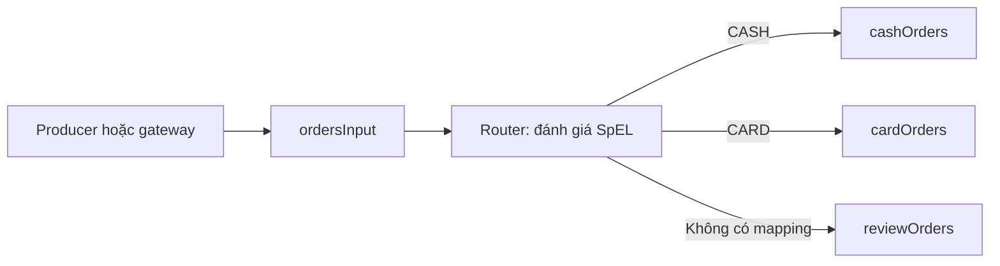

# Router expression

## 1. Mục tiêu và phạm vi bài học

Trong chương **Router** của module **SPRING_INTEGRATION_CORE**, router expression là cách dùng Spring Expression Language (SpEL) để tính quyết định định tuyến từ một thông điệp. Bài học tập trung vào quan hệ giữa `Message`, biểu thức, khóa định tuyến và `MessageChannel`; từ đó xây dựng endpoint bằng Java DSL, quy định nhánh mặc định và kiểm thử các trường hợp không định tuyến được.

Sau bài học, bạn có thể:

- Đọc dữ liệu từ payload và headers trong ngữ cảnh SpEL của router.
- Phân biệt kết quả biểu thức là khóa nghiệp vụ với kết quả là tên channel.
- Cấu hình `channelMapping`, `channelKeyFallback`, `resolutionRequired` và `defaultOutputChannel` theo một chính sách rõ ràng.
- Viết luồng định tuyến đơn đích hoặc nhiều đích và nhận biết giới hạn khi kết hợp với aggregator.
- Phân biệt lỗi đánh giá biểu thức, lỗi phân giải channel và lỗi xử lý ở nhánh đích.
- Kiểm thử hành vi định tuyến bằng các channel trong bộ nhớ.

Ví dụ dùng **Java 17, Spring Integration 6.5.x và JUnit 5**. Đây là mốc API cho bài học; khi dùng Spring Boot, hãy để BOM của Boot quản lý các phiên bản Spring tương thích. Java DSL nằm trong `spring-integration-core`; phần kiểm thử dưới đây cần thêm `spring-test` và `junit-jupiter`. Không cần message broker để thực hành.

## 2. Router expression giải quyết vấn đề gì?

Giả sử hệ thống nhận đơn hàng với payload:

```json
{
  "orderId": "ORD-101",
  "paymentMethod": "CARD",
  "amountVnd": 850000
}
```

Yêu cầu định tuyến:

| Dữ liệu nghiệp vụ | Nhánh cần nhận |
| --- | --- |
| `paymentMethod = CASH` | Xử lý thu tiền mặt |
| `paymentMethod = CARD` | Xử lý thanh toán thẻ |
| Thiếu phương thức hoặc giá trị chưa hỗ trợ | Chờ kiểm tra thủ công |

Producer chỉ gửi `Message` vào `ordersInput`. Producer không cần gọi trực tiếp dịch vụ thu tiền mặt hay dịch vụ thanh toán thẻ. Router đọc dữ liệu cần thiết, tính khóa rồi chuyển thông điệp tới channel phù hợp.



Router expression phù hợp với quyết định ngắn, chẳng hạn đọc một thuộc tính, dùng một header hoặc chọn một trong vài khóa bằng điều kiện. Spring Integration hỗ trợ cấu hình trực tiếp biểu thức trong router và trong `IntegrationFlow.route(...)`. [Tài liệu router với SpEL](https://docs.spring.io/spring-integration/reference/6.5/router/spel.html).

Trong thiết kế này, router quyết định **đi đâu**. Transformer trước router có thể chuyển JSON thành đối tượng hoặc Map; filter có thể chặn dữ liệu không hợp lệ; endpoint ở nhánh đích thực hiện nghiệp vụ. Gateway cung cấp điểm gọi vào luồng nếu ứng dụng cần giao tiếp qua một interface.

## 3. Mô hình thực thi: biểu thức không phải channel

Hãy đọc quá trình định tuyến thành các bước:

1. Endpoint nhận một `Message<?>` từ input channel.
2. Biểu thức được đánh giá trên thông điệp đó.
3. Kết quả được diễn giải thành một hoặc nhiều khóa định tuyến.
4. Router dùng mapping hoặc cơ chế phân giải tên để tìm channel.
5. Thông điệp được gửi tới các channel đã chọn; nếu không chọn được đích nào, chính sách mặc định được áp dụng hoặc một exception được phát sinh.

Ví dụ:

```text
Biểu thức                         Kết quả    Mapping                Channel đích
payload['paymentMethod']          CARD       CARD -> cardOrders     bean cardOrders
```

`CARD` là khóa nghiệp vụ. `cardOrders` là tên bean channel. Hai giá trị này không có nghĩa giống nhau.

Một biểu thức cũng có thể trả trực tiếp tên channel:

```java
.route("headers['targetChannel']")
```

Cách viết trên chỉ có ý nghĩa khi giá trị header được phép dùng làm tên channel và router được cấu hình cho phép phân giải khóa thành tên. Nó không tự tạo channel, không tạo consumer và không bảo đảm một channel bất kỳ có thể nhận thông điệp.

Với luồng có đầu vào bên ngoài, một lựa chọn thiết kế dễ kiểm soát là trả **khóa nghiệp vụ hữu hạn**, khai báo mapping tường minh và tắt `channelKeyFallback`. Ví dụ `CARD` vẫn giữ nguyên khi tên channel nội bộ được đổi.

## 4. Ngữ cảnh SpEL của router

### 4.1. Root object là Message

Trong biểu thức router, bạn thường truy cập trực tiếp:

- `payload`: nội dung thông điệp.
- `headers`: tập header.
- `#root`: chính thông điệp đang được đánh giá.
- `@beanName`: bean trong application context, nếu cần ủy quyền việc tính khóa.

Cách truy cập này dựa trên ngữ cảnh đánh giá do Spring Integration cung cấp. Một `SpelExpressionParser` tự tạo trong unit test không mặc nhiên có đầy đủ bean resolver và property accessor giống ngữ cảnh đó. [SpEL trong Spring Integration](https://docs.spring.io/spring-integration/reference/6.5/spel.html).

| Mục đích | Biểu thức | Giả định |
| --- | --- | --- |
| Đọc trường trong Map | `payload['paymentMethod']` | Payload đã là Map |
| Đọc thuộc tính JavaBean | `payload.paymentMethod` | Có getter phù hợp |
| Đọc header | `headers['customerTier']` | Header tuân thủ hợp đồng dữ liệu |
| Chọn khóa theo số tiền | `payload['amountVnd'] >= 5000000 ? 'HIGH' : 'NORMAL'` | Giá trị tồn tại và là số |
| Kết hợp header và payload | `headers['customerTier'] == 'VIP' and payload['amountVnd'] >= 5000000 ? 'PRIORITY' : 'STANDARD'` | Kiểu dữ liệu đã được xác nhận |
| Ủy quyền cho bean | `@paymentRoutingPolicy.classify(payload)` | Bean tồn tại và method trả kết quả phù hợp |

Payload là chuỗi JSON không tự trở thành Map chỉ vì biểu thức dùng `payload['paymentMethod']`. Với ví dụ chính của bài, hãy đặt bước chuyển đổi JSON thành Map trước router nếu đầu vào thực tế là chuỗi.

### 4.2. Không bọc biểu thức route bằng `#{...}`

Java DSL:

```java
.route("payload['paymentMethod']")
```

Chuỗi trên đã được API `route` hiểu là biểu thức SpEL. Không cần viết:

```java
// Không dùng cú pháp template của @Value cho tham số này.
.route("#{payload['paymentMethod']}")
```

`'CARD'` bên trong biểu thức là string literal của SpEL; dấu `"` bên ngoài là dấu giới hạn chuỗi Java. Vì vậy:

```java
.route("'CARD'")                    // Luôn trả về chuỗi CARD.
.route("payload['paymentMethod']")  // Đọc giá trị trong payload.
```

DSL cũng có overload nhận lambda hoặc router object; một lambda Java và một chuỗi SpEL là hai cách cấu hình khác nhau. [Message Routers trong Java DSL](https://docs.spring.io/spring-integration/reference/6.5/dsl/java-routers.html).

### 4.3. Thiếu dữ liệu, chuỗi rỗng và giá trị sai kiểu

Biểu thức sau gán khóa dự phòng khi giá trị là `null` hoặc chuỗi rỗng:

```spel
payload['paymentMethod'] ?: 'UNKNOWN'
```

Toán tử Elvis của SpEL cũng xét chuỗi rỗng. Tuy nhiên, chuỗi chỉ chứa khoảng trắng như `"   "` không tự được chuẩn hóa thành `UNKNOWN`. Việc trim, đổi chữ hoa hoặc xác nhận mã phương thức nên nằm trong hợp đồng đầu vào hoặc bước chuẩn hóa. [Toán tử Elvis](https://docs.spring.io/spring-framework/reference/6.2/core/expressions/language-ref/operator-elvis.html).

Với JavaBean có đối tượng lồng nhau:

```spel
payload.customer?.address?.country ?: 'UNKNOWN'
```

Dấu `?.` bảo vệ việc truy cập qua một giá trị `null` tại vị trí tương ứng. Nó không sửa lỗi tên thuộc tính, không biến chuỗi JSON thành object và không thay thế kiểm tra kiểu dữ liệu. Chuỗi truy cập có nhiều vị trí có thể `null` cần bảo vệ ở từng vị trí phù hợp. [Safe Navigation Operator](https://docs.spring.io/spring-framework/reference/6.2/core/expressions/language-ref/operator-safe-navigation.html).

Nếu một trường số lại chứa chuỗi `"không rõ"`, đừng kỳ vọng nhánh mặc định tự động xử lý mọi phép so sánh. Một exception trong lúc đánh giá biểu thức khác với kết quả không có mapping.

## 5. Ví dụ Java DSL hoàn chỉnh

### 5.1. Hợp đồng của ví dụ

Payload là `Map<String, Object>`, có thể chứa:

- `orderId`: mã đơn, phục vụ theo dõi.
- `paymentMethod`: `CASH`, `CARD`, giá trị khác hoặc bị thiếu.
- `amountVnd`: số tiền kiểu số; router hiện tại không dùng trường này.

Router chỉ có hai mapping được hỗ trợ. Giá trị không được ánh xạ đi tới `reviewOrders`. Tên channel nội bộ do người gửi đưa vào trường `paymentMethod` cũng không được dùng để chọn trực tiếp channel.

### 5.2. Cấu hình

```java
package example.integration;

import org.springframework.context.annotation.Bean;
import org.springframework.context.annotation.Configuration;
import org.springframework.integration.channel.DirectChannel;
import org.springframework.integration.channel.QueueChannel;
import org.springframework.integration.config.EnableIntegration;
import org.springframework.integration.dsl.IntegrationFlow;

@Configuration
@EnableIntegration
public class PaymentRoutingConfig {

    @Bean
    public DirectChannel ordersInput() {
        return new DirectChannel();
    }

    @Bean
    public QueueChannel cashOrders() {
        return new QueueChannel(100);
    }

    @Bean
    public QueueChannel cardOrders() {
        return new QueueChannel(100);
    }

    @Bean
    public QueueChannel reviewOrders() {
        return new QueueChannel(100);
    }

    @Bean
    public IntegrationFlow paymentRoutingFlow() {
        return IntegrationFlow.from("ordersInput")
                .route("payload['paymentMethod'] ?: 'UNKNOWN'", router -> router
                        .channelMapping("CASH", "cashOrders")
                        .channelMapping("CARD", "cardOrders")
                        .channelKeyFallback(false)
                        .resolutionRequired(true)
                        .defaultOutputChannel("reviewOrders"))
                .get();
    }
}
```

Trong cấu hình này:

- `ordersInput` là `DirectChannel`, vì vậy việc gọi router xảy ra trên thread gửi.
- Ba `QueueChannel` là nơi giữ kết quả để quan sát hoặc kiểm thử; mỗi queue có sức chứa 100 thông điệp.
- `channelMapping` tách khóa nghiệp vụ khỏi tên channel.
- `channelKeyFallback(false)` ngăn khóa chưa có mapping bị dùng như tên channel.
- `resolutionRequired(true)` giữ chính sách phát hiện lỗi khi một tên channel đã được chọn không phân giải được.
- `defaultOutputChannel` xử lý trường hợp không xác định được đích.

`QueueChannel` ở ví dụ là hàng đợi trong bộ nhớ, không phải hàng đợi bền vững của broker. Một ứng dụng thật cần consumer cho từng queue và chính sách xử lý đầy queue, thay vì để kết quả tích lại mãi.

### 5.3. Gửi và nhận thông điệp

Đoạn chương trình sau dùng cùng package với cấu hình:

```java
package example.integration;

import java.util.Map;

import org.springframework.context.annotation.AnnotationConfigApplicationContext;
import org.springframework.integration.channel.QueueChannel;
import org.springframework.messaging.Message;
import org.springframework.messaging.MessageChannel;
import org.springframework.messaging.support.MessageBuilder;

public class RouterDemo {

    public static void main(String[] args) {
        try (var context =
                     new AnnotationConfigApplicationContext(PaymentRoutingConfig.class)) {

            MessageChannel input =
                    context.getBean("ordersInput", MessageChannel.class);
            QueueChannel cards =
                    context.getBean("cardOrders", QueueChannel.class);

            Message<Map<String, Object>> order = MessageBuilder
                    .withPayload(Map.<String, Object>of(
                            "orderId", "ORD-101",
                            "paymentMethod", "CARD",
                            "amountVnd", 850_000L))
                    .setHeader("traceId", "trace-101")
                    .build();

            boolean accepted = input.send(order, 1_000);
            Message<?> routed = cards.receive(1_000);

            System.out.println("accepted = " + accepted);
            System.out.println("payload = "
                    + (routed == null ? "<no message>" : routed.getPayload()));
        }
    }
}
```

Kết quả mong đợi là `accepted = true` và payload của đơn nằm ở `cardOrders`. Thứ tự hiển thị các phần tử Map không phải hợp đồng của ví dụ.

Việc gửi thành công tới queue cho biết thông điệp đã được chấp nhận ở ranh giới đó. Nó chưa chứng minh nghiệp vụ thanh toán đã hoàn tất.

## 6. Hiểu đúng mapping, fallback và nhánh mặc định

### 6.1. Hai nghĩa khác nhau của “không tìm thấy”

**Không có mapping cho khóa:**

```text
Biểu thức -> BANK_TRANSFER
Mapping chỉ có CASH và CARD
channelKeyFallback = false
Không có đích được chọn -> reviewOrders
```

**Mapping có tồn tại, nhưng tên channel bị sai:**

```text
Biểu thức -> CARD
Mapping CARD -> cardOrderz
Không có bean channel tên cardOrderz
resolutionRequired = true -> exception
```

Trường hợp thứ hai thường là lỗi cấu hình. Giữ nó hiển thị rõ giúp tránh biến một lỗi triển khai thành một đơn chờ xử lý thủ công.

`channelKeyFallback` quyết định có được diễn giải khóa chưa ánh xạ thành tên channel hay không. `resolutionRequired` điều khiển cách xử lý khi phân giải một tên channel không thành công. Javadoc cũng nêu lý do hạn chế fallback khi dữ liệu có thể dẫn thông điệp tới channel ngoài dự kiến. [AbstractMappingMessageRouter API](https://docs.spring.io/spring-integration/docs/6.5.0/api/org/springframework/integration/router/AbstractMappingMessageRouter.html).

### 6.2. Bảng hành vi của ví dụ chính

Bảng dưới giả định các channel đã khai báo tồn tại và có thể nhận thông điệp:

| Tình huống | Kết quả biểu thức | Hành vi |
| --- | --- | --- |
| `paymentMethod = CASH` | `CASH` | Gửi tới `cashOrders` |
| `paymentMethod = CARD` | `CARD` | Gửi tới `cardOrders` |
| Thiếu khóa `paymentMethod` | `UNKNOWN` | Gửi tới `reviewOrders` |
| `paymentMethod = ""` | `UNKNOWN` | Gửi tới `reviewOrders` |
| `paymentMethod = BANK_TRANSFER` | `BANK_TRANSFER` | Gửi tới `reviewOrders` |
| `paymentMethod = cashOrders` | `cashOrders` | Gửi tới `reviewOrders`, vì fallback đã tắt |
| Mapping `CARD` trỏ tới tên bean bị sai | `CARD` | Exception do không phân giải được channel |
| Payload có kiểu không phù hợp khiến biểu thức lỗi | Không đánh giá thành công | Exception; không tự chuyển sang nhánh mặc định |
| Channel đã chọn không nhận được message | Đã tính được khóa và đích | Lỗi gửi; không dùng default như cơ chế cứu mọi lỗi |

Nếu bỏ nhánh mặc định và không chọn được channel nào, router không mặc nhiên xem thông điệp là đã xử lý. Nếu chủ ý bỏ thông điệp không định tuyến được, có thể cấu hình default tới `nullChannel`, đồng thời cần biết việc bỏ đó có đáp ứng yêu cầu nghiệp vụ hay không.

### 6.3. Lưu ý phiên bản và chính sách lỗi

Từ Spring Integration 6.0, khi cấu hình default output channel, `channelKeyFallback` được đặt về `false`, trừ khi được cấu hình tường minh theo cơ chế của router. Vì thế ví dụ vẫn ghi rõ `false` để thể hiện chính sách. Bộ cấu hình có default output channel cùng với cả `channelKeyFallback = true` và `resolutionRequired = true` bị từ chối khi khởi tạo do mơ hồ. [Common Router Parameters](https://docs.spring.io/spring-integration/reference/6.5/router/common-parameters.html).

Nếu chủ ý cho tên channel không phân giải được đi vào nhánh mặc định, có thể chọn `resolutionRequired(false)`. Đó là thay đổi chính sách xử lý lỗi; cần cân nhắc việc lỗi đánh máy trong mapping cũng có thể trở thành thông điệp đi nhánh dự phòng.

Đừng dùng một quy tắc chung rằng “có default thì mọi lỗi đều vào default”. Default dành cho trường hợp không xác định được đích theo cấu hình định tuyến, không thay thế error handling.

## 7. Các biến thể biểu thức thường dùng

Các đoạn dưới là biến thể cấu hình, không phải các flow cần bật đồng thời với ví dụ chính trên cùng một input channel.

### 7.1. Định tuyến theo header

Khi endpoint trước đó đã chuẩn hóa phương thức vào header:

```java
.route("headers['paymentMethod'] ?: 'UNKNOWN'", router -> router
        .channelMapping("CASH", "cashOrders")
        .channelMapping("CARD", "cardOrders")
        .channelKeyFallback(false)
        .resolutionRequired(true)
        .defaultOutputChannel("reviewOrders"))
```

Điều này giúp router không phụ thuộc sâu vào cấu trúc payload. Tuy nhiên, bạn cần xác định endpoint nào sở hữu header và kiểu dữ liệu của header. Nếu chỉ cần ánh xạ đúng một header, `HeaderValueRouter` cũng là lựa chọn trực tiếp. [Các router có sẵn](https://docs.spring.io/spring-integration/reference/6.5/router/implementations.html).

### 7.2. Định tuyến theo điều kiện

Giả sử `amountVnd` đã được xác nhận là số không âm:

```spel
payload['amountVnd'] >= 5000000 ? 'HIGH_VALUE' : 'NORMAL_VALUE'
```

Bạn vẫn cần mapping cho hai khóa, ví dụ `HIGH_VALUE -> approvalOrders` và `NORMAL_VALUE -> normalOrders`, cùng các channel tương ứng.

Biên `5000000` phải được kiểm thử. Nếu yêu cầu là “từ 5 triệu đồng trở lên”, toán tử đúng là `>=`; thay bằng `>` làm đơn đúng 5 triệu đi sai nhánh.

Không so sánh tiền dưới dạng chuỗi. Ví dụ `"900000"` và `"5000000"` có thể tham gia phép so sánh chuỗi khác với ý nghĩa tiền tệ. Dùng hợp đồng số nguyên theo đơn vị tiền hoặc kiểu tiền phù hợp và chuẩn hóa trước router.

### 7.3. Phân loại trước, định tuyến sau

Khi quy tắc cần nhiều trường hoặc kết quả phân loại được dùng tiếp, có thể tính một header như `routeKey` ở endpoint trước đó rồi để router đọc:

```java
.route("headers['routeKey']", router -> router
        .channelMapping("HIGH_VALUE", "approvalOrders")
        .channelMapping("NORMAL_VALUE", "normalOrders")
        .channelKeyFallback(false)
        .defaultOutputChannel("reviewOrders"))
```

Ví dụ này cần các channel `approvalOrders`, `normalOrders` và `reviewOrders` đã được khai báo. Điểm lợi của cách tách bước là quan sát được kết quả phân loại mà không phải đánh giá lại biểu thức trong endpoint ghi log.

## 8. Định tuyến một thông điệp tới nhiều đích

Kết quả biểu thức có thể là collection hoặc array. Khi có nhiều giá trị đích, router có thể chuyển thông điệp tới từng channel tương ứng. Lớp `ExpressionEvaluatingRouter` mô tả các dạng kết quả thường dùng này trong API. [ExpressionEvaluatingRouter API](https://docs.spring.io/spring-integration/docs/6.5.0/api/org/springframework/integration/router/ExpressionEvaluatingRouter.html).

Ví dụ một luồng riêng cần xử lý đơn và ghi nhận kiểm toán:

```java
@Bean
public IntegrationFlow auditedOrderFlow() {
    return IntegrationFlow.from("auditedOrdersInput")
            .route(
                    "headers['auditRequired'] == true"
                            + " ? {'PROCESS', 'AUDIT'} : {'PROCESS'}",
                    router -> router
                            .channelMapping("PROCESS", "processingOrders")
                            .channelMapping("AUDIT", "auditOrders")
                            .channelKeyFallback(false)
                            .resolutionRequired(true)
                            .applySequence(true))
            .get();
}
```

Đoạn cấu hình này cần các channel `auditedOrdersInput`, `processingOrders` và `auditOrders`. Header `auditRequired` được quy ước là Boolean.

Một số hệ quả thiết kế cần ghi nhớ:

- Đây là gửi toàn bộ thông điệp tới các đích, không phải tách từng phần tử payload như splitter.
- Không được giả định các nhánh chạy song song. Loại channel quyết định ranh giới thread.
- Không được giả định payload có thể thay đổi độc lập ở từng nhánh. Nên dùng payload bất biến hoặc sao chép dữ liệu có chủ đích.
- Gửi thành công ở một nhánh không tự bảo đảm nhánh khác thành công hay rollback.
- `applySequence(true)` bổ sung thông tin sequence phục vụ việc phối hợp nhánh; nó không tạo aggregator và không tự thu kết quả.

Nếu đưa kết quả hai nhánh vào aggregator, hãy bảo đảm mỗi nhánh thật sự tạo kết quả cần gom, giữ các header liên quan và có chính sách cho nhánh lỗi hoặc thiếu kết quả. Nhánh kiểm toán chỉ ghi log rồi kết thúc sẽ không tự sinh một phần tử phản hồi cho aggregator.

Trong DSL, `channelMapping` và `subFlowMapping` là những lựa chọn nối khóa với đích hoặc subflow. Việc quay lại flow cha phải được thiết kế theo API tương ứng; đừng coi mọi nhánh của router đều tự tiếp tục ở một bước chung. [RouterSpec API](https://docs.spring.io/spring-integration/docs/6.5.0/api/org/springframework/integration/dsl/RouterSpec.html).

## 9. Cấu hình XML tương đương

Nếu ứng dụng dùng XML, có thể biểu diễn cùng chính sách cơ bản như sau. Đây là một lựa chọn cấu hình thay thế; không đăng ký thêm một router XML cùng xử lý `ordersInput` nếu flow Java DSL đã được bật.

```xml
<?xml version="1.0" encoding="UTF-8"?>
<beans xmlns="http://www.springframework.org/schema/beans"
       xmlns:xsi="http://www.w3.org/2001/XMLSchema-instance"
       xmlns:int="http://www.springframework.org/schema/integration"
       xsi:schemaLocation="
           http://www.springframework.org/schema/beans
           https://www.springframework.org/schema/beans/spring-beans.xsd
           http://www.springframework.org/schema/integration
           https://www.springframework.org/schema/integration/spring-integration.xsd">

    <int:channel id="ordersInput"/>

    <int:channel id="cashOrders">
        <int:queue capacity="100"/>
    </int:channel>

    <int:channel id="cardOrders">
        <int:queue capacity="100"/>
    </int:channel>

    <int:channel id="reviewOrders">
        <int:queue capacity="100"/>
    </int:channel>

    <int:router id="paymentRouter"
                input-channel="ordersInput"
                expression="payload['paymentMethod'] ?: 'UNKNOWN'"
                resolution-required="true"
                default-output-channel="reviewOrders">
        <int:mapping value="CASH" channel="cashOrders"/>
        <int:mapping value="CARD" channel="cardOrders"/>
    </int:router>
</beans>
```

Ở mốc Spring Integration 6.5.x của bài, khai báo default output channel đưa cơ chế fallback về chính sách đã giải thích ở trên. Khi đọc cấu hình từ một phiên bản cũ, hãy kiểm tra lại quy tắc này trước khi kết luận hai cấu hình tương đương.

## 10. Kiểm thử hành vi định tuyến

### 10.1. Những điều cần chứng minh

Một test chỉ khẳng định `send()` trả về `true` chưa đủ. Cần chứng minh:

1. Đúng nhánh nhận được thông điệp.
2. Nhánh còn lại không nhận ngoài ý muốn.
3. Payload và header nghiệp vụ cần giữ vẫn còn.
4. Giá trị thiếu, rỗng và chưa hỗ trợ tuân thủ chính sách.
5. Một giá trị trùng tên channel nội bộ không vượt qua mapping.

Các test dưới dùng `QueueChannel` để kiểm tra kết quả ở cuối luồng, không cần mock router và không cần broker.

### 10.2. Test với JUnit 5 và Spring Test

Đặt test trong cùng package với `PaymentRoutingConfig`:

```java
package example.integration;

import java.util.Map;

import org.junit.jupiter.api.BeforeEach;
import org.junit.jupiter.api.Test;
import org.junit.jupiter.api.extension.ExtendWith;
import org.springframework.beans.factory.annotation.Autowired;
import org.springframework.beans.factory.annotation.Qualifier;
import org.springframework.integration.channel.QueueChannel;
import org.springframework.messaging.Message;
import org.springframework.messaging.MessageChannel;
import org.springframework.messaging.support.MessageBuilder;
import org.springframework.test.context.ContextConfiguration;
import org.springframework.test.context.junit.jupiter.SpringExtension;

import static org.junit.jupiter.api.Assertions.*;

@ExtendWith(SpringExtension.class)
@ContextConfiguration(classes = PaymentRoutingConfig.class)
class PaymentRoutingTest {

    @Autowired
    @Qualifier("ordersInput")
    MessageChannel input;

    @Autowired
    @Qualifier("cashOrders")
    QueueChannel cash;

    @Autowired
    @Qualifier("cardOrders")
    QueueChannel card;

    @Autowired
    @Qualifier("reviewOrders")
    QueueChannel review;

    @BeforeEach
    void clearQueues() {
        cash.clear();
        card.clear();
        review.clear();
    }

    @Test
    void routesCardAndPreservesBusinessData() {
        Message<?> sent = orderWith("CARD");

        assertTrue(input.send(sent, 1_000));

        Message<?> received = card.receive(1_000);
        assertNotNull(received);
        assertEquals(sent.getPayload(), received.getPayload());
        assertEquals("trace-test",
                received.getHeaders().get("traceId"));
        assertNull(cash.receive(0));
        assertNull(review.receive(0));
    }

    @Test
    void routesCashOnlyToCashChannel() {
        assertTrue(input.send(orderWith("CASH"), 1_000));

        assertNotNull(cash.receive(1_000));
        assertNull(card.receive(0));
        assertNull(review.receive(0));
    }

    @Test
    void routesUnsupportedMethodToReview() {
        assertTrue(input.send(orderWith("BANK_TRANSFER"), 1_000));

        assertNotNull(review.receive(1_000));
        assertNull(cash.receive(0));
        assertNull(card.receive(0));
    }

    @Test
    void routesMissingMethodToReview() {
        Message<?> sent = MessageBuilder
                .withPayload(Map.<String, Object>of(
                        "orderId", "ORD-MISSING"))
                .build();

        assertTrue(input.send(sent, 1_000));

        assertNotNull(review.receive(1_000));
        assertNull(cash.receive(0));
        assertNull(card.receive(0));
    }

    @Test
    void routesEmptyMethodToReview() {
        assertTrue(input.send(orderWith(""), 1_000));

        assertNotNull(review.receive(1_000));
        assertNull(cash.receive(0));
        assertNull(card.receive(0));
    }

    @Test
    void doesNotTreatAnUnmappedValueAsAChannelName() {
        assertTrue(input.send(orderWith("cashOrders"), 1_000));

        assertNotNull(review.receive(1_000));
        assertNull(cash.receive(0));
        assertNull(card.receive(0));
    }

    private static Message<Map<String, Object>> orderWith(String method) {
        return MessageBuilder
                .withPayload(Map.<String, Object>of(
                        "orderId", "ORD-TEST",
                        "paymentMethod", method,
                        "amountVnd", 850_000L))
                .setHeader("traceId", "trace-test")
                .build();
    }
}
```

Input là `DirectChannel`, nên khi `send()` trả về trong cấu hình này, router đã thực hiện việc gửi tới queue đích. Do đó, các phép `receive(0)` ở nhánh không mong đợi có ý nghĩa kiểm tra ngay sau lần gửi. Nếu thêm channel bất đồng bộ trước router, cần thay cách chờ và cách khẳng định sự vắng mặt cho phù hợp.

`clearQueues()` tránh dữ liệu từ test trước ảnh hưởng test sau khi context được tái sử dụng. Ví dụ giả định các test này chạy tuần tự, không có consumer khác đọc các queue.

### 10.3. Các kiểm thử mở rộng

Nếu mở rộng bài thực hành, bổ sung các ca sau theo đúng phần cấu hình đã thay đổi:

| Thay đổi | Ca cần kiểm thử |
| --- | --- |
| Dùng điều kiện số tiền | Ngay dưới ngưỡng, bằng ngưỡng, ngay trên ngưỡng |
| Dùng chuẩn hóa mã | Chữ thường, khoảng trắng, mã không hỗ trợ |
| Đọc JavaBean lồng nhau | Thuộc tính tồn tại nhưng có giá trị null |
| Thêm mapping mới | Channel đích tồn tại và nhận được thông điệp |
| Bật fan-out | Mỗi đích nhận đủ một thông điệp; các header sequence phù hợp |
| Thêm xử lý bất đồng bộ | Lỗi đi đúng error flow và không bị bỏ sót |
| Thêm gateway request-reply | Nhánh đã chọn tạo được reply hoặc có hành vi timeout dự kiến |

Một bài kiểm thử riêng cho mapping sai tên channel nên chứng minh exception xuất hiện, thay vì sửa cấu hình chạy bình thường để tất cả lỗi đều bị đẩy sang review.

## 11. Nhánh mặc định và error flow là hai cơ chế khác nhau

Trong ví dụ, `BANK_TRANSFER` chưa được hỗ trợ là một kết quả phân loại hợp lệ: đơn đi vào review. Ngược lại, không đánh giá được biểu thức hoặc không gửi được tới channel là lỗi kỹ thuật.

Với `DirectChannel`, lỗi xử lý đồng bộ có thể truyền về phía gọi `send()`. Chỉ thêm header `errorChannel` không tự chuyển mọi exception đồng bộ sang một channel lỗi.

Khi có poller hoặc thành phần bất đồng bộ do Spring Integration quản lý, lỗi có thể được xuất bản dưới dạng `ErrorMessage`. Lúc đó cần kiểm tra cấu hình error handler, header `errorChannel` và error channel chung. Một executor tự tạo cũng cần tích hợp cơ chế xử lý lỗi phù hợp. [Error Handling](https://docs.spring.io/spring-integration/reference/6.5/error-handling.html).

Có thể phân chia trách nhiệm trong thiết kế:

| Tình huống | Hướng xử lý |
| --- | --- |
| Mã phương thức mới chưa hỗ trợ | Review để quyết định nghiệp vụ |
| Payload sai hợp đồng | Validation hoặc nhánh dành cho dữ liệu không hợp lệ |
| Tên channel bị cấu hình sai | Làm lỗi hiển thị rõ; sửa cấu hình |
| Dịch vụ ở nhánh đích tạm thời không truy cập được | Error flow, retry hoặc recovery theo ranh giới xử lý |
| Cùng đơn được gửi lại | Cơ chế idempotency ở nơi có side effect |

Router không tự cung cấp giao dịch xuyên các nhánh và không tự bảo đảm xử lý đúng một lần. Nếu retry khiến thông điệp chạy lại qua router, nhánh đã thành công trước đó có thể bị gọi lại. Đây là lý do cần xem xét idempotency ở endpoint thanh toán.

Gateway request-reply cần được thiết kế thêm: ví dụ chính chỉ đưa thông điệp vào queue, chưa có consumer tạo reply. Đổi điểm vào thành gateway có giá trị trả về không làm các queue tự sinh phản hồi.

## 12. Khi nào chuyển từ SpEL sang Java?

Biểu thức sau dễ đọc:

```spel
payload['paymentMethod'] ?: 'UNKNOWN'
```

Nếu biểu thức phải xử lý nhiều ngoại lệ, nhiều cấp ưu tiên hoặc gọi dịch vụ bên ngoài, hãy cân nhắc chuyển phần tính khóa thành một bean có tên rõ ràng.

Ví dụ chính sách Java tương đương với hai mã được hỗ trợ:

```java
package example.integration;

import java.util.Map;

public class PaymentRoutingPolicy {

    public String classify(Map<String, Object> order) {
        Object value = order.get("paymentMethod");

        if (!(value instanceof String method)) {
            return "UNKNOWN";
        }

        return switch (method) {
            case "CASH" -> "CASH";
            case "CARD" -> "CARD";
            default -> "UNKNOWN";
        };
    }
}
```

Đăng ký bean trong cấu hình:

```java
@Bean
public PaymentRoutingPolicy paymentRoutingPolicy() {
    return new PaymentRoutingPolicy();
}
```

Sau đó thay biểu thức của router, giữ các mapping và chính sách channel:

```java
.route("@paymentRoutingPolicy.classify(payload)", router -> router
        .channelMapping("CASH", "cashOrders")
        .channelMapping("CARD", "cardOrders")
        .channelKeyFallback(false)
        .resolutionRequired(true)
        .defaultOutputChannel("reviewOrders"))
```

Một lựa chọn khác là dùng overload nhận lambda có kiểu dữ liệu rõ ràng. Bean hoặc lambda giúp kiểm thử thuật toán bằng Java; test luồng vẫn cần thiết để kiểm tra wiring, mapping và nhánh mặc định.

Giữ phần tính khóa càng gần một phép phân loại thuần càng tốt: cùng payload và header nghiệp vụ cho cùng kết quả, không tạo thanh toán, không ghi cơ sở dữ liệu chỉ để chọn nhánh. Side effect đặt trong endpoint sau router để ranh giới lỗi dễ nhận biết.

## 13. Lỗi thường gặp và cách nhận biết

| Hiện tượng | Nguyên nhân có thể | Cách xử lý |
| --- | --- | --- |
| Không đọc được `paymentMethod` | Payload vẫn là JSON String hoặc kiểu khác hợp đồng | Kiểm tra bước chuyển đổi trước router |
| Có khóa nhưng không vào nhánh mong muốn | Sai chữ hoa, khoảng trắng, sai mapping | Kiểm tra giá trị thực tế; chuẩn hóa có chủ đích |
| Giá trị lạ đi tới channel nội bộ | Cho phép khóa được dùng làm tên channel | Tắt fallback và dùng mapping hữu hạn |
| Có default mà vẫn nhận exception | Lỗi đánh giá, lỗi phân giải bắt buộc hoặc lỗi gửi | Xác định giai đoạn thất bại |
| Gọi gateway chờ mãi hoặc timeout | Nhánh chỉ nhận message, không tạo reply | Thiết kế consumer và hợp đồng trả lời |
| Một nhánh thành công nhưng nhánh kia lỗi | Fan-out không có bảo đảm nguyên tử chung | Xem xét recovery và idempotency |
| Aggregator không hoàn tất | Thiếu kết quả nhánh hoặc thiếu metadata cần gom | Kiểm tra hợp đồng từng nhánh và timeout |
| Test đôi lúc nhận sai thông điệp | Queue còn dữ liệu hoặc có consumer cạnh tranh | Cô lập test và kiểm soát việc đọc queue |
| Thông điệp lặp lại qua router | Mapping trỏ ngược về channel upstream | Rà soát topology và các khóa được cho phép |

Khi chẩn đoán, quan sát ít nhất mã đơn, correlation hoặc trace ID, tên endpoint và nhánh đã chọn. Không cần ghi toàn bộ dữ liệu thanh toán để biết thông điệp đã đi đâu. Nếu dữ liệu quan sát được ghi lại sau bước phân loại, có thể dùng cùng khóa đã tính để giảm nguy cơ log và router đưa ra hai quyết định khác nhau.

## 14. Bài thực hành

Thực hiện lần lượt trên ví dụ chính:

1. Thêm phương thức `BANK_TRANSFER`, một channel mới và test chứng minh đơn chỉ vào channel đó.
2. Bỏ khóa `paymentMethod`; xác nhận đơn vào review.
3. Gửi giá trị `cashOrders`; xác nhận nó không được hiểu là tên channel.
4. Trong một cấu hình thử nghiệm riêng, sửa mapping `CARD` thành tên channel không tồn tại; quan sát exception với `resolutionRequired(true)`.
5. Chuyển điều kiện sang header đã chuẩn hóa; giữ nguyên kết quả đối với các mã được hỗ trợ.
6. Thiết kế luồng nhiều đích cho xử lý và kiểm toán; mô tả rõ từng nhánh có trả kết quả để gom hay không.

Kết quả cần giải thích được là: **biểu thức tính ra gì, mapping chọn gì, channel nào nhận message, và nếu thất bại thì lỗi xuất hiện ở giai đoạn nào**. Khi bốn câu trả lời này rõ ràng, router expression trở thành một phần có thể quan sát và kiểm thử của luồng tích hợp.

