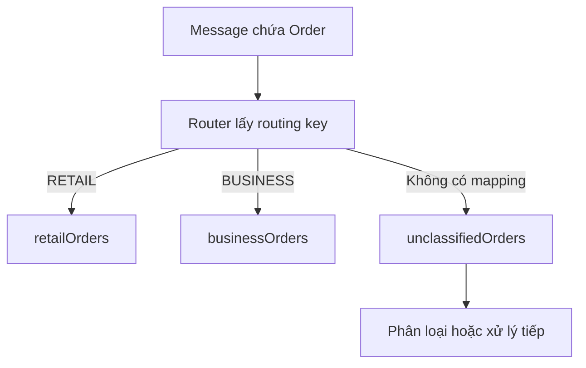

# Default output channel — Kênh đầu ra mặc định của Router

Trong Spring Integration Core, router quyết định message sẽ đi đến `MessageChannel` nào. Khi hệ thống bổ sung loại yêu cầu mới, dữ liệu đầu vào có thể hợp lệ về cấu trúc nhưng chưa có tuyến xử lý tương ứng. **Default output channel** giúp khai báo một đường đi rõ ràng cho trường hợp chưa xác định được đích.

Bài thuộc chương **Router**, tập trung vào cách thiết kế nhánh mặc định trong luồng thông điệp: giữ message để phân loại lại, tiếp tục một quy trình chung, hoặc chủ động loại bỏ theo yêu cầu nghiệp vụ. Các ví dụ kết nối `Message`, channel, endpoint và Java DSL; phần kiểm thử minh họa cách xác nhận cả tuyến đã biết lẫn tuyến chưa biết.

## 1. Mục tiêu và kiến thức nền

Sau bài học, bạn có thể:

- Phân biệt routing key, channel mapping và default output channel.
- Giải thích quan hệ giữa `defaultOutputChannel`, `channelKeyFallback` và `resolutionRequired`.
- Cấu hình nhánh mặc định bằng Java DSL, Java configuration và XML.
- Chọn giữa channel riêng, default subflow, tiếp tục parent flow và `nullChannel`.
- Kiểm thử loại dữ liệu chưa biết và mapping trỏ tới channel không tồn tại.

Bạn cần biết cấu trúc `Message<T>`, payload, header và cách khai báo bean Spring. Ví dụ chính dùng Java 17 và API Spring Integration 6.x với `IntegrationFlow.from(...)`. Trong dự án Spring Boot, dùng bộ phiên bản do Boot quản lý; nếu dùng Spring độc lập, cần quản lý các dependency tương thích.

Các dependency phục vụ ví dụ gồm `spring-integration-core`; phần kiểm thử dùng `spring-test` và JUnit Jupiter. Không cần message broker, cơ sở dữ liệu hay `spring-integration-test` cho các phép kiểm tra channel trong bài.

## 2. Vai trò của nhánh mặc định

Giả sử ứng dụng tiếp nhận đơn hàng với trường `kind`:

| Routing key | Đích đã khai báo |
| --- | --- |
| `RETAIL` | `retailOrders` |
| `BUSINESS` | `businessOrders` |
| Giá trị khác hoặc thiếu | `unclassifiedOrders` |

`RETAIL` là **khóa nghiệp vụ**; `retailOrders` là **tên bean channel**. Mapping nối hai khái niệm đó. Channel mặc định `unclassifiedOrders` tiếp nhận đơn chưa phân loại để một bước khác quyết định tiếp.

Một router có thể xác định nhiều đích. Default output channel không phải bản sao gửi kèm cho mọi message. Hợp đồng phổ biến là dùng nó khi router không xác định được channel nào; nếu không có đích và cũng không có default output channel, router phát sinh lỗi. [Common Router Parameters](https://docs.spring.io/spring-integration/reference/6.5/router/common-parameters.html).



Sơ đồ mô tả chính sách dùng mapping tường minh và tắt việc dùng key làm tên channel. Nếu bật định tuyến theo tên channel, cần xét thêm bước phân giải tên trước khi kết luận message đi nhánh mặc định.

Đối với đơn hàng, nên đặt tên channel thể hiện trách nhiệm, chẳng hạn `unclassifiedOrders` hoặc `manualReviewOrders`. Tên như `otherChannel` không giúp người đọc biết message sẽ được xử lý thế nào.

## 3. Ba thiết lập cần hiểu cùng nhau

### 3.1. `defaultOutputChannel`: chọn đích mặc định

Trong Java DSL, có thể chỉ định tên bean hoặc đối tượng channel:

```java
.defaultOutputChannel("unclassifiedOrders")
```

```java
.defaultOutputChannel(unclassifiedOrders())
```

Chọn một cách khai báo cho một router. Đích mặc định vẫn là một `MessageChannel` bình thường: cần được khai báo đúng, có khả năng tiếp nhận và có cách tiêu thụ message phù hợp. DSL cung cấp hai overload này trong [AbstractRouterSpec](https://docs.spring.io/spring-integration/api/org/springframework/integration/dsl/AbstractRouterSpec.html).

### 3.2. `channelKeyFallback`: có thử coi key là tên channel không?

Với router hỗ trợ mapping, nếu key chưa có trong bảng ánh xạ:

- `channelKeyFallback(true)`: thử dùng chính key để phân giải tên channel.
- `channelKeyFallback(false)`: chỉ dùng mapping đã khai báo; không dùng key chưa biết làm tên channel.

Ví dụ key là `retailOrders`, trong khi bảng mapping chỉ có `RETAIL` và `BUSINESS`. Nếu bật lựa chọn này, router có thể tìm thấy bean `retailOrders` dù key không phải loại đơn đã đăng ký. Tắt lựa chọn giúp giữ ranh giới giữa giá trị nghiệp vụ và tên hạ tầng. [RouterSpec.channelKeyFallback](https://docs.spring.io/spring-integration/api/org/springframework/integration/dsl/RouterSpec.html).

Từ Spring Integration 6.0, cấu hình default output channel cho router thuộc nhóm `AbstractMappingMessageRouter` sẽ mặc định tắt `channelKeyFallback` nếu bạn chưa đặt nó tường minh. Bài vẫn ghi `.channelKeyFallback(false)` để thể hiện chính sách ngay trong cấu hình. [Thay đổi từ phiên bản 6.0](https://docs.spring.io/spring-integration/reference/6.5/router/common-parameters.html).

### 3.3. `resolutionRequired`: tên đích có bắt buộc phân giải được không?

Thiết lập này áp dụng khi router đã có tên channel cần phân giải:

- `true`: không phân giải được tên đích thì gây lỗi; đây là mặc định.
- `false`: bỏ qua tên không phân giải được và xét các đích còn lại.

Hai tình huống cần phân biệt:

1. Key `WHOLESALE` chưa có mapping, `channelKeyFallback(false)`: không có tên đích để phân giải; message có thể đi default dù `resolutionRequired(true)`.
2. Key `RETAIL` mapping tới `retialOrders`, nhưng bean đó không tồn tại: đây là lỗi phân giải tên đích; với `resolutionRequired(true)`, lỗi xảy ra trước nhánh mặc định.

Phân biệt này dựa trên thứ tự lấy key, tra mapping và phân giải channel trong [AbstractMappingMessageRouter](https://github.com/spring-projects/spring-integration/blob/6.5.x/spring-integration-core/src/main/java/org/springframework/integration/router/AbstractMappingMessageRouter.java).

Với tập loại đơn cố định, có thể tắt `channelKeyFallback`, giữ yêu cầu phân giải nghiêm ngặt và khai báo default output channel. Dữ liệu chưa có tuyến được tiếp nhận riêng, còn tên channel gõ sai vẫn được phát hiện.

### 3.4. Bảng hành vi

Bảng áp dụng cho router dùng mapping, giả định default output channel hợp lệ và không có lỗi gửi message.

| Tình huống | `channelKeyFallback` | `resolutionRequired` | Có default? | Kết quả |
| --- | --- | --- | --- | --- |
| Key có mapping, channel tồn tại | `false` | `true` | Có | Gửi tới channel đã mapping |
| Key không có mapping | `false` | `true` | Có | Gửi tới default |
| Key có mapping, channel không tồn tại | `false` | `true` | Có | Lỗi phân giải channel |
| Key có mapping, channel không tồn tại | `false` | `false` | Có | Bỏ qua đích lỗi; nếu không còn đích thì dùng default |
| Key chưa mapping nhưng trùng tên channel tồn tại | `true` | `false` | Có | Phân giải key thành channel rồi gửi |
| Key chưa mapping, không phân giải được thành channel | `true` | `false` | Có | Dùng default nếu không còn đích |
| Key không có mapping | `false` | `false` | Không | Không có đích; `MessageDeliveryException` |

Trong Spring Integration 6.x, tổ hợp **có default output channel + `channelKeyFallback(true)` + `resolutionRequired(true)`** bị từ chối khi khởi tạo `AbstractMappingMessageRouter`. [Ràng buộc cấu hình router](https://docs.spring.io/spring-integration/reference/6.5/router/common-parameters.html).

Các quy tắc mapping không áp dụng nguyên xi cho mọi router. Recipient list chẳng hạn chọn người nhận bằng điều kiện; cần hiểu cách router cụ thể xác định tập đích.

## 4. Ví dụ Java DSL đầy đủ: phân loại đơn hàng

Cấu hình có một input `DirectChannel` và ba output `QueueChannel`. Các queue dùng để quan sát kết quả và kiểm thử, chưa gắn consumer nghiệp vụ.

```java
package vn.learning.integration.router;

import org.springframework.context.annotation.Bean;
import org.springframework.context.annotation.Configuration;
import org.springframework.integration.channel.DirectChannel;
import org.springframework.integration.channel.QueueChannel;
import org.springframework.integration.config.EnableIntegration;
import org.springframework.integration.dsl.IntegrationFlow;

@Configuration
@EnableIntegration
public class DefaultOutputChannelConfig {

    public record Order(String id, String kind) {
    }

    @Bean
    public DirectChannel ordersIn() {
        return new DirectChannel();
    }

    @Bean
    public QueueChannel retailOrders() {
        return new QueueChannel(20);
    }

    @Bean
    public QueueChannel businessOrders() {
        return new QueueChannel(20);
    }

    @Bean
    public QueueChannel unclassifiedOrders() {
        return new QueueChannel(20);
    }

    @Bean
    public IntegrationFlow orderRoutingFlow() {
        return IntegrationFlow.from(ordersIn())
                .<Order, String>route(
                        order -> routingKey(order.kind()),
                        router -> router
                                .channelMapping("RETAIL", "retailOrders")
                                .channelMapping("BUSINESS", "businessOrders")
                                .channelKeyFallback(false)
                                .resolutionRequired(true)
                                .defaultOutputChannel("unclassifiedOrders")
                                .sendTimeout(1_000))
                .get();
    }

    static String routingKey(String kind) {
        return kind == null || kind.isBlank() ? "UNKNOWN" : kind.trim();
    }
}
```

Hàm `routingKey` thực hiện chính sách riêng của ví dụ: thiếu hoặc trắng được đổi thành `UNKNOWN`; giá trị khác chỉ được bỏ khoảng trắng đầu cuối. Hàm không đổi chữ thường thành chữ hoa, nên `retail` khác `RETAIL`.

Giá trị lambda trả về là **routing key**, không phải payload thay thế. `Order` đi nhánh mặc định vẫn chứa `id` và `kind` ban đầu. Việc định tuyến không tự biến payload thành thông báo lỗi. Cú pháp lambda và mapping được trình bày trong [Java DSL Message Routers](https://docs.spring.io/spring-integration/reference/dsl/java-routers.html).

### 4.1. Gửi và quan sát message

Trong ứng dụng hoặc kiểm thử đã có Spring context, có thể gửi một message rồi đọc queue mặc định:

```java
import org.springframework.context.ApplicationContext;
import org.springframework.integration.channel.QueueChannel;
import org.springframework.messaging.Message;
import org.springframework.messaging.MessageChannel;
import org.springframework.messaging.support.MessageBuilder;
import vn.learning.integration.router.DefaultOutputChannelConfig.Order;

public final class RoutingDemo {

    private RoutingDemo() {
    }

    public static Message<?> sendUnknownOrder(ApplicationContext context) {
        MessageChannel input = context.getBean("ordersIn", MessageChannel.class);
        QueueChannel fallback = context.getBean(
                "unclassifiedOrders", QueueChannel.class);

        Order order = new Order("O-103", "WHOLESALE");
        Message<Order> request = MessageBuilder.withPayload(order)
                .setHeader("traceId", "trace-103")
                .build();

        input.send(request);
        return fallback.receive(1_000);
    }
}
```

Kết quả kỳ vọng chứa `Order("O-103", "WHOLESALE")` và header `traceId=trace-103`. Router không sửa `kind` thành `UNKNOWN`; việc chuẩn hóa chỉ phục vụ quyết định định tuyến.

| Payload đầu vào | Key được tính | Channel nhận |
| --- | --- | --- |
| `Order("O-101", "RETAIL")` | `RETAIL` | `retailOrders` |
| `Order("O-102", "BUSINESS")` | `BUSINESS` | `businessOrders` |
| `Order("O-103", "WHOLESALE")` | `WHOLESALE` | `unclassifiedOrders` |
| `Order("O-104", null)` | `UNKNOWN` | `unclassifiedOrders` |
| `Order("O-105", "  ")` | `UNKNOWN` | `unclassifiedOrders` |
| `Order("O-106", "retailOrders")` | `retailOrders` | `unclassifiedOrders` |

Dòng cuối kiểm chứng chính sách không dùng tên bean làm tuyến ngầm. Dù `retailOrders` là bean có thật, ứng dụng chỉ chấp nhận key nghiệp vụ đã mapping.

### 4.2. Queue có ý nghĩa gì trong ví dụ?

`QueueChannel` giữ message trong hàng đợi. Gửi thành công vào queue không đồng nghĩa nghiệp vụ đã xử lý xong; consumer cần nhận message bằng poller hoặc cơ chế tiêu thụ phù hợp. Các queue trên lưu trong bộ nhớ, không tự bảo đảm tồn tại sau khi ứng dụng khởi động lại.

`sendTimeout(1_000)` giới hạn thời gian router chờ gửi tới channel có hỗ trợ chờ, chẳng hạn queue đầy. Nó không giới hạn thời gian thực thi handler đồng bộ phía sau `DirectChannel`. [Các loại MessageChannel](https://docs.spring.io/spring-integration/reference/channel/implementations.html).

Nếu yêu cầu không được mất đơn chưa phân loại, cần thiết kế lưu bền vững và xử lý lại. Tên `unclassifiedOrders` mới chỉ xác định trách nhiệm, chưa cung cấp các bảo đảm vận hành đó.

## 5. Java configuration và XML

### 5.1. Java configuration với `HeaderValueRouter`

Khi loại đơn nằm trong header `orderKind`, có thể dùng router chuyên biệt. Bean sau thay thế `orderRoutingFlow`, dùng lại các channel của cấu hình chính:

```java
import org.springframework.context.annotation.Bean;
import org.springframework.integration.annotation.ServiceActivator;
import org.springframework.integration.router.HeaderValueRouter;

@Bean
@ServiceActivator(inputChannel = "ordersIn")
public HeaderValueRouter orderKindRouter() {
    HeaderValueRouter router = new HeaderValueRouter("orderKind");
    router.setChannelMapping("RETAIL", "retailOrders");
    router.setChannelMapping("BUSINESS", "businessOrders");
    router.setChannelKeyFallback(false);
    router.setResolutionRequired(true);
    router.setDefaultOutputChannelName("unclassifiedOrders");
    router.setSendTimeout(1_000);
    return router;
}
```

Đặt phương thức trong lớp configuration có `@EnableIntegration`. Chỉ chọn một router cho `ordersIn` khi thực hành. Nếu cùng đăng ký bean trên và DSL cũ, input có hai subscriber nên kết quả không còn thể hiện một router duy nhất.

Message gửi vào cấu hình này dùng header `orderKind` để chọn tuyến đã biết. Trường `kind` trong payload không tự trở thành routing key. [Cấu hình HeaderValueRouter](https://docs.spring.io/spring-integration/reference/6.5/router/implementations.html).

### 5.2. XML với `header-value-router`

Đây là phương án XML độc lập theo header; không nạp đồng thời với configuration Java phía trên:

```xml
<?xml version="1.0" encoding="UTF-8"?>
<beans xmlns="http://www.springframework.org/schema/beans"
       xmlns:xsi="http://www.w3.org/2001/XMLSchema-instance"
       xmlns:int="http://www.springframework.org/schema/integration"
       xsi:schemaLocation="
           http://www.springframework.org/schema/beans
           https://www.springframework.org/schema/beans/spring-beans.xsd
           http://www.springframework.org/schema/integration
           https://www.springframework.org/schema/integration/spring-integration.xsd">

    <int:channel id="ordersIn"/>

    <int:channel id="retailOrders">
        <int:queue capacity="20"/>
    </int:channel>

    <int:channel id="businessOrders">
        <int:queue capacity="20"/>
    </int:channel>

    <int:channel id="unclassifiedOrders">
        <int:queue capacity="20"/>
    </int:channel>

    <int:header-value-router input-channel="ordersIn"
                             header-name="orderKind"
                             channel-key-fallback="false"
                             resolution-required="true"
                             default-output-channel="unclassifiedOrders"
                             timeout="1000">
        <int:mapping value="RETAIL" channel="retailOrders"/>
        <int:mapping value="BUSINESS" channel="businessOrders"/>
    </int:header-value-router>
</beans>
```

Tên thuộc tính thay đổi theo cách cấu hình: XML dùng `default-output-channel`; Java bean dùng `setDefaultOutputChannelName(...)`; DSL dùng `defaultOutputChannel(...)`.

## 6. Các lựa chọn cho nhánh mặc định trong Java DSL

Các đoạn dưới là **biến thể thay thế**, dùng lại `Order`, hàm `routingKey` và các bean channel của cấu hình chính. Thay phương thức flow tương ứng khi thực hành để tránh nhiều subscriber trên input.

### 6.1. Dùng channel riêng

```java
.defaultOutputChannel("unclassifiedOrders")
```

Cách này phù hợp khi nhiều luồng cùng gửi yêu cầu chưa phân loại tới một nơi chung. Consumer và cách lưu trữ có thể được triển khai độc lập với router.

### 6.2. Dùng `defaultSubFlowMapping(...)`

Nếu cần bổ sung thông tin trước khi đưa message vào queue:

```java
@Bean
public IntegrationFlow orderRoutingFlow() {
    return IntegrationFlow.from(ordersIn())
            .<Order, String>route(
                    order -> routingKey(order.kind()),
                    router -> router
                            .channelMapping("RETAIL", "retailOrders")
                            .channelMapping("BUSINESS", "businessOrders")
                            .channelKeyFallback(false)
                            .resolutionRequired(true)
                            .defaultSubFlowMapping(fallback -> fallback
                                    .enrichHeaders(headers -> headers
                                            .header("routingReason", "UNCLASSIFIED"))
                                    .channel("unclassifiedOrders")))
            .get();
}
```

`routingReason` là header do ứng dụng thêm bằng header enricher. Default output channel tự nó không sinh lý do. DSL dùng đầu vào của subflow làm đích mặc định của router. [AbstractRouterSpec](https://github.com/spring-projects/spring-integration/blob/6.5.x/spring-integration-core/src/main/java/org/springframework/integration/dsl/AbstractRouterSpec.java).

Muốn phân biệt “thiếu kind” và “kind chưa hỗ trợ”, cần tính lý do từ message hoặc có bước chuẩn hóa trước router. Nhãn chung `UNCLASSIFIED` chưa cung cấp sự phân biệt đó.

### 6.3. Dùng `defaultOutputToParentFlow()`

Khi muốn message chưa khớp mapping đi tới bước ngay sau router trong flow cha:

```java
@Bean
public IntegrationFlow orderRoutingFlow() {
    return IntegrationFlow.from(ordersIn())
            .<Order, String>route(
                    order -> routingKey(order.kind()),
                    router -> router
                            .channelMapping("RETAIL", "retailOrders")
                            .channelMapping("BUSINESS", "businessOrders")
                            .resolutionRequired(true)
                            .defaultOutputToParentFlow())
            .channel("unclassifiedOrders")
            .get();
}
```

Trong ví dụ, `RETAIL` và `BUSINESS` đi tới các channel đã mapping; chỉ message chưa khớp mới đi tiếp tới `unclassifiedOrders`. Dòng sau `.route(...)` không tự trở thành bước chung cho mọi nhánh. Với Spring Integration 6.x, phương thức này của `RouterSpec` cũng tắt `channelKeyFallback`. [RouterSpec](https://github.com/spring-projects/spring-integration/blob/6.5.x/spring-integration-core/src/main/java/org/springframework/integration/dsl/RouterSpec.java).

Nếu muốn các nhánh đều hội tụ về một bước, cần thiết kế điểm hội tụ hoặc cơ chế trả lời của subflow. Default output channel không thay thế chức năng tổng hợp của aggregator.

### 6.4. Bỏ message bằng `nullChannel`

Khi nghiệp vụ cho phép bỏ message chưa có tuyến:

```java
.channelKeyFallback(false)
.defaultOutputChannel("nullChannel")
```

`nullChannel` do Spring Integration cung cấp để tiếp nhận rồi bỏ message. Nó không lưu yêu cầu chờ xử lý lại. [Cấu hình nullChannel](https://docs.spring.io/spring-integration/reference/router/common-parameters.html).

Một luồng thống kê phụ có thể chấp nhận bỏ sự kiện ngoài phạm vi. Với đơn hàng cần theo dõi, nhánh lưu đơn chưa phân loại thường phù hợp hơn. Quyết định cần xuất phát từ yêu cầu nghiệp vụ.

## 7. Quan hệ với xử lý lỗi

### 7.1. Chưa có tuyến và lỗi thực thi

| Sự kiện | Ý nghĩa trong ví dụ | Cách xử lý dự kiến |
| --- | --- | --- |
| `WHOLESALE` chưa có mapping | Chưa có tuyến nghiệp vụ | Đưa vào `unclassifiedOrders` |
| Mapping trỏ tới tên bean sai | Cấu hình hỏng | Phát hiện bằng lỗi và kiểm thử |
| Hàm lấy key ném exception | Không tính được quyết định định tuyến | Xử lý exception tại ranh giới gọi |
| Handler xử lý đơn ném exception | Thực thi nghiệp vụ thất bại | Error flow, retry hoặc recovery theo thiết kế |
| Queue đầu ra đầy | Đích không tiếp nhận được kịp thời | Xử lý lỗi giao message và áp lực tải |

Mặc định `ignoreSendFailures` là `false`: lỗi gửi tới tuyến đã chọn được ném ra. Đừng kỳ vọng router tự chuyển đơn đó sang nhóm chưa phân loại.

Có một chi tiết khi bật `ignoreSendFailures(true)`: trong `AbstractMessageRouter` nhánh 6.5.x, router bỏ qua các `MessagingException` khi gửi tới đích thông thường. Nếu không đích nào gửi thành công, nó có thể thử default output channel. Vì thế “default chỉ xuất hiện khi không có mapping” chưa bao quát cấu hình này. Đây là kết luận từ [mã xử lý gửi của AbstractMessageRouter](https://github.com/spring-projects/spring-integration/blob/6.5.x/spring-integration-core/src/main/java/org/springframework/integration/router/AbstractMessageRouter.java).

Cơ chế đó không cung cấp retry tổng quát. Nếu handler đồng bộ đã tạo tác dụng phụ rồi mới ném lỗi, chuyển sang nhánh khác có thể khiến nghiệp vụ được thực hiện thêm lần nữa. Ví dụ chính giữ mặc định `ignoreSendFailures(false)` để tách lỗi thực thi khỏi đơn chưa phân loại.

### 7.2. `errorChannel` có vai trò riêng

Default output channel nhận message đang được định tuyến. Cơ chế error flow có thể nhận `ErrorMessage` chứa exception. Với luồng đồng bộ qua `DirectChannel`, exception thường truyền về bên gọi; chỉ thêm header `errorChannel` không tự khiến mọi lỗi đồng bộ được chuyển thành error message.

Với tác vụ bất đồng bộ hoặc poller do framework quản lý, cơ chế công bố lỗi có thể gửi `ErrorMessage` tới channel trong header `errorChannel`, hoặc channel toàn cục tương ứng. Gateway có chính sách xử lý lỗi riêng. [Error Handling](https://docs.spring.io/spring-integration/reference/error-handling.html).

Nếu gateway chờ trả lời, nhánh mặc định cần đáp ứng hợp đồng đó. Đưa request vào queue hoặc `nullChannel` không tự tạo response. Có thể chọn kết quả “chờ phân loại”, phản hồi từ chối rõ ràng hoặc giao diện gửi một chiều, tùy yêu cầu ứng dụng.

## 8. Kiểm thử bằng Spring Test và JUnit 5

### 8.1. Kiểm thử cấu hình DSL chính

Đặt lớp sau cùng package với configuration. Test xác nhận đích nhận, payload, header truy vết và việc không có message dư ở queue khác.

```java
package vn.learning.integration.router;

import org.junit.jupiter.api.BeforeEach;
import org.junit.jupiter.api.Test;
import org.springframework.beans.factory.annotation.Autowired;
import org.springframework.beans.factory.annotation.Qualifier;
import org.springframework.integration.channel.QueueChannel;
import org.springframework.messaging.Message;
import org.springframework.messaging.MessageChannel;
import org.springframework.messaging.support.MessageBuilder;
import org.springframework.test.context.junit.jupiter.SpringJUnitConfig;

import vn.learning.integration.router.DefaultOutputChannelConfig.Order;

import static org.junit.jupiter.api.Assertions.assertEquals;
import static org.junit.jupiter.api.Assertions.assertNotNull;
import static org.junit.jupiter.api.Assertions.assertNull;
import static org.junit.jupiter.api.Assertions.assertTrue;

@SpringJUnitConfig(DefaultOutputChannelConfig.class)
class DefaultOutputChannelTest {

    @Autowired
    @Qualifier("ordersIn")
    MessageChannel input;

    @Autowired
    @Qualifier("retailOrders")
    QueueChannel retail;

    @Autowired
    @Qualifier("businessOrders")
    QueueChannel business;

    @Autowired
    @Qualifier("unclassifiedOrders")
    QueueChannel unclassified;

    @BeforeEach
    void drainQueues() {
        for (QueueChannel channel : new QueueChannel[] {
                retail, business, unclassified}) {
            while (channel.receive(0) != null) {
                // Dọn dữ liệu còn lại giữa các test dùng chung context.
            }
        }
    }

    @Test
    void routesKnownKinds() {
        assertOnlyDestination(new Order("O-101", "RETAIL"), retail);
        assertOnlyDestination(new Order("O-102", "BUSINESS"), business);
    }

    @Test
    void routesUnknownKindToDefault() {
        assertOnlyDestination(new Order("O-103", "WHOLESALE"), unclassified);
    }

    @Test
    void routesMissingOrBlankKindToDefault() {
        assertOnlyDestination(new Order("O-104", null), unclassified);
        assertOnlyDestination(new Order("O-105", "  "), unclassified);
    }

    @Test
    void doesNotUseUnknownKeyAsChannelBeanName() {
        assertOnlyDestination(new Order("O-106", "retailOrders"), unclassified);
    }

    private void assertOnlyDestination(Order order, QueueChannel expected) {
        Message<Order> request = MessageBuilder.withPayload(order)
                .setHeader("traceId", "trace-" + order.id())
                .build();

        assertTrue(input.send(request));

        Message<?> result = expected.receive(1_000);
        assertNotNull(result);
        assertEquals(order, result.getPayload());
        assertEquals(request.getHeaders().get("traceId"),
                result.getHeaders().get("traceId"));

        assertNull(retail.receive(0));
        assertNull(business.receive(0));
        assertNull(unclassified.receive(0));
    }
}
```

Test giả định không chạy song song và không có consumer khác đọc ba queue. `ordersIn` là `DirectChannel`, nên router đưa message vào queue trước khi `send` trả về. Không cần `Thread.sleep(...)` để đợi tác vụ nền trong cấu hình này.

Kiểm tra payload và `traceId` giúp xác nhận nhánh mặc định giữ thông tin truy vết. Kiểm tra các queue còn lại giúp phát hiện cấu hình vô tình gửi nhiều bản sao.

### 8.2. Kiểm thử mapping hỏng

Có thể kiểm tra chính sách phân giải nghiêm ngặt bằng router độc lập. Thêm các import cần thiết và thành viên sau vào lớp test ở trên:

```java
import org.springframework.context.ApplicationContext;
import org.springframework.integration.router.HeaderValueRouter;
import org.springframework.messaging.MessagingException;

import static org.junit.jupiter.api.Assertions.assertThrows;

@Autowired
ApplicationContext context;

@Test
void failsWhenExplicitMappingPointsToMissingChannel() {
    QueueChannel isolatedFallback = new QueueChannel();
    HeaderValueRouter router = new HeaderValueRouter("orderKind");
    router.setBeanFactory(context);
    router.setChannelMapping("RETAIL", "channelThatDoesNotExistForThisTest");
    router.setChannelKeyFallback(false);
    router.setResolutionRequired(true);
    router.setDefaultOutputChannel(isolatedFallback);
    router.afterPropertiesSet();

    Message<Order> request = MessageBuilder
            .withPayload(new Order("O-107", "RETAIL"))
            .setHeader("orderKind", "RETAIL")
            .build();

    assertThrows(MessagingException.class, () -> router.handleMessage(request));
    assertNull(isolatedFallback.receive(0));
}
```

Tên channel không tồn tại là dữ kiện cố ý của test; fallback dùng queue riêng để tránh ảnh hưởng flow đang chạy. Test thể hiện yêu cầu: key đã mapping tới hạ tầng sai phải bị phát hiện, dù có đích mặc định.

Mã kiểm thử trong bài dùng để chạy trong dự án đã có dependency phù hợp. Việc soạn bài không bao gồm thực thi build hoặc kiểm thử ứng dụng.

### 8.3. Các tình huống nên kiểm tra khi áp dụng thực tế

| Tình huống | Điều cần xác nhận |
| --- | --- |
| Không có default và không có đích | Phát sinh lỗi, không mất message âm thầm |
| Bật định tuyến key theo tên channel | Key trùng bean tuân thủ chính sách đã chọn |
| Tắt `resolutionRequired` | Đích lỗi được bỏ qua; fallback chỉ nhận khi không còn đích phù hợp |
| Handler đồng bộ ném lỗi | Cấu hình mặc định truyền lỗi về, không gửi fallback thay |
| Queue mặc định đầy | Thời gian chờ hữu hạn, kết quả lỗi phù hợp |
| Gateway chờ trả lời | Nhánh mặc định đáp ứng hợp đồng trả lời |
| Router nhiều đích | Không thêm bản sao vào default khi đã gửi thành công tới đích thường |

## 9. Thiết kế để nhánh mặc định vận hành được

Hãy xác định một đơn vào `unclassifiedOrders` sẽ được giải quyết bởi ai và trong bao lâu. Có thể lưu bản ghi chờ xử lý gồm mã đơn, key đã tính, nguyên nhân, thời điểm nhận và mã truy vết. Sau khi bổ sung mapping, quá trình xử lý lại cần nhận biết đơn đã thực hiện để tránh tác dụng phụ trùng lặp.

Các số liệu hữu ích cho ví dụ đơn hàng:

- Số đơn vào nhánh mặc định và tỷ lệ so với tổng đầu vào.
- Số đơn đang chờ và thời gian chờ lâu nhất.
- Số lần consumer của nhánh mặc định thất bại.
- Phân bố theo nhóm nguyên nhân ổn định, như thiếu loại đơn hoặc loại chưa hỗ trợ.

Không dùng mọi giá trị `kind` tùy ý làm nhãn metric. Giá trị chi tiết có thể nằm trong dữ liệu truy vết có kiểm soát; metric nên dùng nhóm hữu hạn. Nếu tỷ lệ chưa phân loại tăng sau triển khai, kiểm tra hợp đồng dữ liệu và bảng mapping trước khi tăng consumer.

Nếu nhiều router liên tiếp đều có nhánh mặc định, cần nhìn rõ message đang ở bước phân loại nào. Quay trở lại input mà không thay đổi dữ liệu hoặc chính sách có thể khiến đơn đi vòng vô hạn. Luồng xử lý lại nên có điểm kết thúc và giới hạn số lần thử.

## 10. Liên hệ với các thành phần khác

Trong một luồng hoàn chỉnh, transformer có thể chuẩn hóa dữ liệu trước router; filter loại yêu cầu không đáp ứng tiêu chí tiếp nhận; router phân loại message được chấp nhận; endpoint thực hiện nghiệp vụ ở từng nhánh. Nếu có nhiều kết quả cần hợp nhất, aggregator đảm nhiệm logic nhóm và hoàn tất theo thiết kế riêng.

Default output channel đóng vai trò xác định đường đi còn lại của quyết định định tuyến. Nó không tự cung cấp chức năng lưu lỗi, tổng hợp kết quả hay trả lời gateway. Khi chọn nhánh mặc định, hãy mô tả rõ message sẽ được giữ, xử lý tiếp hay bỏ đi; sau đó kiểm chứng bằng đầu vào cụ thể như các test trong bài.
