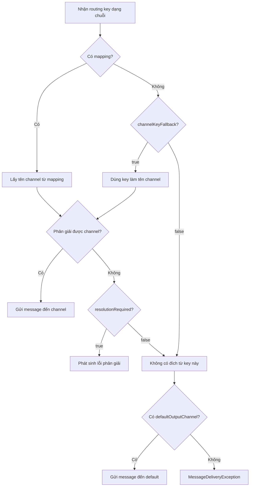

# Resolution required trong Spring Integration Router

## 1. Mục tiêu và bối cảnh

Trong chương Router của `SPRING_INTEGRATION_CORE`, `resolutionRequired` quyết định cách router phản ứng khi không phân giải được một tên channel thành đối tượng `MessageChannel`. Hiểu thuộc tính này giúp thiết kế luồng thông điệp có hành vi rõ ràng khi dữ liệu định tuyến hoặc cấu hình bị sai.

Ví dụ, một hệ thống nhận đơn hàng có header `orderType`:

- `ONLINE` đi đến `onlineOrders`.
- `STORE` đi đến `storeOrders`.
- Loại đơn chưa được hỗ trợ đi đến `unroutableOrders` để xem xét.

Hai tình huống sau cần được xử lý có chủ đích: đối tác gửi loại đơn mới `PARTNER`, và lập trình viên viết nhầm tên channel thành `onlienOrders`. Tình huống đầu có thể là dữ liệu nghiệp vụ cần tiếp nhận riêng; tình huống sau là lỗi cấu hình cần phát hiện sớm khi luồng sử dụng mapping đó.

Sau bài này, bạn có thể:

- Phân biệt routing key, channel mapping, phân giải channel và gửi message.
- Chọn `resolutionRequired(true)` hoặc `false` theo hợp đồng của luồng.
- Phối hợp thuộc tính này với `channelKeyFallback` và `defaultOutputChannel`.
- Viết cấu hình Java DSL, đọc cấu hình XML tương đương và kiểm thử các nhánh thất bại.

Bài sử dụng API của Spring Integration 6.x, lấy nhánh 6.5 làm mốc cho ví dụ. Những quy tắc mặc định có thay đổi từ 6.0 được nêu riêng; không nên suy hành vi của dự án cũ chỉ từ tên thuộc tính.

## 2. Router thực hiện những bước nào?

Một router dựa trên mapping thường đi qua các bước:

```text
Message(payload, headers)
    -> lấy routing key
    -> tìm channel mapping hoặc dùng key làm tên channel nếu được phép
    -> phân giải tên thành MessageChannel
    -> gửi message đến channel
```

Với đầu vào:

```java
Message<String> message = MessageBuilder.withPayload("ORDER-1001")
        .setHeader("orderType", "ONLINE")
        .build();
```

và mapping:

```text
ONLINE -> onlineOrders
```

các thành phần có vai trò khác nhau:

| Thành phần | Giá trị trong ví dụ | Ý nghĩa |
| --- | --- | --- |
| Payload | `ORDER-1001` | Dữ liệu nghiệp vụ được chuyển tiếp |
| Header định tuyến | `orderType` | Nơi router lấy thông tin để quyết định đường đi |
| Routing key | `ONLINE` | Khóa dùng để tra mapping |
| Tên channel sau mapping | `onlineOrders` | Tên cần được resolver tìm kiếm |
| Channel thực tế | Bean `QueueChannel` hoặc `DirectChannel` | Đích mà router gọi `send(...)` |

Trong ứng dụng Spring thông thường, resolver tìm channel theo tên bean. Một mapping tồn tại chưa bảo đảm channel đích tồn tại. Ngược lại, channel tồn tại cũng chưa bảo đảm có consumer hay consumer xử lý thành công.

`resolutionRequired` tác động đến bước **phân giải tên channel**. Nó không xác thực toàn bộ dữ liệu nghiệp vụ và không xác nhận xử lý cuối luồng đã thành công. Khả năng ánh xạ giá trị header sang tên channel được mô tả trong [Router Implementations — HeaderValueRouter](https://docs.spring.io/spring-integration/reference/6.5/router/implementations.html#router-implementations-headervalue-router).

## 3. Ý nghĩa của `resolutionRequired`

### 3.1. Khi bằng `true`

Giá trị mặc định của `resolutionRequired` là `true`. Nếu router cần phân giải một tên channel nhưng thất bại, router phát sinh `MessagingException`; nguyên nhân bên trong có thể là `DestinationResolutionException`.

Ví dụ:

```text
orderType = ONLINE
mapping: ONLINE -> onlienOrders
bean thực tế: onlineOrders
```

Router đã tìm được mapping, nhưng tên `onlienOrders` không phân giải được. Với `resolutionRequired(true)`, lỗi này được đưa ra để cơ chế xử lý lỗi của luồng tiếp nhận.

### 3.2. Khi bằng `false`

Khi đặt `resolutionRequired(false)`, tên channel không phân giải được bị bỏ qua trong quá trình xác định các đích. Router vẫn cần có nơi nhận message: một đích hợp lệ còn lại hoặc channel mặc định.

Tài liệu [Common Router Parameters](https://docs.spring.io/spring-integration/reference/6.5/router/common-parameters.html) định nghĩa thuộc tính này ở mức phân giải tên. Vì vậy, không nên diễn giải `false` thành “mọi lỗi của router đều được bỏ qua”.

Ba trường hợp cần tách biệt:

| Sau khi bỏ qua tên không hợp lệ | Kết quả khi việc gửi đến đích còn lại thành công |
| --- | --- |
| Còn ít nhất một channel hợp lệ | Gửi đến các channel hợp lệ |
| Không còn channel, có `defaultOutputChannel` hợp lệ | Gửi message sang channel mặc định |
| Không còn channel, không có channel mặc định | Phát sinh `MessageDeliveryException` |

Quy tắc không có đích và không có channel mặc định được trình bày trong [phần HeaderValueRouter](https://docs.spring.io/spring-integration/reference/6.5/router/implementations.html#router-implementations-headervalue-router). `false` không đồng nghĩa với tự động hủy message.

## 4. Ba thuộc tính cần đọc cùng nhau

| Thuộc tính | Câu hỏi mà thuộc tính trả lời |
| --- | --- |
| `channelKeyFallback` | Khi key không có trong mapping, có được thử dùng chính key làm tên channel không? |
| `resolutionRequired` | Khi đã có tên channel cần phân giải mà resolver thất bại, có phát sinh lỗi ngay không? |
| `defaultOutputChannel` | Khi không gửi được đến đích thông thường theo chính sách của router, channel mặc định là gì? |

### 4.1. Không có mapping khác với phân giải mapping thất bại

Giả sử:

```text
mapping: ONLINE -> onlineOrders
channelKeyFallback = false
resolutionRequired = true
defaultOutputChannel = unroutableOrders
```

- Key `PARTNER` không có mapping. Vì key fallback bị tắt, router không tìm bean tên `PARTNER`; message có thể đến channel mặc định.
- Key `ONLINE` có mapping. Router vẫn phải phân giải `onlineOrders`; nếu channel này bị thiếu, `resolutionRequired(true)` làm phát sinh lỗi.

Đây là cấu hình hữu ích khi muốn tiếp nhận loại đơn mới vào hàng chờ riêng nhưng vẫn phát hiện tên đích cấu hình sai.

### 4.2. Thay đổi từ Spring Integration 6.0

Từ 6.0, cấu hình channel mặc định làm `channelKeyFallback` trở thành `false` nếu bạn chưa đặt rõ thuộc tính này. Nếu đã chỉ định `channelKeyFallback(true)`, giá trị chỉ định được tôn trọng. Để người đọc nhìn ngay thấy ý định, các ví dụ chính vẫn ghi rõ `channelKeyFallback(false)`.

Tổ hợp có channel mặc định, `channelKeyFallback(true)` và `resolutionRequired(true)` bị từ chối khi router khởi tạo. Hãy chọn một chính sách nhất quán thay vì coi channel mặc định là nơi bắt mọi lỗi. Xem [API AbstractMappingMessageRouter](https://docs.spring.io/spring-integration/docs/6.3.x/api/org/springframework/integration/router/AbstractMappingMessageRouter.html).

Nếu cần thử định tuyến động theo tên và chuyển tên không tồn tại sang dự phòng, cấu hình hợp lệ là:

```java
.route("headers['targetChannel']", router -> router
        .channelKeyFallback(true)
        .resolutionRequired(false)
        .defaultOutputChannel("unroutableOrders"))
```

Đây là đoạn DSL minh họa để đặt trong một `IntegrationFlow`; bản thân nó chưa phải một cấu hình ứng dụng đầy đủ. Chỉ dùng kiểu định tuyến này khi nguồn cung cấp tên đích đã được kiểm soát.

### 4.3. Bảng hành vi cho một routing key

Giả định chỉ có một key dạng chuỗi, các channel dự phòng đều tồn tại, và thao tác gửi đến channel hợp lệ thành công. Các giá trị bên dưới là cấu hình **hiệu lực** sau khởi tạo.

| Trạng thái key/mapping | `channelKeyFallback` | `resolutionRequired` | Có default? | Hành vi |
| --- | --- | --- | --- | --- |
| Có mapping, channel đích tồn tại | `false` | `true` hoặc `false` | Có hoặc không | Gửi đến channel được mapping |
| Có mapping, channel đích bị thiếu | `false` | `true` | Có hoặc không | Phát sinh lỗi phân giải |
| Có mapping, channel đích bị thiếu | `false` | `false` | Có | Gửi sang default |
| Có mapping, channel đích bị thiếu | `false` | `false` | Không | Không có đích; phát sinh `MessageDeliveryException` |
| Không có mapping | `false` | `true` hoặc `false` | Có | Không thử tìm channel theo key; gửi sang default |
| Không có mapping | `false` | `true` hoặc `false` | Không | Không có đích; phát sinh `MessageDeliveryException` |
| Không có mapping, key là tên channel tồn tại | `true` | `true` hoặc `false` | Không | Gửi đến channel mang tên key |
| Không có mapping, key là tên channel bị thiếu | `true` | `true` | Không | Phát sinh lỗi phân giải |
| Không có mapping, key là tên channel bị thiếu | `true` | `false` | Có | Bỏ qua tên thiếu rồi gửi sang default |
| Bất kỳ key nào | `true` | `true` | Có | Tổ hợp cấu hình bị từ chối khi khởi tạo |

Bảng là cách áp dụng chính sách vào các tình huống mẫu, dựa trên [logic mapping của AbstractMappingMessageRouter](https://github.com/spring-projects/spring-integration/blob/v6.5.0/spring-integration-core/src/main/java/org/springframework/integration/router/AbstractMappingMessageRouter.java).

## 5. Sơ đồ quyết định

Sơ đồ này mô tả một key dạng chuỗi và giả định thao tác gửi thành công. Nó không mô tả lỗi khi gửi hoặc mọi loại router.



Nếu router không trả về key, chẳng hạn không có header để tra, luồng đi trực tiếp vào nhánh không có đích. Hãy quy định rõ thiếu header là dữ liệu cần đưa vào hàng chờ riêng hay đầu vào cần từ chối trước router.

## 6. Ví dụ hoàn chỉnh bằng Java DSL

### 6.1. Điều kiện sử dụng

Ví dụ dùng Java 17 trở lên, Spring Integration 6.5.x và Spring Context tương thích. Cần thư viện `org.springframework.integration:spring-integration-core`; trong Spring Boot có thể dùng `spring-boot-starter-integration` và để dependency management của Boot quản lý phiên bản.

Cấu hình dùng `DirectChannel` ở đầu vào và các `QueueChannel` ở đầu ra để dễ quan sát. Queue trong ví dụ là bộ nhớ trong tiến trình; khi triển khai cần chọn cơ chế lưu giữ phù hợp nếu đơn hàng phải tồn tại qua lần khởi động lại.

### 6.2. Cấu hình luồng đơn hàng

```java
import org.springframework.context.annotation.Bean;
import org.springframework.context.annotation.Configuration;
import org.springframework.integration.channel.DirectChannel;
import org.springframework.integration.channel.QueueChannel;
import org.springframework.integration.config.EnableIntegration;
import org.springframework.integration.dsl.IntegrationFlow;

@Configuration
@EnableIntegration
public class OrderRoutingConfiguration {

    @Bean
    public DirectChannel orderInput() {
        return new DirectChannel();
    }

    @Bean
    public QueueChannel onlineOrders() {
        return new QueueChannel();
    }

    @Bean
    public QueueChannel storeOrders() {
        return new QueueChannel();
    }

    @Bean
    public QueueChannel unroutableOrders() {
        return new QueueChannel();
    }

    @Bean
    public IntegrationFlow orderRoutingFlow() {
        return IntegrationFlow.from(orderInput())
                .route("headers['orderType']", router -> router
                        .channelMapping("ONLINE", "onlineOrders")
                        .channelMapping("STORE", "storeOrders")
                        .channelKeyFallback(false)
                        .resolutionRequired(true)
                        .defaultOutputChannel("unroutableOrders"))
                .get();
    }
}
```

Ở đây, một router endpoint đăng ký nhận message từ `orderInput`. Biểu thức SpEL đọc header để sinh key; các mapping nêu hợp đồng định tuyến. Các phương thức DSL tương ứng được liệt kê trong [RouterSpec](https://docs.spring.io/spring-integration/api/org/springframework/integration/dsl/RouterSpec.html), còn cách dùng biểu thức trong `.route(...)` nằm ở [Message Routers — Java DSL](https://docs.spring.io/spring-integration/reference/dsl/java-routers.html).

Cấu hình chọn chính sách:

- Có mapping hợp lệ thì chuyển đơn đến nhánh tương ứng.
- Không có mapping thì giữ đơn ở `unroutableOrders`.
- Có mapping nhưng tên đích không phân giải được thì phát sinh lỗi.

### 6.3. Gửi message và quan sát

Lớp sau dùng cùng `OrderRoutingConfiguration` trong một ứng dụng Java thông thường:

```java
import org.springframework.context.annotation.AnnotationConfigApplicationContext;
import org.springframework.integration.channel.QueueChannel;
import org.springframework.messaging.Message;
import org.springframework.messaging.MessageChannel;
import org.springframework.messaging.support.MessageBuilder;

public class OrderRoutingDemo {

    public static void main(String[] args) {
        try (var context = new AnnotationConfigApplicationContext(
                OrderRoutingConfiguration.class)) {

            MessageChannel input = context.getBean(
                    "orderInput", MessageChannel.class);
            QueueChannel online = context.getBean(
                    "onlineOrders", QueueChannel.class);
            QueueChannel fallback = context.getBean(
                    "unroutableOrders", QueueChannel.class);

            input.send(MessageBuilder.withPayload("ORDER-1001")
                    .setHeader("orderType", "ONLINE")
                    .build());

            input.send(MessageBuilder.withPayload("ORDER-1002")
                    .setHeader("orderType", "PARTNER")
                    .build());

            Message<?> onlineMessage = online.receive(1000);
            Message<?> fallbackMessage = fallback.receive(1000);

            System.out.println(onlineMessage == null
                    ? "Không có đơn online"
                    : onlineMessage.getPayload());
            System.out.println(fallbackMessage == null
                    ? "Không có đơn cần xem xét"
                    : fallbackMessage.getPayload());
        }
    }
}
```

Kết quả mong đợi khi chạy:

```text
ORDER-1001
ORDER-1002
```

Với cấu hình này, `PARTNER` đến fallback dù `resolutionRequired` vẫn là `true`: không có bước phân giải tên `PARTNER` vì key fallback đã tắt. Để quan sát nhánh lỗi cấu hình, đổi riêng mapping của `ONLINE` thành `onlienOrders` trong bản thực hành; khi gửi đơn `ONLINE`, lỗi phân giải được đưa về lời gọi `send(...)` đồng bộ.

### 6.4. Khi nghiệp vụ chấp nhận bỏ qua đích không phân giải được

Nếu hợp đồng cho phép cả đích cấu hình bị thiếu đi vào hàng chờ dự phòng, thay `resolutionRequired(true)` bằng `resolutionRequired(false)` trong cấu hình trên. Cần ghi nhận lý do và cảnh báo vận hành, vì lúc này một lỗi chính tả trong mapping có thể trông giống loại đơn chưa được hỗ trợ.

Thiết kế ví dụ chọn `true` để giữ sự phân biệt đó. Việc dùng `false` nên xuất phát từ yêu cầu xử lý cụ thể, chẳng hạn một nhánh tùy chọn được bật theo môi trường và luôn có nơi tiếp nhận các message chưa chuyển được.

## 7. Cấu hình XML tương đương

Với hệ thống dùng XML namespace của Spring Integration, tên thuộc tính là `resolution-required`.

```xml
<?xml version="1.0" encoding="UTF-8"?>
<beans xmlns="http://www.springframework.org/schema/beans"
       xmlns:xsi="http://www.w3.org/2001/XMLSchema-instance"
       xmlns:int="http://www.springframework.org/schema/integration"
       xsi:schemaLocation="
           http://www.springframework.org/schema/beans
           https://www.springframework.org/schema/beans/spring-beans.xsd
           http://www.springframework.org/schema/integration
           https://www.springframework.org/schema/integration/spring-integration.xsd">

    <int:channel id="orderInput"/>

    <int:channel id="onlineOrders">
        <int:queue/>
    </int:channel>

    <int:channel id="storeOrders">
        <int:queue/>
    </int:channel>

    <int:channel id="unroutableOrders">
        <int:queue/>
    </int:channel>

    <int:header-value-router input-channel="orderInput"
                             header-name="orderType"
                             channel-key-fallback="false"
                             resolution-required="true"
                             default-output-channel="unroutableOrders">
        <int:mapping value="ONLINE" channel="onlineOrders"/>
        <int:mapping value="STORE" channel="storeOrders"/>
    </int:header-value-router>
</beans>
```

XML và cấu hình Java DSL ở trên là hai cách khai báo thay thế cho cùng chính sách. Khi thực hành, chọn một cách để tránh tạo hai consumer cùng xử lý đầu vào.

Ở Java bean thuần, API setter tương ứng là `setResolutionRequired(boolean)`, `setChannelKeyFallback(boolean)` và `setDefaultOutputChannel(...)` hoặc `setDefaultOutputChannelName(...)`.

## 8. Nhiều đích: bỏ qua một tên không có nghĩa bỏ cả message

Một router hỗ trợ nhiều key có thể trả về danh sách như:

```text
["onlineOrders", "optionalAuditOrders"]
```

Giả sử dùng tên channel trực tiếp, key fallback được bật, `onlineOrders` tồn tại và `optionalAuditOrders` bị thiếu:

- Với `resolutionRequired(false)`, router có thể bỏ qua tên bị thiếu rồi gửi đến `onlineOrders`.
- Với `resolutionRequired(true)`, quá trình phân giải phát sinh lỗi. Trong router mapping chuẩn, danh sách đích được xác định trước vòng gửi, nên trường hợp lỗi phân giải này không nên được hiểu thành “đích đầu chắc chắn đã nhận”.

Cấu trúc xác định danh sách rồi gửi thể hiện trong [AbstractMessageRouter](https://github.com/spring-projects/spring-integration/blob/v6.5.0/spring-integration-core/src/main/java/org/springframework/integration/router/AbstractMessageRouter.java). Đây cũng là lý do cần tách kiểm thử lỗi phân giải khỏi kiểm thử lỗi gửi.

Trong hệ thống đơn hàng, nếu audit là bắt buộc thì bỏ qua nhánh audit sẽ vi phạm hợp đồng dù đơn vẫn đi đến xử lý chính. Nếu audit là tùy chọn, hãy thiết kế theo dõi riêng cho nhánh đó thay vì coi thành công ở một đích là thành công đầy đủ của toàn bộ quy trình.

## 9. Phân biệt lỗi phân giải, lỗi gửi và lỗi nghiệp vụ

| Giai đoạn | Ví dụ | Cơ chế cần xem xét |
| --- | --- | --- |
| Chọn key | Header có kiểu sai; hàm định tuyến ném lỗi | Xác thực đầu vào, hàm định tuyến, error flow |
| Phân giải channel | Mapping trỏ đến bean tên sai | `resolutionRequired` |
| Gửi vào channel | `DirectChannel` không có subscriber; queue hữu hạn bị đầy | Loại channel, timeout, `ignoreSendFailures`, error flow |
| Xử lý phía sau | Service activator không gọi được dịch vụ ngoài | Chính sách retry, giao dịch, bù trừ, xử lý lỗi |

`ignoreSendFailures` điều khiển lỗi trong giai đoạn gửi, không thay thế `resolutionRequired`. Với `DirectChannel`, handler downstream chạy trong cùng thread, nên lỗi từ handler có thể xuất hiện như thất bại khi gửi vào nhánh đó. Tài liệu [Common Router Parameters — ignore-send-failures](https://docs.spring.io/spring-integration/reference/router/common-parameters.html) giải thích sự phụ thuộc vào loại channel.

Khi gửi trực tiếp vào luồng đồng bộ qua `DirectChannel`, exception được truyền về caller. Chỉ thêm header `errorChannel` không tự biến mọi exception đồng bộ thành `ErrorMessage`. Với poller hoặc xử lý bất đồng bộ do framework quản lý, cơ chế xử lý lỗi có thể xuất bản `ErrorMessage`; khi đó cần kiểm tra cấu hình error handler và channel lỗi. Xem [Error Handling](https://docs.spring.io/spring-integration/reference/error-handling.html).

Nếu dùng messaging gateway, phải đọc thêm chính sách trả lời và xử lý lỗi của gateway. Một request được đưa vào queue dự phòng không tự tạo reply cho lời gọi request-reply; nhánh dự phòng cần có hành vi trả lời hoặc timeout phù hợp với hợp đồng gateway.

## 10. Kiểm thử chính sách định tuyến

Các kiểm thử sau kiểm tra router độc lập bằng JUnit Jupiter. Chúng dùng resolver giả lập để chỉ cung cấp hai channel có chủ đích, nhờ đó phân biệt rõ tên hợp lệ và tên thiếu mà không phụ thuộc thời gian khởi động ứng dụng.

Cần `spring-integration-core` và JUnit Jupiter trong classpath kiểm thử. Mã dưới đây là ví dụ để người học đưa vào dự án thực hành; bài không khẳng định các kiểm thử đã được chạy trong repository.

```java
import org.junit.jupiter.api.Test;
import org.springframework.integration.channel.QueueChannel;
import org.springframework.integration.router.HeaderValueRouter;
import org.springframework.messaging.Message;
import org.springframework.messaging.MessageDeliveryException;
import org.springframework.messaging.MessagingException;
import org.springframework.messaging.core.DestinationResolutionException;
import org.springframework.messaging.support.MessageBuilder;

import static org.junit.jupiter.api.Assertions.assertDoesNotThrow;
import static org.junit.jupiter.api.Assertions.assertNotNull;
import static org.junit.jupiter.api.Assertions.assertNull;
import static org.junit.jupiter.api.Assertions.assertSame;
import static org.junit.jupiter.api.Assertions.assertThrows;

class ResolutionRequiredTest {

    private final QueueChannel online = new QueueChannel();
    private final QueueChannel fallback = new QueueChannel();

    private HeaderValueRouter configuredRouter(
            boolean required, boolean withDefault) {

        HeaderValueRouter router = new HeaderValueRouter("orderType");
        router.setChannelMapping("ONLINE", "onlineOrders");
        router.setChannelMapping("BROKEN", "missingOrders");
        router.setChannelKeyFallback(false);
        router.setResolutionRequired(required);

        router.setChannelResolver(name -> {
            if ("onlineOrders".equals(name)) {
                return online;
            }
            if ("unroutableOrders".equals(name)) {
                return fallback;
            }
            throw new DestinationResolutionException(
                    "Channel chưa được đăng ký: " + name);
        });

        if (withDefault) {
            router.setDefaultOutputChannel(fallback);
        }

        router.afterPropertiesSet();
        return router;
    }

    private Message<String> order(String type) {
        return MessageBuilder.withPayload("ORDER-TEST")
                .setHeader("orderType", type)
                .build();
    }

    @Test
    void validMappingRoutesToBusinessChannel() {
        HeaderValueRouter router = configuredRouter(true, true);
        Message<String> message = order("ONLINE");

        router.handleMessage(message);

        assertSame(message, online.receive(0));
        assertNull(fallback.receive(0));
    }

    @Test
    void unknownKeyUsesDefaultEvenWhenResolutionIsRequired() {
        HeaderValueRouter router = configuredRouter(true, true);
        Message<String> message = order("PARTNER");

        router.handleMessage(message);

        assertSame(message, fallback.receive(0));
        assertNull(online.receive(0));
    }

    @Test
    void missingMappedChannelThrowsWhenResolutionIsRequired() {
        HeaderValueRouter router = configuredRouter(true, true);

        MessagingException error = assertThrows(MessagingException.class,
                () -> router.handleMessage(order("BROKEN")));

        assertNotNull(error.getFailedMessage());
        assertNull(fallback.receive(0));
        assertNull(online.receive(0));
    }

    @Test
    void missingMappedChannelUsesDefaultWhenResolutionIsOptional() {
        HeaderValueRouter router = configuredRouter(false, true);
        Message<String> message = order("BROKEN");

        assertDoesNotThrow(() -> router.handleMessage(message));

        assertSame(message, fallback.receive(0));
        assertNull(online.receive(0));
    }

    @Test
    void optionalResolutionWithoutAnyDestinationStillThrows() {
        HeaderValueRouter router = configuredRouter(false, false);

        assertThrows(MessageDeliveryException.class,
                () -> router.handleMessage(order("BROKEN")));
    }

    @Test
    void ambiguousDefaultConfigurationIsRejectedAtInitialization() {
        HeaderValueRouter router = new HeaderValueRouter("orderType");
        router.setChannelKeyFallback(true);
        router.setResolutionRequired(true);
        router.setDefaultOutputChannel(fallback);

        assertThrows(IllegalStateException.class, router::afterPropertiesSet);
    }
}
```

`receive(0)` không chờ message. Vì bài gọi `handleMessage(...)` đồng bộ và đích là queue, sau khi lời gọi hoàn tất có thể quan sát ngay kết quả. `assertSame(...)` phù hợp với ví dụ không bật sequence hoặc bổ sung message history làm router tạo message mới.

Sau kiểm thử độc lập, nên có kiểm thử với Spring context thật để phát hiện tên bean viết sai và cấu hình DSL chưa được đăng ký. Kiểm thử trên cố ý dùng resolver giả lập nên không chứng minh bean `onlineOrders` của ứng dụng tồn tại. Cần kiểm tra riêng nhánh thiếu header, nhiều đích và lỗi gửi nếu hợp đồng luồng sử dụng các trường hợp này.

## 11. Chọn chính sách theo yêu cầu nghiệp vụ

### 11.1. Dữ liệu mới được giữ lại, cấu hình sai phải báo lỗi

Đây là chính sách của ví dụ đơn hàng:

```text
channelKeyFallback = false
resolutionRequired = true
defaultOutputChannel = hàng chờ tiếp nhận đơn chưa phân loại
```

Cần định nghĩa người hoặc dịch vụ xử lý hàng chờ, thời gian tối đa được chờ và cách phát lại sau khi bổ sung mapping. Tên channel mặc định chỉ là một phần của giải pháp; phải có consumer hoặc quy trình nhận lại dữ liệu.

### 11.2. Đích động có thể chưa xuất hiện

Nếu một thành phần đã được kiểm soát cung cấp tên đích và luồng chấp nhận chuyển sang dự phòng khi đích đó chưa có, có thể dùng `channelKeyFallback(true)` kết hợp `resolutionRequired(false)` và channel mặc định.

Đừng nhận trực tiếp tên bean từ yêu cầu bên ngoài rồi coi mọi tên channel trong context là đích hợp lệ. Mapping các key nghiệp vụ đã cho phép giúp giới hạn đường đi rõ hơn. API [setChannelKeyFallback](https://docs.spring.io/spring-integration/docs/6.3.x/api/org/springframework/integration/router/AbstractMappingMessageRouter.html#setChannelKeyFallback(boolean)) cũng cảnh báo việc key trở thành tên channel ngoài dự kiến.

### 11.3. Loại bỏ message có chủ đích

Nếu yêu cầu nghiệp vụ cho phép loại bỏ một số message, có thể dùng `nullChannel` làm channel mặc định. Phải thiết lập chính sách phân giải phù hợp để message thực sự đi tới default; `nullChannel` không tiếp nhận một exception đã được ném ở bước phân giải.

Với đơn hàng cần đối soát, hàng chờ xem xét thường phù hợp hơn việc loại bỏ. Nếu tiêu chí chỉ là chấp nhận hay từ chối message, cân nhắc một filter với nhánh discard được thiết kế rõ; router thích hợp khi cần chọn đường đi trong các nhánh xử lý.

## 12. Quan sát vận hành và chẩn đoán

Khi gặp message không đến nhánh mong đợi, kiểm tra theo chuỗi quyết định:

1. Xác định routing key thực tế, bao gồm chữ hoa/thường, khoảng trắng và kiểu dữ liệu của header.
2. Kiểm tra mapping có khớp key không và tên channel sau mapping có chính xác không.
3. Xem giá trị hiệu lực của `channelKeyFallback`, `resolutionRequired` và channel mặc định, đặc biệt khi nâng cấp từ phiên bản cũ.
4. Xác nhận channel đích tồn tại, rồi kiểm tra subscriber hoặc consumer của channel đó.
5. Xác định lỗi xảy ra khi phân giải, khi gửi hay trong handler phía sau.
6. Kiểm tra caller đồng bộ hoặc error flow bất đồng bộ tương ứng để tìm message thất bại.

Với ví dụ đơn hàng, có thể thiết kế các chỉ số ứng dụng như `orders_routed_total`, `orders_unroutable_total` và `orders_resolution_failed_total`. Đây là tên gợi ý cho ứng dụng, không phải tên metric mặc định của Spring Integration.

Khi đưa message vào hàng chờ xem xét, nên giữ định danh đơn, correlation ID, key định tuyến và thời điểm tiếp nhận. Nếu cần ghi nguyên nhân, hãy bổ sung metadata ở bước phù hợp; router không tự thêm một header giải thích mọi lý do đi vào default. Tránh đưa dữ liệu nhạy cảm nguyên vẹn vào log chỉ để chẩn đoán đường đi.

Không nên retry vô hạn một tên bean viết sai. Việc thử lại chỉ có ý nghĩa khi nguyên nhân có khả năng thay đổi trong thời gian retry; lỗi mapping cố định cần được sửa và triển khai lại hoặc cập nhật bằng cơ chế cấu hình được kiểm soát.

## 13. Những nhầm lẫn thường gặp

| Nhận định | Cách hiểu chính xác |
| --- | --- |
| “`resolutionRequired(false)` làm router luôn thành công.” | Router vẫn có thể không có đích, thất bại khi gửi hoặc gặp lỗi trong hàm định tuyến. |
| “Có default thì mọi lỗi đều đến default.” | Default không bắt mọi exception; lỗi phân giải với `true` vẫn có thể chặn luồng. |
| “`true` bắt buộc mọi key phải có trong mapping.” | Key không được mapping phụ thuộc key fallback; khi key fallback tắt, nó có thể đến default mà không có bước phân giải tên. |
| “Channel phân giải được tức là nghiệp vụ hoàn tất.” | Đây mới là xác định đích; việc gửi và xử lý phía sau có hợp đồng riêng. |
| “Đặt header `errorChannel` là caller đồng bộ không còn nhận lỗi.” | Đường truyền lỗi phụ thuộc thread, endpoint, gateway và error handler. |
| “Bỏ qua nhánh thiếu trong router nhiều đích là không ảnh hưởng nghiệp vụ.” | Phải đánh giá nhánh đó có bắt buộc để hoàn tất quy trình hay không. |

Khi thiết kế luồng, hãy viết trước kỳ vọng cho ba đầu vào: key hợp lệ, key chưa hỗ trợ và mapping trỏ đến tên channel không tồn tại. Sau đó chọn cấu hình và kiểm thử để ba trường hợp này có kết quả đúng với hợp đồng đã thống nhất.
