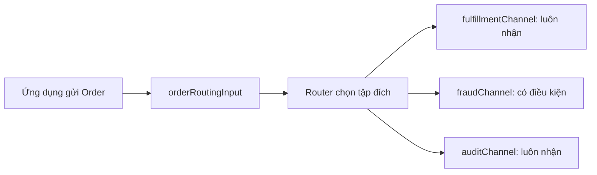
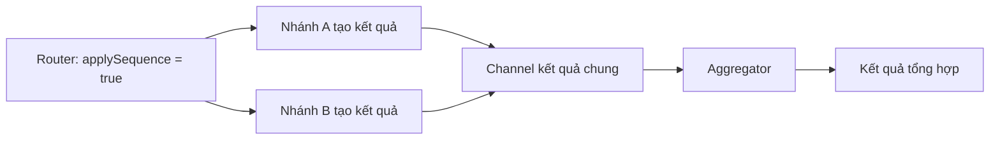

# Router nhiều output

## Mục tiêu và bối cảnh

Trong chương **Router** của module **SPRING_INTEGRATION_CORE**, bài này trình bày cách chuyển một `Message` đến nhiều `MessageChannel` theo các quy tắc có thể đồng thời thỏa mãn. Nội dung nối quyết định định tuyến với endpoint Java DSL, cách gọi từ ứng dụng, xử lý lỗi và kiểm thử luồng thông điệp.

Sau bài học, bạn có thể:

- Phân biệt chọn một đích với chọn nhiều đích cho cùng một message.
- Viết hàm định tuyến trả về danh sách khóa và ánh xạ từng khóa sang channel.
- Dùng `routeToRecipients()` khi mỗi người nhận có một điều kiện riêng.
- Quyết định khi nào cần sequence header để ghép kết quả bằng aggregator.
- Nhận diện gửi thành công một phần và thiết kế retry không gây lặp tác dụng nghiệp vụ.

Ví dụ sử dụng Java 17 trở lên và API Spring Integration 6.x. Dùng phiên bản dependency đồng bộ với BOM của dự án; Java DSL nằm trong `spring-integration-core`. Nếu dùng Spring Boot, có thể lấy thành phần cần thiết qua `spring-boot-starter-integration`; mã kiểm thử sử dụng JUnit Jupiter. Những tên tệp Java bên dưới mô tả cách bố trí ví dụ trong dự án thực hành.

## 1. Một message có thể cần nhiều người nhận

Giả sử hệ thống nhận một đơn hàng đã hợp lệ. Đơn cần được chuyển đến:

1. Bộ phận thực hiện đơn hàng: luôn nhận.
2. Bộ phận kiểm soát rủi ro: nhận nếu đơn từ nước ngoài hoặc giá trị từ 10 triệu đồng.
3. Bộ phận kiểm toán: luôn nhận.

Một đơn có thể thỏa cả ba điều kiện. Nếu viết `if ... else if ...` để chọn đúng một nhánh, hệ thống sẽ bỏ sót người nhận.

| Mã đơn | Tổng tiền | Từ nước ngoài | Các đích cần nhận |
| --- | ---: | --- | --- |
| O-101 | 2.000.000 VND | Không | fulfillment, audit |
| O-102 | 10.000.000 VND | Không | fulfillment, fraud, audit |
| O-103 | 2.000.000 VND | Có | fulfillment, fraud, audit |



Trong bài, **output của router** là channel đích được chọn. Hàm định tuyến trả về thông tin đích; router dùng thông tin đó để chuyển message đang xử lý. Danh sách đích không trở thành payload nghiệp vụ gửi xuống các nhánh. Hợp đồng nhiều đích được mô tả trong [API AbstractMessageRouter](https://docs.spring.io/spring-integration/api/org/springframework/integration/router/AbstractMessageRouter.html).

## 2. Phân biệt các cơ chế gần giống nhau

| Cơ chế | Quyết định chính | Ví dụ |
| --- | --- | --- |
| Router chọn một đích | Message này đến nhánh nào? | Chọn kho Bắc hoặc kho Nam |
| Router nhiều output | Message này cần đến những nhánh nào? | Thực hiện đơn, kiểm toán, có thể kiểm soát rủi ro |
| `PublishSubscribeChannel` | Phát đến các subscriber của channel | Các bộ xử lý cùng quan tâm một sự kiện |
| Splitter | Tách payload thành những phần tử nào? | Một đơn hàng thành nhiều dòng hàng |
| Aggregator | Khi nào đủ thông tin để tạo kết quả chung? | Ghép kết quả của các bước kiểm tra |

Một `DirectChannel` có nhiều subscriber thường phân phối mỗi message cho một consumer, với chiến lược phân phối/failover của nó. Muốn các bộ xử lý đều nhận, cần cấu trúc phát tới nhiều người nhận phù hợp. Các đặc tính của direct channel và publish-subscribe channel được trình bày trong [Message Channel Implementations](https://docs.spring.io/spring-integration/reference/channel/implementations.html).

Với ví dụ đơn hàng, router chọn nhiều đích phù hợp vì membership thay đổi theo nội dung đơn. Splitter sẽ chỉ cần thiết nếu từng dòng hàng phải trở thành một message riêng.

## 3. Hai giai đoạn: chọn đích và gửi message

Hãy tách hai việc sau khi đọc hoặc thiết kế một router:

```text
Order
  -> hàm quyết định các khóa nghiệp vụ
  -> ánh xạ khóa sang tên channel
  -> resolve tên thành MessageChannel
  -> gửi message lần lượt đến các channel đã xác định
```

Ví dụ:

```text
["FULFILLMENT", "FRAUD", "AUDIT"]
        |             |        |
        v             v        v
fulfillmentChannel fraudChannel auditChannel
```

Khóa nghiệp vụ giúp quy tắc chọn người nhận không phụ thuộc trực tiếp vào tên bean. Java DSL hỗ trợ hàm định tuyến và `channelMapping()`; xem [Message Routers trong Java DSL](https://docs.spring.io/spring-integration/reference/dsl/java-routers.html).

Có hai loại lỗi khác nhau:

- **Không resolve được đích:** đã có tên channel nhưng không tìm được channel tương ứng.
- **Gửi thất bại:** đã tìm được channel nhưng channel từ chối nhận, hết thời gian chờ hoặc đường xử lý đồng bộ ném lỗi.

Phân biệt này giúp tránh dùng một tùy chọn xử lý lỗi để giải quyết nhầm giai đoạn.

## 4. Ví dụ đầy đủ: hàm trả về nhiều khóa

### 4.1. Cấu hình Java DSL

Ví dụ dùng `DirectChannel` ở đầu vào và ba `QueueChannel` ở đầu ra. Queue giúp quan sát rõ router đã chuyển message tới đâu mà chưa cần kết nối hệ thống thực hiện đơn, chống gian lận hay kiểm toán.

```java
package learning.integration.router;

import java.util.ArrayList;
import java.util.List;

import org.springframework.context.annotation.Bean;
import org.springframework.context.annotation.Configuration;
import org.springframework.integration.channel.DirectChannel;
import org.springframework.integration.channel.QueueChannel;
import org.springframework.integration.config.EnableIntegration;
import org.springframework.integration.dsl.IntegrationFlow;
import org.springframework.messaging.MessageChannel;

@Configuration
@EnableIntegration
public class OrderRoutingConfig {

    public record Order(
            String orderId,
            long totalVnd,
            boolean overseas) {
    }

    public static List<String> targetKeys(Order order) {
        List<String> keys = new ArrayList<>();
        keys.add("FULFILLMENT");

        if (order.overseas() || order.totalVnd() >= 10_000_000L) {
            keys.add("FRAUD");
        }

        keys.add("AUDIT");
        return List.copyOf(keys);
    }

    @Bean
    public MessageChannel orderRoutingInput() {
        return new DirectChannel();
    }

    @Bean
    public QueueChannel fulfillmentChannel() {
        return new QueueChannel(100);
    }

    @Bean
    public QueueChannel fraudChannel() {
        return new QueueChannel(100);
    }

    @Bean
    public QueueChannel auditChannel() {
        return new QueueChannel(100);
    }

    @Bean
    public IntegrationFlow orderRoutingFlow() {
        return IntegrationFlow.from("orderRoutingInput")
                .<Order, Object>route(
                        Order.class,
                        OrderRoutingConfig::targetKeys,
                        router -> router
                                .channelMapping(
                                        "FULFILLMENT",
                                        "fulfillmentChannel")
                                .channelMapping(
                                        "FRAUD",
                                        "fraudChannel")
                                .channelMapping(
                                        "AUDIT",
                                        "auditChannel")
                                .channelKeyFallback(false)
                                .resolutionRequired(true)
                                .ignoreSendFailures(false)
                                .applySequence(false)
                                .sendTimeout(500))
                .get();
    }
}
```

`Order` là payload, `orderRoutingInput` là channel đầu vào và `orderRoutingFlow` đăng ký endpoint router. Hàm `targetKeys()` có thể kiểm thử riêng vì chỉ đọc dữ liệu và trả về danh sách khóa, không gọi dịch vụ bên ngoài.

Ở overload DSL này, kiểu kết quả hàm và kiểu khóa cấu hình cùng tham gia generic của `RouterSpec`. Khai báo `<Order, Object>` cho phép hàm trả về `List<String>` trong khi từng mapping vẫn dùng khóa `String`. Hợp đồng overload nằm trong [BaseIntegrationFlowDefinition của Spring Integration 6.5](https://raw.githubusercontent.com/spring-projects/spring-integration/v6.5.10/spring-integration-core/src/main/java/org/springframework/integration/dsl/BaseIntegrationFlowDefinition.java).

### 4.2. Diễn giải lựa chọn cấu hình

Trong ví dụ, các mapping là danh sách đích được ứng dụng chủ động cho phép. `channelKeyFallback(false)` ngăn một khóa chưa được ánh xạ tự được dùng như tên channel. `resolutionRequired(true)` yêu cầu tên channel cần resolve phải tồn tại. Hai thiết lập điều khiển các bước khác nhau; xem [API RouterSpec](https://docs.spring.io/spring-integration/api/org/springframework/integration/dsl/RouterSpec.html).

Cụ thể, khóa chưa có mapping khi fallback bị tắt có thể không đóng góp đích nào; đừng xem `resolutionRequired(true)` như bộ kiểm tra mọi khóa nghiệp vụ. Nếu cần phát hiện mọi khóa không hợp lệ, hãy kiểm tra ở hàm chọn đích hoặc kiểm thử tính đầy đủ của bảng mapping. Cơ chế này thể hiện trong [AbstractMappingMessageRouter](https://raw.githubusercontent.com/spring-projects/spring-integration/v6.5.10/spring-integration-core/src/main/java/org/springframework/integration/router/AbstractMappingMessageRouter.java).

`sendTimeout(500)` đặt thời gian chờ gửi đến channel theo mili giây, hữu ích khi queue có giới hạn dung lượng. Đây không phải thời gian tối đa để hoàn tất nghiệp vụ ở người nhận. `QueueChannel` trong ví dụ chỉ chứa message trong bộ nhớ; cần consumer hoặc poller thích hợp khi biến ví dụ thành luồng xử lý thực.

Hàm luôn thêm `FULFILLMENT` và `AUDIT`; điều kiện rủi ro chỉ bổ sung `FRAUD`. Danh sách không có đích trùng. Khi tự kết hợp nhiều nhóm quy tắc, nên tạo tập đích duy nhất, chẳng hạn dùng `LinkedHashSet`, trước khi trả kết quả.

## 5. Gửi message vào flow và đọc đầu ra

Với `AnnotationConfigApplicationContext`, có thể chạy thử trực tiếp như sau:

```java
package learning.integration.router;

import org.springframework.context.annotation.AnnotationConfigApplicationContext;
import org.springframework.integration.channel.QueueChannel;
import org.springframework.messaging.MessageChannel;
import org.springframework.messaging.support.MessageBuilder;

public class RouterDemo {

    public static void main(String[] args) {
        try (var context =
                new AnnotationConfigApplicationContext(OrderRoutingConfig.class)) {

            MessageChannel input =
                    context.getBean("orderRoutingInput", MessageChannel.class);

            var order = new OrderRoutingConfig.Order(
                    "O-102", 10_000_000L, false);

            boolean accepted = input.send(
                    MessageBuilder.withPayload(order)
                            .setHeader("traceId", "trace-O-102")
                            .build(),
                    1_000);

            System.out.println("accepted = " + accepted);

            for (String name : new String[] {
                    "fulfillmentChannel", "fraudChannel", "auditChannel"}) {
                QueueChannel output =
                        context.getBean(name, QueueChannel.class);
                System.out.println(name + " -> " + output.receive(0));
            }
        }
    }
}
```

Cả ba queue đều có một message chứa đơn O-102. Nếu đổi giá trị thành `2_000_000L` và vẫn giữ `overseas=false`, `fraudChannel.receive(0)` trả về `null`.

Mốc 10 triệu được chọn để thấy rõ điều kiện `>=`: đơn đúng ngưỡng cũng đến fraud. Header `traceId` giúp theo dõi một lần phát qua các nhánh.

Kết quả gửi thành công tới queue chỉ cho biết message đã được tiếp nhận ở ranh giới đó. Muốn xác nhận hoàn tất đơn hàng, ứng dụng phải có thông điệp kết quả hoặc cơ chế trạng thái nghiệp vụ riêng.

### Đặt gateway ở ranh giới ứng dụng

Ứng dụng có thể dùng một giao diện thay cho việc tự lấy channel:

```java
package learning.integration.router;

import org.springframework.integration.annotation.MessagingGateway;

@MessagingGateway(defaultRequestChannel = "orderRoutingInput")
public interface OrderGateway {
    void submit(OrderRoutingConfig.Order order);
}
```

Thêm `@IntegrationComponentScan(basePackageClasses = OrderGateway.class)` vào lớp cấu hình, với import `org.springframework.integration.annotation.IntegrationComponentScan`, rồi inject `OrderGateway` ở nơi gọi. Gateway là lối vào; logic chọn đích vẫn nằm trong router. Cách đăng ký giao diện gateway được mô tả trong [Messaging Gateways](https://docs.spring.io/spring-integration/reference/gateway.html).

Kiểu trả về `void` phù hợp khi hợp đồng là gửi đơn vào flow. Nó không có nghĩa tự động chạy ở thread khác. Nếu muốn trả một kết quả tổng hợp cho caller, cần thiết kế đường reply và bước ghép kết quả; việc khai báo nhiều output chưa tạo ra hợp đồng đó.

## 6. Cách viết tương đương bằng recipient list

Khi quy tắc gắn trực tiếp với từng người nhận, `routeToRecipients()` thường dễ đọc hơn. **Thay thế** bean `orderRoutingFlow()` ở ví dụ chính bằng bean sau, giữ nguyên model và các channel:

```java
@Bean
public IntegrationFlow orderRoutingFlow() {
    return IntegrationFlow.from("orderRoutingInput")
            .routeToRecipients(recipients -> recipients
                    .recipient("fulfillmentChannel")
                    .<Order>recipient(
                            "fraudChannel",
                            order -> order.overseas()
                                    || order.totalVnd() >= 10_000_000L)
                    .recipient("auditChannel")
                    .applySequence(false)
                    .ignoreSendFailures(false))
            .get();
}
```

Tất cả recipient có selector phù hợp đều được chọn. Hai recipient không kèm selector luôn được chọn. Các điều kiện không loại trừ nhau và không dừng sau recipient phù hợp đầu tiên. DSL cung cấp cả selector dựa trên payload và `recipientMessageSelector()` cho toàn bộ message; xem [API RecipientListRouterSpec](https://docs.spring.io/spring-integration/api/org/springframework/integration/dsl/RecipientListRouterSpec.html).

Ví dụ thay thế giữ cùng quy tắc chọn đích, nhưng không đặt timeout gửi riêng như bản đầu. Khi đưa vào ứng dụng, hãy thống nhất timeout với cấu hình endpoint/channel đang dùng.

Không đăng ký hai phiên bản flow cùng lúc cho một `DirectChannel` đầu vào để “so sánh”. Chúng sẽ trở thành các consumer cạnh tranh và làm thay đổi cấu trúc thí nghiệm.

| Khi nào chọn | Cách viết nên cân nhắc |
| --- | --- |
| Có policy trả về khóa nghiệp vụ dùng lại ở nhiều chỗ | Hàm trả danh sách khóa và `channelMapping()` |
| Mỗi người nhận có một điều kiện đơn giản | `routeToRecipients()` |
| Quyết định phụ thuộc header và payload | Selector nhận `Message<?>` hoặc policy nhận message |
| Cần các subscriber cùng nhận một sự kiện | Cấu trúc publish-subscribe và các quy tắc ở subscriber nếu cần |

## 7. Message được chia sẻ thế nào giữa các nhánh?

Trong ví dụ chính, router chuyển cùng nội dung đơn hàng đến các queue. Không có thao tác clone sâu `Order`. Record giúp giữ model không có setter, nhưng record chứa một collection mutable vẫn có thể chia sẻ dữ liệu mutable.

Với `applySequence(false)`, không nên viết logic phụ thuộc vào việc các nhánh nhận cùng một đối tượng `Message` theo identity. Điều quan trọng là hợp đồng dữ liệu và header. Nếu bật sequence, router tạo message với header riêng cho từng đích; payload vẫn không được clone sâu. Có thể xem cách xây message trong [AbstractMessageRouter của Spring Integration 6.5](https://raw.githubusercontent.com/spring-projects/spring-integration/v6.5.10/spring-integration-core/src/main/java/org/springframework/integration/router/AbstractMessageRouter.java).

Ví dụ cần tránh:

```java
// Giả sử payload là một Map mutable được các nhánh dùng chung.
payload.put("fraudStatus", "APPROVED");
```

Nhánh audit có thể quan sát dữ liệu trước hoặc sau khi thay đổi, tùy cấu trúc thực thi. Một thiết kế rõ ràng hơn là tạo kết quả riêng của nhánh, chẳng hạn `FraudResult(orderId, status)`, rồi gửi kết quả đến nơi cần dùng.

Thứ tự danh sách đích trong policy cũng không phải hợp đồng về thứ tự hoàn tất nghiệp vụ. Với các queue, router chỉ đưa message vào từng queue; consumer ở mỗi queue có nhịp xử lý riêng. Nếu audit phải ghi nhận kết quả kiểm soát rủi ro, nên định tuyến sự kiện kết quả của fraud tới audit.

## 8. Sequence header và điểm ghép aggregator

Để quan sát sequence, thay `.applySequence(false)` ở ví dụ chính bằng `.applySequence(true)`. Router thêm thông tin để phân biệt các lượt chuyển thuộc cùng lần chia nhánh. Trong trường hợp đơn được chọn cả ba đích, có thể hình dung:

| Đích | `correlationId` | `sequenceNumber` | `sequenceSize` |
| --- | --- | ---: | ---: |
| fulfillment | Cùng một giá trị cho lần chia nhánh | 1 | 3 |
| fraud | Cùng một giá trị cho lần chia nhánh | 2 | 3 |
| audit | Cùng một giá trị cho lần chia nhánh | 3 | 3 |

Nếu chỉ chọn fulfillment và audit, kích thước sequence tương ứng là 2. Đây là số đích được chọn, không phải số bước đã xử lý thành công. Ý nghĩa và giá trị mặc định của `applySequence` được mô tả trong [annotation Router](https://docs.spring.io/spring-integration/docs/current/api/org/springframework/integration/annotation/Router.html).

Sequence chỉ hữu ích cho aggregator khi thiết kế bảo đảm các kết quả liên quan thực sự được gửi về một điểm ghép, với header tương quan cần thiết được bảo toàn.



Ví dụ, nếu audit là nhánh chỉ ghi log và không trả message, aggregator chờ đủ cả ba kết quả có thể không hoàn tất. Khi thiết kế bước ghép, hãy xác định:

- Những nhánh nào phải đóng góp kết quả và mỗi nhánh đóng góp bao nhiêu message.
- Cách biểu diễn kết quả khi một nhánh bị filter hoặc xử lý thất bại.
- Điều kiện release, timeout và cách xử lý nhóm không đầy đủ.

Những câu hỏi này thuộc hợp đồng tổng hợp. Bật sequence không tự tạo aggregator, không thêm reply và không tự bảo đảm nhóm hoàn chỉnh.

## 9. Không có đích, thiếu channel và gửi thất bại

Các lựa chọn cần được đặt theo hợp đồng nghiệp vụ:

| Tùy chọn | Tác dụng cần hiểu |
| --- | --- |
| `resolutionRequired(true)` | Báo lỗi khi một tên đích cần resolve không tìm được channel |
| `resolutionRequired(false)` | Cho phép bỏ qua tên channel không resolve được |
| `ignoreSendFailures(false)` | Một lần gửi lỗi làm dừng việc gửi tới các đích tiếp theo |
| `ignoreSendFailures(true)` | Cho phép tiếp tục các lần gửi sau lỗi gửi được router xử lý |
| `defaultOutputChannel(...)` | Cung cấp đường mặc định khi định tuyến không có đầu ra sử dụng được |
| `nullChannel` làm đầu ra mặc định | Chủ động loại message; cần có chủ đích |

Các tham số này được giải thích trong [Common Router Parameters](https://docs.spring.io/spring-integration/reference/router/common-parameters.html).

Ví dụ, policy trả danh sách rỗng có thể mang nghĩa “không còn người nhận phù hợp”. Khi đó bạn có thể chọn queue để xem xét thủ công. Nếu cấu hình bỏ qua tên channel sai mà vẫn tìm được đích khác, việc thiếu một đích có thể khó phát hiện; bài kiểm thử cần kiểm tra đủ tập đích.

Đầu ra mặc định không phải danh sách các nhánh gửi thất bại và không tự bổ sung người nhận bị thiếu. Hãy thiết kế error flow/retry theo lỗi cụ thể.

### 9.1. Gửi thành công một phần

Xét thứ tự của policy trong ví dụ:

```text
1. fulfillmentChannel nhận thành công
2. fraudChannel đã đầy, gửi chờ hết 500 ms rồi lỗi
3. auditChannel chưa được gửi vì ignoreSendFailures=false
```

Tại thời điểm caller nhận exception, message của fulfillment vẫn ở queue. Router không tự thu hồi lần gửi đó. Ví dụ không cấu hình transaction hay kho thông điệp bền vững.

Nếu caller gửi lại đơn O-102, fulfillment có thể nhận lần thứ hai. Vì thế, hệ thống cần định nghĩa “đã xử lý” theo khóa nghiệp vụ, chẳng hạn:

```text
(orderId, tên thao tác, phiên bản sự kiện)
("O-102", "FULFILLMENT", 1)
("O-102", "AUDIT", 1)
```

Với thao tác tạo lệnh giao hàng, consumer có thể dùng unique constraint trên khóa xử lý để tránh tạo hai lệnh. Việc ghi nhận khóa và thực hiện thay đổi nghiệp vụ phải nằm trong một thiết kế nhất quán; đánh dấu thành công trước rồi gọi dịch vụ ngoài có thể làm mất thao tác khi tiến trình lỗi.

Chọn retry riêng cho nhánh đã thất bại nếu có thể xác định rõ trạng thái từng nhánh. Khi cần bảo đảm giao nhận qua sự cố tiến trình, hãy bổ sung cơ chế lưu bền và giao nhận phù hợp, chẳng hạn outbox hoặc broker có cấu hình xác nhận; router trong bộ nhớ chưa cung cấp bảo đảm đó.

### 9.2. Lỗi đồng bộ và lỗi sau ranh giới bất đồng bộ

Với `DirectChannel`, lỗi của xử lý chạy cùng thread có thể trả về caller. Nếu router đưa message thành công vào queue rồi consumer của queue gặp lỗi sau đó, lỗi ấy xảy ra ở một lần xử lý khác. Cơ chế error handler của poller/executor có thể phát `ErrorMessage`; cần cấu hình theo ranh giới thực thi. Xem [Error Handling](https://docs.spring.io/spring-integration/reference/error-handling.html).

Do đó, `ignoreSendFailures` của router không kiểm soát mọi lỗi xảy ra về sau ở các consumer. Trong ví dụ kiểm thử, lỗi queue đầy xảy ra ngay khi router gửi, nên caller đồng bộ quan sát được.

## 10. Kiểm thử luồng nhiều output

Kiểm thử cần chứng minh cả **các đích phải nhận** và **đích không được nhận**. Chỉ kiểm tra fulfillment có message sẽ bỏ qua lỗi quên gửi audit hoặc gửi nhầm fraud.

Lớp dưới đây dùng cấu hình chính ở mục 4, chưa bật sequence và chưa thay bằng recipient list. Mỗi test tạo context riêng, không có consumer nền lấy message khỏi các queue. Đây là mã thực hành để người học chạy trong dự án có JUnit Jupiter.

```java
package learning.integration.router;

import java.util.List;

import org.junit.jupiter.api.Test;
import org.springframework.context.annotation.AnnotationConfigApplicationContext;
import org.springframework.integration.channel.QueueChannel;
import org.springframework.messaging.Message;
import org.springframework.messaging.MessageChannel;
import org.springframework.messaging.MessagingException;
import org.springframework.messaging.support.MessageBuilder;

import static org.junit.jupiter.api.Assertions.*;

class OrderRoutingTest {

    @Test
    void sendsToAllAndOnlySelectedChannels() {
        try (var context =
                new AnnotationConfigApplicationContext(OrderRoutingConfig.class)) {

            MessageChannel input =
                    context.getBean("orderRoutingInput", MessageChannel.class);
            QueueChannel fulfillment =
                    context.getBean("fulfillmentChannel", QueueChannel.class);
            QueueChannel fraud =
                    context.getBean("fraudChannel", QueueChannel.class);
            QueueChannel audit =
                    context.getBean("auditChannel", QueueChannel.class);

            List<OrderRoutingConfig.Order> orders = List.of(
                    new OrderRoutingConfig.Order("O-101", 2_000_000L, false),
                    new OrderRoutingConfig.Order("O-102", 10_000_000L, false),
                    new OrderRoutingConfig.Order("O-103", 2_000_000L, true));

            for (var order : orders) {
                String traceId = "trace-" + order.orderId();
                Message<?> message = MessageBuilder.withPayload(order)
                        .setHeader("traceId", traceId)
                        .build();

                assertTrue(input.send(message, 1_000));

                assertOrder(fulfillment.receive(0), order, traceId);
                assertOrder(audit.receive(0), order, traceId);

                boolean requiresFraud =
                        order.overseas() || order.totalVnd() >= 10_000_000L;
                if (requiresFraud) {
                    assertOrder(fraud.receive(0), order, traceId);
                } else {
                    assertNull(fraud.receive(0));
                }

                assertNull(fulfillment.receive(0));
                assertNull(fraud.receive(0));
                assertNull(audit.receive(0));
            }
        }
    }

    @Test
    void keepsEarlierDeliveryWhenALaterQueueIsFull() {
        try (var context =
                new AnnotationConfigApplicationContext(OrderRoutingConfig.class)) {

            MessageChannel input =
                    context.getBean("orderRoutingInput", MessageChannel.class);
            QueueChannel fulfillment =
                    context.getBean("fulfillmentChannel", QueueChannel.class);
            QueueChannel fraud =
                    context.getBean("fraudChannel", QueueChannel.class);
            QueueChannel audit =
                    context.getBean("auditChannel", QueueChannel.class);

            var blocker = MessageBuilder.withPayload(
                    new OrderRoutingConfig.Order("BLOCKER", 0L, false))
                    .build();

            // Dung lượng fraudChannel trong cấu hình chính là 100.
            for (int i = 0; i < 100; i++) {
                assertTrue(fraud.send(blocker, 0));
            }

            var order =
                    new OrderRoutingConfig.Order("O-104", 20_000_000L, false);
            var message = MessageBuilder.withPayload(order).build();

            assertThrows(
                    MessagingException.class,
                    () -> input.send(message, 1_000));

            Message<?> delivered = fulfillment.receive(0);
            assertNotNull(delivered);
            assertEquals(order, delivered.getPayload());

            // Đích thứ ba chưa được gửi sau lỗi tại đích thứ hai.
            assertNull(audit.receive(0));
            assertNull(fulfillment.receive(0));
        }
    }

    private static void assertOrder(
            Message<?> message,
            OrderRoutingConfig.Order expected,
            String traceId) {

        assertNotNull(message);
        assertEquals(expected, message.getPayload());
        assertEquals(traceId, message.getHeaders().get("traceId"));
    }
}
```

Test đầu kiểm tra trường hợp thông thường, đúng ngưỡng và điều kiện overseas độc lập. Các lần `receive(0)` cuối vòng lặp phát hiện message thừa sau một lần gửi.

Test thứ hai cố tình làm đầy queue ở giữa danh sách. Nó chứng minh hành vi cần xử lý trong nghiệp vụ: một lần gọi thất bại không có nghĩa tất cả đích đều chưa nhận message.

Khi thực hành bật `applySequence(true)`, có thể bổ sung các assertion sau vào test riêng:

- Các message của cùng lần chia nhánh có `correlationId` bằng nhau.
- `sequenceSize` là 2 hoặc 3 theo tập người nhận của đơn.
- Tập `sequenceNumber` phủ từ 1 đến `sequenceSize`.
- Payload và header nghiệp vụ vẫn đúng.

Dùng `IntegrationMessageHeaderAccessor.CORRELATION_ID`, `SEQUENCE_NUMBER` và `SEQUENCE_SIZE` từ package `org.springframework.integration` khi truy cập các header này.

## 11. Các lỗi thiết kế thường gặp

| Hiện tượng | Nguyên nhân có thể gặp | Cách sửa trong ví dụ đơn hàng |
| --- | --- | --- |
| Chỉ một bộ xử lý nhận được đơn | Dùng một direct channel với nhiều consumer cạnh tranh | Chọn nhiều channel đích hoặc thiết kế publish-subscribe |
| Đơn có rủi ro đến fraud nhưng thiếu audit | Viết nhánh chọn một đích bằng `else if` | Tạo danh sách người nhận từ các điều kiện độc lập |
| Caller nhận lỗi nhưng kho vẫn nhận đơn | Một đích đã nhận trước khi đích sau lỗi | Theo dõi trạng thái từng thao tác và chống xử lý lặp |
| Log cho thấy payload thay đổi giữa các nhánh | Dùng chung dữ liệu mutable | Tạo model bất biến hoặc message kết quả mới |
| Aggregator chờ mãi | Số kết quả thực tế khác hợp đồng nhóm | Xác định nhánh đóng góp, release và timeout |
| Gửi queue thành công nhưng nghiệp vụ thất bại sau đó | Đánh đồng tiếp nhận với hoàn tất | Theo dõi kết quả xử lý ở consumer |
| Một khóa sai bị bỏ qua | Tắt fallback nhưng thiếu kiểm tra policy/mapping | Kiểm thử tập khóa và đích mà nghiệp vụ yêu cầu |

## 12. Bài thực hành mở rộng

1. Thêm `notificationChannel` khi đơn có yêu cầu thông báo. Kiểm tra rằng các đích fulfillment, fraud và audit vẫn được chọn theo quy tắc ban đầu.
2. Thêm trường hợp đơn nội địa có giá trị `9_999_999L`, rồi đối chiếu với `10_000_000L` để kiểm tra ranh giới điều kiện.
3. Đổi sang recipient list và chạy lại các kiểm tra tập người nhận. Đặt timeout phù hợp trước khi lặp lại thí nghiệm queue đầy.
4. Tạo hai nhánh kiểm tra có kết quả, bật sequence và đưa kết quả về một aggregator. Thử cho một nhánh không trả kết quả, rồi xác định timeout và đường xử lý nhóm thiếu.
5. Mô phỏng gửi lại cùng một đơn sau lỗi. Thiết kế khóa chống lặp cho fulfillment để đơn vẫn chỉ tạo một lệnh giao hàng.

Với bài tập aggregator, tham khảo hợp đồng correlation và release trong [Aggregator](https://docs.spring.io/spring-integration/reference/aggregator.html). Hãy tách trường hợp “gửi đến nhiều người nhận độc lập” và trường hợp “cần một kết quả chung” ngay từ yêu cầu nghiệp vụ.
