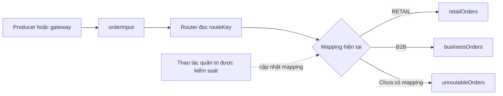

# Router và dynamic destination

> Thuộc chương **Router** của module **SPRING_INTEGRATION_CORE**. Bài học tập trung vào lựa chọn đích nhận thông điệp khi chạy, phân giải `MessageChannel` và thay đổi mapping trong một luồng Spring Integration.

## 1. Bài toán: cùng một cửa vào, đích xử lý có thể thay đổi

Một hệ thống tiếp nhận đơn hàng qua channel `orderInput`. Đơn thuộc nhóm `RETAIL` đi đến luồng bán lẻ; đơn `B2B` đi đến luồng doanh nghiệp. Khi luồng bán lẻ được nâng cấp, hệ thống cần chuyển các đơn mới sang luồng dự phòng mà producer vẫn gửi vào cửa vào cũ.

Router chịu trách nhiệm chọn channel đích từ nội dung của `Message<?>`. Endpoint bao quanh router nhận thông điệp ở channel đầu vào, gọi logic định tuyến rồi chuyển thông điệp đến đích. Producer chỉ cần biết hợp đồng đầu vào, chẳng hạn payload đơn hàng và header `routeKey`.

Sau bài học, người học có thể:

- Phân biệt routing key, tên channel, đối tượng `MessageChannel` và destination ở hệ thống bên ngoài.
- Cấu hình router bằng Java DSL hoặc một `HeaderValueRouter` được Spring quản lý.
- Cập nhật mapping lúc ứng dụng đang chạy và hiểu giới hạn của việc chuyển tuyến.
- Chọn chính sách cho đích không xác định, lỗi phân giải và lỗi gửi.
- Thiết kế kiểm thử quan sát được thông điệp tại đúng đích.

Các ví dụ Java dùng Java 17 và API Spring Integration 6.x với `IntegrationFlow.from(...)`. Dự án thực hành cần `spring-integration-core`, các phụ thuộc Spring tương thích và JUnit Jupiter để chạy lớp kiểm thử. Nếu dùng Spring Boot, hãy để BOM của Boot quản lý phiên bản Spring; không trộn các phiên bản độc lập một cách tùy ý. Ví dụ không yêu cầu broker và không khai báo một ứng dụng Boot hoàn chỉnh.

## 2. Dynamic destination có những nghĩa nào?

### 2.1. Chọn đích theo từng thông điệp

Giả sử `RETAIL → retailOrders` và `B2B → businessOrders` đã được cấu hình lúc khởi động. Mỗi thông điệp có thể đi đến một đích khác nhau, nhưng bảng luật vẫn cố định. Đây là định tuyến dựa trên dữ liệu của thông điệp.

### 2.2. Đổi luật khi ứng dụng đang chạy

Vẫn với khóa `RETAIL`, người vận hành thay mapping từ `retailOrders` sang `retailStandbyOrders`. Những lần định tuyến dùng mapping mới có thể đổi đích mà không cần sửa producer hoặc khởi động lại toàn bộ ứng dụng. Đây là khả năng thay đổi cấu hình định tuyến trong runtime, thường được nhắc đến khi nói về Dynamic Router. Spring Integration mô tả riêng khả năng thay đổi các bước tính khóa và phân giải channel trong [Dynamic Routers](https://docs.spring.io/spring-integration/reference/router/dynamic-routers.html).

### 2.3. Tạo thêm channel hoặc flow khi chạy

Thêm mapping không đồng thời tạo một channel mới. Nếu một tenant mới cần cả channel, endpoint và adapter riêng, ứng dụng phải quản lý vòng đời của những thành phần đó. `IntegrationFlowContext` là API dành cho việc đăng ký và quản lý flow trong runtime; registration có thể được hủy khi không còn cần thiết. Xem [Dynamic and Runtime Integration Flows](https://docs.spring.io/spring-integration/reference/dsl/java-runtime-flows.html).

### 2.4. Destination ngoài ứng dụng

`retailOrders` trong bài là tên một Spring `MessageChannel`. Một queue JMS, topic Kafka, exchange AMQP hoặc URL HTTP thuộc lớp tích hợp bên ngoài. Router có thể chọn channel nối với outbound adapter tương ứng; bản thân một chuỗi trả về từ router không có nghĩa là framework sẽ tạo queue, topic hoặc kết nối đến URL đó.

| Nhu cầu | Thành phần cần thay đổi | Điều không tự xảy ra |
|---|---|---|
| Mỗi đơn đi theo nhóm nghiệp vụ | Hàm tính khóa hoặc header của thông điệp | Bảng mapping không tự được cập nhật |
| Chuyển tuyến lúc bảo trì | Mapping của router | Thông điệp đã nằm ở đích cũ không tự được chuyển |
| Thêm cả pipeline cho tenant | Đăng ký channel, flow và tài nguyên liên quan | Thêm một dòng mapping không tạo pipeline |
| Gửi đến hệ thống bên ngoài | Channel nối outbound adapter hoặc gateway | Tên channel không tự trở thành destination của broker |

Việc chọn hình thức nào phụ thuộc nhu cầu thay đổi: dữ liệu của từng thông điệp, chính sách định tuyến hay cấu trúc của pipeline.

## 3. Từ Message đến channel đích

Với router có mapping, có thể hình dung quá trình thành ba bước:

1. **Tính routing key:** đọc header `routeKey`, phân tích payload hoặc gọi một hàm nghiệp vụ.
2. **Tra tên channel:** dùng khóa để tìm tên trong bảng mapping; một số cấu hình cho phép dùng chính khóa làm tên channel.
3. **Phân giải và gửi:** tìm `MessageChannel` tương ứng rồi gửi thông điệp.

Ví dụ:

```text
Message(payload=Order(...), headers.routeKey=RETAIL)
    → routing key: RETAIL
    → channel name: retailOrders
    → bean MessageChannel có tên retailOrders
    → gửi thông điệp
```



Ở trường hợp resolver mặc định dựa vào Spring BeanFactory, tên channel phải xác định được một bean phù hợp. Router không gửi thông điệp đến một bean tùy ý chỉ vì tên bean khớp. Nếu logic trả thẳng về một đối tượng `MessageChannel`, bước tra tên và mapping có thể được bỏ qua. Cách này phù hợp khi ứng dụng đã giữ tham chiếu channel, nhưng làm bảng mapping tên ít hữu ích hơn cho việc đổi tuyến.

Tách khóa nghiệp vụ như `RETAIL` khỏi tên kỹ thuật như `retailStandbyOrders` giúp producer không bị ràng buộc vào cấu trúc nội bộ. Producer giữ nguyên hợp đồng ngay cả khi người vận hành đổi channel đích.

## 4. Cấu hình đầy đủ với HeaderValueRouter và Java DSL

Ví dụ sau có một `DirectChannel` đầu vào và bốn `QueueChannel` đầu ra. Các queue được giới hạn dung lượng để ví dụ không tạo bộ đệm tăng vô hạn. Chúng giúp quan sát kết quả bằng `receive()` mà chưa cần dựng consumer xử lý đơn.

Lưu đoạn mã thực hành vào lớp `OrderRoutingConfig` trong một dự án Java riêng nếu muốn chạy. Đoạn mã ở đây là nội dung bài học.

```java
package example.routing;

import org.springframework.context.annotation.Bean;
import org.springframework.context.annotation.Configuration;
import org.springframework.integration.channel.DirectChannel;
import org.springframework.integration.channel.QueueChannel;
import org.springframework.integration.config.EnableIntegration;
import org.springframework.integration.dsl.IntegrationFlow;
import org.springframework.integration.router.HeaderValueRouter;

@Configuration
@EnableIntegration
public class OrderRoutingConfig {

    @Bean
    public DirectChannel orderInput() {
        return new DirectChannel();
    }

    @Bean
    public QueueChannel retailOrders() {
        return new QueueChannel(100);
    }

    @Bean
    public QueueChannel businessOrders() {
        return new QueueChannel(100);
    }

    @Bean
    public QueueChannel retailStandbyOrders() {
        return new QueueChannel(100);
    }

    @Bean
    public QueueChannel unroutableOrders() {
        return new QueueChannel(100);
    }

    @Bean
    public HeaderValueRouter orderRouter() {
        HeaderValueRouter router = new HeaderValueRouter("routeKey");
        router.setChannelMapping("RETAIL", "retailOrders");
        router.setChannelMapping("B2B", "businessOrders");
        router.setChannelKeyFallback(false);
        router.setResolutionRequired(true);
        router.setDefaultOutputChannelName("unroutableOrders");
        router.setSendTimeout(1_000);
        return router;
    }

    @Bean
    public IntegrationFlow orderRoutingFlow(HeaderValueRouter orderRouter) {
        return IntegrationFlow.from("orderInput")
                .route(orderRouter)
                .get();
    }
}
```

`HeaderValueRouter` lấy giá trị header `routeKey` làm khóa. DSL gắn router vào endpoint tiêu thụ từ `orderInput`. Router là một bean riêng để mã quản trị có thể nhận tham chiếu trực tiếp và cập nhật mapping. Có thể đưa một router implementation vào `.route(...)` theo [Router Implementations](https://docs.spring.io/spring-integration/reference/router/implementations.html).

Ba lựa chọn cấu hình tạo nên chính sách của ví dụ:

- `channelKeyFallback=false`: khóa không có mapping không được dùng làm tên channel.
- `resolutionRequired=true`: một tên channel đã được chọn nhưng không phân giải được sẽ tạo lỗi.
- `defaultOutputChannelName=unroutableOrders`: khi không chọn được channel nào, thông điệp đi vào nhánh kiểm tra thủ công.

Như vậy, `UNKNOWN` là một loại đầu vào chưa được hỗ trợ và đi vào nhánh dự phòng; còn mapping `RETAIL → channelDoesNotExist` là lỗi cấu hình và phải được phát hiện. Hai tình huống có chính sách khác nhau một cách có chủ đích.

### Gửi một thông điệp

Trong đoạn sau, `context` là `ApplicationContext` đã nạp cấu hình trên:

```java
var input = context.getBean("orderInput",
        org.springframework.messaging.MessageChannel.class);

var order = org.springframework.messaging.support.MessageBuilder
        .withPayload("order-1001")
        .setHeader("routeKey", "RETAIL")
        .setHeader("businessId", "order-1001")
        .build();

input.send(order);
```

Payload chuỗi giữ ví dụ ngắn; ứng dụng thực tế có thể dùng DTO đơn hàng. Router không cần biến đổi payload để đổi tuyến. Khi cần chuẩn hóa dữ liệu hoặc suy ra header từ payload, đặt transformer hoặc header enricher trước router.

`QueueChannel` mặc định giữ dữ liệu trong bộ nhớ nếu không có message store bền vững. Việc `send()` thành công chỉ xác nhận đã đưa thông điệp vào queue, chưa xác nhận nghiệp vụ đã hoàn tất. Để triển khai consumer cho một queue đầu ra, cần endpoint có poller phù hợp. Xem [Message Channel Configuration](https://docs.spring.io/spring-integration/reference/channel/configuration.html).

### Biến thể chỉ viết bằng DSL

Nếu không cần bean router riêng để quản trị, có thể thay phương thức `orderRoutingFlow` bằng:

```java
@Bean
public IntegrationFlow orderRoutingFlow() {
    return IntegrationFlow.from("orderInput")
            .route("headers['routeKey']", r -> r
                    .channelMapping("RETAIL", "retailOrders")
                    .channelMapping("B2B", "businessOrders")
                    .channelKeyFallback(false)
                    .resolutionRequired(true)
                    .defaultOutputChannel("unroutableOrders")
                    .sendTimeout(1_000))
            .get();
}
```

Đây là phương án thay thế; chỉ cấu hình một flow định tuyến trong bài thực hành. Đăng ký cả hai flow cùng tiêu thụ `orderInput` sẽ tạo nhiều subscriber trên `DirectChannel` và làm thay đổi hành vi phân phối. `route(...)` hỗ trợ SpEL, lambda hoặc router implementation như hướng dẫn [Message Routers trong Java DSL](https://docs.spring.io/spring-integration/reference/dsl/java-routers.html).

Biểu thức SpEL ở ví dụ là chuỗi cố định do lập trình viên cung cấp. Không lấy một biểu thức định tuyến tùy ý từ request của client rồi thực thi nó.

## 5. Đổi destination khi ứng dụng đang chạy

### 5.1. Chuyển một khóa sang đích đã có

Với cấu hình đầy đủ ở mục 4, mã quản trị có thể nhận bean router và thực hiện:

```java
HeaderValueRouter router = context.getBean(
        "orderRouter", HeaderValueRouter.class);

// Chuẩn bị đích dự phòng trước khi mở tuyến sang đó.
router.setChannelMapping("RETAIL", "retailStandbyOrders");

// Sau khi hoàn tất bảo trì, chuyển các lần định tuyến tiếp theo về đích cũ.
router.setChannelMapping("RETAIL", "retailOrders");
```

Hai lệnh minh họa hai thời điểm quản trị khác nhau; không cần gọi liên tiếp trong triển khai thực tế. API còn có `removeChannelMapping(key)` và `setChannelMappings(map)` để quản lý cấu hình. Những thao tác này thuộc nhóm khả năng quản trị của mapping router. Xem [AbstractMappingMessageRouter API](https://docs.spring.io/spring-integration/api/org/springframework/integration/router/AbstractMappingMessageRouter.html).

`setChannelMapping` chỉ thay quan hệ giữa khóa và tên channel. Channel đích cần tồn tại và pipeline phía sau cần sẵn sàng theo yêu cầu nghiệp vụ. Một queue có thể nhận dữ liệu dù chưa có consumer, nhưng điều đó không chứng minh luồng xử lý đã khỏe.

### 5.2. Xóa mapping và thay toàn bộ bảng

```java
router.removeChannelMapping("RETAIL");
// Với chính sách của bài, RETAIL hiện đi vào unroutableOrders.

router.setChannelMappings(java.util.Map.of(
        "RETAIL", "retailStandbyOrders",
        "B2B", "businessOrders"
));
```

`setChannelMappings(...)` có nghĩa là cung cấp toàn bộ bảng mới. Nếu chỉ truyền `RETAIL`, đừng kỳ vọng mapping `B2B` được tự giữ lại. Trước khi thay cả bảng, nên so sánh danh sách khóa cũ và mới, xác minh đích tồn tại, rồi công bố một phiên bản cấu hình được kiểm soát.

### 5.3. Ranh giới của việc đổi tuyến

Xét chuỗi sự kiện sau:

```text
t0: order-A đã được gửi vào retailOrders
t1: RETAIL được đổi sang retailStandbyOrders
t2: order-B được định tuyến theo mapping mới
```

`order-A` vẫn ở đích cũ. Cập nhật mapping không thu hồi thông điệp, không hủy tác dụng phụ đã xảy ra và không di chuyển dữ liệu tồn đọng giữa hai queue. Thông điệp đang chạy đồng thời với thao tác cập nhật có thể đã chọn đích trước khi cấu hình mới được áp dụng.

Nếu đơn A phải được xử lý xong trước đơn B, việc đổi đích cần thêm quy trình dừng nhận hoặc đệm đầu vào, chờ đích cũ xử lý hết và xác định thời điểm mở đích mới. Với thông điệp có thể được gửi lại, consumer nên có cơ chế chống xử lý lặp dựa trên mã nghiệp vụ.

Các ví dụ quản trị ở đây giả định có một nguồn cập nhật cấu hình được điều phối. Không suy ra rằng nhiều lệnh sửa mapping từ nhiều luồng hoặc nhiều node tạo thành một giao dịch chung. Trong hệ thống nhiều instance, mỗi router giữ trạng thái trong instance của nó; ứng dụng phải phân phối phiên bản cấu hình đến các instance và theo dõi việc áp dụng.

## 6. Chọn chính sách khi không đến được đích

### 6.1. Ba giai đoạn có thể thất bại

| Giai đoạn | Ví dụ | Chính sách trong cấu hình mẫu |
|---|---|---|
| Không lấy được khóa phù hợp | Thiếu `routeKey`, hoặc khóa `UNKNOWN` | Không có đích đã chọn; gửi thông điệp vào `unroutableOrders` |
| Không phân giải được tên channel | `RETAIL` được map đến tên không tồn tại | Ném `MessagingException` vì `resolutionRequired=true` |
| Phân giải được nhưng không gửi được | Queue đầy, hoặc `DirectChannel` không có subscriber | Báo lỗi gửi; default channel không tự trở thành cơ chế failover |
| Gửi được nhưng xử lý nghiệp vụ thất bại | Consumer từ chối đơn hoặc API bên ngoài lỗi | Xử lý lỗi tại ranh giới thực thi của consumer/gateway/adapter |

Không nên diễn giải tất cả các trường hợp thành “router không tìm thấy đích”. Việc ghi rõ giai đoạn giúp vận hành biết cần sửa dữ liệu, cấu hình hay hệ thống nhận.

### 6.2. Quan hệ giữa ba tùy chọn quan trọng

`channelKeyFallback` quyết định liệu khóa chưa có mapping có được coi là tên channel hay không. `resolutionRequired` áp dụng khi đã có tên channel cần phân giải. `defaultOutputChannel` dùng khi router không thu được channel đích nào theo chính sách phân giải, chứ không bắt mọi exception.

Từ Spring Integration 6.0, thiết lập default output channel sẽ tắt channel key fallback nếu chưa đặt fallback tường minh. Cấu hình đồng thời có default channel, `channelKeyFallback=true` và `resolutionRequired=true` bị từ chối khi khởi tạo. Bài đặt rõ các giá trị để người đọc nhìn thấy chính sách. Xem [Common Router Parameters](https://docs.spring.io/spring-integration/reference/router/common-parameters.html).

| Cấu hình | Khóa không được map | Tên đích được chọn nhưng không tồn tại |
|---|---|---|
| Fallback `false`, resolution `true`, có default | Đi default vì không tạo ra tên đích từ khóa | Báo lỗi phân giải |
| Fallback `false`, resolution `false`, có default | Đi default | Bỏ đích không phân giải được; nếu không còn đích nào thì đi default |
| Fallback `true`, resolution `false`, có default | Thử dùng khóa làm tên channel | Nếu không còn channel hợp lệ thì đi default |

Khi chọn `resolutionRequired=false`, cần quyết định có chấp nhận việc lỗi tên channel bị chuyển sang nhánh dự phòng hay không. Với đơn hàng quan trọng, nhánh này phải được theo dõi và xử lý; đặt tên là quarantine hoặc unroutable không tự tạo cơ chế lưu trữ bền vững, cảnh báo hay gửi lại.

Nếu không có channel hợp lệ và cũng không có default output channel, router báo lỗi thay vì mặc nhiên bỏ thông điệp. Dùng `nullChannel` làm default là lựa chọn bỏ thông điệp có chủ đích. Chỉ nên áp dụng khi việc mất dữ liệu đó phù hợp yêu cầu nghiệp vụ.

### 6.3. Lỗi gửi và lỗi nghiệp vụ

`ignoreSendFailures` liên quan đến thất bại khi gửi, không thay thế `resolutionRequired`. Bật tùy chọn này có thể khiến việc gửi lỗi bị bỏ qua; nó không tự retry, không tạo giao dịch chung giữa các đích và không tự đưa thông điệp vào default channel.

Với lời gọi trực tiếp vào `orderInput` là `DirectChannel`, lỗi phát sinh ngay tại router có thể truyền về caller. Chỉ thêm header `errorChannel` không làm mọi lỗi đồng bộ tự động chuyển thành `ErrorMessage`. Tại một ranh giới bất đồng bộ có error handler của Spring Integration, lỗi có thể được công bố thành `ErrorMessage` đến channel lỗi tương ứng. Gateway cũng có cấu hình xử lý lỗi riêng. Xem [Error Handling](https://docs.spring.io/spring-integration/reference/error-handling.html).

Ví dụ queue đầy trong cấu hình mẫu chịu giới hạn thời gian gửi do router đặt bằng `setSendTimeout(1_000)`. Nếu consumer đọc queue ở luồng khác rồi thất bại sau đó, đó là lỗi của lần xử lý tiếp theo; producer không thể suy ra kết quả nghiệp vụ chỉ từ lần gửi ban đầu.

## 7. Khi routing key chính là tên channel

Một biến thể ngắn của Java DSL là:

```java
return IntegrationFlow.from("orderInput")
        .route("headers['destinationChannel']")
        .get();
```

Biến thể này phù hợp khi `destinationChannel` được tạo bởi thành phần nội bộ đáng tin cậy và giá trị là tên channel hợp lệ. Producer hoặc bước trước router có thể chọn `retailOrders` hay `businessOrders` cho từng message mà không cần mapping nghiệp vụ.

Đổi lại, người tạo header phải biết tên kỹ thuật của channel. Nếu client bên ngoài được quyền tự điền tên đích, nó có thể hướng thông điệp đến một channel ngoài ý muốn, thậm chí quay về đầu vào và tạo vòng lặp. Khi có đầu vào không đáng tin cậy, nên chuyển dữ liệu đã xác thực thành khóa nghiệp vụ và giữ mapping thuộc quyền ứng dụng. Đây cũng là lý do cấu hình chính đặt `channelKeyFallback=false`.

Một danh sách tên đích được phép cần đi kèm kiểm tra quyền trên từng khóa. Ví dụ tenant A không được chọn khóa của tenant B chỉ vì khóa đó tồn tại trong bảng mapping. Allowlist của channel và quyền truy cập dữ liệu là hai lớp kiểm tra khác nhau.

Không dùng việc ghép prefix hoặc suffix như một cơ chế phân quyền. Chúng giúp thống nhất tên channel, còn quyền định tuyến phải được kiểm tra theo danh tính và ngữ cảnh nghiệp vụ.

## 8. Kiểm thử hành vi định tuyến

Kiểm thử router nên quan sát thông điệp ở channel nhận, kiểm tra các đích còn lại và kiểm tra lỗi khi cần. Các test sau dùng cấu hình đầy đủ ở mục 4, không dùng biến thể DSL thay thế. Mỗi test mở một context mới để cập nhật runtime của test này không ảnh hưởng test khác.

```java
package example.routing;

import org.junit.jupiter.api.Test;
import org.springframework.context.annotation.AnnotationConfigApplicationContext;
import org.springframework.integration.channel.QueueChannel;
import org.springframework.integration.router.HeaderValueRouter;
import org.springframework.messaging.Message;
import org.springframework.messaging.MessageChannel;
import org.springframework.messaging.MessagingException;
import org.springframework.messaging.support.MessageBuilder;

import static org.junit.jupiter.api.Assertions.*;

class OrderRoutingTest {

    private static Message<String> order(String id, String routeKey) {
        return MessageBuilder.withPayload(id)
                .setHeader("routeKey", routeKey)
                .setHeader("businessId", id)
                .build();
    }

    private static QueueChannel queue(
            AnnotationConfigApplicationContext context, String name) {
        return context.getBean(name, QueueChannel.class);
    }

    @Test
    void routesRetailToOnlyItsMappedChannel() {
        try (var context = new AnnotationConfigApplicationContext(
                OrderRoutingConfig.class)) {
            var input = context.getBean("orderInput", MessageChannel.class);
            assertTrue(input.send(order("order-1", "RETAIL")));

            Message<?> received = queue(context, "retailOrders").receive(0);
            assertNotNull(received);
            assertEquals("order-1", received.getPayload());
            assertEquals("RETAIL", received.getHeaders().get("routeKey"));
            assertNull(queue(context, "businessOrders").receive(0));
            assertNull(queue(context, "retailStandbyOrders").receive(0));
            assertNull(queue(context, "unroutableOrders").receive(0));
        }
    }

    @Test
    void sendsAnUnmappedKeyToDefaultEvenIfItNamesAnExistingChannel() {
        try (var context = new AnnotationConfigApplicationContext(
                OrderRoutingConfig.class)) {
            var input = context.getBean("orderInput", MessageChannel.class);
            assertTrue(input.send(order("order-2", "businessOrders")));

            Message<?> received = queue(context, "unroutableOrders").receive(0);
            assertNotNull(received);
            assertEquals("order-2", received.getPayload());
            assertNull(queue(context, "businessOrders").receive(0));
        }
    }

    @Test
    void changesTheTargetForSubsequentMessages() {
        try (var context = new AnnotationConfigApplicationContext(
                OrderRoutingConfig.class)) {
            var input = context.getBean("orderInput", MessageChannel.class);
            var router = context.getBean("orderRouter", HeaderValueRouter.class);

            input.send(order("before-change", "RETAIL"));
            router.setChannelMapping("RETAIL", "retailStandbyOrders");
            input.send(order("after-change", "RETAIL"));

            Message<?> oldTarget = queue(context, "retailOrders").receive(0);
            Message<?> newTarget = queue(context, "retailStandbyOrders").receive(0);
            assertNotNull(oldTarget);
            assertNotNull(newTarget);
            assertEquals("before-change", oldTarget.getPayload());
            assertEquals("after-change", newTarget.getPayload());
            assertNull(queue(context, "retailOrders").receive(0));
            assertNull(queue(context, "unroutableOrders").receive(0));
        }
    }

    @Test
    void failsWhenAnExplicitMappingNamesAMissingChannel() {
        try (var context = new AnnotationConfigApplicationContext(
                OrderRoutingConfig.class)) {
            var input = context.getBean("orderInput", MessageChannel.class);
            var router = context.getBean("orderRouter", HeaderValueRouter.class);
            router.setChannelMapping("RETAIL", "channelDoesNotExist");

            assertThrows(MessagingException.class,
                    () -> input.send(order("order-3", "RETAIL")));
            assertNull(queue(context, "unroutableOrders").receive(0));
        }
    }
}
```

`receive(0)` phù hợp ở đây vì `DirectChannel` thực thi router trong cùng luồng; khi `send()` trả về thành công, thông điệp đã được đặt vào queue đầu ra. Nếu đầu vào dùng executor hoặc bước xử lý bất đồng bộ, test cần chờ theo điều kiện với timeout hữu hạn. Tránh `Thread.sleep(...)` cố định vì nó làm test chậm và vẫn dễ lỗi khi môi trường thay đổi.

Test đổi mapping giữ nguyên thông điệp `before-change` trong queue cũ để minh họa rằng đổi tuyến không di chuyển dữ liệu tồn đọng. Test khóa `businessOrders` chứng minh việc tắt fallback có tác dụng ngay cả khi khóa tình cờ trùng tên một channel tồn tại.

Có thể mở rộng bộ kiểm thử trong dự án thực hành bằng các tình huống:

| Tình huống | Điều cần khẳng định |
|---|---|
| Thiếu header `routeKey` | Thông điệp đến nhánh mặc định của cấu hình mẫu |
| Xóa mapping `RETAIL` | Các thông điệp mới của khóa đó không còn đến đích cũ |
| Đổi `resolutionRequired` sang `false` trước lúc gửi | Mapping trỏ đến channel thiếu có thể đi default khi không còn đích hợp lệ |
| Queue đầu ra đầy | Lần gửi kết thúc theo timeout và báo lỗi phù hợp |
| Tenant dùng khóa không thuộc quyền | Bước xác thực từ chối trước khi router gửi |
| Tải lại cấu hình sau khi restart | Bảng mapping khớp phiên bản đã được lưu |

## 9. Thiết kế vận hành cho một router thay đổi được

Trong ví dụ bán lẻ, một quy trình chuyển tuyến có thể gồm:

1. Xác minh `retailStandbyOrders` và consumer đằng sau đã sẵn sàng; xác minh khả năng nhận tải.
2. Lưu phiên bản mapping đang hoạt động và người yêu cầu thay đổi.
3. Áp dụng mapping mới qua một thao tác quản trị đã được xác thực.
4. Quan sát lưu lượng, số thông điệp không định tuyến được và lỗi tại đích mới.
5. Chờ đích cũ xử lý hết nếu nghiệp vụ yêu cầu; sau đó mới dừng tài nguyên cũ.
6. Khi cần rollback, áp dụng lại mapping cũ và đánh giá riêng các thông điệp đã đi sang đích mới.

Rollback bảng mapping chỉ tác động đến các lần định tuyến sử dụng cấu hình sau đó. Nếu đích mới đã ghi dữ liệu sai, ứng dụng vẫn cần biện pháp sửa dữ liệu hoặc bù trừ nghiệp vụ phù hợp.

Nên ghi nhận mã nghiệp vụ, routing key, đích đã chọn, phiên bản cấu hình và kết quả gửi. Nếu `HeaderValueRouter` không cung cấp trực tiếp toàn bộ dữ liệu cần quan sát ở một chỗ, bổ sung instrumentation qua thành phần nghiệp vụ hoặc interceptor phù hợp. Tránh dùng `businessId` hay số tenant không giới hạn làm nhãn metric vì có thể tạo quá nhiều chuỗi thời gian.

Các thao tác sửa mapping có thể được ứng dụng đưa ra qua một dịch vụ quản trị hoặc cơ chế quản lý được hỗ trợ. Không đưa quyền thực thi lệnh quản trị vào cùng luồng dữ liệu mà client không đáng tin cậy có thể gửi tùy ý. Cập nhật bằng Java API như bài này giúp ví dụ độc lập với cú pháp Control Bus giữa các phiên bản.

Khi cần tạo thêm flow bằng `IntegrationFlowContext`, thứ tự triển khai nên là chuẩn bị tài nguyên, đăng ký flow và xác minh đích trước khi thêm mapping. Khi gỡ bỏ, hãy chuyển hoặc ngừng tuyến trước, xử lý dữ liệu còn lại rồi mới hủy registration. Cần giới hạn số flow/channel theo chính sách quản lý tài nguyên thay vì tạo một flow mới cho mọi giá trị header.

## 10. Những ngộ nhận cần tránh

| Ngộ nhận | Cách hiểu đúng để thiết kế |
|---|---|
| Trả về tên channel là sẽ tạo được channel | Resolver phải tìm được một channel theo cấu hình; tạo channel/flow là công việc riêng |
| Có default channel thì mọi lỗi đều được chuyển sang đó | Default xử lý tình huống không thu được đích, không bắt mọi lỗi phân giải hoặc gửi |
| `resolutionRequired=false` đồng nghĩa thông điệp bị bỏ | Còn phải xét các đích hợp lệ khác và default channel; không có đích có thể vẫn báo lỗi |
| Đổi mapping sẽ chuyển cả dữ liệu đang chờ | Dữ liệu đã vào đích cũ cần được quản lý riêng |
| Header tên đích là cơ chế phân quyền | Header cần được kiểm soát và đối chiếu quyền nghiệp vụ |
| `send()` thành công đồng nghĩa đơn đã xử lý xong | Đích dạng queue chỉ xác nhận tiếp nhận; kết quả nghiệp vụ cần hợp đồng phản hồi hoặc theo dõi riêng |
| Sửa mapping ở một instance là sửa cả cụm | Cần phân phối cấu hình, phiên bản và xác nhận áp dụng trên các instance |
| Router nhiều đích tạo giao dịch nguyên tử | Cần thiết kế riêng về retry, giao dịch và chống xử lý lặp |

Một router có thể chọn nhiều channel, nhưng việc nhận đủ phản hồi cho aggregator phụ thuộc số nhánh thực tế, metadata tương quan và chính sách hoàn tất. Khi topology thay đổi, không nên giữ giả định rằng mọi thông điệp luôn có cùng số nhánh. Chủ đề này cần được giải quyết cùng thiết kế scatter-gather và xử lý timeout của aggregator.

`dynamicChannelLimit` của mapping router cũng dễ bị hiểu sai. Nó giới hạn danh sách channel động được giữ cho mục đích báo cáo, không phải hạn mức channel được phép định tuyến đến và không thay thế allowlist. Chi tiết được ghi trong [Javadoc của setDynamicChannelLimit](https://docs.spring.io/spring-integration/api/org/springframework/integration/router/AbstractMappingMessageRouter.html#setDynamicChannelLimit(int)).

## 11. Thực hành: chuyển tuyến có kiểm soát

Với cấu hình ở mục 4, hãy mô phỏng một đợt bảo trì luồng bán lẻ:

1. Gửi hai thông điệp `RETAIL` và một thông điệp `B2B`; kiểm tra từng queue nhận đúng nhóm.
2. Chuyển `RETAIL` sang `retailStandbyOrders`, rồi gửi thêm một thông điệp cùng khóa.
3. Xác minh queue cũ vẫn còn dữ liệu đã nhận trước khi đổi tuyến và queue dự phòng có dữ liệu mới.
4. Xóa mapping `RETAIL`; xác minh thông điệp mới đến `unroutableOrders`.
5. Khôi phục mapping rồi thử cấu hình trỏ đến tên channel không tồn tại; ghi lại sự khác biệt so với khóa chưa được map.
6. Đề xuất cách lưu phiên bản cấu hình, khôi phục sau restart và bảo vệ thao tác quản trị trong hệ thống nhiều instance.

Kết quả thực hành cần có bằng chứng về channel nhận, hành vi ở nhánh mặc định và giới hạn của việc đổi mapping. Khi thiết kế luồng thực tế, hãy xác định rõ ai được chọn khóa, ai được đổi mapping, thông điệp nào đã qua điểm chuyển tuyến và cách xác nhận xử lý nghiệp vụ ở đích.

