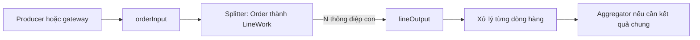

# Message splitter là gì

## 1. Từ một đơn hàng đến nhiều đơn vị xử lý

Một hệ thống bán hàng nhận một đơn gồm ba dòng sản phẩm. Dịch vụ giữ hàng trong kho lại xử lý từng dòng: xác định SKU, số lượng và kho đáp ứng. Nếu luôn chuyển cả đơn hàng, mỗi thành phần phía sau phải biết cách duyệt danh sách và giữ ngữ cảnh của đơn.

**Message splitter** là endpoint thực hiện mẫu tích hợp **Splitter**: nhận một thông điệp, tách dữ liệu của nó thành các phần, rồi phát từng phần dưới dạng một thông điệp riêng để xử lý độc lập. Đây là một thành phần của Spring Integration Core trong nhóm mẫu Enterprise Integration Patterns. Xem định nghĩa tại [Spring Integration — Splitter](https://docs.spring.io/spring-integration/reference/splitter.html).

Ví dụ nghiệp vụ của bài:

```text
Message<Order>
└── orderId: ORD-1001
    ├── lineId: L1, sku: BOOK,     quantity: 2
    ├── lineId: L2, sku: KEYBOARD, quantity: 1
    └── lineId: L3, sku: MOUSE,    quantity: 1

                   Splitter
                       ↓

Message<LineWork>   Message<LineWork>   Message<LineWork>
ORD-1001 / L1       ORD-1001 / L2       ORD-1001 / L3
BOOK × 2           KEYBOARD × 1        MOUSE × 1
```

Trong ví dụ này, **đơn vị tách là dòng hàng**. Dòng BOOK có số lượng 2 vẫn tạo một thông điệp. Chỉ khi hợp đồng nghiệp vụ yêu cầu xử lý từng sản phẩm vật lý thì dòng này mới cần tách thành hai công việc.

Sau bài học, người học cần thiết kế được đầu vào và đầu ra của splitter, đọc được các header liên kết thông điệp con, viết một luồng bằng Java DSL và nhận ra các tình huống cần thêm cơ chế điều phối, xử lý lỗi hoặc ghép kết quả.

## 2. Splitter nằm ở đâu trong luồng thông điệp?

Trong mô hình Spring Integration, `Message` mang payload và header; `MessageChannel` chuyển thông điệp giữa các thành phần; endpoint đảm nhận một công việc trong luồng. Splitter là endpoint thay đổi **độ hạt của công việc** từ một tập hợp sang các phần tử.



Sơ đồ trên mô tả một phương án thiết kế cho đơn hàng. Các thông điệp con có thể đi qua cùng một output channel; không cần tạo một channel cho mỗi dòng hàng.

Hãy tách bạch ba quyết định thiết kế:

1. **Tách thành phần nào?** Ví dụ: dòng hàng, hóa đơn trong một lô, bản ghi trong một tệp.
2. **Mỗi phần được xử lý ra sao?** Ví dụ: biến đổi dữ liệu, định tuyến theo kho hoặc gọi dịch vụ giữ hàng.
3. **Có cần chờ kết quả chung không?** Ví dụ: phát kết quả từng dòng ngay, hoặc chỉ trả báo cáo khi toàn bộ đơn hoàn tất.

Ở bài này, splitter giải quyết quyết định thứ nhất. Các phần tiếp theo chỉ ra tác động của hai quyết định còn lại lên hợp đồng của luồng.

## 3. Phân biệt splitter với các thành phần dễ nhầm

Bảng dưới dùng cùng một ví dụ đơn hàng để phân biệt mục đích thiết kế:

| Thành phần | Câu hỏi cần giải quyết | Ví dụ trong luồng đơn hàng |
|---|---|---|
| Splitter | Tập dữ liệu này gồm những công việc con nào? | Một đơn thành ba công việc xử lý dòng hàng |
| Transformer | Dữ liệu cần được biểu diễn ra sao? | Một dòng hàng thành yêu cầu giữ kho |
| Router | Thông điệp này cần đi đến đâu? | Chuyển công việc đến kho phù hợp |
| Filter | Thông điệp có đủ điều kiện đi tiếp không? | Chấp nhận hoặc loại một công việc |
| Publish-subscribe channel | Những subscriber nào cần nhận thông điệp? | Thông báo một sự kiện cho kho và hệ thống audit |
| Aggregator | Những kết quả liên quan nào đủ để tạo kết quả chung? | Kết quả giữ kho của các dòng thành báo cáo đơn |

Một transformer trả về `List<LineWork>` vẫn có thể tạo **một message có payload là danh sách**. Khi muốn từng phần tử trở thành message đi tiếp trong luồng, hãy thể hiện bước đó bằng splitter. Transformer tập trung vào việc chuyển đổi biểu diễn dữ liệu; xem [Spring Integration — Transformer](https://docs.spring.io/spring-integration/reference/transformer.html).

Tương tự, phát một đơn hàng đến hai subscriber phục vụ mục đích thông báo cho hai nơi; tách đơn thành ba dòng phục vụ mục đích chia công việc. Số subscriber và số phần tử của đơn là hai đại lượng khác nhau.

Nếu một phương thức nghiệp vụ chỉ cần duyệt ba dòng để tính tổng tiền trong bộ nhớ, vòng lặp Java có thể đã đủ. Splitter có ích khi từng phần cần trở thành đơn vị xử lý trong một luồng thông điệp có các endpoint riêng.

## 4. Header giúp nhận diện thông điệp con

### 4.1. Ba header của một chuỗi

Spring Integration khai báo các hằng header liên quan đến chuỗi trong `IntegrationMessageHeaderAccessor`:

| Hằng Java | Tên header | Cách hiểu trong bài |
|---|---|---|
| `CORRELATION_ID` | `correlationId` | Nhận diện nhóm thông điệp liên quan |
| `SEQUENCE_NUMBER` | `sequenceNumber` | Vị trí của phần tử trong chuỗi |
| `SEQUENCE_SIZE` | `sequenceSize` | Kích thước chuỗi khi xác định được |

Có thể dùng accessor để đọc các giá trị này thay vì tự ép kiểu từng header. Xem [API IntegrationMessageHeaderAccessor](https://docs.spring.io/spring-integration/api/org/springframework/integration/IntegrationMessageHeaderAccessor.html).

Với một lần tách đơn giản, không lồng nhau, giữ cấu hình sequencing mặc định và đầu vào có ID ký hiệu là `M0`, ta mong đợi:

| Payload của thông điệp con | ID riêng, ký hiệu | `correlationId` | `sequenceNumber` | `sequenceSize` |
|---|---|---|---:|---:|
| Công việc cho L1 | M1 | M0 | 1 | 3 |
| Công việc cho L2 | M2 | M0 | 2 | 3 |
| Công việc cho L3 | M3 | M0 | 3 | 3 |

Các ký hiệu M0–M3 giúp đọc ví dụ; chương trình thực tế dùng giá trị ID do hạ tầng message tạo ra. Vị trí chuỗi bắt đầu từ 1. Bảng mô tả lần tách từ danh sách payload, không phải mọi trường hợp tùy biến trả về các `Message` đã được dựng sẵn.

### 4.2. ID kỹ thuật và khóa nghiệp vụ có vai trò khác nhau

Trong ứng dụng của bài:

- `orderId = ORD-1001` giúp xác định đơn hàng.
- `lineId = L2` giúp xác định một dòng cụ thể.
- `requestId = REQ-01` giúp theo dõi yêu cầu xuyên suốt các bước.
- `correlationId` và các số thứ tự phục vụ việc liên kết chuỗi thông điệp.

Một lần gửi lại cùng đơn hàng có thể tạo một message đầu vào mới. Vì vậy, đối với thao tác giữ hàng, nên thiết kế khóa chống xử lý lặp từ dữ liệu nghiệp vụ, chẳng hạn `orderId + lineId + operation`. Không lấy việc hai thông điệp có ID kỹ thuật khác nhau làm bằng chứng rằng chúng là hai yêu cầu nghiệp vụ khác nhau.

### 4.3. Sequencing có thể cấu hình

`AbstractMessageSplitter` có `applySequence` mặc định là `true`; có thể tắt nếu luồng có hợp đồng nhóm riêng. Khi tắt, splitter không áp dụng bộ thông tin chuỗi mới; điều này không đồng nghĩa xóa mọi header tương quan đã tồn tại. API cũng hỗ trợ discard channel cho kết quả tách rỗng. Xem [API AbstractMessageSplitter](https://docs.spring.io/spring-integration/api/org/springframework/integration/splitter/AbstractMessageSplitter.html).

Với bài nhập môn, nên giữ sequencing và kiểm tra trực tiếp các header trước khi thêm xử lý phức tạp.

## 5. Thiết kế hàm tách và kiểu dữ liệu

Một hàm tách đơn hàng có hợp đồng rõ ràng:

```text
Order(orderId, List<OrderLine>)
          ↓ splitOrder
List<LineWork(orderId, OrderLine)>
          ↓ splitter phát từng phần tử
N Message<LineWork>
```

Thiết kế này chủ động đưa `orderId` vào từng `LineWork`. Một handler phía sau chỉ cần công việc của nó để biết đang xử lý đơn nào; nó không phải giữ một biến dùng chung trỏ về đơn hàng trước đó.

Với Java DSL, `.split()` dùng splitter mặc định cho payload dạng tập phần tử. Có thể truyền một hàm tách, biểu thức hoặc triển khai splitter riêng. Những nguồn như `Iterable`, `Iterator`, mảng, `Stream` và reactive `Publisher` được hỗ trợ trong mô hình DSL. Xem [Spring Integration — Java DSL Splitters](https://docs.spring.io/spring-integration/reference/dsl/java-splitters.html).

Khi chọn hợp đồng cho ví dụ, cần phân biệt:

| Kết quả hàm tách | Hợp đồng nên thể hiện |
|---|---|
| Danh sách các `LineWork` | Mỗi phần tử là một công việc con |
| Danh sách các `Message<LineWork>` | Mỗi phần có thể mang thêm header riêng |
| Một đối tượng đơn | Chỉ có một kết quả, không thể mặc định suy ra nhiều phần |
| Danh sách rỗng | Không có công việc con |
| `null` | Kết thúc luồng theo quy tắc của handler; không phải một công việc rỗng |

Phần tử `null` cũng không phải cách biểu diễn một dòng hàng thất bại. Nên dùng một đối tượng kết quả có trạng thái rõ ràng như `SUCCESS`, `REJECTED` hoặc `FAILED`.

Chuỗi chứa JSON không tự trở thành danh sách đơn hàng chỉ vì đưa vào splitter. Hãy parse và kiểm tra cấu trúc trước, hoặc viết hàm tách dành cho định dạng đó.

## 6. Ví dụ hoàn chỉnh bằng Java DSL

### 6.1. Điều kiện sử dụng

Ví dụ chính dùng Java 17 và Spring Integration 6.x, với `spring-integration-core` cùng các dependency Spring tương thích. Trong dự án Spring Boot đã quản lý dependency, có thể sử dụng `spring-boot-starter-integration`.

Ví dụ dùng `AnnotationConfigApplicationContext` để quan sát luồng mà không cần HTTP, cơ sở dữ liệu hoặc broker. Lớp cấu hình, mô hình dữ liệu và `main` được đặt chung để dễ sao chép vào một dự án học tập.

### 6.2. Cấu hình và gửi đơn hàng

```java
import java.util.List;
import java.util.Objects;

import org.springframework.context.annotation.Bean;
import org.springframework.context.annotation.Configuration;
import org.springframework.context.annotation.AnnotationConfigApplicationContext;
import org.springframework.integration.IntegrationMessageHeaderAccessor;
import org.springframework.integration.channel.DirectChannel;
import org.springframework.integration.channel.QueueChannel;
import org.springframework.integration.config.EnableIntegration;
import org.springframework.integration.dsl.IntegrationFlow;
import org.springframework.messaging.Message;
import org.springframework.messaging.support.MessageBuilder;

@Configuration
@EnableIntegration
public class SplitterLessonConfig {

    public record OrderLine(String lineId, String sku, int quantity) {
        public OrderLine {
            Objects.requireNonNull(lineId, "lineId");
            Objects.requireNonNull(sku, "sku");
            if (quantity <= 0) {
                throw new IllegalArgumentException("quantity must be positive");
            }
        }
    }

    public record Order(String orderId, List<OrderLine> lines) {
        public Order {
            Objects.requireNonNull(orderId, "orderId");
            lines = List.copyOf(lines);
        }
    }

    public record LineWork(String orderId, OrderLine line) {
    }

    @Bean
    public DirectChannel orderInput() {
        return new DirectChannel();
    }

    @Bean
    public QueueChannel lineOutput() {
        return new QueueChannel();
    }

    public static List<LineWork> splitOrder(Order order) {
        return order.lines().stream()
                .map(line -> new LineWork(order.orderId(), line))
                .toList();
    }

    @Bean
    public IntegrationFlow orderSplitFlow() {
        return IntegrationFlow.from("orderInput")
                .split(Order.class, SplitterLessonConfig::splitOrder)
                .channel("lineOutput")
                .get();
    }

    public static void main(String[] args) {
        try (var context =
                new AnnotationConfigApplicationContext(SplitterLessonConfig.class)) {

            var order = new Order("ORD-1001", List.of(
                    new OrderLine("L1", "BOOK", 2),
                    new OrderLine("L2", "KEYBOARD", 1),
                    new OrderLine("L3", "MOUSE", 1)));

            Message<Order> original = MessageBuilder.withPayload(order)
                    .setHeader("requestId", "REQ-01")
                    .build();

            var input = context.getBean("orderInput", DirectChannel.class);
            var output = context.getBean("lineOutput", QueueChannel.class);

            if (!input.send(original)) {
                throw new IllegalStateException("Order was not accepted");
            }

            System.out.println("Parent message id: " + original.getHeaders().getId());

            for (int i = 0; i < order.lines().size(); i++) {
                Message<?> child = output.receive(1000);
                if (child == null) {
                    throw new IllegalStateException("Missing child message");
                }

                var headers = new IntegrationMessageHeaderAccessor(child);
                System.out.printf(
                        "%s | correlation=%s | sequence=%d/%d | requestId=%s%n",
                        child.getPayload(),
                        headers.getCorrelationId(),
                        headers.getSequenceNumber(),
                        headers.getSequenceSize(),
                        child.getHeaders().get("requestId"));
            }
        }
    }
}
```

Overload `split(Class<P>, Function<P, ?>)` cho phép chỉ rõ kiểu đầu vào của hàm tách; `channel("lineOutput")` đặt đích cho các thông điệp con. Xem chữ ký tại [API BaseIntegrationFlowDefinition](https://docs.spring.io/spring-integration/api/org/springframework/integration/dsl/BaseIntegrationFlowDefinition.html).

Kết quả quan sát dự kiến, rút gọn cách in record và ID:

```text
Parent message id: M0
ORD-1001 / L1 / BOOK / 2     | correlation=M0 | sequence=1/3 | requestId=REQ-01
ORD-1001 / L2 / KEYBOARD / 1 | correlation=M0 | sequence=2/3 | requestId=REQ-01
ORD-1001 / L3 / MOUSE / 1    | correlation=M0 | sequence=3/3 | requestId=REQ-01
```

Đây là kết quả kỳ vọng để đối chiếu khi chạy ví dụ, không phải log của một lần thực thi được đính kèm.

### 6.3. Đọc luồng theo từng bước

Với ba dòng hàng trên, quá trình xử lý cần được hiểu như sau:

1. Producer dựng một `Message<Order>` và gắn `requestId`.
2. `orderInput` chuyển message đến endpoint splitter.
3. `splitOrder` tạo ba `LineWork`, mỗi phần giữ mã đơn và một dòng hàng.
4. Splitter phát ba message mang các payload đó.
5. `lineOutput` giữ chúng để đoạn `main` đọc và quan sát.

Lời gọi `.stream().map(...).toList()` trong hàm tách đã thu dữ liệu thành một `List`. Vì thế splitter nhận một collection có kích thước xác định. Đây không phải ví dụ đưa trực tiếp một nguồn stream chưa biết kích thước vào splitter.

`QueueChannel` trong bài là bộ đệm trong bộ nhớ để quan sát kết quả. Cấu hình mặc định có dung lượng rất lớn, nên chỉ phù hợp làm ví dụ nhỏ ở đây. Trong một luồng thực tế, cần chọn giới hạn hàng đợi và cách tiêu thụ phù hợp với tốc độ producer. Xem hành vi của queue và các channel tại [Spring Integration — Message Channel Implementations](https://docs.spring.io/spring-integration/reference/channel/implementations.html).

### 6.4. Không sửa header hoặc payload dùng chung tại chỗ

`MessageHeaders` là cấu trúc bất biến đối với thao tác cập nhật qua API map; dùng builder hoặc endpoint làm giàu header khi cần dựng thông điệp mới. Xem [Spring Framework — MessageHeaders](https://docs.spring.io/spring-framework/docs/current/javadoc-api/org/springframework/messaging/MessageHeaders.html).

Tính bất biến của phần bao message không bảo đảm một payload tùy ý cũng bất biến. Trong ví dụ, các record chứa chuỗi, số nguyên và danh sách đã sao chép giúp tránh việc handler phía sau vô tình sửa danh sách dòng hàng của đơn.

Nếu mô hình thực tế dùng `OrderLine` có nhiều thuộc tính mutable, cần quyết định rõ việc chia sẻ đối tượng hoặc tạo bản sao. Không giả định rằng bước tách đã tự sao chép sâu toàn bộ dữ liệu nghiệp vụ.

## 7. Một số cách cấu hình khác

### 7.1. Payload đầu vào đã là danh sách

Nếu producer gửi `Message<List<LineWork>>`, có thể dùng splitter mặc định:

```java
@Bean
public IntegrationFlow collectionSplitFlow() {
    return IntegrationFlow.from("workListInput")
            .split()
            .channel("lineOutput")
            .get();
}
```

Trong phương án này, producer chịu trách nhiệm tạo các `LineWork` đầy đủ ngữ cảnh. Đừng thay `Order` bằng danh sách các dòng chỉ để viết ngắn hơn nếu điều đó làm mất mã đơn cần thiết.

### 7.2. Chuỗi có dấu phân cách đơn giản

Với Spring Integration từ 6.2, DSL cung cấp `splitWith` và `SplitterSpec` để cấu hình trực tiếp. Ví dụ sau giả định đầu vào chỉ gồm các mã SKU đơn giản:

```java
@Bean
public IntegrationFlow skuSplitFlow() {
    return IntegrationFlow.from("skuTextInput")
            .splitWith(spec -> spec.delimiters(","))
            .channel("skuOutput")
            .get();
}
```

Với payload `"BOOK,KEYBOARD,MOUSE"`, mỗi token trở thành một phần được phát. Thuộc tính `delimiters` dành cho việc token hóa chuỗi; xem [API DefaultMessageSplitter](https://docs.spring.io/spring-integration/api/org/springframework/integration/splitter/DefaultMessageSplitter.html).

Nếu dữ liệu là CSV có dấu phân cách nằm trong dấu nháy, trường nhiều dòng hoặc quy tắc escape, cần dùng parser phù hợp để tạo bản ghi trước khi tách. Ví dụ token SKU không đại diện cho một trình đọc CSV đầy đủ.

### 7.3. Dùng annotation trên một bean

Một phương án khác cho hàm tách đơn hàng:

```java
import java.util.List;

import org.springframework.integration.annotation.Splitter;
import org.springframework.stereotype.Component;

@Component
public class OrderSplitter {

    @Splitter(inputChannel = "orderInput", outputChannel = "lineOutput")
    public List<SplitterLessonConfig.LineWork> split(
            SplitterLessonConfig.Order order) {

        return SplitterLessonConfig.splitOrder(order);
    }
}
```

Lớp này cần được đăng ký thành bean, chẳng hạn qua component scanning. Đây là phương án thay thế endpoint DSL của ví dụ, không phải một endpoint thứ hai cần cùng đăng ký trên `orderInput`. Xem cấu hình annotation tại [API @Splitter](https://docs.spring.io/spring-integration/api/org/springframework/integration/annotation/Splitter.html).

## 8. Kết hợp transformer, router, filter, aggregator và gateway

Giả sử dịch vụ kho trả một `LineResult` cho mỗi `LineWork`. Một thiết kế có thể gồm:

```text
Gateway nhận Order
    → Splitter tạo LineWork
    → Transformer tạo yêu cầu giữ kho
    → Router chọn kho xử lý
    → Handler tạo LineResult
    → Aggregator tạo OrderResult, nếu cần phản hồi chung
```

Ở đây, hợp đồng kết quả cần trả lời: dòng không có hàng là một kết quả nghiệp vụ `REJECTED`, hay là thông điệp bị loại khỏi luồng?

Aggregator mặc định nhóm dựa trên `correlationId` và sử dụng kích thước chuỗi để quyết định đủ nhóm. Nếu một filter loại bớt message trước khi ghép, cần thiết kế lại điều kiện hoàn tất hoặc có kết quả bù cho phần đã bị loại. Xem [Spring Integration — Aggregator](https://docs.spring.io/spring-integration/reference/aggregator.html).

Áp dụng vào đơn ba dòng:

- Nếu L1 và L3 thành công, L2 hết hàng, báo cáo đơn có thể cần đủ ba kết quả: hai `SUCCESS`, một `REJECTED`.
- Nếu L2 bị loại và không có kết quả thay thế, thành phần ghép chỉ thấy hai kết quả dù hợp đồng ban đầu có ba dòng.
- Nếu nghiệp vụ cho phép kết quả một phần sau một thời hạn, cần ghi rõ kết quả thiếu có ý nghĩa gì đối với khách hàng.

Khi gateway được thiết kế để trả một `OrderResult`, luồng phải có đường tạo đúng kết quả chung đó. Việc tách đơn thành nhiều message không tự xác lập cách chọn một phản hồi đại diện cho cả đơn.

Nếu mỗi dòng được xử lý và thông báo độc lập, có thể không cần aggregator. Lựa chọn này phụ thuộc hợp đồng nghiệp vụ, không phụ thuộc việc luồng đã có splitter.

## 9. Danh sách rỗng và nguồn chưa biết kích thước

### 9.1. Đơn hàng không có dòng

Mô hình `Order` trong ví dụ cho phép danh sách rỗng để quan sát hành vi này. Khi hàm tách trả về collection rỗng, không có phần tử để phát ra output. `AbstractMessageSplitter` có thể gửi message đầu vào sang discard channel nếu được cấu hình; mặc định nó bị bỏ ở bước này. Kết quả `null` có ý nghĩa kết thúc luồng và không phải cùng trường hợp discard do container rỗng. Xem [API AbstractMessageSplitter](https://docs.spring.io/spring-integration/api/org/springframework/integration/splitter/AbstractMessageSplitter.html).

Một phương án kiểm soát dành cho payload danh sách là:

```java
@Bean
public IntegrationFlow guardedCollectionSplitFlow() {
    return IntegrationFlow.from("workListInput")
            .splitWith(spec -> spec.discardChannel("emptyWorkInput"))
            .channel("lineOutput")
            .get();
}
```

Trong ứng dụng, cần cung cấp channel và consumer xử lý `emptyWorkInput`. Consumer đó nhận thông điệp đầu vào bị loại; nó cần biết hợp đồng payload ban đầu.

Khả năng khai báo `discardChannel`, `applySequence` và các tùy chọn khác được mô tả tại [API SplitterSpec](https://docs.spring.io/spring-integration/api/org/springframework/integration/dsl/SplitterSpec.html).

Với một API tạo đơn hàng thông thường, một lựa chọn dễ hiểu hơn là từ chối đơn rỗng ngay tại bước xác thực. Nếu đơn rỗng hợp lệ, ứng dụng cần chủ động định nghĩa phản hồi; một bước ghép phía sau không nhận được message nào để bắt đầu nhóm.

### 9.2. Iterator hoặc stream không có tổng số biết trước

Nguồn đọc theo từng phần giúp tránh gom toàn bộ dữ liệu vào một collection. Tuy nhiên, nếu splitter không xác định được số phần tử, `sequenceSize` có thể bằng `0`, nghĩa là **chưa biết tổng số**, không phải “nhóm có không phần tử”. Chiến lược ghép dựa trên kích thước chuỗi không thể dùng giá trị này để biết nguồn đã kết thúc. Xem phần Iterators tại [Spring Integration — Splitter](https://docs.spring.io/spring-integration/reference/splitter.html).

Đối với một tệp lớn hoặc truy vấn nhiều bản ghi, trước khi chọn nguồn đọc dần hãy xác định:

1. Kết quả sẽ được xử lý độc lập hay cần ghép?
2. Nếu cần ghép, hệ thống biết đã đọc hết bằng tổng số, tín hiệu kết thúc hay hợp đồng nào khác?
3. Ai chịu trách nhiệm đóng stream hoặc tài nguyên cơ sở dữ liệu?
4. Nếu đọc đến giữa nguồn thì lỗi, công việc nào đã được phát và sẽ được tiếp tục ra sao?

Đừng dùng thời gian im lặng làm bằng chứng duy nhất rằng mọi bản ghi đều đã được xử lý thành công.

## 10. Thứ tự, song song và lỗi

### 10.1. Số thứ tự không điều khiển luồng thực thi

Trong ví dụ chính, danh sách L1–L3 được duyệt và đưa vào queue theo thứ tự. Khi thay đổi kiến trúc, chẳng hạn thêm executor hoặc nhiều worker, thời điểm hoàn thành có thể thành L3, L1 rồi L2.

`DirectChannel` gọi handler trên luồng của bên gửi. `ExecutorChannel` giao việc cho executor, tạo khả năng xử lý trên luồng khác. Việc chọn channel và executor quyết định đặc tính thực thi; splitter tự nó không phải cấu hình thread pool. Xem [Spring Integration — Message Channel Implementations](https://docs.spring.io/spring-integration/reference/channel/implementations.html).

Đối với nghiệp vụ, hãy phân biệt:

- Thứ tự phần tử trong đơn ban đầu.
- Thứ tự công việc được gửi đi.
- Thứ tự công việc thực sự hoàn tất.
- Thứ tự cần hiển thị trong báo cáo cuối.

Nếu báo cáo cần thứ tự L1–L3, hãy giữ dữ liệu thứ tự và thiết kế bước tạo báo cáo để dùng nó. Không suy từ `sequenceNumber = 1` rằng công việc đó luôn hoàn thành đầu tiên.

### 10.2. Một dòng lỗi không tự hoàn tác cả đơn

Với đường đồng bộ qua `DirectChannel`, exception có thể truyền về bên gửi. Khi xử lý bất đồng bộ, lỗi không thể trở về bằng cùng call stack; Spring Integration cung cấp cơ chế phát `ErrorMessage`, định tuyến theo `errorChannel` của message hoặc channel lỗi chung theo cấu hình. Xem [Spring Integration — Error Handling](https://docs.spring.io/spring-integration/reference/error-handling.html).

Giả sử luồng giữ hàng thực tế xử lý L1 thành công rồi L2 lỗi. Những câu hỏi cần giải quyết trong thiết kế là:

- L1 đã ghi thay đổi vào cơ sở dữ liệu hay gọi một API bên ngoài chưa?
- Bên gửi sẽ gửi lại cả đơn hay chỉ gửi lại L2?
- Nếu gửi lại cả đơn, khóa nào ngăn giữ hàng L1 hai lần?
- Kết quả cuối có cần chứa trạng thái thất bại của L2?
- Nghiệp vụ có yêu cầu giải phóng lượng hàng đã giữ cho L1 không?

Splitter không tự cung cấp câu trả lời cho các câu hỏi đó. Một lời gọi đến dịch vụ bên ngoài đã thành công không tự được bù chỉ vì bước sau phát sinh exception. Thiết kế transaction, retry, idempotency và bù trừ phải dựa trên hiệu ứng thực tế của từng bước.

Nếu muốn retry từng dòng, nên đặt chính sách quanh thao tác của từng dòng. Retry toàn bộ đơn sau khi một số dòng đã có hiệu ứng có thể tạo thao tác lặp.

## 11. Kiểm thử hợp đồng tách

### 11.1. Những điều cần xác nhận

Với ví dụ đơn hàng, kiểm thử có ích cần xác nhận:

| Tình huống | Điều cần quan sát |
|---|---|
| Ba dòng hàng | Đúng ba message con, mỗi message chứa đúng dòng và mã đơn |
| BOOK có số lượng 2 | Vẫn chỉ một công việc cho dòng BOOK |
| Header theo dõi | `requestId` còn trên các message con |
| Liên kết chuỗi | Cùng correlation của lần tách, vị trí 1–3, kích thước 3 |
| ID của message con | Phân biệt được từng message trong ví dụ payload danh sách |
| Đơn rỗng | Không có message con; chính sách từ chối hoặc discard cần kiểm thử riêng |
| Gửi lại cùng đơn | Hành vi xử lý lặp được xác định ở hợp đồng nghiệp vụ |

Không chỉ kiểm tra `splitOrder(order).size()`: phép kiểm tra đó chưa quan sát được endpoint thực tế và các header mà luồng tạo ra.

### 11.2. Ví dụ JUnit 5 cho luồng chính

Đặt test cùng package với `SplitterLessonConfig`, với JUnit Jupiter có sẵn trong dự án:

```java
import java.util.HashSet;
import java.util.List;
import java.util.Set;
import java.util.UUID;

import org.junit.jupiter.api.Test;
import org.springframework.context.annotation.AnnotationConfigApplicationContext;
import org.springframework.integration.IntegrationMessageHeaderAccessor;
import org.springframework.integration.channel.DirectChannel;
import org.springframework.integration.channel.QueueChannel;
import org.springframework.messaging.Message;
import org.springframework.messaging.support.MessageBuilder;

import static org.junit.jupiter.api.Assertions.*;

class SplitterLessonTest {

    @Test
    void splitsEachOrderLineAndPreservesItsContext() {
        try (var context =
                new AnnotationConfigApplicationContext(SplitterLessonConfig.class)) {

            var order = new SplitterLessonConfig.Order("ORD-1001", List.of(
                    new SplitterLessonConfig.OrderLine("L1", "BOOK", 2),
                    new SplitterLessonConfig.OrderLine("L2", "KEYBOARD", 1),
                    new SplitterLessonConfig.OrderLine("L3", "MOUSE", 1)));

            Message<?> original = MessageBuilder.withPayload(order)
                    .setHeader("requestId", "REQ-01")
                    .build();

            var input = context.getBean("orderInput", DirectChannel.class);
            var output = context.getBean("lineOutput", QueueChannel.class);
            Set<UUID> childIds = new HashSet<>();

            assertTrue(input.send(original));

            for (int i = 0; i < order.lines().size(); i++) {
                Message<?> child = output.receive(1000);
                assertNotNull(child);

                var work = assertInstanceOf(
                        SplitterLessonConfig.LineWork.class, child.getPayload());
                var headers = new IntegrationMessageHeaderAccessor(child);

                assertEquals(order.orderId(), work.orderId());
                assertEquals(order.lines().get(i), work.line());
                assertEquals("REQ-01", child.getHeaders().get("requestId"));
                assertEquals(original.getHeaders().getId(),
                        headers.getCorrelationId());
                assertEquals(i + 1, headers.getSequenceNumber());
                assertEquals(3, headers.getSequenceSize());
                assertNotNull(child.getHeaders().getId());
                assertTrue(childIds.add(child.getHeaders().getId()));
                assertNotEquals(original.getHeaders().getId(),
                        child.getHeaders().getId());
            }

            assertNull(output.receive(0));
        }
    }

    @Test
    void emptyOrderProducesNoChildMessages() {
        try (var context =
                new AnnotationConfigApplicationContext(SplitterLessonConfig.class)) {

            var input = context.getBean("orderInput", DirectChannel.class);
            var output = context.getBean("lineOutput", QueueChannel.class);
            var emptyOrder =
                    new SplitterLessonConfig.Order("ORD-EMPTY", List.of());

            assertTrue(input.send(MessageBuilder.withPayload(emptyOrder).build()));
            assertNull(output.receive(0));
        }
    }
}
```

Test thứ hai chỉ xác nhận luồng minh họa không phát message con cho đơn rỗng. Nó không xác nhận đơn rỗng được nghiệp vụ chấp nhận, đã được audit hoặc đã trả phản hồi cho khách hàng.

Những kiểm tra trên dựa vào luồng đồng bộ của ví dụ. Khi thêm executor, kiểm thử phải chờ theo điều kiện với thời hạn phù hợp; không giả định rằng bên gửi trở về đồng nghĩa mọi công việc con đã hoàn tất.

## 12. Áp dụng vào một tình huống thực tế

Một hệ thống nhập lô 500 hóa đơn cần gửi từng hóa đơn sang dịch vụ đối soát. Thiết kế có thể chuyển hợp đồng của ví dụ như sau:

| Ví dụ đơn hàng | Luồng nhập hóa đơn |
|---|---|
| `Order` | `InvoiceBatch` |
| `orderId` | `batchId` |
| `OrderLine` | `Invoice` |
| `LineWork` | `InvoiceWork(batchId, invoice)` |
| Kết quả giữ kho từng dòng | Kết quả đối soát từng hóa đơn |
| Báo cáo đơn | Báo cáo lô |

Nếu đối soát từng hóa đơn độc lập, splitter giúp biến mỗi hóa đơn thành một công việc có thể định tuyến và xử lý riêng. Nếu phía nhập lô đòi một báo cáo chung, cần quy định khi nào lô hoàn tất, hóa đơn lỗi được biểu diễn ra sao và gửi lại một lô có tạo đối soát trùng hay không.

Trước khi đưa một splitter vào luồng, hãy chốt đơn vị tách, dữ liệu ngữ cảnh mỗi phần cần mang, điều kiện hoàn tất và chính sách với phần rỗng hoặc thất bại. Một splitter có hợp đồng rõ ràng giúp các endpoint phía sau nhận đúng công việc mà chúng cần xử lý.
