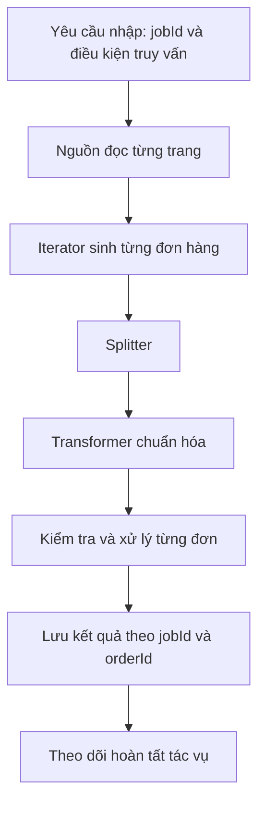

# Tách iterator

Trong module **SPRING_INTEGRATION_CORE**, splitter là endpoint biến một thông điệp đầu vào thành nhiều thông điệp con để các bước sau xử lý từng phần. Bài này thuộc chương **Splitter**, tập trung vào việc trả về `Iterator` để duyệt dữ liệu dần, phối hợp với `MessageChannel`, transformer, xử lý lỗi và aggregator.

Tình huống minh họa là một tác vụ cần xử lý các mã số trong khoảng cho trước. Thay vì tạo sẵn danh sách mọi mã số, ta sinh từng giá trị khi splitter yêu cầu. Cách tổ chức này cũng giúp hình dung nguồn phân trang hoặc cursor, nhưng các nguồn có tài nguyên bên ngoài còn cần thiết kế vòng đời riêng.

Sau bài học, bạn có thể:

- Phân biệt `Iterator`, `Iterable` và collection khi làm đầu ra của splitter.
- Viết luồng Java DSL tách từng phần tử và giữ các header liên quan.
- Giải thích trường hợp `sequenceSize = 0`.
- Chọn cách xác định hoàn tất, kiểm soát lượng dữ liệu chờ và xử lý việc duyệt bị gián đoạn.
- Viết kiểm thử quan sát payload, correlation và sequence.

## 1. Iterator tham gia vào splitter ở đâu?

Có hai cách sử dụng thường gặp:

1. Payload đầu vào đã là một đối tượng có thể duyệt; hàm split trả lại iterator của nó.
2. Payload đầu vào là yêu cầu nghiệp vụ; hàm split mở hoặc tạo nguồn rồi trả về iterator.

Trong cả hai trường hợp, kết quả trả về từ hàm split mới là thứ endpoint dùng để tạo các thông điệp con. Nếu iterator sinh ra đối tượng nghiệp vụ, mỗi đối tượng trở thành payload của một thông điệp. Nếu nó sinh ra `Message<?>`, splitter làm việc với các thông điệp đó và bổ sung thông tin trình tự khi được bật. [Mô hình lập trình Splitter](https://docs.spring.io/spring-integration/reference/6.5/splitter.html).


Một cách hình dung thuật toán là:

```java
// Mã giả giải thích ý tưởng, không phải mã nguồn của framework.
Iterator<?> iterator = createIterator(request);

while (iterator.hasNext()) {
    Object item = iterator.next();
    sendChildMessage(item);
}
```

Splitter tạo và gửi nhiều message; nó không mặc nhiên tạo một thread cho mỗi phần tử. Thời điểm handler xử lý và mức độ song song phụ thuộc cấu trúc channel của luồng.

### 1.1. Iterator khác Iterable như thế nào?

| Kiểu | Vai trò | Điểm cần xét khi đưa vào luồng |
| --- | --- | --- |
| `Collection<T>` | Một tập phần tử với thao tác `size()` | Có thể đã giữ toàn bộ dữ liệu trong bộ nhớ |
| `Iterable<T>` | Cung cấp phương thức `iterator()` | Khả năng duyệt lại tùy cách triển khai |
| `Iterator<T>` | Giữ vị trí của một lượt duyệt | Sau khi đã lấy phần tử, vị trí duyệt đã thay đổi |
| `Stream<T>` | Pipeline thao tác dữ liệu | Cần xét thêm vòng đời stream và nguồn tài nguyên |

Theo hợp đồng Java, `hasNext()` cho biết còn phần tử hay không; `next()` lấy phần tử kế tiếp và phải ném `NoSuchElementException` khi đã hết. `Iterator` không cung cấp `size()` hay thao tác quay về đầu. [Java Iterator API](https://docs.oracle.com/en/java/javase/17/docs/api/java.base/java/util/Iterator.html).

Không dùng chung một iterator đang thay đổi vị trí cho nhiều yêu cầu. Với yêu cầu có thể chạy lại, nên giữ mô tả nguồn, chẳng hạn khoảng mã hoặc token truy vấn, rồi tạo một lượt duyệt mới.

### 1.2. Có iterator chưa chắc đã tiết kiệm bộ nhớ

Hai cách tạo nguồn sau có chi phí khác nhau:

```java
// Dữ liệu đã được tải hết trước khi iterator được tạo.
List<Order> orders = repository.loadAllOrders();
return orders.iterator();

// Ý tưởng về nguồn đọc dần; cần thiết kế việc mở/đóng cursor.
return repository.openOrderCursor(query);
```

Đây là hai phác thảo nghiệp vụ, không phải các API có sẵn trong Spring Integration.

Ở cách đầu, việc gọi `iterator()` không giải phóng bộ nhớ của danh sách. Ở cách sau, lợi ích chỉ xuất hiện nếu cursor thực sự đọc dần và các bước sau không giữ lại toàn bộ kết quả. Hãy xem iterator là cơ chế duyệt; cách nguồn cấp dữ liệu và nơi lưu dữ liệu quyết định chi phí thực tế.

## 2. Ví dụ hoàn chỉnh: nguồn số được sinh dần

Các ví dụ sử dụng Java 17 và Java DSL của Spring Integration 6.5. Chúng cần `spring-integration-core` và các thư viện Spring tương ứng; phần kiểm thử dùng JUnit Jupiter. Phiên bản phụ thuộc nên do cấu hình quản lý dependency của ứng dụng lựa chọn.

Ví dụ gồm hai lớp sản xuất trong cùng package `example.splitter`. Nguồn số không mở file hay kết nối cơ sở dữ liệu, giúp quan sát riêng hành vi của iterator.

### 2.1. Tạo nguồn có trạng thái riêng cho từng lượt duyệt

```java
package example.splitter;

import java.util.Iterator;
import java.util.NoSuchElementException;

public record NumberRange(int startInclusive, int endExclusive)
        implements Iterable<Integer> {

    public NumberRange {
        if (endExclusive < startInclusive) {
            throw new IllegalArgumentException(
                    "endExclusive must be >= startInclusive");
        }
    }

    @Override
    public Iterator<Integer> iterator() {
        return new Iterator<>() {
            private int current = startInclusive;

            @Override
            public boolean hasNext() {
                return current < endExclusive;
            }

            @Override
            public Integer next() {
                if (!hasNext()) {
                    throw new NoSuchElementException();
                }
                return current++;
            }
        };
    }
}
```

`new NumberRange(10, 14)` mô tả bốn giá trị `10, 11, 12, 13`. Đối tượng chỉ lưu hai cận. Mỗi lần gọi `iterator()` tạo một vị trí `current` riêng, nên một lượt duyệt không làm cạn lượt duyệt khác.

Việc tạo `NumberRange` không tạo danh sách các số. Mỗi giá trị chỉ xuất hiện khi có lời gọi `next()`. Đây là nguồn giả lập phù hợp để minh họa tính sinh dần mà không lẫn với hành vi đọc trước của driver hoặc API bên ngoài.

### 2.2. Khai báo channel và IntegrationFlow

```java
package example.splitter;

import org.springframework.context.annotation.Bean;
import org.springframework.context.annotation.Configuration;
import org.springframework.integration.channel.DirectChannel;
import org.springframework.integration.channel.QueueChannel;
import org.springframework.integration.config.EnableIntegration;
import org.springframework.integration.dsl.IntegrationFlow;

@Configuration
@EnableIntegration
public class IteratorSplitterConfiguration {

    @Bean
    public DirectChannel rangeInput() {
        return new DirectChannel();
    }

    @Bean
    public QueueChannel rangeResults() {
        return new QueueChannel(16);
    }

    @Bean
    public IntegrationFlow iteratorRangeFlow() {
        return IntegrationFlow.from(rangeInput())
                .split(NumberRange.class, NumberRange::iterator)
                .transform(Integer.class, value -> "item-" + value)
                .channel(rangeResults())
                .get();
    }
}
```

`split(NumberRange.class, NumberRange::iterator)` khai báo kiểu payload đầu vào và hàm tạo iterator. Transformer tiếp theo nhận từng `Integer`, nên nó được gọi bốn lần cho khoảng `[10, 14)`. Dạng DSL nhận kiểu đầu vào và `Function` được mô tả trong [BaseIntegrationFlowDefinition API](https://docs.spring.io/spring-integration/api/org/springframework/integration/dsl/BaseIntegrationFlowDefinition.html).

Trong ví dụ, `rangeInput` là `DirectChannel`, nên lời gọi gửi thông điệp đi qua splitter và transformer trên thread gọi. `rangeResults` giữ kết quả để mã kiểm thử lấy ra sau. Không cần poller chỉ để gọi trực tiếp `receive()` từ kiểm thử.

**Giới hạn của cấu hình minh họa:** queue chỉ chứa 16 message. Các kiểm thử bên dưới gửi tối đa bốn phần tử trước khi đọc kết quả. Nếu gửi một khoảng lớn trên cùng thread mà chưa có consumer độc lập lấy dữ liệu khỏi queue, lời gọi gửi có thể chờ khi queue đầy. Để xử lý dữ liệu lớn, phải thiết kế consumer, timeout gửi và dung lượng chờ cùng nhau. [Các triển khai MessageChannel](https://docs.spring.io/spring-integration/reference/6.5/channel/implementations.html).

### 2.3. Gửi một yêu cầu

Đoạn sau giả định `context` là application context đã đăng ký cấu hình ở trên:

```java
MessageChannel input =
        context.getBean("rangeInput", MessageChannel.class);

Message<NumberRange> request = MessageBuilder
        .withPayload(new NumberRange(10, 14))
        .setHeader("jobId", "import-42")
        .build();

input.send(request);
```

Các kiểu ở đoạn này nằm trong `org.springframework.messaging`; `MessageBuilder` nằm trong `org.springframework.messaging.support`.

Bốn payload ở channel kết quả là `item-10`, `item-11`, `item-12`, `item-13`. Header nghiệp vụ `jobId` đi cùng các phần tử, giúp nối log của một tác vụ ngay cả khi các bước sau đổi payload.

Nếu muốn giấu chi tiết message khỏi mã nghiệp vụ, ứng dụng có thể đặt messaging gateway trước `rangeInput`. Với luồng phát nhiều phần tử nhưng chưa có bước tổng hợp câu trả lời, cần chọn hợp đồng gửi một chiều hoặc thiết kế rõ cách trả kết quả của cả tác vụ.

## 3. Header trình tự: thứ tự đã biết, tổng số có thể chưa biết

Splitter mặc định bật `applySequence`. Với một lượt tách thông thường, các header quan trọng là:

| Header | Ý nghĩa trong ví dụ |
| --- | --- |
| `correlationId` | Liên kết các message con với message yêu cầu |
| `sequenceNumber` | Vị trí phần tử, bắt đầu từ 1 |
| `sequenceSize` | Tổng số nếu xác định được; bằng 0 khi chưa biết |

Với iterator thông thường trong ví dụ, dữ liệu quan sát được là:

| Payload sau transformer | `sequenceNumber` | `sequenceSize` |
| --- | --- | --- |
| `item-10` | 1 | 0 |
| `item-11` | 2 | 0 |
| `item-12` | 3 | 0 |
| `item-13` | 4 | 0 |

**Giá trị 0 biểu thị chưa xác định tổng số; nó không có nghĩa lượt tách không có phần tử.** Một iterator thông thường không cho splitter biết trước còn bao nhiêu phần tử. Sau khi đã gửi phần tử cuối, cũng không có cơ chế quay lại sửa header của những message đã gửi.

API `AbstractMessageSplitter` có hai phương thức mở rộng `obtainSizeIfPossible(Iterable<?>)` và `obtainSizeIfPossible(Iterator<?>)`. Nhánh `Iterable` có thể lấy kích thước khi nguồn là `Collection`; nhánh `Iterator` mặc định trả về 0. Vì vậy, không nên kết luận mọi `Iterable` đều có kích thước bằng 0. [AbstractMessageSplitter API](https://docs.spring.io/spring-integration/api/org/springframework/integration/splitter/AbstractMessageSplitter.html).

Trong `NumberRange`, con người có thể tính hiệu hai cận. Tuy nhiên, hàm split trả về một iterator ẩn danh và splitter mặc định không đọc các cận để suy ra số lượng.

Nếu viết splitter chuyên biệt, chỉ cung cấp kích thước từ metadata đáng tin cậy và không làm thay đổi lượt duyệt. Duyệt hết iterator để đếm trước vừa tiêu thụ nguồn, vừa làm mất lợi ích phát sớm từng phần tử.

## 4. Ghép lại bằng aggregator cần hợp đồng hoàn tất

Correlation trả lời câu hỏi “các phần tử thuộc tác vụ nào?”. Release strategy trả lời “đã đủ điều kiện trả kết quả chưa?”. Hai câu hỏi cần được giải quyết riêng.

Aggregator mặc định dựa vào kích thước trình tự để xác định nhóm đầy đủ. Khi iterator có `sequenceSize = 0`, việc thêm một `.aggregate()` phía sau không tự tạo được điều kiện hoàn tất. Nhóm có thể tiếp tục chờ dù splitter đã duyệt xong nguồn. [Aggregator: correlation và release](https://docs.spring.io/spring-integration/reference/6.5/aggregator.html).

### 4.1. Ba lựa chọn thiết kế

| Nhu cầu nghiệp vụ | Cách xác định hoàn tất | Điều cần quy định |
| --- | --- | --- |
| Xử lý độc lập từng phần tử | Không cần aggregator | Theo dõi trạng thái tác vụ bằng cơ chế riêng nếu cần |
| Có metadata tổng số chính xác | Release strategy so với số phần tử mong đợi | Cách xử lý trùng, thiếu và phần tử bị filter |
| Không biết trước tổng số | Thông điệp kết thúc và số lượng, hoặc chính sách hết hạn | Ý nghĩa của kết quả đầy đủ và kết quả một phần |

Ví dụ tác vụ nhập liệu có bản kê khai `expectedCount = 4` có thể gắn thông tin này lên mọi message con. Một release strategy minh họa là:

```java
package example.splitter;

import org.springframework.integration.aggregator.ReleaseStrategy;
import org.springframework.integration.store.MessageGroup;

public final class ExpectedCountReleaseStrategy
        implements ReleaseStrategy {

    @Override
    public boolean canRelease(MessageGroup group) {
        if (group.size() == 0) {
            return false;
        }

        Integer expected = group.getOne()
                .getHeaders()
                .get("expectedCount", Integer.class);

        return expected != null
                && expected > 0
                && group.size() == expected;
    }
}
```

Đây là ví dụ độc lập để minh họa hợp đồng đếm, chưa được gắn vào `iteratorRangeFlow`. Nó giả định mọi message trong nhóm có cùng `expectedCount`, mỗi phần tử chỉ tới một lần và mỗi phần tử đều tạo đúng một kết quả.

Hãy thử phá từng giả định:

- Nếu một filter loại bỏ một phần tử mà tổng mong đợi vẫn bằng 4, nhóm chỉ nhận ba message và tiếp tục chờ.
- Nếu retry gửi trùng một kết quả, đếm message có thể đạt 4 dù thiếu một phần tử khác.
- Nếu metadata tổng số được đọc từ một tập dữ liệu đang thay đổi, con số đó có thể lệch so với lượt duyệt thực tế.

Trong luồng có phát lại, nên kiểm soát trùng bằng khóa phần tử trước khi dùng số lượng làm điều kiện hoàn tất. Nếu cần tính cả phần tử không hợp lệ, có thể phát kết quả trạng thái cho từng phần tử thay vì âm thầm bỏ chúng.

### 4.2. Thông điệp kết thúc và timeout

Giả sử nguồn phát thêm `End(jobId, emittedCount)` sau khi hết dữ liệu. Nếu downstream xử lý song song, thông điệp kết thúc có thể tới nơi tổng hợp trước một số kết quả. Do đó, điều kiện hoàn tất nên là “đã nhận tín hiệu kết thúc và đủ các kết quả cần có”, đồng thời xét trùng lặp.

Tín hiệu nguồn đã hết cũng cần phân biệt với tín hiệu mọi tác vụ con đã xử lý xong. Khi nguồn gặp lỗi ở giữa, không phát tín hiệu kết thúc thành công như thể dữ liệu đã đầy đủ.

Một lựa chọn khác là cấu hình `groupTimeout` và quyết định có phát kết quả một phần qua `sendPartialResultOnExpiry` hay không. Hết thời gian chờ là một chính sách vận hành; nó không chứng minh đã nhận hết dữ liệu. Kết quả nên mang trạng thái phù hợp để phía sử dụng biết nhóm đã hoàn tất hay bị thiếu. [Aggregator và group timeout](https://docs.spring.io/spring-integration/reference/6.5/aggregator.html#agg-and-group-timeout).

## 5. Duyệt lười, bộ nhớ và áp lực từ downstream

Iterator giúp tránh tạo một collection trung gian, nhưng cần đánh giá toàn bộ đường đi của dữ liệu.

Với cách ước lượng thực hành:

```text
Bộ nhớ của luồng ≈ bộ đệm nguồn
                + dữ liệu đang xử lý
                + message đang chờ trong channel hoặc executor
                + dữ liệu các nhóm aggregator chưa giải phóng
```

Đây là mô hình để tìm nơi tích tụ, không phải công thức đo heap chính xác.

Ví dụ, mỗi payload trung bình 2 KiB và có một triệu phần tử. Riêng dữ liệu thô đã xấp xỉ 2 GiB, chưa tính object, message và header. Một iterator nhỏ ở đầu luồng không giải quyết được việc queue hoặc aggregator phía sau giữ toàn bộ lượng dữ liệu này.

Các câu hỏi thiết kế hữu ích gồm:

- Nguồn đọc trước bao nhiêu phần tử trong một lần?
- Consumer xử lý trung bình bao lâu cho một phần tử?
- Có bao nhiêu phần tử có thể chờ hoặc đang chạy cùng lúc?
- Khi vùng chờ đầy, producer chờ trong bao lâu và lỗi được xử lý ở đâu?
- Khi tác vụ bị hủy, ai dừng đọc và giải phóng tài nguyên?

`DirectChannel` giữ việc gọi handler trên thread gửi; `ExecutorChannel` chuyển việc xử lý qua executor. Việc thêm executor làm thay đổi điểm chờ và đường truyền lỗi, nhưng cần xét thêm dung lượng hàng đợi và số worker. [Hành vi các loại channel](https://docs.spring.io/spring-integration/reference/6.5/channel/implementations.html).

Trong thiết kế đồng bộ đơn giản, handler chậm sẽ kéo dài thời gian lời gọi gửi. Nếu chuyển sang xử lý song song, hãy giới hạn số phần tử đang xử lý hoặc chờ. Một nguồn duyệt theo yêu cầu cũng không tự biến toàn bộ luồng thành hệ thống reactive có backpressure.

## 6. Vòng đời nguồn: iterator không đại diện đầy đủ cho tài nguyên

Nguồn `NumberRange` không cần đóng. Iterator lấy từ file, cursor cơ sở dữ liệu hoặc phản hồi mạng có thể phụ thuộc tài nguyên còn mở.

Ví dụ sau đóng stream trước khi bên nhận bắt đầu duyệt:

```java
// Ví dụ sai về vòng đời tài nguyên.
public Iterator<String> unsafeLines(Path path) throws IOException {
    try (Stream<String> lines =
            Files.lines(path, StandardCharsets.UTF_8)) {
        return lines.iterator();
    }
}
```

`Files.lines()` đọc dần và stream trả về giữ file đang mở; đóng stream sẽ đóng file. Vì vậy, trả iterator ra ngoài khối trên không chuyển quyền sở hữu file một cách an toàn. [Java Files.lines API](https://docs.oracle.com/en/java/javase/17/docs/api/java.base/java/nio/file/Files.html#lines(java.nio.file.Path,java.nio.charset.Charset)).

Đổi sang mở stream rồi trả iterator mà không giữ đường đóng tài nguyên cũng tạo vấn đề. Giao diện `Iterator` không có phương thức `close()`.

Một hợp đồng quản lý nguồn nên quy định:

1. Thành phần nào mở nguồn.
2. Thành phần nào thực sự duyệt nguồn.
3. Cách đóng khi duyệt hết, khi đọc lỗi, khi gửi message lỗi hoặc khi hủy.
4. Liệu có ranh giới bất đồng bộ trước bước duyệt khiến phạm vi tài nguyên kết thúc sớm hay không.

Nếu bên gọi quản lý tài nguyên bằng `try-with-resources`, phạm vi đó phải bao trọn thao tác duyệt thực tế. Cần kiểm tra cấu trúc luồng để xác nhận splitter đã duyệt xong trước khi rời phạm vi. Các phần tử gửi đi nên là dữ liệu đã tách khỏi cursor nếu còn được xử lý sau khi cursor đóng.

Khi triển khai nguồn ngoài thực tế, có thể dùng adapter hoặc splitter chuyên biệt có hợp đồng vòng đời phù hợp, hoặc tạo lớp quản lý nguồn chịu trách nhiệm đóng trong mọi đường kết thúc. Không suy ra việc đóng tài nguyên chỉ từ việc đối tượng trả về có kiểu `Iterator`.

## 7. Iterator rỗng và lỗi giữa chừng

### 7.1. Iterator rỗng

`new NumberRange(10, 10)` tạo một lượt duyệt không có phần tử. Luồng không tạo message con để biểu diễn số lượng bằng 0.

Điều này ảnh hưởng tới tác vụ cần một kết quả tổng thể: nếu không có message nào đến aggregator thì không có nhóm mới để chờ hoặc hết hạn. Hãy xử lý yêu cầu rỗng ở cấp tác vụ, chẳng hạn trả trạng thái hoàn tất với số phần tử bằng 0.

Splitter còn hỗ trợ `discardChannel` cho yêu cầu có kết quả tách là container rỗng. Kết quả split bằng `null` là trường hợp kết thúc luồng riêng, nên không dùng hai trường hợp này thay thế nhau khi thiết kế ý nghĩa nghiệp vụ. [Cấu hình Splitter](https://docs.spring.io/spring-integration/reference/6.5/splitter.html).

### 7.2. Lỗi sau khi đã gửi một số phần tử

Giả sử nguồn cần sinh `A, B, C, D`, nhưng việc đọc `C` ném ngoại lệ. Tại thời điểm đó, `A` và `B` có thể đã được gửi và thậm chí đã ghi kết quả ra hệ thống khác.

Không nên coi một lần gửi message cha là cam kết mọi tác dụng phụ của message con đều nguyên tử. Tính nguyên tử còn phụ thuộc transaction thực tế và tài nguyên tham gia.

Cần phân biệt hai vị trí lỗi:

| Vị trí lỗi | Ví dụ | Thông tin nên lưu để phục hồi |
| --- | --- | --- |
| Khi đọc nguồn | Cursor mất kết nối trong `hasNext()` hoặc `next()` | Khóa truy vấn, checkpoint, số phần tử đã phát |
| Khi xử lý một phần tử | Ghi dữ liệu của `B` thất bại | Khóa phần tử, trạng thái xử lý, số lần thử |

Ở luồng đồng bộ qua `DirectChannel`, ngoại lệ có thể truyền về bên gọi. Sau ranh giới bất đồng bộ, cần xử lý lỗi qua cơ chế của endpoint, executor hoặc poller, thường với `ErrorMessage` và error channel thích hợp. Chỉ đặt header `errorChannel` không biến mọi ngoại lệ đồng bộ thành message lỗi. [Error Handling](https://docs.spring.io/spring-integration/reference/6.5/error-handling.html).

### 7.3. Retry phải có nguồn phát lại rõ ràng

Iterator là trạng thái của một lượt duyệt. Thử lại trên chính đối tượng đã bị đọc dở không bảo đảm bắt đầu lại từ đầu, cũng không bảo đảm an toàn sau lỗi.

Hãy giữ yêu cầu có thể tạo lại nguồn, rồi chọn chính sách nghiệp vụ:

- Chạy lại toàn bộ từ mô tả nguồn và bỏ qua kết quả đã xử lý theo khóa ổn định.
- Chạy tiếp từ checkpoint đã được xác nhận.
- Chỉ thử lại phần tử lỗi khi phần tử đó đã được vật chất hóa độc lập khỏi nguồn.

Với nhập liệu, một khóa như `(jobId, recordId)` thường hữu ích hơn việc chỉ dùng UUID của message để nhận diện kết quả trùng. Tác vụ mới gửi lại có thể tạo message ID mới dù đang xử lý cùng bản ghi.

## 8. Kiểm thử hành vi của luồng minh họa

Lớp kiểm thử sau dùng hai lớp sản xuất ở mục 2. Nó tạo application context thật, gửi một message, rồi kiểm tra các message con. Mỗi test có context riêng để queue và trạng thái không ảnh hưởng lẫn nhau.

```java
package example.splitter;

import org.junit.jupiter.api.Test;
import org.springframework.context.annotation.AnnotationConfigApplicationContext;
import org.springframework.integration.IntegrationMessageHeaderAccessor;
import org.springframework.integration.channel.QueueChannel;
import org.springframework.messaging.Message;
import org.springframework.messaging.MessageChannel;
import org.springframework.messaging.support.MessageBuilder;

import static org.junit.jupiter.api.Assertions.*;

class IteratorSplitterTest {

    @Test
    void splitsIteratorAndPreservesCorrelationHeaders() {
        try (var context = new AnnotationConfigApplicationContext(
                IteratorSplitterConfiguration.class)) {

            MessageChannel input =
                    context.getBean("rangeInput", MessageChannel.class);
            QueueChannel output =
                    context.getBean("rangeResults", QueueChannel.class);

            Message<NumberRange> request = MessageBuilder
                    .withPayload(new NumberRange(10, 14))
                    .setHeader("jobId", "import-42")
                    .build();

            assertTrue(input.send(request));

            for (int index = 0; index < 4; index++) {
                Message<?> child = output.receive(1000);

                assertNotNull(child);
                assertEquals("item-" + (10 + index), child.getPayload());
                assertEquals("import-42",
                        child.getHeaders().get("jobId"));
                assertEquals(request.getHeaders().getId(),
                        child.getHeaders().get(
                                IntegrationMessageHeaderAccessor.CORRELATION_ID));
                assertEquals(Integer.valueOf(index + 1),
                        child.getHeaders().get(
                                IntegrationMessageHeaderAccessor.SEQUENCE_NUMBER,
                                Integer.class));
                assertEquals(Integer.valueOf(0),
                        child.getHeaders().get(
                                IntegrationMessageHeaderAccessor.SEQUENCE_SIZE,
                                Integer.class));
            }

            assertNull(output.receive(0));
        }
    }

    @Test
    void emptyIteratorProducesNoChildMessages() {
        try (var context = new AnnotationConfigApplicationContext(
                IteratorSplitterConfiguration.class)) {

            MessageChannel input =
                    context.getBean("rangeInput", MessageChannel.class);
            QueueChannel output =
                    context.getBean("rangeResults", QueueChannel.class);

            assertTrue(input.send(MessageBuilder
                    .withPayload(new NumberRange(10, 10))
                    .build()));

            assertNull(output.receive(0));
        }
    }
}
```

Test đầu xác nhận đồng thời kết quả chuyển đổi, số lượng message, thứ tự quan sát trong cấu hình hiện tại và các header cần cho việc theo dõi hoặc ghép nhóm. Test thứ hai xác nhận gửi yêu cầu thành công không đồng nghĩa luôn tạo ra ít nhất một message con.

Các đoạn kiểm thử là mã minh họa để người học chạy trong môi trường đã cấu hình dependency. Với nguồn thật, cần bổ sung kiểm thử theo hợp đồng nguồn thay vì suy ra hành vi I/O từ ví dụ số học này.

Các tình huống mở rộng có giá trị gồm:

| Tình huống | Điều cần xác nhận |
| --- | --- |
| Hai yêu cầu riêng biệt | Không trộn nhóm correlation |
| Nguồn ném lỗi sau hai phần tử | Có thể nhận diện dữ liệu đã phát và nguồn được đóng |
| Queue đầy | Hành vi chờ hoặc timeout đúng cấu hình |
| Executor xử lý đảo thứ tự | Không đánh đồng thứ tự phát với thứ tự hoàn thành |
| Nhận trùng một kết quả | Nhóm chưa được coi là đủ chỉ nhờ số message tăng |
| Không có phần tử | Tác vụ tổng thể vẫn có trạng thái kết thúc rõ ràng |

## 9. Áp dụng vào tác vụ nhập đơn hàng

Giả sử ứng dụng cần nhập đơn hàng theo nhiều trang từ một hệ thống ngoài. Có thể tổ chức luồng như sau:



Trong thiết kế này, iterator chỉ nên giữ trang hiện tại và thông tin để đọc trang tiếp theo. Mỗi đơn hàng sinh ra cần là một đối tượng độc lập, không bị sửa thành nội dung của bản ghi kế tiếp sau khi đã gửi.

Trước khi triển khai, cần xác định tính ổn định của việc phân trang. Nếu các đơn hàng có thể được chèn hoặc đổi trạng thái trong lúc đọc, phân trang theo offset có thể tạo trùng hoặc bỏ sót tùy API. Có thể cần token, snapshot hoặc mốc truy vấn ổn định theo hợp đồng của nguồn.

Một phương án vận hành cụ thể là lưu tiến độ theo tác vụ, ghi kết quả từng `orderId` với khả năng nhận diện trùng, và chỉ đánh dấu hoàn tất khi nguồn đã kết thúc cùng với mọi kết quả cần có. Nếu nghiệp vụ chỉ cần lưu từng đơn độc lập, không cần gom mọi đơn vào một payload lớn chỉ để xác nhận thành công.

Nếu dùng router để chia đơn hợp lệ và không hợp lệ, cả hai nhánh phải tham gia cách tính trạng thái tác vụ. Nếu dùng filter để bỏ phần tử, cần quyết định “bị bỏ” có được tính là đã xử lý hay là lỗi cần báo. Quyết định này phải nhất quán với điều kiện hoàn tất đã chọn.

## 10. Những điểm cần ghi nhớ

- Iterator cho phép splitter lấy từng phần tử mà không cần tạo một collection trung gian.
- Hiệu quả bộ nhớ phụ thuộc cả nguồn, queue, executor và nơi giữ kết quả.
- `sequenceNumber` cho biết vị trí phát; `sequenceSize = 0` cho biết chưa xác định tổng số.
- Aggregator cần điều kiện hoàn tất phù hợp khi không có tổng số trình tự.
- Hết lượt duyệt, xử lý xong mọi phần tử và tác vụ thành công là các mốc khác nhau.
- Nguồn có tài nguyên cần quy định rõ ai đóng và đóng khi nào.
- Iterator đã tiêu thụ không phải một cơ chế tự phát lại; retry cần mô tả nguồn hoặc checkpoint.
